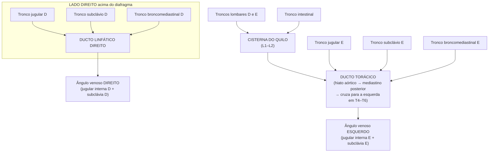

> **Roteiro do laboratório:** Problema 1, questões 17 a 22 (linfonodos da cabeça, do pescoço, do tronco, dos membros e da mama; troncos linfáticos; cisterna do quilo; formação e fluxo da linfa e os dois ductos) e Problema 2, questões 2 e 3 (composição bioquímica da linfa; distribuição anatômica da circulação linfática, ducto linfático direito e ducto torácico). As tabelas abaixo seguem o formato do roteiro (**localização × drenagem**).

## Objetivos do tópico {#objetivos}

Ao final, você deve ser capaz de:

1. Explicar como a **linfa** se forma a partir do líquido intersticial, sua **composição bioquímica** e as forças que a fazem circular.
2. Descrever o caminho **capilares linfáticos → vasos linfáticos → linfonodos → troncos → ductos → veias**.
3. Localizar os principais **grupos de linfonodos regionais** (cabeça, pescoço, tórax, membro superior, mama, abdome, pelve e membro inferior) e dizer **o que cada um drena**.
4. Descrever os **troncos linfáticos** (lombares, intestinal, broncomediastinais, subclávios e jugulares) e a **cisterna do quilo**.
5. Descrever o trajeto do **ducto torácico** e do **ducto linfático direito** e os territórios que cada um drena.
6. Aplicar esse conhecimento a situações clínicas: linfonodo de Virchow, metástases, linfedema, filariose e quilotórax.

::: referencias
Moore – Anatomia Orientada para a Clínica, 8ª ed., caps. "Introdução", "Tórax", "Abdome", "Membro superior", "Membro inferior" e "Pescoço" · Netter – Atlas de Anatomia Humana, 7ª ed. · Guyton & Hall – Tratado de Fisiologia Médica, 14ª ed., cap. "A microcirculação e o sistema linfático".
:::

## Conceitos-base {#conceitos-base}

### Por que existe o sistema linfático {#por-que-linfatico}

Nos capilares sanguíneos, as forças de Starling empurram líquido para fora do vaso na extremidade arterial e o puxam de volta na extremidade venosa (o mesmo princípio da [filtração glomerular](#/fisiologia/filtracao-glomerular#starling)). Mas a conta não fecha: por dia, filtra-se mais líquido do que se reabsorve — sobram cerca de **2 a 4 litros** no interstício, junto com **proteínas** que escaparam dos capilares e não conseguem voltar por eles. O sistema linfático existe para **devolver esse excesso ao sangue**. Sem ele, o líquido se acumularia nos tecidos (**edema**) e as proteínas plasmáticas se esgotariam.

Ele tem ainda duas outras funções:

- **Absorver gorduras** no intestino: os lipídios da dieta, empacotados em quilomícrons, entram nos **vasos quilíferos** das vilosidades e seguem pela linfa (por isso a linfa intestinal é leitosa, o **quilo**).
- **Transporte imunológico**: levar antígenos e células dendríticas dos tecidos até os linfonodos, onde a resposta imune começa.

### Formação da linfa: os capilares linfáticos {#formacao-linfa}

Os **capilares linfáticos** começam em **fundo cego** no interstício de quase todos os tecidos (exceto, por exemplo, SNC, medula óssea e cartilagem). São muito permeáveis porque:

- Suas células endoteliais se **sobrepõem como telhas** nas bordas, formando "**válvulas**" que abrem para dentro: o líquido entra, mas não sai.
- Não têm lâmina basal contínua.
- **Filamentos de ancoragem** prendem as células endoteliais ao tecido ao redor: quando o interstício incha, esses filamentos puxam as células e as aberturas se alargam.

O líquido que entra nesses capilares passa a se chamar **linfa**.

### Composição bioquímica da linfa {#composicao-linfa}

A linfa é, basicamente, **líquido intersticial que entrou nos linfáticos**, por isso se parece com o plasma, com algumas diferenças:

| Componente | Na linfa |
|---|---|
| Água e eletrólitos (Na⁺, K⁺, Cl⁻, HCO₃⁻) | Concentrações semelhantes às do plasma |
| Glicose, ureia, aminoácidos | Semelhantes às do plasma |
| **Proteínas** | **Menos** que no plasma, em média (cerca de 2 g/dL, variando conforme o tecido); a linfa do **fígado** é muito rica em proteínas (até ~6 g/dL), porque os sinusoides hepáticos são muito permeáveis |
| **Lipídios** | Linfa **intestinal** rica em **quilomícrons** após as refeições → aspecto **leitoso** (quilo) |
| Fatores de coagulação (fibrinogênio etc.) | Presentes → a linfa **coagula**, mais lentamente que o sangue |
| **Células** | Sobretudo **linfócitos** (muito mais na linfa que sai dos linfonodos e no ducto torácico); quase não há hemácias |
| Anticorpos, citocinas, antígenos e células dendríticas | Presentes, em trânsito |

### Do capilar ao sangue: o caminho e a propulsão {#fluxo-linfa}

A linfa não tem uma bomba central. Ela é empurrada por:

- **Válvulas** em todo o trajeto dos vasos coletores, que impedem o refluxo;
- **Contração intrínseca** do músculo liso da parede dos linfáticos (cada segmento entre duas válvulas, o linfângio, funciona como uma pequena bomba);
- **Compressão externa**: contração dos músculos esqueléticos, pulsação das artérias vizinhas, movimentos do corpo;
- **Respiração**: a pressão negativa no tórax durante a inspiração "aspira" a linfa para o ducto torácico.

Por isso a imobilidade (pacientes acamados, voos longos) favorece edema.

::: figura img/morfo/drenagem/sistema-linfatico-openstax.jpg
**Anatomia do sistema linfático.** Vasos linfáticos (*lymph vessel*) e linfonodos (*lymph nodes*) espalhados pelo corpo, timo, baço, tonsila e adenoide, e o **ducto linfático direito entrando na veia** (*right lymphatic duct, entering vein*). No detalhe à direita, os **capilares linfáticos** (*lymphatic capillary*) em fundo cego entre as células do tecido (*tissue cell*) e os capilares sanguíneos (*blood capillary*), recolhendo o líquido intersticial (*interstitial fluid*). Embaixo, um linfonodo com massas de linfócitos e macrófagos.
:::

::: referencias
Guyton & Hall, 14ª ed., cap. "A microcirculação e o sistema linfático" · Moore, 8ª ed., cap. "Introdução" · Ross & Pawlina, 8ª ed., cap. "Sistema linfático".
:::

## Explicação detalhada {#explicacao}

### Linfonodos regionais: visão geral {#linfonodos-regionais}

Os linfonodos se organizam em **grupos regionais**, cada um recebendo a linfa de um território definido. Duas regras gerais ajudam a memorizar:

1. **Os linfonodos superficiais acompanham as veias superficiais; os profundos acompanham as artérias e veias profundas.** Por exemplo: os inguinais superficiais ficam junto à veia safena magna; os cervicais profundos, junto à veia jugular interna.
2. **A linfa passa por vários linfonodos em série** antes de chegar aos troncos: primeiro um grupo "regional" (que recebe a drenagem direta do órgão), depois grupos intermediários e, por fim, grupos terminais (como os cervicais profundos inferiores, os axilares apicais e os lombares).

::: figura img/morfo/drenagem/regioes-linfonodais.png
**Regiões linfonodais do corpo** (rótulos em inglês). De cima para baixo: **pré-auriculares** (*pre-auricular*), **anel de Waldeyer** (*Waldeyer ring*), **cervicais e occipitais** (*cervical and occipital*), **supraclaviculares** (*supraclavicular*), **infraclaviculares**, **peitorais**, **axilares**, **mediastinais**, **hilares**, **epitrocleares e braquiais** (*epitrochlear and brachial*), **baço**, **para-aórticos**, **mesentéricos**, **ilíacos**, **inguinais e femorais** e **poplíteos** (*popliteal*).
:::

### Linfonodos da cabeça {#linfonodos-cabeca}

Os linfonodos da cabeça formam um "colar" na transição entre a cabeça e o pescoço (o **colar pericervical**) e drenam, por fim, para os **cervicais profundos**.

| Linfonodos | Localização | Drenagem |
|---|---|---|
| **Occipitais** | Região occipital, perto da inserção do músculo trapézio no crânio | Couro cabeludo da região occipital e pele da parte superior da nuca |
| **Mastoideos** (retroauriculares) | Sobre o processo mastoide, atrás da orelha | Couro cabeludo da região parietal posterior, face posterior da orelha e parte posterior do meato acústico externo |
| **Pré-auriculares** | Diante do trago da orelha | Couro cabeludo da região temporal, parte lateral das pálpebras e da conjuntiva, face anterior da orelha |
| **Parotídeos** (superficiais e profundos) | Sobre e dentro da glândula parótida | Fronte e região temporal, parte lateral das pálpebras, raiz do nariz, glândula parótida, orelha externa, meato acústico externo e orelha média |
| **Infraorbitais** (faciais) | Abaixo da órbita, ao longo da veia facial | Parte medial das pálpebras e conjuntiva, nariz e bochecha |
| **Bucinatórios** | Sobre o músculo bucinador, ao longo da veia facial | Pele e mucosa da bochecha |
| **Mandibulares** | Sobre a face externa da mandíbula, junto aos vasos faciais na margem anterior do masseter | Bochecha e lábios (vão para os submandibulares) |

### Linfonodos do pescoço {#linfonodos-pescoco}

| Linfonodos | Localização | Drenagem |
|---|---|---|
| **Submandibulares** | No trígono submandibular, ao redor da glândula submandibular, abaixo do corpo da mandíbula | Lábio superior e parte lateral do lábio inferior, bochechas, nariz, gengivas e dentes (exceto incisivos inferiores), partes laterais da língua anterior, assoalho da boca, glândulas submandibular e sublingual; recebem os submentuais e faciais |
| **Submentuais** | No trígono submentual, abaixo do queixo, entre os ventres anteriores dos músculos digástricos | Parte central do lábio inferior, queixo, assoalho anterior da boca, **ápice da língua** e incisivos inferiores |
| **Cervicais superficiais** | Ao longo da **veia jugular externa**, superficiais ao esternocleidomastóideo | Pele das partes anterior e lateral do pescoço, parte inferior da orelha e região parotídea; drenam para os profundos |
| **Cervicais profundos** | Cadeia ao longo da **veia jugular interna**, sob o esternocleidomastóideo | **Toda a linfa da cabeça e do pescoço** chega a eles, diretamente ou passando pelos grupos anteriores; seus eferentes formam o **tronco jugular** |
| **Cervicais profundos superiores** | Acima do ponto em que o músculo omo-hióideo cruza a veia jugular interna; inclui o **jugulodigástrico** (abaixo do ventre posterior do digástrico, junto ao ângulo da mandíbula) | Recebem os grupos da cabeça; o **jugulodigástrico (linfonodo tonsilar)** drena a **tonsila palatina** e a parte posterior da língua — aumenta nas amigdalites |
| **Cervicais profundos inferiores** | Abaixo do cruzamento do omo-hióideo; inclui o **júgulo-omo-hióideo** e os **supraclaviculares** | O júgulo-omo-hióideo drena a **língua**; o grupo inferior recebe a linfa dos superiores e forma o tronco jugular. O **supraclavicular esquerdo** (de **Virchow**) fica perto da desembocadura do ducto torácico |

### Linfonodos do tórax {#linfonodos-torax}

**Linfonodos parietais (drenam a parede do tórax):**

| Linfonodos | Localização | Drenagem |
|---|---|---|
| **Paraesternais** | Ao longo dos **vasos torácicos internos**, nas extremidades anteriores dos espaços intercostais | **Parte medial da mama**, parede torácica anterior, parte superior da parede abdominal anterior (acima do umbigo) e face superior do fígado; vão para o tronco broncomediastinal |
| **Intercostais** | Nas partes posteriores dos espaços intercostais, perto das cabeças das costelas | Parede posterolateral do tórax e pleura parietal; os inferiores drenam para o ducto torácico |
| **Frênicos anteriores** | Atrás do processo xifoide, na face superior do diafragma | Diafragma anterior e face convexa (superior) do fígado; vão aos paraesternais |
| **Frênicos médios** (laterais) | Na face superior do diafragma, perto de onde os nervos frênicos entram no músculo | Parte média do diafragma; à direita, também a face convexa do fígado |
| **Frênicos posteriores** | Junto aos pilares do diafragma, perto da aorta | Parte posterior do diafragma; vão aos mediastinais posteriores e lombares |

**Linfonodos viscerais (drenam as vísceras do tórax):**

| Linfonodos | Localização | Drenagem |
|---|---|---|
| **Mediastinais anteriores** (braquiocefálicos) | Mediastino superior/anterior, à frente dos grandes vasos e do arco da aorta | **Timo**, pericárdio, parte do coração, pleura mediastinal e parte da tireoide; vão ao tronco broncomediastinal |
| **Mediastinais posteriores** | Atrás do pericárdio, ao longo do **esôfago** e da aorta torácica | **Esôfago**, face posterior do pericárdio e do diafragma; drenam principalmente para o **ducto torácico** |
| **Traqueobronquiais superiores** | No ângulo entre a traqueia e cada brônquio principal | Pulmões (via broncopulmonares), brônquios, parte do coração; vão aos paratraqueais |
| **Traqueobronquiais inferiores** (carinais) | Abaixo da **carina** (bifurcação da traqueia) | Lobos inferiores dos pulmões e parte do coração |
| **Paratraqueais** | Ao longo da traqueia | Traqueia e esôfago superior; recebem os traqueobronquiais e formam, com outros grupos, o **tronco broncomediastinal** |
| **Broncopulmonares** (hilares) | No **hilo pulmonar** | O pulmão (recebem dos intrapulmonares); vão aos traqueobronquiais |
| **Intrapulmonares** | Dentro do pulmão, ao longo dos brônquios lobares e segmentares | O parênquima pulmonar e a pleura visceral (via plexos subpleural e profundo) |

O caminho da linfa do pulmão, portanto, é: **intrapulmonares → broncopulmonares (hilares) → traqueobronquiais → paratraqueais → troncos broncomediastinais**. É esse trajeto que o câncer de pulmão percorre ao se disseminar, e é por isso que o estadiamento examina os linfonodos hilares e mediastinais.

### Linfonodos do membro superior e da mama {#linfonodos-membro-superior}

| Linfonodos | Localização | Drenagem |
|---|---|---|
| **Supratrocleares** (cubitais, epitrocleares) | Acima do epicôndilo medial do úmero, junto à **veia basílica** | Parte **medial** do antebraço e da mão (dedos mediais); vão aos axilares umerais |
| **Deltopeitorais** (infraclaviculares) | No **sulco deltopeitoral**, junto à **veia cefálica** | Vasos que acompanham a veia cefálica (parte **lateral** do membro); vão aos axilares apicais |
| **Axilares** (20 a 30 linfonodos, em 5 grupos) | Na gordura da **axila**, ao redor dos vasos axilares | Todo o membro superior, a maior parte da mama, a parede torácica e a parte da parede abdominal acima do umbigo |
| **Umerais** (laterais) | Parede **lateral** da axila, junto à parte distal da veia axilar | **Quase todo o membro superior** |
| **Peitorais** (anteriores) | Parede **medial**, ao longo dos vasos torácicos laterais, na borda inferior do músculo peitoral menor | **A maior parte da mama** (cerca de 75% da linfa mamária), parede torácica anterior e parede abdominal acima do umbigo |
| **Subescapulares** (posteriores) | Parede **posterior**, ao longo dos vasos subescapulares | Parede posterior do tórax e região escapular, parte inferior da nuca |
| **Centrais** | Na **base** da axila, profundamente na gordura | Recebem os três grupos anteriores (umerais, peitorais e subescapulares) |
| **Apicais** | No **ápice** da axila, ao longo da parte proximal da veia axilar, medial ao peitoral menor | Recebem os centrais, os deltopeitorais e a parte superior da mama; seus eferentes formam o **tronco subclávio** |

**Drenagem da mama:** cerca de **75%** da linfa vai para os **linfonodos axilares** (sobretudo os peitorais); a maior parte da linfa dos **quadrantes mediais** vai para os **paraesternais**; uma parte pode ir para a mama do outro lado ou para linfonodos do abdome (pela parede abdominal). Por isso o câncer de mama costuma se espalhar primeiro para a **axila**, e é ali que se procura o **linfonodo sentinela**.

### Linfonodos do abdome e da pelve {#linfonodos-abdome}

**Linfonodos parietais (retroperitoneais):**

| Linfonodos | Localização | Drenagem |
|---|---|---|
| **Ilíacos externos** | Ao longo dos vasos ilíacos externos | Recebem os **inguinais** (membro inferior), parte inferior da parede abdominal anterior e parte das vísceras pélvicas (bexiga, próstata, colo do útero, parte superior da vagina) |
| **Ilíacos internos** | Ao longo dos vasos ilíacos internos | **Vísceras pélvicas** (reto, bexiga, próstata, colo uterino, vagina), períneo profundo e região glútea |
| **Sacrais** | Na face anterior do sacro, ao longo dos vasos sacrais medianos | Reto e parede posterior da pelve; vão aos ilíacos internos e comuns |
| **Ilíacos comuns** | Ao longo dos vasos ilíacos comuns | Recebem os ilíacos externos, internos e sacrais; vão aos lombares |
| **Lombares** (aórticos e cavais) | Ao redor da **aorta abdominal** e da **veia cava inferior** | Recebem os ilíacos comuns e drenam diretamente **rins, glândulas suprarrenais, gônadas (testículos e ovários)**, parede abdominal posterior e parte do útero e das tubas; seus eferentes formam os **troncos lombares** |

**Linfonodos viscerais (pré-aórticos — acompanham as artérias que irrigam o tubo digestivo):**

| Linfonodos | Localização | Drenagem |
|---|---|---|
| **Celíacos** | Ao redor do tronco celíaco | Recebem os gástricos, hepáticos e pancreaticoesplênicos (estômago, duodeno superior, fígado, vias biliares, pâncreas, baço) |
| **Gástricos** | Ao longo das curvaturas menor e maior do estômago (gástricos esquerdos e direitos, gastromentais, pilóricos) | **Estômago**; vão aos celíacos |
| **Hepáticos** | Ao longo da artéria hepática, no omento menor e na porta do fígado | **Fígado**, vesícula biliar e vias biliares; vão aos celíacos |
| **Pancreaticoesplênicos** | Ao longo da artéria esplênica, atrás do pâncreas | **Baço**, corpo e cauda do pâncreas e parte do estômago; vão aos celíacos |
| **Mesentéricos superiores** | Na raiz do mesentério, ao redor da artéria mesentérica superior | Recebem os mesentéricos, ileocólicos e mesocólicos (intestino delgado e metade direita do cólon) |
| **Mesentéricos** (justaintestinais) | No mesentério, ao longo das artérias jejunais e ileais | **Jejuno e íleo** (com os vasos quilíferos); vão aos mesentéricos superiores |
| **Ileocólicos** | Ao longo da artéria ileocólica | Íleo terminal, **ceco, apêndice** e início do cólon ascendente |
| **Mesocólicos transversos** (cólicos médios) | No mesocolo transverso, ao longo da artéria cólica média | **Cólon transverso** |
| **Mesentéricos inferiores** | Ao redor da artéria mesentérica inferior | **Cólon descendente, sigmoide** e parte superior do reto; drenam para os pré-aórticos e para o tronco intestinal (parte para os lombares) |

Os eferentes dos linfonodos celíacos e mesentéricos formam o **tronco intestinal**.

### Linfonodos do membro inferior {#linfonodos-membro-inferior}

| Linfonodos | Localização | Drenagem |
|---|---|---|
| **Poplíteos** | Na **fossa poplítea** (atrás do joelho), junto à terminação da **veia safena parva** e aos vasos poplíteos | Pele da face **posterolateral** da perna e do pé (território da safena parva) e estruturas profundas da perna; vão aos inguinais profundos |
| **Inguinais superficiais** | Na tela subcutânea do trígono femoral, abaixo do ligamento inguinal: um grupo **horizontal** (paralelo ao ligamento) e um **vertical** (ao longo do final da **veia safena magna**) | **Todo o membro inferior superficial** (exceto o território da safena parva), parede abdominal **abaixo do umbigo**, região glútea, **períneo, genitais externos** (exceto testículos e glande), região perianal e canal anal abaixo da linha pectinada, parte inferior da vagina |
| **Inguinais profundos** | Sob a fáscia lata, **medial à veia femoral** (1 a 3 linfonodos; o mais alto, no canal femoral) | Recebem os superficiais, os poplíteos e a **glande** do pênis ou do clitóris; vão aos **ilíacos externos** |

### Troncos linfáticos {#troncos-linfaticos}

Quando os vasos eferentes dos últimos grupos de linfonodos de cada região se unem, formam os **troncos linfáticos**:

| Tronco | Formado pelos eferentes de | Drenagem | Desemboca em |
|---|---|---|---|
| **Lombares** (direito e esquerdo) | Linfonodos **lombares** | Membros inferiores, pelve, parede abdominal abaixo do umbigo, rins, suprarrenais e gônadas | **Cisterna do quilo** |
| **Intestinal** (geralmente único) | Linfonodos **celíacos e mesentéricos** | Tubo digestivo abdominal, fígado, baço e pâncreas (leva o **quilo**, rico em gordura) | **Cisterna do quilo** (ou um tronco lombar) |
| **Broncomediastinais** (direito e esquerdo) | Linfonodos **paraesternais, mediastinais anteriores e traqueobronquiais** | Vísceras torácicas (pulmões, coração), parede torácica anterior | Direito → **ducto linfático direito**; esquerdo → **ducto torácico** (ou diretamente no ângulo venoso) |
| **Subclávios** (direito e esquerdo) | Linfonodos **axilares apicais** | Membro superior, mama e parede torácica superficial | Direito → ducto linfático direito; esquerdo → ducto torácico (ou ângulo venoso) |
| **Jugulares** (direito e esquerdo) | Linfonodos **cervicais profundos inferiores** | Cabeça e pescoço | Direito → ducto linfático direito; esquerdo → ducto torácico (ou ângulo venoso) |

### Cisterna do quilo {#cisterna-quilo}

A **cisterna do quilo** é uma dilatação em forma de saco na **origem do ducto torácico**:

- Fica no abdome, **anterior aos corpos das vértebras L1–L2**, à **direita da aorta** e atrás do **pilar direito do diafragma**.
- Recebe os **troncos lombares direito e esquerdo** e o **tronco intestinal** (e, às vezes, os vasos intercostais inferiores).
- O nome vem do **quilo**, a linfa leitosa e rica em gordura que chega do intestino pelo tronco intestinal.
- Nem todas as pessoas têm uma cisterna bem formada; em algumas, há apenas uma confluência dos troncos.

### Ducto torácico {#ducto-toracico}

É o **maior vaso linfático** do corpo (cerca de 40 cm). Seu trajeto, de baixo para cima:

1. **Começa** na cisterna do quilo, na altura de **L1–L2**.
2. **Atravessa o diafragma** pelo **hiato aórtico** (altura de T12), junto com a aorta.
3. **Sobe no mediastino posterior**, à frente da coluna vertebral, entre a **aorta torácica** (à sua esquerda) e a **veia ázigo** (à sua direita), atrás do esôfago.
4. Na altura de **T4–T6**, **cruza para a esquerda**, passando por trás do esôfago.
5. Sobe pelo **mediastino superior** à esquerda do esôfago e chega à base do **pescoço**.
6. Faz um **arco** para a esquerda (por volta de C7), por trás da bainha carótica, e **desemboca no ângulo venoso esquerdo** — a **junção da veia jugular interna esquerda com a veia subclávia esquerda**.

No trajeto, recebe vasos dos espaços intercostais e, perto do fim, geralmente os **troncos jugular, subclávio e broncomediastinal esquerdos**.

**Território drenado pelo ducto torácico: cerca de três quartos do corpo** — **tudo abaixo do diafragma** (os dois membros inferiores, a pelve e o abdome) **e a metade esquerda acima do diafragma** (lado esquerdo da cabeça, do pescoço e do tórax e o membro superior esquerdo).

### Ducto linfático direito {#ducto-linfatico-direito}

- É **curto** (cerca de 1 a 2 cm), na base do pescoço, à direita.
- É formado pela união dos **troncos jugular, subclávio e broncomediastinal direitos** (quando eles não desembocam separadamente na veia).
- **Desemboca no ângulo venoso direito** — a **junção da veia jugular interna direita com a veia subclávia direita**.
- **Território**: o **quadrante superior direito** do corpo — **lado direito da cabeça e do pescoço**, **membro superior direito** e **lado direito do tórax** (incluindo o pulmão direito e parte do coração).

::: figura img/morfo/drenagem/troncos-ductos-openstax.jpg
**Territórios dos ductos.** Em lilás, a região drenada pelo **ducto linfático direito** (*drained by right lymphatic duct*): lado direito da cabeça, do pescoço, do tórax e o membro superior direito. Em amarelo, a região drenada pelo **ducto torácico** (*drained by thoracic duct*): todo o resto. Nos detalhes, as desembocaduras: o ducto linfático direito no encontro da **veia jugular interna direita** com a **subclávia direita**; o ducto torácico no encontro da **jugular interna esquerda** com a **subclávia esquerda**. No centro, a **cisterna do quilo** (*cisterna chyli*) na origem do ducto torácico.
:::

::: referencias
Moore – Anatomia Orientada para a Clínica, 8ª ed., caps. "Tórax", "Abdome", "Pescoço", "Membro superior" e "Membro inferior" · Netter – Atlas de Anatomia Humana, 7ª ed.
:::

## Correlação clínica {#correlacao-clinica}

### Linfonodo de Virchow (sinal de Troisier) {#virchow}

O **linfonodo supraclavicular esquerdo** fica perto do ponto em que o **ducto torácico** desemboca. Como o ducto torácico traz a linfa do **abdome**, um câncer abdominal (principalmente **gástrico**, mas também de pâncreas, cólon, ovário ou testículo) pode enviar células por esse caminho e aumentar esse linfonodo, que fica **endurecido e palpável** acima da clavícula esquerda. Esse achado é chamado de **sinal de Troisier**, e o linfonodo, de **Virchow**.

### Metástases seguem a drenagem {#metastases-drenagem}

Saber para onde cada órgão drena permite prever onde procurar metástases:

- **Mama** → **axilares** (e paraesternais nos quadrantes mediais).
- **Testículo** → **lombares (para-aórticos)**, junto à aorta — porque o testículo se desenvolve no abdome e "desce" levando seus vasos. Já a **pele do escroto** drena para os **inguinais superficiais**. Por isso um tumor de testículo não aumenta os linfonodos da virilha.
- **Língua**: o **ápice** drena para os **submentuais**; as partes laterais, para os **submandibulares**; a parte posterior, para os **cervicais profundos superiores** (jugulodigástrico).
- **Canal anal**: abaixo da linha pectinada → **inguinais superficiais**; acima → **ilíacos internos**.

### Linfedema e filariose {#linfedema}

O **linfedema** é o inchaço causado pela **falha da drenagem linfática**. Causas: retirada de linfonodos (por exemplo, o **esvaziamento axilar** no tratamento do câncer de mama, com inchaço do braço), radioterapia, infecções repetidas, malformações congênitas e a **filariose linfática** (*Wuchereria bancrofti*), em que os vermes adultos vivem nos vasos linfáticos e os obstruem, podendo causar **elefantíase** de membros inferiores e escroto. Belém já foi uma área endêmica importante dessa doença; graças ao programa de eliminação do Ministério da Saúde, o Brasil teve reconhecida pela OMS, em 2024, a eliminação da filariose linfática como problema de saúde pública — mas os casos antigos com linfedema crônico ainda precisam de cuidado.

### Quilotórax {#quilotorax}

A lesão do **ducto torácico** (em cirurgias do esôfago, do coração ou do pescoço, ou por tumores) faz o quilo vazar para a cavidade pleural — o **quilotórax**, um derrame de aspecto **leitoso**, rico em triglicerídeos e linfócitos. Como o ducto cruza da direita para a esquerda em T4–T6, lesões abaixo desse nível tendem a causar quilotórax à **direita**, e acima, à **esquerda**.

::: referencias
Moore, 8ª ed., boxes clínicos dos caps. "Tórax", "Abdome" e "Pescoço" · Ministério da Saúde – Guia de Vigilância em Saúde (filariose linfática).
:::

## Pontos de alta cobrança em prova {#alta-cobranca}

::: prova
- **Linfa** = líquido intersticial excedente (2–4 L/dia) + proteínas que escaparam; **capilares linfáticos** em fundo cego, células sobrepostas ("válvulas") e filamentos de ancoragem.
- **Composição**: eletrólitos e glicose semelhantes ao plasma; **menos proteínas** (exceto linfa hepática); **quilo** intestinal com quilomícrons; coagula; rica em **linfócitos**.
- **Propulsão**: válvulas + contração do músculo liso dos linfáticos + músculos esqueléticos + pulsação arterial + respiração.
- **Caminho**: capilares → vasos coletores → linfonodos → **troncos** → **ductos** → **ângulos venosos** (jugular interna + subclávia).
- **Cabeça/pescoço**: tudo chega aos **cervicais profundos** (ao longo da **jugular interna**) → tronco jugular. **Jugulodigástrico** = tonsila palatina; **submentuais** = ápice da língua e lábio inferior central.
- **Mama**: ~75% → **axilares** (peitorais); quadrantes mediais → **paraesternais**. Axilares: umerais, peitorais, subescapulares → centrais → **apicais** → tronco subclávio.
- **Pulmão**: intrapulmonares → broncopulmonares (hilares) → traqueobronquiais → paratraqueais → broncomediastinal.
- **Testículo → lombares**; **escroto → inguinais superficiais**. Membro inferior: superficial → **inguinais superficiais** (safena magna); território da safena parva → **poplíteos**.
- **Troncos**: lombares, intestinal, broncomediastinais, subclávios, jugulares.
- **Cisterna do quilo**: L1–L2, recebe troncos **lombares** e **intestinal**.
- **Ducto torácico**: cisterna → **hiato aórtico** → mediastino posterior (entre aorta e ázigo) → **cruza para a esquerda em T4–T6** → **ângulo venoso esquerdo**; drena **3/4 do corpo** (tudo abaixo do diafragma + metade esquerda acima).
- **Ducto linfático direito**: troncos jugular, subclávio e broncomediastinal direitos → **ângulo venoso direito**; drena o **quadrante superior direito**.
- **Virchow** (supraclavicular esquerdo) = câncer abdominal (gástrico). Linfedema, filariose, quilotórax.
:::

## Armadilhas comuns {#armadilhas}

::: armadilha
- **Dizer que o ducto torácico drena só o lado esquerdo.** Ele drena **todo o corpo abaixo do diafragma** (os dois lados) **e** a metade esquerda acima dele.
- **Dizer que os ductos desembocam no coração ou na veia cava.** Eles desembocam nos **ângulos venosos** (junção jugular interna + subclávia).
- **Achar que o testículo drena para os linfonodos inguinais.** Drena para os **lombares** (para-aórticos); quem drena para os inguinais é a **pele do escroto**.
- **Achar que a linfa tem mais proteína que o plasma.** Em geral tem **menos** (a exceção é a linfa hepática, rica em proteínas).
- **Esquecer os poplíteos.** A pele posterolateral da perna e do pé (safena parva) drena primeiro para os **poplíteos**, e não diretamente para os inguinais.
- **Confundir os grupos axilares.** Os **apicais** são o último grupo e formam o **tronco subclávio**; os **peitorais** recebem a maior parte da mama.
- **Achar que a cisterna do quilo fica no tórax.** Ela fica no **abdome**, em L1–L2; o ducto entra no tórax pelo **hiato aórtico**.
:::

## Resumo para revisão rápida {#resumo}

- **Linfa**: excesso do líquido intersticial + proteínas; entra em capilares linfáticos em fundo cego; composição parecida com o plasma, com menos proteína, quilo no intestino e muitos linfócitos.
- **Fluxo**: capilares → coletores com válvulas → linfonodos → troncos → ductos → ângulos venosos; propulsão por músculo liso, músculos esqueléticos, artérias e respiração.
- **Cabeça**: occipitais, mastoideos, pré-auriculares, parotídeos, infraorbitais, bucinatórios, mandibulares → **pescoço**: submandibulares, submentuais, cervicais superficiais (jugular externa) → **cervicais profundos** (jugular interna; jugulodigástrico, júgulo-omo-hióideo, supraclaviculares) → tronco jugular.
- **Tórax**: parietais (paraesternais, intercostais, frênicos) e viscerais (mediastinais anteriores e posteriores, traqueobronquiais, paratraqueais, broncopulmonares, intrapulmonares) → broncomediastinais.
- **Membro superior/mama**: supratrocleares, deltopeitorais, axilares (umerais, peitorais, subescapulares, centrais, apicais) → tronco subclávio; mama 75% axila, medial → paraesternais.
- **Abdome/pelve**: parietais (ilíacos externos, internos, comuns, sacrais, lombares → troncos lombares) e viscerais (celíacos, gástricos, hepáticos, pancreaticoesplênicos, mesentéricos → tronco intestinal).
- **Membro inferior**: poplíteos (safena parva), inguinais superficiais (safena magna, períneo, genitais externos, parede abdominal infraumbilical) → profundos → ilíacos externos.
- **Cisterna do quilo** (L1–L2) → **ducto torácico** (hiato aórtico, mediastino posterior, cruza em T4–T6, ângulo venoso esquerdo; 3/4 do corpo). **Ducto linfático direito** (ângulo venoso direito; quadrante superior direito).
- **Clínica**: Virchow, metástases seguindo a drenagem (testículo → lombares), linfedema, filariose, quilotórax.

::: referencias
Moore, 8ª ed. · Netter, 7ª ed. · Guyton & Hall, 14ª ed.
:::
