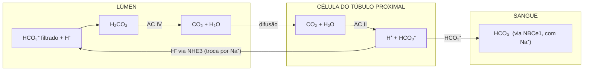
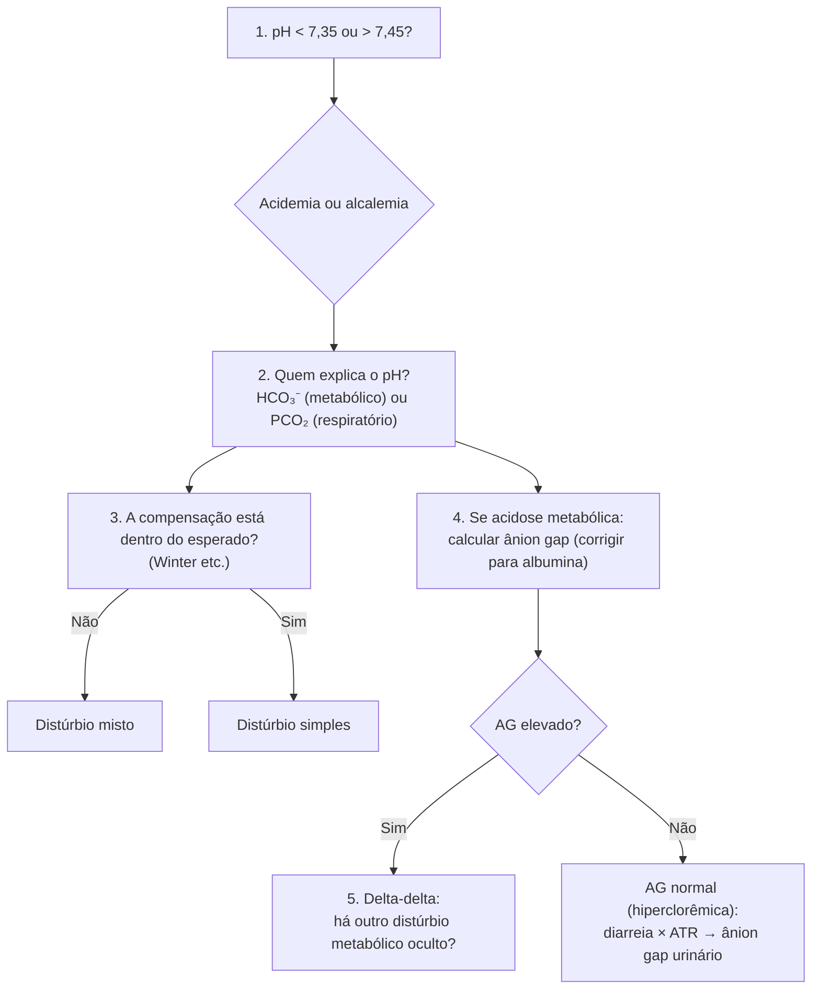

## Objetivos do tópico {#objetivos}

Ao final, você deve ser capaz de:

1. Explicar por que o organismo precisa excretar ácido diariamente e quais são as três linhas de defesa contra variações de pH.
2. Usar a equação de Henderson-Hasselbalch para entender por que o sistema bicarbonato é o tampão mais importante do líquido extracelular.
3. Descrever, célula por célula, a **reabsorção de bicarbonato** no túbulo proximal e a **excreção de ácido** (acidez titulável e amônio) no néfron distal.
4. Explicar por que a **amoniogênese** é a principal resposta adaptativa renal à acidose crônica.
5. Interpretar uma gasometria arterial em passos: distúrbio primário, compensação esperada, ânion gap, delta-delta.
6. Diferenciar as **acidoses tubulares renais** (tipos 1, 2 e 4) e as alcaloses metabólicas responsivas e resistentes a cloreto.

::: referencias
Guyton & Hall, 14ª ed., cap. 31 · Berne & Levy, 7ª ed., cap. 37.
:::

## Conceitos-base {#conceitos-base}

### O problema: produzimos ácido o tempo todo {#producao-acido}

A concentração de H⁺ no LEC é minúscula — **~40 nEq/L** (pH 7,40), cerca de um milionésimo da concentração de Na⁺ — e precisa ficar numa faixa estreita (pH ~7,35–7,45), porque o estado de ionização de proteínas (enzimas, canais, hemoglobina) depende dela.

O metabolismo produz dois tipos de ácido:

| Tipo | Origem | Quantidade | Quem elimina |
|---|---|---|---|
| **Volátil** (CO₂ → H₂CO₃) | Oxidação de carboidratos e gorduras | ~15.000–20.000 mmol/dia | **Pulmões** |
| **Fixo / não volátil** | Aminoácidos sulfurados (H₂SO₄), fosfoproteínas (H₃PO₄), ácidos orgânicos não metabolizados | ~1 mEq/kg/dia (~50–100 mEq/dia em dieta ocidental) | **Rins** |

Cada mEq de ácido fixo produzido é tamponado no LEC, principalmente pelo HCO₃⁻, que é **consumido**:

> H⁺ + HCO₃⁻ → H₂CO₃ → CO₂ + H₂O (o CO₂ sai pelos pulmões)

Portanto, a tarefa do rim não é só "jogar fora o H⁺": é **devolver ao corpo o bicarbonato que foi gasto tamponando**. Cada H⁺ excretado na urina ligado a um tampão urinário corresponde a **um HCO₃⁻ novo** que volta ao sangue.

### Henderson-Hasselbalch {#henderson-hasselbalch}

> **pH = 6,1 + log ( [HCO₃⁻] / (0,03 × PCO₂) )**
>
> Com HCO₃⁻ = 24 mEq/L e PCO₂ = 40 mmHg: 24 / 1,2 = 20 → log 20 ≈ 1,3 → pH = 7,4.

A equação mostra a ideia mais importante do tópico: **o pH depende da razão HCO₃⁻/PCO₂**, não dos valores absolutos. O **rim controla o numerador** (HCO₃⁻) e o **pulmão controla o denominador** (PCO₂). Quando um deles se altera (distúrbio primário), o outro se move **na mesma direção** para aproximar a razão de 20:1 (compensação).

### As três linhas de defesa {#linhas-defesa}

| Linha | Tempo de ação | Mecanismo | Limitação |
|---|---|---|---|
| Tampões químicos | Segundos | Ligam ou liberam H⁺ | Não removem ácido do corpo; se esgotam |
| Respiratória | Minutos a horas (máximo em 12–24 h) | Altera a ventilação → altera PCO₂ | Corrige 50–75%; não restaura HCO₃⁻ |
| **Renal** | Horas a dias (máximo em 3–5 dias) | Reabsorve/gera HCO₃⁻, excreta H⁺ | Lenta, mas é a única que **elimina** ácido fixo |

::: referencias
Guyton & Hall, 14ª ed., cap. 31 · Berne & Levy, 7ª ed., cap. 37.
:::

## Explicação detalhada {#explicacao}

### Sistemas-tampão {#tampoes}

- **Bicarbonato/CO₂ (pK 6,1)** — pelo pK, seria um tampão "ruim" para pH 7,4. É o mais importante do LEC porque é um **sistema aberto**: o CO₂ formado é eliminado pelos pulmões e o HCO₃⁻ é regulado pelos rins. Os dois componentes são controlados independentemente.
- **Fosfato (pK 6,8)** — concentração baixa no LEC, mas importante no **líquido intracelular** e, principalmente, **na urina**, onde se concentra e onde o pH cai até perto do seu pK (base da acidez titulável).
- **Proteínas e hemoglobina** — principal tampão **intracelular** (grupos imidazol da histidina). A hemoglobina desoxigenada tampona o H⁺ gerado pelo CO₂ nos tecidos.

**Princípio iso-hídrico:** todos os tampões de um mesmo compartimento estão em equilíbrio com o mesmo [H⁺]. Basta medir um deles (o bicarbonato, na gasometria) para inferir o estado de todos.

::: referencias
Guyton & Hall, 14ª ed., cap. 31.
:::

### Reabsorção do bicarbonato filtrado {#reabsorcao-bicarbonato}

Carga filtrada de HCO₃⁻ = [TFG](#/fisiologia/filtracao-glomerular#numeros) × [HCO₃⁻] = 180 L/dia × 24 mEq/L ≈ **4.320 mEq/dia**. Perder parte disso seria catastrófico; praticamente todo é reabsorvido:

- **Túbulo proximal: ~80%**
- Alça de Henle (ramo ascendente espesso): ~10–15%
- Túbulo distal e ducto coletor: o restante

**Mecanismo no túbulo proximal (decore o desenho):**

1. Na célula, a **anidrase carbônica II** (citoplasmática) forma H⁺ + HCO₃⁻ a partir de CO₂ + H₂O.
2. O H⁺ é secretado para o lúmen principalmente pelo **trocador Na⁺/H⁺ (NHE3)**, que usa o gradiente de Na⁺ criado pela Na⁺/K⁺-ATPase basolateral (transporte ativo secundário). Uma H⁺-ATPase contribui menos.
3. No lúmen, o H⁺ encontra o HCO₃⁻ filtrado → H₂CO₃ → a **anidrase carbônica IV** (na borda em escova) o converte em CO₂ + H₂O.
4. O CO₂ difunde para dentro da célula e é reaproveitado no passo 1.
5. O HCO₃⁻ formado na célula sai para o sangue pelo cotransportador basolateral **Na⁺-HCO₃⁻ (NBCe1)**.

**Ponto conceitual crucial:** nesse processo, o H⁺ secretado é **reciclado** — ele não é excretado. Para cada HCO₃⁻ filtrado que "desaparece" do lúmen, um HCO₃⁻ idêntico aparece no sangue. É uma **recuperação**, não uma geração de bicarbonato novo, e **não elimina ácido**.

::: clinica Acetazolamida
A acetazolamida inibe a anidrase carbônica do túbulo proximal → o HCO₃⁻ filtrado não é reabsorvido → **bicarbonatúria, urina alcalina e acidose metabólica hiperclorêmica**. É usada justamente para isso: na alcalose metabólica de pacientes com IC tratados com diurético de alça, na prevenção do mal das montanhas (a acidose estimula a ventilação) e no glaucoma.
:::

::: referencias
Guyton & Hall, 14ª ed., cap. 31 · Berne & Levy, 7ª ed., cap. 37 · Katzung – Farmacologia Básica e Clínica, 15ª ed., cap. 15 (diuréticos).
:::

### Excreção de ácido e geração de bicarbonato novo {#excrecao-acido}

No **néfron distal** (túbulo coletor), as **células intercaladas tipo α (tipo A)** secretam H⁺ ativamente:

- **H⁺-ATPase** apical (estimulada pela aldosterona) e **H⁺/K⁺-ATPase** apical (que reabsorve K⁺ — por isso é estimulada pela hipocalemia).
- O HCO₃⁻ gerado na célula sai para o sangue pelo trocador **Cl⁻/HCO₃⁻ (AE1)** basolateral → **HCO₃⁻ novo**.
- Já as **células intercaladas tipo β (tipo B)** fazem o inverso: secretam HCO₃⁻ no lúmen via **pendrina** — importantes na alcalose.

O epitélio distal é "apertado" e consegue gerar um gradiente de H⁺ de até ~1.000 vezes: o pH urinário mínimo é **~4,5**. Mas mesmo em pH 4,5, a concentração de H⁺ livre é de apenas ~0,03 mEq/L — excretar 70 mEq/dia de H⁺ livre exigiria mais de 2.000 L de urina! Logo, o H⁺ precisa ser excretado **ligado a tampões urinários**. São dois:

#### Acidez titulável (fosfato) {#acidez-titulavel}

O H⁺ secretado se liga ao fosfato filtrado: **HPO₄²⁻ + H⁺ → H₂PO₄⁻**. Recebe esse nome porque é medida titulando a urina com base até pH 7,4.

- Responde por ~**30–40%** da excreção ácida em condições basais (~20–30 mEq/dia).
- **Pouco adaptável**: depende da quantidade de fosfato filtrado, que não aumenta muito na acidose (e só tampona bem enquanto o pH urinário está acima de ~5,8, perto do pK de 6,8).

#### Amônio — o sistema adaptativo {#amonio}

1. No **túbulo proximal**, a **glutamina** é metabolizada (glutaminase → glutamato → α-cetoglutarato) gerando **2 NH₄⁺ + 2 HCO₃⁻** por molécula. O HCO₃⁻ vai para o sangue (bicarbonato novo).
2. O NH₄⁺ é secretado no lúmen (substituindo o H⁺ no NHE3).
3. No **ramo ascendente espesso**, o NH₄⁺ é reabsorvido (substituindo o K⁺ no **NKCC2**) e se acumula no interstício medular.
4. No **ducto coletor**, a amônia (NH₃) entra no lúmen (por difusão e por transportadores Rh glicoproteínas), onde encontra o H⁺ secretado pelas células α e forma **NH₄⁺**, que **não consegue voltar** (é carregado) — **difusão e aprisionamento**.

Por que é o sistema mais importante? Porque é **regulável**: na acidose crônica, a amoniogênese aumenta muito — a excreção de NH₄⁺ pode subir de ~30–40 para **mais de 300 mEq/dia** ao longo de alguns dias.

**Moduladores da amoniogênese:**

- ↑ na **acidose** e na **hipocalemia** (a hipocalemia causa acidificação intracelular).
- ↓ na **hipercalemia** — base da acidose da **ATR tipo 4**.

> **Excreção ácida líquida = acidez titulável + NH₄⁺ − HCO₃⁻ urinário**
>
> Em equilíbrio, ela iguala a produção diária de ácido fixo (~70 mEq/dia).

::: referencias
Guyton & Hall, 14ª ed., cap. 31 · Berne & Levy, 7ª ed., cap. 37.
:::

### Fatores que regulam a secreção renal de H⁺ {#regulacao-secrecao}

| Fator | Efeito sobre a secreção de H⁺ / reabsorção de HCO₃⁻ | Raciocínio |
|---|---|---|
| ↑ PCO₂ (acidose respiratória) | ↑ | Mais CO₂ na célula → mais H⁺ gerado (base da compensação renal) |
| ↓ pH do LEC | ↑ | Acidose intracelular estimula NHE3, H⁺-ATPase e amoniogênese |
| **Depleção de volume** | ↑ | Ang II estimula NHE3 no túbulo proximal; aldosterona estimula a H⁺-ATPase distal |
| **Aldosterona** | ↑ | Estimula H⁺-ATPase (célula α) e, indiretamente, via reabsorção de Na⁺ (lúmen mais negativo) |
| **Hipocalemia** | ↑ | Acidose intracelular → ↑amoniogênese; ↑H⁺/K⁺-ATPase |
| Hipercalemia | ↓ | ↓amoniogênese |

Isso explica a **alcalose de contração** e por que vômitos e diuréticos causam alcalose que **se mantém**: depleção de volume + hipocloremia + hipocalemia + hiperaldosteronismo fazem o rim continuar reabsorvendo HCO₃⁻ mesmo quando ele já está alto.

::: referencias
Guyton & Hall, 14ª ed., cap. 31 · Berne & Levy, 7ª ed., cap. 37.
:::

### Distúrbios primários e compensações esperadas {#compensacoes}

| Distúrbio primário | Alteração primária | Compensação | Valor esperado |
|---|---|---|---|
| **Acidose metabólica** | ↓ HCO₃⁻ | Hiperventilação (↓PCO₂) | **PCO₂ = 1,5 × HCO₃⁻ + 8 (± 2)** — fórmula de Winter |
| **Alcalose metabólica** | ↑ HCO₃⁻ | Hipoventilação (↑PCO₂) | PCO₂ sobe ~**0,7** mmHg por 1 mEq/L de ↑HCO₃⁻ |
| **Acidose respiratória aguda** | ↑ PCO₂ | Tampões | HCO₃⁻ sobe **1** por 10 mmHg de ↑PCO₂ |
| **Acidose respiratória crônica** | ↑ PCO₂ | Renal | HCO₃⁻ sobe **3,5** por 10 mmHg de ↑PCO₂ |
| **Alcalose respiratória aguda** | ↓ PCO₂ | Tampões | HCO₃⁻ cai **2** por 10 mmHg de ↓PCO₂ |
| **Alcalose respiratória crônica** | ↓ PCO₂ | Renal | HCO₃⁻ cai **4–5** por 10 mmHg de ↓PCO₂ |

**Regras de ouro:**

- A compensação **nunca ultrapassa** nem normaliza completamente o pH (exceção possível: alcalose respiratória crônica, que pode chegar perto do normal).
- Se o valor medido está **fora** da faixa esperada, há um **segundo distúrbio primário** (distúrbio misto). Ex.: acidose metabólica com PCO₂ maior que o previsto por Winter = acidose respiratória associada.
- A diferença entre aguda e crônica nos distúrbios respiratórios é **o rim**: ele leva 3–5 dias para gerar HCO₃⁻ novo (via amoniogênese).

::: referencias
Harrison – Medicina Interna, 21ª ed., cap. "Acidose e alcalose" · Berne & Levy, 7ª ed., cap. 37.
:::

### Interpretação da gasometria passo a passo {#gasometria}

**Ânion gap (AG) = Na⁺ − (Cl⁻ + HCO₃⁻)**

- Normal: ~**8–12 mEq/L** (depende do método do laboratório). Representa ânions não medidos, principalmente **albumina**.
- **Corrija para albumina**: AG corrigido = AG + 2,5 × (4,0 − albumina em g/dL). Um paciente com hipoalbuminemia grave pode ter acidose com AG elevado "mascarada" por AG aparentemente normal.

**Delta-delta (Δ/Δ) = (AG − 12) / (24 − HCO₃⁻)**

Numa acidose de AG elevado pura, cada mEq de ácido não medido consome ~1 mEq de HCO₃⁻, então a razão fica **~1–2**.

- **< 1**: o HCO₃⁻ caiu mais do que o AG explica → **acidose de AG normal associada**.
- **> 2**: o HCO₃⁻ caiu menos do que deveria → **alcalose metabólica associada** (ou acidose respiratória crônica compensada prévia).

::: referencias
Harrison – Medicina Interna, 21ª ed., cap. "Acidose e alcalose".
:::

### Causas de acidose metabólica: AG elevado × AG normal {#causas-acidose}

| AG elevado (ácido não medido acumulado) | AG normal / hiperclorêmica (perda de HCO₃⁻ ou falha renal em gerar HCO₃⁻) |
|---|---|
| **Lactato** (choque, sepse, hipóxia, metformina em contexto de hipoperfusão) | **Diarreia** (perda intestinal de HCO₃⁻) |
| **Cetoacidose** (diabética, alcoólica, jejum) | **Acidoses tubulares renais** |
| **Insuficiência renal avançada** (retenção de sulfato, fosfato, urato) | Inibidores da anidrase carbônica (acetazolamida, topiramato) |
| Intoxicações: **metanol, etilenoglicol**, salicilato | Infusão de grandes volumes de **SF 0,9%** (acidose dilucional/hiperclorêmica) |
| Piroglutâmico (oxoprolina — paracetamol crônico em desnutridos) | Ureterossigmoidostomia, fístulas pancreáticas/biliares |

Mnemônico útil para AG elevado: **GOLDMARK** — Glicóis (etileno/propilenoglicol), Oxoprolina, L-lactato, D-lactato, Metanol, Aspirina, Renal (insuficiência), Cetoacidose (K de *ketoacidosis*).

**Ânion gap urinário (AGU) = Na⁺u + K⁺u − Cl⁻u** — estima indiretamente o NH₄⁺ urinário (que sai acompanhado de Cl⁻):

- **AGU negativo** → muito NH₄⁺ → o rim está respondendo bem → causa **extrarrenal** (diarreia). Mnemônico: "**neGUTive**".
- **AGU positivo** → pouco NH₄⁺ → o rim **não** está excretando ácido → **ATR distal (tipo 1) ou tipo 4**.

::: referencias
Harrison – Medicina Interna, 21ª ed., cap. "Acidose e alcalose" · Berne & Levy, 7ª ed., cap. 37.
:::

### Acidoses tubulares renais (ATR) {#atr}

| | **Tipo 1 (distal)** | **Tipo 2 (proximal)** | **Tipo 4 (hipoaldosteronismo)** |
|---|---|---|---|
| Defeito | Célula α não secreta H⁺ (ou há retrovazamento) | Túbulo proximal não reabsorve HCO₃⁻ (↓ limiar) | Falta de aldosterona ou resistência a ela |
| pH urinário | **> 5,5** sempre | Variável: > 5,5 ao receber álcali; **< 5,5** quando o HCO₃⁻ plasmático já caiu abaixo do limiar | **< 5,5** (consegue acidificar, mas excreta pouco NH₄⁺) |
| K⁺ sérico | **Baixo** | **Baixo** (piora com reposição de álcali) | **Alto** |
| HCO₃⁻ plasmático | Pode ser muito baixo (< 10) | Geralmente 12–20 (estabiliza no novo limiar) | Moderadamente baixo (> 15) |
| Complicações | **Nefrolitíase/nefrocalcinose** (urina alcalina, hipercalciúria, hipocitratúria), osteomalácia | Raquitismo/osteomalácia; frequentemente **síndrome de Fanconi** (glicosúria, aminoacidúria, fosfatúria) | Hipercalemia |
| Causas típicas | Sjögren, LES, **anfotericina B**, lítio, hereditária | **Mieloma** (cadeias leves), acetazolamida, **tenofovir**, ifosfamida, topiramato, cistinose | **Nefropatia diabética** (hipoaldosteronismo hiporreninêmico), **IECA/BRA**, espironolactona, AINE, trimetoprima, heparina, inibidores de calcineurina |
| Tratamento | Álcali (citrato) em dose moderada | Álcali em **dose alta** (muito é perdido na urina) + tiazídico | Corrigir K⁺ (restringir, diurético de alça, fludrocortisona conforme o caso) |

**Raciocínio-chave da ATR tipo 2:** a reabsorção proximal de HCO₃⁻ falha acima de um limiar reduzido (ex.: 16 mEq/L). Enquanto o HCO₃⁻ plasmático está acima disso, sobra HCO₃⁻ na urina (urina alcalina). Quando o plasma cai até 16, tudo o que é filtrado é reabsorvido, e o néfron distal **normal** acidifica a urina (pH < 5,5). Por isso o pH urinário, isoladamente, pode enganar.

**Raciocínio-chave da ATR tipo 4:** a hipercalemia é a causa da acidose, não só um achado associado — ela **suprime a amoniogênese**. Corrigir o potássio frequentemente melhora a acidose.

::: referencias
Harrison – Medicina Interna, 21ª ed., cap. "Acidose e alcalose" · Berne & Levy, 7ª ed., cap. 37.
:::

### Alcalose metabólica: geração e manutenção {#alcalose-metabolica}

Toda alcalose metabólica persistente tem duas fases:

1. **Geração** — perda de H⁺ (vômitos/aspiração gástrica; renal por diurético ou hiperaldosteronismo) ou ganho de álcali.
2. **Manutenção** — o rim normal excretaria o excesso de HCO₃⁻ rapidamente. Para a alcalose persistir, algo faz o rim **continuar reabsorvendo**: depleção de volume, **depleção de cloreto**, hipocalemia, excesso de mineralocorticoide.

**Classificação pelo cloro urinário:**

| Cl⁻ urinário < 20 mEq/L — **responsiva a cloreto (salina)** | Cl⁻ urinário > 20 mEq/L — **resistente a cloreto** |
|---|---|
| Vômitos, sonda nasogástrica | Hiperaldosteronismo primário, Cushing, estenose de artéria renal (com hipertensão) |
| Diurético usado **no passado** | Diurético **em uso**, Bartter, Gitelman (sem hipertensão) |
| Pós-hipercapnia | Hipocalemia grave |

**Acidúria paradoxal nos vômitos:** um paciente com alcalose por vômitos pode ter **urina ácida**. Por quê? A hipovolemia (Ang II, aldosterona) e a hipocalemia fazem o néfron reabsorver Na⁺ avidamente e secretar H⁺ e K⁺ em troca — o rim prioriza o volume sobre o pH. Tratar com **SF 0,9% + KCl** remove o estímulo e permite excretar o HCO₃⁻ (a urina fica alcalina).

::: referencias
Harrison – Medicina Interna, 21ª ed., cap. "Acidose e alcalose" · Guyton & Hall, 14ª ed., cap. 31.
:::

## Correlação clínica {#correlacao-clinica}

### Caso 1 — Cetoacidose diabética {#caso-cad}

Jovem com DM1, poliúria e vômitos. Gasometria: pH 7,12; PCO₂ 22 mmHg; HCO₃⁻ 8 mEq/L. Na⁺ 135, Cl⁻ 100, albumina 4,0.

1. Acidemia; HCO₃⁻ baixo → **acidose metabólica**.
2. Winter: 1,5 × 8 + 8 = 20 (± 2) → esperado 18–22 → PCO₂ 22: **compensação adequada**.
3. AG = 135 − (100 + 8) = **27** (elevado).
4. Δ/Δ = (27 − 12) / (24 − 8) = 15 / 16 ≈ **0,9** → próximo de 1: acidose de AG elevado praticamente pura (valores logo abaixo de 1 são comuns na CAD por perda urinária de cetoânions, que gera um componente hiperclorêmico, sobretudo durante a hidratação).

Durante o tratamento, é comum a fase de **acidose hiperclorêmica**: os cetoânions perdidos na urina eram "bicarbonato em potencial", e a infusão de SF adiciona cloreto.

### Caso 2 — DPOC com descompensação {#caso-dpoc}

Paciente com DPOC, PCO₂ habitual 60 mmHg e HCO₃⁻ 31 (acidose respiratória crônica compensada: esperado 24 + 3,5 × 2 = 31). Chega com infecção: PCO₂ 80. Se o problema agudo for só respiratório, o HCO₃⁻ subiria mais ~2 (agudo: 1 por 10) → ~33, e o pH cairia bastante — **acidose respiratória aguda sobre crônica**.

Se esse paciente for intubado e a PCO₂ for baixada rapidamente para 40, o HCO₃⁻ alto (que o rim levou dias para gerar) fica "sem par" → **alcalose metabólica pós-hipercapnia** (risco de arritmias e convulsões). Por isso a ventilação deve reduzir a PCO₂ gradualmente.

### Caso 3 — Diarreia × ATR {#caso-diarreia}

Dois pacientes com acidose de AG normal e hipocalemia. O AGU diferencia: na diarreia, o rim responde aumentando NH₄⁺ (AGU **negativo**); na ATR distal, não consegue (AGU **positivo**, pH urinário > 5,5).

::: referencias
Harrison – Medicina Interna, 21ª ed., cap. "Acidose e alcalose" e cap. "Diabetes mellitus: complicações agudas" · Diretriz da Sociedade Brasileira de Diabetes (2024), capítulo de cetoacidose diabética.
:::

## Pontos de alta cobrança em prova {#alta-cobranca}

::: prova
- **pH = 6,1 + log(HCO₃⁻ / 0,03·PCO₂)** → o pH depende da **razão**; rim controla HCO₃⁻, pulmão controla PCO₂.
- Ácido fixo: ~1 mEq/kg/dia; o rim precisa **gerar HCO₃⁻ novo** para repor o que foi consumido.
- Túbulo proximal reabsorve **~80%** do HCO₃⁻ filtrado (NHE3, AC IV luminal, AC II, NBCe1) — isso **não** excreta ácido.
- Excreção ácida líquida = **acidez titulável + NH₄⁺ − HCO₃⁻ urinário**. **NH₄⁺ é o sistema adaptativo** (glutamina no TP).
- **Hipercalemia suprime a amoniogênese** → ATR tipo 4; hipocalemia a estimula.
- **Winter: PCO₂ = 1,5 × HCO₃⁻ + 8 ± 2**. Respiratória: aguda 1 (acidose) / 2 (alcalose); crônica 3,5 / 4–5 por 10 mmHg.
- **AG = Na⁺ − (Cl⁻ + HCO₃⁻)**, normal ~8–12; corrigir para albumina (+2,5 por g/dL abaixo de 4).
- **Δ/Δ < 1** → acidose de AG normal associada; **> 2** → alcalose metabólica associada.
- **AGU negativo = diarreia**; positivo = ATR distal/tipo 4.
- ATR 1: pH urinário > 5,5, K⁺ baixo, **cálculos**. ATR 2: Fanconi, mieloma, acetazolamida, tenofovir. ATR 4: **K⁺ alto**, diabetes, IECA/BRA, espironolactona.
- Alcalose: **Cl⁻ urinário < 20 = responsiva a salina** (vômitos); > 20 = resistente (hiperaldosteronismo, diurético em uso).
:::

## Armadilhas comuns {#armadilhas}

::: armadilha
- **"Reabsorver bicarbonato = excretar ácido."** Falso. A reabsorção proximal apenas recupera o HCO₃⁻ filtrado. Só H⁺ excretado com fosfato ou como NH₄⁺ gera HCO₃⁻ **novo**.
- **Achar que o rim excreta ácido como H⁺ livre.** Em pH urinário 4,5 a quantidade de H⁺ livre é desprezível; o ácido sai ligado a tampões.
- **Esquecer de corrigir o AG para a albumina.** Paciente com albumina 2,0 g/dL e AG 12 tem, na verdade, AG corrigido de 17.
- **Ver pH normal e concluir "gasometria normal".** pH normal com HCO₃⁻ e PCO₂ muito alterados = distúrbio misto (ex.: acidose metabólica + alcalose respiratória na intoxicação por salicilato).
- **Usar o pH urinário isolado para excluir ATR proximal.** No estado estável, a ATR tipo 2 acidifica a urina.
- **Achar que a compensação corrige o pH totalmente.** Se o pH normalizou, suspeite de distúrbio misto.
- **Tratar a hipocalemia da ATR proximal com álcali antes do potássio.** O álcali aumenta a oferta distal de HCO₃⁻ e piora a caliurese.
- **Acidúria paradoxal:** urina ácida não exclui alcalose metabólica — é típica dos vômitos com depleção de volume e K⁺.
:::

## Resumo para revisão rápida {#resumo}

- Produzimos ~1 mEq/kg/dia de ácido fixo. Tampões (segundos) → pulmão (minutos-horas) → **rim** (dias; único que elimina ácido fixo).
- pH depende da razão HCO₃⁻/PCO₂ (20:1 em pH 7,4). Distúrbio primário em um → compensação no **mesmo sentido** no outro.
- **Reabsorção de HCO₃⁻** (~80% no proximal): NHE3 secreta H⁺; AC IV no lúmen, AC II na célula; NBCe1 basolateral. Recupera, não gera.
- **Geração de HCO₃⁻ novo** = excreção de H⁺ com tampões: **acidez titulável** (fosfato, pouco adaptável) + **NH₄⁺** (glutamina → 2 NH₄⁺ + 2 HCO₃⁻; aumenta muito na acidose crônica; suprimido pela hipercalemia).
- Célula intercalada α: H⁺-ATPase (aldosterona) e H⁺/K⁺-ATPase; HCO₃⁻ sai por AE1. Célula β: secreta HCO₃⁻ (pendrina).
- Compensações: Winter (1,5·HCO₃⁻ + 8 ± 2); alcalose metabólica 0,7; respiratória aguda 1/2, crônica 3,5/4–5 por 10 mmHg.
- AG = Na − (Cl + HCO₃), corrigir para albumina. AG alto: lactato, cetoacidose, IR, tóxicos. AG normal: diarreia (AGU −) × ATR (AGU +).
- ATR 1 (K↓, pH u > 5,5, cálculos) · ATR 2 (K↓, Fanconi, álcali em dose alta) · ATR 4 (K↑, hipoaldosteronismo).
- Alcalose: geração + manutenção (volume, Cl⁻, K⁺, aldosterona). Cl⁻u < 20 responde a salina.

::: referencias
Guyton & Hall, 14ª ed., cap. 31 · Berne & Levy, 7ª ed., cap. 37 · Harrison, 21ª ed., cap. "Acidose e alcalose".
:::
