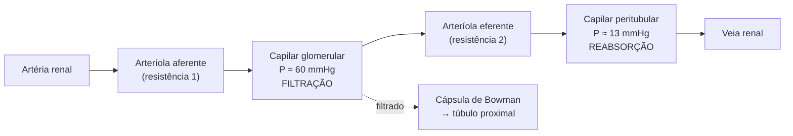
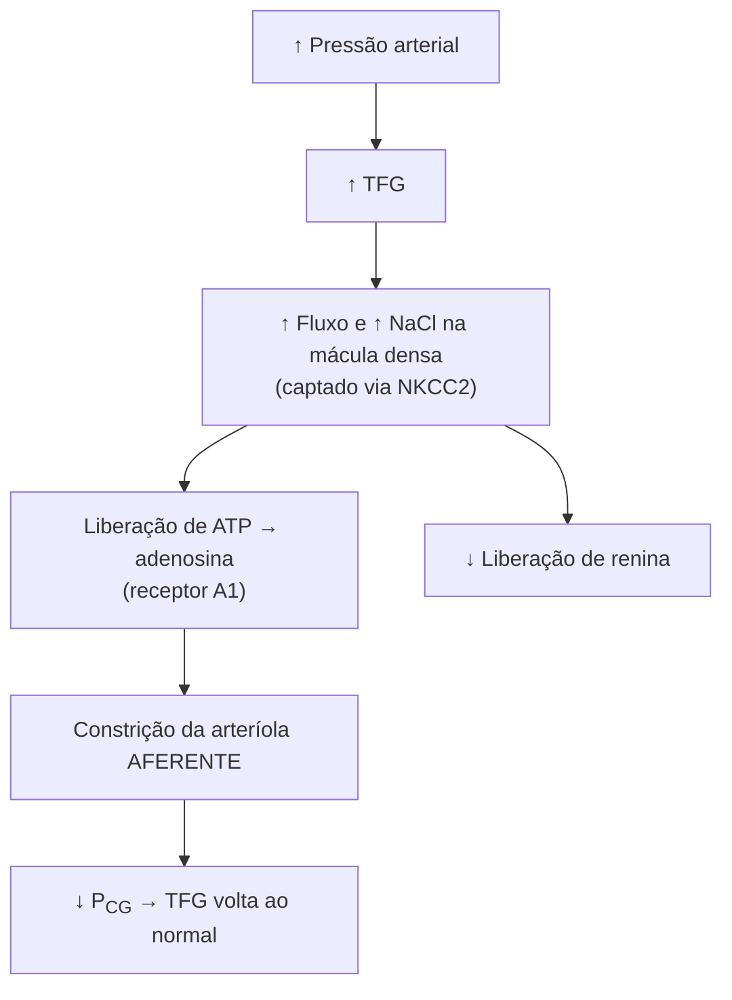
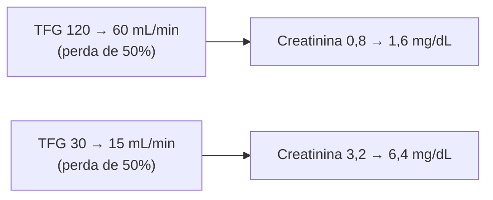

## Objetivos do tópico {#objetivos}

Ao final, você deve ser capaz de:

1. Descrever a barreira de filtração glomerular e explicar por que ela seleciona moléculas por **tamanho** e por **carga**.
2. Escrever a equação de Starling do glomérulo e prever o efeito de cada força sobre a taxa de filtração glomerular (TFG).
3. Prever o que acontece com TFG, fluxo plasmático renal (FPR) e fração de filtração (FF) quando as arteríolas **aferente** e **eferente** se contraem ou dilatam.
4. Explicar os dois mecanismos de **autorregulação** (miogênico e feedback tubuloglomerular) e o papel da angiotensina II e das prostaglandinas.
5. Aplicar o conceito de **depuração** (*clearance*) para estimar TFG e FPR, e interpretar a creatinina sérica com suas limitações.
6. Usar esse raciocínio em situações clínicas: IECA/BRA na estenose de artéria renal, AINE em hipovolemia, hiperfiltração diabética e efeito dos iSGLT2.

::: referencias
Guyton & Hall, 14ª ed., cap. 26 e 27 · Berne & Levy, 7ª ed., cap. 33.
:::

## Conceitos-base {#conceitos-base}

### Números que você precisa saber {#numeros}

| Parâmetro | Valor típico (adulto, 70 kg) | Comentário |
|---|---|---|
| Fluxo sanguíneo renal (FSR) | ~1.100–1.200 mL/min | ~20–25% do débito cardíaco para um órgão de ~0,4% do peso corporal |
| Fluxo plasmático renal (FPR) | ~600–650 mL/min | FSR × (1 − hematócrito) |
| TFG | ~125 mL/min (~180 L/dia) | Varia com sexo, idade e superfície corporal |
| Fração de filtração (FF) | ~0,20 (20%) | FF = TFG / FPR |
| Débito urinário | ~1–1,5 L/dia | Ou seja, **>99% do filtrado é reabsorvido** |

O rim recebe muito mais sangue do que precisaria para seu metabolismo. Esse fluxo enorme não existe para "nutrir" o rim, e sim para **filtrar** o plasma inteiro cerca de 60 vezes por dia. Uma TFG alta permite remover rapidamente produtos que dependem principalmente de filtração (ureia, creatinina) e permite que o volume e a composição dos líquidos corporais sejam controlados com precisão pela reabsorção tubular.

### O corpúsculo renal e a microcirculação {#microcirculacao}

O rim tem **dois leitos capilares em série**, separados pela arteríola eferente:

1. **Capilares glomerulares** — pressão hidrostática alta (~60 mmHg) → favorecem **filtração**.
2. **Capilares peritubulares** — pressão hidrostática baixa (~13 mmHg) e pressão oncótica alta (o plasma ficou concentrado em proteínas depois da filtração) → favorecem **reabsorção**.

Esse arranjo é a chave de quase toda a fisiologia renal: **as duas arteríolas funcionam como resistências ajustáveis antes e depois do glomérulo**, e por isso o rim consegue regular a pressão glomerular de forma independente da pressão arterial sistêmica.

::: referencias
Guyton & Hall, 14ª ed., cap. 26 · Berne & Levy, 7ª ed., cap. 33.
:::

## Explicação detalhada {#explicacao}

### A barreira de filtração {#barreira}

O filtrado precisa atravessar **três camadas**:

| Camada | Estrutura | O que barra |
|---|---|---|
| Endotélio fenestrado | Poros de ~70–100 nm, glicocálice com carga negativa | Células sanguíneas; contribui para a barreira de carga |
| Membrana basal glomerular (MBG) | Colágeno IV, laminina, proteoglicanos de **heparan sulfato** (carga negativa) | Proteínas grandes e aniônicas |
| Podócitos | Processos podais interdigitados; **diafragma de fenda** (nefrina, podocina) | Principal filtro final para macromoléculas |

**Seletividade por tamanho:** substâncias com peso molecular abaixo de ~7 kDa (água, glicose, ureia, creatinina, inulina) são filtradas livremente — sua concentração no filtrado é igual à do plasma. À medida que o raio molecular aumenta, a filtrabilidade cai; a albumina (~69 kDa) é filtrada em quantidade mínima.

**Seletividade por carga:** para um mesmo tamanho, moléculas **catiônicas** são filtradas mais facilmente que as neutras, e estas mais que as **aniônicas**. A albumina é aniônica em pH fisiológico, e por isso sua filtração é muito menor do que o tamanho sozinho prevê.

Por que isso importa? Porque em várias doenças glomerulares a barreira perde primeiro sua **carga negativa** ou a integridade do **diafragma de fenda** (lesão podocitária). O resultado é **proteinúria** — e, se intensa, síndrome nefrótica — mesmo sem alteração grosseira do tamanho dos "poros".

::: clinica Barreira lesada = proteinúria
Na doença de lesões mínimas, os podócitos sofrem apagamento dos processos podais e perda de carga aniônica: há proteinúria maciça e seletiva (principalmente albumina), com microscopia óptica normal. Mutações da nefrina causam síndrome nefrótica congênita — um exemplo de como uma única proteína do diafragma de fenda sustenta a barreira.
:::

::: referencias
Guyton & Hall, 14ª ed., cap. 27 · Berne & Levy, 7ª ed., cap. 33 · Robbins & Cotran – Patologia, 10ª ed., cap. 20 (correlação).
:::

### Forças de Starling no glomérulo {#starling}

A TFG é o produto de dois fatores:

> **TFG = Kf × Pressão efetiva de filtração**
>
> **TFG = Kf × [(PCG − PB) − (πCG − πB)]**

- **Kf** (coeficiente de filtração) = permeabilidade × área de superfície. É ~400 vezes maior que o de outros capilares — por isso o glomérulo filtra tanto com uma pressão efetiva pequena.
- **PCG** — pressão hidrostática no capilar glomerular (~60 mmHg): **favorece** a filtração.
- **PB** — pressão hidrostática na cápsula de Bowman (~18 mmHg): **opõe-se**.
- **πCG** — pressão oncótica no capilar glomerular (~32 mmHg em média): **opõe-se**.
- **πB** — pressão oncótica na cápsula de Bowman (~0, porque quase não há proteína no filtrado): favoreceria, mas é desprezível.

Pressão efetiva ≈ 60 − 18 − 32 = **~10 mmHg**.

**O detalhe fisiopatológico importante:** πCG **não é constante ao longo do capilar**. Como água sai e as proteínas ficam, a pressão oncótica sobe de ~28 mmHg na extremidade aferente para ~36 mmHg na eferente. Duas consequências:

1. Quanto **maior a fração de filtração**, mais a pressão oncótica sobe ao longo do capilar, e mais a filtração "se autolimita" no final do capilar.
2. Quanto **maior o fluxo plasmático**, mais devagar πCG sobe, e mais extensa é a área do capilar que continua filtrando. Por isso **↑FPR aumenta a TFG mesmo sem mudar PCG**.

| Alteração | Força afetada | Efeito sobre a TFG | Exemplo clínico |
|---|---|---|---|
| ↓ Kf | Área/permeabilidade | ↓ | Glomerulonefrites, nefropatia diabética avançada, hipertensão crônica (perda de glomérulos) |
| ↑ PB | Hidrostática de Bowman | ↓ | **Obstrução do trato urinário** (cálculo, hiperplasia prostática) |
| ↑ πCG | Oncótica capilar | ↓ | Desidratação com hemoconcentração; hiperproteinemia |
| ↓ πCG | Oncótica capilar | ↑ (teórico) | Hipoalbuminemia (na prática compensada por outros fatores) |
| ↑ PCG | Hidrostática capilar | ↑ | Dilatação aferente, constrição eferente moderada |

::: dica Como raciocinar
PCG é o principal ponto de controle **fisiológico** da TFG. Kf e PB mudam principalmente em **doença**. Em questões, pergunte-se primeiro: "o que aconteceu com PCG e com o FPR?"
:::

::: referencias
Guyton & Hall, 14ª ed., cap. 27 · Berne & Levy, 7ª ed., cap. 33.
:::

### Efeito das arteríolas aferente e eferente {#arteriolas}

Pense no glomérulo como um trecho de mangueira entre duas torneiras.

- **Contrair a aferente** (torneira de entrada): menos pressão chega ao glomérulo → **↓PCG**, e menos fluxo entra → **↓FPR**. TFG e FPR caem proporcionalmente; FF pouco muda.
- **Dilatar a aferente**: ↑PCG e ↑FPR → ↑TFG.
- **Contrair a eferente** (torneira de saída): o sangue "represa" no glomérulo → **↑PCG** → ↑TFG, enquanto o fluxo total **cai** (↓FPR). Como TFG sobe e FPR cai, **FF aumenta**.
- **Constrição eferente intensa**: o FPR cai tanto que πCG sobe muito ao longo do capilar e passa a dominar → a TFG, depois de subir, **começa a cair** (efeito **bifásico**).
- **Dilatar a eferente**: ↓PCG → ↓TFG; FPR ↑; FF ↓.

| Mudança | PCG | FPR | TFG | FF |
|---|---|---|---|---|
| Constrição aferente | ↓ | ↓ | ↓ | ≈ |
| Dilatação aferente | ↑ | ↑ | ↑ | ≈ |
| Constrição eferente (moderada) | ↑ | ↓ | ↑ | ↑ |
| Constrição eferente (intensa) | ↑ | ↓↓ | ↓ (bifásico) | ↑↑ |
| Dilatação eferente | ↓ | ↑ | ↓ | ↓ |

**Por que a FF importa além do glomérulo?** O sangue que sai pela eferente vai para os capilares peritubulares. Se a FF aumentou, esse sangue está mais **concentrado em proteínas** (π peritubular alta) e com **pressão hidrostática mais baixa** → a reabsorção de líquido no túbulo proximal **aumenta**. É um dos mecanismos pelo qual a angiotensina II retém sódio e água em hipovolemia — e, como a Ang II também estimula o NHE3 proximal, ajuda a explicar a [alcalose de contração](#/fisiologia/equilibrio-acido-base#regulacao-secrecao).

::: referencias
Guyton & Hall, 14ª ed., cap. 27 · Berne & Levy, 7ª ed., cap. 33.
:::

### Autorregulação da TFG e do fluxo sanguíneo renal {#autorregulacao}

Com pressão arterial média entre **~80 e ~170 mmHg**, o FSR e a TFG variam pouco. Sem isso, cada subida de pressão aumentaria muito a TFG e o rim perderia litros de sal e água (a capacidade tubular de reabsorção seria ultrapassada). Dois mecanismos atuam juntos, ambos ajustando **principalmente a arteríola aferente**.

#### 1. Mecanismo miogênico {#miogenico}

O músculo liso da aferente responde ao **estiramento**: ↑pressão → estiramento da parede → abertura de canais catiônicos sensíveis a estiramento → despolarização → entrada de Ca²⁺ por canais tipo L → **contração**. A resistência sobe e o fluxo volta ao normal. É rápido (segundos) e intrínseco ao vaso. Também protege o glomérulo contra **barotrauma** hipertensivo.

#### 2. Feedback tubuloglomerular (FTG) {#feedback-tubuloglomerular}

A **mácula densa** (células especializadas no início do túbulo distal, encostadas nas arteríolas do mesmo néfron, formando o aparelho justaglomerular) "mede" a carga de **NaCl** que chega até ela, através do cotransportador **NKCC2**.

Na direção oposta (↓pressão → ↓TFG → **↓NaCl na mácula densa**):

1. Cai a sinalização por adenosina → a aferente **dilata**.
2. A mácula densa estimula as células justaglomerulares (via COX-2/PGE₂ e NO) a liberar **renina** → angiotensina II → constrição **preferencial da eferente** → PCG sobe e a TFG é preservada.

::: alerta Autorregulação não é perfeita
Abaixo de ~80 mmHg (choque, hemorragia), a autorregulação se esgota e a TFG cai em paralelo à pressão. Além disso, ela protege a TFG mas **não impede** a natriurese pressórica: em pressões altas, a excreção de sódio aumenta, o que é parte do controle de longo prazo da pressão arterial.
:::

::: referencias
Guyton & Hall, 14ª ed., cap. 27 · Berne & Levy, 7ª ed., cap. 33.
:::

### Controle neuro-humoral {#controle-neurohumoral}

| Mediador | Efeito vascular principal | Efeito sobre a TFG | Quando importa |
|---|---|---|---|
| Simpático (noradrenalina, α1) | Contrai aferente e eferente | ↓ (em ativação intensa) | Hemorragia grave, isquemia cerebral; também estimula renina (β1) |
| **Angiotensina II** | Contrai ambas, com **maior sensibilidade da eferente** em concentrações moderadas | Mantida ou ↑ apesar de ↓FPR | Hipovolemia, IC, estenose de artéria renal |
| **Prostaglandinas (PGE₂, PGI₂)** | **Dilatam a aferente** | Mantida em estados de baixa perfusão | Contrapõem o simpático e a Ang II quando o rim está ameaçado |
| Óxido nítrico (NO) | Dilatação basal | Mantém FSR e TFG | Disfunção endotelial reduz NO |
| Endotelina | Contrai ambas | ↓ | Lesão endotelial, síndrome hepatorrenal |
| Peptídeo natriurético atrial (PNA) | Dilata aferente, contrai eferente | ↑ | Expansão de volume |

**O raciocínio integrador:** em hipovolemia, o corpo ativa simultaneamente forças que **contraem** (simpático, Ang II, endotelina) e forças que **protegem** o rim (prostaglandinas dilatando a aferente; Ang II contraindo mais a eferente). A TFG fica preservada por um equilíbrio. Se você **bloquear um dos protetores**, a TFG desaba:

- **AINE** → bloqueia prostaglandinas → a aferente fica sem contraposição à vasoconstrição → **↓PCG**.
- **IECA/BRA** → remove a Ang II → a eferente relaxa → **↓PCG**.

Veja a correlação clínica abaixo — esse é um dos temas mais cobrados do tópico.

::: referencias
Guyton & Hall, 14ª ed., cap. 27 · Berne & Levy, 7ª ed., cap. 33 · Goodman & Gilman – As Bases Farmacológicas da Terapêutica, 13ª ed., cap. 26 e 38 (correlação farmacológica).
:::

### Depuração e medida da TFG {#depuracao}

**Depuração (clearance)** de uma substância X é o volume de plasma completamente "limpo" de X por unidade de tempo:

> **CX = (UX × V̇) / PX**
>
> UX = concentração urinária · V̇ = fluxo urinário · PX = concentração plasmática

A lógica: se uma substância é **livremente filtrada e não é reabsorvida, secretada, sintetizada ou metabolizada pelo túbulo**, tudo que foi filtrado aparece na urina. Então carga filtrada = carga excretada → TFG × P = U × V̇ → **C = TFG**.

| Substância | Comportamento tubular | Depuração em relação à TFG | Uso |
|---|---|---|---|
| Inulina | Só filtrada | = TFG | Padrão-ouro experimental |
| Creatinina | Filtrada + **pequena secreção** (~10–20%) | Levemente > TFG | Uso clínico (estimativas) |
| Glicose (normal) | Filtrada e 100% reabsorvida | ~0 | — |
| Ureia | Filtrada e parcialmente reabsorvida | < TFG | Varia com o fluxo urinário |
| PAH (para-amino-hipurato) | Filtrado + intensamente secretado (extração ~90%) | ≈ FPR efetivo | Estimar FPR |

**Regra prática:** CX > TFG → houve **secreção** líquida; CX < TFG → houve **reabsorção** líquida (ou a substância não é livremente filtrada).

#### Creatinina sérica: por que ela engana {#creatinina}

A creatinina vem do metabolismo da creatina muscular e é produzida em ritmo aproximadamente constante. Em equilíbrio, produção = excreção ≈ TFG × PCr. Logo **PCr ≈ produção / TFG**: a relação é **hiperbólica**.

- Quando a TFG cai pela **metade**, a creatinina **dobra** (em equilíbrio).
- Consequência: no início da doença renal, uma grande perda de TFG (de 120 para 60 mL/min) eleva a creatinina de ~0,8 para ~1,6 mg/dL — valor que ainda "parece" pouco alterado. Já em TFG baixa, pequenas perdas elevam muito a creatinina.
- A creatinina depende da **massa muscular**: idosos, mulheres, amputados e desnutridos podem ter creatinina "normal" com TFG reduzida.
- Fármacos que **inibem a secreção tubular** de creatinina (trimetoprima, cimetidina, dolutegravir) aumentam a creatinina sérica **sem reduzir a TFG verdadeira**.
- Na **lesão renal aguda**, a creatinina leva horas a dias para atingir o novo equilíbrio — ela atrasa em relação à queda real da TFG.

Por isso, na prática, usa-se a **TFG estimada** (equação CKD-EPI 2021, que dispensa o coeficiente de raça), e em situações de dúvida (massa muscular atípica) a **cistatina C**, que independe da musculatura.

#### Exemplo de cálculo {#exemplo-calculo}

Urina de 24 h: volume 1.440 mL (V̇ = 1 mL/min); creatinina urinária = 100 mg/dL; creatinina plasmática = 1,0 mg/dL.

CCr = (100 × 1) / 1,0 = **100 mL/min**.

Se o PAH tem U = 650 mg/dL, P = 1 mg/dL e V̇ = 1 mL/min, FPR efetivo ≈ 650 mL/min → **FF = 100 / 650 ≈ 0,15**.

::: referencias
Guyton & Hall, 14ª ed., cap. 27 · Berne & Levy, 7ª ed., cap. 33 · KDIGO 2024 Clinical Practice Guideline for the Evaluation and Management of CKD.
:::

## Correlação clínica {#correlacao-clinica}

### IECA/BRA na estenose bilateral de artéria renal {#ieca-estenose}

Na estenose bilateral (ou estenose em rim único), a pressão que chega aos glomérulos é baixa. A TFG só se mantém porque a **Ang II contrai a eferente** e sustenta PCG. Ao iniciar um IECA ou BRA, a eferente relaxa, PCG despenca e a creatinina sobe — às vezes de forma abrupta (**LRA hemodinâmica**). Uma elevação de creatinina **>30%** após iniciar IECA/BRA deve levar a investigar estenose de artéria renal ou hipovolemia.

### AINE em paciente hipovolêmico ou com IC — o "triplo golpe" {#aine}

Em hipovolemia, insuficiência cardíaca, cirrose ou doença renal crônica, as prostaglandinas mantêm a aferente dilatada. O AINE remove essa proteção. A combinação **AINE + IECA/BRA + diurético** ("triple whammy") ataca simultaneamente a aferente (AINE), a eferente (IECA/BRA) e o volume (diurético) — causa clássica de LRA em idosos.

### Hiperfiltração diabética e iSGLT2 {#hiperfiltracao}

No diabetes mal controlado, o túbulo proximal reabsorve mais glicose **e sódio** via SGLT2. Chega **menos NaCl à mácula densa** → o FTG "entende" que a TFG está baixa → **dilata a aferente** → PCG e TFG sobem (**hiperfiltração**). Com o tempo, a hipertensão intraglomerular lesa os glomérulos.

Os **inibidores de SGLT2** bloqueiam essa reabsorção → mais NaCl chega à mácula densa → o FTG **restaura o tônus aferente** → PCG cai. Isso explica:

- A **queda inicial e esperada** da TFG (o "dip") nas primeiras semanas, que é hemodinâmica e reversível.
- A **nefroproteção a longo prazo** (menos barotrauma glomerular).

O raciocínio é paralelo ao dos IECA/BRA, que reduzem PCG pelo lado eferente.

### Obstrução urinária {#obstrucao}

Um cálculo ureteral bilateral ou hiperplasia prostática com retenção aumenta a **pressão na cápsula de Bowman (PB)**, reduzindo a pressão efetiva de filtração — causa de **LRA pós-renal**, reversível se desobstruída precocemente.

### LRA pré-renal {#pre-renal}

Hipovolemia, choque ou IC grave reduzem a perfusão abaixo da faixa de autorregulação. O túbulo está íntegro e reabsorve sódio avidamente (**FENa < 1%**, urina concentrada, razão ureia/creatinina elevada). Se a hipoperfusão persiste, evolui para necrose tubular aguda.

::: referencias
Harrison – Medicina Interna, 21ª ed., cap. "Lesão renal aguda" · KDIGO 2012 Clinical Practice Guideline for Acute Kidney Injury · KDIGO 2024 CKD Guideline · Diretriz da Sociedade Brasileira de Diabetes (2024), seção de doença renal do diabetes.
:::

## Pontos de alta cobrança em prova {#alta-cobranca}

::: prova
- **TFG = Kf × [(PCG − PB) − (πCG − πB)]**; pressão efetiva ≈ 10 mmHg.
- **Constrição eferente**: ↑TFG, ↓FPR, **↑FF** (bifásica se intensa). **Constrição aferente**: ↓TFG, ↓FPR, FF ≈.
- **Ang II** contrai preferencialmente a **eferente** → preserva TFG em hipovolemia; **IECA/BRA** → ↓TFG na estenose bilateral de artéria renal.
- **Prostaglandinas** dilatam a **aferente**; **AINE** → LRA em hipovolêmicos, IC, cirrose, idosos.
- **Feedback tubuloglomerular**: mácula densa sente **NaCl (NKCC2)** → adenosina → constrição aferente.
- **Obstrução** → ↑PB → ↓TFG.
- **Depuração da inulina = TFG**; **PAH ≈ FPR**; creatinina **superestima levemente** a TFG (secreção).
- Creatinina × TFG é **hiperbólica**: TFG cai pela metade → creatinina dobra.
- **iSGLT2**: ↑NaCl na mácula densa → constrição aferente → queda inicial de TFG + nefroproteção.
- Barreira: seleção por **tamanho** e **carga** (albumina aniônica é retida).
:::

## Armadilhas comuns {#armadilhas}

::: armadilha
- **"Constrição eferente sempre aumenta a TFG."** Falso: com constrição intensa, a queda do FPR eleva muito a πCG e a TFG cai (resposta bifásica).
- **Confundir FPR com FSR.** FPR = FSR × (1 − Ht). Questões com hematócrito exigem essa conversão.
- **Achar que creatinina normal = TFG normal.** Em pessoas com pouca massa muscular, ou na fase inicial de perda de função, a creatinina pode estar no limite da normalidade com TFG já reduzida.
- **Interpretar aumento de creatinina com trimetoprima/cimetidina como lesão renal.** Pode ser só bloqueio da secreção tubular.
- **Achar que o FTG mede pressão ou volume.** A mácula densa mede **NaCl** (via NKCC2) — por isso diuréticos de alça, que bloqueiam o NKCC2, estimulam a renina.
- **Esquecer que a autorregulação tem limites.** Abaixo de ~80 mmHg de PAM a TFG cai com a pressão.
- **Supor que hipoalbuminemia causa grande aumento da TFG.** O efeito teórico da ↓πCG é pequeno e frequentemente compensado (↓Kf, alterações hemodinâmicas).
:::

## Resumo para revisão rápida {#resumo}

- O rim recebe ~20–25% do DC; filtra ~180 L/dia (TFG ~125 mL/min) e reabsorve >99%.
- Barreira: endotélio fenestrado + MBG (heparan sulfato, carga −) + podócitos (diafragma de fenda: nefrina). Seleção por **tamanho** e **carga**.
- TFG = Kf × pressão efetiva (~10 mmHg). PCG é o principal alvo de regulação; πCG sobe ao longo do capilar e limita a filtração; ↑FPR → ↑TFG.
- Aferente controla a **entrada** (PCG e FPR na mesma direção); eferente controla a **saída** (PCG e FPR em direções opostas → altera a FF).
- Autorregulação (PAM ~80–170 mmHg): **miogênica** (estiramento → contração aferente) + **FTG** (NaCl na mácula densa → adenosina → constrição aferente; ↓NaCl → renina → Ang II → constrição eferente).
- Protetores da TFG em baixa perfusão: **prostaglandinas** (aferente) e **Ang II** (eferente). AINE e IECA/BRA removem essas proteções.
- Depuração: C = U·V̇/P. Inulina = TFG; PAH ≈ FPR; creatinina ≈ TFG (levemente maior). Creatinina × TFG é hiperbólica; prefira TFG estimada (CKD-EPI 2021) e cistatina C quando a massa muscular é atípica.

::: referencias
Guyton & Hall, 14ª ed., cap. 26–27 · Berne & Levy, 7ª ed., cap. 33 · KDIGO 2024.
:::
