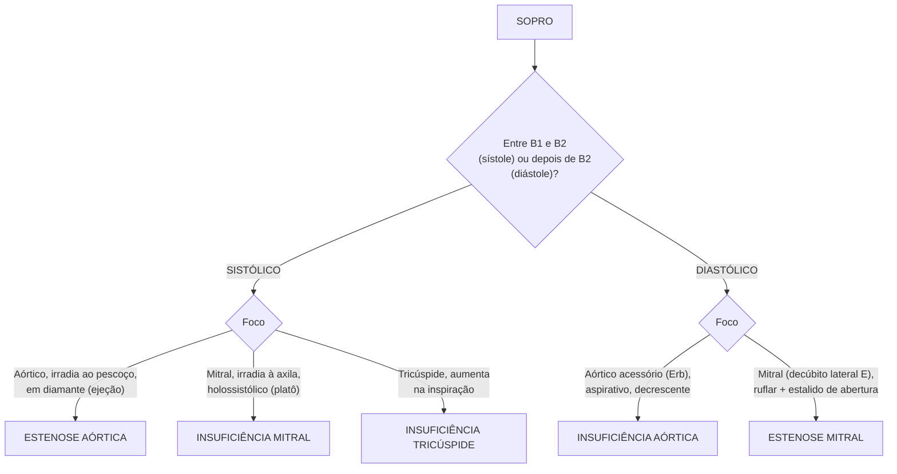

> **Habilidades Profissionais II.** O exame cardiovascular "traduz" a fisiologia do ciclo cardíaco em sinais que podemos ver, palpar e ouvir. Por isso o tópico começa pelo ciclo cardíaco e só depois passa às bulhas e aos sopros. Nas seções há **sons reais de ausculta** (gravações com licença livre) e **links para vídeos** de demonstração das manobras.

## Objetivos do tópico {#objetivos}

Ao final, você deve ser capaz de:

1. Explicar o **ciclo cardíaco** (diagrama de Wiggers) e relacionar cada evento com as **bulhas**, os **pulsos** e os **sopros**.
2. Medir corretamente a **pressão arterial** (método auscultatório, sons de Korotkoff) e examinar os **pulsos arteriais** e o **pulso venoso jugular**.
3. Realizar a **inspeção e a palpação do precórdio** (ictus cordis, impulsões, frêmitos).
4. Localizar os **focos de ausculta** e descrever as **bulhas** normais (B1, B2 e seus desdobramentos) e extras (B3, B4).
5. Caracterizar um **sopro** (momento no ciclo, foco, irradiação, intensidade, timbre, manobras) e explicar **por que ele ocorre**.
6. Reconhecer os achados das **estenoses e insuficiências** aórtica e mitral (e tricúspide e pulmonar), dos **sopros inocentes** e do **atrito pericárdico**.

::: referencias
Porto – Semiologia Médica, 8ª ed., caps. "Exame do coração" e "Exame dos pulsos" · Bickley – Bates: Propedêutica Médica, 13ª ed., cap. "Sistema cardiovascular" · Guyton & Hall – Tratado de Fisiologia Médica, 14ª ed., cap. "O músculo cardíaco; o coração como bomba e a função das valvas".
:::

## Conceitos-base {#conceitos-base}

### Anatomia funcional em uma página {#anatomia-funcional}

O coração tem quatro câmaras: **átrio direito** (recebe o sangue venoso das veias cavas) → **valva tricúspide** → **ventrículo direito** → **valva pulmonar** → artéria pulmonar → pulmões → veias pulmonares → **átrio esquerdo** → **valva mitral** → **ventrículo esquerdo** → **valva aórtica** → aorta.

- As valvas **atrioventriculares** (mitral à esquerda, tricúspide à direita) ficam entre átrios e ventrículos e são presas por **cordas tendíneas** aos **músculos papilares**, que impedem que elas "virem" para o átrio durante a contração.
- As valvas **semilunares** (aórtica e pulmonar) ficam na saída dos ventrículos.
- **Toda valva abre e fecha passivamente, por diferença de pressão**: abre quando a pressão "antes" dela supera a pressão "depois"; fecha quando a relação se inverte. Esse princípio explica todo o resto.

No tórax, o coração fica no mediastino, inclinado: a **ponta (ápice)**, formada pelo ventrículo esquerdo, aponta para baixo, para a frente e para a esquerda, e normalmente fica no **5º espaço intercostal esquerdo, na linha hemiclavicular**. O **ventrículo direito** forma a maior parte da face anterior do coração, logo atrás do esterno.

### O ciclo cardíaco (diagrama de Wiggers) {#ciclo-cardiaco}

O **ciclo cardíaco** é a sequência de eventos de um batimento. Divide-se em **sístole** (contração ventricular e ejeção) e **diástole** (relaxamento e enchimento). Acompanhe pelo lado esquerdo (o direito é igual, com pressões menores):

1. **Fim da diástole — contração atrial**: o átrio se contrai e "completa" o enchimento do ventrículo (cerca de 20–30% do volume em repouso; mais em quem tem ventrículo rígido). No pulso venoso jugular, gera a **onda "a"**.
2. **Contração isovolumétrica (início da sístole)**: o ventrículo começa a contrair; a pressão dentro dele **supera a do átrio** → a **mitral (e a tricúspide) fecha** → **primeira bulha (B1)**. Como a aórtica ainda está fechada (a pressão do ventrículo ainda é menor que a da aorta), o ventrículo contrai **com volume constante** (as quatro valvas fechadas) e a pressão sobe rapidamente.
3. **Ejeção ventricular**: quando a pressão do ventrículo **supera a da aorta** (~80 mmHg), a **valva aórtica abre** (sem som, em condições normais) e o sangue é ejetado. A pressão arterial sobe até o máximo (**pressão sistólica**, ~120 mmHg) — é aqui que sentimos o **pulso**.
4. **Relaxamento isovolumétrico (início da diástole)**: o ventrículo relaxa; quando sua pressão **cai abaixo da pressão da aorta**, a **valva aórtica (e a pulmonar) fecha** → **segunda bulha (B2)**. A pressão da aorta, então, cai lentamente até a **pressão diastólica** (~80 mmHg) enquanto o sangue escoa para os tecidos. Nesse intervalo, todas as valvas estão fechadas e a pressão ventricular despenca.
5. **Enchimento ventricular**: quando a pressão do ventrículo cai **abaixo da do átrio**, a **mitral abre** (sem som, normalmente) e o sangue acumulado no átrio entra rapidamente (**enchimento rápido** — se o ventrículo estiver muito cheio ou dilatado, esse choque gera a **B3**), depois lentamente (**diástase**), e o ciclo recomeça com a contração atrial (que, contra um ventrículo rígido, gera a **B4**).

::: figura img/morfo/hp/cardio/diagrama-wiggers.png
**Diagrama de Wiggers — ciclo cardíaco do lado esquerdo.** Linhas de cima: **pressão aórtica** (*aortic pressure*), **pressão atrial** (*atrial pressure*) e **pressão ventricular** (*ventricular pressure*); abaixo, o **volume ventricular** (*ventricular volume*), o **eletrocardiograma** e o **fonocardiograma** (*phonocardiogram*, registro dos sons). Observe: a **B1** coincide com o cruzamento das pressões ventricular e atrial (fechamento da mitral, logo após o QRS); a **B2**, com o cruzamento da pressão ventricular para baixo da aórtica (fechamento da aórtica, no fim da onda T). Entre B1 e B2 está a **sístole** (contração isovolumétrica + ejeção); entre B2 e a próxima B1, a **diástole** (relaxamento isovolumétrico + enchimento rápido + diástase + contração atrial).
:::

**Regra de ouro para a ausculta**: a **sístole** fica entre **B1 e B2** (é o intervalo **mais curto** em frequências normais); a **diástole** fica entre **B2 e a B1 seguinte** (mais longa). Para não confundir, palpe o **pulso carotídeo** enquanto ausculta: **B1 vem logo antes do pulso**.

::: referencias
Guyton & Hall, 14ª ed., cap. "O músculo cardíaco; o coração como bomba" · Porto, 8ª ed.
:::

## Explicação detalhada {#explicacao}

### Sequência do exame {#sequencia}

Paciente em **decúbito dorsal** com a cabeceira elevada a ~30–45°, tórax descoberto, ambiente silencioso, examinador **à direita** do paciente. Ordem: **sinais vitais e pressão arterial → pulsos arteriais → pulso venoso jugular → inspeção e palpação do precórdio → ausculta** (com manobras). Em pessoas com mamas volumosas, peça licença e desloque a mama com delicadeza (ou peça à paciente) para auscultar a ponta.

### Pressão arterial {#pressao-arterial}

**Método auscultatório**, conforme as Diretrizes Brasileiras de Hipertensão:

1. Paciente **sentado**, em repouso por **3–5 minutos**, pernas descruzadas, costas apoiadas, sem ter fumado, tomado café ou feito exercício nos 30 minutos anteriores, **bexiga vazia**, sem falar durante a medida.
2. Braço **apoiado na altura do coração**, palma para cima; manguito de **tamanho adequado** (a bolsa de borracha deve envolver ~80% da circunferência do braço — manguito pequeno **superestima** a pressão), colocado 2–3 cm acima da fossa cubital, centralizado sobre a artéria braquial.
3. **Estimar a sistólica pela palpação** do pulso radial: inflar até o pulso desaparecer; esse valor + ~20–30 mmHg é o ponto até onde se inflará. Isso evita erro pelo **hiato auscultatório** (um intervalo silencioso entre a sistólica e a diastólica em alguns hipertensos, que faria subestimar a sistólica).
4. Colocar o estetoscópio (campânula ou diafragma) sobre a **artéria braquial**, inflar até o nível estimado e **desinflar lentamente** (2–3 mmHg por segundo).
5. **Sons de Korotkoff**: produzidos pela turbulência do sangue que volta a passar pela artéria parcialmente comprimida:
   - **Fase I** — aparecimento do primeiro som nítido, repetitivo = **pressão sistólica**;
   - Fases II e III — sons com sopro e depois mais intensos;
   - Fase IV — abafamento;
   - **Fase V** — **desaparecimento** dos sons = **pressão diastólica** (em alguns casos — gestantes, crianças, insuficiência aórtica, estados hipercinéticos —, os sons não desaparecem até zero; usa-se então a fase IV).
6. Medir nos **dois braços** na primeira consulta (usar o de maior valor); repetir após 1–2 minutos e usar a média.

::: figura img/morfo/hp/cardio/korotkoff.jpg
**Medida da pressão arterial pelos sons de Korotkoff.** Enquanto o manguito desinfla, a pressão no manguito (linha descendente) cruza primeiro a **pressão sistólica** — o sangue passa em jatos e surge o **primeiro som** (fase I) — e depois a **pressão diastólica**, quando o fluxo deixa de ser turbulento e os sons **desaparecem** (fase V). Entre essas duas pressões, a artéria fica parcialmente comprimida a cada batimento.
:::

**Classificação** (adultos, consultório): normal < 120/80 mmHg; pré-hipertensão 120–139/80–89; hipertensão estágio 1 ≥ 140/90; estágio 2 ≥ 160/100; estágio 3 ≥ 180/110. A **pressão de pulso** (sistólica − diastólica) normal fica em torno de 40 mmHg; é **alargada** na insuficiência aórtica, no hipertireoidismo, na anemia e na rigidez arterial do idoso, e **estreita** na estenose aórtica grave, no choque e no tamponamento.

### Pulsos arteriais {#pulsos}

Palpe com as polpas dos dedos indicador e médio (não o polegar, que tem pulso próprio): **radiais**, **braquiais**, **carotídeos** (um de cada vez, nunca os dois juntos, e sem massagear — risco de reflexo vagal e de soltar placas), **femorais**, **poplíteos**, **tibiais posteriores** (atrás do maléolo medial) e **pediosos** (dorso do pé). Avalie:

- **Frequência** (normal em adultos: 60–100 bpm) e **ritmo** (regular ou irregular — na fibrilação atrial é "irregularmente irregular"). **Déficit de pulso**: a frequência na ausculta é maior que a do pulso radial (batimentos fracos não chegam à periferia — fibrilação atrial).
- **Amplitude e forma** (melhor avaliadas no **pulso carotídeo**, mais próximo do coração):
  - **Pulso *parvus et tardus*** (pequeno e lento para subir): **estenose aórtica** grave — a valva estreita retarda e reduz a ejeção.
  - **Pulso em martelo d'água (Corrigan)** — amplo, com subida e queda abruptas: **insuficiência aórtica** — grande volume ejetado que reflui logo em seguida.
  - **Pulso alternante** — alterna batimentos fortes e fracos: insuficiência ventricular esquerda grave.
  - **Pulso paradoxal** — queda da sistólica de mais de 10 mmHg na **inspiração**: **tamponamento cardíaco**, asma grave.
- **Simetria**: compare os dois lados e membros superiores × inferiores (pulso femoral fraco e atrasado em relação ao radial sugere **coarctação da aorta**; pulsos ausentes em um membro, obstrução arterial).
- **Ausculta das carótidas**: um **sopro carotídeo** sugere estenose (placa de aterosclerose), com risco de AVC.

::: figura midia/hp/cardio/som-sopro-carotideo.mp3
**Sopro carotídeo** (gravação com estetoscópio sobre a carótida esquerda de um paciente com **estenose de cerca de 70%** por placa de aterosclerose). Ouça o ruído soprante a cada batimento, produzido pela **turbulência** do sangue ao passar pelo estreitamento — o mesmo princípio dos sopros cardíacos.
:::

### Pulso venoso jugular {#pulso-jugular}

As veias jugulares funcionam como um "**manômetro**" do **átrio direito**, porque não há valvas entre elas e o coração.

- **Técnica**: paciente com a cabeceira a **45°**, cabeça levemente virada para a esquerda, luz tangencial. Observe a **veia jugular interna direita** (entre as duas cabeças do esternocleidomastóideo; suas pulsações são vistas, não palpadas) e a jugular externa (mais superficial).
- **Pressão venosa jugular (PVJ)**: mede-se a altura do topo da coluna pulsátil acima do **ângulo esternal (de Louis)**; normal até **~3–4 cm** (o que corresponde a uma pressão do átrio direito de ~8–9 cmH₂O, já que o átrio fica ~5 cm abaixo do ângulo esternal). Uma **turgência jugular a 45°** indica pressão venosa central elevada: **insuficiência cardíaca direita** (frequentemente secundária à esquerda), hipervolemia, **tamponamento cardíaco**, pericardite constritiva, estenose/insuficiência tricúspide, embolia pulmonar maciça.
- **Refluxo hepatojugular (abdominojugular)**: compressão do abdome por ~10 segundos eleva a coluna jugular de forma sustentada em quem tem insuficiência cardíaca direita (o ventrículo direito não acomoda o volume extra).
- **Ondas do pulso venoso** (vistas com prática): **a** (contração atrial — aumentada na estenose tricúspide e na hipertensão pulmonar; **ausente na fibrilação atrial**; ondas "a" em canhão no bloqueio atrioventricular total, quando o átrio contrai contra a tricúspide fechada), **c**, descendente **x**, **v** (enchimento atrial com a tricúspide fechada — **ondas v gigantes na insuficiência tricúspide**) e descendente **y**.
- **Diferença entre pulso venoso e arterial**: o venoso tem **duas ondas por batimento**, **não é palpável**, **varia com a respiração** (cai na inspiração) e com a posição, e **desaparece com leve compressão** acima da clavícula; o carotídeo é único, palpável e não muda com a posição.

::: figura img/morfo/hp/cardio/turgencia-jugular.jpg
**Turgência jugular** em paciente com insuficiência tricúspide grave. A **veia jugular externa** está muito distendida no pescoço, mesmo com o paciente parcialmente sentado — sinal de **pressão venosa central elevada**: o sangue não consegue entrar adequadamente no coração direito e se acumula no sistema venoso.
:::

### Inspeção e palpação do precórdio {#precordio}

- **Inspeção**: abaulamentos (cardiomegalia na infância, derrame pericárdico volumoso), retrações, pulsações visíveis, o **ictus cordis** (visível em pessoas magras).
- **Ictus cordis (choque da ponta)**: o impulso do **ápice do ventrículo esquerdo** contra a parede torácica no início da sístole. Palpe com a face palmar da mão e depois com as polpas dos dedos; se difícil, coloque o paciente em **decúbito lateral esquerdo** (aproxima a ponta da parede). Avalie:
  - **Localização** — normal no **4º–5º espaço intercostal esquerdo, na linha hemiclavicular**; **desviado para baixo e para a esquerda** na **dilatação do ventrículo esquerdo** (insuficiência aórtica, insuficiência mitral, cardiomiopatia dilatada).
  - **Extensão** — normal ≤ **2 polpas digitais** (~2–3 cm); maior = **aumento do VE**.
  - **Intensidade e duração** — **propulsivo/sustentado** na **hipertrofia** (estenose aórtica, hipertensão, que causam sobrecarga de **pressão**); **amplo e difuso** na **dilatação** (sobrecarga de **volume**).
- **Impulsão paraesternal esquerda** (levantamento do esterno com a mão espalmada): **hipertrofia/dilatação do ventrículo direito** (hipertensão pulmonar, estenose mitral, DPOC).
- **Frêmito**: a **sensação tátil de um sopro intenso** — uma "vibração" como a de um gato ronronando (por isso "frêmito catário"). Indica sopro de **intensidade ≥ 4/6**. Descreva onde é palpado e em que fase (sistólico ou diastólico).
- **Bulhas palpáveis**: B2 palpável no foco pulmonar = hipertensão pulmonar.

### Os focos de ausculta {#focos}

Os focos **não ficam sobre as valvas**, mas nos pontos da parede torácica para onde **o som de cada valva é melhor transmitido** (seguindo o fluxo de sangue):

| Foco | Localização | O que se ouve melhor |
|---|---|---|
| **Aórtico** | **2º espaço intercostal direito**, junto ao esterno | Valva aórtica (B2 aórtica; sopros aórticos) |
| **Aórtico acessório (Erb)** | **3º espaço intercostal esquerdo**, junto ao esterno | Sopros da **insuficiência aórtica** (diastólicos) |
| **Pulmonar** | **2º espaço intercostal esquerdo**, junto ao esterno | Valva pulmonar; **desdobramento de B2** |
| **Tricúspide** | **4º–5º espaço intercostal esquerdo**, na borda esternal esquerda (base do apêndice xifoide) | Valva tricúspide |
| **Mitral** | **Ápice — 5º espaço intercostal esquerdo, linha hemiclavicular** (ou onde estiver o ictus) | Valva mitral (B1; sopros mitrais, B3, B4) |

**Técnica**: ausculte **todos os focos**, primeiro com o **diafragma** (pressionado firmemente — sons **agudos**: B1, B2, sopros de regurgitação, atrito) e depois com a **campânula** (apoiada levemente, sem pressionar — sons **graves**: **B3, B4**, ruflar da estenose mitral). Ausculte também as regiões de irradiação (axila, carótidas, dorso) e use as posições especiais: **decúbito lateral esquerdo** (ápice: estenose mitral, B3, B4) e **sentado, inclinado para a frente, em expiração forçada** (borda esternal: insuficiência aórtica, atrito pericárdico).

::: figura img/morfo/hp/cardio/focos-ausculta.png
**Focos de ausculta cardíaca.** As cores indicam as regiões onde o som de cada valva é mais bem ouvido: **vermelho — tricúspide** (borda esternal esquerda baixa), **amarelo — pulmonar** (2º espaço intercostal esquerdo), **verde — mitral** (ápice, 5º espaço intercostal na linha hemiclavicular), **azul — aórtico** (2º espaço intercostal direito). Repare que os focos aórtico e pulmonar ficam na "base" do coração (perto da saída dos grandes vasos) e o mitral, na ponta.
:::

::: videos
- [Ausculta cardíaca: focos e técnica (busca no YouTube)](https://www.youtube.com/results?search_query=ausculta+card%C3%ADaca+focos+semiologia)
- [Palpação do ictus cordis (busca no YouTube)](https://www.youtube.com/results?search_query=palpa%C3%A7%C3%A3o+ictus+cordis+semiologia)
- [Pressão venosa jugular — como avaliar (busca no YouTube)](https://www.youtube.com/results?search_query=press%C3%A3o+venosa+jugular+exame+f%C3%ADsico)

Prefira vídeos de faculdades de medicina, hospitais universitários e sociedades médicas.
:::

### As bulhas cardíacas {#bulhas}

#### Primeira bulha (B1) {#b1}

**Fechamento das valvas mitral e tricúspide** no início da sístole. Som "**TUM**" — mais grave e um pouco mais longo que B2; **mais intenso no foco mitral** (ápice). Coincide com o pulso carotídeo.

- **Hiperfonética**: as valvas fecham a partir de uma posição **mais aberta** (estão bem abertas no fim da diástole) → batem com mais força: **estenose mitral** (com valva ainda móvel), **PR curto**, taquicardia e estados hipercinéticos (febre, anemia, hipertireoidismo, exercício).
- **Hipofonética**: valvas já quase fechadas no início da sístole ou som mal transmitido: **PR longo**, **insuficiência mitral** (valva não coapta), contratilidade reduzida, estenose mitral muito calcificada (valva imóvel), obesidade, enfisema, derrame pericárdico.
- **Intensidade variável**: fibrilação atrial, bloqueio atrioventricular total.

#### Segunda bulha (B2) e seus desdobramentos {#b2}

**Fechamento das valvas aórtica (A2) e pulmonar (P2)** no fim da sístole. Som "**TÁ**" — mais curto, seco e agudo; **mais intenso na base** (focos aórtico e pulmonar).

- **Desdobramento fisiológico**: na **inspiração**, a pressão intratorácica cai, **chega mais sangue ao coração direito** e menos ao esquerdo; o ventrículo direito leva um pouco mais de tempo para esvaziar (e a impedância pulmonar cai) → a **P2 atrasa** e se separa da A2: ouve-se "**TÁ-TRÁ**" no **foco pulmonar**, que se funde novamente na expiração. É **normal**, sobretudo em jovens.
- **Desdobramento amplo**: a separação existe também na expiração e aumenta na inspiração — **bloqueio de ramo direito** (ativação tardia do VD), estenose pulmonar.
- **Desdobramento fixo** (não varia com a respiração): **comunicação interatrial (CIA)** — o fluxo extra da esquerda para a direita mantém o VD sempre sobrecarregado, e a respiração não muda o volume relativo dos dois lados.
- **Desdobramento paradoxal (invertido)**: a **A2 é que atrasa** (vem depois da P2); o desdobramento aparece na **expiração** e some na inspiração — **bloqueio de ramo esquerdo**, estenose aórtica grave.
- **Hiperfonese de P2**: **hipertensão pulmonar** (a valva pulmonar fecha com mais força). **Hiperfonese de A2**: hipertensão arterial sistêmica. **Hipofonese de A2**: **estenose aórtica** calcificada (valva rígida, pouco móvel).

#### Terceira bulha (B3) {#b3}

Som **grave** no início da diástole, logo após B2 (na fase de **enchimento rápido**): "TUM-TÁ-**tu**", lembrando o galope de um cavalo ("**ritmo de galope**", em três tempos — mnemônico em inglês "*Ken-tuck-y*"). Ouvida com a **campânula** no **ápice**, em decúbito lateral esquerdo.

- **Mecanismo**: o sangue que entra rapidamente num ventrículo **já cheio, dilatado e complacente demais** provoca uma vibração súbita da parede e das estruturas valvares quando o enchimento rápido é freado.
- **Fisiológica** em **crianças, adolescentes, atletas e gestantes** (enchimento rápido vigoroso).
- **Patológica** após os ~40 anos: **insuficiência cardíaca com disfunção sistólica** (sobrecarga de volume), **insuficiência mitral** grave. É um sinal importante de IC descompensada.

#### Quarta bulha (B4) {#b4}

Som **grave** no **fim da diástole**, imediatamente antes de B1: "**tu**-TUM-TÁ" (mnemônico "*Ten-nes-see*"), produzido pela **contração atrial** empurrando sangue contra um ventrículo **rígido, pouco complacente**. Campânula, ápice.

- Quase sempre **patológica**: **hipertrofia ventricular** (hipertensão, estenose aórtica, cardiomiopatia hipertrófica), **isquemia miocárdica** aguda, idosos.
- **Não existe B4 na fibrilação atrial** (não há contração atrial eficaz).

#### Outros sons {#outros-sons}

- **Estalido de abertura** da mitral: som seco, agudo, no início da diástole, na **estenose mitral** (a valva espessada, mas ainda móvel, abre bruscamente "como uma vela inflando"). Quanto **mais próximo de B2**, **mais grave** a estenose (pressão do átrio esquerdo mais alta faz a valva abrir mais cedo).
- **Clique sistólico** (meso a telessistólico): **prolapso da valva mitral** (a cúspide "estala" ao ser empurrada para o átrio), frequentemente seguido de sopro telessistólico.
- **Clique de ejeção**: logo após B1, na estenose aórtica ou pulmonar congênita (valva bicúspide).
- **Atrito pericárdico**: ruído **áspero**, "de couro novo" ou de lixa, com até **três componentes** (sístole atrial, sístole e diástole ventricular), mais audível na borda esternal esquerda com o paciente **sentado e inclinado para a frente**, em expiração; **não se irradia** e pode **variar** de um exame para o outro. Indica **pericardite** (inflamação das lâminas do pericárdio, que se atritam).

::: figura midia/hp/cardio/som-coracao-normal.mp3
**Coração normal** — bulhas de uma adolescente saudável, gravadas no foco tricúspide. Identifique o ritmo em **dois tempos**: **TUM** (B1, fechamento das valvas atrioventriculares) – **TÁ** (B2, fechamento das semilunares), com um **intervalo curto** entre B1 e B2 (sístole) e um **intervalo mais longo** entre B2 e a próxima B1 (diástole). Não há sopros nem bulhas extras.
:::

::: figura img/morfo/hp/cardio/fonocardiogramas.png
**Fonocardiogramas de sons cardíacos normais e anormais** (registros gráficos dos sons, em português). Compare: o padrão **normal** (B1 e B2 com silêncio entre elas); **sopros sistólicos** entre B1 e B2 (de **ejeção**, em forma de losango/"diamante", como na estenose aórtica, e **holossistólicos**, em platô, como na insuficiência mitral); e **sopros diastólicos** após B2 (decrescente, como na insuficiência aórtica, e o ruflar com reforço pré-sistólico, como na estenose mitral).
:::

::: referencias
Porto, 8ª ed., cap. "Exame do coração" · Bates, 13ª ed.
:::

### Sopros: o que são e como descrevê-los {#sopros}

**Sopro** é um som prolongado produzido pelo **fluxo turbulento** do sangue. O fluxo normal é **laminar** (silencioso); ele se torna **turbulento** quando: (1) o sangue passa por um **orifício estreitado** (**estenose**); (2) volta por uma valva que **não fecha bem** (**insuficiência** ou regurgitação); (3) passa por uma **comunicação anormal** (CIV, CIA, persistência do canal arterial); (4) o **fluxo aumenta muito** por uma valva normal (anemia, febre, gravidez, hipertireoidismo, exercício — **sopros funcionais**); (5) o sangue fica menos viscoso (anemia).

**Como descrever um sopro** (sempre nesta ordem):

1. **Momento no ciclo**: **sistólico** (entre B1 e B2) ou **diastólico** (entre B2 e B1); e em que parte — protossistólico, mesossistólico, telessistólico, **holossistólico** (ocupa toda a sístole, de B1 a B2).
2. **Foco** de maior intensidade.
3. **Irradiação** (para onde o som "viaja", seguindo o jato): aórticos → **pescoço/carótidas**; mitrais → **axila**.
4. **Intensidade** — **escala de Levine** (1 a 6):
   - **1/6**: muito fraco, ouvido só com atenção, em ambiente silencioso;
   - **2/6**: fraco, mas ouvido logo;
   - **3/6**: moderado, facilmente audível, **sem frêmito**;
   - **4/6**: intenso, **com frêmito**;
   - **5/6**: muito intenso, ouvido com apenas a borda do estetoscópio na pele;
   - **6/6**: ouvido **com o estetoscópio afastado** da pele.
5. **Forma** (configuração): **em diamante** (crescente-decrescente) — típica do **sopro de ejeção**; **em platô** (intensidade constante) — **regurgitação**; **decrescente**; **crescente**.
6. **Timbre**: rude/áspero, aspirativo, "em jato de vapor", musical, **ruflar** (grave, como um tambor rufando).
7. **Manobras que o modificam** (veja adiante).

### Estenoses e insuficiências valvares {#valvopatias}

A lógica é sempre a mesma: **em que fase do ciclo a valva deveria estar aberta ou fechada?**

- Uma **estenose** dá sopro **quando a valva deveria estar aberta** e o sangue precisa passar por ela: semilunares (aórtica, pulmonar) abrem na **sístole** → estenose aórtica = sopro **sistólico**; atrioventriculares (mitral, tricúspide) abrem na **diástole** → estenose mitral = sopro **diastólico**.
- Uma **insuficiência** dá sopro **quando a valva deveria estar fechada** e o sangue reflui: semilunares fecham na **diástole** → insuficiência aórtica = sopro **diastólico**; atrioventriculares fecham na **sístole** → insuficiência mitral = sopro **sistólico**.

| | **Sístole** | **Diástole** |
|---|---|---|
| Valva **aórtica/pulmonar** | **Estenose** aórtica/pulmonar | **Insuficiência** aórtica/pulmonar |
| Valva **mitral/tricúspide** | **Insuficiência** mitral/tricúspide | **Estenose** mitral/tricúspide |

#### Estenose aórtica {#estenose-aortica}

- **Causas**: **degeneração e calcificação** da valva no idoso (a mais comum), **valva aórtica bicúspide** congênita (calcifica mais cedo, 50–60 anos), febre reumática.
- **Fisiopatologia**: o orifício estreito obriga o ventrículo esquerdo a gerar **pressões muito mais altas** para ejetar o sangue (**sobrecarga de pressão**) → **hipertrofia concêntrica** do VE (parede espessa, cavidade normal) → ventrículo rígido (B4), maior consumo de oxigênio e menor perfusão coronariana do miocárdio hipertrófico.
- **Sintomas clássicos** (a tríade, que indica doença grave e alta mortalidade se não tratada): **angina**, **síncope** ao esforço (o débito não aumenta com o exercício, e os vasos periféricos dilatam) e **dispneia/insuficiência cardíaca**.
- **Exame**: **sopro sistólico de ejeção**, **em diamante** (crescente-decrescente), **rude**, mais intenso no **foco aórtico**, **irradiado para as carótidas** (e às vezes para o ápice — fenômeno de Gallavardin); frêmito na base se intenso; **pulso *parvus et tardus***; **ictus propulsivo** e sustentado; **B4**; **A2 hipofonética** (valva calcificada) e desdobramento paradoxal nos casos graves; pressão de pulso estreita. Quanto **mais tardio o pico** do sopro, **mais grave** a estenose (a ejeção demora mais).

#### Insuficiência aórtica {#insuficiencia-aortica}

- **Causas**: dilatação da raiz da aorta (hipertensão, síndrome de Marfan, aortite sifilítica), febre reumática, **endocardite** (aguda), valva bicúspide, dissecção da aorta (aguda).
- **Fisiopatologia**: na diástole, parte do sangue ejetado **volta da aorta para o ventrículo** → o VE recebe o sangue do átrio **mais** o que refluiu (**sobrecarga de volume**) → **dilatação** com hipertrofia excêntrica; o volume sistólico ejetado é enorme (pressão **sistólica alta**), e a aorta "esvazia" rapidamente na diástole (pressão **diastólica baixa**) → **pressão de pulso muito alargada** (ex.: 170/40 mmHg).
- **Exame**: **sopro diastólico** **aspirativo**, **decrescente**, de alta frequência, logo após B2, mais audível no **foco aórtico acessório (3º espaço intercostal esquerdo)**, com o paciente **sentado, inclinado para a frente, em expiração**; **ictus desviado para baixo e para a esquerda, amplo** (VE dilatado); pulso em **martelo d'água**; muitos sinais periféricos ligados à pressão de pulso alargada (balanço da cabeça a cada batimento — **sinal de Musset**; pulsação das unhas — **sinal de Quincke**; sopro duplo na femoral — Duroziez). Pode haver um **sopro mesodiastólico no ápice** (ruflar de Austin Flint: o jato regurgitante impede a abertura completa da cúspide anterior da mitral). Um sopro sistólico de fluxo na base também é comum (grande volume ejetado).

#### Estenose mitral {#estenose-mitral}

- **Causa**: quase sempre **febre reumática** (cardiopatia reumática crônica — ainda frequente no Brasil e em regiões com acesso limitado a tratamento das faringites estreptocócicas; veja [febre reumática](#/imunologia/hipersensibilidades#tipo-ii-inflamacao)): as comissuras se fundem, as cúspides espessam e calcificam (aspecto em "boca de peixe").
- **Fisiopatologia**: o sangue tem dificuldade para passar do átrio esquerdo ao ventrículo na diástole → **pressão alta no átrio esquerdo** → **dilatação atrial** (→ **fibrilação atrial** e trombos/embolias) e **congestão pulmonar** (dispneia, ortopneia, hemoptise) → **hipertensão pulmonar** → sobrecarga e falência do **ventrículo direito**. O VE é **protegido** (recebe pouco sangue). A taquicardia (exercício, febre, gestação) piora muito os sintomas porque **encurta a diástole**, o tempo disponível para o átrio esvaziar.
- **Exame**: **B1 hiperfonética**, **estalido de abertura** da mitral após B2, seguido de **sopro diastólico em ruflar** (**grave**, como um tambor rufando), **com reforço pré-sistólico** (pela contração atrial — some na fibrilação atrial), **localizado no ápice** (não irradia), melhor ouvido com a **campânula** e o paciente em **decúbito lateral esquerdo**, após um pequeno esforço; **P2 hiperfonética** e impulsão paraesternal (hipertensão pulmonar); fácies com bochechas arroxeadas (fácies mitral); pulso irregular se houver fibrilação atrial.

#### Insuficiência mitral {#insuficiencia-mitral}

- **Causas**: **prolapso da valva mitral**, febre reumática, **dilatação do VE** (o anel se alarga — insuficiência "funcional"), **isquemia/infarto** dos músculos papilares (ruptura → insuficiência aguda grave com edema pulmonar), endocardite.
- **Fisiopatologia**: na sístole, parte do sangue do VE **reflui para o átrio esquerdo** (que tem pressão baixa) → sobrecarga de **volume** do átrio e do ventrículo esquerdos → **dilatação** de ambos; congestão pulmonar nos casos graves.
- **Exame**: **sopro holossistólico** (ocupa toda a sístole, "**em platô**", começando junto com B1 e indo até B2, que pode ficar encoberta), **em jato de vapor**, mais intenso no **foco mitral**, **irradiado para a axila esquerda** (e dorso); **B1 hipofonética**; **B3** se a regurgitação é importante (grande volume entrando no VE no enchimento rápido); **ictus desviado** para a esquerda e para baixo. No **prolapso**: **clique mesossistólico** seguido de **sopro telessistólico**.

::: figura midia/hp/cardio/som-prolapso-mitral.mp3
**Prolapso da valva mitral com insuficiência mitral** (gravação de uma adolescente com o diagnóstico). Procure, entre B1 e B2, o **ruído sistólico** produzido pelo sangue que **reflui do ventrículo para o átrio esquerdo** através da valva que não fecha completamente. Compare com a gravação do coração normal: lá, o intervalo entre B1 e B2 é silencioso.
:::

#### Valvas do lado direito {#valvas-direitas}

- **Insuficiência tricúspide**: geralmente **funcional**, por dilatação do VD (hipertensão pulmonar, insuficiência cardíaca esquerda); também na endocardite de usuários de drogas injetáveis. **Sopro holossistólico** na **borda esternal esquerda baixa**, que **aumenta na inspiração profunda** (**sinal de Rivero-Carvallo**: a inspiração aumenta o retorno venoso ao coração direito, aumentando o volume regurgitado); **ondas v gigantes** no pulso jugular, **fígado pulsátil**, edema, ascite.
- **Estenose pulmonar** (geralmente congênita): sopro sistólico de ejeção no foco pulmonar.
- **Insuficiência pulmonar**: sopro diastólico no foco pulmonar (na hipertensão pulmonar — sopro de Graham Steell).
- **Regra**: **sopros do lado direito aumentam na inspiração**; os do lado esquerdo, na expiração.

#### Comunicações e sopros inocentes {#sopros-inocentes}

- **Comunicação interventricular (CIV)**: sopro **holossistólico** **rude**, intenso (frequentemente com frêmito), na **borda esternal esquerda baixa** (3º–4º espaço intercostal) — o sangue passa do VE (pressão alta) para o VD durante toda a sístole. Defeitos **pequenos** fazem sopros **mais intensos** (jato de alta velocidade).
- **Comunicação interatrial (CIA)**: sopro sistólico de fluxo pulmonar (aumento do fluxo pela valva pulmonar) e **desdobramento fixo de B2**.
- **Sopro inocente (funcional)**: comum em **crianças** (até ~50%), gestantes e estados hipercinéticos. Características: **sistólico** (nunca diastólico), **suave** (intensidade **≤ 2/6**, sem frêmito), **curto**, mesossistólico, **localizado** (pouca irradiação), **varia com a posição** (diminui ao sentar ou ficar em pé), **B2 normal**, sem outras alterações e com o paciente **assintomático**. O mais comum em crianças é o **sopro de Still** (vibratório, musical, na borda esternal esquerda média). **Todo sopro diastólico é patológico.**

::: figura midia/hp/cardio/som-cia-civ.mp3
**Comunicação interventricular** (gravação de um coração com o defeito). Note o **sopro sistólico intenso e áspero** que preenche o intervalo entre B1 e B2: em cada sístole, o sangue passa em jato do ventrículo esquerdo (pressão alta) para o direito através do orifício no septo.
:::

::: figura midia/hp/cardio/som-sopro-inocente.mp3
**Sopro inocente de Still em uma criança pequena.** Um sopro **sistólico suave, musical ("vibratório")**, sem frêmito, com bulhas normais, numa criança saudável. Não indica doença do coração — resulta das vibrações do fluxo normal na via de saída do ventrículo esquerdo. Compare a suavidade dele com a aspereza do sopro da comunicação interventricular.
:::

### Manobras que modificam os sopros {#manobras-sopros}

| Manobra | O que faz | Efeito |
|---|---|---|
| **Inspiração profunda** (Rivero-Carvallo) | ↑ retorno venoso ao coração **direito** | ↑ sopros do lado **direito** (insuficiência tricúspide) |
| **Expiração** | ↑ retorno ao coração esquerdo; aproxima o coração da parede | ↑ sopros do lado **esquerdo** |
| **Decúbito lateral esquerdo** | Aproxima o ápice da parede torácica | ↑ **estenose mitral**, B3, B4 |
| **Sentado, inclinado para a frente, em expiração** | Aproxima a base do coração da parede | ↑ **insuficiência aórtica**, atrito pericárdico |
| **Agachamento** ou elevação das pernas | ↑ retorno venoso e pós-carga | ↑ a maioria dos sopros; ↓ cardiomiopatia hipertrófica e prolapso mitral |
| **Ficar em pé** ou **Valsalva** (fase de esforço) | ↓ retorno venoso | ↓ a maioria dos sopros; ↑ **cardiomiopatia hipertrófica obstrutiva** e o **prolapso mitral** (clique mais precoce) |
| **Preensão manual sustentada** (*handgrip*) | ↑ resistência periférica (pós-carga) | ↑ **insuficiência mitral**, insuficiência aórtica, CIV; ↓ estenose aórtica |

::: videos
- [Sopros cardíacos — estenose e insuficiência aórtica e mitral (busca no YouTube)](https://www.youtube.com/results?search_query=sopros+card%C3%ADacos+estenose+insufici%C3%AAncia+a%C3%B3rtica+mitral+ausculta)
- [Bulhas B3 e B4 — ritmo de galope (busca no YouTube)](https://www.youtube.com/results?search_query=B3+B4+bulhas+card%C3%ADacas+galope)
- [Medida da pressão arterial — técnica correta (busca no YouTube)](https://www.youtube.com/results?search_query=aferi%C3%A7%C3%A3o+press%C3%A3o+arterial+t%C3%A9cnica+correta)
:::

::: referencias
Porto, 8ª ed., caps. "Exame do coração" e "Valvopatias" · Bates, 13ª ed. · Sociedade Brasileira de Cardiologia – Diretriz Brasileira de Valvopatias · Diretrizes Brasileiras de Hipertensão Arterial.
:::

## Correlação clínica {#correlacao-clinica}

### Insuficiência cardíaca ao exame {#ic-exame}

- **Congestão esquerda** (pulmonar): dispneia aos esforços, **ortopneia** (falta de ar deitado, melhora sentado — o retorno venoso aumenta deitado), **dispneia paroxística noturna**, **estertores crepitantes** nas bases pulmonares (veja [exame do tórax](#/habilidades-profissionais/hp-exame-torax#ruidos-adventicios)), **B3**, ictus desviado.
- **Congestão direita** (sistêmica): **turgência jugular**, **refluxo hepatojugular**, **hepatomegalia** dolorosa, **ascite**, **edema de membros inferiores** (depressível, "cacifo", simétrico, vespertino).
- **Baixo débito**: extremidades frias, enchimento capilar lento, pressão de pulso estreita, confusão, oligúria.

### Pericardite e tamponamento {#pericardite}

- **Pericardite aguda**: dor torácica que **piora ao deitar e ao inspirar** e **melhora sentado e inclinado para a frente**, **atrito pericárdico**, alterações difusas no ECG.
- **Tamponamento cardíaco** (líquido no pericárdio comprimindo o coração): **tríade de Beck** — **hipotensão**, **turgência jugular** e **bulhas abafadas** —, além de **pulso paradoxal** e taquicardia. É uma emergência (pericardiocentese).

### Endocardite infecciosa {#endocardite}

Febre + **sopro novo** (ou mudança de um sopro antigo) deve levantar suspeita de **endocardite** (infecção das valvas). Procure sinais periféricos: petéquias conjuntivais, hemorragias em lasca nas unhas, nódulos de Osler (dolorosos, nas polpas digitais), lesões de Janeway (indolores, nas palmas e plantas), esplenomegalia. Colher hemoculturas antes do antibiótico.

::: referencias
Porto, 8ª ed. · Harrison – Medicina Interna, 21ª ed., caps. "Abordagem ao paciente com sopro cardíaco" e "Endocardite infecciosa".
:::

## Pontos de alta cobrança em prova {#alta-cobranca}

::: prova
- **Ciclo**: B1 = **fechamento mitral/tricúspide** (início da sístole, junto ao pulso carotídeo); B2 = **fechamento aórtica/pulmonar** (fim da sístole). Sístole entre B1 e B2 (mais curta); diástole entre B2 e B1. Valvas abrem e fecham por **diferença de pressão**.
- **PA**: sentado, repouso 3–5 min, braço na altura do coração, **manguito adequado** (pequeno superestima), estimar pelo pulso radial (**hiato auscultatório**), **Korotkoff I = sistólica, V = diastólica**.
- **Pulsos**: ***parvus et tardus*** = estenose aórtica; **martelo d'água** = insuficiência aórtica; **paradoxal** = tamponamento; **alternante** = disfunção grave do VE; **déficit de pulso** = FA.
- **Jugular** (45°): PVJ > ~3–4 cm acima do ângulo esternal = pressão venosa alta (IC direita, tamponamento); **refluxo hepatojugular**; onda **a ausente na FA**, **v gigante na insuficiência tricúspide**; venoso: duas ondas, não palpável, varia com respiração.
- **Ictus**: 5º EIC na linha hemiclavicular, ≤ 2 polpas; **desviado/amplo** = **dilatação do VE** (sobrecarga de volume: IAo, IM); **propulsivo/sustentado** = **hipertrofia** (sobrecarga de pressão: EAo, HAS). **Frêmito** = sopro ≥ 4/6.
- **Focos**: aórtico (2º EIC D), pulmonar (2º EIC E), **aórtico acessório/Erb (3º EIC E)**, tricúspide (4º–5º EIC borda esternal E), mitral (ápice). **Diafragma** = agudos; **campânula** = graves (B3, B4, ruflar).
- **B2**: desdobramento **fisiológico** (inspiração, P2 atrasa); **fixo** = **CIA**; **paradoxal** = BRE, estenose aórtica grave; amplo = BRD. P2 hiperfonética = hipertensão pulmonar.
- **B3** (enchimento rápido, ventrículo **dilatado/sobrecarga de volume**; normal em jovens, atletas, gestantes; patológica na IC sistólica). **B4** (contração atrial contra ventrículo **rígido**: hipertrofia, isquemia; **não existe na FA**).
- **Lógica**: estenose = sopro quando a valva deveria estar **aberta**; insuficiência = quando deveria estar **fechada**. **EAo** e **IM** = **sistólicos**; **IAo** e **EM** = **diastólicos**.
- **EAo**: ejeção em **diamante**, foco aórtico, **irradia para as carótidas**, pulso *parvus et tardus*, B4, A2 hipofonética; **angina, síncope, dispneia**. **IAo**: diastólico **aspirativo decrescente** no **Erb**, sentado/inclinado/expiração; **pressão de pulso alargada**, martelo d'água, ictus desviado. **EM** (reumática): **B1 hiperfonética + estalido de abertura + ruflar diastólico** no ápice (campânula, decúbito lateral E), reforço pré-sistólico, FA, hipertensão pulmonar. **IM**: **holossistólico em platô**, ápice, **irradia para a axila**, B1 hipofonética, B3; prolapso = **clique mesossistólico + sopro telessistólico**.
- **Levine**: 3/6 sem frêmito; **4/6 com frêmito**; 6/6 com estetoscópio afastado. **Sopro inocente**: sistólico, ≤ 2/6, curto, localizado, varia com posição, B2 normal. **Todo diastólico é patológico.**
- **Manobras**: inspiração (**Rivero-Carvallo**) ↑ sopros direitos; **Valsalva/em pé** ↓ a maioria, ↑ **cardiomiopatia hipertrófica** e prolapso; **handgrip** ↑ IM/IAo, ↓ EAo.
- **Tamponamento**: tríade de **Beck** (hipotensão, turgência jugular, bulhas abafadas) + pulso paradoxal. **Atrito pericárdico**: áspero, sentado inclinado para a frente.
:::

## Armadilhas comuns {#armadilhas}

::: armadilha
- **Confundir sístole com diástole na ausculta.** Palpe o **pulso carotídeo**: a **B1** vem logo antes dele; o intervalo B1–B2 é o mais curto.
- **Achar que estenose sempre dá sopro sistólico.** A **estenose mitral** dá sopro **diastólico** (a mitral se abre na diástole).
- **Usar o diafragma para procurar B3, B4 e ruflar mitral.** São sons **graves**: use a **campânula**, apoiada levemente.
- **Achar que o foco mitral fica sobre a valva mitral.** Os focos são os pontos onde o som **chega melhor** à parede, seguindo o fluxo.
- **Achar que todo desdobramento de B2 é patológico.** O desdobramento **na inspiração** é **fisiológico**; o **fixo** (CIA) e o **paradoxal** é que indicam doença.
- **Achar que sopro intenso significa defeito maior na CIV.** Defeitos **pequenos** costumam gerar sopros **mais intensos**.
- **Medir a PA com manguito pequeno em braço grande.** Superestima a pressão (falso diagnóstico de hipertensão).
- **Esperar B4 em paciente com fibrilação atrial.** Sem contração atrial eficaz, **não há B4** (nem reforço pré-sistólico na estenose mitral).
:::

## Resumo para revisão rápida {#resumo}

- **Ciclo cardíaco**: valvas abrem/fecham por pressão; B1 = fechamento AV (início da sístole); B2 = fechamento semilunar (fim da sístole).
- **Sequência**: PA (Korotkoff I e V, manguito adequado) → pulsos (parvus et tardus, martelo d'água, paradoxal) → jugular a 45° → precórdio (ictus 5º EIC LHC, ≤ 2 polpas; frêmito) → ausculta (5 focos; diafragma e campânula; posições).
- **Bulhas**: B1 e B2 (desdobramento fisiológico, fixo na CIA, paradoxal no BRE); B3 (sobrecarga de volume) e B4 (ventrículo rígido); estalido de abertura (EM), clique (prolapso), atrito pericárdico.
- **Sopros**: turbulência; descrever momento, foco, irradiação, intensidade (Levine), forma, timbre, manobras.
- **Valvopatias**: EAo (sistólico de ejeção, carótidas), IM (holossistólico, axila), IAo (diastólico aspirativo, Erb, pressão de pulso larga), EM (ruflar diastólico no ápice, estalido, B1 forte). Direita aumenta na inspiração. Sopro inocente: sistólico suave, localizado; diastólico é sempre patológico.
- **Clínica**: IC (B3, crepitantes, jugular, edema), tamponamento (Beck), endocardite (sopro novo + febre).

::: referencias
Porto – Semiologia Médica, 8ª ed. · Bates – Propedêutica Médica, 13ª ed. · Guyton & Hall, 14ª ed.
:::
