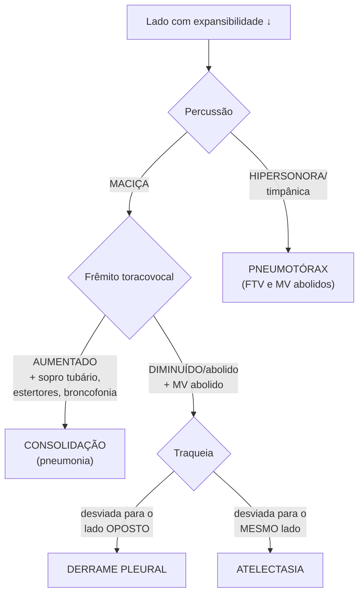

> **Habilidades Profissionais II.** O exame do tórax segue quatro etapas — **inspeção, palpação, percussão e ausculta** — e o raciocínio final é juntar os achados num **padrão** (consolidação, derrame, pneumotórax, atelectasia, enfisema). Há **gravações reais** de sons pulmonares e **links para vídeos** das manobras.

## Objetivos do tópico {#objetivos}

Ao final, você deve ser capaz de:

1. Localizar as **linhas e regiões do tórax** e projetar na parede os **lobos pulmonares**.
2. Fazer a **inspeção estática** (forma do tórax, abaulamentos, retrações, sinais periféricos como o **baqueteamento digital**) e **dinâmica** (frequência, ritmo, padrões respiratórios, tiragem).
3. Realizar a **palpação** (expansibilidade, **frêmito toracovocal**) e a **percussão** (técnica, sons e o que significam).
4. Auscultar e descrever os **sons respiratórios normais** (murmúrio vesicular, som brônquico) e os **ruídos adventícios** (estertores finos e grossos, sibilos, roncos, estridor, atrito pleural), além da **ressonância vocal**.
5. Combinar os achados nos **padrões semiológicos** das principais síndromes pleuropulmonares.

::: referencias
Porto – Semiologia Médica, 8ª ed., caps. "Exame do tórax" e "Exame dos pulmões" · Bickley – Bates: Propedêutica Médica, 13ª ed., cap. "Tórax e pulmões" · Guyton & Hall, 14ª ed., cap. "Ventilação pulmonar".
:::

## Conceitos-base {#conceitos-base}

### Por que o tórax "soa" e "vibra" {#fisica-torax}

Toda a semiologia do tórax se baseia em como **som e vibração atravessam** os tecidos:

- O pulmão normal é uma **esponja cheia de ar**. O ar **transmite mal** as vibrações de baixa frequência e **ressoa** quando percutido.
- Um pulmão **consolidado** (alvéolos cheios de pus, sangue ou líquido — como na pneumonia) se torna **sólido**: **transmite melhor** a vibração da voz e os sons brônquicos, e soa **maciço** à percussão.
- **Líquido ou ar entre o pulmão e a parede** (derrame pleural, pneumotórax) **afastam** o pulmão e **bloqueiam** a transmissão da vibração e do som.

Guarde essa regra: **sólido aproxima e conduz; líquido ou ar na pleura afastam e isolam**.

### Linhas e referências do tórax {#linhas-toracicas}

- **Anteriores**: linha **medioesternal**, linhas **esternais**, linhas **hemiclaviculares** (do ponto médio da clavícula para baixo).
- **Laterais**: linhas **axilares anterior, média e posterior**.
- **Posteriores**: linha **vertebral** (processos espinhosos), linhas **escapulares**.
- **Ângulo esternal (de Louis)**: a saliência entre o manúbrio e o corpo do esterno, onde se articula a **2ª costela** — referência para contar costelas e espaços intercostais; corresponde também à bifurcação da traqueia.
- Atrás, a **vértebra C7** (vértebra proeminente) e o **ângulo inferior da escápula** (~7º espaço intercostal) ajudam a contar.

**Projeção dos lobos**:

- **Pulmão direito**: três lobos (superior, médio, inferior); **esquerdo**: dois (superior, com a **língula**, e inferior).
- Pela **frente**, predominam os **lobos superiores** (e o **médio** à direita, entre o 4º e o 6º espaço); por **trás**, predominam os **lobos inferiores** (abaixo de ~T3) — por isso **pneumonias de lobo inferior** se examinam **nas costas** e as do **lobo médio**, na face **anterior e lateral direita**.
- O limite inferior dos pulmões fica, aproximadamente, no **6º espaço** na linha hemiclavicular, no **8º** na axilar média e no **10º** atrás (T10); a pleura desce cerca de dois espaços abaixo.

::: figura img/morfo/hp/torax/exame-respiratorio.jpg
**Pontos-chave do exame respiratório.** A ilustração resume onde e como examinar: observe os pontos de **percussão e ausculta** distribuídos de forma **simétrica** nas faces anterior, lateral e posterior do tórax — compare sempre **um lado com o outro** no mesmo nível, de cima para baixo, como numa "escada".
:::

::: referencias
Porto, 8ª ed. · Moore – Anatomia Orientada para a Clínica, 8ª ed., cap. "Tórax".
:::

## Explicação detalhada {#explicacao}

### Inspeção {#inspecao}

Paciente sentado, tórax descoberto, boa iluminação; examine de frente, de lado e de costas.

#### Inspeção estática {#inspecao-estatica}

- **Forma do tórax**:
  - **Normal**: diâmetro anteroposterior menor que o laterolateral (relação ~1:2).
  - **Em tonel (barril)**: diâmetro anteroposterior **aumentado**, costelas horizontalizadas — **enfisema/DPOC** (hiperinsuflação crônica) e idosos.
  - **Pectus excavatum** ("peito escavado"): depressão do esterno — geralmente congênito; casos graves comprimem coração e pulmões.
  - **Pectus carinatum** ("peito de pombo"): esterno projetado para a frente.
  - **Cifoescoliose**: desvio da coluna que deforma o tórax e pode causar doença restritiva.
- **Abaulamentos e retrações** localizados (tumores, derrames volumosos abaúlam os espaços intercostais; atelectasias e fibroses retraem).
- **Pele e circulação colateral** (veias dilatadas na parede — obstrução da veia cava superior).
- **Sinais periféricos importantes**: **cianose** (central — lábios, língua: hipoxemia; periférica — extremidades: má perfusão), **baqueteamento digital**, uso de musculatura acessória, posição preferida (em tripé na DPOC).

**Baqueteamento digital (dedos em baqueta de tambor; unhas em vidro de relógio)**: aumento do tecido mole da ponta dos dedos, com **perda do ângulo** entre a unha e a pele da base (normalmente ~160°; no baqueteamento, ≥ 180°) e unhas curvas. Causas: **câncer de pulmão**, **fibrose pulmonar**, **bronquiectasias** e supurações crônicas (abscesso, empiema, fibrose cística), cardiopatias congênitas **cianóticas**, endocardite, doença inflamatória intestinal, cirrose. **Não** é típico da DPOC simples (se aparecer num paciente com DPOC, pense em câncer). Um teste prático é o **sinal de Schamroth**: encostar as unhas dos dedos indicadores das duas mãos — normalmente forma-se uma pequena "janela" em losango entre elas, que **desaparece** no baqueteamento.

::: figura img/morfo/hp/torax/baqueteamento-digital.jpg
**Baqueteamento digital.** As pontas dos dedos estão **alargadas** e arredondadas, com as **unhas convexas** ("em vidro de relógio") e perda do ângulo normal entre a unha e a pele. Associa-se a doenças pulmonares crônicas (câncer de pulmão, fibrose, bronquiectasias) e cardiopatias cianóticas, entre outras.
:::

::: figura img/morfo/hp/torax/pectus-excavatum.jpg
***Pectus excavatum*** em um adolescente. Observe a **depressão** da parte inferior do esterno e das cartilagens costais, formando uma "concha" na face anterior do tórax. Na maioria das vezes é apenas estético, mas formas graves podem reduzir a capacidade pulmonar e deslocar o coração.
:::

#### Inspeção dinâmica {#inspecao-dinamica}

- **Frequência respiratória** (contar por 1 minuto, de preferência sem o paciente perceber): adultos **12–20 irpm**. **Taquipneia** (> 20), **bradipneia** (< 12), **apneia**.
- **Tipo respiratório**: **toracoabdominal** em homens e crianças (predomínio do diafragma), **torácico** (costal superior) em mulheres, em geral.
- **Ritmos/padrões anormais**:
  - **Respiração de Kussmaul**: respirações **profundas e rápidas** (amplas), regulares — **acidose metabólica** (cetoacidose diabética, insuficiência renal); o corpo "lava" CO₂ para compensar a acidose (veja [equilíbrio ácido-base](#/fisiologia/equilibrio-acido-base)).
  - **Cheyne-Stokes**: ciclos de respirações que **aumentam e diminuem** progressivamente de amplitude, intercalados com **apneias** — **insuficiência cardíaca** grave, lesões neurológicas, uso de opioides, sono em altitude.
  - **Biot (atáxica)**: respirações irregulares e apneias sem padrão — lesão do bulbo (mau prognóstico).
  - **Suspirosa**: suspiros frequentes — ansiedade.
- **Sinais de esforço respiratório**: **tiragem** (retração dos espaços intercostais, da fúrcula ou da região subcostal na inspiração — o esforço para vencer uma obstrução ou um pulmão rígido gera pressão muito negativa), batimento de asa do nariz, uso de esternocleidomastóideos, **respiração paradoxal** (abdome afunda na inspiração — fadiga do diafragma).
- **Expansibilidade**: observar se os dois lados se expandem igualmente.

### Palpação {#palpacao}

#### Expansibilidade {#expansibilidade}

- **Ápices**: mãos sobre as regiões supraclaviculares, polegares próximos à coluna; o paciente inspira profundamente.
- **Bases** (posterior): mãos espalmadas sobre as bases, polegares paralelos à coluna, formando uma prega de pele entre eles; na inspiração profunda, os polegares devem se afastar **simetricamente** (~3–5 cm).
- **Redução unilateral**: o lado doente se expande menos — **derrame pleural**, **pneumotórax**, **atelectasia**, consolidação extensa, dor pleurítica, fibrose localizada. **Redução bilateral**: DPOC, fibrose difusa, doenças neuromusculares.

#### Frêmito toracovocal (FTV) {#fremito}

- **O que é**: a **vibração** da parede torácica produzida pela voz, sentida pela mão.
- **Técnica**: mãos espalmadas (ou a borda ulnar) sobre o tórax, comparando **pontos simétricos** de cima para baixo, enquanto o paciente repete "**trinta e três**" (palavra com consoantes que vibram bem em português) em voz de intensidade constante.
- **Interpretação** (pela regra da transmissão):
  - **FTV aumentado**: **consolidação** (pneumonia com brônquio pérvio) — o tecido sólido conduz melhor a vibração.
  - **FTV diminuído ou abolido**: **derrame pleural** (o líquido afasta e isola), **pneumotórax** (o ar isola), **atelectasia com brônquio obstruído** (a vibração não chega ao parênquima), espessamento pleural, enfisema, obesidade.

::: dica Frêmito de outros tipos
O **frêmito brônquico** é a vibração das secreções nos brônquios grandes (some com a tosse), e o **frêmito pleural** é a sensação tátil do **atrito pleural** — não confundir com o frêmito toracovocal.
:::

### Percussão {#percussao}

**Técnica (percussão dígito-digital)**: apoie firmemente a **falange média do dedo médio** da mão não dominante (o plessímetro) sobre o espaço intercostal, **sem que o resto da mão toque a pele**; com a ponta do **dedo médio da mão dominante** (o plexor), golpeie a falange apoiada com um movimento **rápido do punho** (não do cotovelo), retirando logo o dedo — um ou dois golpes por ponto. Percorra o tórax de cima para baixo, **comparando lados simétricos**.

**Sons da percussão**:

| Som | Como é | Onde é normal | Patológico em |
|---|---|---|---|
| **Claro pulmonar (som claro atimpânico)** | Ressonante, oco, grave | Sobre o pulmão normal | — |
| **Submaciço** | Intermediário, menos ressonante | Transição com órgãos sólidos | Consolidação inicial, derrame pequeno |
| **Maciço** | **Seco, curto, sem ressonância** (como percutir a coxa) | Sobre fígado (5º–6º espaço à direita), coração | **Derrame pleural**, **consolidação**, atelectasia, tumores |
| **Hipersonoro** | **Mais ressonante** e prolongado que o normal | — | **Enfisema**, **pneumotórax**, asma em crise |
| **Timpânico** | Musical, como um tambor | Sobre o estômago (**espaço de Traube**) e alças intestinais | Pneumotórax grande, cavidades |

- **Derrame pleural**: **macicez** na base, que pode ter limite superior curvo (mais alto na axila — **curva de Damoiseau**); a macicez **muda com a posição** se o líquido for livre.
- **Excursão diafragmática**: percutir a base posterior em inspiração e expiração profundas, marcando o nível da macicez — normal ~4–6 cm; reduzida no enfisema e na paralisia diafragmática.

::: videos
- [Expansibilidade e frêmito toracovocal (busca no YouTube)](https://www.youtube.com/results?search_query=fr%C3%AAmito+toracovocal+expansibilidade+exame+pulmonar)
- [Percussão do tórax — técnica (busca no YouTube)](https://www.youtube.com/results?search_query=percuss%C3%A3o+do+t%C3%B3rax+semiologia+t%C3%A9cnica)
- [Exame físico do aparelho respiratório completo (busca no YouTube)](https://www.youtube.com/results?search_query=exame+f%C3%ADsico+aparelho+respirat%C3%B3rio+semiologia)
:::

### Ausculta {#ausculta}

**Técnica**: paciente sentado, respirando **pela boca, profunda e regularmente**; estetoscópio com o **diafragma** firme sobre a pele (nunca sobre a roupa); ausculte pelo menos **um ciclo respiratório completo** em cada ponto, comparando lados simétricos, nas faces posterior, lateral e anterior.

#### Sons respiratórios normais {#sons-normais}

- **Murmúrio vesicular (MV)**: som **suave, de baixa frequência**, ouvido em **quase todo o tórax**, produzido pela turbulência do ar nos brônquios e filtrado pelo parênquima cheio de ar. Ouve-se **durante toda a inspiração** e apenas no **início da expiração** (inspiração mais longa e intensa que a expiração).
  - **Diminuído ou abolido**: **derrame pleural**, **pneumotórax**, **atelectasia**, **enfisema** (pouco fluxo), obesidade, espessamento pleural, hipoventilação.
- **Som traqueal/brônquico**: **alto, agudo, "soprante"**, com **expiração tão longa ou mais longa** que a inspiração e uma pausa entre elas; normal sobre a **traqueia** e o manúbrio. Ouvido sobre o pulmão (**sopro tubário**), indica **consolidação** — o tecido sólido conduz até a parede o som dos brônquios.
- **Som broncovesicular**: intermediário, normal na região interescapular e no 1º–2º espaço intercostal anterior.

#### Ruídos adventícios {#ruidos-adventicios}

São sons **anormais** que se somam aos sons respiratórios.

**Descontínuos — estertores** (crepitações; em inglês *crackles*): sons curtos, explosivos, como estalidos.

- **Estertores finos (crepitantes)**: **agudos, curtos**, ouvidos no **fim da inspiração**, **não mudam com a tosse**, lembram o som de **esfregar fios de cabelo** perto do ouvido ou de abrir um velcro. **Mecanismo**: **abertura súbita de pequenas vias aéreas e alvéolos** que estavam fechados (colapsados por líquido ou rigidez) — na inspiração, quando a pressão os vence, eles "estalam" ao abrir. Causas: **congestão pulmonar/insuficiência cardíaca** (nas **bases**), **pneumonia** (no início e na resolução), **fibrose pulmonar** (estertores "**em velcro**", bilaterais, nas bases).
- **Estertores grossos (bolhosos)**: **mais graves e longos**, no **início da inspiração e na expiração**, **mudam ou desaparecem com a tosse**. **Mecanismo**: passagem do ar por **secreções** nos brônquios maiores. Causas: **bronquite**, **bronquiectasias**, pneumonia com muita secreção, edema pulmonar avançado.

::: figura midia/hp/torax/som-estertores-pneumonia.mp3
**Estertores (crepitações) numa pneumonia** — gravação com estetoscópio. Ouça os **estalidos curtos e repetidos** durante a inspiração: são alvéolos e pequenos brônquios, cheios de exsudato inflamatório, que se **abrem bruscamente** quando o ar entra.
:::

::: figura midia/hp/torax/som-estertores-fibrose.mp3
**Estertores "em velcro" na fibrose pulmonar idiopática.** Estalidos **finos, secos e numerosos** no fim da inspiração, como abrir um velcro — produzidos pela abertura súbita de pequenas vias aéreas num pulmão **rígido** e fibrosado. São característicos das doenças intersticiais.
:::

**Contínuos** (sons musicais, mais longos):

- **Sibilos**: **agudos**, **musicais** ("chiado", "piado de gato"), mais na **expiração** (que fica prolongada); produzidos pela **vibração das paredes de vias aéreas estreitadas** à passagem do ar. Causas: **asma** (difusos, variáveis), **DPOC**, bronquiolite, edema pulmonar ("asma cardíaca"), anafilaxia. Um **sibilo localizado e fixo** sugere **obstrução por tumor ou corpo estranho**. **Atenção**: na **crise grave** de asma, os sibilos podem **desaparecer** ("**tórax silencioso**") porque quase não há fluxo de ar — sinal de **extrema gravidade**.
- **Roncos**: **graves**, como ronco, por secreções em **brônquios de maior calibre**; frequentemente **mudam com a tosse**.
- **Estridor**: som **agudo**, intenso, predominantemente **inspiratório**, audível até **sem estetoscópio**, produzido por **obstrução da via aérea superior** (laringe, traqueia) — **laringite (crupe)**, epiglotite, corpo estranho, edema de glote na anafilaxia, tumores. É **emergência**.

::: figura midia/hp/torax/som-sibilos.mp3
**Sibilos** — gravação de uma pessoa com obstrução das vias aéreas. Repare no som **musical e agudo**, como um assobio, produzido pela vibração das paredes dos brônquios estreitados (broncoespasmo, edema e muco), mais evidente na **expiração**.
:::

**Atrito pleural**: ruído **áspero**, como **couro se esfregando** ou passos na neve, ouvido **na inspiração e na expiração**, mais nas regiões **laterais e inferiores**; **não muda com a tosse**; desaparece se o paciente prender a respiração (diferente do atrito pericárdico, que continua com os batimentos). **Mecanismo**: as **pleuras inflamadas** (ásperas pela fibrina) atritam entre si. Causas: **pleurite** (pneumonia, tuberculose, embolia pulmonar com infarto, doenças autoimunes); costuma desaparecer quando surge um **derrame** (o líquido separa os folhetos). Associa-se a **dor pleurítica** (em pontada, piora com a inspiração e a tosse).

| Ruído | Tipo | Fase | Muda com a tosse? | Mecanismo | Exemplos |
|---|---|---|---|---|---|
| **Estertores finos** | Descontínuo, agudo | **Fim da inspiração** | **Não** | Abertura de pequenas vias/alvéolos colapsados | IC, pneumonia, fibrose |
| **Estertores grossos** | Descontínuo, grave | Início da inspiração e expiração | **Sim** | Ar em secreções de brônquios maiores | Bronquite, bronquiectasias |
| **Sibilos** | Contínuo, agudo, musical | Principalmente **expiração** | Pouco | Vias aéreas estreitadas vibrando | Asma, DPOC |
| **Roncos** | Contínuo, grave | Inspiração e expiração | **Sim** | Secreções em brônquios grandes | Bronquite, secreção |
| **Estridor** | Contínuo, agudo, intenso | **Inspiração** | Não | Obstrução da via aérea **superior** | Crupe, corpo estranho, edema de glote |
| **Atrito pleural** | Áspero | Inspiração e expiração | Não | Pleuras inflamadas atritando | Pleurite |

#### Ressonância vocal {#ressonancia-vocal}

Ausculta da **voz** do paciente (repetindo "trinta e três"). Normalmente, ouve-se um som **abafado e incompreensível**. Segue a mesma lógica do frêmito:

- **Aumentada** sobre **consolidação**:
  - **Broncofonia**: a voz falada é ouvida **mais alta e nítida**;
  - **Pectorilóquia** (afônica): até a **voz sussurrada** é ouvida claramente, palavra por palavra;
  - **Egofonia**: a voz fica **anasalada, "de cabra"** (o "i" soa como "ê") — ouvida no **limite superior de um derrame pleural** (onde o pulmão está comprimido) e em consolidações.
- **Diminuída** em **derrame**, **pneumotórax**, atelectasia, enfisema.

::: referencias
Porto, 8ª ed., cap. "Exame dos pulmões" · Bates, 13ª ed. · Sociedade Brasileira de Pneumologia e Tisiologia – nomenclatura dos sons respiratórios.
:::

### Os padrões semiológicos {#padroes}

O exame só faz sentido quando os achados são **combinados**:

| Síndrome | Inspeção / expansibilidade | Frêmito toracovocal | Percussão | Murmúrio vesicular | Adventícios / voz | Traqueia/mediastino |
|---|---|---|---|---|---|---|
| **Consolidação** (pneumonia lobar) | ↓ expansibilidade no lado afetado | **↑ aumentado** | **Maciço/submaciço** | Substituído por **sopro tubário** (som brônquico) | **Estertores finos**; **broncofonia, pectorilóquia**, egofonia | Central |
| **Derrame pleural** | ↓ expansibilidade; abaulamento se volumoso | **↓ ou abolido** | **Maciço** (base; muda com posição) | **↓ ou abolido** | **Egofonia** no limite superior; atrito antes de o líquido se formar | **Desviados para o lado oposto** (se volumoso) |
| **Pneumotórax** | ↓ expansibilidade no lado afetado | **↓ ou abolido** | **Hipersonoro/timpânico** | **↓ ou abolido** | — (ressonância vocal ↓) | Desviados para o lado **oposto** no **hipertensivo** |
| **Atelectasia** (brônquio obstruído) | ↓ expansibilidade; **retração** | **↓ ou abolido** | **Maciço** | **↓ ou abolido** | — | **Desviados para o mesmo lado** (o pulmão colapsado "puxa") |
| **Enfisema/DPOC** | **Tórax em tonel**, ↓ expansibilidade bilateral, musculatura acessória | ↓ bilateral | **Hipersonoro** bilateral; ↓ excursão diafragmática | **↓ difusamente**, expiração prolongada | Sibilos, roncos, estertores grossos (bronquite) | Central |
| **Asma (crise)** | Taquipneia, tiragem, musculatura acessória | Normal ou ↓ | Normal ou hipersonoro | ↓ (ou tórax silencioso na crise grave) | **Sibilos** difusos, expiração prolongada | Central |
| **Fibrose pulmonar** | ↓ expansibilidade bilateral; baqueteamento | Normal ou ↑ | Normal ou submaciço | Normal ou ↓ | **Estertores finos "em velcro"** nas bases | Central |
| **Congestão pulmonar (IC)** | Taquipneia, ortopneia | Normal | Normal (submaciço se houver derrame) | Normal | **Estertores finos nas bases**, bilaterais; às vezes sibilos | Central |

::: videos
- [Sons pulmonares: estertores, sibilos, roncos e estridor (busca no YouTube)](https://www.youtube.com/results?search_query=sons+pulmonares+estertores+sibilos+roncos+ausculta)
- [Ausculta pulmonar — técnica e murmúrio vesicular (busca no YouTube)](https://www.youtube.com/results?search_query=ausculta+pulmonar+t%C3%A9cnica+murm%C3%BArio+vesicular)
:::

::: referencias
Porto, 8ª ed. · Bates, 13ª ed.
:::

## Correlação clínica {#correlacao-clinica}

### Casos típicos {#casos-torax}

- **Pneumonia lobar (lobo inferior direito)**: febre, tosse produtiva, dor pleurítica; na base direita posterior, expansibilidade reduzida, **frêmito aumentado**, **macicez**, **sopro tubário**, **estertores finos**, broncofonia.
- **Derrame pleural** (insuficiência cardíaca, pneumonia, tuberculose, câncer): dispneia; base com **macicez**, **frêmito e murmúrio abolidos**, egofonia no limite superior. O diagnóstico se confirma por imagem, e a **toracocentese** (punção do líquido) avalia se é transudato ou exsudato.
- **Pneumotórax hipertensivo**: o ar entra na pleura e não sai (efeito válvula), comprimindo o pulmão e o mediastino → **dispneia intensa, hipotensão, turgência jugular, desvio da traqueia para o lado oposto, hipersonoridade e murmúrio abolido** no lado afetado. É uma **emergência**: descompressão imediata com agulha (2º espaço intercostal na linha hemiclavicular ou 4º–5º espaço na linha axilar média), sem esperar radiografia.
- **Crise de asma**: sibilos difusos, expiração prolongada, tiragem; sinais de gravidade — dificuldade para falar frases, uso intenso de musculatura acessória, **tórax silencioso**, cianose, confusão, pulso paradoxal.
- **Insuficiência cardíaca descompensada**: **estertores finos bilaterais nas bases**, que sobem conforme piora a congestão; às vezes derrame pleural bilateral (maior à direita).

### Sinais de alerta de insuficiência respiratória {#alerta-respiratorio}

Frequência > 30 irpm, saturação baixa, uso de musculatura acessória, tiragem, respiração paradoxal, cianose, confusão ou sonolência (hipercapnia), incapacidade de falar — exigem avaliação imediata e oxigênio/suporte ventilatório.

::: referencias
Porto, 8ª ed. · Harrison – Medicina Interna, 21ª ed. · Sociedade Brasileira de Pneumologia e Tisiologia.
:::

## Pontos de alta cobrança em prova {#alta-cobranca}

::: prova
- **Regra**: tecido **sólido** (consolidação) **conduz** vibração e som (FTV ↑, som brônquico, broncofonia); **líquido ou ar na pleura** (derrame, pneumotórax) **isolam** (FTV e MV ↓/abolidos).
- **Referências**: ângulo de Louis = **2ª costela**; lobos **inferiores** examinados **atrás**; lobo **médio** na frente/lateral direita.
- **Tórax em tonel** = enfisema; **pectus excavatum/carinatum**; **baqueteamento** (câncer de pulmão, fibrose, bronquiectasias, cardiopatia cianótica — não DPOC simples; sinal de Schamroth).
- **FR** 12–20 irpm. **Kussmaul** = profunda e rápida, **acidose metabólica**; **Cheyne-Stokes** = crescendo-decrescendo com apneias, **IC grave**/lesão neurológica; **Biot** = irregular, lesão bulbar. **Tiragem** = esforço.
- **FTV** ("trinta e três"): ↑ consolidação; ↓ derrame, pneumotórax, atelectasia, enfisema.
- **Percussão**: claro pulmonar (normal), **maciço** (derrame, consolidação, atelectasia), **hipersonoro** (enfisema, pneumotórax), **timpânico** (espaço de Traube). Técnica: falange média apoiada, golpe com o punho.
- **MV**: inspiração inteira + início da expiração; ↓ derrame, pneumotórax, atelectasia, enfisema. **Sopro tubário** (som brônquico no pulmão) = **consolidação**.
- **Estertores finos**: fim da inspiração, não mudam com tosse, abertura de alvéolos (**IC nas bases, pneumonia, fibrose "em velcro"**). **Grossos**: secreção, mudam com tosse. **Sibilos**: musicais, expiratórios, vias estreitadas (asma, DPOC; **localizado** = obstrução focal; **tórax silencioso** = gravidade). **Roncos**: graves, secreção. **Estridor**: inspiratório, **via aérea superior**, emergência. **Atrito pleural**: áspero, nas duas fases, não muda com tosse, some ao prender a respiração.
- **Ressonância vocal**: broncofonia, **pectorilóquia** (sussurro nítido), **egofonia** (voz de cabra; limite superior do derrame) = consolidação.
- **Padrões**: **consolidação** (FTV ↑, maciço, sopro tubário, crepitantes); **derrame** (FTV ↓, maciço, MV ↓, traqueia **oposta**); **pneumotórax** (FTV ↓, **hipersonoro**, MV ↓; hipertensivo = emergência); **atelectasia** (FTV ↓, maciço, MV ↓, traqueia **para o mesmo lado**); **enfisema** (tonel, hipersonoro bilateral, MV ↓ difuso).
:::

## Armadilhas comuns {#armadilhas}

::: armadilha
- **Achar que derrame e consolidação são iguais por serem maciços.** O **frêmito** diferencia: **aumentado** na consolidação, **diminuído** no derrame.
- **Confundir o desvio da traqueia.** **Derrame volumoso e pneumotórax hipertensivo** empurram para o lado **oposto**; **atelectasia** puxa para o **mesmo lado**.
- **Achar que ausência de sibilos na asma é bom sinal.** Pode ser o **tórax silencioso** da crise **muito grave**.
- **Confundir estertores grossos com finos.** Os **grossos mudam com a tosse** (secreção); os **finos não** (abertura de alvéolos).
- **Confundir atrito pleural com pericárdico.** O **pleural some ao prender a respiração**; o pericárdico continua com os batimentos.
- **Achar que baqueteamento faz parte da DPOC.** Na DPOC com baqueteamento, investigue **câncer de pulmão** ou bronquiectasias.
- **Auscultar sobre a roupa ou percutir com o cotovelo.** Ausculta sempre na pele; percussão com movimento do **punho**.
:::

## Resumo para revisão rápida {#resumo}

- **Sequência**: inspeção (estática: forma, baqueteamento; dinâmica: FR, padrões, tiragem) → palpação (expansibilidade, FTV) → percussão (claro, maciço, hipersonoro, timpânico) → ausculta (MV, som brônquico, adventícios, ressonância vocal).
- **Regra física**: sólido conduz (FTV ↑, sopro tubário); líquido/ar pleural isola (FTV e MV ↓).
- **Adventícios**: estertores finos (alvéolos abrindo: IC, pneumonia, fibrose), grossos (secreção), sibilos (estreitamento: asma, DPOC), roncos, estridor (via aérea superior), atrito pleural.
- **Padrões**: consolidação, derrame, pneumotórax, atelectasia, enfisema, asma, fibrose, congestão.
- **Padrões respiratórios**: Kussmaul (acidose), Cheyne-Stokes (IC grave), Biot (bulbo).

::: referencias
Porto – Semiologia Médica, 8ª ed. · Bates – Propedêutica Médica, 13ª ed.
:::
