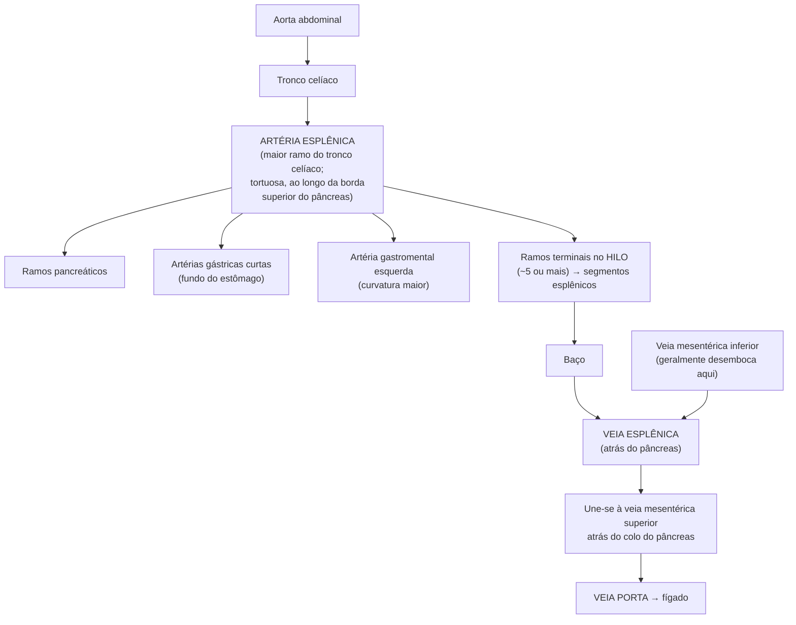
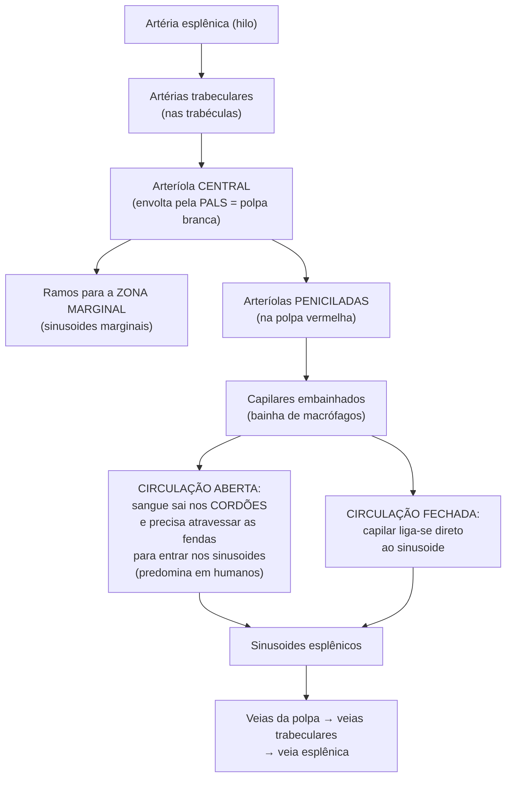

> **Roteiro do laboratório (Problema 1):** questões 15 e 16 — identificar o baço, sua localização, faces, bordas, irrigação e drenagem; na histologia, cápsula, trabéculas, polpas vermelha e branca, zona timo-dependente, zona marginal, circulação do sangue, sinusoides ao microscópio eletrônico e hemocaterese. A função imunológica do baço (e a asplenia) está em [órgãos linfoides](#/imunologia/orgaos-linfoides-hematopoese#baco).

## Objetivos do tópico {#objetivos}

Ao final, você deve ser capaz de:

1. Descrever a **localização**, as **faces**, as **bordas**, o **hilo** e as **relações** do baço.
2. Descrever a **irrigação arterial** (artéria esplênica e seus ramos), a **drenagem venosa** (veia esplênica → veia porta) e a **drenagem linfática** do baço.
3. Identificar na lâmina **cápsula, trabéculas, polpa branca (nódulos e bainha periarteriolar), zona marginal e polpa vermelha (cordões e sinusoides)**, explicando por que a polpa vermelha é tão eosinófila e por que o baço não tem córtex e medula.
4. Explicar a **circulação sanguínea dentro do baço** (aberta e fechada) e o que diferencia os nódulos linfáticos do baço dos de outros órgãos.
5. Descrever a estrutura dos **sinusoides esplênicos** e o processo de **hemocaterese**.

::: referencias
Moore – Anatomia Orientada para a Clínica, 8ª ed., cap. "Abdome" · Ross & Pawlina – Histologia: Texto e Atlas, 8ª ed., cap. "Sistema linfático" · Junqueira & Carneiro – Histologia Básica, 13ª ed., cap. "Sistema imune e órgãos linfoides".
:::

## Conceitos-base {#conceitos-base}

### O que o baço faz {#funcoes-baco}

O baço é o **maior órgão linfoide** do corpo e o único que fica **no caminho do sangue** (os linfonodos ficam no caminho da linfa). Ele tem duas grandes funções, cada uma ligada a uma parte do órgão:

- **Imunológica — polpa branca**: funciona como um "linfonodo do sangue", onde linfócitos encontram antígenos que chegaram pela circulação (por exemplo, bactérias no sangue). A zona marginal produz rapidamente IgM contra polissacarídeos de bactérias encapsuladas.
- **Filtração do sangue — polpa vermelha**: remove **hemácias velhas ou defeituosas** (hemocaterese), plaquetas envelhecidas, partículas e bactérias opsonizadas; recicla o **ferro** da hemoglobina; armazena cerca de um terço das plaquetas.

No feto, o baço também produz células sanguíneas (hematopoese), função que pode voltar em doenças graves da medula.

::: referencias
Ross & Pawlina, 8ª ed., cap. "Sistema linfático".
:::

## Explicação detalhada {#explicacao}

### Anatomia do baço {#anatomia-baco}

#### Localização e dimensões {#localizacao-baco}

- Fica no **hipocôndrio esquerdo** (quadrante superior esquerdo do abdome), sob a cúpula esquerda do diafragma, **posterior ao estômago**.
- Seu eixo longo acompanha a **10ª costela**, e o órgão fica protegido pelas **costelas 9, 10 e 11**.
- No adulto mede aproximadamente **12 × 7 × 3 cm** e pesa cerca de **150 g** (varia bastante).
- Normalmente **não é palpável**; quando se palpa a ponta do baço abaixo do rebordo costal esquerdo, geralmente há **esplenomegalia** (aumento).
- É **intraperitoneal**: coberto pelo peritônio visceral em toda a superfície, exceto no **hilo**.

#### Faces, bordas e extremidades {#faces-bordas}

- **Face diafragmática** — convexa e lisa, voltada para o diafragma (e, através dele, para a pleura, o pulmão e as costelas 9–11).
- **Face visceral** — côncava, voltada para as vísceras. Nela ficam o **hilo** e as **impressões** dos órgãos vizinhos:
  - **gástrica** (estômago) — a maior, anterior ao hilo;
  - **renal** (rim esquerdo) — posterior ao hilo;
  - **cólica** (flexura esquerda do cólon) — na extremidade anterior;
  - **pancreática** (cauda do pâncreas) — junto ao hilo.
- **Borda superior** — fina e frequentemente com **incisuras** (chanfraduras), úteis para reconhecer um baço aumentado ao exame.
- **Borda inferior** — arredondada.
- **Extremidades** anterior e posterior (polos).
- **Hilo** — na face visceral, por onde entram os ramos da **artéria esplênica** e saem as tributárias da **veia esplênica**; ali também estão linfonodos e nervos.

::: figura img/morfo/baco/baco-gray1188.png
**Face visceral do baço** (Gray). Observe o **hilo**, com os vasos esplênicos (em vermelho a artéria, em azul a veia saindo do hilo, *vein leaving hilus*), e as impressões: **gástrica** (*gastric surface*, a maior), **renal** (*renal surface*), **cólica** (*colic surface*) e **pancreática** (*pancreatic surface*). Também aparecem as bordas **anterior** (superior, *anterior border*) e **posterior** (inferior, *posterior border*).
:::

#### Ligamentos e relações {#ligamentos-baco}

O baço é mantido em posição por pregas de peritônio que também levam seus vasos:

- **Ligamento gastroesplênico** — une o baço à curvatura maior do estômago; contém os **vasos gástricos curtos** e os **vasos gastromentais (gastroepiploicos) esquerdos**.
- **Ligamento esplenorrenal** — une o baço ao rim esquerdo; contém os **vasos esplênicos** e a **cauda do pâncreas**.
- **Ligamento frenocólico** — entre a flexura esquerda do cólon e o diafragma, serve de "apoio" à extremidade inferior do baço.

### Irrigação, drenagem e inervação {#vascularizacao-baco}

- **Artéria esplênica** — é o **maior ramo do tronco celíaco**. Segue um trajeto **tortuoso** para a esquerda, ao longo da **borda superior do pâncreas**, e passa pelo ligamento esplenorrenal até o hilo, onde se divide em vários ramos. No caminho, dá ramos ao **pâncreas**, as **artérias gástricas curtas** (para o fundo do estômago) e a **artéria gastromental esquerda**.
- Dentro do baço, os ramos são **artérias terminais**, que irrigam **segmentos** com pouca comunicação entre si. Por isso a obstrução de um ramo causa um **infarto esplênico** em forma de cunha — e é possível retirar só parte do baço (esplenectomia parcial).
- **Veia esplênica** — formada no hilo, corre **posteriormente ao pâncreas**, geralmente recebe a **veia mesentérica inferior** e se une à **veia mesentérica superior**, atrás do colo do pâncreas, para formar a **veia porta**. Por isso o sangue do baço passa pelo **fígado** antes de voltar ao coração — e a **hipertensão portal** (como na cirrose) causa **esplenomegalia**.
- **Drenagem linfática** — os vasos linfáticos (que saem da cápsula e das trabéculas) vão para os **linfonodos esplênicos** no hilo e, daí, para os **linfonodos pancreaticoesplênicos** e **celíacos**. O baço não tem vasos linfáticos aferentes: ele filtra sangue, não linfa.
- **Inervação** — fibras simpáticas do **plexo celíaco**, que acompanham a artéria (controlam principalmente o calibre dos vasos).

::: figura img/morfo/baco/baco-openstax.jpg
**Baço: anatomia e histologia.** (a) O baço no hipocôndrio esquerdo, sob o **diafragma** (*diaphragm*), com o **hilo** (*hilum*), a **artéria esplênica** (*splenic artery*) e a **veia esplênica** (*splenic vein*); à direita, o esquema mostra a **polpa branca** (*white pulp*) em torno de uma **arteríola**, a **polpa vermelha** (*red pulp*), uma **trabécula** (*trabecula*) e uma **vênula** (*venule*). (b) Lâmina: **trabécula**, **zona marginal** (*marginal zone*), **artéria central** (*central artery or arteriole*), **centro germinativo** (*germinal center*), **capilares arteriais**, **seio venoso** (*venous sinus*) e **polpa vermelha**.
:::

::: referencias
Moore – Anatomia Orientada para a Clínica, 8ª ed., cap. "Abdome" · Netter – Atlas de Anatomia Humana, 7ª ed., pranchas do baço e do tronco celíaco.
:::

### Histologia do baço {#histologia-baco}

#### Cápsula e trabéculas {#capsula-trabeculas}

- **Cápsula** de tecido conjuntivo denso, com algumas fibras de músculo liso, coberta por **mesotélio** (o peritônio visceral).
- **Trabéculas** partem da cápsula para dentro do órgão levando **artérias e veias trabeculares**.
- Uma rede de **células e fibras reticulares** preenche o interior e sustenta as células livres.

#### O baço não tem córtex e medula {#sem-cortex-medula}

Diferente do linfonodo e do timo, o baço **não é dividido em córtex e medula**. Sua organização é em **polpa branca** e **polpa vermelha**, misturadas por todo o órgão. A olho nu, num corte do baço fresco, a polpa branca aparece como **pontos branco-acinzentados** de 1–2 mm espalhados num fundo **vermelho-escuro** (a polpa vermelha).

#### Polpa branca — o componente imunológico {#polpa-branca}

A polpa branca é formada por tecido linfoide organizado **ao redor das artérias**:

- **Bainha linfoide periarteriolar (PALS)** — um "manguito" de **linfócitos T** em volta da **arteríola central**. É a **zona timo-dependente** do baço.
- **Nódulos linfáticos (folículos)** — de **linfócitos B**, primários ou secundários (com centro germinativo), que se formam junto à bainha. Nos cortes, o nódulo esplênico tem uma característica **exclusiva**: a **arteríola central aparece dentro dele, geralmente em posição excêntrica** (deslocada para a periferia). É assim que se reconhece um nódulo do baço e o diferencia dos nódulos do linfonodo ou das tonsilas, que não têm uma artéria no meio.

Por que se diz que a polpa branca é **essencialmente o componente imunológico** do baço? Porque é nela que estão os linfócitos T e B organizados, onde antígenos do sangue são apresentados e onde se formam centros germinativos e plasmócitos — enquanto a polpa vermelha se dedica sobretudo à filtração.

#### Zona marginal {#zona-marginal}

É a faixa de transição entre a polpa branca e a polpa vermelha, ao redor dos nódulos e da bainha. Contém:

- **Sinusoides marginais**, onde o sangue arterial chega primeiro e flui lentamente;
- **Macrófagos** especializados e **células dendríticas**, que capturam antígenos do sangue;
- **Linfócitos B da zona marginal**, que respondem rapidamente a **polissacarídeos** de bactérias encapsuladas produzindo **IgM**, sem precisar da ajuda de linfócitos T.

É o primeiro local de contato do sangue com o tecido linfoide — por isso é tão importante na defesa contra pneumococo, meningococo e *Haemophilus*.

#### Polpa vermelha — a filtração {#polpa-vermelha}

A polpa vermelha ocupa cerca de 75% do baço e tem dois componentes que se alternam:

- **Cordões esplênicos (de Billroth)** — faixas de tecido reticular frouxo, cheias de **hemácias**, **macrófagos**, plaquetas, plasmócitos e outros leucócitos. É onde o sangue "se espreme" e onde os macrófagos inspecionam as hemácias.
- **Sinusoides esplênicos (seios venosos)** — vasos largos que recolhem o sangue filtrado.

**Por que a polpa vermelha é tão eosinófila?** Porque é repleta de **hemácias**, e a **hemoglobina** cora intensamente pela **eosina**. A polpa branca, ao contrário, é **basófila** (roxa), por causa dos núcleos dos linfócitos agrupados.

#### Sinusoides esplênicos ao microscópio eletrônico {#sinusoides-baco}

Os sinusoides do baço têm uma estrutura única, ideal para "testar" as hemácias:

- Suas **células endoteliais são alongadas**, em forma de **bastão**, dispostas paralelamente ao longo do vaso, como as **aduelas de um barril**.
- Entre elas há **fendas** estreitas (cerca de 2–3 µm).
- A **lâmina basal é descontínua**: forma **anéis** que circundam o sinusoide como os aros de um barril (fibras anulares).
- Para voltar ao sangue a partir dos cordões, a hemácia (que mede 7–8 µm) precisa **se deformar** e passar espremida por essas fendas.

Na parte (b) da figura da seção de vascularização, os **seios venosos** (*venous sinus*) são os espaços claros da polpa vermelha, e a **zona marginal** circunda a polpa branca com sua **artéria central**.

### Circulação do sangue dentro do baço {#circulacao-baco}

O ponto central é a **circulação aberta**: o sangue sai dos capilares diretamente no tecido dos **cordões**, sem estar dentro de um vaso, e precisa **atravessar as fendas** dos sinusoides para voltar à circulação. Nesse trajeto lento, os **macrófagos** inspecionam cada hemácia — as que não conseguem se deformar ficam retidas.

### Hemocaterese {#hemocaterese}

**Hemocaterese** é a **destruição das hemácias envelhecidas** pelo baço (e, em menor grau, pelo fígado e pela medula óssea):

1. As hemácias vivem cerca de **120 dias**. Com o tempo, sua membrana perde flexibilidade e expõe sinais de "envelhecimento".
2. Nos **cordões**, as hemácias rígidas **não conseguem passar pelas fendas** dos sinusoides e ficam retidas.
3. Os **macrófagos** dos cordões as fagocitam.
4. A hemoglobina é decomposta: a **globina** vira aminoácidos; o **ferro** é guardado (ferritina, hemossiderina) e devolvido à medula para formar novas hemácias; o **heme** vira **biliverdina** e depois **bilirrubina**, que vai pelo sangue até o fígado e é excretada na bile.

O baço também retira **inclusões** de dentro das hemácias sem destruí-las (como os restos nucleares chamados corpúsculos de Howell-Jolly) — por isso esses corpúsculos aparecem no sangue de quem não tem baço.

::: referencias
Ross & Pawlina, 8ª ed., cap. "Sistema linfático" · Junqueira & Carneiro, 13ª ed., cap. "Sistema imune e órgãos linfoides".
:::

## Correlação clínica {#correlacao-clinica}

### Ruptura do baço e sinal de Kehr {#ruptura-baco}

Apesar da proteção das costelas, o baço é o órgão abdominal **mais lesado no trauma fechado** (acidentes, quedas, esportes de contato). Fraturas das **costelas 9–11** à esquerda devem levantar a suspeita. Como o órgão é muito vascularizado e tem cápsula fina, a ruptura causa **hemorragia intraperitoneal** grave. O sangue que irrita o diafragma pode causar **dor referida no ombro esquerdo** (**sinal de Kehr**), porque o diafragma é inervado pelo nervo frênico (C3–C5), que compartilha segmentos medulares com a pele do ombro.

### Esplenomegalia {#esplenomegalia}

O baço aumenta por: **hipertensão portal** (cirrose — o sangue represa pela veia esplênica), **infecções** (mononucleose, malária, leishmaniose visceral — que na Amazônia é causa importante de baço muito grande), **anemias hemolíticas** (trabalho excessivo de hemocaterese), **doenças hematológicas** (leucemias, linfomas, mielofibrose). O baço grande pode reter e destruir plaquetas e leucócitos em excesso (**hiperesplenismo**) e fica mais vulnerável à ruptura — por isso pacientes com mononucleose devem evitar esportes de contato.

### Esplenectomia e baços acessórios {#esplenectomia}

Sem baço, perde-se a defesa da zona marginal contra **bactérias encapsuladas** → vacinação e orientação (veja [órgãos linfoides](#/imunologia/orgaos-linfoides-hematopoese#baco)). Cerca de 10% das pessoas têm **baços acessórios** (pequenos nódulos de tecido esplênico perto do hilo ou nos ligamentos); se não forem retirados numa esplenectomia feita para tratar uma doença (como a púrpura trombocitopênica imune), a doença pode voltar.

::: referencias
Moore, 8ª ed., cap. "Abdome" · Harrison – Medicina Interna, 21ª ed., cap. "Linfadenopatia e esplenomegalia".
:::

## Pontos de alta cobrança em prova {#alta-cobranca}

::: prova
- **Localização**: hipocôndrio esquerdo, posterior ao estômago, **costelas 9–11** (eixo na 10ª); ~12 × 7 × 3 cm, ~150 g; intraperitoneal; normalmente não palpável.
- **Faces**: **diafragmática** (convexa) e **visceral** (côncava, com hilo e impressões **gástrica, renal, cólica, pancreática**). **Borda superior com incisuras.**
- **Ligamentos**: **gastroesplênico** (gástricos curtos, gastromentais esquerdos) e **esplenorrenal** (vasos esplênicos, cauda do pâncreas).
- **Artéria esplênica** = maior ramo do **tronco celíaco**, tortuosa, na borda superior do pâncreas; ramos pancreáticos, **gástricas curtas**, **gastromental esquerda**; ramos intraesplênicos **terminais** (segmentos, infarto em cunha).
- **Veia esplênica** (atrás do pâncreas) + mesentérica inferior → une-se à **mesentérica superior** → **veia porta**. Linfa: esplênicos → pancreaticoesplênicos → celíacos.
- **Histologia**: cápsula + trabéculas; **sem córtex e medula**; **polpa branca** (PALS = T, **zona timo-dependente**; nódulos B com **arteríola central excêntrica**); **zona marginal** (macrófagos, B que fazem IgM contra polissacarídeos); **polpa vermelha** (**cordões de Billroth** + **sinusoides**), **eosinófila por causa das hemácias**.
- **Sinusoides**: endotélio em **bastões** ("aduelas de barril"), **fendas**, lâmina basal em **anéis**.
- **Circulação**: arteríola central → peniciladas → capilares embainhados → **aberta** (cordões → fendas → sinusoides; predomina em humanos) ou fechada.
- **Hemocaterese**: hemácias velhas (120 dias) rígidas retidas nos cordões → fagocitadas por macrófagos → ferro reciclado, heme → bilirrubina.
- **Clínica**: órgão mais lesado no trauma fechado; **sinal de Kehr**; esplenomegalia na hipertensão portal.
:::

## Armadilhas comuns {#armadilhas}

::: armadilha
- **Dizer que o baço tem córtex e medula.** Ele se organiza em **polpa branca** e **polpa vermelha**.
- **Achar que a polpa vermelha é vermelha por ter muitos vasos.** É vermelha (e eosinófila) pelas **hemácias** acumuladas nos cordões e sinusoides.
- **Confundir a zona timo-dependente do baço com o folículo.** A zona timo-dependente é a **PALS** (linfócitos T em volta da arteríola central); os **folículos** são de linfócitos B.
- **Achar que o baço tem linfáticos aferentes.** Ele filtra **sangue**; tem apenas linfáticos eferentes.
- **Dizer que a veia esplênica desemboca na veia cava inferior.** Ela forma a **veia porta** (com a mesentérica superior) e leva o sangue ao **fígado**.
- **Confundir nódulo do baço com nódulo do linfonodo.** O do baço tem a **arteríola central** (excêntrica) dentro dele.
- **Achar que hemocaterese é produção de hemácias.** É a **destruição** das hemácias velhas.
:::

## Resumo para revisão rápida {#resumo}

- **Funções**: polpa branca = imunidade contra antígenos do sangue; polpa vermelha = filtração, hemocaterese, reciclagem de ferro, reserva de plaquetas.
- **Anatomia**: hipocôndrio esquerdo, costelas 9–11; faces diafragmática e visceral (impressões gástrica, renal, cólica, pancreática); borda superior com incisuras; hilo; ligamentos gastroesplênico e esplenorrenal.
- **Vasos**: artéria esplênica (tronco celíaco; ramos pancreáticos, gástricas curtas, gastromental esquerda; terminais no baço) → veia esplênica (+ mesentérica inferior) → com a mesentérica superior forma a **veia porta**. Linfa: esplênicos → pancreaticoesplênicos → celíacos.
- **Histologia**: cápsula e trabéculas; sem córtex/medula; **polpa branca** (PALS-T + nódulos B com arteríola excêntrica), **zona marginal**, **polpa vermelha** (cordões de Billroth + sinusoides com endotélio em bastões, fendas e lâmina basal em anéis).
- **Circulação aberta**: o sangue passa pelos cordões e precisa atravessar as fendas → hemácias rígidas retidas → **hemocaterese** pelos macrófagos.
- **Clínica**: ruptura no trauma (sinal de Kehr), esplenomegalia (hipertensão portal, infecções, hemólise), asplenia e baços acessórios.

::: referencias
Moore, 8ª ed. · Ross & Pawlina, 8ª ed. · Junqueira & Carneiro, 13ª ed.
:::
