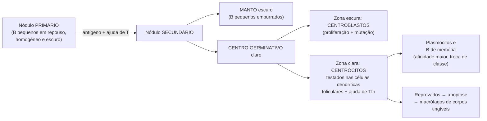
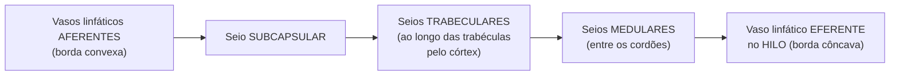

> **Roteiro do laboratório:** Problema 1, questões 10, 11, 12, 14 e 15 (nódulos e centros germinativos; MALT, BALT, GALT e células M; tonsilas; organização anatômica e histológica do linfonodo; caminho da linfa, recirculação e vênulas de endotélio alto) e Problema 2, questão 4 (anel de Waldeyer e tecido linfático urogenital). A fisiologia do "encontro" entre antígeno e linfócito no linfonodo está em [órgãos linfoides](#/imunologia/orgaos-linfoides-hematopoese#linfonodos).

## Objetivos do tópico {#objetivos}

Ao final, você deve ser capaz de:

1. Conceituar **nódulo (folículo) linfático**, diferenciar nódulo **primário** e **secundário** e explicar o que o **centro germinativo** representa.
2. Descrever a **anatomia** do linfonodo (forma, bordas, hilo, vasos aferentes e eferentes) e identificar na lâmina **cápsula, trabéculas, seio subcapsular, córtex com nódulos, paracórtex, cordões e seios medulares**.
3. Descrever o **caminho da linfa** dentro do linfonodo e o papel das **vênulas de endotélio alto** na **recirculação** dos linfócitos.
4. Explicar como **linfócitos B, linfócitos T, macrófagos e células dendríticas** interagem em cada região do linfonodo.
5. Caracterizar o **MALT** (tecido linfoide associado às mucosas), incluindo o **BALT**, o **GALT** (folículos isolados, **placas de Peyer**, **apêndice**) e o tecido linfoide urogenital, e o papel das **células M**.
6. Descrever as **tonsilas** e o **anel linfático de Waldeyer**, diferenciando-as pela localização, pelo epitélio e pelas criptas.

::: referencias
Junqueira & Carneiro – Histologia Básica, 13ª ed., cap. "Sistema imune e órgãos linfoides" · Ross & Pawlina – Histologia: Texto e Atlas, 8ª ed., cap. "Sistema linfático".
:::

## Conceitos-base {#conceitos-base}

### Tecido linfoide difuso e nodular {#tecido-linfoide}

O **tecido linfoide** é um tecido conjuntivo especial em que uma rede de **células e fibras reticulares** sustenta grande quantidade de **linfócitos** (além de macrófagos, células dendríticas e plasmócitos). Ele aparece de duas formas:

- **Difuso** — linfócitos espalhados, sem organização definida, como na lâmina própria das mucosas.
- **Nodular** — linfócitos agrupados em estruturas esféricas bem delimitadas, os **nódulos** (ou **folículos**) **linfáticos**.

O tecido linfoide pode formar **órgãos encapsulados** (linfonodos e baço) ou ficar **sem cápsula**, nas mucosas (tonsilas, placas de Peyer, apêndice, MALT em geral).

### Nódulos linfáticos e centros germinativos {#nodulos-linfaticos}

O **nódulo linfático** é um agrupamento esférico de **linfócitos B**, com cerca de 0,2 a 1 mm. Existem dois tipos:

- **Nódulo primário** — formado por **linfócitos B pequenos e em repouso** (naïve), densamente agrupados. Na lâmina aparece **homogêneo e escuro**. Indica que o tecido ainda não está respondendo a um antígeno.
- **Nódulo secundário** — surge quando um linfócito B encontra seu antígeno e recebe ajuda de linfócitos T. Tem duas partes:
  - **Centro germinativo** — região central **clara**, com células grandes em proliferação. "Claro" porque as células são **maiores**, com núcleos mais claros (cromatina frouxa) e mais citoplasma, e ficam menos empacotadas.
  - **Manto (coroa)** — anel periférico **escuro** de linfócitos B pequenos que foram "empurrados" para fora.

**Quem está no centro germinativo:**

- **Centroblastos** — linfócitos B grandes, em divisão intensa, que sofrem **mutações** nos genes dos anticorpos (hipermutação somática). Concentram-se na chamada **zona escura** do centro germinativo.
- **Centrócitos** — linfócitos B menores, que pararam de se dividir e são **testados**: só sobrevivem os que reconhecem o antígeno com **mais força**. Ficam na **zona clara**.
- **Células dendríticas foliculares** — **retêm o antígeno intacto** na superfície por longos períodos, para que os centrócitos o "provem".
- **Linfócitos T auxiliares foliculares (Tfh)** — dão os sinais de sobrevivência e de **troca de classe** aos centrócitos selecionados.
- **Macrófagos de corpos tingíveis** — fagocitam os linfócitos B reprovados, que morrem por apoptose (aparecem como macrófagos claros com restos celulares escuros, no padrão de "céu estrelado").

**Do ponto de vista imunológico**, o centro germinativo representa uma **resposta humoral ativa, dependente de linfócitos T**: é o local onde ocorrem a **maturação de afinidade** (anticorpos cada vez melhores), a **troca de classe** (de IgM para IgG, IgA ou IgE) e a formação de **plasmócitos de vida longa** e **linfócitos B de memória**. Ver um centro germinativo numa lâmina significa: "este tecido está montando uma resposta de anticorpos".

::: referencias
Junqueira & Carneiro, 13ª ed., cap. "Sistema imune e órgãos linfoides" · Ross & Pawlina, 8ª ed., cap. "Sistema linfático" · Abbas, 10ª ed., cap. "Ativação dos linfócitos B e produção de anticorpos".
:::

## Explicação detalhada {#explicacao}

### Anatomia do linfonodo {#anatomia-linfonodo}

Os **linfonodos** são pequenos órgãos encapsulados, em forma de **feijão** (ou rim), com alguns milímetros a cerca de 2 cm, dispostos **ao longo dos vasos linfáticos** — como estações de filtragem da linfa antes de ela voltar ao sangue. Concentram-se em regiões como pescoço, axilas, virilhas, mediastino e mesentério (veja [drenagem linfática](#/anatomia/morfo-drenagem-linfatica)).

- **Borda convexa** — é onde chegam os **vasos linfáticos aferentes**, vários, que perfuram a cápsula em diferentes pontos.
- **Borda côncava (hilo)** — por onde **entra a artéria** e **saem a veia** e o **vaso linfático eferente** (geralmente um só).
- Como há muitos aferentes e poucos eferentes, a linfa **desacelera** dentro do linfonodo, o que facilita a filtragem.

::: figura img/morfo/linfonodo/linfonodo-openstax.jpg
**Estrutura e histologia de um linfonodo.** À direita, o esquema: **vasos linfáticos aferentes** (*afferent lymphatic vessels*) chegando pela borda convexa, **cápsula** (*connective tissue capsule*), **seio subcapsular** (*subcapsular sinus*), **córtex** (*cortex*) com **centros germinativos** (*germinal centers*), **trabéculas** (*trabeculae*) e **vasos linfáticos eferentes** (*efferent lymphatic vessels*) saindo pelo hilo. À esquerda, a lâmina correspondente com cápsula, seio subcapsular, córtex e centros germinativos. Rótulos em inglês.
:::

### Histologia do linfonodo: camada por camada {#histologia-linfonodo}

Uma maneira útil de ler a lâmina é ir **de fora para dentro**, seguindo o mesmo caminho da linfa:

**1. Cápsula e trabéculas**
- **Cápsula** de tecido conjuntivo denso, rosada (eosinófila), envolvendo todo o órgão.
- **Trabéculas** partem da cápsula para o interior, levando vasos sanguíneos.
- Uma **rede de células e fibras reticulares** preenche o interior e sustenta as células.

**2. Seios linfáticos — as regiões "claras" e frouxas**
- **Seio subcapsular (marginal)** — espaço logo abaixo da cápsula, onde a linfa aferente chega primeiro.
- **Seios trabeculares (intermediários)** — acompanham as trabéculas pelo córtex.
- **Seios medulares** — espaços amplos e irregulares entre os cordões medulares.
- Os seios aparecem **menos corados** porque são **espaços com poucas células**, por onde a linfa flui. São revestidos por endotélio descontínuo, atravessados por células reticulares e ricos em **macrófagos**, que fagocitam partículas, micróbios e células tumorais da linfa.

**3. Córtex superficial — zona dos linfócitos B**
- Contém os **nódulos linfáticos** (primários e secundários, com centros germinativos).
- É a **zona timo-independente** (os linfócitos B não dependem do timo).

**4. Paracórtex (córtex profundo) — zona dos linfócitos T**
- Região **entre os nódulos e a medula**, sem nódulos, de **linfócitos T** densamente agrupados e **células dendríticas**.
- É a **zona timo-dependente**: fica atrofiada em quem não tem timo (como na síndrome de DiGeorge).
- Aqui ficam as **vênulas de endotélio alto (HEV)**, a porta de entrada dos linfócitos que vêm do sangue.

**5. Medula — cordões e seios**
- **Cordões medulares** — faixas **densas** de células: **plasmócitos** (que secretam anticorpos para a linfa eferente), macrófagos e linfócitos.
- **Seios medulares** — os espaços claros entre os cordões, que convergem para o hilo.

**Por que algumas regiões são escuras e outras claras?** As regiões **densamente coradas** (nódulos, mantos, paracórtex, cordões) são cheias de **linfócitos e plasmócitos** — muitos núcleos basófilos juntos. Os **seios** e os **centros germinativos** são mais claros: os seios por terem poucas células, e os centros germinativos por terem células grandes com núcleos menos condensados.

::: figura img/morfo/linfonodo/linfonodo-normal.jpg
**Linfonodo normal em pequeno aumento** (H&E), retirado junto com o mesentério de uma peça de colectomia. Ao redor, a **gordura** do mesentério (espaços claros). Dentro da cápsula rosada, o **seio subcapsular** como uma faixa clara logo abaixo da cápsula; no córtex, os **nódulos linfáticos** arredondados e mais escuros na periferia; no centro, as regiões mais frouxas da **medula**. Tente localizar cada camada antes de ler a legenda.
:::

| Região | Aspecto na lâmina | Células principais | Função |
|---|---|---|---|
| **Seio subcapsular** | Faixa clara logo abaixo da cápsula | Macrófagos, células reticulares | Recebe a linfa aferente; macrófagos capturam antígenos |
| **Córtex superficial** | Nódulos escuros, alguns com centro claro | **Linfócitos B**, células dendríticas foliculares, Tfh | Resposta humoral, centros germinativos |
| **Paracórtex** | Faixa densa sem nódulos | **Linfócitos T**, células dendríticas; **HEV** | Apresentação de antígenos a T; entrada de linfócitos |
| **Cordões medulares** | Faixas densas | **Plasmócitos**, macrófagos | Secreção de anticorpos |
| **Seios medulares** | Espaços claros entre cordões | Macrófagos | Filtragem final; drenam para o eferente |

### Caminho da linfa dentro do linfonodo {#caminho-linfa}

Ao longo de todo esse caminho, a linfa passa por **macrófagos** que a filtram, e os **antígenos** e as **células dendríticas** que vieram dos tecidos são direcionados ao córtex e ao paracórtex, onde encontram os linfócitos.

### Vascularização sanguínea e vênulas de endotélio alto {#vascularizacao-linfonodo}

O sangue tem um trajeto separado da linfa:

1. A **artéria** entra pelo **hilo** e segue pelas trabéculas e pelos cordões medulares até o córtex, onde forma capilares.
2. Os capilares drenam para as **vênulas pós-capilares do paracórtex**, que são **vênulas de endotélio alto (HEV)**: em vez do endotélio achatado comum, suas células são **cúbicas** (altas).
3. As vênulas se reúnem e saem pela **veia** no hilo.

**O papel das HEV na recirculação:**

- As células endoteliais das HEV expressam moléculas às quais a **L-selectina** dos linfócitos naïve se liga, e apresentam **quimiocinas** (CCL19, CCL21) reconhecidas pelo receptor **CCR7**.
- Assim, os linfócitos que circulam no sangue **aderem às HEV e atravessam a parede**, entrando no paracórtex. A maioria dos linfócitos que entram num linfonodo chega por esse caminho, e não pela linfa.
- Se não encontram seu antígeno em algumas horas, os linfócitos **saem pela linfa eferente** e, pelos ductos linfáticos, **voltam ao sangue** — completando a **recirculação**. Cada linfócito passa por vários linfonodos por dia, "patrulhando" o corpo.

### Como as células interagem no linfonodo {#interacoes-celulares}

1. **Células dendríticas** dos tecidos chegam pelos **aferentes** trazendo antígenos processados e se instalam no **paracórtex**, onde apresentam peptídeos em MHC aos **linfócitos T** naïve que entram pelas HEV.
2. **Antígenos solúveis** que chegam pela linfa são capturados pelos **macrófagos do seio subcapsular** e entregues, intactos, aos **linfócitos B** dos folículos e às **células dendríticas foliculares**.
3. Linfócitos **T auxiliares ativados** migram para a **borda do folículo**, onde encontram os linfócitos B que capturaram o mesmo antígeno; parte se torna **Tfh** e entra no folículo para sustentar o **centro germinativo**.
4. Os **plasmócitos** formados migram para os **cordões medulares** (e depois para a medula óssea) e secretam anticorpos, que saem pela linfa eferente.
5. Os **macrófagos** dos seios fagocitam o que restar.

::: referencias
Junqueira & Carneiro, 13ª ed., cap. "Sistema imune e órgãos linfoides" · Ross & Pawlina, 8ª ed., cap. "Sistema linfático" · Abbas, 10ª ed., cap. "Células e tecidos do sistema imune".
:::

### MALT: tecido linfoide associado às mucosas {#malt}

As mucosas do intestino, das vias respiratórias e do trato urogenital somam uma área enorme de contato com o ambiente. O **MALT** é o tecido linfoide **não encapsulado** que as protege. Ele vai do difuso (linfócitos espalhados na lâmina própria e entre as células epiteliais) a agregados organizados de nódulos.

#### GALT: tecido linfoide associado ao intestino {#galt}

- **Folículos linfoides isolados** — nódulos espalhados na lâmina própria ao longo de todo o intestino.
- **Placas de Peyer** — **agregados de dezenas de nódulos** na mucosa e na submucosa do **íleo**, em geral na parede **oposta à inserção do mesentério**. Visíveis a olho nu como placas ovais.
  - Acima dos nódulos, a mucosa forma uma **cúpula** sem vilosidades, coberta por um **epitélio associado ao folículo**, que contém as **células M**.
- **Apêndice cecal** — sua mucosa e submucosa são **repletas de nódulos linfáticos**, frequentemente com centros germinativos, sobretudo em crianças e adolescentes; com a idade, o tecido linfoide diminui. Na lâmina, o apêndice se reconhece pela **luz pequena**, pelas glândulas intestinais e pelo anel de nódulos linfáticos ao redor.

::: figura img/morfo/linfonodo/placas-peyer.jpg
**Placas de Peyer** no íleo (H&E). Da esquerda para a direita: luz intestinal com as **vilosidades** e as glândulas da mucosa e, mais para fora, os **nódulos linfáticos** grandes e escuros (um deles circulado em vermelho) ocupando mucosa e submucosa, seguidos da camada muscular rosada. Um nódulo isolado seria um folículo linfoide isolado; vários juntos formam a placa de Peyer.
:::

#### As células M {#celulas-m}

As **células M** (de *microfold*, "micropregas") são células especializadas do epitélio que recobre os nódulos do MALT intestinal:

- Não têm as microvilosidades típicas dos enterócitos; sua superfície tem pequenas pregas.
- Sua face basal forma um **bolsão** onde ficam linfócitos, macrófagos e células dendríticas.
- Elas capturam antígenos e micro-organismos do lúmen e os **transportam através da célula** (transcitose), entregando-os intactos às células imunes do bolsão — que levam o antígeno aos nódulos subjacentes.

**Papel imunológico do MALT como um todo:** "amostrar" continuamente o que está no lúmen para (1) gerar respostas de **IgA secretora**, que neutraliza micróbios e toxinas na superfície da mucosa **sem inflamação**, e (2) manter a **tolerância** a alimentos e à microbiota. O lado negativo: alguns patógenos (*Salmonella*, *Shigella*, poliovírus) usam as células M como porta de entrada.

#### BALT e tecido linfoide urogenital {#balt}

- **BALT** — nódulos linfáticos na parede dos **brônquios**, em especial nas bifurcações, cobertos por epitélio que também contém células especializadas na captura de antígenos inalados. No adulto saudável é discreto e aumenta com infecções e inflamação crônica (como no tabagismo).
- **Tecido linfoide urogenital** — linfócitos e nódulos na mucosa da bexiga, da uretra, da vagina e do colo uterino, que produzem IgA secretora local.

### Tonsilas e anel linfático de Waldeyer {#tonsilas}

As **tonsilas** (antigamente chamadas de amígdalas) são massas de tecido linfoide **parcialmente encapsuladas** situadas na entrada das vias aéreas e digestivas. Em conjunto, formam um anel ao redor da faringe: o **anel linfático de Waldeyer**, a primeira barreira contra antígenos inalados e ingeridos.

::: figura img/morfo/linfonodo/tonsilas-anatomia.png
**Tonsilas e faringe** (rótulos em espanhol: *amígdala* = tonsila). De cima para baixo: **tonsila faríngea** (*amígdala faríngea*, a "adenoide", na nasofaringe), **tonsila palatina** (*amígdala palatina*, na orofaringe, ao lado da úvula) e **tonsila lingual** (*amígdala lingual*, na base da língua). Também aparecem a nasofaringe, a orofaringe, a laringofaringe, o palato duro e o mole (*paladar*) e a úvula.
:::

| Tonsila | Localização | Epitélio de revestimento | Criptas | Outras características |
|---|---|---|---|---|
| **Palatinas** (par) | **Orofaringe**, na fossa tonsilar entre os arcos **palatoglosso** e **palatofaríngeo** | **Estratificado pavimentoso não queratinizado** | **10 a 20 criptas** profundas e ramificadas | **Cápsula** de tecido conjuntivo denso na face profunda, que a separa dos músculos da faringe |
| **Faríngea** (ímpar, "adenoide") | Teto e parede posterior da **nasofaringe** | **Pseudoestratificado cilíndrico ciliado** (respiratório), com áreas estratificadas | **Sem criptas verdadeiras** — tem **pregas** | Cápsula fina; mais desenvolvida na infância, involui na adolescência |
| **Linguais** | **Base da língua** (terço posterior) | **Estratificado pavimentoso não queratinizado** | **Uma cripta** por tonsila | **Glândulas mucosas** cujos ductos se abrem no fundo das criptas, ajudando a limpá-las |
| **Tubárias** (par) | Ao redor da abertura da **tuba auditiva** na nasofaringe | Respiratório | — | Extensão da tonsila faríngea |

**Histologia da tonsila palatina** (a mais cobrada na lâmina):

- Superfície coberta por **epitélio estratificado pavimentoso**, que mergulha formando as **criptas**.
- Ao redor das criptas, numerosos **nódulos linfáticos**, muitos com **centros germinativos**.
- No fundo das criptas, o epitélio fica **"reticulado"**: tão infiltrado por linfócitos que fica difícil ver os limites entre as células. É ali que os antígenos são amostrados.
- As criptas podem conter **restos de células descamadas, linfócitos e bactérias** (às vezes formando os "cáseos" amigdalianos).
- Na face profunda, uma **cápsula** de tecido conjuntivo separa a tonsila da musculatura — é esse plano que o cirurgião segue na amigdalectomia.

**Papel imunológico:** as criptas aumentam muito a **superfície de contato** com o conteúdo da boca e do nariz. Os antígenos que penetram nas criptas induzem respostas locais (centros germinativos, plasmócitos produtores de IgA e IgG), fazendo das tonsilas sentinelas da entrada do organismo.

::: referencias
Junqueira & Carneiro, 13ª ed., cap. "Sistema imune e órgãos linfoides" · Ross & Pawlina, 8ª ed., cap. "Sistema linfático" · Moore – Anatomia Orientada para a Clínica, 8ª ed., cap. "Pescoço".
:::

## Correlação clínica {#correlacao-clinica}

### Linfonodo aumentado e metástases {#linfonodo-clinica}

- **Linfadenopatia reativa** — a ativação de uma resposta imune faz o linfonodo crescer: na resposta humoral, aumentam os **folículos com centros germinativos** (hiperplasia folicular); na resposta a vírus, expande-se o **paracórtex**.
- **Metástases** — células de um tumor que entram nos linfáticos chegam primeiro ao **seio subcapsular** do linfonodo regional, que é onde se procuram as células tumorais. Por isso se faz a pesquisa do **linfonodo sentinela** (o primeiro a receber a drenagem do tumor) em cânceres como o de mama e o melanoma.

### Tonsilas: amigdalite, abscesso e adenoide aumentada {#tonsilas-clinica}

- **Amigdalite bacteriana** (sobretudo por *Streptococcus pyogenes*): tonsilas aumentadas, com exsudato nas criptas.
- **Abscesso periamigdaliano** — acúmulo de pus entre a **cápsula** da tonsila palatina e a musculatura da faringe: dor intensa, dificuldade para abrir a boca (trismo), voz "de batata quente", úvula desviada.
- **Hipertrofia da adenoide (tonsila faríngea)** em crianças: obstrução nasal, **respiração pela boca**, ronco e apneia do sono, e **otites médias** de repetição (pela obstrução da abertura da tuba auditiva).

### Placas de Peyer e infecções intestinais {#peyer-clinica}

Na **febre tifoide**, a *Salmonella* Typhi entra pelas células M e se multiplica nas placas de Peyer, que podem **ulcerar** e até perfurar o íleo. O apêndice inflama com frequência quando sua luz estreita é obstruída — e a **hiperplasia linfoide** é uma causa comum de obstrução em jovens.

::: referencias
Robbins – Patologia Básica, 10ª ed., caps. "Doenças dos leucócitos e dos linfonodos" e "Trato gastrointestinal" · Moore, 8ª ed., cap. "Pescoço".
:::

## Pontos de alta cobrança em prova {#alta-cobranca}

::: prova
- **Nódulo primário** = B pequenos em repouso (homogêneo, escuro). **Nódulo secundário** = **centro germinativo** claro (centroblastos, centrócitos, células dendríticas foliculares, Tfh, macrófagos de corpos tingíveis) + **manto** escuro. Centro germinativo = **resposta humoral ativa** (maturação de afinidade, troca de classe, plasmócitos e memória).
- **Linfonodo**: forma de feijão; **aferentes na borda convexa**; **hilo** (borda côncava) com artéria, veia e **eferente**.
- **Camadas**: cápsula → **seio subcapsular** → **córtex** (nódulos B, timo-independente) → **paracórtex** (T, dendríticas, **HEV**, **timo-dependente**) → **medula** (**cordões** com plasmócitos + **seios**).
- **Seios** = claros (poucas células, macrófagos, linfa); **cordões e nódulos** = escuros (muitas células).
- **Caminho da linfa**: aferente → subcapsular → trabeculares → medulares → eferente (hilo).
- **HEV**: endotélio cúbico no paracórtex; L-selectina + CCR7 (CCL19/21) → entrada dos linfócitos do sangue → **recirculação**.
- **MALT**: não encapsulado; **placas de Peyer** (íleo, borda antimesentérica, cúpula com **células M**), **apêndice** (anel de nódulos), folículos isolados, **BALT**, urogenital. **Células M** fazem transcitose de antígenos → resposta de **IgA secretora**.
- **Tonsilas (anel de Waldeyer)**: **palatina** (epitélio estratificado pavimentoso, 10–20 criptas, cápsula profunda); **faríngea/adenoide** (epitélio respiratório, **sem criptas**, pregas); **lingual** (uma cripta, glândulas mucosas); **tubária**.
:::

## Armadilhas comuns {#armadilhas}

::: armadilha
- **Achar que o centro germinativo é escuro.** Ele é **claro** (células grandes de núcleo frouxo); escuro é o **manto**.
- **Confundir paracórtex com córtex superficial.** Os **nódulos B** ficam no córtex superficial; o **paracórtex** é dos **linfócitos T**, sem nódulos.
- **Inverter aferentes e eferentes.** Aferentes (vários) entram pela **borda convexa**; o eferente sai pelo **hilo**, junto com a veia (a artéria entra pelo hilo).
- **Dizer que a linfa entra nos linfonodos pelas HEV.** As HEV são **vasos sanguíneos**: por elas entram **linfócitos vindos do sangue**. A linfa entra pelos **vasos aferentes**.
- **Achar que a tonsila faríngea tem criptas como a palatina.** A faríngea tem **pregas** e epitélio **respiratório**.
- **Achar que o MALT tem cápsula.** É tecido linfoide **não encapsulado**; as tonsilas têm apenas cápsula **parcial**.
- **Confundir placa de Peyer com linfonodo na lâmina.** A placa fica **na parede do intestino** (há vilosidades, glândulas e camada muscular); o linfonodo é um órgão **isolado com cápsula e seios**.
:::

## Resumo para revisão rápida {#resumo}

- **Tecido linfoide**: difuso ou nodular, sustentado por rede reticular.
- **Nódulo primário** (B em repouso) × **secundário** (centro germinativo claro + manto escuro). Centro germinativo = centroblastos, centrócitos, dendríticas foliculares, Tfh → maturação de afinidade, troca de classe, plasmócitos e memória.
- **Linfonodo**: feijão; aferentes na borda convexa; hilo com artéria, veia e eferente. Cápsula, trabéculas, **seio subcapsular**, **córtex** (nódulos B), **paracórtex** (T + HEV, timo-dependente), **medula** (cordões com plasmócitos + seios).
- **Linfa**: aferente → subcapsular → trabeculares → medulares → eferente.
- **HEV**: endotélio cúbico; L-selectina/CCR7 → linfócitos do sangue entram → recirculação.
- **Interações**: dendríticas → T no paracórtex; macrófagos subcapsulares e dendríticas foliculares → B nos folículos; T ajuda B na borda do folículo; plasmócitos nos cordões medulares.
- **MALT**: placas de Peyer (íleo, células M), apêndice, folículos isolados, BALT, urogenital → IgA secretora e tolerância.
- **Tonsilas (Waldeyer)**: palatinas (estratificado pavimentoso, 10–20 criptas, cápsula), faríngea (respiratório, pregas), linguais (1 cripta, glândulas mucosas), tubárias.

::: referencias
Junqueira & Carneiro, 13ª ed. · Ross & Pawlina, 8ª ed.
:::
