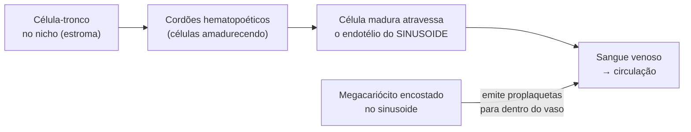

> **Roteiro do laboratório (Problema 1):** questões 4 e 9 — identificar no esfregaço as células granulocíticas e agranulocíticas, suas características nucleares e citoplasmáticas, funções e proporções; caracterizar a medula óssea vermelha e amarela, sua localização, sinusoides, adipócitos, megacariócitos e a diversidade de células hematopoéticas. A fisiologia da produção dessas células está em [órgãos linfoides e hematopoese](#/imunologia/orgaos-linfoides-hematopoese#hematopoese).

## Objetivos do tópico {#objetivos}

Ao final, você deve ser capaz de:

1. Explicar como uma lâmina de esfregaço sanguíneo é feita e corada, e por que cada estrutura fica com uma cor diferente (coloração de Romanowsky: Leishman, Wright, Giemsa).
2. Reconhecer ao microscópio os cinco tipos de leucócitos — **neutrófilo, eosinófilo, basófilo, linfócito e monócito** — além de hemácias e plaquetas, usando tamanho, forma do núcleo e aspecto do citoplasma.
3. Classificar os leucócitos em **granulócitos** e **agranulócitos** e citar a proporção e a função de cada um.
4. Diferenciar **medula óssea vermelha** e **amarela**, dizer onde cada uma está no corpo e por que isso importa para a punção de medula.
5. Identificar na lâmina de medula óssea os **cordões hematopoéticos**, os **capilares sinusoides**, os **adipócitos** e os **megacariócitos**, explicando a função de cada um.

::: referencias
Junqueira & Carneiro – Histologia Básica, 13ª ed., caps. "Células do sangue" e "Hemocitopoese" · Ross & Pawlina – Histologia: Texto e Atlas, 8ª ed., caps. "Sangue" e "Medula óssea".
:::

## Conceitos-base {#conceitos-base}

### O sangue como tecido {#sangue-tecido}

O sangue é um **tecido conjuntivo especializado**: tem células (os **elementos figurados**) suspensas numa matriz extracelular líquida, o **plasma**. Os elementos figurados são três:

- **Hemácias** (eritrócitos) — transportam oxigênio; são as células mais numerosas (cerca de 4,5 a 5,5 milhões por mm³).
- **Leucócitos** (glóbulos brancos) — células de defesa; muito menos numerosos (cerca de 4.000 a 11.000 por mm³).
- **Plaquetas** — fragmentos de citoplasma que participam da coagulação (cerca de 150.000 a 450.000 por mm³).

Todos são produzidos na **medula óssea vermelha** a partir de uma mesma célula-tronco (hematopoese).

### Como se faz e se cora um esfregaço {#coloracao}

O **esfregaço** é uma gota de sangue espalhada em camada fina sobre a lâmina, de forma que as células fiquem lado a lado, sem se sobrepor. Depois de seco, é corado com um **corante de Romanowsky** (Leishman, Wright, May-Grünwald-Giemsa). Esses corantes misturam dois tipos de componente:

- Um corante **ácido** (a **eosina**, de cor rosa-alaranjada), que se liga a estruturas **básicas** (com carga positiva), como a hemoglobina e as proteínas dos grânulos dos eosinófilos. Dizemos que essas estruturas são **acidófilas** ou **eosinófilas**.
- Corantes **básicos** (o **azul de metileno** e seus derivados, os azures, de cor azul-arroxeada), que se ligam a estruturas **ácidas** (com carga negativa), como o DNA do núcleo, o RNA dos ribossomos e a heparina dos grânulos dos basófilos. Essas estruturas são **basófilas**.

Essa regra simples explica quase todas as cores da lâmina: **núcleos roxos**, **hemácias rosadas**, **citoplasma rico em ribossomos azulado** (linfócitos, plasmócitos), **grânulos do eosinófilo alaranjados** e **grânulos do basófilo roxo-escuros**.

### Como "ler" a lâmina {#leitura}

- Procure a região onde as hemácias estão **lado a lado sem se sobrepor** (geralmente perto do final do esfregaço). Ali as células estão bem espalhadas.
- Use a **hemácia como régua**: ela mede cerca de **7–8 µm**. Comparar o leucócito com a hemácia ao lado dá uma boa ideia do tamanho dele.
- Para cada leucócito, observe nesta ordem: **(1) tamanho**, **(2) forma do núcleo**, **(3) cor do citoplasma** e **(4) presença e cor dos grânulos**.
- Comece com aumento menor para localizar as células e use a **objetiva de imersão (100×)** para ver os detalhes.

::: referencias
Junqueira & Carneiro, 13ª ed., caps. "Células do sangue" e "Técnicas de estudo em histologia" · Ross & Pawlina, 8ª ed., cap. "Sangue".
:::

## Explicação detalhada {#explicacao}

### Visão geral: granulócitos e agranulócitos {#granulocitos-agranulocitos}

Os leucócitos são classificados pela presença de **grânulos específicos** no citoplasma, visíveis ao microscópio óptico:

- **Granulócitos** — têm grânulos específicos e núcleo **lobulado** (por isso também são chamados **polimorfonucleares**): **neutrófilos**, **eosinófilos** e **basófilos**. O nome de cada um vem da cor dos grânulos: neutra, eosinófila (rosa-alaranjada) ou basófila (roxa).
- **Agranulócitos** — não têm grânulos específicos e o núcleo **não é lobulado** (**mononucleares**): **linfócitos** e **monócitos**. Eles podem ter alguns grânulos azurófilos (que são lisossomos), mas não os grânulos específicos.

::: figura img/morfo/sangue/leucocitos-openstax.jpg
**Os cinco leucócitos lado a lado** (da esquerda para a direita): basófilo (grânulos roxo-escuros que escondem o núcleo), eosinófilo (grânulos alaranjados, núcleo bilobado), neutrófilo (núcleo com 3 a 5 lobos, citoplasma claro), monócito (núcleo em forma de rim ou ferradura, citoplasma cinza-azulado) e linfócito (núcleo redondo ocupando quase toda a célula). Ilustração em inglês: *Basophil, Eosinophil, Neutrophil, Monocyte, Lymphocyte*.
:::

::: figura img/morfo/sangue/esfregaco-rotulado.jpg
**Esfregaço sanguíneo normal** (coloração de Wright). Ao fundo, as hemácias rosadas sem núcleo. Letras: **N** = neutrófilo; **L** = linfócito; **M** = monócito; **E** = eosinófilo; **B** = basófilo; **P** = plaquetas (pequenos pontos roxos). Repare como o linfócito tem quase o tamanho de uma hemácia, enquanto o monócito é bem maior.
:::

### Tabela de identificação {#tabela-identificacao}

| Célula | % dos leucócitos | Tamanho | Núcleo | Citoplasma e grânulos | Função principal |
|---|---|---|---|---|---|
| **Neutrófilo** | **50–70%** (o mais numeroso) | 12–15 µm | **3 a 5 lobos** ligados por filamentos finos (forma jovem: **bastonete**, em forma de C ou U) | Rosa-pálido, com grânulos finos quase invisíveis | Fagocitose de **bactérias**; primeira célula da inflamação aguda |
| **Eosinófilo** | 1–4% | 12–17 µm | **Bilobado** ("óculos") | Cheio de **grânulos grandes alaranjados** (eosinófilos) | Defesa contra **helmintos**; alergia |
| **Basófilo** | 0–1% (o mais raro) | 14–16 µm | Bilobado ou irregular, **escondido** pelos grânulos | **Grânulos grandes roxo-escuros** (heparina, histamina) | Reações alérgicas (libera histamina) |
| **Linfócito** | 20–40% | Pequeno: 6–9 µm (pouco maior que a hemácia); grande: até 15 µm | **Redondo, denso**, ocupa quase toda a célula | Fina borda de citoplasma **azul-claro** | Imunidade adaptativa (linfócitos B, T) e NK |
| **Monócito** | 2–8% | **12–20 µm** (o maior) | **Em forma de rim ou ferradura**, cromatina mais frouxa | Abundante, **cinza-azulado** ("vidro fosco"), às vezes com vacúolos | Migra para os tecidos e vira **macrófago** |

Uma frase para memorizar a ordem de frequência: "**N**unca **L**eve **M**acacos **E**m **B**anheiras" — **N**eutrófilos > **L**infócitos > **M**onócitos > **E**osinófilos > **B**asófilos.

### Granulócitos em detalhe {#granulocitos}

#### Neutrófilo {#neutrofilo}

É o leucócito mais numeroso. Seu núcleo tem **3 a 5 lobos** unidos por pontes finas de cromatina — por isso o nome "polimorfonuclear". O citoplasma é rosa-claro, com **grânulos muito finos** que não se coram fortemente nem com o corante ácido nem com o básico (daí "neutrófilo"). Contém dois tipos de grânulos: os **azurófilos** (lisossomos com mieloperoxidase) e os **específicos** (lactoferrina, lisozima).

O neutrófilo vive pouco: circula algumas horas no sangue e, nos tecidos, alguns dias. Ao chegar a um foco de infecção, fagocita e destrói bactérias (veja [imunidade inata](#/imunologia/imunidade-inata#fagocitose)). O **pus** é formado principalmente por neutrófilos mortos.

O **bastonete** é o neutrófilo jovem, com núcleo em forma de **C, U ou ferradura**, ainda **sem segmentação** em lobos. Normalmente representa até ~5% dos leucócitos; quando aumenta, fala-se em **desvio à esquerda**, típico de infecção bacteriana.

::: figura img/morfo/sangue/neutrofilo-bastonete.jpg
**Neutrófilo em bastonete** no centro (coloração de Wright). O núcleo tem forma de **U/ferradura** e espessura relativamente uniforme, sem as constrições que separariam lobos. Compare com o neutrófilo segmentado (letra N no esfregaço acima), que tem lobos bem definidos.
:::

#### Eosinófilo {#eosinofilo}

Reconhecido de longe pelos **grânulos grandes e alaranjados** que enchem o citoplasma e pelo **núcleo bilobado**. A cor laranja vem da **proteína básica principal** dos grânulos, que tem carga positiva e atrai a eosina (corante ácido). Esses grânulos têm um "cristaloide" central visível ao microscópio eletrônico. O eosinófilo combate parasitas grandes (helmintos), liberando o conteúdo tóxico dos grânulos sobre eles, e participa das reações alérgicas e da asma. Está aumentado nas **verminoses** e nas **alergias**.

#### Basófilo {#basofilo}

É o mais raro (menos de 1%) e, por isso, o mais difícil de encontrar na lâmina. Seus **grânulos grandes, roxo-escuros**, frequentemente **escondem o núcleo**. A cor vem da **heparina** (um polissacarídeo com muitas cargas negativas, que atrai o corante básico). Os grânulos também contêm **histamina**. Tem receptores para IgE e, quando ativado, libera histamina — como o mastócito, que é o "parente" que fica nos tecidos.

### Agranulócitos em detalhe {#agranulocitos}

#### Linfócito {#linfocito}

O linfócito pequeno — o mais comum no sangue — tem **pouco mais que o tamanho de uma hemácia**. O **núcleo é redondo, escuro e denso**, ocupando quase toda a célula, e o citoplasma forma apenas uma **fina borda azul-clara** (azulada por causa dos ribossomos). Alguns linfócitos são maiores, com mais citoplasma e alguns grânulos (os "grandes linfócitos granulares", em geral células NK). **Ao microscópio comum, não dá para distinguir linfócito B de T**: para isso é necessária a citometria de fluxo (marcadores CD).

::: figura img/morfo/sangue/linfocito.jpg
**Linfócito pequeno** (coloração de Wright). O núcleo arredondado e muito corado ocupa quase toda a célula, que tem praticamente o tamanho das hemácias ao redor. A borda de citoplasma é estreita.
:::

#### Monócito {#monocito}

É o **maior leucócito** do sangue. O **núcleo tem forma de rim ou de ferradura**, com cromatina mais "rendada" (menos densa que a do linfócito), e o **citoplasma é abundante, cinza-azulado**, com aspecto de vidro fosco e às vezes pequenos vacúolos. Circula por 1 a 3 dias e depois entra nos tecidos, onde se transforma em **macrófago** (no fígado, células de Kupffer; no pulmão, macrófagos alveolares; no osso, origina os osteoclastos).

::: figura img/morfo/sangue/monocito.jpg
**Monócito** (coloração de Wright). Note o tamanho bem maior que o das hemácias, o **núcleo em forma de rim/ferradura** e o citoplasma acinzentado. Cuidado para não confundir com o bastonete: no monócito o citoplasma é **cinza-azulado e abundante**; no bastonete é **rosado e granular**.
:::

### Plaquetas {#plaquetas}

As **plaquetas** são fragmentos de citoplasma de **2–4 µm**, sem núcleo, que aparecem como **pequenos pontos roxos** entre as hemácias (letra P no esfregaço). Têm uma região central granular (granulômero) e uma periferia clara (hialômero). Vivem cerca de 10 dias e são produzidas pelos **megacariócitos** da medula óssea.

::: referencias
Junqueira & Carneiro, 13ª ed., cap. "Células do sangue" · Ross & Pawlina, 8ª ed., cap. "Sangue".
:::

### Medula óssea vermelha e amarela {#medula-vermelha-amarela}

A **medula óssea** é o tecido mole que preenche as cavidades dos ossos (o canal medular dos ossos longos e os espaços entre as trabéculas do osso esponjoso). Existem dois tipos:

- **Medula vermelha (hematopoética)** — ativa na produção de células do sangue. A cor vem das hemácias em formação e da hemoglobina.
- **Medula amarela (adiposa)** — formada principalmente por **adipócitos**; não produz células, mas guarda a capacidade de **voltar a ser vermelha** se o corpo precisar (por exemplo, em anemias graves ou hemorragias crônicas).

**Onde fica cada uma ao longo da vida:**

- No **recém-nascido**, praticamente toda a medula do esqueleto é vermelha.
- Com o crescimento, a medula dos ossos longos vai sendo substituída por gordura, das extremidades dos membros para o centro.
- No **adulto**, a medula vermelha fica restrita ao **esqueleto axial e às raízes dos membros**: **ossos do crânio, vértebras, costelas, esterno, ossos do quadril (pelve)** e **extremidades proximais do fêmur e do úmero**.

Por isso, a **punção de medula óssea** no adulto é feita no **osso do quadril (crista ilíaca posterior)** — local preferido para aspirado e biópsia — ou no **esterno** (apenas aspirado).

::: figura img/morfo/sangue/medula-vermelha-amarela-openstax.jpg
**Medula vermelha e amarela** num corte da cabeça de um osso longo. Na região esponjosa, a medula vermelha (*red marrow*); no centro, a medula amarela (*yellow marrow*), rica em gordura. Ao redor, a superfície externa do osso (*outer surface of bone*).
:::

### Histologia da medula óssea vermelha {#histologia-medula}

Ao microscópio, a medula vermelha parece uma "mistura" de muitas células, mas tem uma organização lógica, formada por **estroma** (o suporte) e **parênquima** (as células que de fato produzem o sangue):

**Estroma:**

- **Células reticulares** e **fibras reticulares** (colágeno tipo III) formam uma rede de sustentação. As células reticulares produzem fatores que regulam a hematopoese (o "nicho" das células-tronco).
- **Adipócitos** — aparecem como **espaços redondos vazios** (a gordura é dissolvida durante o preparo da lâmina). Sua quantidade aumenta com a idade: em adultos, cerca de metade do espaço medular pode ser gordura.
- **Macrófagos** — fagocitam restos celulares e os núcleos expelidos pelas hemácias em formação; ficam no centro das **ilhotas eritroblásticas**, rodeados por precursores de hemácias, aos quais fornecem ferro.

**Vasos — os capilares sinusoides:**

- São capilares **largos e de trajeto irregular**, com **endotélio descontínuo** e lâmina basal incompleta.
- Essa parede "aberta" permite que as células maduras **atravessem para o sangue** — passam por aberturas temporárias nas células endoteliais. As células imaturas, menos deformáveis, ficam retidas.

**Parênquima — os cordões hematopoéticos:**

- Entre os sinusoides ficam os **cordões** de células em diferentes estágios de maturação das três linhagens: **eritroide** (precursores de hemácias, com citoplasma que vai de azul a rosado conforme a hemoglobina se acumula), **granulocítica** (mieloblastos, promielócitos, mielócitos, metamielócitos, bastonetes) e **megacariocítica**, além de precursores de monócitos e linfócitos.

::: figura img/morfo/sangue/hematopoese-medula-openstax.jpg
**Hematopoese**: a célula-tronco multipotente origina a linhagem **mieloide** (megacarioblasto → megacariócito → plaquetas; proeritroblasto → reticulócito → hemácia; mieloblasto → basófilo, neutrófilo, eosinófilo; monoblasto → monócito → macrófago) e a **linfoide** (linfoblasto → linfócitos T, B, NK; o linfócito B origina o plasmócito). Ilustração com rótulos em inglês.
:::

### Megacariócito {#megacariocito}

O **megacariócito** é a **maior célula da medula óssea** (cerca de 40–100 µm) — fácil de reconhecer mesmo em pequeno aumento. Características:

- **Núcleo enorme, multilobulado e muito corado.** O megacariócito é **poliploide**: replica o DNA várias vezes **sem se dividir** (endomitose), chegando a ter 16, 32 ou até 64 conjuntos de cromossomos (16N a 64N). Isso dá a ele muito material genético para produzir uma grande quantidade de citoplasma.
- **Citoplasma abundante**, levemente granular e eosinófilo, cheio dos grânulos que as plaquetas vão herdar.
- Fica **encostado nos sinusoides** e emite prolongamentos (**proplaquetas**) para dentro do vaso. O fluxo de sangue fragmenta esses prolongamentos em **plaquetas** — cada megacariócito origina milhares delas.
- Sua produção é estimulada pela **trombopoetina** (TPO), hormônio produzido principalmente no fígado.

::: figura img/morfo/sangue/megacariocitos.jpg
**Dois megacariócitos** em aspirado de medula óssea (coloração de Wright). Note o tamanho gigantesco comparado às outras células ao redor (precursores hematopoéticos, em azul-escuro) e o núcleo grande e lobulado ocupando boa parte da célula.
:::

### Medula óssea "em formação" {#medula-em-formacao}

O roteiro pede para identificar a **medula óssea em formação**. Ela aparece nas lâminas de **ossificação endocondral** (por exemplo, osso longo de feto): à medida que a cartilagem é substituída por osso, vasos sanguíneos invadem a cavidade e trazem células que formam a medula. Na lâmina, você vê **trabéculas de osso novo** (rosadas, com osteoblastos na superfície) e, entre elas, o tecido medular primitivo com **muitas células hematopoéticas** e vasos — ainda com poucos adipócitos.

::: referencias
Junqueira & Carneiro, 13ª ed., caps. "Hemocitopoese" e "Tecido ósseo" · Ross & Pawlina, 8ª ed., cap. "Medula óssea".
:::

## Correlação clínica {#correlacao-clinica}

### O hemograma e o esfregaço {#hemograma}

Hoje a contagem dos leucócitos é feita por aparelhos automatizados, mas o **esfregaço** continua essencial quando há alterações: é ao microscópio que se veem **bastonetes** (desvio à esquerda), **linfócitos atípicos** (mononucleose), **blastos** (leucemias agudas), **granulações tóxicas** (infecção grave) e **parasitas** (malária, dentro das hemácias). A interpretação clínica do leucograma está em [órgãos linfoides e hematopoese](#/imunologia/orgaos-linfoides-hematopoese#leucograma-clinico).

### Aspirado e biópsia de medula {#puncao-medula}

- **Aspirado**: aspira-se um pouco da medula (crista ilíaca posterior ou esterno) e faz-se um esfregaço — ótimo para ver a **morfologia** de cada célula (contagem de blastos, displasias).
- **Biópsia** (crista ilíaca): retira-se um cilindro de osso com medula — mostra a **arquitetura** e a **celularidade** (proporção entre células e gordura), fibrose e infiltração por tumores.
- **Celularidade normal**: grosseiramente, "100 menos a idade" em porcentagem — um adulto de 60 anos tem cerca de 40% de células e 60% de gordura. Medula **hipocelular** (muita gordura) sugere **aplasia**; **hipercelular**, leucemias e outras neoplasias.

### Quando a medula amarela volta a ser vermelha {#reconversao}

Em situações de grande demanda — anemias hemolíticas crônicas (como a anemia falciforme e as talassemias), hemorragias repetidas —, a medula amarela pode se converter novamente em vermelha, e a hematopoese pode até ocorrer fora da medula (fígado e baço: **hematopoese extramedular**). Na talassemia grave, a expansão medular deforma os ossos do crânio e da face.

::: referencias
Hoffbrand – Fundamentos em Hematologia, 7ª ed. · Ross & Pawlina, 8ª ed., cap. "Medula óssea".
:::

## Pontos de alta cobrança em prova {#alta-cobranca}

::: prova
- **Granulócitos** (polimorfonucleares, grânulos específicos): **neutrófilo, eosinófilo, basófilo**. **Agranulócitos** (mononucleares): **linfócito, monócito**.
- **Frequência**: neutrófilos (50–70%) > linfócitos (20–40%) > monócitos (2–8%) > eosinófilos (1–4%) > basófilos (0–1%).
- **Neutrófilo**: 3–5 lobos, citoplasma rosa-pálido; **bastonete** = núcleo em C/U não segmentado (desvio à esquerda).
- **Eosinófilo**: núcleo **bilobado**, grânulos **alaranjados** (proteína básica principal) → helmintos, alergia.
- **Basófilo**: grânulos **roxo-escuros** que **escondem o núcleo** (heparina, histamina); o mais raro.
- **Linfócito**: núcleo **redondo e denso**, pouco citoplasma azul, ~tamanho da hemácia; B e T são indistinguíveis ao MO.
- **Monócito**: o **maior**; núcleo em **rim/ferradura**; citoplasma **cinza-azulado**; vira macrófago.
- **Plaquetas**: fragmentos de 2–4 µm, sem núcleo, de megacariócitos.
- **Romanowsky**: eosina (ácida) cora estruturas básicas (hemoglobina, grânulos do eosinófilo); azul de metileno (básico) cora estruturas ácidas (DNA, RNA, heparina).
- **Medula vermelha no adulto**: crânio, vértebras, costelas, esterno, pelve, epífises proximais de fêmur e úmero → punção na **crista ilíaca posterior** ou **esterno**.
- **Lâmina de medula**: cordões hematopoéticos + **sinusoides** (endotélio descontínuo) + **adipócitos** (espaços vazios) + **megacariócitos** (célula gigante, núcleo multilobulado, poliploide, encostada no sinusoide).
:::

## Armadilhas comuns {#armadilhas}

::: armadilha
- **Confundir monócito com bastonete.** Ambos têm núcleo curvo. O monócito é maior, tem citoplasma **cinza-azulado** e cromatina frouxa; o bastonete tem citoplasma **rosado** e cromatina mais condensada.
- **Confundir linfócito grande com monócito.** O linfócito tem núcleo **redondo** e central, com citoplasma azul-claro e liso; o monócito tem núcleo **reniforme** e citoplasma acinzentado e "fosco".
- **Achar que "agranulócito" não tem nenhum grânulo.** Ele não tem grânulos **específicos**, mas pode ter grânulos azurófilos (lisossomos).
- **Achar que o basófilo é o granulócito "comum".** Ele é o mais raro: se você está vendo muitos, desconfie de neoplasia mieloproliferativa (como a LMC) — ou de que está confundindo com outra célula.
- **Esperar ver gordura nos adipócitos da lâmina.** A gordura é dissolvida pelos solventes do preparo; os adipócitos aparecem como **espaços vazios** arredondados.
- **Chamar o megacariócito de "célula com vários núcleos".** Ele tem **um único núcleo**, enorme e **multilobulado** (poliploide), e não vários núcleos separados.
- **Dizer que a medula vermelha do adulto está em todos os ossos.** Nos ossos longos dos membros, ela foi substituída por medula amarela, exceto nas extremidades proximais do fêmur e do úmero.
:::

## Resumo para revisão rápida {#resumo}

- **Sangue** = tecido conjuntivo: plasma + hemácias, leucócitos e plaquetas, todos da medula vermelha.
- **Coloração (Romanowsky)**: eosina → estruturas básicas (rosa/laranja); azul de metileno → estruturas ácidas (azul/roxo). Use a hemácia (7–8 µm) como régua.
- **Neutrófilo** (50–70%): 3–5 lobos, citoplasma claro; bastonete = jovem, núcleo em U.
- **Eosinófilo** (1–4%): bilobado, grânulos alaranjados; helmintos e alergia.
- **Basófilo** (0–1%): grânulos roxos que escondem o núcleo; histamina e heparina.
- **Linfócito** (20–40%): núcleo redondo e denso, borda de citoplasma azul.
- **Monócito** (2–8%): o maior; núcleo em rim; citoplasma cinza-azulado → macrófago.
- **Plaquetas**: fragmentos de megacariócitos.
- **Medula vermelha** (hematopoética) × **amarela** (adiposa, pode reconverter). No adulto: esqueleto axial e raízes dos membros; punção na crista ilíaca/esterno.
- **Lâmina de medula**: estroma (células e fibras reticulares, adipócitos, macrófagos), **sinusoides** de endotélio descontínuo, **cordões hematopoéticos** das três linhagens e **megacariócitos** gigantes, poliploides, que liberam plaquetas nos sinusoides.

::: referencias
Junqueira & Carneiro, 13ª ed. · Ross & Pawlina, 8ª ed.
:::
