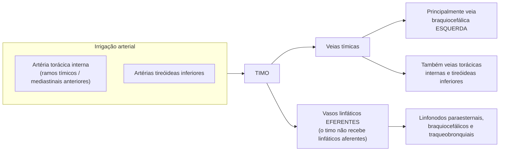
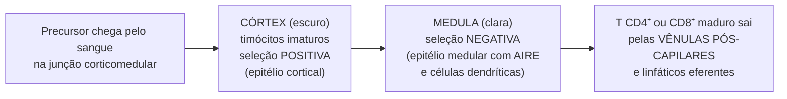

> **Roteiro do laboratório (Problema 1):** questões 1, 2, 3, 5, 6, 7 e 8 — estroma e parênquima dos órgãos linfáticos; órgãos primários e secundários; localização, relações e caracteres anatômicos do timo; hormônios tímicos; irrigação e drenagem; histologia do estroma e do parênquima, córtex e medula, barreira hematotímica e vênulas pós-capilares. A função do timo na "educação" dos linfócitos T está explicada em [órgãos linfoides](#/imunologia/orgaos-linfoides-hematopoese#timo).

## Objetivos do tópico {#objetivos}

Ao final, você deve ser capaz de:

1. Definir **estroma** e **parênquima** dos órgãos linfáticos e classificar todos os órgãos linfáticos em **primários (centrais)** e **secundários (periféricos)**.
2. Descrever a **localização**, as **relações anatômicas** e os **caracteres** do timo, e como ele muda ao longo da vida.
3. Descrever a **irrigação arterial**, a **drenagem venosa** e a **drenagem linfática** do timo.
4. Citar os **hormônios tímicos** e seus efeitos.
5. Identificar na lâmina a **cápsula**, os **septos**, o **córtex** (escuro) e a **medula** (clara), as **células epiteliais reticulares** e os **corpúsculos de Hassall**, explicando por que o córtex é mais escuro que a medula.
6. Explicar a **barreira hematotímica** e o papel das **vênulas pós-capilares**.

::: referencias
Junqueira & Carneiro – Histologia Básica, 13ª ed., cap. "Sistema imune e órgãos linfoides" · Ross & Pawlina – Histologia: Texto e Atlas, 8ª ed., cap. "Sistema linfático" · Moore – Anatomia Orientada para a Clínica, 8ª ed., cap. "Tórax".
:::

## Conceitos-base {#conceitos-base}

### Estroma e parênquima dos órgãos linfáticos {#estroma-parenquima}

Quase todo órgão pode ser dividido em duas partes:

- **Parênquima** — as células que realizam a **função específica** do órgão. Nos órgãos linfáticos, são os **linfócitos** e as células que trabalham com eles: macrófagos, células dendríticas e plasmócitos.
- **Estroma** — o **arcabouço de sustentação**: cápsula de tecido conjuntivo, trabéculas (septos) que partem dela, vasos e uma rede interna que segura as células livres.

Na maioria dos órgãos linfáticos (linfonodos, baço, tonsilas), essa rede interna é formada por **células reticulares** e **fibras reticulares** (colágeno tipo III), de origem **mesenquimal**. As células reticulares não só sustentam: produzem quimiocinas que organizam onde ficam os linfócitos T e os B.

**O timo é a exceção importante:** seu estroma interno é formado por **células epiteliais reticulares** (de origem **endodérmica**), unidas por desmossomos, e **não** por fibras reticulares. Essas células epiteliais não são apenas suporte: são elas que **"educam"** os linfócitos T. Essa diferença cai muito em prova.

### Órgãos linfáticos primários e secundários {#primarios-secundarios}

| | **Primários (centrais)** | **Secundários (periféricos)** |
|---|---|---|
| Função | **Produzir e "educar"** os linfócitos (maturação e tolerância central) | Local onde linfócitos maduros **encontram antígenos** e são ativados |
| Contato com antígenos estranhos | Não depende deles | Depende deles — é onde a resposta imune começa |
| Órgãos | **Medula óssea vermelha** (origem de todos os linfócitos e maturação dos B) e **timo** (maturação dos T). No feto: também o fígado | **Linfonodos**, **baço**, **tonsilas** (palatinas, faríngea, linguais, tubárias) e **MALT**: tecido linfoide associado ao intestino (placas de Peyer, apêndice, folículos isolados), aos brônquios e ao trato urogenital |

A medula óssea está em [esfregaço e medula óssea](#/histologia-embriologia/morfo-sangue-medula-ossea#medula-vermelha-amarela); os órgãos secundários estão em [linfonodos, MALT e tonsilas](#/histologia-embriologia/morfo-linfonodos-malt-tonsilas) e em [baço](#/histologia-embriologia/morfo-baco).

::: referencias
Junqueira & Carneiro, 13ª ed., cap. "Sistema imune e órgãos linfoides" · Ross & Pawlina, 8ª ed., cap. "Sistema linfático".
:::

## Explicação detalhada {#explicacao}

### Anatomia do timo {#anatomia-timo}

#### Localização e relações {#localizacao-timo}

O timo é um órgão **bilobado** (lobos direito e esquerdo, unidos por tecido conjuntivo) situado no **mediastino superior**, estendendo-se ao **mediastino anterior**. Suas principais relações:

- **Anteriormente**: o **manúbrio do esterno** e a parte superior do corpo do esterno; em crianças, também as cartilagens costais superiores.
- **Posteriormente**: os **grandes vasos da base** — **veia braquiocefálica esquerda**, **arco da aorta** e seus ramos, **veia cava superior** — e, mais abaixo, o **pericárdio fibroso** que envolve o coração.
- **Lateralmente**: as **pleuras mediastinais** e os pulmões.
- **Superiormente**: na criança, pode subir até o **pescoço**, alcançando a região da **glândula tireoide** (anterior à traqueia).

::: figura img/morfo/timo/timo-gray1178.png
**Timo de feto a termo, exposto *in situ*** (Gray). Note o órgão grande e bilobado (*thymus*) ocupando o mediastino superior e anterior, à frente do **pericárdio** (*pericardium*) e entre os **pulmões** (*right/left lung*), subindo em direção à **glândula tireoide** (*thyroid gland*) e à **traqueia** (*trachea*). Também aparecem a **veia cava superior** (*superior vena cava*), o **nervo vago direito** (*right vagus*), a **artéria carótida comum esquerda** (*left common carotid artery*), a **veia jugular interna esquerda** e os vasos subclávios esquerdos.
:::

#### Caracteres e mudanças com a idade {#idade-timo}

- **Ao nascer**, o timo é proporcionalmente **grande** (cerca de 10–15 g) e pode aparecer na radiografia de tórax do lactente como um alargamento do mediastino superior (o "sinal da vela de barco").
- Continua crescendo até a **puberdade** (cerca de 30–40 g), quando atinge o maior peso absoluto.
- Depois sofre **involução**: o parênquima é progressivamente substituído por **tecido adiposo**. No idoso, restam ilhas de tecido tímico dentro de um "corpo adiposo" — mas ele continua produzindo alguns linfócitos T.
- **Cor e consistência**: na criança, rosado-acinzentado e lobulado; no adulto, amarelado pela gordura.
- **Origem embriológica**: o epitélio vem do **endoderma da 3ª bolsa faríngea** (junto com as paratireoides inferiores), o que explica a síndrome de DiGeorge (ausência de timo e de paratireoides).

### Irrigação, drenagem e inervação do timo {#vascularizacao-timo}

- **Artérias**: ramos da **artéria torácica interna** (ramo da subclávia, que desce atrás das cartilagens costais) e das **artérias tireóideas inferiores**. Pequenos ramos podem vir também das artérias pericardicofrênicas.
- **Veias**: as **veias tímicas** drenam sobretudo para a **veia braquiocefálica esquerda**, que passa logo atrás do timo; também para as veias torácicas internas e tireóideas inferiores.
- **Linfáticos**: o timo tem apenas **vasos linfáticos eferentes** (que saem dele), dirigidos aos linfonodos **paraesternais**, **braquiocefálicos** e **traqueobronquiais**. Ele **não recebe linfa** de outros lugares — diferente do linfonodo, que tem vasos aferentes — porque não é um órgão que "filtra" antígenos.
- **Nervos**: ramos do **vago** e do **tronco simpático** (para os vasos).

**Dentro do órgão**, as artérias entram pela cápsula e caminham pelos **septos** até a **junção corticomedular**. Dali, emitem capilares que sobem pelo **córtex** e voltam para vênulas na junção corticomedular e na medula — onde estão as **vênulas pós-capilares**, por onde os linfócitos T maduros saem para o sangue.

::: figura img/morfo/timo/timo-gray1179.jpg
**Lóbulo tímico com a vascularização injetada** (desenho clássico de Gray, a partir do timo de bezerro). As **artérias** (*artery*) e **veias** (*vein*) penetram pela periferia e se distribuem pelo lóbulo; no centro, a região medular com um **corpúsculo concêntrico** (*concentric corpuscle* = corpúsculo de Hassall). *Granular cells* = timócitos.
:::

### Hormônios do timo {#hormonios-timo}

As células epiteliais reticulares produzem fatores que atuam **dentro do timo** (e, em menor grau, na circulação) para promover a maturação dos linfócitos T:

| Hormônio/fator | Efeito principal |
|---|---|
| **Timosinas** (como a timosina α1) | Estimulam a **diferenciação** dos timócitos e a expressão de marcadores de linfócito T maduro |
| **Timopoetina** | Induz a diferenciação de precursores em linfócitos T e influencia a transmissão neuromuscular (curiosidade: ligada à miastenia) |
| **Timulina** (fator tímico sérico) | Depende de **zinco**; aumenta funções dos linfócitos T (incluindo T reguladores); seus níveis caem com a idade e na deficiência de zinco |
| **Fator humoral tímico** | Promove a proliferação e a maturação de linfócitos T |

Além dos hormônios, as células epiteliais produzem **citocinas** (como IL-7) essenciais para a sobrevivência e a proliferação dos timócitos. Os **corpúsculos de Hassall** liberam a citocina TSLP, que ajuda a gerar **linfócitos T reguladores**.

::: referencias
Moore – Anatomia Orientada para a Clínica, 8ª ed., cap. "Tórax" · Netter – Atlas de Anatomia Humana, 7ª ed., pranchas do mediastino · Ross & Pawlina, 8ª ed., cap. "Sistema linfático".
:::

### Histologia do timo {#histologia-timo}

#### Visão geral da lâmina {#visao-lamina-timo}

Em pequeno aumento, o timo é muito fácil de reconhecer:

1. Uma **cápsula** fina de tecido conjuntivo envolve o órgão e emite **septos** (trabéculas) para dentro, dividindo-o em **lóbulos incompletos**.
2. Cada lóbulo tem uma **periferia escura** (o **córtex**) e um **centro claro** (a **medula**). Como os septos não chegam até o centro, a medula de lóbulos vizinhos é **contínua**.
3. Na medula, procure os **corpúsculos de Hassall**: estruturas **rosadas (eosinófilas), redondas**, formadas por células achatadas em camadas concêntricas, como uma "cebola". São **exclusivos do timo** — o sinal definitivo para identificar a lâmina.
4. **Não há nódulos linfáticos com centro germinativo** no timo normal (isso o diferencia do linfonodo e do baço).
5. No adulto, aparecem muitos **adipócitos** (espaços vazios) substituindo o parênquima — a involução.

::: figura img/morfo/timo/timo-openstax.jpg
**Localização e histologia do timo.** À esquerda, o timo no tórax em relação às outras estruturas linfáticas (*thymus*, *lymph nodes*, *spleen*, *tonsil*, *adenoid*). À direita, a lâmina em pequeno aumento: **cápsula fibrosa** (*fibrous capsule*), **trabéculas** (*trabeculae*), **córtex** escuro (*cortex*) e **medula** clara (*medulla*). Embaixo, o esquema celular: **células epiteliais corticais** (*cortical epithelial cell*), **timócitos** (*thymocytes*), **células dendríticas** (*dendritic cell*), **macrófagos** (*macrophage*), **vasos** (*blood vessel*) e **células epiteliais medulares** (*medullary epithelial cell*).
:::

#### Por que o córtex é escuro e a medula é clara? {#cortex-escuro}

A diferença de cor vem da **densidade de núcleos**:

- No **córtex**, há uma quantidade enorme de **timócitos pequenos e imaturos**, empacotados. Cada timócito é quase só núcleo, e núcleos são **basófilos** (o DNA cora de roxo pela hematoxilina). Muitos núcleos juntos = região **escura**.
- Na **medula**, há **menos timócitos** (os que já passaram pela seleção) e **mais células epiteliais reticulares**, que são grandes, com núcleo claro e mais citoplasma. Menos núcleos densos = região **clara**.

No córtex também se veem **macrófagos** com o citoplasma claro, cheios de restos de timócitos que morreram por apoptose durante a seleção (lembre que a grande maioria dos timócitos morre no timo). Esses macrófagos aparecem como pontos claros no fundo escuro — o padrão de **"céu estrelado"**.

#### Estroma: as células epiteliais reticulares {#celulas-epiteliais}

As **células epiteliais reticulares** (ou epitelioreticulares) formam uma rede tridimensional: têm prolongamentos longos unidos entre si por **desmossomos**, com filamentos de queratina — características de células epiteliais. Ao microscópio óptico, aparecem como células com **núcleo grande, claro e oval**, com nucléolo evidente, entre os timócitos. Há vários tipos, que podem ser agrupados por função:

| Localização | Função |
|---|---|
| **Subcapsulares e perivasculares** (na periferia do córtex, ao redor dos vasos) | Formam uma camada contínua que **isola** o córtex — parte da **barreira hematotímica** |
| **Corticais** | Formam compartimentos onde os timócitos ficam; **apresentam MHC próprio** e fazem a **seleção positiva** |
| **Medulares** | Expressam **AIRE** e apresentam proteínas de vários tecidos do corpo → **seleção negativa** (tolerância central), junto com células dendríticas |
| **Dos corpúsculos de Hassall** | Células epiteliais achatadas, queratinizadas, dispostas em camadas concêntricas; produzem citocinas (TSLP) que favorecem a formação de **linfócitos T reguladores** |

#### Parênquima: timócitos, macrófagos e células dendríticas {#parenquima-timo}

- **Timócitos** — linfócitos T em maturação. No **córtex** estão os imaturos (duplo-negativos e duplo-positivos CD4⁺CD8⁺), passando pela seleção positiva; na **medula**, os mais maduros (simples-positivos CD4⁺ ou CD8⁺), passando pela seleção negativa.
- **Macrófagos** — fagocitam os timócitos que morrem; mais visíveis no córtex.
- **Células dendríticas** — concentradas na **junção corticomedular** e na medula; participam da seleção negativa.

::: figura img/morfo/timo/diferenciacao-t-openstax.jpg
**Diferenciação dos linfócitos T no timo.** (1) Timócitos sem CD4 nem CD8 chegam da medula óssea ao córtex. (2) **Seleção positiva** no córtex: sobrevivem os que se ligam ao MHC das células epiteliais tímicas. (3) Tornam-se duplo-positivos (CD4⁺CD8⁺). (4) Na medula, **seleção negativa**: morrem os que se ligam fortemente a antígenos próprios apresentados por células dendríticas. (5) Os sobreviventes passam a expressar só CD4 (auxiliares) ou só CD8 (citotóxicos) e saem do timo. Rótulos em inglês.
:::

#### Corpúsculos de Hassall {#corpusculos-hassall}

São a "assinatura" do timo na lâmina:

- Ficam **apenas na medula**.
- Formados por **células epiteliais reticulares achatadas**, dispostas em **camadas concêntricas** ao redor de um centro que pode estar **queratinizado** ou calcificado.
- São intensamente **eosinófilos** (rosados), com tamanho que varia de 20 a mais de 100 µm.
- Aumentam em número e tamanho com a idade.

::: figura img/morfo/timo/corpusculo-hassall.jpg
**Corpúsculo de Hassall** na medula tímica (H&E). A estrutura rosada central é formada por células epiteliais achatadas em camadas concêntricas, como as de uma cebola. Ao redor, os núcleos pequenos e escuros dos timócitos da medula.
:::

### Barreira hematotímica e vênulas pós-capilares {#barreira-hematotimica}

Os timócitos do **córtex** estão aprendendo a distinguir o que é próprio. Se antígenos estranhos que circulam no sangue chegassem até eles nessa fase, poderiam induzir tolerância a esses antígenos (o linfócito "aprenderia" que eles são próprios) ou atrapalhar a seleção. Por isso, o córtex é protegido pela **barreira hematotímica**, formada, de dentro do vaso para fora, por:

1. **Endotélio contínuo**, com **junções oclusivas** entre as células endoteliais (capilares do córtex);
2. **Lâmina basal** do endotélio e, às vezes, pericitos;
3. **Espaço perivascular** com **macrófagos**, que capturam e destroem antígenos que conseguirem atravessar;
4. **Lâmina basal das células epiteliais reticulares**;
5. A camada contínua de **células epiteliais reticulares** perivasculares, unidas por junções oclusivas.

A barreira existe **apenas no córtex**. A **medula** não tem essa barreira — lá ficam as **vênulas pós-capilares** (com endotélio mais alto, na junção corticomedular), pelas quais os **precursores entram** no timo e os **linfócitos T maduros saem** para a circulação sanguínea; parte sai também pelos vasos linfáticos eferentes.

::: referencias
Junqueira & Carneiro, 13ª ed., cap. "Sistema imune e órgãos linfoides" · Ross & Pawlina, 8ª ed., cap. "Sistema linfático".
:::

## Correlação clínica {#correlacao-clinica}

### Timoma e miastenia gravis {#timoma-miastenia}

O **timoma** é um tumor das **células epiteliais tímicas**, geralmente no mediastino anterior. Cerca de 30–50% dos pacientes com timoma têm **miastenia gravis**, doença autoimune em que anticorpos atacam os receptores de acetilcolina da junção neuromuscular, causando fraqueza que piora com o uso do músculo (ptose, visão dupla). Acredita-se que o timo alterado falhe na seleção negativa e libere linfócitos T autorreativos que ajudam a produzir esses anticorpos. A **timectomia** (retirada do timo) é parte do tratamento da miastenia em muitos casos. Na tomografia, uma massa no **mediastino anterior** do adulto faz lembrar os "4 Ts": **timoma**, **teratoma** (tumores de células germinativas), **tireoide** (bócio mergulhante) e linfoma ("terrível linfoma").

### Síndrome de DiGeorge {#digeorge}

A deleção 22q11.2 compromete o desenvolvimento da **3ª e da 4ª bolsas faríngeas**: o timo e as paratireoides não se formam (ou ficam hipoplásicos). Resultado: **deficiência de linfócitos T**, **hipocalcemia** e cardiopatia conotruncal. Veja [órgãos linfoides](#/imunologia/orgaos-linfoides-hematopoese#timo).

### Timo na radiografia infantil e cirurgia cardíaca {#timo-radiografia}

Em lactentes, o timo grande alarga a sombra do mediastino superior e pode ser confundido com uma massa. Em cirurgias cardíacas na infância, o timo é frequentemente removido em parte para acessar o coração; como a involução é natural e os linfócitos T de memória já estão formados, isso tem pouca consequência clínica evidente, mas o repertório de linfócitos T novos diminui.

::: referencias
Harrison – Medicina Interna, 21ª ed., caps. "Miastenia gravis" e "Massas mediastinais" · Moore, 8ª ed., cap. "Tórax".
:::

## Pontos de alta cobrança em prova {#alta-cobranca}

::: prova
- **Parênquima** = linfócitos e células acessórias; **estroma** = cápsula, trabéculas e rede de **células e fibras reticulares** — exceto no **timo**, cujo estroma é de **células epiteliais reticulares** (endodérmicas, com desmossomos).
- **Primários**: **medula óssea** e **timo** (produzem e educam). **Secundários**: **linfonodos, baço, tonsilas, MALT** (ativação por antígenos).
- **Timo**: bilobado, **mediastino superior/anterior**, atrás do **manúbrio**, à frente dos **grandes vasos** (veia braquiocefálica esquerda, arco da aorta, VCS) e do **pericárdio**; maior na puberdade; **involução adiposa** depois.
- **Artérias**: **torácica interna** e **tireóideas inferiores**. **Veias**: principalmente **braquiocefálica esquerda**. **Linfáticos**: só **eferentes** → paraesternais, braquiocefálicos, traqueobronquiais.
- **Hormônios**: timosina, timopoetina, **timulina (zinco)**, fator humoral tímico → maturação dos linfócitos T.
- **Lâmina**: cápsula, septos, lóbulos incompletos; **córtex escuro** (muitos timócitos = muitos núcleos) e **medula clara** (menos timócitos, mais células epiteliais); **corpúsculos de Hassall** (eosinófilos, concêntricos, só na medula, exclusivos do timo); **sem nódulos com centro germinativo**.
- **Barreira hematotímica** só no **córtex**: endotélio contínuo com junções oclusivas + lâminas basais + macrófagos perivasculares + células epiteliais.
- **Vênulas pós-capilares** na junção corticomedular/medula: entrada de precursores e saída de T maduros.
- **Timoma** → associação com **miastenia gravis**.
:::

## Armadilhas comuns {#armadilhas}

::: armadilha
- **Dizer que o estroma do timo é de fibras reticulares.** No timo, a rede de sustentação é de **células epiteliais reticulares**; nos outros órgãos linfoides, de células e fibras reticulares.
- **Confundir timo com linfonodo na lâmina.** Ambos têm córtex escuro e medula clara, mas o timo tem **corpúsculos de Hassall** e **não tem nódulos com centro germinativo**; o linfonodo tem **seios** e **folículos**.
- **Achar que o timo tem linfáticos aferentes.** Ele tem só **eferentes**: não filtra linfa.
- **Colocar a barreira hematotímica na medula.** Ela protege o **córtex**; na medula, há vênulas por onde as células entram e saem.
- **Achar que o timo desaparece no adulto.** Ele **involui** e é substituído por gordura, mas mantém pequenas ilhas funcionais.
- **Inverter as seleções.** Positiva no **córtex** (epitélio cortical, MHC próprio); negativa na **medula** (epitélio medular com AIRE e dendríticas).
- **Dizer que o corpúsculo de Hassall é um vaso ou um nódulo.** É um agregado de **células epiteliais** achatadas e queratinizadas.
:::

## Resumo para revisão rápida {#resumo}

- **Estroma** (sustentação: cápsula, trabéculas, rede reticular) × **parênquima** (linfócitos e células acessórias). No timo, o estroma é **epitelial**.
- **Primários**: medula óssea e timo. **Secundários**: linfonodos, baço, tonsilas, MALT.
- **Timo**: bilobado, mediastino superior/anterior, atrás do manúbrio, à frente dos grandes vasos e do pericárdio; cresce até a puberdade e depois involui (gordura). Epitélio da **3ª bolsa faríngea**.
- **Vascularização**: artérias **torácicas internas** e **tireóideas inferiores** → veias tímicas → **braquiocefálica esquerda**; linfáticos só eferentes.
- **Hormônios**: timosina, timopoetina, timulina (zinco), fator humoral tímico.
- **Lâmina**: lóbulos incompletos; **córtex escuro** (timócitos densos, macrófagos em "céu estrelado", seleção positiva); **medula clara** (células epiteliais, dendríticas, **corpúsculos de Hassall**, seleção negativa).
- **Barreira hematotímica** (córtex): endotélio com junções oclusivas, lâminas basais, macrófagos, epitélio. **Vênulas pós-capilares** (junção corticomedular): entrada de precursores e saída de T maduros.
- **Clínica**: timoma e miastenia gravis; DiGeorge.

::: referencias
Junqueira & Carneiro, 13ª ed. · Ross & Pawlina, 8ª ed. · Moore, 8ª ed.
:::
