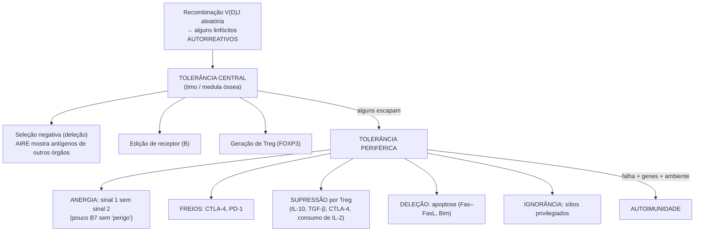

> **Pré-requisitos:** o conceito de tolerância e de seleção clonal no [panorama do sistema imune](#/imunologia/visao-geral-sistema-imune#tolerancia), a seleção dos linfócitos no [timo](#/imunologia/orgaos-linfoides-hematopoese#timo) e os mecanismos de lesão em [hipersensibilidades](#/imunologia/hipersensibilidades). Este tópico cobre o item da ementa do ASE6 "tolerância imunológica e autoimunidade".

## Objetivos do tópico {#objetivos}

Ao final, você deve ser capaz de:

1. Definir **tolerância imunológica** e **autoimunidade**, e explicar por que o sistema imune **inevitavelmente** produz linfócitos autorreativos.
2. Descrever a **tolerância central** (timo e medula óssea: seleção negativa, papel do **AIRE**, edição de receptor, geração de T reguladores).
3. Descrever a **tolerância periférica**: **anergia** (falta de coestimulação, **CTLA-4**, **PD-1**), **supressão por linfócitos T reguladores** (FOXP3, IL-10, TGF-β), **deleção** por apoptose e **ignorância** (sítios privilegiados).
4. Explicar como **genética** (sobretudo **HLA**) e **ambiente** (infecções, mimetismo molecular, lesão tecidual, hormônios) se combinam para romper a tolerância.
5. Classificar as doenças autoimunes em **órgão-específicas** e **sistêmicas** e descrever o **lúpus eritematoso sistêmico**, a **artrite reumatoide**, o **diabetes tipo 1**, a **tireoidite de Hashimoto** e a **esclerose múltipla**.
6. Relacionar tolerância e autoimunidade com **imunodeficiências monogênicas** (IPEX, APECED), **inibidores de checkpoint** no câncer e tratamentos imunossupressores.

::: referencias
Abbas, Lichtman & Pillai – Imunologia Celular e Molecular, 10ª ed., caps. "Tolerância imunológica e autoimunidade" · Robbins Patologia Básica, 10ª ed., cap. "Doenças do sistema imune".
:::

## Conceitos-base {#conceitos-base}

### Tolerância e autoimunidade {#definicoes}

- **Tolerância imunológica**: **ausência de resposta** a um antígeno, **induzida pela exposição prévia a esse antígeno** — é um estado **ativo e específico**, não uma incapacidade. A **autotolerância** (tolerância ao próprio) é o que impede o sistema imune de atacar nossos tecidos.
- **Autoimunidade**: resposta imune (anticorpos e/ou linfócitos T) contra **antígenos próprios** (**autoantígenos**). Quando essa resposta causa lesão e manifestações clínicas, fala-se em **doença autoimune**. Autoanticorpos em baixos títulos podem existir em pessoas saudáveis (sobretudo idosos) sem doença.

### Por que linfócitos autorreativos existem {#por-que-autorreativos}

Os receptores dos linfócitos B (BCR) e T (TCR) são gerados por **recombinação aleatória** dos segmentos gênicos **V(D)J** (veja [diversidade](#/imunologia/visao-geral-sistema-imune#diversidade)). Esse processo cria uma variedade imensa de receptores — capaz de reconhecer praticamente qualquer molécula —, mas **sem "saber" o que é próprio**. Uma fração dos receptores gerados reconhece, inevitavelmente, moléculas do próprio corpo. O sistema imune precisa, portanto, de mecanismos para **eliminar ou controlar** esses linfócitos autorreativos. Quando esses mecanismos falham, surge a autoimunidade.

As doenças autoimunes afetam cerca de **5–8% da população**, são **mais comuns em mulheres** (lúpus: ~9 mulheres para cada homem; Hashimoto e Graves também) e costumam ser **crônicas e progressivas**, porque o autoantígeno **nunca é eliminado** (ele faz parte do corpo) — a resposta é continuamente reestimulada.

::: referencias
Abbas, 10ª ed., cap. "Tolerância imunológica e autoimunidade".
:::

## Explicação detalhada {#explicacao}

### Tolerância central {#tolerancia-central}

**Tolerância central** ocorre nos **órgãos linfoides primários** — **timo** (linfócitos T) e **medula óssea** (linfócitos B) —, enquanto os linfócitos ainda estão **imaturos**. Nessa fase, reconhecer um antígeno **com alta afinidade** é interpretado como "isto é próprio" (porque, ali, quase todos os antígenos presentes são próprios).

#### No timo (linfócitos T) {#tolerancia-timo}

1. Os timócitos imaturos passam primeiro pela **seleção positiva** no córtex: sobrevivem apenas os que reconhecem **com afinidade moderada** o MHC próprio (garantindo que sejam úteis — veja [restrição ao MHC](#/imunologia/imunidade-celular-mhc-linfocitos-t#o-que-tcr-ve)).
2. Na **medula tímica**, ocorre a **seleção negativa**: os timócitos cujo TCR reconhece **com alta afinidade** peptídeos próprios apresentados pelas células epiteliais medulares e células dendríticas recebem um sinal forte que os leva à **apoptose** — são **deletados**.
3. **E os antígenos de outros órgãos (insulina, tireoglobulina, proteínas do olho)?** As células epiteliais da medula tímica expressam uma proteína chamada **AIRE** (*autoimmune regulator*, regulador autoimune), um fator de transcrição que faz essas células **produzirem pequenas quantidades de proteínas típicas de outros tecidos** (antígenos "tecido-específicos"). Assim, o timo funciona como uma "**galeria de retratos do corpo**", mostrando aos timócitos amostras de quase todos os órgãos. Mutações no gene **AIRE** causam a síndrome **APECED** (poliendocrinopatia autoimune tipo 1): autoimunidade contra várias glândulas (paratireoides, adrenais), candidíase mucocutânea e distrofia ectodérmica.
4. Alguns timócitos CD4⁺ que reconhecem antígenos próprios com afinidade intermediária-alta **não morrem**, mas se diferenciam em **linfócitos T reguladores (Treg)**, que vão controlar a autoimunidade na periferia.

#### Na medula óssea (linfócitos B) {#tolerancia-medula}

Linfócitos B imaturos que reconhecem fortemente antígenos próprios podem:

- **Editar o receptor** (**edição de receptor**): reativam a recombinação da cadeia leve e trocam a cadeia leve do BCR, gerando um receptor novo que talvez não seja mais autorreativo — uma "segunda chance";
- Sofrer **deleção** por apoptose, se a edição falhar;
- Tornar-se **anérgicos** (não responsivos), se reconhecem antígenos próprios fracos ou solúveis.

A tolerância central é **eficiente, mas imperfeita**: alguns linfócitos autorreativos escapam (antígenos que não são expressos no timo, afinidade abaixo do limiar de deleção). Por isso existe a **tolerância periférica**.

### Tolerância periférica {#tolerancia-periferica}

Atua sobre linfócitos **maduros** autorreativos que escaparam para a circulação e os tecidos.

#### 1. Anergia — falta de "segundo sinal" {#anergia}

Para um linfócito T virgem ser ativado, ele precisa de **dois sinais** (veja [ativação T](#/imunologia/imunidade-celular-mhc-linfocitos-t#ativacao-t)):

- **Sinal 1**: o TCR reconhece o peptídeo no MHC;
- **Sinal 2 (coestimulação)**: as moléculas **B7 (CD80/CD86)** da célula apresentadora se ligam ao **CD28** do linfócito.

As células apresentadoras só expressam muitas moléculas B7 quando estão **ativadas por sinais de perigo** (micróbios, inflamação — PAMPs e DAMPs). Antígenos próprios, normalmente, são apresentados por células dendríticas **em repouso**, com pouco B7. Quando o linfócito recebe **sinal 1 sem sinal 2**, ele se torna **anérgico**: fica vivo, mas **incapaz de responder** a esse antígeno, mesmo que encontre depois um estímulo completo. É uma lógica de segurança: "só responda se houver perigo".

#### 2. Receptores inibitórios — os "freios" (checkpoints) {#checkpoints}

Os linfócitos T expressam receptores que **desligam** a ativação:

- **CTLA-4**: aparece na superfície do linfócito T após a ativação e liga-se ao **B7 com afinidade muito maior que o CD28**, **competindo** com ele e **retirando** o B7 da célula apresentadora — reduz a coestimulação. É expresso constitutivamente pelos **Treg**, um dos seus principais mecanismos de supressão.
- **PD-1**: expresso por linfócitos T ativados e cronicamente estimulados; ao se ligar aos seus ligantes **PD-L1/PD-L2** (expressos em muitos tecidos, especialmente sob inflamação), envia um sinal inibitório que **reduz a função** do linfócito nos tecidos — protege os órgãos da lesão imune e limita a resposta crônica.

Camundongos sem CTLA-4 morrem de autoimunidade generalizada; sem PD-1, desenvolvem doenças autoimunes mais tardias. Na clínica, os **inibidores de checkpoint** (anticorpos anti-CTLA-4, como o ipilimumabe, e anti-PD-1/PD-L1, como o nivolumabe e o pembrolizumabe) **"soltam os freios"** dos linfócitos T contra tumores — e, como efeito colateral, causam **eventos adversos autoimunes** (colite, hepatite, tireoidite, hipofisite, diabetes, pneumonite).

#### 3. Supressão por linfócitos T reguladores (Treg) {#treg}

Os **Treg** são linfócitos T **CD4⁺ CD25⁺** (CD25 = cadeia α do receptor de IL-2) que expressam o fator de transcrição **FOXP3**, essencial para sua função. São gerados no **timo** (Treg "naturais") ou na **periferia** a partir de linfócitos CD4⁺ comuns expostos a antígenos na presença de **TGF-β** (Treg "induzidos", importantes no intestino, para tolerar alimentos e a microbiota). Suprimem as respostas imunes por vários mecanismos:

- Produção de citocinas **anti-inflamatórias**: **IL-10** (inibe macrófagos e células dendríticas) e **TGF-β** (inibe a proliferação de linfócitos T e B);
- **CTLA-4**, que retira o B7 das células apresentadoras;
- **Consumo de IL-2** (graças ao alto CD25), privando os linfócitos efetores desse fator de crescimento.

Mutações no **FOXP3** causam a síndrome **IPEX** (desregulação imune, poliendocrinopatia, enteropatia, ligada ao X): meninos com diabetes tipo 1 neonatal, enteropatia grave, eczema e outras autoimunidades — prova de que os Treg são indispensáveis.

#### 4. Deleção na periferia {#delecao-periferica}

Linfócitos T que reconhecem antígenos próprios **repetidamente** e com intensidade, sem coestimulação adequada, podem morrer por **apoptose** — pela via mitocondrial (proteína pró-apoptótica Bim) ou pela via **Fas–FasL** (linfócitos ativados expressam Fas e FasL e se eliminam mutuamente). Mutações em **Fas** ou **FasL** causam a **síndrome linfoproliferativa autoimune (ALPS)**: acúmulo de linfócitos (linfonodos e baço aumentados) e autoimunidade (citopenias autoimunes).

#### 5. Ignorância e sítios imunologicamente privilegiados {#sitios-privilegiados}

Alguns antígenos ficam **escondidos** do sistema imune, em locais com barreiras e ambiente imunossupressor — os **sítios privilegiados**: **olho** (câmara anterior), **testículos**, **cérebro**, **placenta/feto**. Linfócitos autorreativos contra esses antígenos não os encontram ("ignorância"). Se uma lesão expõe esses antígenos, pode surgir autoimunidade: na **oftalmia simpática**, um trauma perfurante num olho libera antígenos oculares que induzem uma resposta que ataca **também o olho sadio**; após vasectomia ou trauma testicular, podem surgir anticorpos antiespermatozoides.

::: referencias
Abbas, 10ª ed., cap. "Tolerância imunológica e autoimunidade".
:::

### Como a autoimunidade surge: genes + ambiente {#mecanismos-autoimunidade}

A autoimunidade é **multifatorial**: em geral, ocorre quando uma pessoa com **suscetibilidade genética** é exposta a **gatilhos ambientais** que rompem a tolerância.

#### Fatores genéticos {#fatores-geneticos}

- **Agregação familiar** e maior concordância em gêmeos idênticos (ex.: ~25–50% no lúpus e no diabetes tipo 1, muito maior que entre irmãos não gêmeos) — mas **não 100%**, mostrando a importância do ambiente.
- **Genes HLA** (o MHC humano) — os mais importantes. Como as moléculas HLA apresentam os peptídeos aos linfócitos T, certas variantes (alelos) podem apresentar autoantígenos de forma mais eficiente ou falhar em deletar linfócitos autorreativos no timo. Associações clássicas:

| Doença | Alelo HLA associado |
|---|---|
| **Espondilite anquilosante** | **HLA-B27** (risco muito aumentado) |
| **Artrite reumatoide** | **HLA-DR4** (o "epítopo compartilhado" de alelos DRB1) |
| **Diabetes tipo 1** | **HLA-DR3** e **DR4** (DQ2/DQ8) |
| **Doença celíaca** | **HLA-DQ2** e **DQ8** |
| **Lúpus** | HLA-DR2, DR3 |
| Esclerose múltipla | HLA-DR2 (DRB1*15:01) |

- **Genes não HLA**: genes de vias de tolerância e de sinalização — **PTPN22** (fosfatase que regula a sinalização de linfócitos; artrite reumatoide, DM1, lúpus), **CTLA4**, receptor de **IL-2**, **NOD2** (doença de Crohn), genes do **complemento** (deficiências de **C1q, C2, C4** → lúpus, por falha em remover imunocomplexos e células apoptóticas), genes que eliminam DNA de células mortas.
- **Doenças monogênicas** raras, mas didáticas: **AIRE** (APECED), **FOXP3** (IPEX), **Fas/FasL** (ALPS), **CTLA4** (haploinsuficiência).

#### Fatores ambientais {#fatores-ambientais}

1. **Infecções**, por dois mecanismos principais:
   - **Ativação das células apresentadoras ("efeito espectador")**: a infecção num tecido gera inflamação e **coestimulação (B7)**; linfócitos autorreativos anérgicos ou ignorantes que reconhecem antígenos próprios desse tecido passam a receber o **sinal 2** e são **ativados**.
   - **Mimetismo molecular**: um antígeno do micróbio é **estruturalmente parecido** com um antígeno próprio; a resposta contra o micróbio **reage de forma cruzada** com o tecido. Exemplo clássico: **febre reumática** (proteína M do *Streptococcus pyogenes* × proteínas do coração); outros: síndrome de Guillain-Barré após *Campylobacter* (gangliosídeos dos nervos).
2. **Lesão tecidual**: libera e expõe **antígenos escondidos** (sítios privilegiados, antígenos intracelulares) e gera inflamação (oftalmia simpática; anticorpos anticardíacos após infarto).
3. **Modificações de antígenos próprios**: o **tabagismo** promove a **citrulinação** de proteínas nos pulmões (troca de arginina por citrulina), criando neoantígenos — base dos anticorpos **anti-CCP** na artrite reumatoide em pessoas com HLA-DR4; fármacos (hidralazina, procainamida) podem induzir **lúpus farmacológico**.
4. **Radiação ultravioleta**: aumenta a apoptose de queratinócitos e a exposição de antígenos nucleares — desencadeia e piora o **lúpus** (fotossensibilidade).
5. **Hormônios**: o **estrogênio** favorece a resposta de linfócitos B (maior prevalência de autoimunidade em mulheres, pico na idade fértil); genes imunes no cromossomo X também contribuem.
6. **Microbiota** intestinal: influencia o equilíbrio entre Treg e Th17.

#### Por que a doença se perpetua: espalhamento de epítopos {#espalhamento}

Uma vez iniciada, a resposta autoimune lesa o tecido, liberando **novos autoantígenos**, que ativam **novos clones** de linfócitos contra outros epítopos (partes) da mesma proteína ou de outras proteínas do tecido — o **espalhamento de epítopos** (*epitope spreading*). A resposta se amplia e se torna autossustentada, explicando a cronicidade e a progressão.

::: referencias
Abbas, 10ª ed. · Robbins Patologia Básica, 10ª ed., cap. "Doenças do sistema imune".
:::

### Classificação e exemplos de doenças autoimunes {#doencas-autoimunes}

As doenças autoimunes podem ser **órgão-específicas** (a resposta é dirigida a antígenos de um órgão) ou **sistêmicas** (antígenos distribuídos por todo o corpo, frequentemente com imunocomplexos). O mecanismo de lesão segue os tipos de [hipersensibilidade](#/imunologia/hipersensibilidades): II (anticorpos contra tecido), III (imunocomplexos) ou IV (linfócitos T).

| Doença | Tipo | Alvo / mecanismo principal | Marcadores |
|---|---|---|---|
| **Diabetes tipo 1** | Órgão-específica | **Células β** do pâncreas destruídas por **linfócitos T CD8⁺** (tipo IV) | Anti-GAD, anti-insulina, anti-IA2 |
| **Tireoidite de Hashimoto** | Órgão-específica | Tireoide destruída por linfócitos T e anticorpos → **hipotireoidismo** | **Anti-TPO**, antitireoglobulina |
| **Doença de Graves** | Órgão-específica | Anticorpos **estimuladores** do receptor de TSH (tipo II) → hipertireoidismo | TRAb |
| **Miastenia gravis** | Órgão-específica | Anticorpos contra receptor de acetilcolina (tipo II) | Anti-AChR |
| **Anemia perniciosa** | Órgão-específica | Anticorpos contra células parietais e fator intrínseco → deficiência de B12 | Anti-fator intrínseco |
| **Esclerose múltipla** | Órgão-específica (SNC) | Linfócitos T CD4⁺ (Th1/Th17) e B contra a **mielina** → desmielinização | Bandas oligoclonais no líquor |
| **Doença celíaca** | Órgão-específica (intestino) | Resposta T ao **glúten** (gliadina) apresentado por HLA-DQ2/DQ8 → atrofia das vilosidades | Antitransglutaminase |
| **Artrite reumatoide** | Sistêmica (articular predominante) | Linfócitos T CD4⁺, B e macrófagos na **sinóvia**; citocinas (TNF, IL-6) | **Fator reumatoide**, **anti-CCP** |
| **Lúpus eritematoso sistêmico** | **Sistêmica** | Autoanticorpos contra **antígenos nucleares** → imunocomplexos (tipo III) + anticorpos contra células (tipo II) | **FAN**, **anti-DNA de dupla fita**, **anti-Sm** |
| **Síndrome de Sjögren** | Sistêmica | Infiltração de glândulas salivares e lacrimais → olho e boca secos | Anti-Ro, anti-La |
| **Esclerose sistêmica** | Sistêmica | Fibrose da pele e órgãos, vasculopatia | Anti-Scl-70, anticentrômero |

#### Lúpus eritematoso sistêmico (LES) {#lupus}

O **lúpus** é o protótipo da doença autoimune sistêmica. Afeta sobretudo **mulheres jovens** (idade fértil).

**Fisiopatologia, passo a passo**:

1. **Falha na remoção de células apoptóticas e de material nuclear**: células morrem por apoptose o tempo todo; normalmente, seus restos são removidos rapidamente (com ajuda do complemento C1q). No lúpus — por genes (deficiência de C1q, C2, C4; genes de enzimas que degradam DNA), por **luz ultravioleta** (mais apoptose na pele) e outros fatores —, **sobra material nuclear** (DNA, histonas, nucleossomos, ribonucleoproteínas).
2. **Ativação da imunidade inata**: o DNA e o RNA próprios, quando captados por **células dendríticas plasmocitoides** e linfócitos B, ativam receptores Toll endossômicos (TLR7, TLR9) → grande produção de **interferon tipo I** (a "assinatura do interferon" do lúpus), que ativa ainda mais células dendríticas e linfócitos B.
3. **Quebra da tolerância dos linfócitos B e T** → produção de **autoanticorpos contra antígenos nucleares**.
4. **Lesão**:
   - **Imunocomplexos** (tipo III) com antígenos nucleares se depositam nos **rins** (**nefrite lúpica**, a manifestação mais grave), pele, articulações, serosas, vasos → **consumo de complemento** (C3 e C4 baixos);
   - **Anticorpos contra células do sangue** (tipo II) → anemia hemolítica, leucopenia/linfopenia, plaquetopenia;
   - **Anticorpos antifosfolípides** → trombose e perdas gestacionais (veja [síndrome antifosfolípide](#/patologia/hemostasia-coagulacao#trombofilias)).

**Manifestações** (muito variadas — "a grande imitadora"): **eritema malar** ("em asa de borboleta", que poupa os sulcos nasolabiais, piora com o sol), **fotossensibilidade**, úlceras orais, **artrite** não erosiva, **serosites** (pleurite, pericardite), **nefrite** (proteinúria, hematúria, hipertensão), alterações neurológicas (convulsões, psicose), citopenias, febre, fadiga, alopecia.

**Laboratório**:

- **FAN (fator antinuclear)**: positivo em **quase todos** os pacientes (**muito sensível** — FAN negativo torna o lúpus improvável), mas **pouco específico** (positivo em outras doenças autoimunes, infecções e em parte das pessoas saudáveis).
- **Anti-DNA de dupla fita** e **anti-Sm**: **muito específicos** para lúpus. O anti-DNA se correlaciona com a **atividade** da doença e com a **nefrite**.
- **Complemento baixo** (C3, C4) na doença ativa.

**Tratamento**: **hidroxicloroquina** (base para quase todos), fotoproteção, corticoides, imunossupressores (micofenolato, ciclofosfamida, azatioprina), biológicos (belimumabe, que bloqueia o fator de sobrevivência dos linfócitos B, BAFF).

#### Artrite reumatoide {#artrite-reumatoide}

Inflamação crônica autoimune da **membrana sinovial** das articulações, sobretudo **pequenas articulações das mãos e dos pés** (punhos, metacarpofalângicas, interfalângicas proximais), de forma **simétrica**, com **rigidez matinal prolongada** (mais de 1 hora). Em indivíduos com **HLA-DR4** (e PTPN22), o **tabagismo** e outros fatores promovem a **citrulinação** de proteínas; surgem **anticorpos anti-CCP** (antipeptídeos citrulinados, muito específicos) anos antes dos sintomas. Linfócitos T CD4⁺ (Th1, Th17), linfócitos B, plasmócitos e macrófagos infiltram a sinóvia, que **prolifera** e forma o **pannus** — um tecido inflamatório que **invade e destrói a cartilagem e o osso** (com ativação de osteoclastos pela citocina RANKL) → **erosões** e deformidades (desvio ulnar, dedos em pescoço de cisne). Citocinas como **TNF** e **IL-6** são centrais — base dos tratamentos com **anti-TNF** e anti-IL-6, além do **metotrexato**. O **fator reumatoide** (anticorpo IgM contra a porção Fc da IgG) é frequente, mas menos específico.

#### Diabetes mellitus tipo 1 {#dm1}

Destruição autoimune das **células β** das ilhotas pancreáticas, principalmente por **linfócitos T CD8⁺** (com CD4⁺ e macrófagos — a **insulite**). Os autoanticorpos (anti-GAD65, anti-insulina, anti-IA2, anti-ZnT8) aparecem anos antes e são **marcadores** (não a causa principal da lesão). Os sintomas (poliúria, polidipsia, perda de peso, cetoacidose) surgem quando a maior parte das células β já foi destruída. Associação com **HLA-DR3/DR4** (DQ2/DQ8). Tratamento: **insulina**.

#### Tireoidite de Hashimoto {#hashimoto}

A **causa mais comum de hipotireoidismo** em regiões com iodo suficiente. Linfócitos T (CD4⁺ e CD8⁺) e anticorpos (**anti-TPO**, antitireoglobulina) destroem progressivamente os tireócitos; a glândula fica infiltrada por linfócitos, com **folículos linfoides e centros germinativos** e células epiteliais oncocíticas (células de Hürthle). Clínica: bócio inicialmente, depois **hipotireoidismo** (cansaço, ganho de peso, intolerância ao frio, constipação, pele seca) — **TSH alto**, T4 livre baixo. Associa-se a outras autoimunidades e tem risco aumentado de linfoma de tireoide.

::: referencias
Robbins Patologia Básica, 10ª ed., caps. "Doenças do sistema imune", "Ossos, articulações e tecidos moles" e "Sistema endócrino" · Abbas, 10ª ed.
:::

## Correlação clínica {#correlacao-clinica}

### Princípios do tratamento das doenças autoimunes {#tratamento-autoimune}

- **Anti-inflamatórios e imunossupressores inespecíficos**: **corticoides**, metotrexato, azatioprina, micofenolato, ciclofosfamida, hidroxicloroquina.
- **Terapias-alvo (biológicos)**: anti-**TNF** (artrite reumatoide, doença de Crohn, espondilite), anti-**IL-6** (tocilizumabe), anti-**IL-17** e anti-IL-23 (psoríase), anti-**CD20** (rituximabe — elimina linfócitos B; artrite reumatoide, esclerose múltipla), **abatacepte** (CTLA-4 fundido a uma porção de imunoglobulina: bloqueia o B7 e impede a coestimulação — usa o próprio mecanismo da tolerância!), belimumabe (anti-BAFF, lúpus), inibidores de JAK.
- **Reposição hormonal** quando a glândula foi destruída: **insulina** (DM1), **levotiroxina** (Hashimoto), vitamina **B12** (anemia perniciosa), glicocorticoides e mineralocorticoides (doença de Addison).
- **Risco**: a imunossupressão aumenta o risco de **infecções** (incluindo reativação de tuberculose com anti-TNF) — veja [imunodeficiências](#/imunologia/imunodeficiencias).

### Inibidores de checkpoint: o outro lado da moeda {#checkpoint-clinica}

Anticorpos anti-CTLA-4 e anti-PD-1/PD-L1 revolucionaram o tratamento de vários cânceres (melanoma, pulmão, rim), porque **liberam** a resposta dos linfócitos T contra o tumor. O preço é a **perda de tolerância**: colite, hepatite, pneumonite, dermatite, **tireoidite**, **hipofisite**, **diabetes tipo 1** abrupto — os "eventos adversos imunomediados", tratados com corticoides.

### Autoimunidade e gestação {#autoimunidade-gestacao}

Autoanticorpos IgG maternos **atravessam a placenta** e podem causar doença transitória no recém-nascido: **Graves neonatal** (TRAb), **miastenia neonatal** e **lúpus neonatal** (anticorpos anti-Ro/SSA podem causar **bloqueio cardíaco congênito**). A doença desaparece quando a IgG materna é eliminada (semanas a meses), exceto o bloqueio cardíaco, que é permanente.

::: referencias
Abbas, 10ª ed. · Goodman & Gilman, 13ª ed., cap. "Imunossupressores, tolerógenos e imunoestimulantes".
:::

## Pontos de alta cobrança em prova {#alta-cobranca}

::: prova
- **Tolerância** = não resposta **específica e ativa** induzida pelo antígeno. Linfócitos autorreativos existem porque a **recombinação V(D)J é aleatória**.
- **Tolerância central**: timo — **seleção negativa** (deleção de alta afinidade ao próprio) na medula tímica; **AIRE** expressa antígenos de outros órgãos (mutação → **APECED**: hipoparatireoidismo, Addison, candidíase); geração de **Treg**. Medula — **edição de receptor**, deleção, anergia dos B.
- **Tolerância periférica**: **anergia** (sinal 1 sem **sinal 2**/B7–CD28); **CTLA-4** (compete com CD28 por B7, maior afinidade) e **PD-1/PD-L1** (freios); **Treg** CD4⁺CD25⁺**FOXP3⁺** (IL-10, TGF-β, CTLA-4, consumo de IL-2; mutação → **IPEX**); **deleção** (Fas–FasL; mutação → **ALPS**); **ignorância** (sítios privilegiados: olho, testículo, cérebro — oftalmia simpática).
- **Genes**: **HLA** — B27 (espondilite), DR4 (artrite reumatoide), DR3/DR4 (DM1), DQ2/DQ8 (celíaca); PTPN22; deficiências de C1q/C2/C4 → lúpus.
- **Ambiente**: infecções (**mimetismo molecular** — febre reumática; ativação de APCs/espectador), lesão tecidual (antígenos escondidos), **tabagismo** (citrulinação → **anti-CCP**), **UV** (lúpus), **estrogênio** (mulheres), fármacos (lúpus induzido). **Espalhamento de epítopos** perpetua.
- **Órgão-específicas**: DM1 (CD8⁺ contra células β), Hashimoto (**anti-TPO**, hipotireoidismo), Graves, miastenia, anemia perniciosa, esclerose múltipla, celíaca. **Sistêmicas**: lúpus, AR, Sjögren, esclerose sistêmica.
- **Lúpus**: falha na remoção de restos apoptóticos → material nuclear → TLR7/9 → **interferon tipo I** → autoanticorpos → **imunocomplexos** (nefrite, C3/C4 baixos) + citopenias; eritema malar, fotossensibilidade, artrite, serosite; **FAN** (sensível) + **anti-DNA dupla fita** e **anti-Sm** (específicos; anti-DNA ↔ atividade e nefrite); hidroxicloroquina.
- **Artrite reumatoide**: poliartrite **simétrica** de pequenas articulações, rigidez matinal > 1 h, **pannus** destrói cartilagem e osso; **anti-CCP** (específico), fator reumatoide; TNF/IL-6; metotrexato, anti-TNF.
- **Inibidores de checkpoint** (anti-CTLA-4, anti-PD-1) → eventos autoimunes. **Abatacepte** = CTLA-4-Ig. Anticorpos IgG maternos → doença neonatal transitória (anti-Ro → bloqueio cardíaco).
:::

## Armadilhas comuns {#armadilhas}

::: armadilha
- **Achar que tolerância é "incapacidade" de responder.** É um estado **ativo e específico**, mantido por mecanismos de controle.
- **Achar que a tolerância central elimina todos os autorreativos.** Ela é **imperfeita**; a **periférica** é indispensável.
- **Confundir CTLA-4 com CD28.** O **CD28** ativa (sinal 2); o **CTLA-4** **inibe** (compete pelo B7 com maior afinidade).
- **Achar que FAN positivo confirma lúpus.** O FAN é **sensível, mas pouco específico**; os específicos são **anti-DNA de dupla fita** e **anti-Sm**. FAN negativo torna lúpus improvável.
- **Achar que no DM1 os autoanticorpos destroem as células β.** Eles são **marcadores**; a destruição é feita principalmente por **linfócitos T CD8⁺**.
- **Achar que doença autoimune tem uma única causa genética.** Na maioria, é **poligênica + ambiental**; as formas monogênicas (AIRE, FOXP3, Fas) são raras.
- **Confundir Hashimoto com Graves.** **Hashimoto** destrói a tireoide → **hipo**tireoidismo (anti-TPO, TSH alto); **Graves** estimula → **hiper**tireoidismo (TRAb, TSH suprimido).
:::

## Resumo para revisão rápida {#resumo}

- **Tolerância**: necessária porque o repertório aleatório gera autorreativos.
- **Central**: seleção negativa no timo (AIRE), Treg, edição de receptor na medula.
- **Periférica**: anergia (sem coestimulação), CTLA-4 e PD-1, Treg (FOXP3; IL-10, TGF-β), deleção (Fas), ignorância (sítios privilegiados).
- **Autoimunidade** = genes (HLA, PTPN22, complemento) + ambiente (infecções/mimetismo, lesão, tabagismo, UV, hormônios); espalhamento de epítopos; crônica.
- **Doenças**: órgão-específicas (DM1, Hashimoto, Graves, miastenia, EM, celíaca) e sistêmicas (lúpus — FAN, anti-DNA, anti-Sm, imunocomplexos; AR — pannus, anti-CCP).
- **Clínica**: imunossupressores e biológicos (anti-TNF, rituximabe, abatacepte), reposição hormonal; inibidores de checkpoint causam autoimunidade; doenças neonatais por IgG materna; monogênicas (APECED, IPEX, ALPS).

::: referencias
Abbas, Lichtman & Pillai, 10ª ed. · Robbins Patologia Básica, 10ª ed.
:::
