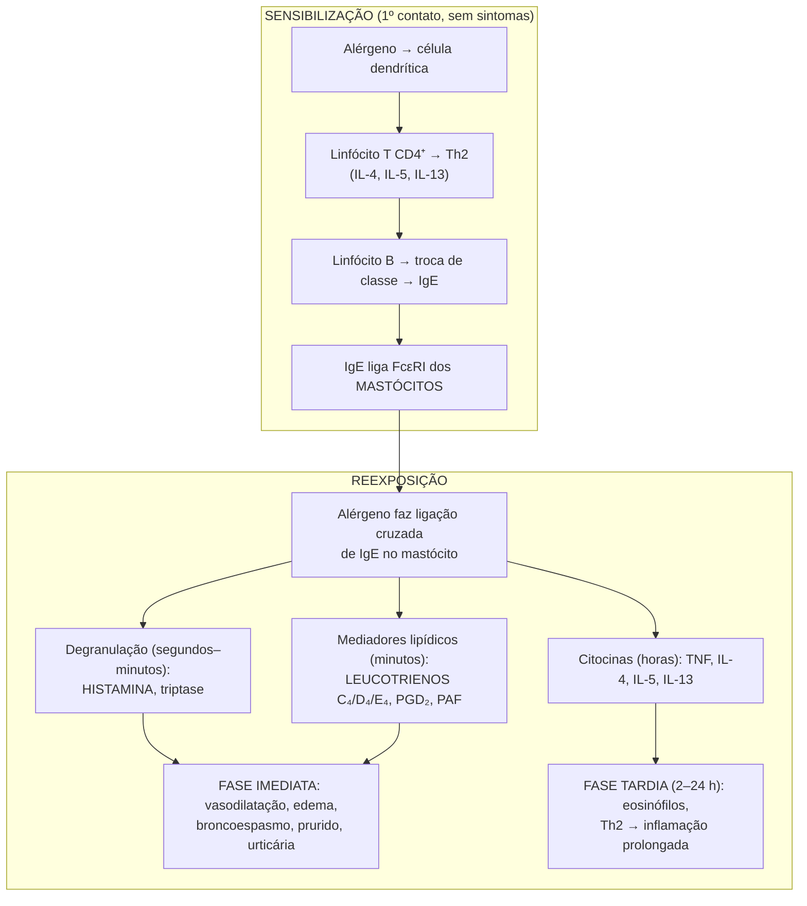
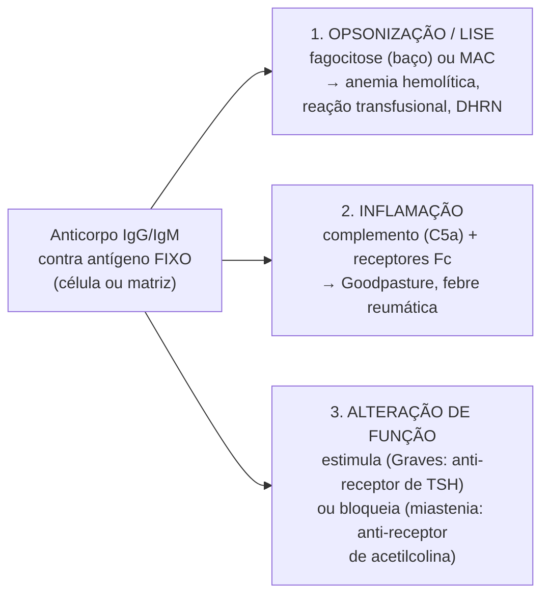

> **Pré-requisitos:** anticorpos e classes de imunoglobulinas ([imunidade humoral](#/imunologia/imunidade-humoral-anticorpos)), linfócitos T CD4⁺ (Th1, Th2, Th17) e CD8⁺ ([imunidade celular](#/imunologia/imunidade-celular-mhc-linfocitos-t)), complemento ([sistema complemento](#/imunologia/sistema-complemento)) e mediadores inflamatórios ([inflamação aguda](#/patologia/inflamacao-aguda#mediadores)). Este tópico cobre o item da ementa do ASE6 "reações de hipersensibilidade".

## Objetivos do tópico {#objetivos}

Ao final, você deve ser capaz de:

1. Definir **hipersensibilidade** e explicar a **classificação de Gell e Coombs** (tipos I, II, III e IV) pelo **mecanismo efetor**.
2. Narrar passo a passo a **hipersensibilidade tipo I** (sensibilização, reação imediata e de fase tardia), com IgE, mastócitos, eosinófilos e linfócitos Th2, e reconhecer a **anafilaxia**, a **asma**, a **rinite** e a **urticária**.
3. Explicar a **tipo II** (anticorpos contra antígenos de células ou matriz) e seus três mecanismos: destruição celular, inflamação e **alteração de função** (Graves, miastenia).
4. Explicar a **tipo III** (imunocomplexos depositados nos vasos), com exemplos sistêmicos (doença do soro, lúpus, glomerulonefrite pós-estreptocócica) e locais (reação de Arthus).
5. Explicar a **tipo IV** (mediada por linfócitos T): inflamação por CD4⁺ (dermatite de contato, teste tuberculínico, granulomas) e citotoxicidade por CD8⁺.
6. Aplicar a classificação a casos clínicos e conhecer o tratamento básico da **anafilaxia**.

::: referencias
Abbas, Lichtman & Pillai – Imunologia Celular e Molecular, 10ª ed., caps. "Hipersensibilidade" e "Alergia" · Robbins Patologia Básica, 10ª ed., cap. "Doenças do sistema imune".
:::

## Conceitos-base {#conceitos-base}

### O que é hipersensibilidade {#definicao}

**Hipersensibilidade** é uma resposta imune **exagerada ou inadequada** que **lesa os tecidos do próprio organismo**. Os mecanismos efetores são os **mesmos** usados normalmente contra micróbios (anticorpos, complemento, fagócitos, linfócitos T, mastócitos) — o problema é **contra o quê** eles são dirigidos e **quanto** são ativados:

- Contra **antígenos ambientais inofensivos** (pólen, ácaros, alimentos, fármacos) → **alergias**;
- Contra **antígenos próprios** (falha da tolerância) → **doenças autoimunes** (veja [autoimunidade](#/imunologia/autoimunidade-tolerancia));
- Contra **micróbios**, mas de forma exagerada ou prolongada → lesão colateral (hepatite viral, tuberculose).

**Antígeno** é qualquer molécula reconhecida especificamente por anticorpos ou linfócitos; **alérgeno** é um antígeno que provoca **alergia** (resposta com IgE).

### A classificação de Gell e Coombs {#classificacao}

Os imunologistas Gell e Coombs (1963) classificaram as hipersensibilidades pelo **mecanismo imunológico** que causa a lesão:

| Tipo | Nome | Mediador principal | Tempo | Exemplos |
|---|---|---|---|---|
| **I** | **Imediata** (alérgica, anafilática) | **IgE** + **mastócitos** (e Th2, eosinófilos) | **Minutos** (e fase tardia em horas) | **Anafilaxia**, **asma** alérgica, **rinite**, urticária, alergia alimentar |
| **II** | **Mediada por anticorpos** (citotóxica) | **IgG/IgM** contra antígenos **fixos** em células ou matriz | Horas a dias | Anemia hemolítica autoimune, **reação transfusional**, **doença hemolítica do recém-nascido**, **Graves**, **miastenia gravis**, febre reumática, Goodpasture |
| **III** | **Mediada por imunocomplexos** | Complexos **antígeno–anticorpo circulantes** que se **depositam** nos vasos | Dias a semanas (Arthus: horas) | **Lúpus**, **doença do soro**, **glomerulonefrite pós-estreptocócica**, reação de Arthus, poliarterite nodosa |
| **IV** | **Tardia** (mediada por células) | **Linfócitos T** (CD4⁺ Th1/Th17 e CD8⁺) | **24–72 horas** | **Dermatite de contato**, **teste tuberculínico (PPD)**, **granulomas**, diabetes tipo 1, rejeição de transplante |

Mnemônico em inglês: **ACID** — **A**nafilática (I), **C**itotóxica (II), **I**munocomplexos (III), **D**elayed (tardia, IV). Note que **I, II e III dependem de anticorpos** e **IV depende de linfócitos T**. Em muitas doenças reais, mais de um tipo participa.

::: referencias
Abbas, 10ª ed., cap. "Hipersensibilidade" · Robbins Patologia Básica, 10ª ed.
:::

## Explicação detalhada {#explicacao}

### Hipersensibilidade tipo I (imediata) {#tipo-i}

#### Quem participa {#tipo-i-atores}

- **IgE**: a classe de anticorpo produzida em menor quantidade no sangue, mas que fica **presa na superfície dos mastócitos e basófilos** por meio de receptores de altíssima afinidade (**FcεRI**). Normalmente serve para a defesa contra **helmintos**.
- **Mastócitos**: células dos tecidos conjuntivos, abundantes **perto de vasos**, na **pele**, nas **mucosas respiratória e digestiva** — os locais de contato com o ambiente. Seus **grânulos** contêm mediadores pré-formados (histamina, proteases como a **triptase**, heparina). **Basófilos** são o equivalente circulante.
- **Linfócitos Th2**: produzem **IL-4** e **IL-13** (que fazem os linfócitos B **trocarem de classe para IgE**), **IL-5** (que produz e ativa **eosinófilos**) e IL-13 (muco, hiper-reatividade brônquica).
- **Eosinófilos**: recrutados na fase tardia; liberam proteínas tóxicas (proteína básica principal, proteína catiônica) e leucotrienos que lesam o epitélio.
- **Atopia**: a **predisposição genética** a produzir IgE contra alérgenos ambientais comuns e a desenvolver doenças alérgicas (asma, rinite, dermatite atópica). Envolve genes da resposta Th2 e da **barreira epitelial** (como a filagrina na pele). Ambiente com menor exposição a micróbios na infância parece aumentar o risco ("hipótese da higiene").

#### Passo a passo {#tipo-i-etapas}

**1. Sensibilização (primeiro contato — sem sintomas)**

1. O alérgeno (proteína de pólen, ácaro, pelo de gato, amendoim, veneno de abelha, penicilina ligada a proteínas) atravessa o epitélio e é capturado por **células dendríticas**, que o levam ao linfonodo e o apresentam a linfócitos T CD4⁺.
2. Em pessoas predispostas, e com o estímulo de citocinas epiteliais (IL-25, IL-33, TSLP), esses linfócitos se diferenciam em **Th2** (e em células T auxiliares foliculares produtoras de IL-4).
3. A **IL-4/IL-13** induz os linfócitos B específicos a **trocarem de classe para IgE** e se tornarem plasmócitos produtores de IgE.
4. A **IgE** circulante se liga aos receptores **FcεRI** dos **mastócitos** em todo o corpo: o indivíduo está **sensibilizado**. Não houve sintoma algum.

**2. Reação imediata (reexposição — minutos)**

5. Numa nova exposição, o alérgeno se liga às moléculas de IgE presas aos mastócitos, fazendo **ligação cruzada** entre dois ou mais receptores (o alérgeno "une" duas IgE vizinhas).
6. A ligação cruzada dispara a **ativação do mastócito**:
   - **Degranulação** (em segundos a minutos): libera os mediadores **pré-formados** — **histamina** (vasodilatação, aumento da permeabilidade, contração do músculo liso dos brônquios e do intestino, prurido), **proteases** (triptase, quimase), heparina;
   - **Síntese de mediadores lipídicos** (em minutos): **prostaglandina D₂** (vasodilatação, broncoconstrição), **leucotrienos C₄, D₄, E₄** (broncoconstrição intensa e prolongada, permeabilidade, muco), **fator de ativação plaquetária**.
7. Resultado clínico em minutos: **vasodilatação** e **edema**, **broncoespasmo**, **secreção de muco**, **prurido**, cólicas.

**3. Reação de fase tardia (2 a 24 horas depois)**

8. Os mastócitos também produzem **citocinas** (TNF, IL-4, IL-5, IL-13) e quimiocinas, que recrutam **eosinófilos**, neutrófilos, basófilos e **linfócitos Th2**.
9. Esse infiltrado causa uma segunda onda de inflamação, **mais prolongada**, com lesão do epitélio — é a base da **inflamação crônica da asma** (que leva a remodelamento das vias aéreas) e explica por que alguns pacientes pioram de novo horas após uma crise.

#### Manifestações clínicas {#tipo-i-clinica}

A manifestação depende de **onde** o alérgeno entra e de **quanto** chega à circulação:

- **Rinite alérgica e conjuntivite**: alérgenos inalados (ácaros da poeira — os mais importantes no Brasil —, pólens, fungos, pelos de animais) → espirros, coriza, obstrução nasal, prurido nasal e ocular.
- **Asma alérgica**: broncoespasmo (sibilos, dispneia), muco e, cronicamente, inflamação com eosinófilos e hiper-reatividade brônquica.
- **Urticária e angioedema**: placas elevadas, avermelhadas, pruriginosas e fugazes na pele (urticas) e edema mais profundo (lábios, pálpebras) — histamina na pele.
- **Alergia alimentar**: amendoim, castanhas, leite de vaca, ovo, frutos do mar → urticária, vômitos, diarreia, até anafilaxia.
- **Dermatite atópica**: eczema crônico pruriginoso em pele com barreira defeituosa (mistura de mecanismos tipo I e tipo IV).
- **Anafilaxia**: a forma **sistêmica e potencialmente fatal**.

#### Anafilaxia {#anafilaxia}

**Anafilaxia** é uma reação de hipersensibilidade **sistêmica, grave e de início rápido** (minutos a poucas horas após a exposição), causada pela liberação maciça de mediadores de mastócitos e basófilos em todo o corpo. Gatilhos mais comuns: **alimentos** (amendoim, frutos do mar, leite — mais em crianças), **picadas de insetos** (abelhas, vespas, formigas), **medicamentos** (antibióticos β-lactâmicos, anti-inflamatórios, contrastes, relaxantes musculares na anestesia) e **látex**.

**Fisiopatologia e clínica**:

- **Vasodilatação generalizada** e **aumento da permeabilidade** (o plasma sai dos vasos — até metade do volume em minutos) → **hipotensão**, **choque distributivo**, síncope;
- **Edema de laringe e de glote** (rouquidão, estridor) e **broncoespasmo** (sibilos) → **insuficiência respiratória**, a principal causa de morte;
- **Pele**: urticária generalizada, rubor, angioedema (presentes na maioria, mas **podem faltar**);
- **Trato digestivo**: náuseas, vômitos, cólicas, diarreia.

**Tratamento — a adrenalina é a primeira e mais importante medida**: **adrenalina intramuscular** (na face anterolateral da coxa; em adultos, tipicamente 0,3–0,5 mg da solução 1 mg/mL, repetida a cada 5–15 minutos se necessário). Por quê? A adrenalina age em **receptores α1** (vasoconstrição → aumenta a pressão e reduz o edema de mucosas), **β1** (aumenta a força e a frequência do coração) e **β2** (broncodilatação e **inibição da liberação de mediadores** pelos mastócitos) — revertendo **todos** os mecanismos da anafilaxia. Complementos: posição deitada com pernas elevadas, **oxigênio**, **reposição volêmica** com cristaloides, broncodilatador inalatório; **anti-histamínicos** e **corticoides** são **adjuvantes** (não substituem a adrenalina — os anti-histamínicos tratam a urticária, mas não a hipotensão nem o broncoespasmo; os corticoides demoram horas). Observar por algumas horas pelo risco de **reação bifásica** (fase tardia). Pacientes com risco devem portar **adrenalina autoinjetável**.

**Reações anafilactoides (não IgE)**: alguns agentes (contrastes iodados, opioides, vancomicina — "síndrome do homem vermelho") **ativam diretamente** os mastócitos, sem IgE nem sensibilização prévia — o quadro é parecido e o tratamento é o mesmo.

**Diagnóstico de alergia**: **testes cutâneos** de leitura imediata (*prick test* — uma pequena quantidade de alérgeno na pele provoca pápula e eritema em 15–20 minutos se houver IgE específica), dosagem de **IgE específica** no sangue; na anafilaxia, a **triptase** sérica elevada (colhida nas primeiras horas) confirma a ativação mastocitária.

**Tratamentos da alergia**: evitar o alérgeno, **anti-histamínicos H1**, **corticoides** (inalatórios na asma, tópicos nasais), **antileucotrienos**, **estabilizadores de mastócitos** (cromoglicato), **imunoterapia alérgeno-específica** ("vacinas para alergia": doses crescentes do alérgeno induzem tolerância — mais IgG4 "bloqueadora", linfócitos T reguladores e IL-10), anticorpo **anti-IgE** (omalizumabe) e anti-IL-5 na asma grave.

::: referencias
Abbas, 10ª ed., cap. "Alergia" · Robbins Patologia Básica, 10ª ed. · Associação Brasileira de Alergia e Imunologia – Guia para o manejo da anafilaxia.
:::

### Hipersensibilidade tipo II (mediada por anticorpos contra células e tecidos) {#tipo-ii}

Na tipo II, anticorpos **IgG ou IgM** se ligam a antígenos **fixos** — na **superfície de células** ou na **matriz extracelular** (próprios ou de fora, como um fármaco aderido à membrana). A lesão se restringe ao **tecido que contém o antígeno**. Há **três mecanismos**:

#### 1. Opsonização e fagocitose / lise celular {#tipo-ii-lise}

Os anticorpos recobrem a célula (opsonização) → **fagócitos** com receptores para a porção Fc da IgG e para o C3b a reconhecem e destroem (sobretudo no **baço**), ou o **complemento** forma o **complexo de ataque à membrana** e a **lisa**.

- **Reação transfusional hemolítica**: transfusão de sangue incompatível no sistema **ABO** — o receptor tem **anticorpos naturais IgM** contra os antígenos A ou B que não possui; eles se ligam às hemácias transfundidas e ativam o complemento → **hemólise intravascular** imediata (febre, dor lombar, hipotensão, hemoglobinúria, CIVD, lesão renal). Por isso a **tipagem e a prova cruzada** antes de transfundir.
- **Doença hemolítica do recém-nascido (eritroblastose fetal)**: mãe **Rh negativa** sensibilizada (numa gestação anterior com feto Rh positivo, por exemplo no parto) produz **IgG anti-D**, que **atravessa a placenta** numa gestação seguinte e destrói as hemácias do feto Rh positivo → anemia, icterícia grave (risco de *kernicterus*), hidropisia. **Prevenção**: imunoglobulina **anti-D** na mãe Rh negativa (na 28ª semana e até 72 horas após o parto de bebê Rh positivo, e após abortos e sangramentos), que remove as hemácias fetais antes que ela se sensibilize (veja [doença hemolítica](#/imunologia/imunidade-humoral-anticorpos#doenca-hemolitica)).
- **Anemia hemolítica autoimune**, **púrpura trombocitopênica imune** (anticorpos contra plaquetas), **anemia hemolítica por fármacos** (penicilina aderida às hemácias).

#### 2. Inflamação mediada por anticorpos {#tipo-ii-inflamacao}

Anticorpos depositados em tecidos fixos ativam o **complemento** (C5a recruta neutrófilos) e os **receptores Fc** dos leucócitos, que liberam enzimas e radicais e lesam o tecido.

- **Síndrome de Goodpasture**: anticorpos contra o **colágeno tipo IV** da membrana basal dos **glomérulos** e dos **alvéolos** → glomerulonefrite rapidamente progressiva e hemorragia pulmonar. Na imunofluorescência, depósito **linear** de IgG ao longo da membrana basal (diferente do depósito granuloso dos imunocomplexos).
- **Febre reumática**: após faringite pelo *Streptococcus pyogenes*, anticorpos contra proteínas da bactéria (proteína M) **reagem de forma cruzada** com proteínas do **coração**, articulações e outros tecidos (**mimetismo molecular**) → cardite (lesão das valvas — doença reumática do coração), artrite.
- **Pênfigo vulgar**: anticorpos contra **desmogleínas** (proteínas dos desmossomos que unem os queratinócitos) → bolhas na pele e mucosas.

#### 3. Alteração da função celular (sem destruição) {#tipo-ii-funcao}

Os anticorpos se ligam a **receptores** e **estimulam** ou **bloqueiam** sua função:

- **Doença de Graves**: anticorpos **estimuladores** contra o **receptor do TSH** imitam o TSH → a tireoide produz hormônio em excesso e cresce → **hipertireoidismo** com bócio difuso (e oftalmopatia). O TSH fica **suprimido** (retroalimentação), mas a tireoide continua estimulada pelos anticorpos.
- **Miastenia gravis**: anticorpos contra o **receptor de acetilcolina** da **junção neuromuscular** **bloqueiam** e promovem a internalização e destruição dos receptores → **fraqueza muscular que piora com o uso** (fatigabilidade), ptose palpebral, diplopia. Melhora com **anticolinesterásicos** (aumentam a acetilcolina disponível).
- **Anemia perniciosa**: anticorpos contra o **fator intrínseco** e as células parietais → má absorção de vitamina B12.
- **Diabetes por anticorpos contra o receptor de insulina** (raro).

::: referencias
Abbas, 10ª ed., cap. "Hipersensibilidade" · Robbins Patologia Básica, 10ª ed.
:::

### Hipersensibilidade tipo III (imunocomplexos) {#tipo-iii}

#### Como se forma {#tipo-iii-mecanismo}

**Imunocomplexos** são agregados de **antígeno + anticorpo** formados na circulação. Normalmente, eles são removidos pelos fagócitos (sobretudo no baço e fígado), com a ajuda do complemento (que os "dissolve" e os leva, presos às hemácias, até os macrófagos). Causam doença quando:

- São formados **em grande quantidade** e de forma **persistente** (infecção crônica, autoantígeno abundante);
- Têm **tamanho intermediário** e se formam com **excesso leve de antígeno** — complexos grandes são removidos facilmente, pequenos ficam solúveis; os intermediários escapam da remoção e **se depositam**;
- A remoção está deficiente (deficiência de complemento — por isso a falta de C1q, C2 ou C4 predispõe ao lúpus).

**Passo a passo**:

1. **Formação** dos imunocomplexos na circulação (cerca de 1 semana após a introdução do antígeno, quando começam a surgir anticorpos).
2. **Deposição** nas paredes de vasos onde o sangue é **filtrado sob pressão** e com fluxo turbulento: **glomérulos renais**, **articulações** (sinóvia), **pele** e pequenos vasos em geral (vasculite), plexo coroide. O aumento da permeabilidade vascular (mediado por mastócitos e plaquetas) facilita a deposição.
3. **Inflamação**: os complexos depositados **ativam o complemento** (consumo — **C3 e C4 baixos** no sangue) → **C5a** recruta **neutrófilos** e **C3a/C5a** ativam mastócitos; os neutrófilos, ao tentar fagocitar os complexos presos à parede, liberam enzimas e radicais → **vasculite**, com **necrose fibrinoide** da parede vascular (veja [necrose fibrinoide](#/patologia/necrose-apoptose#necrose-fibrinoide)).

A diferença essencial em relação à tipo II: na **tipo III**, o antígeno **não é do tecido lesado** — os complexos se formam no sangue e **se depositam onde o fluxo favorece**, por isso as doenças são **sistêmicas** (rins, articulações, pele, vasos) e independentes de qual é o antígeno. Na imunofluorescência, os depósitos são **granulosos** ("em grumos").

#### Exemplos {#tipo-iii-exemplos}

- **Doença do soro (forma sistêmica aguda)**: historicamente, após receber **soro de cavalo** (antitoxinas); hoje, após **soros antiveneno** (antiofídico, antiescorpiônico — relevante no Brasil), anticorpos monoclonais quiméricos e alguns fármacos. Cerca de **1 a 2 semanas** após a administração (tempo para produzir anticorpos contra as proteínas estranhas): **febre**, **urticária/exantema**, **artralgias/artrite**, **linfadenopatia** e **proteinúria** (glomerulite), com **complemento baixo**. Costuma ser autolimitada quando o antígeno é eliminado.
- **Lúpus eritematoso sistêmico**: autoanticorpos contra **antígenos nucleares** (DNA de dupla fita, histonas, nucleossomos) liberados por células mortas formam imunocomplexos que se depositam nos **rins** (nefrite lúpica), pele, articulações, serosas (veja [autoimunidade](#/imunologia/autoimunidade-tolerancia)).
- **Glomerulonefrite pós-estreptocócica**: **1 a 3 semanas** após faringite ou impetigo por *Streptococcus pyogenes* (cepas nefritogênicas), imunocomplexos com antígenos estreptocócicos se depositam nos glomérulos → **síndrome nefrítica**: hematúria (urina cor de "coca-cola"), **edema**, **hipertensão**, oligúria, **C3 baixo**; mais comum em crianças; geralmente boa evolução.
- **Poliarterite nodosa** (associada à hepatite B em parte dos casos), **vasculites** por crioglobulinas (hepatite C), endocardite infecciosa (glomerulonefrite).
- **Reação de Arthus (forma local)**: quando um antígeno é injetado na **pele** de alguém que já tem **muitos anticorpos IgG** contra ele (por exemplo, doses de reforço muito frequentes de vacina contra tétano/difteria), formam-se imunocomplexos **no local da injeção** → em **4 a 10 horas**, edema, eritema, dor e, nos casos intensos, **necrose** cutânea por vasculite local.

::: referencias
Abbas, 10ª ed., cap. "Hipersensibilidade" · Robbins Patologia Básica, 10ª ed., caps. "Doenças do sistema imune" e "Rim".
:::

### Hipersensibilidade tipo IV (tardia, mediada por linfócitos T) {#tipo-iv}

Na tipo IV, **não há anticorpos**: a lesão é causada por **linfócitos T** sensibilizados. É chamada **tardia** porque a reação leva **24 a 72 horas** para aparecer após a reexposição — o tempo necessário para **recrutar** os linfócitos T de memória ao local, **ativá-los**, produzirem citocinas e atraírem macrófagos. Há dois mecanismos:

#### 1. Inflamação mediada por linfócitos T CD4⁺ (Th1 e Th17) {#tipo-iv-cd4}

1. **Sensibilização**: no primeiro contato, células dendríticas apresentam o antígeno a linfócitos T CD4⁺, que se diferenciam em **Th1** (e Th17) de memória.
2. **Reexposição**: os linfócitos de memória reconhecem o antígeno apresentado no local, produzem **IFN-γ** (Th1) — que **ativa macrófagos** — e **IL-17** (Th17) — que recruta neutrófilos —, além de TNF e quimiocinas que recrutam mais células.
3. Os **macrófagos ativados** liberam enzimas, radicais e citocinas → **inflamação** e lesão; se o antígeno persistir, formam-se **granulomas**.

**Exemplos**:

- **Teste tuberculínico (PPD, reação de Mantoux)**: injeta-se na pele uma pequena quantidade de proteína purificada do *M. tuberculosis*; em quem já teve contato com o bacilo (infecção ou vacina BCG), linfócitos Th1 de memória são recrutados e, em **48–72 horas**, forma-se uma **enduração** (área endurecida, infiltrada por linfócitos e macrófagos) — lida em milímetros. A enduração, e não a vermelhidão, é o que conta.
- **Dermatite de contato alérgica**: substâncias pequenas (**haptenos**) — **níquel** (bijuterias, botões de calça jeans), cromo (cimento), componentes de cosméticos, tinturas de cabelo, borracha, o óleo da **hera venenosa** — penetram na pele e **se ligam a proteínas próprias**, formando novos antígenos. Após sensibilização, a reexposição causa, em 1–3 dias, **eczema** (vermelhidão, vesículas, prurido) **exatamente na área de contato** (o lóbulo da orelha com brinco, a cintura com o botão). Diagnóstico pelo **teste de contato** (*patch test*), lido em 48–96 horas. (Diferente da **dermatite de contato irritativa**, que não é imunológica — lesão direta por detergentes, ácidos.)
- **Granulomas** na **tuberculose**, hanseníase, esquistossomose e micoses (veja [granuloma](#/patologia/inflamacao-cronica-reparo#granuloma)).
- **Doenças autoimunes** mediadas por T CD4⁺: artrite reumatoide, esclerose múltipla, doença de Crohn, psoríase (Th17).

#### 2. Citotoxicidade mediada por linfócitos T CD8⁺ {#tipo-iv-cd8}

**Linfócitos T CD8⁺** citotóxicos reconhecem antígenos apresentados no **MHC de classe I** e **matam** as células-alvo (perforina, granzimas, Fas) (veja [CD8⁺](#/imunologia/imunidade-celular-mhc-linfocitos-t#cd8-citotoxicos)).

- **Diabetes mellitus tipo 1**: linfócitos T CD8⁺ (com participação de CD4⁺) destroem as **células β** das ilhotas pancreáticas.
- **Hepatite viral**: grande parte da lesão hepática na hepatite B e C é causada pelos CD8⁺ que matam hepatócitos infectados (não pelo vírus em si).
- **Rejeição de transplantes** (aguda celular).
- **Reações cutâneas graves a fármacos** (síndrome de Stevens-Johnson, necrólise epidérmica tóxica — CD8⁺ e outras células matam queratinócitos), associadas a certos alelos HLA (como o HLA-B*15:02 com a carbamazepina em populações asiáticas).

::: referencias
Abbas, 10ª ed., cap. "Hipersensibilidade" · Robbins Patologia Básica, 10ª ed.
:::

### Quadro comparativo final {#comparacao}

| | **Tipo I** | **Tipo II** | **Tipo III** | **Tipo IV** |
|---|---|---|---|---|
| Mediador | **IgE** (+ Th2) | **IgG/IgM** | **IgG/IgM** em **complexos** | **Linfócitos T** |
| Antígeno | Alérgeno ambiental solúvel | **Fixo** em célula/matriz | **Solúvel**, circulante | Associado a células (apresentado no MHC) |
| Efetores | **Mastócitos**, eosinófilos | Fagócitos, complemento, receptores Fc | **Complemento**, **neutrófilos** | **Macrófagos** (CD4⁺) ou **CD8⁺** |
| Tempo | Minutos | Horas–dias | Dias–semanas (Arthus: horas) | **24–72 h** |
| Local da lesão | Mucosas, pele, sistêmico | **Onde está o antígeno** | **Onde os complexos se depositam** (rins, articulações, vasos, pele) | Onde está o antígeno |
| Complemento sérico | Normal | Pode cair (hemólise) | **Baixo** (consumo) | Normal |
| Exemplos | Anafilaxia, asma, rinite, urticária | Reação transfusional, DHRN, Graves, miastenia, Goodpasture, febre reumática | Lúpus, doença do soro, GN pós-estreptocócica, Arthus | PPD, dermatite de contato, granulomas, DM1, rejeição |

::: referencias
Abbas, 10ª ed. · Robbins Patologia Básica, 10ª ed.
:::

## Correlação clínica {#correlacao-clinica}

### Reações a medicamentos {#reacoes-medicamentos}

Um mesmo fármaco pode causar **qualquer** tipo de hipersensibilidade — a **penicilina** é o exemplo clássico:

- **Tipo I**: anafilaxia e urticária minutos após a dose (IgE contra os determinantes da penicilina ligada a proteínas).
- **Tipo II**: anemia hemolítica (penicilina aderida às hemácias, anticorpos contra o complexo).
- **Tipo III**: doença do soro (imunocomplexos), 1–2 semanas depois.
- **Tipo IV**: exantema maculopapular tardio, dermatite de contato.

Saber o **tempo** e a **forma** da reação ajuda a classificar e a decidir se o fármaco pode ser usado de novo.

### Soros antiveneno e doença do soro {#soro-antiveneno}

Os soros antiofídicos, antiescorpiônicos e antiaracnídicos produzidos no Brasil (Instituto Butantan, Vital Brazil, Fundação Ezequiel Dias) são **imunoglobulinas de cavalo** (fragmentos F(ab')₂). Podem causar **reações precoces** (urticária, broncoespasmo, anafilaxia ou anafilactoides — durante a infusão) e **tardias** (**doença do soro**, 5–24 dias depois — tipo III). Por isso são administrados em ambiente com recursos para tratar anafilaxia.

### Transfusões e gestação {#transfusao-gestacao}

- Prova cruzada e tipagem ABO e Rh antes de transfundir.
- Pesquisa de anticorpos irregulares (Coombs indireto) no pré-natal; imunoglobulina anti-D nas gestantes Rh negativas não sensibilizadas.

::: referencias
Abbas, 10ª ed. · Ministério da Saúde – Manual de Diagnóstico e Tratamento de Acidentes por Animais Peçonhentos.
:::

## Pontos de alta cobrança em prova {#alta-cobranca}

::: prova
- **Gell e Coombs**: **I** = IgE/mastócitos (imediata); **II** = anticorpos contra antígeno **fixo** (célula/matriz); **III** = **imunocomplexos** circulantes depositados; **IV** = **linfócitos T** (tardia, 24–72 h). I–III = anticorpos; IV = células.
- **Tipo I**: sensibilização (Th2 → **IL-4** → troca para **IgE** → IgE no **FcεRI** do mastócito) → reexposição: **ligação cruzada** → **histamina**, triptase (pré-formados) + **leucotrienos C₄/D₄/E₄**, PGD₂ (sintetizados) → fase imediata; citocinas (IL-5) → **eosinófilos** → **fase tardia** (2–24 h). **Atopia**. Ácaros = principais alérgenos inalados no Brasil.
- **Anafilaxia**: vasodilatação + permeabilidade (choque), edema de glote e broncoespasmo; gatilhos: alimentos, picadas, fármacos, látex. **Adrenalina IM** (coxa) primeiro (α1, β1, β2 + estabiliza mastócitos); anti-histamínico e corticoide são adjuvantes; observar reação bifásica; triptase confirma.
- **Tipo II**: (1) **opsonização/lise** — reação transfusional ABO (IgM natural, hemólise intravascular), **DHRN** (IgG anti-D atravessa a placenta; prevenção com **imunoglobulina anti-D**), AHAI, PTI; (2) **inflamação** — **Goodpasture** (anti-colágeno IV, depósito **linear**), **febre reumática** (mimetismo com proteína M); (3) **alteração de função** — **Graves** (anticorpo **estimulador** do receptor de TSH), **miastenia** (anticorpo **bloqueador** do receptor de acetilcolina).
- **Tipo III**: complexos de tamanho intermediário depositam-se em **glomérulos, articulações, pele, vasos** → **complemento** (C3/C4 **baixos**) → **neutrófilos** → vasculite, **necrose fibrinoide**; depósito **granuloso**. **Doença do soro** (1–2 semanas; febre, urticária, artralgia, proteinúria; soros antiveneno), **lúpus**, **GN pós-estreptocócica** (1–3 semanas, nefrítica, C3 baixo), **Arthus** (local, horas).
- **Tipo IV**: **CD4⁺ Th1** (IFN-γ → macrófagos) — **PPD** (enduração em 48–72 h), **dermatite de contato** (haptenos: **níquel**; patch test), **granulomas**; **CD8⁺** — **DM1**, hepatite viral, rejeição, Stevens-Johnson.
- **Penicilina** pode causar os 4 tipos.
:::

## Armadilhas comuns {#armadilhas}

::: armadilha
- **Achar que anti-histamínico ou corticoide tratam a anafilaxia.** O tratamento essencial e **imediato** é a **adrenalina intramuscular**; os outros são adjuvantes.
- **Achar que a primeira exposição ao alérgeno causa a reação tipo I.** A primeira exposição **sensibiliza**; a reação vem na **reexposição** (exceto reações anafilactoides, que não dependem de IgE).
- **Confundir tipo II e tipo III.** Na **II**, o antígeno está **fixo no tecido lesado**; na **III**, os complexos se formam **no sangue** e se depositam em tecidos que **não** são o alvo original (rins, articulações, vasos).
- **Achar que a Graves destrói a tireoide.** O anticorpo **estimula** o receptor de TSH (hipertireoidismo); na miastenia, o anticorpo **bloqueia** o receptor.
- **Ler o PPD pela vermelhidão.** O que se mede é a **enduração**, em milímetros, em 48–72 horas.
- **Achar que a dermatite de contato alérgica é tipo I.** É **tipo IV** (tardia, linfócitos T, 1–3 dias); a urticária de contato imediata é que seria tipo I.
- **Achar que a hipersensibilidade tipo IV envolve anticorpos.** É mediada por **linfócitos T**.
:::

## Resumo para revisão rápida {#resumo}

- **Hipersensibilidade** = resposta imune exagerada/inadequada que lesa o próprio tecido (alergia, autoimunidade, lesão colateral).
- **Tipo I** (minutos): IgE + mastócitos; Th2/IL-4; histamina, leucotrienos; fase tardia com eosinófilos; asma, rinite, urticária, alergia alimentar, **anafilaxia** (adrenalina IM).
- **Tipo II**: anticorpos contra antígenos fixos; opsonização/lise (reação transfusional, DHRN, AHAI), inflamação (Goodpasture, febre reumática), alteração de função (Graves, miastenia).
- **Tipo III**: imunocomplexos depositados (rins, articulações, vasos, pele) → complemento baixo, neutrófilos, vasculite; doença do soro, lúpus, GN pós-estreptocócica, Arthus.
- **Tipo IV** (24–72 h): linfócitos T; CD4⁺ Th1 (PPD, dermatite de contato, granulomas) e CD8⁺ (DM1, hepatite viral, rejeição).

::: referencias
Abbas, Lichtman & Pillai, 10ª ed. · Robbins Patologia Básica, 10ª ed.
:::
