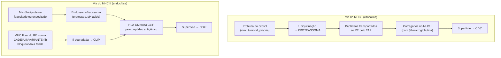
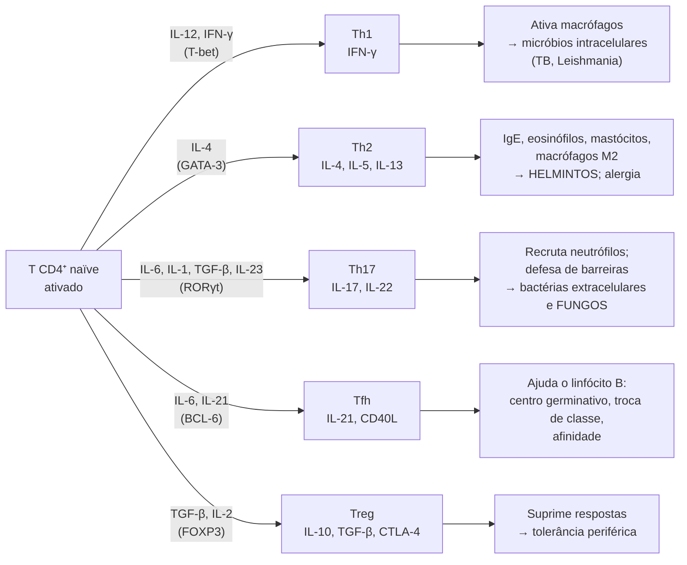

## Objetivos do tópico {#objetivos}

Ao final, você deve ser capaz de:

1. Comparar **MHC de classe I** e **de classe II** quanto à distribuição, à origem dos peptídeos, à via de processamento e ao linfócito que os reconhece.
2. Explicar por que o linfócito T só reconhece antígenos **apresentados** (restrição ao MHC) e o que é **apresentação cruzada**.
3. Descrever os **três sinais** de ativação do linfócito T naïve e o papel de **CD28, CTLA-4 e PD-1**, incluindo as bases da imunoterapia com inibidores de *checkpoint*.
4. Relacionar cada subtipo de **CD4⁺** (Th1, Th2, Th17, Tfh, Treg) às citocinas indutoras, ao fator de transcrição, às citocinas produzidas e aos agressores que combatem.
5. Descrever os mecanismos citotóxicos dos **CD8⁺** e aplicar o conteúdo a situações clínicas: tuberculose e anti-TNF, HIV, superantígenos, associações HLA–doença e rejeição de transplantes.

::: referencias
Abbas, Lichtman & Pillai – Imunologia Celular e Molecular, 10ª ed., caps. "Moléculas do MHC e apresentação de antígenos aos linfócitos T", "Ativação dos linfócitos T", "Diferenciação e funções dos linfócitos T CD4⁺ efetores" e "Diferenciação e funções dos linfócitos T CD8⁺ efetores".
:::

## Conceitos-base {#conceitos-base}

### Por que existe a imunidade celular {#por-que-celular}

Anticorpos são ótimos contra micróbios **fora das células** (no sangue, nas mucosas, nos líquidos teciduais), mas não alcançam o que está **dentro** delas. Vírus, algumas bactérias (*Mycobacterium*, *Listeria*, *Salmonella*) e protozoários (*Leishmania*) escondem-se no citoplasma ou em vesículas. A imunidade celular resolve esse problema de duas maneiras:

- **Linfócitos T CD4⁺** ativam outras células (macrófagos, linfócitos B, neutrófilos) para destruírem o que fagocitaram ou para produzirem anticorpos.
- **Linfócitos T CD8⁺** matam a célula infectada inteira, eliminando a "fábrica" de vírus.

Para isso, as células precisam **mostrar** ao linfócito T pedaços do que há dentro delas. Essa é a função do **MHC** (complexo principal de histocompatibilidade; em humanos, **HLA**).

### O que o TCR enxerga {#o-que-tcr-ve}

O receptor do linfócito T (TCR) **não reconhece antígenos livres**. Ele reconhece um **peptídeo curto encaixado na fenda de uma molécula de MHC próprio** — o complexo peptídeo-MHC. Isso é a **restrição ao MHC**, definida durante a seleção positiva no [timo](#/imunologia/orgaos-linfoides-hematopoese#timo). Duas consequências:

1. O linfócito T reconhece praticamente só **proteínas** (peptídeos), não polissacarídeos ou lipídios (exceções: linfócitos T não convencionais, como os restritos a CD1, que apresentam lipídios).
2. O linfócito T precisa de **contato com outra célula** — não detecta antígeno solúvel.

Regra prática para não confundir: **CD8 × MHC I = 8** e **CD4 × MHC II = 8**.

::: referencias
Abbas, 10ª ed., cap. "Moléculas do MHC e apresentação de antígenos aos linfócitos T".
:::

## Explicação detalhada {#explicacao}

### MHC de classe I × classe II {#mhc-classes}

| | **MHC classe I** | **MHC classe II** |
|---|---|---|
| Genes (HLA) | HLA-**A, B, C** | HLA-**DR, DQ, DP** |
| Estrutura | Cadeia α + **β2-microglobulina** | Cadeias α e β |
| Expresso em | **Todas as células nucleadas** (e plaquetas); não em hemácias maduras | **Células apresentadoras de antígeno (APCs)**: dendríticas, macrófagos, linfócitos B; induzível por IFN-γ |
| Origem dos peptídeos | **Citosol** (proteínas próprias, virais, tumorais) | **Vesículas endocíticas** (material fagocitado/endocitado) |
| Tamanho do peptídeo | 8–10 aminoácidos (fenda fechada) | 13–25 aminoácidos (fenda aberta) |
| Reconhecido por | **CD8⁺** (citotóxicos) | **CD4⁺** (auxiliares) |
| Sentido biológico | "Esta célula está infectada/transformada — mate-a" | "Esta APC capturou algo de fora — ajude a combater" |

Os genes HLA são **codominantes** (expressamos os alelos dos dois pais) e **extremamente polimórficos** — milhares de alelos na população. Isso amplia o repertório de peptídeos que uma população consegue apresentar, mas também explica a dificuldade de encontrar doadores compatíveis para transplantes.

### Vias de processamento e apresentação {#apresentacao-antigeno}

**Por que as vias não se misturam?** A **cadeia invariante** ocupa a fenda do MHC II enquanto ele está no retículo endoplasmático, impedindo que peptídeos citosólicos o ocupem. Só no compartimento endocítico ela é degradada (restando o fragmento **CLIP**), e o **HLA-DM** troca o CLIP pelo peptídeo antigênico.

**Apresentação cruzada:** certas **células dendríticas** conseguem desviar antígenos **fagocitados** (por exemplo, de células infectadas ou tumorais mortas) para a via do **MHC I**, ativando **CD8⁺ naïve**. Isso é essencial para gerar CTLs contra vírus que **não infectam** as dendríticas e contra tumores.

**Estratégias de escape** (que reforçam o raciocínio): herpesvírus e citomegalovírus bloqueiam o **TAP** ou retêm o MHC I no RE — escapam dos CD8⁺, mas se tornam alvo das **NK** (veja [imunidade inata](#/imunologia/imunidade-inata#celulas-nk)).

::: referencias
Abbas, 10ª ed., cap. "Moléculas do MHC e apresentação de antígenos aos linfócitos T".
:::

### Ativação do linfócito T naïve: os três sinais {#ativacao-t}

O encontro ocorre no **paracórtex do linfonodo**, entre a dendrítica que trouxe o antígeno e o T naïve recirculante.

| Sinal | O que é | Se faltar |
|---|---|---|
| **1 – Antígeno** | TCR (+ CD3, que transmite o sinal) reconhece **peptídeo-MHC**; CD4 ou CD8 ligam-se ao MHC como correceptores | Sem reconhecimento, nada acontece |
| **2 – Coestimulação** | **CD28** (no T) liga-se a **B7-1/B7-2 (CD80/CD86)** na APC ativada por PAMPs | Sinal 1 sem sinal 2 → **anergia** (tolerância periférica) |
| **3 – Citocinas** | Citocinas da APC (IL-12, IL-4, IL-6, TGF-β…) definem **qual subtipo** o CD4⁺ vai se tornar | Diferenciação inadequada |

Após ativado, o linfócito T secreta **IL-2** e expressa o receptor de alta afinidade (**CD25**) → **expansão clonal** (um clone pode multiplicar-se milhares de vezes em poucos dias) e diferenciação em células **efetoras** e de **memória**.

**Os freios (checkpoints):**

- **CTLA-4** — expresso após a ativação; liga-se ao B7 com afinidade **maior** que o CD28, competindo com ele e retirando o B7 da APC. Atua sobretudo **na fase de ativação**, no linfonodo. Também é muito expresso nas **Treg**.
- **PD-1** — liga-se a **PD-L1/PD-L2** nos tecidos (inclusive em células tumorais) e inibe o linfócito T **efetor na periferia**, especialmente em estimulação crônica ("exaustão").

**Inibidores de checkpoint** (anti-CTLA-4: ipilimumabe; anti-PD-1: nivolumabe, pembrolizumabe; anti-PD-L1: atezolizumabe) soltam esses freios e reativam a resposta antitumoral. O preço são os **eventos adversos imunomediados**: colite, pneumonite, hepatite, tireoidite, hipofisite, diabetes tipo 1 — autoimunidade iatrogênica.

O **abatacepte** (CTLA-4-Ig) faz o contrário: bloqueia o B7 e impede a coestimulação — é usado na artrite reumatoide.

::: referencias
Abbas, 10ª ed., cap. "Ativação dos linfócitos T" · Goodman & Gilman, 13ª ed., cap. "Imunossupressores, tolerógenos e imunoestimulantes".
:::

### Subtipos de linfócitos T CD4⁺ {#subtipos-cd4}

| Subtipo | Indução | Fator de transcrição | Citocinas | Função | Quando dá errado |
|---|---|---|---|---|---|
| **Th1** | IL-12 (dendríticas, macrófagos), IFN-γ | **T-bet** | **IFN-γ** | Ativação clássica de macrófagos; IgG opsonizante | Doenças autoimunes órgão-específicas, hipersensibilidade tipo IV |
| **Th2** | IL-4 | **GATA-3** | **IL-4, IL-5, IL-13** | Troca para **IgE**, eosinófilos (IL-5), muco, macrófagos M2 | **Alergia, asma** |
| **Th17** | IL-6 + TGF-β (+ IL-1, IL-23) | **RORγt** | **IL-17, IL-22** | Recrutamento de neutrófilos, peptídeos antimicrobianos, integridade de barreiras | **Psoríase**, doença inflamatória intestinal; defeitos → **candidíase mucocutânea** |
| **Tfh** | IL-6, IL-21 | **BCL-6** | IL-21; **CD40L** | Centro germinativo, troca de classe, maturação de afinidade | Autoanticorpos |
| **Treg** | TGF-β, IL-2 | **FOXP3** | IL-10, TGF-β; CTLA-4 | **Tolerância** periférica | Mutação de FOXP3 → **IPEX** |

**As subpopulações se inibem mutuamente:** IFN-γ inibe Th2; IL-4 inibe Th1. Isso explica a **polarização** — por exemplo, na hanseníase, uma resposta Th1 eficiente leva à forma **tuberculoide** (poucos bacilos, granulomas bem formados), e uma resposta Th2/ineficaz, à forma **virchowiana** (muitos bacilos).

::: referencias
Abbas, 10ª ed., cap. "Diferenciação e funções dos linfócitos T CD4⁺ efetores".
:::

### Linfócitos T CD8⁺ citotóxicos {#cd8-citotoxicos}

O CD8⁺ naïve, ativado pela dendrítica (frequentemente por apresentação cruzada e com ajuda de CD4⁺), torna-se **CTL** e mata qualquer célula que apresente o peptídeo-alvo em MHC I:

1. Forma uma **sinapse imunológica** com a célula-alvo.
2. Libera **perforina** (abre poros) e **granzimas** (proteases que ativam **caspases** → **apoptose**).
3. Usa também a via **Fas-ligante (FasL) → Fas** na célula-alvo (apoptose pela via extrínseca).
4. Secreta **IFN-γ** (ativa macrófagos e aumenta o MHC I).

A morte por **apoptose**, e não por necrose, é vantajosa: o conteúdo celular (incluindo vírus) não é liberado de forma inflamatória, e os restos são fagocitados.

### Memória {#memoria}

Após a resolução, a maioria dos efetores morre, mas permanecem **linfócitos de memória** (centrais, nos órgãos linfoides; efetores e residentes nos tecidos), em maior número e com resposta mais rápida. Esse é o fundamento das **vacinas**.

::: referencias
Abbas, 10ª ed., cap. "Diferenciação e funções dos linfócitos T CD8⁺ efetores".
:::

## Correlação clínica {#correlacao-clinica}

### Tuberculose, granuloma e anti-TNF {#tuberculose}

O *Mycobacterium tuberculosis* sobrevive dentro do fagossomo do macrófago. O controle depende do eixo **IL-12 → Th1 → IFN-γ → macrófago ativado**, com participação de **TNF** para formar e manter o **granuloma**, que contém os bacilos.

- **Anti-TNF** (infliximabe, adalimumabe) desestrutura granulomas → **reativação de tuberculose latente**. Antes de iniciar, é obrigatório rastrear infecção latente (**prova tuberculínica ou IGRA** e radiografia) e tratá-la se presente (Ministério da Saúde).
- Defeitos genéticos do eixo **IL-12/IFN-γ** → infecções graves por micobactérias (inclusive BCG) e *Salmonella*.
- O **IGRA** mede justamente o IFN-γ liberado por linfócitos T de memória ao entrar em contato com antígenos do bacilo.

### HIV e a queda dos CD4⁺ {#hiv}

O HIV usa **CD4** (e os correceptores **CCR5** ou **CXCR4**) para infectar linfócitos T CD4⁺, macrófagos e dendríticas. A perda progressiva de CD4⁺ compromete a ativação de macrófagos, a ajuda aos B e aos CD8⁺. A contagem de CD4⁺ prevê o risco de infecções oportunistas: abaixo de **200/mm³** → pneumocistose (indicação de profilaxia); abaixo de **50–100/mm³** → micobactérias atípicas, citomegalovírus, toxoplasmose cerebral, criptococose.

### Superantígenos {#superantigenos}

Toxinas como a **TSST-1** (*S. aureus*, síndrome do choque tóxico) e as exotoxinas pirogênicas do *S. pyogenes* ligam-se **por fora da fenda**: unem o **MHC II** da APC à **região Vβ do TCR**, sem processamento. Assim, ativam **até 20% de todos os linfócitos T** (em vez de ~1 em 10⁵) → liberação maciça de **IL-2, IFN-γ e TNF** → febre, eritrodermia, hipotensão e falência de múltiplos órgãos.

### HLA, doenças e fármacos {#hla-doencas}

| Alelo HLA | Associação |
|---|---|
| **HLA-B27** | Espondilite anquilosante e outras espondiloartrites, uveíte anterior |
| **HLA-DR3 / DR4 (DQ2/DQ8)** | Diabetes tipo 1; DQ2/DQ8 na **doença celíaca** |
| **HLA-DR4** | Artrite reumatoide |
| **HLA-B\*57:01** | Hipersensibilidade grave ao **abacavir** → testar antes de prescrever |
| **HLA-B\*15:02** | Síndrome de Stevens-Johnson por **carbamazepina** (sobretudo em asiáticos) |
| **HLA-B\*58:01** | Reações cutâneas graves ao **alopurinol** |

### Rejeição de transplantes {#rejeicao}

Linfócitos T do receptor reconhecem moléculas HLA do doador como estranhas (**aloreconhecimento**) — uma fração muito grande dos linfócitos T reage a MHC alogênico. Por isso a **compatibilidade HLA** e a **imunossupressão** (inibidores de calcineurina, como tacrolimo e ciclosporina, que bloqueiam a produção de IL-2) são centrais. A rejeição **aguda celular** é mediada principalmente por linfócitos T; a **hiperaguda**, por anticorpos pré-formados.

::: referencias
Abbas, 10ª ed., caps. "Imunidade aos micróbios", "Imunologia dos transplantes" e "Imunodeficiências congênitas e adquiridas" · Ministério da Saúde – Manual de Recomendações para o Controle da Tuberculose no Brasil, 2ª ed., 2019 · Ministério da Saúde – PCDT para Manejo da Infecção pelo HIV em Adultos.
:::

## Pontos de alta cobrança em prova {#alta-cobranca}

::: prova
- TCR reconhece **peptídeo + MHC próprio** (restrição ao MHC). **CD8 ↔ MHC I; CD4 ↔ MHC II** (8 × 1 = 4 × 2 = 8).
- **MHC I**: todas as células nucleadas; HLA-A, B, C; β2-microglobulina; peptídeos **citosólicos** → **proteassoma → TAP → RE**.
- **MHC II**: APCs; HLA-DR, DQ, DP; peptídeos **endocíticos**; **cadeia invariante → CLIP → HLA-DM**.
- **Apresentação cruzada**: dendrítica leva antígeno fagocitado ao MHC I → ativa CD8⁺ contra vírus e tumores.
- Ativação T: **sinal 1 (TCR-MHC) + sinal 2 (CD28-B7)**; sem sinal 2 → **anergia**. **IL-2/CD25** → expansão clonal.
- **CTLA-4** (compete com CD28 pelo B7, fase de ativação) e **PD-1/PD-L1** (periferia, exaustão) → inibidores de checkpoint → **eventos adversos autoimunes**. Abatacepte = CTLA-4-Ig.
- **Th1**: IL-12, T-bet, IFN-γ → macrófagos, intracelulares. **Th2**: IL-4, GATA-3, IL-4/5/13 → IgE, eosinófilos, helmintos, alergia. **Th17**: IL-6 + TGF-β, RORγt, IL-17/22 → neutrófilos, fungos. **Tfh**: BCL-6, IL-21, CD40L. **Treg**: FOXP3, IL-10, TGF-β → **IPEX** se mutado.
- **CD8⁺**: perforina + granzimas → caspases → apoptose; Fas-FasL.
- **Anti-TNF → reativação de TB** (rastrear com PT/IGRA). **Superantígeno** = MHC II + Vβ fora da fenda → ativação policlonal → choque tóxico.
- **HLA-B27** espondilite; **B\*57:01** abacavir; DR3/DR4 DM1; DQ2/DQ8 celíaca.
:::

## Armadilhas comuns {#armadilhas}

::: armadilha
- **"Hemácias expressam MHC I."** Não: hemácias maduras não têm núcleo nem MHC I — por isso os parasitas da malária dentro delas escapam dos CD8⁺.
- **Inverter as vias.** Proteína **viral produzida no citosol → MHC I**; bactéria **fagocitada → MHC II**. A exceção é a **apresentação cruzada** pelas dendríticas.
- **Achar que o linfócito T reconhece antígeno solúvel ou polissacarídeos.** O TCR convencional reconhece **peptídeos apresentados**; polissacarídeos são reconhecidos por linfócitos B.
- **Confundir CTLA-4 e CD28.** Ambos se ligam ao B7, mas CD28 **ativa** e CTLA-4 **inibe**.
- **Pensar que superantígeno é processado.** Ele **não** é processado e não ocupa a fenda; liga-se lateralmente ao MHC II e ao Vβ.
- **Trocar as citocinas que induzem e as que são produzidas.** Th1 é **induzido por IL-12** e **produz IFN-γ**; Th2 é **induzido por IL-4** e produz IL-4, IL-5 e IL-13.
- **Esquecer que o MHC II é induzível.** IFN-γ aumenta MHC II em macrófagos e até em células não profissionais.
:::

## Resumo para revisão rápida {#resumo}

- **Imunidade celular** combate o que está **dentro das células**: CD4⁺ ativa outras células; CD8⁺ mata a célula infectada.
- **MHC I** (todas as nucleadas; citosol → proteassoma → TAP → RE; 8–10 aa) → **CD8⁺**. **MHC II** (APCs; endossomo; cadeia invariante → CLIP → HLA-DM; 13–25 aa) → **CD4⁺**. **Apresentação cruzada** nas dendríticas.
- **Ativação:** sinal 1 (peptídeo-MHC + TCR/CD3 + CD4/CD8), sinal 2 (**CD28-B7**), sinal 3 (citocinas). Sem sinal 2 = anergia. IL-2 → expansão clonal.
- **Freios:** CTLA-4 (compete pelo B7) e PD-1/PD-L1 → inibidores de checkpoint (eventos autoimunes); abatacepte bloqueia B7.
- **CD4⁺:** Th1 (IL-12/T-bet/IFN-γ → macrófago), Th2 (IL-4/GATA-3/IL-4,5,13 → IgE, eosinófilo), Th17 (IL-6+TGF-β/RORγt/IL-17 → neutrófilo, fungos), Tfh (BCL-6/IL-21/CD40L → B), Treg (FOXP3/IL-10/TGF-β → tolerância).
- **CD8⁺:** perforina/granzimas e Fas-FasL → apoptose; IFN-γ.
- **Clínica:** anti-TNF reativa TB; HIV destrói CD4⁺ (< 200 → profilaxia de pneumocistose); superantígenos → choque tóxico; HLA-B27, B\*57:01; rejeição de transplante mediada por T.

::: referencias
Abbas, 10ª ed., caps. sobre MHC, ativação e funções efetoras dos linfócitos T.
:::
