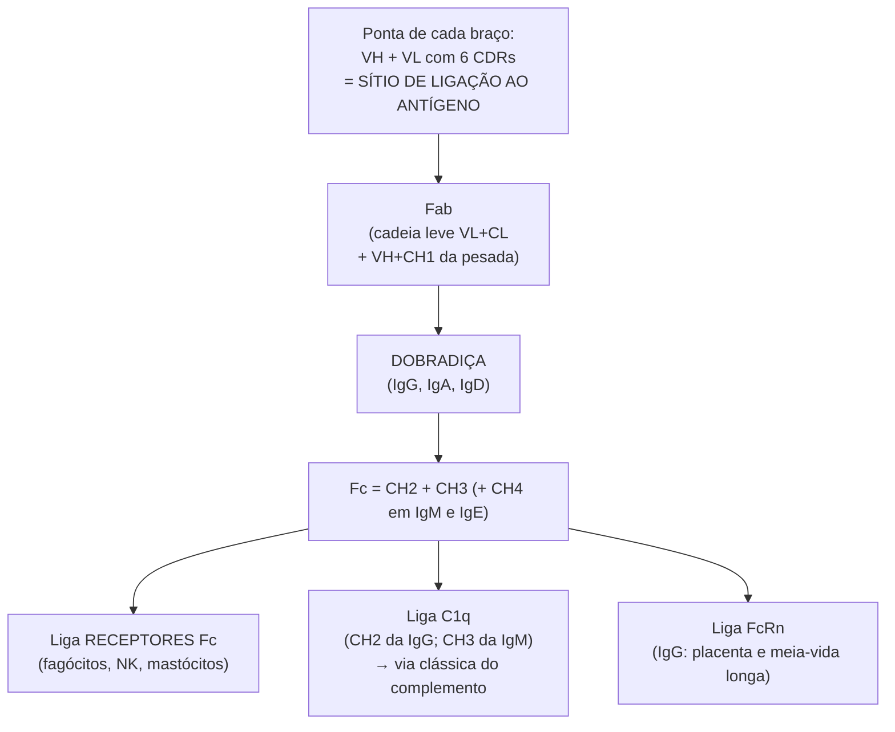
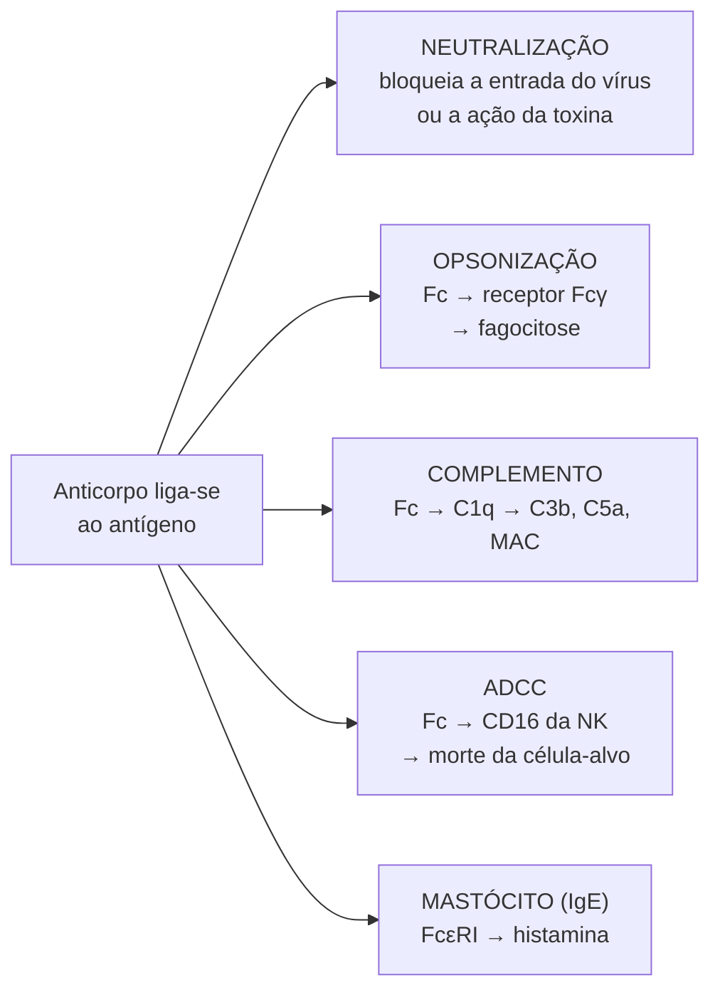

> **Pré-requisito:** a [visão geral do sistema imune](#/imunologia/visao-geral-sistema-imune#linfocitos-b) apresenta linfócitos B, anticorpos e MHC de forma introdutória. Este tópico aprofunda a parte humoral e cobre os itens 4, 5 e 6 do **roteiro 3 do morfofuncional** (estrutura e função das imunoglobulinas, MHC e linfócito B).

## Objetivos do tópico {#objetivos}

Ao final, você deve ser capaz de:

1. Diferenciar **imunoglobulina** de **anticorpo** e definir **antígeno**, **epítopo**, **afinidade** e **avidez**.
2. Descrever a **estrutura** de uma imunoglobulina: cadeias **pesadas** e **leves**, regiões **variáveis** e **constantes**, **regiões hipervariáveis (CDRs)**, **dobradiça**, **sítio de ligação ao antígeno** e os sítios de ligação aos **receptores Fc** e ao **complemento**.
3. Explicar a **origem gênica** de cada cadeia, a **recombinação V(D)J** e o **splicing alternativo** (forma de membrana × secretada; IgM e IgD juntas).
4. Comparar as **cinco classes** (IgG, IgM, IgA, IgE, IgD) quanto à forma, à localização e à função.
5. Descrever o **linfócito B** do ponto de vista morfológico e funcional, sua ativação, a **troca de classe** e a **maturação de afinidade**.
6. Explicar os **mecanismos de ação** dos anticorpos: **neutralização**, **opsonização**, **ativação do complemento**, **ADCC** e ativação de mastócitos.
7. Descrever a **estrutura das moléculas de MHC** de classe I e II.
8. Aplicar o conteúdo a situações clínicas: imunodeficiências de anticorpos, mieloma múltiplo, anticorpos monoclonais terapêuticos e doença hemolítica do recém-nascido.

::: referencias
Abbas, Lichtman & Pillai – Imunologia Celular e Molecular, 10ª ed., caps. "Anticorpos e antígenos", "Ativação dos linfócitos B e produção de anticorpos" e "Mecanismos efetores da imunidade humoral" · Roitt & Delves – Fundamentos de Imunologia, 13ª ed.
:::

## Conceitos-base {#conceitos-base}

### Imunoglobulina ou anticorpo? {#imunoglobulina-anticorpo}

As duas palavras se referem à **mesma família de proteínas**, mas com ênfases diferentes:

- **Imunoglobulina (Ig)** é o nome da **molécula** — uma glicoproteína com uma estrutura característica, presente tanto na **membrana** do linfócito B (como receptor, o **BCR**) quanto **secretada** no plasma e nas secreções. O nome vem de "globulina do sistema imune" (na eletroforese das proteínas do soro, elas migram na faixa das gamaglobulinas).
- **Anticorpo** é a imunoglobulina vista pela sua **função**: a molécula **secretada** que se liga **especificamente** a um antígeno.

Em resumo: **todo anticorpo é uma imunoglobulina**, mas o termo "anticorpo" costuma ser reservado para a forma secretada e para quando se fala do antígeno que ela reconhece ("anticorpo anti-HBs", por exemplo). O BCR é uma imunoglobulina de membrana que funciona como receptor.

### Antígeno, epítopo, afinidade e avidez {#antigeno-epitopo-afinidade}

- **Antígeno** — qualquer molécula que um anticorpo (ou receptor de linfócito) consegue reconhecer especificamente.
- **Epítopo** (determinante antigênico) — a pequena região do antígeno que se encaixa no sítio de ligação do anticorpo. Para anticorpos, os epítopos podem ser:
  - **lineares** — uma sequência contínua de aminoácidos;
  - **conformacionais** — aminoácidos distantes na sequência, mas próximos na proteína dobrada em três dimensões. Se a proteína for desnaturada, o epítopo conformacional desaparece. A maioria dos anticorpos contra proteínas nativas reconhece epítopos conformacionais.
- **Afinidade** — a força da ligação entre **um** sítio de ligação e **um** epítopo (como o encaixe de uma única mão).
- **Avidez** — a força **total** da ligação de uma molécula de anticorpo com vários sítios a um antígeno com vários epítopos repetidos (como várias mãos segurando ao mesmo tempo). Uma IgM tem afinidade individual relativamente baixa, mas **avidez alta**, porque tem 10 sítios de ligação.

A **especificidade** vem da **complementaridade** entre o sítio de ligação e o epítopo: forma, cargas elétricas, pontes de hidrogênio, interações hidrofóbicas. A ligação é **não covalente** e **reversível** — por isso faz sentido falar em afinidade.

::: referencias
Abbas, 10ª ed., cap. "Anticorpos e antígenos".
:::

## Explicação detalhada {#explicacao}

### Estrutura da imunoglobulina {#estrutura-imunoglobulina}

#### O monômero: quatro cadeias {#monomero}

A unidade básica de toda imunoglobulina é um **monômero** em forma de **Y**, formado por **quatro cadeias polipeptídicas**:

- **Duas cadeias pesadas (H, de *heavy*)**, idênticas, com cerca de 50–70 kDa cada. O **tipo de cadeia pesada define a classe**: **γ (gama)** → IgG; **μ (mi)** → IgM; **α (alfa)** → IgA; **ε (épsilon)** → IgE; **δ (delta)** → IgD.
- **Duas cadeias leves (L, de *light*)**, idênticas, com cerca de 25 kDa cada, de um de dois tipos: **κ (kappa)** ou **λ (lambda)**. Cada anticorpo tem **ou** duas κ **ou** duas λ, nunca uma de cada.
- As cadeias são unidas por **pontes dissulfeto**: cada cadeia leve se liga a uma pesada, e as duas pesadas se ligam entre si.

Cada cadeia é formada por **domínios** repetidos de cerca de 110 aminoácidos, todos com a mesma dobra característica (o **domínio de imunoglobulina**, que aparece também em muitas outras moléculas do sistema imune, como TCR, MHC, CD4 e CD8):

- **Cadeia leve**: **1 domínio variável (VL)** + **1 domínio constante (CL)**.
- **Cadeia pesada**: **1 domínio variável (VH)** + **3 domínios constantes** (CH1, CH2, CH3) nas classes **IgG, IgA e IgD**, ou **4 domínios constantes** (CH1 a CH4) nas classes **IgM e IgE**.

#### Regiões variáveis e o sítio de ligação {#regioes-variaveis}

- Na ponta de cada braço do Y, os domínios **VH e VL se juntam** e formam o **sítio de ligação ao antígeno**. Como há dois braços, cada monômero tem **dois sítios idênticos** (é **bivalente**).
- Dentro das regiões variáveis, a variação entre anticorpos não é uniforme: ela se concentra em **três pequenas alças** de cada domínio, as **regiões hipervariáveis**, também chamadas **CDRs** (*complementarity-determining regions*, regiões determinantes de complementaridade). São **3 CDRs na cadeia pesada + 3 na leve = 6 CDRs** por sítio. Elas formam a superfície que toca o epítopo.
- Entre as CDRs ficam as **regiões de arcabouço** (*framework*), menos variáveis, que dão a forma estrutural do domínio.
- A **CDR3** é a mais variável de todas, porque fica exatamente na junção dos segmentos gênicos recombinados (veja adiante).

#### Fab, Fc e dobradiça {#fab-fc}

Quando o anticorpo é cortado pela enzima papaína (um experimento clássico), ele se divide em três fragmentos, e os nomes ficaram:

- **Fab** (*fragment antigen binding*) — cada braço: cadeia leve inteira + VH e CH1 da pesada. **Liga o antígeno.**
- **Fc** (*fragment crystallizable*) — a haste: os domínios constantes restantes das duas pesadas (CH2 e CH3, mais CH4 em IgM e IgE). **Não liga antígeno; define o que o anticorpo faz depois**: liga-se aos **receptores Fc** das células e ao **complemento**.
- **Dobradiça (*hinge*)** — região flexível, rica em prolina e cisteínas, entre o Fab e o Fc, presente em **IgG, IgA e IgD**. Permite que os braços se abram e se movam, alcançando epítopos a distâncias diferentes. **IgM e IgE não têm dobradiça**: no lugar dela têm o domínio CH2 extra.

#### Sítios de ligação aos receptores Fc e ao complemento {#sitios-efetores}

- **Receptores Fc** — proteínas da superfície de fagócitos, células NK, mastócitos e outras, que reconhecem a porção Fc de cada classe: **FcγR** (para IgG, em macrófagos, neutrófilos e NK), **FcεRI** (para IgE, em mastócitos e basófilos), **FcαR** (para IgA). Na IgG, a ligação aos FcγR ocorre principalmente na região da **dobradiça e do domínio CH2**.
- **Complemento** — o componente **C1q** se liga à porção Fc: no domínio **CH2 da IgG** e no domínio **CH3 da IgM**. Só ocorre quando o anticorpo está **ligado ao antígeno** (e com pelo menos duas porções Fc próximas). Veja [sistema complemento](#/imunologia/sistema-complemento#vias-ativacao).
- **FcRn** (receptor Fc neonatal) — liga a IgG, transporta-a pela **placenta** e a **protege da degradação**, reciclando-a para o sangue. É por isso que a IgG tem a **meia-vida mais longa** (cerca de 3 semanas).

#### Monômeros e polímeros {#polimeros}

- **IgG, IgE e IgD** circulam como **monômeros** (2 sítios de ligação).
- **IgM secretada** é um **pentâmero** (5 monômeros, 10 sítios), unidos por pontes dissulfeto e por uma pequena proteína, a **cadeia J** (*joining*). Na membrana do linfócito B, a IgM é monomérica.
- **IgA** é monômero no sangue, mas nas secreções é um **dímero** unido pela **cadeia J** e acompanhado do **componente secretor** — um pedaço do receptor que a transportou através do epitélio (o **receptor poli-Ig**). O componente secretor protege a IgA das enzimas digestivas.

::: referencias
Abbas, 10ª ed., cap. "Anticorpos e antígenos" · Roitt, 13ª ed.
:::

### Origem gênica das cadeias e recombinação V(D)J {#origem-genica}

Cada tipo de cadeia é codificado em um **lócus** (região gênica) diferente:

| Cadeia | Lócus | Cromossomo | Segmentos para a região variável |
|---|---|---|---|
| **Pesada (todas as classes)** | IGH | **14** | **V, D e J** |
| **Leve κ** | IGK | **2** | **V e J** |
| **Leve λ** | IGL | **22** | **V e J** |

Os genes da região variável **não existem prontos**: durante a maturação do linfócito B na medula óssea, eles são **montados por recombinação somática** ("somática" porque acontece nas células do corpo, e não é herdada):

1. **Cadeia pesada primeiro**: a enzima **RAG** (RAG-1 e RAG-2) corta o DNA e une um segmento **D** a um **J**; depois, um **V** ao conjunto DJ → **VDJ**. A enzima **TdT** adiciona nucleotídeos aleatórios nas emendas (diversidade juncional, que forma a CDR3).
2. Se a cadeia pesada produzida é funcional, ela é testada na membrana junto com uma "cadeia leve substituta" (o pré-BCR). Passando no teste, a célula se multiplica e para de rearranjar a outra cópia do gene pesado — **exclusão alélica**: cada linfócito B expressa só um alelo de cadeia pesada.
3. **Cadeia leve depois**: rearranjo **VJ**, primeiro em κ; se não der certo, em λ.
4. O resultado é um linfócito B com **um único tipo de receptor**.

A diversidade vem de três fontes: **combinatória** (muitas combinações possíveis de V, D e J e de cadeia pesada com leve), **juncional** (imprecisão das emendas e nucleotídeos da TdT) e, depois do encontro com o antígeno, **hipermutação somática** (veja "maturação de afinidade").

#### Splicing alternativo: membrana × secretada; IgM e IgD juntas {#splicing-alternativo}

Depois do gene VDJ, o lócus da cadeia pesada tem, em sequência, os genes das regiões constantes: **Cμ, Cδ, Cγ3, Cγ1, Cα1, Cγ2, Cγ4, Cε, Cα2** (a ordem exata não é cobrada; o importante é que **Cμ e Cδ vêm primeiro**). Dois fenômenos dependem de **splicing alternativo** do RNA (o mesmo transcrito sendo "editado" de maneiras diferentes):

- **IgM e IgD ao mesmo tempo**: o linfócito B naïve transcreve um RNA longo que contém VDJ + Cμ + Cδ. Conforme o processamento, a célula produz cadeias μ (IgM) ou δ (IgD) — **com a mesma região variável**. Por isso o linfócito B maduro naïve tem **IgM e IgD de membrana** com a mesma especificidade.
- **Forma de membrana × forma secretada**: no fim de cada gene C há duas opções de "cauda": uma com uma região **hidrofóbica** que ancora a proteína na **membrana** (BCR), e outra **sem** essa região, que gera a forma **secretada**. Ao se transformar em **plasmócito**, a célula passa a escolher a versão secretada.

### As cinco classes de imunoglobulinas {#classes}

| Classe | Forma | % das Ig do soro | Meia-vida | Características e funções |
|---|---|---|---|---|
| **IgG** (γ) | Monômero; 4 subclasses (IgG1–4) | **~75–80%** (a mais abundante) | **~3 semanas** (graças ao FcRn) | Predomina na **resposta secundária**; **atravessa a placenta**; **opsoniza** (IgG1 e IgG3 são as melhores); ativa o complemento (IgG3 > IgG1; IgG4 quase não ativa); neutraliza; media **ADCC** |
| **IgM** (μ) | **Pentâmero** (com cadeia J) no soro; monômero na membrana | ~5–10% | ~5 dias | **Primeira** produzida na resposta primária; **melhor ativadora do complemento**; alta **avidez**; não atravessa a placenta; IgM específica = infecção **recente** |
| **IgA** (α) | Monômero no soro; **dímero + cadeia J + componente secretor** nas secreções; 2 subclasses | ~10–15% no soro, mas é a **mais produzida** no corpo (mucosas) | ~6 dias | **Imunidade de mucosas**: neutraliza micróbios e toxinas no lúmen **sem inflamação**; presente em lágrima, saliva, leite e **colostro** |
| **IgE** (ε) | Monômero (4 domínios constantes) | Traços (<0,01%) | ~2 dias livre, mas semanas ligada ao mastócito | Liga-se ao **FcεRI** de **mastócitos e basófilos**; defesa contra **helmintos**; **alergia** e anafilaxia |
| **IgD** (δ) | Monômero | <1% | ~3 dias | Sobretudo **receptor de membrana** do linfócito B naïve (com a IgM); função secretada pouco clara |

### O linfócito B: morfologia e função {#linfocito-b}

#### Como ele é {#morfologia-linfocito-b}

- **Ao microscópio óptico**, o linfócito B em repouso é **indistinguível** do linfócito T: célula pequena (7–10 µm), **núcleo redondo e denso** ocupando quase toda a célula e fina borda de citoplasma azul-claro (veja [esfregaço](#/histologia-embriologia/morfo-sangue-medula-ossea#linfocito)).
- **Marcadores** (identificados por citometria de fluxo): **CD19** e **CD20** (alvo do rituximabe), **CD21** (receptor de complemento CR2, que também é o receptor do vírus Epstein-Barr), **CD79a/CD79b** (Igα e Igβ) e a **imunoglobulina de membrana** (IgM e IgD no naïve).
- **O complexo BCR**: a imunoglobulina de membrana reconhece o antígeno, mas sua cauda intracelular é curtíssima; quem sinaliza são **Igα e Igβ**, associadas a ela. O **CD21** (com CD19 e CD81) funciona como **correceptor**: quando o antígeno está recoberto pelo fragmento C3d do complemento, a ativação do linfócito B fica muito mais fácil.

#### Onde ele vive e quais são os tipos {#tipos-linfocito-b}

- **Linfócitos B foliculares (B2)** — a maioria; recirculam e ficam nos **folículos** de linfonodos e baço; fazem as respostas **dependentes de T** a proteínas, com centros germinativos.
- **Linfócitos B da zona marginal** — no **baço**; respondem rapidamente a **polissacarídeos** do sangue, sobretudo com IgM, sem precisar de linfócitos T.
- **Linfócitos B-1** — nas cavidades peritoneal e pleural e nas mucosas; produzem os **anticorpos naturais** (IgM de baixa afinidade que existe mesmo sem infecção prévia).

#### O plasmócito {#plasmocito-morfologia}

Ativado e diferenciado, o linfócito B se torna **plasmócito**, uma "fábrica" de anticorpos com aspecto característico:

- Célula **oval**, maior que o linfócito, com **núcleo excêntrico** (deslocado para um lado).
- **Cromatina em "roda de carroça"** (grumos de cromatina dispostos como raios).
- **Citoplasma intensamente basófilo**, por causa da enorme quantidade de **retículo endoplasmático rugoso** (ribossomos = RNA, que cora pelo corante básico).
- **Halo claro perinuclear** — a região do **complexo de Golgi**, que não se cora.
- Perde a imunoglobulina de membrana e o CD20; expressa **CD138**. Plasmócitos de vida longa vivem anos na **medula óssea**.

### Ativação do linfócito B, troca de classe e maturação de afinidade {#ativacao-b}

**1. Resposta independente de T (antígenos polissacarídicos, com epítopos repetidos):** o antígeno liga muitos BCRs ao mesmo tempo e ativa o linfócito B (especialmente os da zona marginal e B-1). Gera principalmente **IgM**, com **pouca troca de classe** e **pouca memória**. É fraca em menores de 2 anos — razão das **vacinas conjugadas** (veja [vacinas](#/imunologia/visao-geral-sistema-imune#vacinas)).

**2. Resposta dependente de T (antígenos proteicos) — passo a passo:**

1. O linfócito B folicular reconhece a proteína pelo BCR, **engloba-a**, corta-a em peptídeos e os exibe em **MHC de classe II**.
2. Na borda entre o folículo e a zona de linfócitos T, encontra um **linfócito T auxiliar** já ativado contra o mesmo antígeno (reconhecendo o mesmo peptídeo).
3. O linfócito T fornece a "ajuda": a molécula **CD40L** (no T) se liga ao **CD40** (no B) e o T libera **citocinas**.
4. Alguns linfócitos B viram logo plasmócitos de vida curta (produzem IgM rapidamente, fora do folículo). Outros entram no folículo com linfócitos **Tfh** e formam o **centro germinativo** (veja [nódulos e centros germinativos](#/histologia-embriologia/morfo-linfonodos-malt-tonsilas#nodulos-linfaticos)).
5. No centro germinativo ocorrem a troca de classe e a maturação de afinidade (abaixo), e se formam **plasmócitos de vida longa** e **linfócitos B de memória**.

#### Troca de classe (mudança de isotipo) {#troca-classe}

- **O que muda**: a **região constante** da cadeia pesada (a classe), mantendo **a mesma região variável** — portanto, **a mesma especificidade**. É como trocar o cabo de uma ferramenta mantendo a ponta.
- **Como acontece estruturalmente**: antes de cada gene C (exceto Cδ) há uma **região de troca** (*switch*). A enzima **AID** (desaminase induzida por ativação) cria quebras nessas regiões, e o DNA entre o gene VDJ e o novo gene C é **cortado fora** (deletado). Por isso a troca é **irreversível**: um linfócito que passou a fazer IgE perdeu os genes Cμ e Cγ daquele cromossomo.
- **Quem decide a classe são as citocinas do linfócito T auxiliar**:
  - **IFN-γ** (resposta Th1) → **IgG** opsonizante e fixadora de complemento (IgG1 e IgG3 em humanos) — contra bactérias e vírus;
  - **IL-4 e IL-13** (resposta Th2) → **IgE** (e IgG4) — contra helmintos; alergia;
  - **TGF-β** (e outros sinais nas mucosas, como APRIL e BAFF) → **IgA** — nas mucosas.

#### Maturação de afinidade {#maturacao-afinidade}

- Nos **centroblastos** do centro germinativo, a mesma enzima **AID** introduz **mutações pontuais** nos genes das regiões variáveis (**hipermutação somática**), sobretudo nas CDRs.
- As mutações são aleatórias: algumas pioram, outras melhoram o encaixe com o antígeno.
- Os **centrócitos** "provam" o antígeno retido nas **células dendríticas foliculares**. Os que se ligam melhor capturam mais antígeno, apresentam mais peptídeo aos **Tfh** e recebem sinais de sobrevivência; os demais morrem por apoptose.
- Com o tempo (e a cada reexposição), a **afinidade média** dos anticorpos **aumenta** — base do teste de **avidez de IgG** usado na sorologia da toxoplasmose na gestação.

### Mecanismos de ação dos anticorpos {#mecanismos-acao}

O anticorpo, sozinho, não destrói nada: ele **bloqueia** ou **marca**, e outras moléculas e células fazem o resto.

| Mecanismo | Como funciona | Principais classes | Exemplo |
|---|---|---|---|
| **Neutralização** | O anticorpo se liga ao micróbio ou à toxina **na região que eles usam para agir** (por exemplo, a proteína com que o vírus se prende à célula, ou o sítio ativo da toxina) e **bloqueia** essa ação. Não precisa do Fc | IgG, IgA (e IgM) | Vacina antitetânica e soro antitetânico; anticorpos que impedem o vírus de entrar na célula; IgA nas mucosas |
| **Opsonização e fagocitose** | O anticorpo recobre o micróbio; os **receptores Fcγ** dos fagócitos reconhecem a porção Fc e o micróbio é **engolido** com muito mais eficiência | **IgG** (IgG1, IgG3) | Bactérias encapsuladas, como o pneumococo |
| **Ativação do complemento** | Anticorpos ligados ao antígeno recrutam o **C1q** → via clássica → opsonização por C3b, inflamação (C3a, C5a) e lise (MAC) | **IgM** > IgG3 > IgG1 | Defesa contra bactérias; lise de hemácias incompatíveis |
| **ADCC** (citotoxicidade celular dependente de anticorpo) | Células **NK** reconhecem, pelo receptor **FcγRIII (CD16)**, uma célula recoberta por IgG e a matam | IgG | Células infectadas por vírus; mecanismo de alguns anticorpos monoclonais contra tumores |
| **Ativação de mastócitos e eosinófilos** | A IgE fica presa ao **FcεRI**; quando o antígeno liga duas IgE vizinhas, o mastócito libera histamina e outros mediadores | **IgE** | Expulsão de helmintos; alergia e anafilaxia |

### Estrutura das moléculas de MHC (HLA) {#estrutura-mhc}

O roteiro pede também a **estrutura das moléculas de MHC**. **MHC** (*major histocompatibility complex*) é o nome do **conjunto de genes** (no cromossomo **6**) e das **moléculas** que eles codificam; em humanos, essas moléculas se chamam **HLA** (*human leukocyte antigens*). Sua função é **exibir peptídeos** para os linfócitos T (veja [imunidade celular](#/imunologia/imunidade-celular-mhc-linfocitos-t#mhc-classes)).

| | **MHC de classe I** (HLA-A, -B, -C) | **MHC de classe II** (HLA-DR, -DQ, -DP) |
|---|---|---|
| Cadeias | **Uma cadeia α (pesada)**, codificada no MHC, com três domínios (**α1, α2, α3**), mais a **β2-microglobulina**, codificada **fora** do MHC (cromossomo 15) e não ligada à membrana | **Duas cadeias, α e β**, ambas codificadas no MHC e ancoradas na membrana, cada uma com dois domínios (**α1, α2**; **β1, β2**) |
| Fenda que aloja o peptídeo | Formada pelos domínios **α1 e α2**; **fechada nas pontas** → peptídeos curtos (**8–10 aminoácidos**) | Formada por **α1 e β1**; **aberta nas pontas** → peptídeos mais longos (**13–25 aminoácidos**) |
| Domínio que liga o correceptor | **α3** liga o **CD8** | **β2** liga o **CD4** |
| Onde está | **Todas as células nucleadas** (e plaquetas) | **Células apresentadoras de antígeno**: dendríticas, macrófagos, **linfócitos B** (e células induzidas por IFN-γ) |

Os domínios α3 e β2-microglobulina (classe I) e α2 e β2 (classe II) são **domínios de imunoglobulina** — por isso MHC, anticorpos e TCR são considerados membros da mesma "superfamília das imunoglobulinas".

::: referencias
Abbas, 10ª ed., caps. "Anticorpos e antígenos", "Ativação dos linfócitos B e produção de anticorpos", "Mecanismos efetores da imunidade humoral" e "Moléculas do MHC e apresentação de antígenos aos linfócitos T" · Junqueira & Carneiro – Histologia Básica, 13ª ed. (plasmócito).
:::

## Correlação clínica {#correlacao-clinica}

### Imunodeficiências de anticorpos {#imunodeficiencias-humorais}

| Doença | Defeito | Achados | Infecções típicas |
|---|---|---|---|
| **Agamaglobulinemia ligada ao X (de Bruton)** | Gene **BTK** — os linfócitos B não amadurecem na medula | Meninos; **ausência de linfócitos B** circulantes e de todas as classes de Ig; tonsilas e linfonodos pequenos (sem folículos) | A partir dos 6 meses (quando acaba a IgG materna): **bactérias encapsuladas**, sinusites, pneumonias, *Giardia*, enterovírus |
| **Imunodeficiência comum variável (IDCV)** | Falha na diferenciação de B em plasmócito (várias causas) | Adultos jovens; **linfócitos B presentes**, mas IgG baixa (e IgA e/ou IgM), resposta ruim a vacinas; risco de autoimunidade e linfoma | Infecções sinopulmonares de repetição, bronquiectasias |
| **Deficiência seletiva de IgA** | Falta de IgA (a imunodeficiência primária mais comum) | Geralmente **assintomática**; pode haver infecções de mucosa, doença celíaca e alergias. Pode haver **anafilaxia em transfusões** se o paciente tiver anticorpos anti-IgA | Infecções respiratórias e intestinais leves |
| **Síndrome de hiper-IgM** | Mais comum: **CD40L** defeituoso (ligado ao X) — sem troca de classe | **IgM normal ou alta**, IgG, IgA e IgE muito baixas; sem centros germinativos | Encapsuladas **e** oportunistas (*Pneumocystis*), porque o CD40L também ativa macrófagos |

O tratamento das formas graves é a **reposição de imunoglobulina** humana (intravenosa ou subcutânea), que fornece IgG pronta.

### Mieloma múltiplo e pico monoclonal {#mieloma}

O **mieloma múltiplo** é a proliferação maligna de **um único clone de plasmócitos** na medula óssea. Como todas as células do clone produzem a mesma imunoglobulina:

- A **eletroforese de proteínas** mostra um **pico estreito** na região das gamaglobulinas (**pico monoclonal** ou "componente M"), em vez da faixa larga normal (policlonal).
- Muitas vezes o clone produz **cadeias leves livres** em excesso, que passam pelo glomérulo e aparecem na urina (**proteína de Bence Jones**) — podendo lesar os túbulos renais ("rim do mieloma").
- Clinicamente: dor óssea e lesões líticas, hipercalcemia, anemia e insuficiência renal; infecções (porque as imunoglobulinas normais caem).

### Anticorpos monoclonais terapêuticos {#monoclonais}

**Anticorpos monoclonais** são produzidos por um único clone, com uma única especificidade. O sufixo do nome indica a origem:

- **-omabe** (*-omab*) — de camundongo; **-ximabe** (*-ximab*) — **quimérico**: região variável de camundongo, constante humana (ex.: **rituximabe**, anti-CD20, que elimina linfócitos B; **infliximabe**, anti-TNF);
- **-zumabe** (*-zumab*) — **humanizado**: só as CDRs são de camundongo (ex.: **trastuzumabe**, anti-HER2; **omalizumabe**, anti-IgE);
- **-umabe** (*-umab*) — **totalmente humano** (ex.: **adalimumabe**, anti-TNF).

Quanto mais humano, menor a chance de o paciente produzir anticorpos contra o próprio medicamento.

### Doença hemolítica do recém-nascido {#doenca-hemolitica}

Uma mãe **Rh negativo** que gerou um feto Rh positivo pode produzir anticorpos **IgG anti-D**. Numa gestação seguinte, esses IgG **atravessam a placenta** (via FcRn), recobrem as hemácias do feto Rh positivo e provocam sua destruição (**opsonização e fagocitose** no baço do feto) → anemia, hidropsia e icterícia grave. A prevenção é dar à mãe **imunoglobulina anti-D** (imunização passiva) na 28ª semana e até 72 horas após o parto ou qualquer sangramento, que remove as hemácias fetais antes que ela se sensibilize. Note que a incompatibilidade **ABO** costuma ser mais branda, porque os anticorpos naturais anti-A e anti-B são principalmente **IgM**, que não atravessa a placenta.

::: referencias
Abbas, 10ª ed., caps. "Mecanismos efetores da imunidade humoral" e "Imunodeficiências congênitas e adquiridas" · Harrison – Medicina Interna, 21ª ed., cap. "Mieloma múltiplo" · Ministério da Saúde – Manual de Gestação de Alto Risco.
:::

## Pontos de alta cobrança em prova {#alta-cobranca}

::: prova
- **Imunoglobulina** = a molécula (membrana ou secretada); **anticorpo** = a forma secretada que liga antígeno específico.
- **Monômero**: 2 cadeias **pesadas** (γ, μ, α, ε, δ → define a classe) + 2 **leves** (κ **ou** λ), pontes dissulfeto.
- **Domínios**: leve = VL + CL; pesada = VH + 3 CH (IgG, IgA, IgD) ou 4 CH (**IgM, IgE**, sem dobradiça).
- **Sítio de ligação** = VH + VL, com **6 CDRs** (hipervariáveis); CDR3 = a mais variável.
- **Fab** liga antígeno; **Fc** liga receptores Fc e complemento (**C1q: CH2 da IgG, CH3 da IgM**); **dobradiça** em IgG, IgA, IgD.
- **Genes**: pesada no **cromossomo 14** (V, D, J); **κ no 2** e **λ no 22** (V, J). **RAG** + **TdT**; exclusão alélica.
- **Splicing alternativo**: **IgM + IgD** no B naïve; forma **de membrana × secretada**.
- **IgG**: mais abundante, **placenta (FcRn)**, meia-vida longa, opsonização, resposta secundária. **IgM**: pentâmero com **cadeia J**, primeira, melhor ativadora do complemento. **IgA**: dímero + **J** + **componente secretor**, mucosas, leite. **IgE**: FcεRI, alergia, helmintos. **IgD**: receptor do B naïve.
- **Troca de classe**: muda a região **constante**, mantém a **variável**; **AID** + regiões switch; deleção do DNA (irreversível); **IFN-γ → IgG**, **IL-4 → IgE**, **TGF-β → IgA**; precisa de **CD40L–CD40**.
- **Maturação de afinidade**: **hipermutação somática** (AID) + seleção nas células dendríticas foliculares.
- **Mecanismos**: neutralização, opsonização, complemento, **ADCC (CD16 da NK)**, mastócitos (IgE).
- **Plasmócito**: núcleo excêntrico em **roda de carroça**, citoplasma **basófilo** (RER), **halo perinuclear** (Golgi).
- **MHC I**: α1-α2-α3 + **β2-microglobulina**; fenda fechada (8–10 aa); α3 liga CD8. **MHC II**: α1α2 + β1β2; fenda aberta (13–25 aa); β2 liga CD4.
- **Clínica**: Bruton (**BTK**, sem B), IDCV, deficiência de IgA, **hiper-IgM (CD40L)**; mieloma (pico monoclonal, Bence Jones); **-ximabe/-zumabe/-umabe**; doença hemolítica (IgG anti-D).
:::

## Armadilhas comuns {#armadilhas}

::: armadilha
- **Achar que a troca de classe muda o antígeno reconhecido.** Ela muda só a **região constante**; a região variável (e a especificidade) é mantida.
- **Confundir troca de classe com maturação de afinidade.** A troca muda a **classe** (por deleção de DNA nas regiões switch); a maturação muda a **afinidade** (por mutações pontuais nas regiões variáveis). As duas dependem da **AID**.
- **Dizer que o anticorpo tem uma cadeia κ e uma λ.** Cada molécula tem **duas iguais**: ou κκ ou λλ.
- **Achar que a IgM atravessa a placenta.** Só a **IgG** atravessa (via FcRn). IgM no recém-nascido indica infecção **congênita**.
- **Confundir o componente secretor com a cadeia J.** A **cadeia J** une os monômeros (IgM e IgA); o **componente secretor** é um pedaço do receptor poli-Ig que acompanha a IgA secretada.
- **Achar que a neutralização depende do Fc.** Ela depende só do **Fab** (bloqueio); opsonização, complemento e ADCC dependem do **Fc**.
- **Atribuir a β2-microglobulina ao MHC de classe II.** Ela faz parte do **MHC de classe I** e é codificada **fora** do lócus MHC.
- **Esperar distinguir linfócito B de T no esfregaço.** São morfologicamente iguais; só a imunofenotipagem diferencia.
:::

## Resumo para revisão rápida {#resumo}

- **Ig** = molécula; **anticorpo** = Ig secretada específica. Epítopo linear ou conformacional; afinidade (1 sítio) × avidez (soma dos sítios).
- **Estrutura**: 2 pesadas + 2 leves (κ ou λ); domínios V e C; **6 CDRs** formam o sítio; **Fab** (liga) + **dobradiça** + **Fc** (receptores Fc, C1q, FcRn).
- **Polímeros**: IgM pentâmero (cadeia J); IgA secretora dímero (cadeia J + componente secretor).
- **Genes**: IGH (cromossomo 14, VDJ), IGK (2, VJ), IGL (22, VJ); RAG e TdT; exclusão alélica; splicing alternativo (IgM+IgD; membrana × secretada).
- **Classes**: IgG (abundante, placenta, opsonização, memória), IgM (primeira, complemento), IgA (mucosas), IgE (mastócitos), IgD (receptor).
- **Linfócito B**: CD19, CD20, CD21; BCR + Igα/Igβ; foliculares, zona marginal e B-1. **Plasmócito**: núcleo excêntrico em roda de carroça, citoplasma basófilo, halo de Golgi, CD138.
- **Ativação**: T-independente (polissacarídeos → IgM) × T-dependente (proteínas → CD40L/citocinas → centro germinativo → **troca de classe** e **maturação de afinidade** → plasmócitos de vida longa e memória).
- **Mecanismos**: neutralização (Fab), opsonização, complemento, ADCC, mastócitos (Fc).
- **MHC**: classe I (α1–α3 + β2m; 8–10 aa; CD8) × classe II (α1α2 + β1β2; 13–25 aa; CD4).
- **Clínica**: Bruton, IDCV, deficiência de IgA, hiper-IgM; mieloma; monoclonais; doença hemolítica Rh.

::: referencias
Abbas, 10ª ed. · Roitt, 13ª ed.
:::
