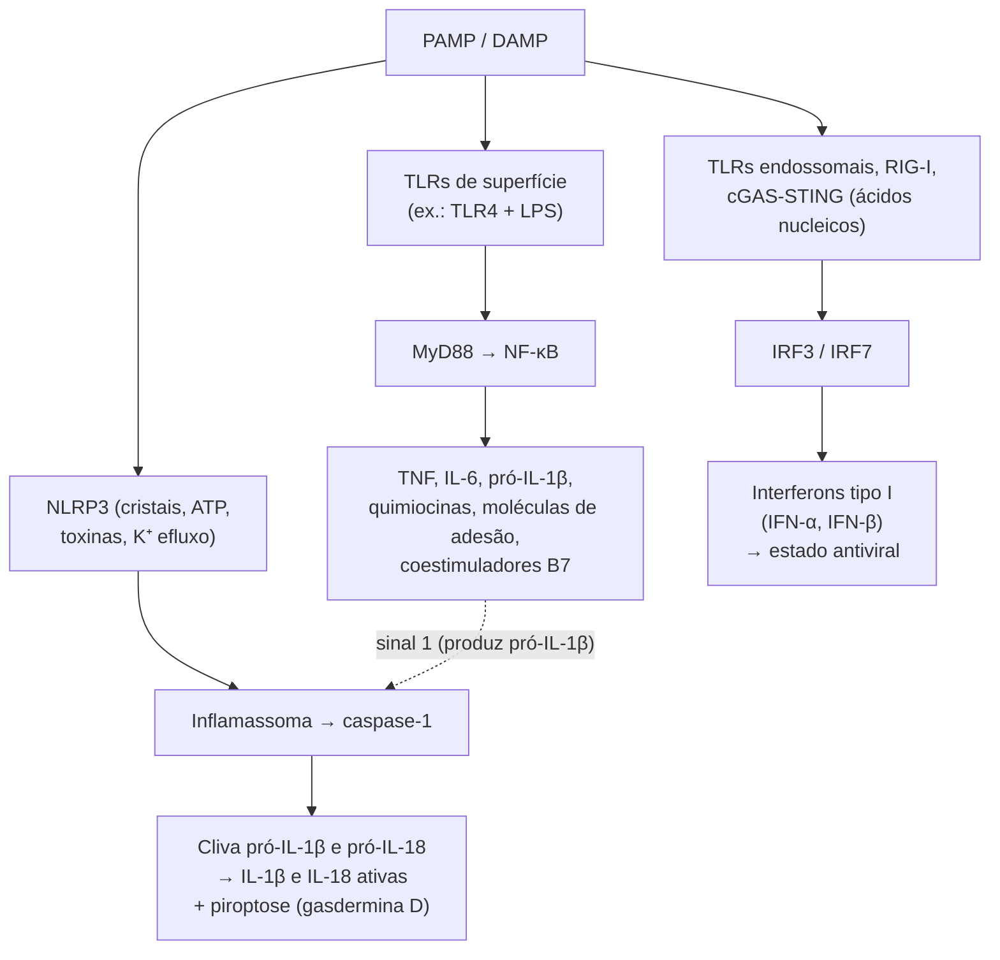
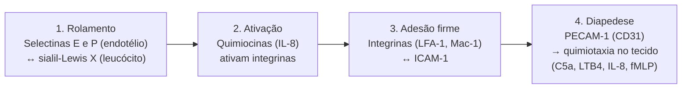

## Objetivos do tópico {#objetivos}

Ao final, você deve ser capaz de:

1. Comparar imunidade **inata** e **adaptativa** quanto à especificidade, ao tempo de resposta e à memória.
2. Descrever as **barreiras** epiteliais e os **receptores de reconhecimento de padrões** (TLRs, NLRs/inflamassoma, RLRs, cGAS-STING), relacionando cada um ao tipo de micróbio que detecta.
3. Explicar como os sinais desses receptores geram **citocinas** (TNF, IL-1, IL-6, IL-12, interferons tipo I) e suas consequências locais e sistêmicas.
4. Descrever o recrutamento e a atuação dos **neutrófilos** (adesão, diapedese, fagocitose, explosão respiratória), dos **macrófagos**, das **células NK** e das células dendríticas.
5. Reconhecer as principais **imunodeficiências da imunidade inata** (doença granulomatosa crônica, deficiência de adesão leucocitária, Chédiak-Higashi) e a base da **sepse** e das **proteínas de fase aguda**.

::: referencias
Abbas, Lichtman & Pillai – Imunologia Celular e Molecular, 10ª ed., cap. "Imunidade inata" · Robbins – Patologia Básica, 10ª ed., cap. "Inflamação e reparo".
:::

## Conceitos-base {#conceitos-base}

### Inata × adaptativa {#inata-adaptativa}

| Característica | Imunidade inata | Imunidade adaptativa |
|---|---|---|
| Quando atua | **Imediatamente** (minutos a horas) | Dias (5–7 na primeira exposição) |
| Reconhece | **Padrões moleculares** compartilhados por grupos de micróbios (PAMPs) e de células lesadas (DAMPs) | **Antígenos específicos** (epítopos) |
| Receptores | Codificados na linhagem germinativa; **número limitado** (~100 tipos) | Gerados por **recombinação somática** (TCR, BCR); diversidade de ~10⁷–10⁹ |
| Distribuição dos receptores | Iguais em todas as células de um tipo (não clonal) | **Clonal**: cada linfócito tem um receptor diferente |
| Memória | Mínima (há "imunidade treinada" em macrófagos, mas fraca) | **Sim** — resposta secundária mais rápida e intensa |
| Discrimina o próprio | Sim: reconhece estruturas ausentes nas células sadias | Sim: por tolerância |
| Componentes | Barreiras, fagócitos, NK, ILCs, mastócitos, complemento, proteínas de fase aguda | Linfócitos T e B, anticorpos |

**Duas funções da imunidade inata que a prova adora:**

1. **Controla** a maioria das infecções sozinha ou as contém até a resposta adaptativa chegar.
2. **Instrui** a resposta adaptativa: as células dendríticas ativadas por PAMPs expressam **coestimuladores (B7)** e produzem citocinas que definem o tipo de resposta T. Sem esse "sinal de perigo", o linfócito T tende à tolerância. É por isso que vacinas precisam de **adjuvantes**.

### PAMPs e DAMPs {#pamps-damps}

- **PAMPs** (*pathogen-associated molecular patterns*): estruturas **essenciais à sobrevivência do micróbio**, portanto difíceis de mutar, e **ausentes nas células humanas**. Exemplos: LPS de Gram-negativos, peptidoglicano e ácido lipoteicoico de Gram-positivos, flagelina, RNA de dupla fita, DNA com motivos CpG não metilados, mananas de fungos.
- **DAMPs** (*damage-associated*): moléculas liberadas por **células lesadas ou necróticas** — ATP extracelular, ácido úrico, HMGB1, DNA mitocondrial. Explicam por que **trauma estéril, isquemia e necrose** também desencadeiam inflamação.

::: referencias
Abbas, 10ª ed., caps. "Propriedades e visão geral das respostas imunes" e "Imunidade inata".
:::

## Explicação detalhada {#explicacao}

### Barreiras epiteliais {#barreiras}

A primeira linha de defesa é **física, química e microbiológica**:

- **Física**: queratina da pele, junções firmes entre células epiteliais, muco, movimento ciliar, peristaltismo, fluxo urinário.
- **Química**: pH ácido (estômago, pele, vagina), lisozima (lágrima, saliva), **peptídeos antimicrobianos** — **defensinas** e **catelicidinas** — que rompem membranas microbianas.
- **Microbiota**: compete por nutrientes e produz substâncias antimicrobianas.
- Linfócitos intraepiteliais e **IgA secretora** completam a defesa das mucosas.

Quebras dessas barreiras explicam muitas infecções: queimaduras (perda da pele → *Pseudomonas*, *Staphylococcus*), cateteres, fibrose cística (muco espesso), uso de antibióticos (perda da microbiota → *Clostridioides difficile*).

### Receptores de reconhecimento de padrões {#receptores-padroes}

Os receptores ficam **onde o micróbio provavelmente estará**: na membrana plasmática (micróbios extracelulares), nos endossomos (material fagocitado, ácidos nucleicos virais) e no citosol (micróbios que invadem o citoplasma).

| Família | Local | Exemplos e ligantes |
|---|---|---|
| **TLRs** (receptores do tipo Toll) — superfície | Membrana plasmática | **TLR4 – LPS** (Gram-negativos); TLR2 – lipoproteínas, peptidoglicano (Gram-positivos, micobactérias); **TLR5 – flagelina** |
| **TLRs endossomais** | Endossomos | **TLR3 – RNA dupla fita**; TLR7/8 – RNA fita simples (vírus); **TLR9 – DNA CpG não metilado** |
| **NLRs** e **inflamassoma** | Citosol | NOD1/NOD2 – peptidoglicano; **NLRP3** – cristais (urato, colesterol), ATP, toxinas formadoras de poros |
| **RLRs** (RIG-I, MDA5) | Citosol | RNA viral no citoplasma |
| **cGAS–STING** | Citosol | DNA no citoplasma (viral, bacteriano ou mitocondrial) |
| Lectinas tipo C (dectina-1) | Membrana | β-glucana de fungos |
| Receptores de manose, de *scavenger* | Membrana | Facilitam a fagocitose |

**Duas vias de saída dos sinais:**

**O inflamassoma precisa de dois sinais:** o sinal 1 (via NF-κB, por exemplo, por TLR) produz pró-IL-1β; o sinal 2 (cristais, ATP, toxinas) monta o inflamassoma, ativa a **caspase-1** e libera IL-1β madura. É a base da **gota** (cristais de urato ativam NLRP3) e das **síndromes autoinflamatórias** (mutações ativadoras de NLRP3 → febres periódicas), tratadas com bloqueadores de IL-1 (anakinra) ou, na gota, com colchicina, que interfere no recrutamento e na ativação dos neutrófilos.

::: referencias
Abbas, 10ª ed., cap. "Imunidade inata".
:::

### Citocinas da imunidade inata {#citocinas-inatas}

| Citocina | Principal fonte | Efeitos locais | Efeitos sistêmicos |
|---|---|---|---|
| **TNF** | Macrófagos, mastócitos | Ativa endotélio (selectinas, integrinas), recruta neutrófilos | **Febre**, proteínas de fase aguda; em excesso: **choque séptico**, caquexia |
| **IL-1** | Macrófagos (via inflamassoma) | Semelhantes ao TNF | **Febre** (PGE₂ no hipotálamo), fase aguda |
| **IL-6** | Macrófagos, endotélio | — | **Proteínas de fase aguda** no fígado (PCR, fibrinogênio), febre; diferenciação Th17 |
| **IL-12** | Macrófagos, dendríticas | Ativa NK; induz **Th1** | ↑ **IFN-γ** |
| **IFN-γ** | NK, linfócitos Th1/CD8 | **Ativa macrófagos** (morte de micróbios fagocitados) | — |
| **IFN tipo I (α/β)** | Células infectadas, dendríticas plasmocitoides | **Estado antiviral** nas células vizinhas (inibe síntese proteica viral), ↑ MHC I | Febre, mal-estar ("sintomas de gripe") |
| **Quimiocinas** (CXCL8/IL-8) | Macrófagos, endotélio | **Quimiotaxia de neutrófilos** | — |

**Proteínas de fase aguda:** sob estímulo de IL-6 (e IL-1/TNF), o fígado aumenta **proteína C-reativa (PCR)**, amiloide sérico A, **fibrinogênio** e ferritina e reduz albumina e transferrina. A PCR atua como opsonina e ativa o complemento. O fibrinogênio aumentado faz as hemácias se empilharem (*rouleaux*) e eleva a **VHS**. A **hepcidina**, induzida por IL-6, sequestra ferro — base da **anemia da inflamação**.

::: referencias
Abbas, 10ª ed., cap. "Imunidade inata" · Robbins – Patologia Básica, 10ª ed., cap. "Inflamação e reparo".
:::

### Neutrófilos: recrutamento e destruição {#neutrofilos}

#### Recrutamento em quatro etapas {#recrutamento-leucocitario}

TNF e IL-1 induzem no endotélio as **selectinas E e P** e **ICAM-1**. A histamina e a trombina expõem rapidamente a selectina P (armazenada nos corpúsculos de Weibel-Palade).

#### Fagocitose e morte microbiana {#fagocitose}

1. **Reconhecimento** facilitado por **opsoninas**: IgG (receptor Fcγ), **C3b** (CR1) e outras.
2. **Englobamento** → fagossomo → fusão com lisossomo (fagolisossomo).
3. **Morte**:
   - **Dependente de oxigênio (explosão respiratória):** a **NADPH oxidase** converte O₂ em superóxido (O₂⁻) → H₂O₂; a **mieloperoxidase (MPO)** usa H₂O₂ + Cl⁻ para formar **ácido hipocloroso (HOCl)**, o oxidante mais potente. Nos macrófagos, a **iNOS** produz óxido nítrico.
   - **Independente de oxigênio:** enzimas e proteínas dos grânulos (elastase, defensinas, lactoferrina, lisozima).
4. **NETs** (*neutrophil extracellular traps*): redes de cromatina e proteínas granulares lançadas pelo neutrófilo, que aprisionam micróbios — mas também favorecem trombose e autoimunidade.

Os produtos tóxicos, quando liberados fora da célula, **lesam tecidos do hospedeiro** — base do dano na inflamação aguda (veja [inflamação aguda](#/patologia/inflamacao-aguda)).

### Macrófagos {#macrofagos}

Fagocitam micróbios e células mortas, produzem citocinas e apresentam antígenos. Podem ser polarizados:

- **Ativação clássica (M1)** — por **IFN-γ** e TLRs: produzem NO e espécies reativas de O₂ → **matam micróbios**, sustentam a inflamação.
- **Ativação alternativa (M2)** — por **IL-4/IL-13** (Th2): produzem TGF-β e fatores de crescimento → **reparo e fibrose**, defesa contra helmintos.

Quando o agressor persiste, macrófagos ativados por IFN-γ tornam-se células epitelioides e células gigantes → **granuloma** (tuberculose).

### Células NK {#celulas-nk}

São linfócitos inatos que matam **células infectadas por vírus e células tumorais**. A decisão de matar é um **balanço** entre receptores:

- **Inibitórios** (KIR, CD94/NKG2A) reconhecem **MHC I próprio** → a célula normal é poupada.
- **Ativadores** (NKG2D) reconhecem proteínas de **estresse** (MIC-A, MIC-B) expressas por células infectadas ou transformadas.

Muitos vírus e tumores **reduzem a expressão de MHC I** para escapar dos linfócitos CD8⁺ — mas aí a NK perde o sinal inibitório e mata (**hipótese do "próprio ausente"**, *missing self*). A NK mata por **perforina e granzimas** (como os CD8⁺) e também por **ADCC**: reconhece células cobertas por IgG pelo receptor **CD16 (FcγRIII)**. A NK é a principal fonte inicial de **IFN-γ**, que ativa macrófagos.

### Células dendríticas: a ponte com a imunidade adaptativa {#celulas-dendriticas}

Capturam antígenos nos tecidos e, ativadas por PAMPs, **amadurecem**: aumentam MHC e coestimuladores (B7-1/B7-2), expressam **CCR7** e migram ao linfonodo para apresentar o antígeno a linfócitos T naïve. As **dendríticas plasmocitoides** são grandes produtoras de interferon tipo I nas infecções virais.

::: referencias
Abbas, 10ª ed., caps. "Imunidade inata" e "Migração de leucócitos para os tecidos" · Robbins – Patologia Básica, 10ª ed., cap. "Inflamação e reparo".
:::

## Correlação clínica {#correlacao-clinica}

### Imunodeficiências da imunidade inata {#imunodeficiencias-inatas}

| Doença | Defeito | Consequência | Pista clínica |
|---|---|---|---|
| **Doença granulomatosa crônica (DGC)** | **NADPH oxidase** (forma mais comum: gp91phox, ligada ao X) | Fagócitos englobam, mas **não fazem explosão respiratória** | Infecções por microrganismos **catalase-positivos** (*S. aureus*, *Aspergillus*, *Serratia*, *Burkholderia*, *Nocardia*) e **granulomas**; teste da **di-hidrorrodamina (DHR)** alterado |
| **Deficiência de adesão leucocitária tipo 1 (LAD-1)** | Integrina **CD18** (β2) | Neutrófilos não aderem ao endotélio nem saem do vaso | **Queda tardia do coto umbilical**, onfalite, infecções **sem pus**, **leucocitose** acentuada |
| **Chédiak-Higashi** | Gene **LYST** (tráfego lisossomal) | Grânulos gigantes; fusão fagolisossomal deficiente | **Albinismo parcial**, infecções piogênicas, neuropatia, sangramento |
| Deficiência de MPO | Mieloperoxidase | Geralmente leve | Candidíase em diabéticos; muitas vezes assintomática |
| Defeitos de TLR/MyD88/IRAK4 | Sinalização de TLR | Pouca resposta inflamatória inicial | Infecções piogênicas graves na infância **com febre e PCR pouco elevadas** |

Por que **catalase-positivos** na DGC? Bactérias catalase-negativas produzem H₂O₂ dentro do fagossomo, que o neutrófilo doente consegue "aproveitar" (via MPO) para matá-las; as catalase-positivas degradam o próprio H₂O₂ e escapam.

### Sepse: a imunidade inata que sai do controle {#sepse}

Na sepse, PAMPs (como o LPS via TLR4) e DAMPs ativam maciçamente monócitos e endotélio → liberação sistêmica de **TNF, IL-1 e IL-6**. Consequências:

- **Vasodilatação** e aumento da permeabilidade (NO, citocinas) → hipotensão e choque distributivo.
- Ativação do **fator tecidual** e consumo de anticoagulantes naturais → **coagulação intravascular disseminada**.
- Disfunção de órgãos (rim, pulmão, fígado, SNC).
- Fase tardia de **imunossupressão** (apoptose de linfócitos, monócitos "paralisados"), com infecções secundárias.

A conduta segue o reconhecimento precoce e as bases das diretrizes de sepse (Surviving Sepsis Campaign; Instituto Latino-Americano de Sepse – ILAS): culturas, **antibiótico precoce**, reposição volêmica guiada e vasopressor se necessário.

### PCR na prática {#pcr-pratica}

A **PCR** sobe em 6–8 horas e tem pico em ~48 h; cai rapidamente quando o estímulo cessa (meia-vida ~19 h). É marcador **inespecífico** de inflamação (infecção, trauma, doenças inflamatórias), útil para acompanhar resposta a tratamento. A **VHS** sobe e cai mais devagar (depende do fibrinogênio) e é afetada por anemia e pela idade.

::: referencias
Abbas, 10ª ed., cap. "Imunodeficiências congênitas e adquiridas" · Harrison – Medicina Interna, 21ª ed., caps. "Distúrbios dos granulócitos e monócitos" e "Sepse e choque séptico" · Surviving Sepsis Campaign 2021 · ILAS – Protocolo de sepse.
:::

## Pontos de alta cobrança em prova {#alta-cobranca}

::: prova
- Inata: **imediata, não clonal, receptores da linhagem germinativa, sem memória relevante**; reconhece **PAMPs e DAMPs**.
- **TLR4 = LPS**; TLR2 = Gram+/lipoproteínas; **TLR5 = flagelina**; **TLR3 = RNA dupla fita**; TLR7/8 = RNA fita simples; **TLR9 = DNA CpG**.
- TLRs → **MyD88 → NF-κB** → TNF, IL-1, IL-6; ácidos nucleicos → **IRF → IFN tipo I** (estado antiviral).
- **Inflamassoma NLRP3 → caspase-1 → IL-1β/IL-18** + piroptose; **gota** (cristais de urato).
- TNF/IL-1/IL-6 → **febre e fase aguda**; IL-6 → **PCR, fibrinogênio, hepcidina**; IL-12 → Th1/IFN-γ; IFN-γ → ativa macrófago.
- Recrutamento: **selectinas (rolamento) → quimiocinas → integrinas/ICAM-1 (adesão) → PECAM-1 (diapedese)**.
- Explosão respiratória: **NADPH oxidase → O₂⁻ → H₂O₂ → (MPO) → HOCl**.
- **DGC** = NADPH oxidase → catalase-positivos + granulomas; **DHR** alterado. **LAD-1** = CD18 → coto umbilical + infecção sem pus + leucocitose. **Chédiak-Higashi** = LYST, albinismo, grânulos gigantes.
- **NK**: mata quem **perdeu MHC I** ("próprio ausente"); perforina/granzimas; **ADCC via CD16**; fonte inicial de IFN-γ.
- Dendrítica ativada → B7 + CCR7 → linfonodo → **liga inata à adaptativa** (por isso vacinas precisam de adjuvantes).
:::

## Armadilhas comuns {#armadilhas}

::: armadilha
- **"A imunidade inata é inespecífica."** Ela é específica para **padrões** (PAMPs/DAMPs), não para antígenos individuais. Reconhecer LPS e não reconhecer células próprias é uma forma de especificidade.
- **Confundir NK com linfócito T CD8⁺.** Ambos matam por perforina/granzimas, mas a NK é **inata**, não tem TCR e é **inibida** pelo MHC I; o CD8⁺ **precisa** do MHC I para reconhecer o alvo.
- **Achar que IFN tipo I e IFN-γ são a mesma coisa.** IFN-α/β = **antiviral**, produzido por quase qualquer célula infectada; IFN-γ = **ativador de macrófagos**, produzido por NK e linfócitos T.
- **Na DGC, a fagocitose é normal.** O defeito é **matar** depois de englobar (explosão respiratória), não englobar.
- **Na LAD-1 não há pus, mas há leucocitose.** Os neutrófilos estão no sangue porque **não conseguem sair**.
- **PCR normal não exclui infecção** em fases muito iniciais (< 6 h) ou em pacientes com defeitos de sinalização inata.
- **Atribuir só à inata a capacidade de instruir a adaptativa sem citar coestimulação.** O ponto-chave é a expressão de **B7** e de citocinas pelas dendríticas ativadas.
:::

## Resumo para revisão rápida {#resumo}

- **Inata** = barreiras + fagócitos + NK/ILCs + mastócitos + complemento + fase aguda; age em minutos; reconhece **PAMPs** (micróbio) e **DAMPs** (lesão).
- **Receptores:** TLRs (superfície: TLR4-LPS, TLR2, TLR5-flagelina; endossomos: TLR3, 7/8, 9), NLRs/**inflamassoma NLRP3** (caspase-1 → IL-1β), RIG-I e cGAS-STING (ácidos nucleicos citosólicos).
- **Sinalização:** NF-κB → TNF, IL-1, IL-6, quimiocinas, B7; IRF → **IFN tipo I** antiviral.
- **Citocinas:** TNF/IL-1/IL-6 → febre, fase aguda (PCR, fibrinogênio, hepcidina), em excesso choque séptico; IL-12 → Th1; IFN-γ → macrófago M1.
- **Neutrófilo:** selectinas → integrinas/ICAM-1 → diapedese → quimiotaxia (C5a, IL-8, LTB4) → fagocitose com opsoninas (IgG, C3b) → **NADPH oxidase/MPO** → HOCl; NETs.
- **NK:** mata células sem MHC I e estressadas; ADCC (CD16); IFN-γ.
- **Dendrítica:** ponte para a adaptativa (MHC + B7 + CCR7).
- **Defeitos:** DGC (NADPH oxidase, catalase+, DHR), LAD-1 (CD18, coto umbilical), Chédiak-Higashi (LYST).

::: referencias
Abbas, 10ª ed., cap. "Imunidade inata" · Robbins – Patologia Básica, 10ª ed., cap. "Inflamação e reparo".
:::
