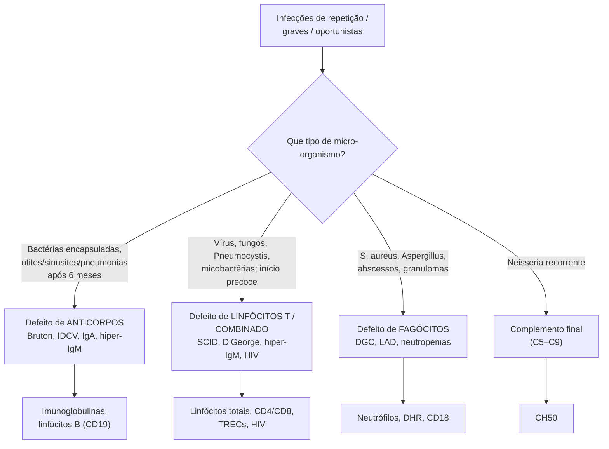
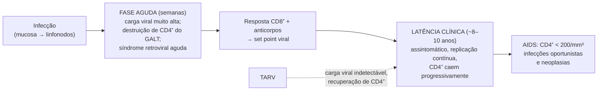

> **Pré-requisitos:** os componentes do sistema imune estão no [panorama](#/imunologia/visao-geral-sistema-imune) e nos tópicos de [imunidade inata](#/imunologia/imunidade-inata), [complemento](#/imunologia/sistema-complemento), [imunidade humoral](#/imunologia/imunidade-humoral-anticorpos) e [imunidade celular](#/imunologia/imunidade-celular-mhc-linfocitos-t). A estrutura e o ciclo do HIV estão em [vírus](#/microbiologia-parasitologia/morfo-virus#hiv). Este tópico cobre o item da ementa do ASE6 "imunodeficiências congênitas e adquiridas".

## Objetivos do tópico {#objetivos}

Ao final, você deve ser capaz de:

1. Definir **imunodeficiência** e diferenciar **primárias** (erros inatos da imunidade) de **secundárias** (adquiridas).
2. Usar o **tipo de infecção** para deduzir **qual braço** do sistema imune está falhando (anticorpos, linfócitos T, fagócitos, complemento).
3. Descrever as principais imunodeficiências primárias: **humorais** (agamaglobulinemia ligada ao X, imunodeficiência comum variável, deficiência de IgA, hiper-IgM), **celulares e combinadas** (DiGeorge, SCID, Wiskott-Aldrich, ataxia-telangiectasia), **de fagócitos** (doença granulomatosa crônica, deficiência de adesão leucocitária, Chédiak-Higashi) e **de complemento**.
4. Reconhecer os **sinais de alerta** para imunodeficiência primária.
5. Listar as causas de **imunodeficiência secundária** e explicar a fisiopatologia da infecção pelo **HIV** e da **aids** (fases, queda de CD4⁺, infecções oportunistas por faixa de CD4⁺, diagnóstico e tratamento).

::: referencias
Abbas, Lichtman & Pillai – Imunologia Celular e Molecular, 10ª ed., cap. "Imunodeficiências congênitas e adquiridas" · Robbins Patologia Básica, 10ª ed., cap. "Doenças do sistema imune" · Ministério da Saúde – Protocolo Clínico e Diretrizes Terapêuticas para Manejo da Infecção pelo HIV em Adultos.
:::

## Conceitos-base {#conceitos-base}

### O que é imunodeficiência {#definicao}

**Imunodeficiência** é a falha de um ou mais componentes do sistema imune, que deixa o organismo **mais suscetível a infecções** — frequentes, graves, prolongadas, recorrentes, ou por micro-organismos que normalmente não causam doença (**oportunistas**). Paradoxalmente, muitas imunodeficiências também predispõem a **autoimunidade** (falha de mecanismos reguladores) e a **câncer** (falha da vigilância contra tumores e vírus oncogênicos).

- **Imunodeficiências primárias** (hoje chamadas **erros inatos da imunidade**): causadas por **defeitos genéticos** em componentes do sistema imune; geralmente se manifestam na **infância** (mas algumas aparecem em adultos). São individualmente raras, mas, somadas, mais comuns do que se pensa (há mais de 450 doenças descritas).
- **Imunodeficiências secundárias** (adquiridas): causadas por **fatores externos** — infecção pelo **HIV**, **desnutrição**, **fármacos** (quimioterapia, corticoides, imunossupressores, biológicos), **câncer** (leucemias, linfomas, mieloma), **diabetes**, insuficiência renal, cirrose, idade avançada, **remoção do baço**, queimaduras. São **muito mais frequentes** que as primárias.

### O tipo de infecção aponta o defeito {#padrao-infeccoes}

Cada braço do sistema imune protege principalmente contra certos micro-organismos. Por isso, o **padrão** das infecções indica onde está o defeito:

| Defeito em | Infecções típicas | Por quê |
|---|---|---|
| **Anticorpos (linfócitos B)** | **Bactérias extracelulares encapsuladas** (*S. pneumoniae*, *H. influenzae*) → **otites, sinusites, pneumonias de repetição**; enterovírus; *Giardia* | Anticorpos opsonizam bactérias encapsuladas e neutralizam toxinas e vírus; a IgA protege mucosas |
| **Linfócitos T** (imunidade celular) | **Vírus** (herpes, citomegalovírus, varicela grave), **fungos** (*Candida* de mucosas, *Pneumocystis*, *Cryptococcus*), **micobactérias**, protozoários intracelulares; também infecções bacterianas (sem T auxiliar, os B funcionam mal) | Os T CD8⁺ matam células infectadas; os CD4⁺ ativam macrófagos e ajudam os B |
| **Fagócitos (neutrófilos)** | **Bactérias** (*S. aureus*, Gram-negativos) e **fungos** (*Aspergillus*, *Candida*) → abscessos de pele, pulmão, fígado, linfonodos; gengivite, periodontite | Neutrófilos matam bactérias e fungos fagocitados |
| **Complemento inicial (C3)** | Bactérias encapsuladas (piogênicas) | C3b é a principal opsonina |
| **Complemento final (C5–C9)** | ***Neisseria*** (meningococo, gonococo) recorrente | O complexo de ataque à membrana lisa as neissérias |
| **Componentes iniciais da via clássica (C1q, C2, C4)** | **Autoimunidade (lúpus)** | Remoção deficiente de imunocomplexos e células apoptóticas |

Além disso, a **idade de início** ajuda: defeitos de anticorpos costumam aparecer **após os 6 meses** de vida, quando acabam os anticorpos IgG recebidos da mãe pela placenta; defeitos graves de linfócitos T (SCID) aparecem **nos primeiros meses**.

::: referencias
Abbas, 10ª ed., cap. "Imunodeficiências congênitas e adquiridas".
:::

## Explicação detalhada {#explicacao}

### Imunodeficiências primárias de anticorpos (humorais) {#deficiencias-humorais}

As deficiências de anticorpos são as **imunodeficiências primárias mais comuns**.

#### Agamaglobulinemia ligada ao X (de Bruton) {#bruton}

- **Defeito**: mutação no gene da **tirosina quinase de Bruton (BTK)**, enzima necessária para a sinalização do pré-BCR na medula óssea. Os precursores **não amadurecem** além do estágio pré-B → **ausência de linfócitos B maduros** no sangue e de plasmócitos → **ausência de todas as imunoglobulinas**.
- **Herança**: recessiva **ligada ao X** → **meninos**.
- **Quando aparece**: após os **6 meses de vida** (quando a IgG materna se esgota).
- **Clínica**: infecções bacterianas de repetição (otites, sinusites, pneumonias por *S. pneumoniae* e *H. influenzae*), diarreia por *Giardia*, infecções graves por **enterovírus** (meningoencefalite crônica, poliomielite associada à vacina oral de pólio — por isso **vacinas de vírus vivos são contraindicadas**). Ao exame, **tonsilas e linfonodos muito pequenos** (sem folículos de linfócitos B). A imunidade celular está **normal** (lidam bem com vírus como varicela e com fungos).
- **Laboratório**: imunoglobulinas muito baixas, **linfócitos B (CD19⁺) ausentes**.
- **Tratamento**: **reposição de imunoglobulina humana** (intravenosa ou subcutânea, por toda a vida) e antibióticos.

#### Imunodeficiência comum variável (IDCV) {#idcv}

- **Defeito**: grupo heterogêneo de defeitos (vários genes, muitos desconhecidos) em que os linfócitos B **estão presentes**, mas **não se diferenciam em plasmócitos** de forma adequada → **IgG baixa** (com IgA e/ou IgM baixas) e **resposta ruim às vacinas**.
- **Quando aparece**: geralmente em **adolescentes e adultos** (pico na 2ª–3ª década); ambos os sexos.
- **Clínica**: infecções sinopulmonares de repetição (podendo levar a **bronquiectasias**), giardíase, e — característico — **autoimunidade** (citopenias autoimunes), **granulomas** e maior risco de **linfoma** e câncer gástrico.
- **Tratamento**: reposição de imunoglobulina.

#### Deficiência seletiva de IgA {#deficiencia-iga}

- **A imunodeficiência primária mais comum** (cerca de 1 em 300–700 pessoas de ascendência europeia; menos frequente em outras populações).
- **Defeito**: IgA sérica e secretora muito baixa, com IgG e IgM normais.
- **Clínica**: **a maioria é assintomática**; alguns têm infecções respiratórias e gastrointestinais de repetição (a IgA protege as mucosas), **giardíase**, doenças **alérgicas** e **autoimunes** (doença celíaca é mais comum — e a sorologia com anticorpo IgA antitransglutaminase dá **falso negativo**).
- **Atenção na transfusão**: alguns pacientes têm **anticorpos anti-IgA**; ao receberem sangue ou plasma com IgA, podem ter **anafilaxia** → usar hemocomponentes lavados ou de doadores deficientes de IgA. (A reposição de imunoglobulina **não** é indicada na deficiência isolada de IgA.)

#### Síndrome de hiper-IgM {#hiper-igm}

- **Defeito** (forma mais comum, ligada ao X): mutação no **CD40L** (ligante de CD40), expresso pelos **linfócitos T CD4⁺** ativados. A interação **CD40L (T) – CD40 (B)** é necessária para a **troca de classe** e a formação de centros germinativos (veja [troca de classe](#/imunologia/imunidade-humoral-anticorpos#troca-classe)). Sem ela, os linfócitos B só produzem **IgM**.
- **Laboratório**: **IgM normal ou alta**, com **IgG, IgA e IgE muito baixas**.
- **Clínica**: infecções bacterianas de repetição (como na falta de anticorpos) **e** infecções **oportunistas** — sobretudo **pneumonia por *Pneumocystis jirovecii*** e *Cryptosporidium* —, porque o CD40L também é necessário para os linfócitos T **ativarem macrófagos** e células dendríticas. É, portanto, uma imunodeficiência **combinada** "disfarçada" de humoral.

### Imunodeficiências de linfócitos T e combinadas {#deficiencias-celulares}

#### Síndrome de DiGeorge (deleção 22q11.2) {#digeorge}

- **Defeito**: **microdeleção no cromossomo 22 (22q11.2)**, que prejudica o desenvolvimento embrionário da **3ª e 4ª bolsas faríngeas**, de onde se originam o **timo** e as **paratireoides** (e partes do coração e da face).
- **Consequências** (mnemônico em inglês *CATCH-22*): **C**ardiopatias congênitas (tronco arterioso, tetralogia de Fallot, arco aórtico interrompido), **A**normalidades faciais (orelhas de implantação baixa, micrognatia, filtro labial curto), **T**imo hipoplásico ou ausente (**deficiência de linfócitos T** → infecções virais e fúngicas), **C**left palate (fenda palatina), **H**ipocalcemia por **hipoparatireoidismo** (→ **tetania e convulsões neonatais**) — **22**.
- A gravidade imunológica varia: a maioria tem deficiência parcial, que melhora com a idade; formas completas (sem timo) exigem transplante de timo.

#### Imunodeficiência combinada grave (SCID) {#scid}

- **Defeito**: diversos defeitos genéticos que impedem o desenvolvimento de **linfócitos T** (e, conforme o tipo, também B e NK) → **ausência de imunidade celular e humoral** (os B, mesmo presentes, não funcionam sem os T auxiliares). É uma **emergência pediátrica**.
- **Causas principais**:
  - **SCID ligada ao X** (a mais comum): mutação na **cadeia γ comum (γc)** dos receptores de várias citocinas (IL-2, IL-4, IL-7, IL-9, IL-15, IL-21). Sem **IL-7**, não se formam linfócitos T; sem **IL-15**, não se formam NK. Fenótipo T⁻ B⁺ NK⁻.
  - **Deficiência de adenosina desaminase (ADA)** (autossômica recessiva): o acúmulo de metabólitos da adenosina (**desoxiadenosina e dATP**) é **tóxico** para os linfócitos em proliferação → T⁻ B⁻ NK⁻.
  - Defeitos na **recombinação V(D)J** (genes **RAG1/RAG2**, Artemis) → sem receptores de antígeno, não há linfócitos T nem B (T⁻ B⁻ NK⁺).
- **Clínica**: nos **primeiros meses de vida**, **infecções graves e recorrentes** por bactérias, vírus, fungos e oportunistas (candidíase oral persistente, **pneumonia por *Pneumocystis***, diarreia crônica por vírus), **déficit de crescimento**, ausência de sombra tímica na radiografia, **linfopenia** grave. Infecções disseminadas por **vacinas de vírus vivos** (rotavírus) e pelo **BCG** (BCGíte disseminada) — atenção ao calendário vacinal brasileiro, que aplica BCG ao nascer.
- **Diagnóstico precoce**: a **triagem neonatal** pelo teste dos **TRECs** (círculos de excisão do receptor de linfócitos T — fragmentos de DNA produzidos durante a recombinação do TCR, ausentes quando não há produção de linfócitos T) já é usada em vários países e em implantação no Brasil.
- **Tratamento**: isolamento protetor, imunoglobulina, profilaxias e **transplante de células-tronco hematopoéticas** (curativo, de preferência antes das infecções graves); reposição enzimática e **terapia gênica** em alguns tipos.

#### Síndrome de Wiskott-Aldrich {#wiskott-aldrich}

- **Defeito**: mutação no gene **WAS** (ligado ao X), proteína que regula o **citoesqueleto de actina** das células hematopoéticas.
- **Tríade**: **plaquetopenia com plaquetas pequenas** (sangramentos, petéquias), **eczema** e **imunodeficiência** (infecções por bactérias encapsuladas e oportunistas; resposta ruim a antígenos polissacarídicos). Maior risco de **autoimunidade** e **linfomas**.

#### Ataxia-telangiectasia {#ataxia-telangiectasia}

- **Defeito**: mutação no gene **ATM** (autossômica recessiva), uma quinase que detecta **quebras de DNA** e ativa o reparo e o p53.
- **Clínica**: **ataxia cerebelar** progressiva (começa quando a criança aprende a andar), **telangiectasias** (vasos dilatados na conjuntiva e na pele), **imunodeficiência** (deficiência de IgA e IgG2, infecções sinopulmonares), **sensibilidade aumentada à radiação** e **alto risco de câncer** (linfomas, leucemias) — pela falha no reparo do DNA (que também prejudica a recombinação de classe dos anticorpos). Alfafetoproteína elevada.

### Defeitos de fagócitos {#deficiencias-fagocitos}

(Os mecanismos de fagocitose e migração estão em [inflamação aguda](#/patologia/inflamacao-aguda#defeitos-leucocitos) e [imunidade inata](#/imunologia/imunidade-inata#imunodeficiencias-inatas).)

- **Doença granulomatosa crônica (DGC)**: defeito na **NADPH oxidase** (forma mais comum ligada ao X, gene CYBB) → sem **explosão respiratória** → os fagócitos engolem, mas **não matam** micro-organismos **catalase-positivos** (*S. aureus*, *Serratia*, *Burkholderia*, *Nocardia*, ***Aspergillus***), que destroem o próprio H₂O₂. Infecções graves (abscessos de pele, fígado, pulmão, linfonodos, osteomielite) e **granulomas** (os micróbios sobrevivem dentro dos macrófagos). Diagnóstico: teste da **di-hidrorrodamina (DHR)** por citometria (ou o antigo teste do nitroazul de tetrazólio). Profilaxia com sulfametoxazol-trimetoprima e itraconazol, interferon-γ; transplante.
- **Deficiência de adesão leucocitária tipo 1 (LAD-1)**: defeito na cadeia **CD18** das integrinas β2 → neutrófilos **não saem dos vasos** → **neutrofilia** muito alta, infecções **sem pus**, **queda tardia do coto umbilical** (> 3 semanas), periodontite grave.
- **Síndrome de Chédiak-Higashi**: defeito no gene **LYST** (tráfego de lisossomos) → **grânulos gigantes** nos leucócitos, falha na fusão fagolisossomal e na função das células NK e T citotóxicas, **albinismo parcial** (cabelos prateados), neuropatia, sangramentos; risco de linfo-histiocitose hemofagocítica.
- **Neutropenias congênitas** (neutropenia congênita grave, neutropenia cíclica).

### Defeitos do complemento {#deficiencias-complemento}

(Detalhados em [deficiências do complemento](#/imunologia/sistema-complemento#deficiencias).)

- **C1q, C2, C4** (via clássica inicial) → **lúpus** e doenças por imunocomplexos (a deficiência de C2 é a mais comum em populações europeias).
- **C3** → infecções graves por **bactérias encapsuladas** (piogênicas) e glomerulonefrite.
- **C5–C9** (complexo de ataque) e properdina → infecções **recorrentes por *Neisseria*** (meningite meningocócica de repetição, muitas vezes por sorogrupos incomuns) — pacientes devem receber **vacinas antimeningocócicas**.
- **Inibidor de C1 (C1-INH)** → **angioedema hereditário** (excesso de **bradicinina**: edema de face, laringe e alças intestinais sem urticária; não responde a anti-histamínicos nem corticoides).

### Sinais de alerta para imunodeficiência primária {#sinais-alerta}

Adaptados das recomendações de sociedades de imunologia (como a Fundação Jeffrey Modell e a Associação Brasileira de Alergia e Imunologia), em crianças — a presença de **dois ou mais** sinais deve levar à investigação:

- **Quatro ou mais otites** em um ano; **duas ou mais sinusites graves** em um ano; **duas ou mais pneumonias** em um ano;
- **Dois ou mais meses de antibiótico** com pouco efeito; necessidade de antibiótico **intravenoso** para curar infecções;
- **Abscessos** cutâneos ou de órgãos profundos recorrentes;
- **Candidíase oral ou de pele persistente** após 1 ano de idade;
- **Duas ou mais infecções graves** (meningite, osteomielite, sepse);
- **Déficit de crescimento** (não ganho de peso);
- **História familiar** de imunodeficiência ou de mortes precoces por infecção;
- Reação adversa ao **BCG** e/ou infecção micobacteriana; **queda tardia do coto umbilical**; **diarreia crônica**.

**Investigação inicial**: **hemograma com contagem de linfócitos** (linfopenia em lactente é sinal de SCID — lactentes normalmente têm muitos linfócitos), **dosagem de imunoglobulinas** (IgG, IgA, IgM) e de **anticorpos vacinais**, contagem de **subpopulações de linfócitos** (CD3, CD4, CD8, CD19, NK), **complemento total (CH50)**, teste da **DHR**, e testes genéticos.

::: referencias
Abbas, 10ª ed. · Robbins Patologia Básica, 10ª ed. · Associação Brasileira de Alergia e Imunologia – Sinais de alerta para imunodeficiência primária.
:::

### Imunodeficiências secundárias {#secundarias}

| Causa | O que é afetado | Infecções típicas |
|---|---|---|
| **HIV/aids** | Linfócitos **T CD4⁺** | Oportunistas (veja abaixo) |
| **Desnutrição proteico-calórica** (a causa mais comum no mundo) | Atrofia do timo e dos órgãos linfoides; imunidade celular, fagócitos, complemento, IgA secretora | Infecções respiratórias e diarreicas graves, tuberculose, sarampo grave |
| **Quimioterapia**, radioterapia | **Neutropenia**, linfopenia, lesão de mucosas | Bactérias e fungos (**neutropenia febril** — emergência) |
| **Corticoides** e imunossupressores (transplantados, doenças autoimunes) | Linfócitos T, macrófagos, neutrófilos | Oportunistas, tuberculose, herpes-zóster, fungos |
| **Biológicos** (anti-TNF, anti-CD20) | TNF (granulomas); linfócitos B | **Reativação de tuberculose** (anti-TNF); hipogamaglobulinemia e infecções (anti-CD20) |
| **Câncer hematológico** (leucemia linfoide crônica, mieloma, linfomas) | Anticorpos funcionais (mieloma, LLC), linfócitos T (linfomas) | Encapsuladas, herpes |
| **Esplenectomia / asplenia** (inclusive funcional, na **anemia falciforme**) | Remoção de bactérias opsonizadas do sangue; linfócitos B da zona marginal | **Sepse fulminante por encapsuladas** (pneumococo, meningococo, *H. influenzae*) — vacinar e orientar |
| **Diabetes** mal controlado | Função de neutrófilos, microcirculação | Infecções de pele, urinárias, pé diabético, **mucormicose** |
| **Insuficiência renal**, cirrose, idade avançada, queimaduras | Vários componentes | Infecções bacterianas |

### HIV e aids {#hiv-aids}

#### O vírus e a infecção das células {#hiv-celulas}

O **HIV** (vírus da imunodeficiência humana) é um **retrovírus** (detalhes da estrutura e do ciclo em [vírus](#/microbiologia-parasitologia/morfo-virus#hiv)) que infecta células com **CD4** e um **correceptor** (**CCR5** ou **CXCR4**): **linfócitos T CD4⁺** (principal alvo), macrófagos e células dendríticas. Transmissão: **sexual** (a principal), **sanguínea** (compartilhamento de seringas, transfusão — hoje rara), **vertical** (gestação, parto, amamentação).

#### Como o HIV destrói o sistema imune, passo a passo {#hiv-fisiopatologia}

1. **Infecção da mucosa** (sexual): o vírus infecta células dendríticas e linfócitos T CD4⁺ da mucosa, que o levam aos **linfonodos**.
2. **Infecção aguda (2–4 semanas)**: replicação maciça, sobretudo no **tecido linfoide associado ao intestino (GALT)**, onde há muitos linfócitos T CD4⁺ de memória ativados com CCR5 — em poucas semanas, **grande parte dos CD4⁺ do intestino é destruída**. **Carga viral altíssima** no sangue (altamente transmissível). Clínica da **síndrome retroviral aguda** (em boa parte dos infectados): febre, faringite, linfonodomegalia, exantema, mialgias — parecida com mononucleose; muitas vezes não reconhecida.
3. **Controle parcial**: surgem **linfócitos T CD8⁺** específicos (que matam células infectadas) e **anticorpos** (soroconversão) → a carga viral cai até um nível de equilíbrio (o "*set point*" viral, que prediz a velocidade de progressão), e os CD4⁺ do sangue se recuperam parcialmente.
4. **Fase de latência clínica (anos — média de ~8–10 anos sem tratamento)**: o paciente fica **assintomático** (pode ter linfadenopatia generalizada persistente), mas a **replicação viral continua** nos órgãos linfoides, com bilhões de vírions produzidos e destruídos por dia, e os CD4⁺ **caem progressivamente**. O vírus sofre mutações constantemente (a transcriptase reversa erra muito), escapando dos anticorpos e dos CD8⁺. O **provírus** integrado fica **latente** em linfócitos T de memória — o **reservatório** que os medicamentos atuais não eliminam.
5. **Mecanismos de perda de CD4⁺**: efeito citopático direto (brotamento, acúmulo de DNA viral), **piroptose** de células com infecção abortiva (morte inflamatória via inflamassoma — provavelmente o mecanismo principal nos tecidos), morte por linfócitos CD8⁺, **ativação imune crônica** (a lesão da barreira intestinal deixa passar produtos bacterianos, como o LPS, para o sangue, mantendo o sistema imune ativado e "exausto"), destruição da arquitetura dos linfonodos, menor produção pelo timo.
6. **Aids (síndrome da imunodeficiência adquirida)**: quando os CD4⁺ caem abaixo de **200 células/mm³** (normal: ~500–1.500) e/ou surgem as **doenças definidoras** (infecções oportunistas e neoplasias). Sem os CD4⁺ — "os maestros" —, falham a ativação dos macrófagos, a ajuda aos linfócitos B (anticorpos de baixa qualidade, apesar de hipergamaglobulinemia) e aos CD8⁺.

#### Infecções e neoplasias oportunistas por faixa de CD4⁺ {#oportunistas}

| CD4⁺ (células/mm³) | Doenças mais frequentes |
|---|---|
| **Qualquer valor** (mais com a queda) | **Tuberculose** (a principal causa de morte em pessoas com HIV em vários países, inclusive no Brasil), pneumonias bacterianas, herpes-zóster, candidíase oral, sarcoma de Kaposi |
| **< 200** | **Pneumonia por *Pneumocystis jirovecii*** (dispneia progressiva, hipoxemia, infiltrado intersticial bilateral), candidíase **esofágica**, histoplasmose disseminada |
| **< 100** | **Neurotoxoplasmose** (lesões cerebrais com realce em anel), **criptococose** (meningite), criptosporidiose |
| **< 50** | **Citomegalovírus** (retinite, colite), **complexo *Mycobacterium avium*** disseminado, linfoma primário do SNC (associado ao vírus Epstein-Barr), leucoencefalopatia multifocal progressiva (vírus JC) |

**Neoplasias associadas à aids**: **sarcoma de Kaposi** (associado ao herpesvírus humano 8 — lesões violáceas na pele e mucosas, vísceras), **linfomas não Hodgkin** (associados ao EBV), **câncer de colo do útero** invasivo (HPV). São tumores causados por **vírus oncogênicos** que a imunidade não controla.

**Profilaxias** conforme o CD4⁺: sulfametoxazol-trimetoprima (*Pneumocystis* e toxoplasmose) quando CD4⁺ < 200; tratamento da tuberculose latente; e, principalmente, iniciar a terapia antirretroviral.

#### Diagnóstico e acompanhamento {#hiv-diagnostico}

- **Testes rápidos** (resultado em ~30 minutos, disponíveis no SUS) e **imunoensaios de 4ª geração** (detectam **anticorpos e antígeno p24** — encurtam a janela), confirmados por testes complementares (Western blot, imunoblot ou **carga viral**). A **janela imunológica** é o período entre a infecção e a detecção pelos testes.
- **Carga viral** (RNA do HIV por PCR): mede a replicação e a resposta ao tratamento (objetivo: **indetectável**).
- **Contagem de linfócitos T CD4⁺**: mede o dano imunológico e orienta profilaxias.

#### Tratamento e prevenção {#hiv-tratamento}

- **Terapia antirretroviral (TARV)**: combinação de fármacos de classes diferentes (por exemplo, **tenofovir + lamivudina + dolutegravir**, esquema inicial preferencial no Brasil), recomendada para **todas as pessoas vivendo com HIV**, independentemente do CD4⁺, oferecida gratuitamente pelo **SUS** desde 1996. Com adesão, a carga viral fica **indetectável**, os CD4⁺ se recuperam e a expectativa de vida se aproxima da população geral.
- **Indetectável = Intransmissível (I=I)**: pessoas com carga viral indetectável sustentada **não transmitem** o HIV por via sexual.
- **Prevenção combinada**: preservativo, **PrEP** (profilaxia pré-exposição — uso diário ou sob demanda de antirretrovirais por pessoas sem HIV com maior risco), **PEP** (profilaxia pós-exposição — iniciar em até **72 horas**, de preferência nas primeiras 2 horas, por 28 dias), testagem, tratamento das parcerias, prevenção da **transmissão vertical** (TARV na gestante, AZT no parto e no recém-nascido conforme o caso, não amamentar).
- **Síndrome inflamatória de reconstituição imune (SIRI)**: ao iniciar a TARV, a recuperação dos CD4⁺ pode desencadear inflamação intensa contra infecções oportunistas latentes (tuberculose, criptococo) — piora paradoxal.

::: referencias
Abbas, 10ª ed., cap. "Imunodeficiências congênitas e adquiridas" · Robbins Patologia Básica, 10ª ed. · Ministério da Saúde – PCDT para Manejo da Infecção pelo HIV em Adultos.
:::

## Correlação clínica {#correlacao-clinica}

### Vacinas em imunodeficientes {#vacinas-imunodeficientes}

- **Vacinas de agentes vivos atenuados** (BCG, tríplice viral, varicela, febre amarela, rotavírus, pólio oral) são, em geral, **contraindicadas** em imunodeficiências graves de linfócitos T (SCID, DiGeorge completo), em agamaglobulinemias (pólio oral, rotavírus) e em imunossupressão importante (aids com CD4⁺ baixo, quimioterapia, altas doses de corticoide) — podem causar a doença.
- **Vacinas inativadas** são seguras (podem ter resposta menor).
- **Asplenia** e deficiências de complemento: vacinar contra **pneumococo**, **meningococo** e ***Haemophilus influenzae* tipo b**; os Centros de Referência para Imunobiológicos Especiais (CRIE) do SUS oferecem esses esquemas.

### Investigação no adulto {#investigacao-adulto}

Um adulto com infecções oportunistas (candidíase esofágica, *Pneumocystis*, tuberculose disseminada, herpes-zóster em vários dermátomos) deve ser **testado para HIV**. Infecções sinopulmonares de repetição com bronquiectasias sugerem **IDCV** (dosar imunoglobulinas).

::: referencias
Ministério da Saúde – Manual dos Centros de Referência para Imunobiológicos Especiais · Abbas, 10ª ed.
:::

## Pontos de alta cobrança em prova {#alta-cobranca}

::: prova
- **Padrão de infecção**: anticorpos → **encapsuladas** (otite, sinusite, pneumonia), início **após 6 meses**; linfócitos T → **vírus, fungos, *Pneumocystis***, micobactérias, início precoce; fagócitos → ***S. aureus*, *Aspergillus***, abscessos; complemento final → ***Neisseria***; C1q/C2/C4 → **lúpus**.
- **Bruton**: **BTK**, ligada ao X, **sem linfócitos B** e sem Ig, tonsilas pequenas, enterovírus; reposição de imunoglobulina; sem vacinas vivas.
- **IDCV**: B presentes que não viram plasmócitos; adultos jovens; infecções + **autoimunidade**, granulomas, linfoma.
- **Deficiência de IgA**: a **mais comum**; maioria assintomática; giardíase, celíaca, alergias; **anafilaxia a transfusão** (anti-IgA).
- **Hiper-IgM**: **CD40L** (T), sem troca de classe → **IgM alta, IgG/IgA/IgE baixas**; encapsuladas + ***Pneumocystis***.
- **DiGeorge (22q11.2)**: 3ª/4ª bolsas faríngeas — **timo** (↓ T) + **paratireoides** (**hipocalcemia**, tetania) + cardiopatia conotruncal + face + fenda palatina.
- **SCID**: **cadeia γ comum** (ligada ao X; IL-7), **ADA** (metabólitos tóxicos), **RAG**; infecções graves nos primeiros meses, **linfopenia**, sem timo, BCGíte; **TRECs** na triagem; **transplante de medula**.
- **Wiskott-Aldrich**: plaquetopenia com **plaquetas pequenas** + **eczema** + infecções (ligada ao X). **Ataxia-telangiectasia**: **ATM**, ataxia + telangiectasias + IgA baixa + câncer + radiossensibilidade.
- **DGC**: **NADPH oxidase**, catalase-positivos, granulomas, **DHR**. **LAD-1**: **CD18**, sem pus, coto umbilical tardio. **Chédiak-Higashi**: LYST, grânulos gigantes, albinismo.
- **Complemento**: C5–C9 → Neisseria (vacinar); C1-INH → angioedema hereditário (bradicinina).
- **Sinais de alerta**: ≥ 4 otites/ano, ≥ 2 pneumonias/ano, antibióticos sem efeito, abscessos, candidíase persistente, déficit de crescimento, história familiar, BCG complicada. Exames iniciais: hemograma (linfócitos), imunoglobulinas, subpopulações, CH50, DHR.
- **Secundárias**: **desnutrição** (a mais comum no mundo), HIV, quimioterapia, corticoides, **asplenia** (encapsuladas; anemia falciforme), diabetes, câncer, biológicos (anti-TNF → TB).
- **HIV**: CD4 + CCR5/CXCR4; aguda (GALT destruído, carga viral alta, síndrome retroviral) → set point → latência (CD4⁺ caem; reservatório) → **aids** (CD4⁺ < 200 ou doença definidora). Perda de CD4⁺: citopatia, **piroptose**, CD8⁺, ativação crônica. **TB em qualquer CD4⁺**; **< 200: *Pneumocystis***; **< 100: toxoplasmose, criptococo**; **< 50: CMV, MAC**. Kaposi (HHV-8), linfoma (EBV), câncer cervical (HPV). Diagnóstico: teste rápido, 4ª geração (anticorpo + **p24**), carga viral; **TARV para todos** (tenofovir + lamivudina + dolutegravir); **I=I**; PrEP; **PEP em até 72 h**.
:::

## Armadilhas comuns {#armadilhas}

::: armadilha
- **Achar que imunodeficiência primária só aparece em recém-nascidos.** A **IDCV** e a deficiência de IgA podem surgir ou ser diagnosticadas em **adultos**.
- **Achar que defeitos de anticorpos aparecem logo ao nascer.** Os anticorpos **IgG maternos** protegem nos primeiros **6 meses**.
- **Confundir hiper-IgM com excesso de produção de anticorpos.** O problema é a **falta de troca de classe** (CD40L): IgM alta **porque** não há IgG/IgA/IgE.
- **Achar que a hipocalcemia do DiGeorge é imunológica.** Ela decorre da **hipoplasia das paratireoides** (mesma origem embrionária do timo).
- **Indicar reposição de imunoglobulina na deficiência isolada de IgA.** Não é indicada (e o paciente pode ter anti-IgA).
- **Achar que a tuberculose só aparece com CD4⁺ muito baixo.** Ela ocorre em **qualquer** contagem de CD4⁺ na pessoa com HIV.
- **Achar que o paciente com HIV na fase de latência não tem replicação viral.** A replicação é **contínua** nos órgãos linfoides; "latência" refere-se à ausência de sintomas.
- **Dar vacinas de vírus vivos em imunodeficiências graves de linfócitos T.** Podem causar a doença (BCGíte, pólio vacinal).
:::

## Resumo para revisão rápida {#resumo}

- **Imunodeficiências**: primárias (erros inatos, genéticas) × secundárias (HIV, desnutrição, fármacos, câncer, asplenia, diabetes — mais comuns). O tipo de infecção aponta o defeito.
- **Humorais**: Bruton (BTK, sem B), IDCV (adultos, autoimunidade), deficiência de IgA (a mais comum), hiper-IgM (CD40L).
- **Celulares/combinadas**: DiGeorge (22q11.2: timo + paratireoides + coração), SCID (γc, ADA, RAG; transplante), Wiskott-Aldrich, ataxia-telangiectasia.
- **Fagócitos**: DGC (NADPH oxidase, catalase-positivos, DHR), LAD-1 (CD18), Chédiak-Higashi. **Complemento**: C5–C9 (Neisseria), C1q/C2/C4 (lúpus), C1-INH (angioedema).
- **Sinais de alerta** e exames iniciais (hemograma, imunoglobulinas, subpopulações, CH50, DHR).
- **HIV/aids**: CD4/CCR5; fase aguda, latência, aids (CD4⁺ < 200); oportunistas por faixa de CD4⁺; diagnóstico (teste rápido, 4ª geração, carga viral); TARV para todos, I=I, PrEP, PEP.

::: referencias
Abbas, Lichtman & Pillai, 10ª ed. · Robbins Patologia Básica, 10ª ed. · Ministério da Saúde – PCDT HIV em Adultos.
:::
