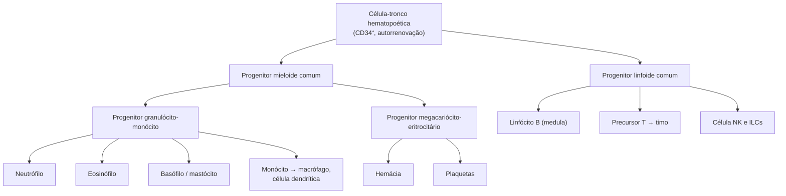
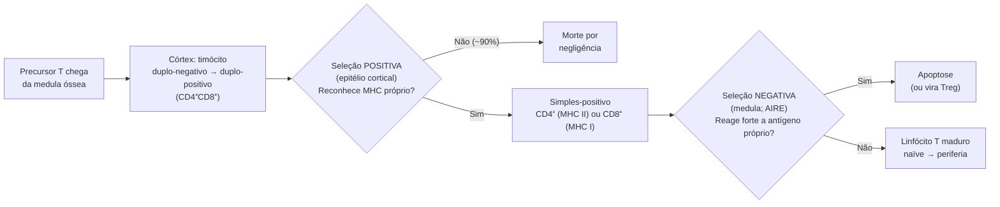

> **Pré-requisito:** se termos como linfócito B, linfócito T, anticorpo, BCR, TCR ou MHC ainda forem novos para você, leia antes a [visão geral do sistema imune](#/imunologia/visao-geral-sistema-imune). Abaixo há um resumo desse vocabulário.

## Objetivos do tópico {#objetivos}

Ao final, você deve ser capaz de:

1. Descrever a hematopoese a partir da célula-tronco hematopoética e as duas grandes linhagens: **mieloide** (que inclui os granulócitos) e **linfoide**.
2. Reconhecer as etapas de maturação da linhagem granulocítica e interpretar **leucocitose, desvio à esquerda, eosinofilia e linfocitose** no hemograma.
3. Diferenciar órgãos linfoides **primários** (medula óssea e timo: onde os linfócitos *nascem e são educados*) e **secundários** (linfonodos, baço, MALT: onde os linfócitos *encontram o antígeno*).
4. Explicar a organização funcional do linfonodo, do baço e do MALT e por que essa arquitetura torna a resposta imune eficiente.
5. Aplicar esses conceitos a situações clínicas: asplenia, síndrome de DiGeorge, linfadenopatia, neutropenia febril e reação leucemoide.

::: referencias
Abbas, Lichtman & Pillai – Imunologia Celular e Molecular, 10ª ed., cap. "Células e tecidos do sistema imune" · Junqueira & Carneiro – Histologia Básica, 13ª ed., caps. "Hemocitopoese" e "Sistema imune e órgãos linfoides".
:::

## Conceitos-base {#conceitos-base}

### A lógica do sistema {#logica-do-sistema}

O sistema imune enfrenta um problema de **logística**: há poucos linfócitos específicos para cada antígeno (cerca de 1 em 10⁵–10⁶ células), e o micróbio pode entrar por qualquer ponto do corpo. A solução tem três partes:

1. **Produzir** grande diversidade de células na medula óssea (hematopoese).
2. **Educar** os linfócitos em órgãos primários, eliminando os que reagem contra o próprio corpo.
3. **Concentrar** antígenos e linfócitos em órgãos secundários estrategicamente posicionados — linfonodos drenando tecidos, baço filtrando o sangue, MALT vigiando as mucosas — onde o encontro raro entre o linfócito certo e seu antígeno se torna provável.

Guardar essa lógica ajuda a prever as consequências clínicas: se a **produção** falha → aplasia/neutropenia; se a **educação** falha → imunodeficiência ou autoimunidade; se o **local de encontro** falta → infecções típicas (por exemplo, asplenia e bactérias encapsuladas).

### Vocabulário essencial {#vocabulario}

Antes de entrar nos órgãos, vale fixar os termos que aparecem o tempo todo neste tópico (explicados em detalhe na [visão geral](#/imunologia/visao-geral-sistema-imune)):

| Termo | O que significa |
|---|---|
| **Leucócitos** | Glóbulos brancos: neutrófilos, eosinófilos, basófilos, monócitos e linfócitos |
| **Antígeno** | Qualquer molécula reconhecida especificamente por um linfócito ou anticorpo (geralmente parte de um micróbio) |
| **Linfócito B** | Linfócito que reconhece antígenos intactos pelo seu receptor (**BCR**) e, ativado, vira **plasmócito**, a célula que produz **anticorpos** |
| **Anticorpo (imunoglobulina)** | Proteína em forma de Y que se prende ao antígeno e o marca para destruição ou o neutraliza |
| **Linfócito T** | Linfócito que reconhece, pelo seu receptor (**TCR**), pedaços de proteínas (peptídeos) exibidos na superfície de outras células por moléculas de **MHC** |
| **MHC (HLA em humanos)** | Molécula de superfície que funciona como "vitrine": exibe peptídeos do que existe dentro da célula (MHC I) ou do que ela capturou (MHC II) |
| **CD4⁺ e CD8⁺** | Os dois grandes tipos de linfócito T: CD4⁺ = **auxiliares** (coordenam a resposta com citocinas); CD8⁺ = **citotóxicos** (matam células infectadas) |
| **Célula apresentadora de antígeno** | Célula que exibe antígenos aos linfócitos T — a principal é a **célula dendrítica** |
| **Citocinas e quimiocinas** | Proteínas mensageiras do sistema imune; as **quimiocinas** são as que atraem células para um local |
| **Linfócito naïve** | Linfócito maduro que ainda não encontrou o seu antígeno |
| **CD (ex.: CD3, CD19)** | Nome padronizado de proteínas de superfície usadas para identificar tipos de células |

### Valores de referência do leucograma {#leucograma}

| Célula | Valor relativo típico | Valor absoluto típico (adulto) | Aumenta tipicamente em |
|---|---|---|---|
| Leucócitos totais | — | ~4.000–11.000/mm³ | Infecções, inflamação, corticoides, leucemias |
| Neutrófilos | ~50–70% | ~1.800–7.500/mm³ | Infecção bacteriana, inflamação aguda, estresse, corticoide |
| Linfócitos | ~20–40% | ~1.000–4.000/mm³ | Infecções virais (mononucleose), coqueluche, LLC |
| Monócitos | ~2–8% | ~200–800/mm³ | Infecções crônicas (TB), recuperação de neutropenia |
| Eosinófilos | ~1–4% | ~50–500/mm³ | **Helmintos**, alergia, asma, reações a fármacos |
| Basófilos | ~0–1% | ~0–100/mm³ | Neoplasias mieloproliferativas (LMC) |

Os valores variam com o laboratório e a idade (crianças pequenas têm predomínio linfocitário). **Interprete sempre o valor absoluto**, não só a porcentagem.

::: referencias
Abbas, 10ª ed., cap. "Propriedades e visão geral das respostas imunes" e "Células e tecidos do sistema imune" · Hoffbrand – Fundamentos em Hematologia, 7ª ed., cap. "Leucócitos: granulócitos, monócitos e seus distúrbios benignos".
:::

## Explicação detalhada {#explicacao}

### Hematopoese: da célula-tronco às linhagens {#hematopoese}

A **célula-tronco hematopoética (CTH)**, CD34⁺, reside em nichos da medula óssea. Duas propriedades a definem: **autorrenovação** e **multipotência**. Ela origina dois progenitores comprometidos:

**O controle é feito por citocinas (fatores de crescimento hematopoéticos)**, e entender quais atuam em cada ramo explica vários fármacos:

| Fator | Ação principal | Uso/Correlação |
|---|---|---|
| Eritropoetina (EPO, renal) | Eritropoese | Anemia da doença renal crônica; EPO recombinante |
| G-CSF | Neutrófilos | **Filgrastim** na neutropenia pós-quimioterapia; mobilizar CTH para transplante |
| GM-CSF | Granulócitos e monócitos | — |
| M-CSF | Monócitos/macrófagos | — |
| Trombopoetina (TPO, hepática) | Megacariócitos/plaquetas | Agonistas de TPO na trombocitopenia imune |
| IL-7 | Desenvolvimento de linfócitos | Mutações no receptor (cadeia γ comum, IL-7Rα) → imunodeficiência combinada grave |
| IL-5 | Eosinófilos | Anti-IL-5 (mepolizumabe) na asma eosinofílica |

::: referencias
Abbas, 10ª ed., cap. "Células e tecidos do sistema imune" · Junqueira & Carneiro, 13ª ed., cap. "Hemocitopoese".
:::

### Linhagem granulocítica {#linhagem-granulocitica}

A maturação do neutrófilo na medula leva cerca de **10–14 dias** e segue esta sequência:

> **Mieloblasto → promielócito → mielócito → metamielócito → bastonete → segmentado**

- Até o **mielócito**, a célula ainda se divide (compartimento mitótico). Do metamielócito em diante, só amadurece (compartimento de maturação/reserva).
- Os **grânulos primários (azurófilos)** — mieloperoxidase, defensinas, elastase — surgem no promielócito; os **secundários (específicos)** — lactoferrina, lisozima, colagenase — no mielócito.
- O neutrófilo maduro vive **horas a poucos dias** no sangue e tecidos. Por isso a neutropenia aparece rapidamente quando a medula é suprimida (quimioterapia).

**Desvio à esquerda:** quando a demanda por neutrófilos é intensa (infecção bacteriana, sepse), a medula libera formas jovens da reserva → aumentam os **bastonetes** (e, em casos graves, metamielócitos e mielócitos) no sangue periférico. Granulações tóxicas e corpúsculos de Döhle reforçam o sinal de infecção.

**Os outros granulócitos:**

| Célula | Grânulos / mediadores | Função principal |
|---|---|---|
| **Neutrófilo** | MPO, elastase, lactoferrina; NADPH oxidase | Fagocitose e destruição de bactérias e fungos; primeira célula da inflamação aguda |
| **Eosinófilo** | Proteína básica principal, peroxidase eosinofílica, proteína catiônica | Defesa contra **helmintos** (grandes demais para fagocitar); inflamação alérgica (via IL-5 e Th2) |
| **Basófilo** | Histamina, heparina; receptor de alta afinidade para IgE (FcεRI) | Circulante; reações alérgicas |
| **Mastócito** | Histamina, triptase, prostaglandinas, leucotrienos; FcεRI | Residente nos tecidos (pele, mucosas); hipersensibilidade tipo I e anafilaxia |

**Monócitos** saem da medula, circulam ~1–3 dias e migram para os tecidos, onde se tornam **macrófagos** (células de Kupffer no fígado, micróglia no SNC, macrófagos alveolares, osteoclastos derivam da mesma linhagem). Macrófagos fagocitam, apresentam antígenos e produzem citocinas.

::: referencias
Junqueira & Carneiro, 13ª ed., cap. "Hemocitopoese" · Hoffbrand – Fundamentos em Hematologia, 7ª ed.
:::

### Linhagem linfoide: quem são e o que fazem os linfócitos {#linhagem-linfoide}

O **progenitor linfoide comum** origina todos os linfócitos. No microscópio eles parecem iguais — células pequenas, redondas, de núcleo grande —, mas têm funções muito diferentes. A diferença está nas proteínas de superfície e, principalmente, no **receptor de antígeno** que cada um carrega.

#### Linfócitos B: os produtores de anticorpos {#linfocitos-b-funcao}

O linfócito B nasce e **amadurece na própria medula óssea**. Durante a maturação, cada linfócito B monta um receptor único, o **BCR**, que é uma molécula de anticorpo presa à sua membrana. Cada linfócito B tem milhares de cópias de **um único tipo** de BCR, capaz de reconhecer **um único epítopo** (a pequena região do antígeno que se encaixa no receptor).

Depois de maduro, o linfócito B **naïve** sai da medula e passa a circular entre o sangue e os órgãos linfoides secundários (linfonodos, baço). Quando encontra o antígeno que se encaixa no seu BCR:

1. Reconhece o antígeno **intacto** — proteína, polissacarídeo ou lipídio, na forma tridimensional original.
2. Recebe, na maioria dos casos, **ajuda de um linfócito T CD4⁺** nos folículos do linfonodo.
3. Multiplica-se (expansão clonal) e se transforma em **plasmócitos**, células especializadas em **secretar anticorpos** com a mesma especificidade do BCR original, e em **linfócitos B de memória**.

Os anticorpos produzidos circulam no sangue e nas secreções, onde **neutralizam** toxinas e micróbios, **marcam** micróbios para que os fagócitos os engulam (opsonização) e **ativam o complemento**. É a chamada **imunidade humoral**, mais eficaz contra micróbios e toxinas que estão **fora das células**.

#### Linfócitos T: coordenadores e executores {#linfocitos-t-funcao}

O linfócito T também nasce na medula óssea, mas seu precursor **migra para o timo**, onde amadurece (o "T" vem de timo). Lá, cada um monta seu receptor único, o **TCR**, e passa pela "educação" tímica descrita adiante.

A grande diferença em relação ao linfócito B é **o que o receptor enxerga**. O TCR **não reconhece moléculas intactas**: ele só reconhece **pequenos fragmentos de proteínas (peptídeos)** que outra célula cortou e exibiu na sua superfície, encaixados em moléculas de **MHC**. Por isso o linfócito T sempre depende do contato com outra célula — ele "inspeciona" a vitrine de MHC das células do corpo.

Os linfócitos T maduros saem do timo como um de dois tipos:

- **T CD4⁺ (auxiliares)** — reconhecem peptídeos em **MHC de classe II**, presente nas células apresentadoras de antígeno. Não matam diretamente; liberam **citocinas** que ativam macrófagos, ajudam os linfócitos B a produzir anticorpos, ajudam os T CD8⁺ e recrutam outras células. São o "centro de comando" da resposta adaptativa — por isso sua destruição pelo HIV desorganiza a imunidade inteira.
- **T CD8⁺ (citotóxicos)** — reconhecem peptídeos em **MHC de classe I**, presente em quase todas as células com núcleo. Quando encontram uma célula exibindo um peptídeo de vírus (ou de tumor), **matam essa célula** induzindo sua apoptose.

Um subgrupo de CD4⁺, os **linfócitos T reguladores (Treg)**, faz o contrário: freia as respostas imunes e ajuda a evitar ataques ao próprio corpo. Juntos, os linfócitos T formam a **imunidade celular**, essencial contra micróbios que vivem **dentro das células** (vírus, micobactérias). Detalhes em [imunidade celular](#/imunologia/imunidade-celular-mhc-linfocitos-t).

#### Células NK e células linfoides inatas {#nk-ilc}

- **Células NK** (*natural killer*) são linfócitos da imunidade **inata**: não montam receptores únicos como B e T. Elas matam células infectadas por vírus e células tumorais usando um sistema de receptores ativadores e inibitórios — em especial, atacam células que **perderam o MHC de classe I**, uma estratégia de "fuga" de vírus e tumores contra os T CD8⁺. Veja [imunidade inata](#/imunologia/imunidade-inata#celulas-nk).
- **Células linfoides inatas (ILCs)** ficam principalmente nas mucosas e produzem as mesmas citocinas que os subtipos de linfócitos T auxiliares, mas sem reconhecer antígenos específicos — reagem rapidamente a sinais de dano.

#### Como identificar cada linfócito {#marcadores}

Como não dá para distingui-los ao microscópio, os laboratórios usam a **imunofenotipagem por citometria de fluxo**, que detecta proteínas de superfície (os marcadores CD):

| Célula | Marcadores |
|---|---|
| Linfócitos T (todos) | **CD3** (complexo associado ao TCR) |
| T auxiliares / citotóxicos | **CD4** / **CD8** |
| Linfócitos B | **CD19**, **CD20** (alvo do rituximabe) |
| Células NK | **CD16**, **CD56** (e ausência de CD3) |

É assim que se mede, por exemplo, a contagem de **linfócitos T CD4⁺** em pessoas vivendo com HIV.

::: referencias
Abbas, 10ª ed., caps. "Células e tecidos do sistema imune" e "Desenvolvimento dos linfócitos".
:::

### Órgãos linfoides primários {#orgaos-primarios}

#### Medula óssea {#medula-ossea}

A medula óssea é, ao mesmo tempo, o local onde **todas** as células do sangue são produzidas e o local onde os **linfócitos B amadurecem**. A maturação do linfócito B acontece em etapas:

1. O precursor monta o seu receptor (BCR) recombinando segmentos de genes — um sorteio que gera um receptor diferente em cada célula (veja [recombinação V(D)J](#/imunologia/visao-geral-sistema-imune#diversidade)).
2. Como o sorteio é aleatório, alguns receptores acabam reconhecendo moléculas **do próprio corpo**. Os linfócitos B imaturos que reconhecem fortemente antígenos próprios presentes na medula têm duas saídas: **"editam" o receptor** (fazem um novo rearranjo da cadeia leve, tentando gerar um BCR inofensivo) ou morrem por **apoptose**. É a **tolerância central de B**.
3. Os que passam por essa checagem saem como linfócitos B **naïve** (com IgM e IgD na membrana) e vão para os órgãos linfoides secundários.

A medula também abriga **plasmócitos de vida longa**, que vieram dos linfonodos depois de uma resposta imune e continuam secretando anticorpos por anos — é por isso que os níveis de anticorpos contra uma vacina podem permanecer altos por muito tempo.

#### Timo {#timo}

Órgão bilobado no mediastino anterior, organizado em **córtex** (denso, cheio de timócitos imaturos) e **medula** (menos densa, com os **corpúsculos de Hassall**). **Timócito** é o nome do linfócito T enquanto ainda está amadurecendo no timo.

**Por que o linfócito T precisa ser "educado"?** Cada timócito monta o seu TCR por sorteio de segmentos gênicos. Isso cria dois riscos: (1) o TCR pode ser **inútil**, incapaz de reconhecer as moléculas de MHC do próprio indivíduo — e, como o linfócito T só enxerga peptídeos exibidos pelo MHC, ele nunca conseguiria funcionar; ou (2) o TCR pode ser **perigoso**, reconhecendo com força peptídeos do próprio corpo, o que causaria autoimunidade. O timo resolve os dois problemas com duas "provas" sucessivas:

1. O precursor chega da medula óssea sem CD4 nem CD8 (**duplo-negativo**) e, no córtex, monta o TCR e passa a expressar **CD4 e CD8 ao mesmo tempo** (**duplo-positivo**).
2. **Prova 1 — seleção positiva (córtex):** as células epiteliais do córtex exibem moléculas de MHC próprio carregadas com peptídeos próprios. O timócito cujo TCR consegue se ligar a elas **com força fraca a moderada** recebe um sinal de sobrevivência; o que não consegue se ligar morre "por negligência" (a grande maioria). Nessa etapa, o timócito também "escolhe" o correceptor: se o TCR reconheceu MHC de classe II, mantém o **CD4**; se reconheceu MHC de classe I, mantém o **CD8**.
3. **Prova 2 — seleção negativa (medula):** os sobreviventes migram para a medula, onde células epiteliais e dendríticas exibem uma enorme variedade de peptídeos próprios. O timócito que se liga a eles **com força alta** é perigoso e morre por apoptose (ou se torna linfócito T regulador).
4. Os aprovados — que reconhecem o MHC próprio, mas não reagem fortemente ao próprio corpo — saem como linfócitos T **naïve** CD4⁺ ou CD8⁺.

- **Seleção positiva (córtex):** sobrevivem só os timócitos cujo TCR reconhece fracamente o **MHC próprio** — garante **restrição ao MHC**. O tipo de MHC reconhecido define a linhagem: MHC II → CD4; MHC I → CD8.
- **Seleção negativa (medula):** timócitos que reagem fortemente a peptídeos próprios são eliminados por apoptose. O fator de transcrição **AIRE** faz as células epiteliais medulares expressarem proteínas de outros órgãos (insulina, tireoglobulina…), permitindo eliminar clones autorreativos contra tecidos periféricos. Parte dos clones autorreativos vira **T reguladora (Treg, FOXP3⁺)**.
- O timo é maior na infância e sofre **involução** progressiva (substituição por gordura) após a puberdade, mas continua funcional em baixa escala.

::: clinica Quando a educação falha
- **Mutação de AIRE** → síndrome poliglandular autoimune tipo 1 (APECED): hipoparatireoidismo, insuficiência adrenal e candidíase mucocutânea crônica.
- **Aplasia tímica (síndrome de DiGeorge, deleção 22q11.2)** → deficiência de linfócitos T, com hipocalcemia (paratireoides ausentes) e cardiopatia conotruncal, pois todos derivam das 3ª e 4ª bolsas faríngeas.
:::

::: referencias
Abbas, 10ª ed., caps. "Desenvolvimento dos linfócitos" e "Tolerância imunológica e autoimunidade" · Junqueira & Carneiro, 13ª ed., cap. "Sistema imune e órgãos linfoides".
:::

### Órgãos linfoides secundários {#orgaos-secundarios}

#### Linfonodos {#linfonodos}

Filtram a **linfa** que vem dos tecidos. A linfa entra pelos vasos **aferentes** (na cápsula), percorre os seios e sai pelo vaso **eferente** no hilo. Arquitetura:

| Região | Quem está lá | Função |
|---|---|---|
| **Córtex** | **Folículos de linfócitos B** (primários; secundários com **centro germinativo** após estímulo) e células dendríticas foliculares | Ativação de B, troca de classe, maturação de afinidade |
| **Paracórtex** | **Linfócitos T** e células dendríticas; **vênulas de endotélio alto (HEV)** | Apresentação de antígeno a T; entrada de linfócitos do sangue |
| **Medula** | Cordões medulares com **plasmócitos** e macrófagos | Secreção de anticorpos, filtração |

**Como os linfócitos chegam e saem:** linfócitos naïve expressam **L-selectina (CD62L)** e o receptor de quimiocinas **CCR7**. Eles aderem às **HEV** do paracórtex e entram no linfonodo, guiados por quimiocinas (CCL19/CCL21). Se não encontram seu antígeno em algumas horas, saem pela linfa eferente seguindo um gradiente de **esfingosina-1-fosfato (S1P)** e voltam ao sangue — a **recirculação**. O fingolimode (usado na esclerose múltipla) bloqueia o receptor de S1P e "aprisiona" os linfócitos nos linfonodos.

As células dendríticas capturam antígenos nos tecidos, amadurecem, passam a expressar CCR7 e migram pelos linfáticos para o paracórtex, onde apresentam o antígeno aos T naïve — veja [imunidade celular](#/imunologia/imunidade-celular-mhc-linfocitos-t#apresentacao-antigeno).

**O encontro passo a passo.** Imagine uma bactéria que entrou por um ferimento no pé:

1. No tecido, uma **célula dendrítica** engloba a bactéria, corta suas proteínas em peptídeos e os exibe em moléculas de MHC. Ao mesmo tempo, os sinais de perigo da bactéria a "amadurecem".
2. A dendrítica entra num vaso linfático e é levada pela linfa até o **linfonodo inguinal**, que drena o membro inferior. Antígenos livres também chegam por essa via.
3. No **paracórtex**, a dendrítica fica exposta ao fluxo contínuo de linfócitos T naïve que chegam do sangue pelas **HEV**. Cada T "testa" a vitrine da dendrítica por alguns minutos.
4. O raro linfócito T CD4⁺ cujo TCR reconhece um dos peptídeos bacterianos é **ativado**, para de circular e se multiplica (é por isso que o linfonodo **aumenta de tamanho** — a "íngua" de uma infecção).
5. Ao mesmo tempo, antígenos bacterianos intactos chegam aos **folículos** do córtex, onde o linfócito B com o BCR correspondente os captura. Os T CD4⁺ ativados migram para a borda do folículo e **ajudam** esse linfócito B, que forma um **centro germinativo**.
6. Os plasmócitos gerados vão para os **cordões medulares** (e depois para a medula óssea), de onde os anticorpos ganham o sangue; os linfócitos T efetores saem pela linfa eferente e chegam ao pé infectado pela circulação.

Esse desenho — antígenos chegando pela linfa, linfócitos chegando pelo sangue e regiões separadas para T e B — transforma um encontro improvável em algo que acontece em poucos dias.

#### Baço {#baco}

Filtra o **sangue** (não tem linfáticos aferentes). Dois compartimentos:

- **Polpa vermelha** (~75%): cordões esplênicos e sinusoides. Os macrófagos removem **hemácias senescentes ou alteradas**, partículas e bactérias **opsonizadas**. É também reservatório de plaquetas (~1/3 delas).
- **Polpa branca**: é a parte "imunológica" do baço, que funciona como um linfonodo para antígenos que chegam pelo **sangue**. Tem tecido linfoide ao redor das arteríolas centrais — **bainha periarteriolar (PALS)** rica em linfócitos T, e **folículos de B**. A **zona marginal**, na transição, contém **linfócitos B da zona marginal** e macrófagos especializados em capturar **antígenos polissacarídicos** do sangue e produzir rapidamente IgM.

::: clinica Asplenia e bactérias encapsuladas
Sem baço (esplenectomia, anemia falciforme com autoesplenectomia), perdem-se: (1) a filtração de bactérias opsonizadas, (2) a resposta rápida de **IgM contra polissacarídeos capsulares** da zona marginal. O resultado é risco de **sepse fulminante por bactérias encapsuladas** — *Streptococcus pneumoniae*, *Haemophilus influenzae* tipo b e *Neisseria meningitidis*. Por isso pacientes asplênicos devem ser **vacinados** contra esses agentes (idealmente ≥2 semanas antes de esplenectomia eletiva) e orientados a procurar atendimento imediato se tiverem febre. No esfregaço, aparecem **corpúsculos de Howell-Jolly** (restos nucleares que o baço normalmente removeria).
:::

#### Tecido linfoide associado a mucosas (MALT) {#malt}

As mucosas (intestino, vias aéreas, trato urogenital) somam uma área enorme exposta a antígenos. O MALT inclui as **placas de Peyer** (íleo), tonsilas, apêndice e agregados difusos na lâmina própria.

- **Células M** no epitélio sobre as placas de Peyer transportam antígenos do lúmen para as células dendríticas subjacentes (transcitose).
- A resposta típica é de **IgA secretora**, transportada através do epitélio pelo **receptor poli-Ig**; ela neutraliza micróbios e toxinas no lúmen sem causar inflamação.
- O intestino também é rico em Treg e mecanismos de **tolerância oral** a alimentos e à microbiota.

::: referencias
Abbas, 10ª ed., caps. "Células e tecidos do sistema imune" e "Imunidade regional" · Junqueira & Carneiro, 13ª ed., cap. "Sistema imune e órgãos linfoides".
:::

## Correlação clínica {#correlacao-clinica}

### Lendo o leucograma {#leucograma-clinico}

| Padrão | Mecanismo | Pense em |
|---|---|---|
| Neutrofilia com **desvio à esquerda** e granulações tóxicas | Liberação da reserva medular por G-CSF, IL-1, TNF | **Infecção bacteriana**, sepse |
| Neutrofilia **sem** desvio | Desmarginação (neutrófilos aderidos ao endotélio voltam à circulação) | **Corticoide**, adrenalina, estresse, exercício |
| **Linfocitose com linfócitos atípicos** | Linfócitos T CD8⁺ ativados contra células B infectadas | Mononucleose (EBV) |
| **Eosinofilia** | IL-5 de Th2 | **Helmintos** (estrongiloidíase, ancilostomíase…), alergia, fármacos |
| **Neutropenia** < 500/mm³ | Supressão medular, destruição | Quimioterapia → **neutropenia febril** é emergência |
| **Linfopenia** | Destruição/redistribuição | HIV, corticoide, sepse |

**Reação leucemoide × leucemia mieloide crônica (LMC):** ambas podem ter leucocitose >50.000/mm³ com formas jovens. Na reação leucemoide (infecção grave, por exemplo) há causa identificável e predomínio de bastonetes e metamielócitos; na LMC há **basofilia**, cromossomo Filadélfia (BCR-ABL) e esplenomegalia.

### Neutropenia febril {#neutropenia-febril}

Em paciente com neutrófilos < 500/mm³ (ou com previsão de cair abaixo disso) e febre, a falta de neutrófilos impede a formação de pus e a localização da infecção — os sinais clássicos podem estar ausentes. Por isso, a conduta é **antibiótico de amplo espectro empírico imediato**, idealmente na primeira hora, após coleta de culturas. O G-CSF (filgrastim) pode encurtar a duração da neutropenia em situações selecionadas.

### Linfadenopatia {#linfadenopatia}

O linfonodo aumenta por **hiperplasia reativa** (folículos com centros germinativos — resposta B; paracórtex — resposta T, como em infecções virais), por **infiltração** (metástases, linfomas) ou por inflamação do próprio linfonodo (linfadenite). Sinais de alarme: linfonodo **> 2 cm, endurecido, aderido, indolor, supraclavicular**, persistente por mais de 4–6 semanas, ou acompanhado de febre, sudorese noturna e perda de peso → investigar com biópsia.

::: referencias
Hoffbrand – Fundamentos em Hematologia, 7ª ed. · Harrison – Medicina Interna, 21ª ed., caps. "Distúrbios dos granulócitos e monócitos" e "Linfadenopatia e esplenomegalia" · Ministério da Saúde – Calendário de vacinação dos Centros de Referência para Imunobiológicos Especiais (CRIE).
:::

## Pontos de alta cobrança em prova {#alta-cobranca}

::: prova
- CTH → **progenitor mieloide comum** (granulócitos, monócitos, hemácias, plaquetas) e **linfoide comum** (B, T, NK, ILCs).
- Maturação do neutrófilo: **mieloblasto → promielócito → mielócito → metamielócito → bastonete → segmentado**. Divide-se só até o mielócito.
- **Desvio à esquerda** = ↑ bastonetes → infecção bacteriana. Neutrofilia sem desvio → corticoide/estresse (desmarginação).
- **Eosinofilia → helmintos e alergia** (IL-5). **Basofilia → pensar em LMC.**
- Órgãos **primários**: medula óssea (B) e **timo** (T). **Secundários**: linfonodos, baço, MALT.
- Timo: **seleção positiva no córtex** (restrição ao MHC; define CD4 × CD8) e **negativa na medula** (tolerância central; **AIRE**).
- Linfonodo: **folículos B no córtex**, **T no paracórtex**, plasmócitos na medula; entrada pelas **HEV** (L-selectina, CCR7); saída por **S1P**.
- Baço: **polpa vermelha filtra hemácias**; **polpa branca** = PALS (T) + folículos (B); **zona marginal** → IgM contra polissacarídeos.
- **Asplenia → encapsulados** (pneumococo, Hib, meningococo); vacinar; Howell-Jolly.
- MALT: **células M**, placas de Peyer, **IgA secretora**.
- **DiGeorge (22q11.2)**: aplasia tímica + hipocalcemia + cardiopatia.
:::

## Armadilhas comuns {#armadilhas}

::: armadilha
- **Confundir órgão primário com secundário.** O linfonodo **não** produz linfócitos a partir de células-tronco; ele é local de **ativação e proliferação** de linfócitos já maduros.
- **Achar que o linfócito T amadurece na medula óssea.** Ele **nasce** lá, mas **amadurece no timo**.
- **Inverter as seleções tímicas.** Positiva = sobrevive quem reconhece **MHC próprio** (córtex). Negativa = morre quem reage **forte a peptídeo próprio** (medula).
- **Interpretar porcentagem em vez de valor absoluto.** "Linfocitose de 60%" pode ser apenas neutropenia com linfócitos absolutos normais.
- **Toda neutrofilia é infecção.** Corticoide, estresse e exercício causam neutrofilia **sem desvio à esquerda** por desmarginação.
- **Esquecer que o baço não recebe linfa.** Ele filtra **sangue**; linfonodos filtram **linfa**.
- **Achar que basófilo e mastócito são a mesma célula.** Compartilham FcεRI e histamina, mas o basófilo circula e o mastócito reside nos tecidos.
:::

## Resumo para revisão rápida {#resumo}

- **Lógica:** produzir (medula) → educar (medula para B, timo para T) → concentrar antígeno e linfócitos (linfonodos, baço, MALT).
- **Hematopoese:** CTH CD34⁺ → mieloide comum (neutrófilo, eosinófilo, basófilo/mastócito, monócito/macrófago/dendrítica, hemácia, plaqueta) e linfoide comum (B, T, NK, ILC). Citocinas: EPO, G-CSF (filgrastim), GM-CSF, TPO, IL-5, IL-7.
- **Neutrófilo:** 10–14 dias de maturação; vida curta; **desvio à esquerda** em infecção bacteriana; neutropenia febril = antibiótico imediato.
- **Eosinófilo** → helmintos e alergia; **basófilo/mastócito** → FcεRI, histamina, hipersensibilidade I.
- **Timo:** córtex (seleção positiva, restrição ao MHC) → medula (seleção negativa, AIRE, Treg). DiGeorge = sem timo.
- **Linfonodo:** córtex (B, centros germinativos), paracórtex (T, HEV), medula (plasmócitos). Recirculação: L-selectina/CCR7 para entrar, S1P para sair.
- **Baço:** polpa vermelha (filtra hemácias e bactérias opsonizadas), polpa branca (PALS-T, folículos-B), zona marginal (IgM anti-polissacarídeo). **Asplenia → encapsulados → vacinar.**
- **MALT:** células M, placas de Peyer, IgA secretora, tolerância oral.

::: referencias
Abbas, 10ª ed., caps. "Células e tecidos do sistema imune" e "Desenvolvimento dos linfócitos" · Junqueira & Carneiro, 13ª ed. · Hoffbrand, 7ª ed.
:::
