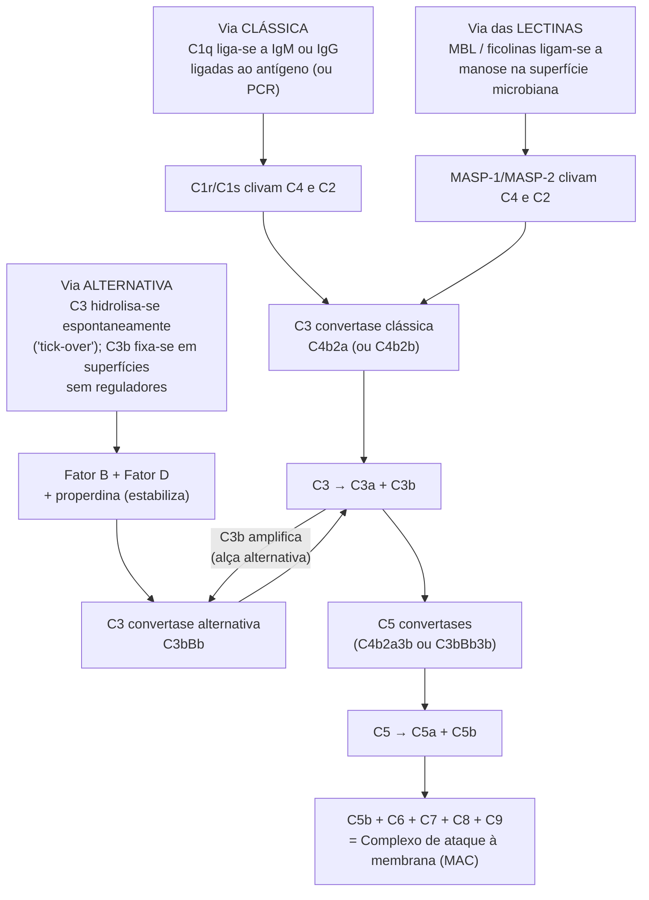
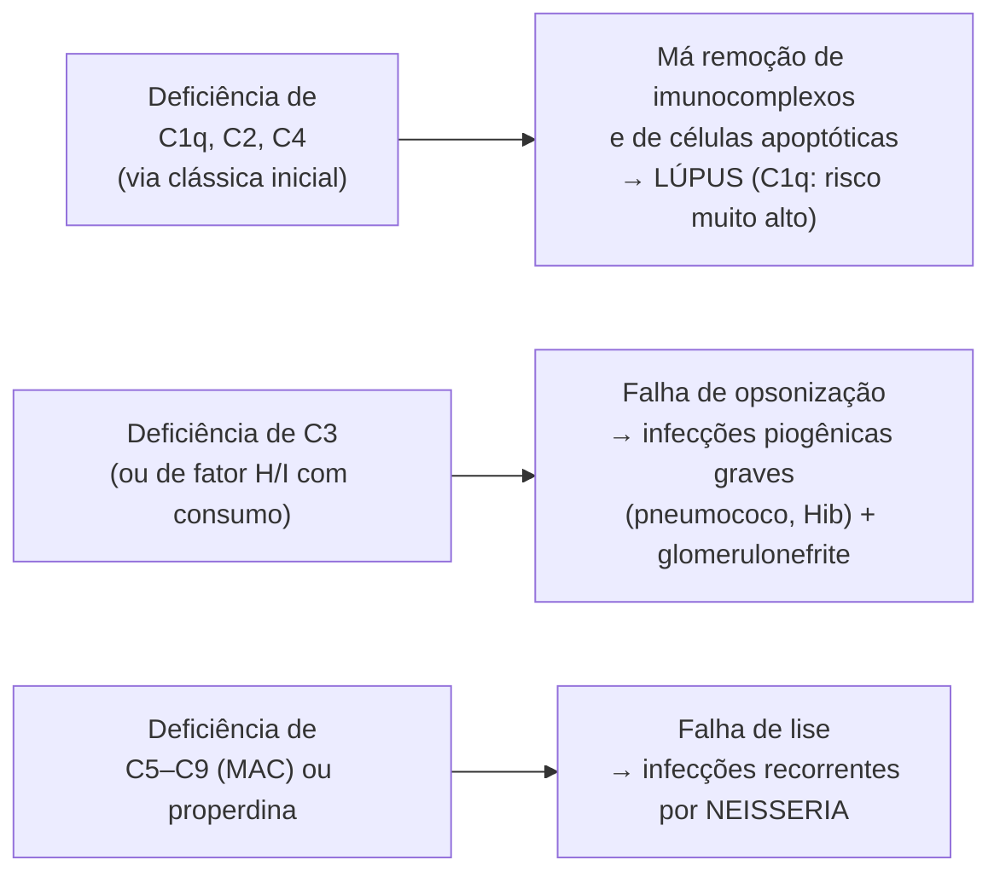

> **Pré-requisito:** a via clássica do complemento depende de anticorpos. Se a estrutura e as classes de anticorpos ainda forem novas, leia antes a [visão geral do sistema imune](#/imunologia/visao-geral-sistema-imune#linfocitos-b).

## Objetivos do tópico {#objetivos}

Ao final, você deve ser capaz de:

1. Descrever as **três vias de ativação** do complemento (clássica, das lectinas e alternativa), o que as dispara e onde elas convergem.
2. Explicar as **três funções efetoras**: opsonização (C3b), inflamação (C3a e C5a) e lise (complexo de ataque à membrana, C5b-9) — além da remoção de imunocomplexos e do auxílio à resposta B.
3. Descrever as **proteínas reguladoras** (C1-INH, DAF/CD55, CD59, fator H, fator I, MCP/CD46) e por que o próprio corpo precisa se proteger do complemento.
4. Correlacionar deficiências e desregulações com as doenças: infecções por *Neisseria*, infecções piogênicas, lúpus, **angioedema hereditário**, **hemoglobinúria paroxística noturna** e **SHU atípica**.
5. Interpretar **C3, C4 e CH50** em doenças por imunocomplexos.

::: referencias
Abbas, Lichtman & Pillai – Imunologia Celular e Molecular, 10ª ed., cap. "Mecanismos efetores da imunidade humoral" (seção "O sistema complemento").
:::

## Conceitos-base {#conceitos-base}

### O que é o complemento {#definicao}

O complemento é um conjunto de **mais de 30 proteínas plasmáticas e de membrana**, a maioria produzida pelo **fígado** e circulante na forma **inativa** (zimogênios). Ao ser ativado, funciona como uma **cascata proteolítica**: cada enzima cliva e ativa a seguinte, **amplificando** muito o sinal. O nome vem da observação de que essas proteínas "complementavam" a ação dos anticorpos na lise de bactérias.

**A regra de nomenclatura ajuda a não se perder:**

- Ao ser clivado, um componente gera um fragmento menor (**"a"**) e um maior (**"b"**). Ex.: C3 → **C3a** (pequeno, solúvel, inflamatório) + **C3b** (grande, liga-se a superfícies, opsoniza).
- **Exceção histórica:** no C2, o fragmento maior era chamado C2a; textos mais recentes renomearam-no C2b. Por isso você encontrará a C3 convertase clássica escrita como **C4b2a** (livros mais antigos) ou **C4b2b** (mais recentes) — é a mesma enzima.

### Pré-requisitos para entender o complemento {#pre-requisitos}

Alguns conceitos aparecem o tempo todo neste tópico:

- **Proteases e zimogênios.** Uma **protease** é uma enzima que corta outras proteínas. Muitas proteases circulam no sangue numa forma **inativa**, chamada **zimogênio**, e só passam a funcionar quando são cortadas por outra protease. A coagulação funciona assim, e o complemento também.
- **Cascata.** Quando uma protease ativa corta e ativa várias moléculas da protease seguinte, que por sua vez ativam várias da próxima, o sinal se **amplifica** a cada etapa — como uma fileira de dominós em que cada peça derruba várias outras. Assim, poucos micróbios detectados geram milhões de moléculas ativas na superfície deles em minutos.
- **Anticorpos.** São proteínas em forma de Y produzidas pelos plasmócitos. Os braços do Y (**Fab**) se prendem ao antígeno; a haste (**Fc**) é a parte que outras moléculas reconhecem — inclusive o primeiro componente do complemento, o **C1q**. As classes que mais ativam o complemento são a **IgM** (a primeira produzida numa infecção, formada por cinco unidades em Y unidas) e a **IgG**.
- **Fagócitos e opsonização.** Neutrófilos e macrófagos engolem micróbios (fagocitose). Fazem isso muito melhor quando o micróbio está "recoberto" por moléculas que eles reconhecem — as **opsoninas**. O fragmento **C3b** do complemento é uma das opsoninas mais importantes.
- **Mastócitos.** Células dos tecidos cheias de grânulos de **histamina**. Quando degranulam, a histamina dilata os vasos e aumenta sua permeabilidade — parte da inflamação.

### A peça central: C3 {#c3-central}

Todas as vias convergem para a **clivagem de C3** pela **C3 convertase**. O C3b gerado faz duas coisas: liga-se covalentemente à superfície do micróbio (via uma **ligação tioéster** reativa) e **participa da formação de mais convertase** — uma alça de **amplificação**. É por isso que C3 é a proteína mais abundante do sistema e que sua deficiência é a mais grave.

::: referencias
Abbas, 10ª ed., cap. "Mecanismos efetores da imunidade humoral".
:::

## Explicação detalhada {#explicacao}

### As três vias de ativação {#vias-ativacao}

O complemento pode ser "ligado" de três maneiras diferentes. Elas diferem no **início** (o que detecta o micróbio), mas todas chegam ao mesmo ponto: formar uma enzima chamada **C3 convertase**, que corta o C3. A partir daí, o caminho é comum.

**Via clássica — iniciada por anticorpos:**

1. Anticorpos **IgM ou IgG** já produzidos contra o micróbio se prendem à superfície dele.
2. O **C1q**, uma proteína em forma de "buquê" com seis cabeças, reconhece as hastes (Fc) dos anticorpos. Ele só é ativado quando se liga a **pelo menos duas hastes próximas** — por isso basta uma IgM (que tem cinco hastes juntas), enquanto é preciso várias IgG lado a lado.
3. A ligação ativa as proteases associadas ao C1q, **C1r e C1s**.
4. O C1s corta o **C4** e o **C2**; os fragmentos maiores (C4b e o fragmento grande de C2) se unem na superfície do micróbio e formam a **C3 convertase clássica (C4b2a, ou C4b2b na nomenclatura nova)**.

A via clássica também pode ser iniciada pela **proteína C-reativa (PCR)**, uma proteína de fase aguda que se liga a micróbios e é reconhecida pelo C1q.

**Via das lectinas — iniciada por açúcares dos micróbios:**

1. A **lectina ligadora de manose (MBL)** e as ficolinas, proteínas do plasma, reconhecem **açúcares** (como a manose) arranjados de um jeito típico da superfície de bactérias e fungos — e que não aparece nas células humanas.
2. Ligadas ao micróbio, ativam proteases associadas (**MASP-1 e MASP-2**), que fazem o mesmo papel do C1s: cortam C4 e C2.
3. Forma-se a **mesma C3 convertase** da via clássica. É uma via **inata**: não precisa de anticorpos.

**Via alternativa — sempre ligada em baixo nível:**

1. O C3 do plasma se quebra **espontaneamente**, em pequena quantidade, o tempo todo (o "tick-over").
2. O C3b formado se prende a qualquer superfície próxima. Se a superfície for de uma **célula humana**, proteínas reguladoras o inativam imediatamente. Se for de um **micróbio**, que não tem esses reguladores, o C3b permanece.
3. No micróbio, o C3b se associa ao **fator B**, que é cortado pelo **fator D**, formando a **C3 convertase alternativa (C3bBb)**. A **properdina** estabiliza essa enzima.
4. Essa convertase corta mais C3, gerando mais C3b, que forma mais convertase: é a **alça de amplificação**, que também reforça as outras duas vias.

**Fase comum — de C3 ao complexo de ataque à membrana:**

1. As C3 convertases cortam enormes quantidades de **C3** em **C3a** (pequeno, se difunde e inflama) e **C3b** (grande, recobre o micróbio).
2. Quando um C3b se junta a uma C3 convertase, ela passa a cortar o **C5** — vira uma **C5 convertase**.
3. O **C5** é cortado em **C5a** (a anafilatoxina mais potente e atraente de neutrófilos) e **C5b**.
4. O C5b recruta, em sequência, **C6, C7, C8** e várias moléculas de **C9**, que se inserem na membrana e formam um **poro**: o **complexo de ataque à membrana (MAC)**. Água e íons entram pelo poro, e a célula estoura (lise osmótica).

O diagrama resume o caminho:

| | Clássica | Lectinas | Alternativa |
|---|---|---|---|
| Gatilho | **Anticorpo** (IgM > IgG3 > IgG1) ligado ao antígeno; PCR | **MBL**/ficolinas reconhecem manose e outros açúcares microbianos | **Hidrólise espontânea de C3**; superfícies sem reguladores (micróbios) |
| Imunidade | Ponte com a **adaptativa** (precisa de anticorpo) | **Inata** | **Inata** (e amplificação de todas) |
| Componentes iniciais | C1q, C1r, C1s, C4, C2 | MBL, MASPs, C4, C2 | C3, fator B, fator D, properdina |
| C3 convertase | C4b2a (C4b2b) | C4b2a (C4b2b) | **C3bBb** |

**Detalhes que costumam cair:**

- **IgM pentamérica** é o ativador mais eficiente da via clássica: basta **uma** molécula ligada ao antígeno, porque o C1q precisa se ligar a pelo menos **duas** porções Fc próximas. Para IgG, são necessárias várias moléculas lado a lado.
- **IgA, IgE e IgG4** praticamente não ativam a via clássica.
- A via alternativa está **sempre ligada em baixo nível** ("tick-over"). Nas células próprias, os reguladores inativam o C3b imediatamente; nos micróbios, sem esses reguladores, o C3b persiste e a cascata se amplifica. É uma discriminação **"próprio × não próprio" por ausência de proteção**.

::: referencias
Abbas, 10ª ed., cap. "Mecanismos efetores da imunidade humoral".
:::

### Funções efetoras {#funcoes-efetoras}

| Função | Fragmento | Mecanismo | Importância clínica |
|---|---|---|---|
| **Opsonização** | **C3b** (e iC3b) | Liga-se ao micróbio; fagócitos o reconhecem pelos receptores **CR1** e CR3 | Função **mais importante** contra bactérias encapsuladas; deficiência de C3 → infecções piogênicas graves |
| **Inflamação** | **C3a, C5a** (anafilatoxinas) — C5a é a mais potente | Degranulam mastócitos (histamina) → vasodilatação e permeabilidade; **C5a é quimiotático** para neutrófilos e ativa-os | Contribuem para o dano na sepse e em doenças por imunocomplexos |
| **Lise** | **C5b-9 (MAC)** | Polímeros de C9 formam **poros** na membrana → entrada de água e íons → lise osmótica | Essencial contra **Neisseria** (bactérias de parede fina); deficiência de C5–C9 → meningococcemia recorrente |
| **Remoção de imunocomplexos** | C3b + **CR1 das hemácias** | Hemácias carregam imunocomplexos até fígado e baço, onde são removidos | Deficiência de C1q/C2/C4 → acúmulo de imunocomplexos → **lúpus** |
| **Ativação de linfócitos B** | **C3d** + **CR2 (CD21)** | O CR2 funciona como correceptor do BCR → reduz o limiar de ativação | O CR2 também é o receptor do **vírus Epstein-Barr** nos linfócitos B |

::: referencias
Abbas, 10ª ed., cap. "Mecanismos efetores da imunidade humoral" · Robbins – Patologia Básica, 10ª ed., cap. "Inflamação e reparo".
:::

### Regulação: como o corpo se protege do próprio complemento {#regulacao}

Como o C3b se liga covalentemente a **qualquer** superfície próxima, as células humanas precisam de proteínas que desliguem a cascata. Sem elas, o complemento destruiria nossas próprias células.

| Regulador | Onde atua | Mecanismo | Deficiência causa |
|---|---|---|---|
| **Inibidor de C1 (C1-INH)** | Plasma | Inibe C1r/C1s e MASPs; também inibe **calicreína** e fator XIIa (sistema de contato) | **Angioedema hereditário** (excesso de **bradicinina**) |
| **DAF (CD55)** | Membrana celular | Acelera a dissociação das C3 convertases | **HPN** (junto com CD59) |
| **CD59 (protectina)** | Membrana celular | Impede a polimerização de C9 (bloqueia o MAC) | **HPN** — hemólise intravascular |
| **MCP (CD46)** | Membrana | Cofator para o fator I clivar C3b/C4b | SHU atípica |
| **Fator H** | Plasma (liga-se a superfícies com ácido siálico) | Desloca Bb e é cofator do fator I na via alternativa | **SHU atípica**, glomerulopatia por C3, degeneração macular |
| **Fator I** | Plasma | Cliva C3b → iC3b (inativo) | Consumo de C3 → infecções piogênicas; SHU atípica |

::: referencias
Abbas, 10ª ed., cap. "Mecanismos efetores da imunidade humoral" · Harrison – Medicina Interna, 21ª ed., caps. "Angioedema" e "Hemoglobinúria paroxística noturna".
:::

## Correlação clínica {#correlacao-clinica}

### Deficiências do complemento {#deficiencias}

O padrão de infecção ou de doença de cada deficiência decorre diretamente da função da peça que falta:

- **Falta C1q, C2 ou C4 (início da via clássica):** as infecções costumam ser menos graves, porque as vias das lectinas e alternativa ainda geram C3b. O problema principal é outro: a via clássica é essencial para **remover imunocomplexos e restos de células apoptóticas**. Sem ela, esse material se acumula, estimula a produção de autoanticorpos contra componentes do núcleo e se deposita em pele, rins e articulações — por isso essas deficiências causam **lúpus**.
- **Falta C3:** todas as vias convergem em C3. Sem ele, não há opsonização eficiente nem formação do MAC. O resultado são **infecções piogênicas graves e de repetição** (pneumococo, *Haemophilus*), muito parecidas com as de quem não produz anticorpos.
- **Falta C5, C6, C7, C8 ou C9 (via terminal):** a opsonização por C3b continua funcionando, então a maioria das bactérias é eliminada normalmente. O que falta é o **MAC**, e só há um grupo de bactérias que depende tanto dele: as **Neisseria** (meningococo, gonococo), com parede fina e sensível ao poro. Daí as **infecções meningocócicas de repetição**.

**A deficiência de C2 é a mais comum entre as hereditárias** (em populações de origem europeia), muitas vezes assintomática ou associada a lúpus e infecções.

### Angioedema hereditário (AEH) {#angioedema-hereditario}

Deficiência quantitativa (tipo I) ou funcional (tipo II) do **C1-INH**, de herança autossômica dominante. Sem esse inibidor, a **calicreína** fica descontrolada e produz **bradicinina** em excesso → aumento de permeabilidade → **angioedema**:

- Edema **não pruriginoso, sem urticária**, de face, lábios, extremidades, genitália, **alças intestinais** (dor abdominal recorrente) e **laringe** (risco de morte por asfixia).
- Desencadeado por traumas (procedimentos odontológicos), estrogênios, estresse.
- **Laboratório:** **C4 baixo** (consumido continuamente pelo C1 sem freio) com C3 normal; C1-INH baixo ou disfuncional.
- **Não responde** a anti-histamínicos, corticoides nem adrenalina de forma confiável, pois não é mediado por histamina. Crises: **concentrado de C1-INH**, **icatibanto** (antagonista do receptor B2 da bradicinina) ou ecalantida.

O **angioedema por IECA** tem o mesmo mediador: os IECA inibem a enzima que degrada a bradicinina (cininase II = ECA).

### Hemoglobinúria paroxística noturna (HPN) {#hpn}

Mutação adquirida no gene **PIG-A** de uma célula-tronco hematopoética → falha na síntese da âncora **GPI** → as células-filhas perdem as proteínas ancoradas por GPI, incluindo **DAF (CD55)** e **CD59**. Sem proteção, as hemácias sofrem **lise intravascular** pelo complemento:

- **Hemólise intravascular** (LDH alto, haptoglobina baixa, hemoglobinúria — urina escura, classicamente pela manhã).
- **Trombose** em locais atípicos (veias hepáticas — síndrome de Budd-Chiari —, mesentéricas, cerebrais): principal causa de morte.
- Associação com **aplasia de medula**.
- Diagnóstico: **citometria de fluxo** mostrando perda de CD55/CD59 (e FLAER).
- Tratamento: **eculizumabe/ravulizumabe** (anti-C5, bloqueiam o MAC). Como bloqueiam a lise, aumentam muito o risco de **meningococcemia** → **vacinação antimeningocócica** obrigatória (e, em alguns protocolos, antibiótico profilático).

### Complemento como marcador de doença {#marcadores}

Em doenças por **imunocomplexos**, o complemento é **consumido** e cai no sangue:

| Situação | C3 | C4 | Comentário |
|---|---|---|---|
| **Lúpus em atividade** (nefrite) | ↓ | ↓ | Via clássica; acompanha atividade junto com anti-DNA |
| **GN pós-estreptocócica** | ↓ | **Normal** | Ativação predominante da **via alternativa**; normaliza em ~6–8 semanas |
| **Crioglobulinemia** (hepatite C) | Normal ou ↓ | **↓↓** | C4 muito baixo é típico |
| **Angioedema hereditário** | Normal | ↓ | C4 é o exame de triagem |
| GN membranoproliferativa / glomerulopatia por C3 | ↓ | Normal | Desregulação da via alternativa (fator nefrítico C3, fator H) |

O **CH50** avalia a via clássica inteira até o MAC: estará muito baixo ou indetectável quando faltar qualquer componente de C1 a C9 — é bom exame de **triagem** para deficiências.

::: referencias
Abbas, 10ª ed., caps. "Mecanismos efetores da imunidade humoral" e "Imunodeficiências congênitas e adquiridas" · Harrison, 21ª ed. · Associação Brasileira de Alergia e Imunologia (ASBAI) – Diretrizes brasileiras do angioedema hereditário.
:::

## Pontos de alta cobrança em prova {#alta-cobranca}

::: prova
- Três vias convergem em **C3**: **clássica** (C1q + IgM/IgG), **lectinas** (MBL + manose), **alternativa** (hidrólise espontânea de C3; fator B, D, properdina).
- **IgM** é o melhor ativador da via clássica (1 molécula basta); IgA e IgE não ativam.
- C3 convertases: **C4b2a (C4b2b)** e **C3bBb**. C5 convertases: acrescentam C3b.
- Funções: **C3b = opsonização**; **C3a/C5a = anafilatoxinas** (C5a quimiotático); **C5b-9 = MAC (lise)**; C3b + CR1 = remoção de imunocomplexos; **C3d + CR2 (CD21)** = correceptor B (e receptor do EBV).
- Deficiências: **C1q/C2/C4 → lúpus**; **C3 → piogênicas graves**; **C5–C9 → Neisseria**.
- **AEH**: ↓ **C1-INH** → **bradicinina**; edema sem urticária, laringe, cólica abdominal; **C4 baixo**; tratar com C1-INH ou icatibanto (não anti-histamínico).
- **HPN**: **PIG-A** → sem âncora GPI → sem **CD55/CD59** → hemólise intravascular + **trombose**; citometria de fluxo; **eculizumabe** → **vacinar contra meningococo**.
- **GN pós-estreptocócica: C3 ↓, C4 normal**; **lúpus: C3 e C4 ↓**; **crioglobulinemia: C4 ↓↓**.
- Fator H/I e MCP → SHU atípica.
:::

## Armadilhas comuns {#armadilhas}

::: armadilha
- **"O complemento é só da imunidade adaptativa."** Duas das três vias (lectinas e alternativa) são **inatas** e funcionam sem anticorpos.
- **Confundir as funções dos fragmentos.** Fragmento **b grande que fica na superfície = opsonina/convertase**; fragmento **a pequeno e solúvel = anafilatoxina**. (Exceção de nomenclatura: C2.)
- **Achar que a lise pelo MAC é a principal função antibacteriana.** Para a maioria das bactérias, a **opsonização por C3b** é mais importante; o MAC é crítico sobretudo contra **Neisseria**.
- **Tratar angioedema hereditário como alergia.** Não há urticária nem prurido, e anti-histamínicos e corticoides não funcionam. C4 baixo é a pista.
- **Esquecer a vacinação antimeningocócica antes do eculizumabe.** Bloquear C5 reproduz uma deficiência terminal do complemento.
- **Inverter C3/C4 na GN pós-estreptocócica.** É **C3 baixo com C4 normal** (via alternativa), ao contrário do lúpus (ambos baixos).
- **Pensar que complemento baixo indica deficiência congênita.** Na maioria das vezes, indica **consumo** por doença ativa.
:::

## Resumo para revisão rápida {#resumo}

- **Complemento:** ~30 proteínas hepáticas; cascata proteolítica que se amplifica; **C3 é o centro**.
- **Vias:** clássica (C1q + IgM/IgG; PCR), lectinas (MBL/MASP), alternativa (tick-over de C3; fator B, D, properdina). Convertases: C4b2a (C4b2b) e C3bBb.
- **Efeitos:** C3b opsoniza (CR1); C3a/C5a inflamam (C5a quimiotático); C5b-9 lisa (Neisseria); C3b/CR1 nas hemácias remove imunocomplexos; C3d/CR2 ajuda o linfócito B.
- **Reguladores:** C1-INH, DAF (CD55), CD59, MCP (CD46), fator H, fator I.
- **Doenças:** C1q/C2/C4 ↓ → lúpus; C3 ↓ → piogênicas; C5–C9 ↓ → Neisseria; **C1-INH ↓ → AEH (bradicinina, C4 ↓)**; **PIG-A → HPN (CD55/CD59, hemólise + trombose, eculizumabe + vacina)**; fator H/I/MCP → SHU atípica.
- **Marcadores:** lúpus ativo C3 e C4 ↓; GNPE C3 ↓ com C4 normal; crioglobulinemia C4 ↓↓; CH50 = triagem.

::: referencias
Abbas, 10ª ed., cap. "Mecanismos efetores da imunidade humoral" · Harrison, 21ª ed.
:::
