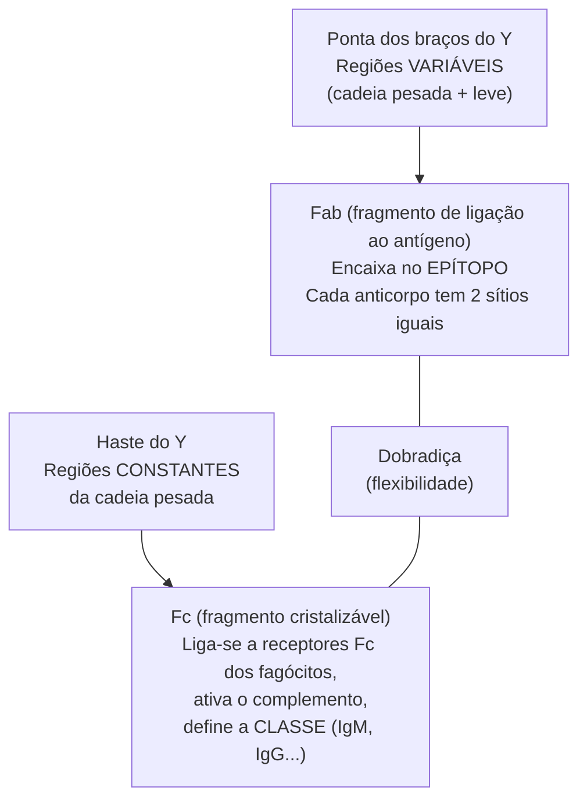
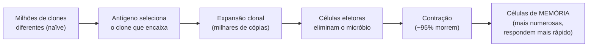
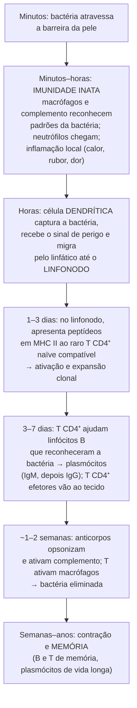

> **Comece por aqui.** Este tópico apresenta, do zero, o vocabulário e a lógica que todos os outros tópicos de imunologia do ASE6 usam. Os detalhes de cada parte estão nos tópicos específicos, indicados ao longo do texto.

## Objetivos do tópico {#objetivos}

Ao final, você deve ser capaz de:

1. Explicar o que é **antígeno**, **epítopo** e **imunógeno**, e por que o sistema imune precisa distinguir o **próprio** do **não próprio**.
2. Comparar as duas camadas de defesa — **imunidade inata** e **imunidade adaptativa** — e explicar como uma depende da outra.
3. Descrever o que são e o que fazem os **linfócitos B**: o receptor **BCR**, a estrutura de um **anticorpo**, a transformação em **plasmócito** e as funções e classes dos anticorpos.
4. Descrever o que são e o que fazem os **linfócitos T**: o receptor **TCR**, por que eles só enxergam antígenos **apresentados** por moléculas de **MHC (HLA)**, e a diferença entre **CD4⁺** e **CD8⁺**.
5. Explicar como surge a enorme **diversidade** de receptores (recombinação V(D)J) e como a **seleção clonal** gera a **memória** imunológica — a base das vacinas.
6. Contar, passo a passo, a **linha do tempo** de uma resposta imune contra um micróbio, e aplicar esse raciocínio a vacinas, sorologias e imunodeficiências.

::: referencias
Abbas, Lichtman & Pillai – Imunologia Celular e Molecular, 10ª ed., cap. "Propriedades e visão geral das respostas imunes" · Roitt & Delves – Fundamentos de Imunologia, 13ª ed.
:::

## Conceitos-base {#conceitos-base}

### O problema que o sistema imune precisa resolver {#problema}

O corpo humano está o tempo todo exposto a micro-organismos — bactérias, vírus, fungos, protozoários e helmintos (vermes). Muitos vivem em paz conosco (a microbiota da pele e do intestino), mas alguns invadem tecidos e causam doença. Além disso, nossas próprias células às vezes se tornam perigosas: uma célula infectada por vírus vira uma "fábrica" de novos vírus, e uma célula que sofre mutações pode se tornar um câncer.

O sistema imune é o conjunto de células, tecidos e moléculas que **defende o organismo** contra essas ameaças. Para isso, ele precisa resolver três problemas difíceis ao mesmo tempo:

1. **Reconhecer**: perceber que algo estranho ou perigoso está presente — e, de preferência, identificar exatamente o quê.
2. **Eliminar**: destruir ou neutralizar a ameaça com a "arma" certa para aquele tipo de agressor (uma bactéria no sangue exige estratégias diferentes de um vírus escondido dentro de uma célula ou de um verme de vários centímetros no intestino).
3. **Não atacar o próprio corpo**: tudo isso precisa acontecer sem destruir as células saudáveis do hospedeiro. Quando essa regra falha, surgem as **doenças autoimunes**.

E há um bônus que o sistema imune consegue oferecer: **lembrar**. Depois de enfrentar um micróbio uma vez, ele responde muito mais rápido e com mais força numa segunda exposição — a **memória imunológica**, que é o fundamento das vacinas.

### Antígeno, epítopo e imunógeno {#antigeno-epitopo}

Três palavras aparecem em todo texto de imunologia, e vale defini-las com precisão:

- **Antígeno** é qualquer molécula que pode ser **reconhecida especificamente** por um receptor de linfócito (BCR ou TCR, explicados adiante) ou por um anticorpo. Antígenos podem ser proteínas, polissacarídeos (açúcares), lipídios ou ácidos nucleicos. O nome vem de *antibody generator*, "gerador de anticorpos".
- **Epítopo** (ou determinante antigênico) é a **pequena região** do antígeno que se encaixa de fato no receptor. Uma proteína grande, como uma toxina bacteriana, tem vários epítopos diferentes; cada um pode ser reconhecido por um linfócito diferente. Pense no antígeno como um rosto e nos epítopos como os traços que permitem reconhecê-lo — o nariz, os olhos, a boca.
- **Imunógeno** é um antígeno capaz de **provocar** uma resposta imune por si só. Todo imunógeno é antígeno, mas nem todo antígeno é imunógeno. Um exemplo clínico: a **penicilina** é uma molécula pequena demais para estimular uma resposta sozinha (é um **hapteno**); mas, ao se ligar a proteínas do próprio paciente, forma um conjunto que o sistema imune reconhece — e é assim que algumas pessoas desenvolvem alergia à penicilina.

Há ainda uma diferença importante entre os dois tipos de linfócitos, que vai reaparecer o tempo todo:

- O **linfócito B** (e o anticorpo que ele produz) reconhece o epítopo **na forma nativa** — a molécula intacta, com sua forma tridimensional, seja ela proteína, açúcar ou lipídio.
- O **linfócito T** reconhece apenas **pequenos pedaços de proteínas (peptídeos)** que foram **cortados dentro de uma célula e exibidos** na superfície dela por moléculas chamadas **MHC**.

### Próprio e não próprio: a tolerância {#tolerancia}

O sistema imune precisa aprender a não reagir contra os componentes do próprio corpo. Esse estado de "não reatividade" contra o próprio chama-se **tolerância imunológica**. Ela é construída de duas formas:

- **Tolerância central**: durante a formação dos linfócitos (na medula óssea para os B e no timo para os T), os que reagem fortemente contra moléculas próprias são eliminados ou "reeducados". Veja como isso acontece no timo em [órgãos linfoides](#/imunologia/orgaos-linfoides-hematopoese#timo).
- **Tolerância periférica**: os linfócitos autorreativos que escapam são controlados nos tecidos — por exemplo, por **linfócitos T reguladores** e porque um linfócito T que reconhece um antígeno sem receber um "sinal de perigo" fica inativo (anérgico).

Quando a tolerância falha, o sistema imune ataca o próprio organismo: diabetes tipo 1 (destruição das células β do pâncreas), lúpus, artrite reumatoide, tireoidite de Hashimoto.

### Inata e adaptativa: duas camadas de defesa {#inata-adaptativa}

O sistema imune funciona em duas camadas, que trabalham juntas:

**Imunidade inata** — a primeira linha, sempre pronta:

- Inclui as **barreiras** (pele, mucosas, muco, substâncias antimicrobianas), células como **neutrófilos**, **macrófagos**, **células dendríticas** e **células NK**, além de proteínas do sangue como o **sistema complemento**.
- Age em **minutos a horas**.
- Reconhece **padrões gerais** compartilhados por grupos inteiros de micróbios (por exemplo, o lipopolissacarídeo da parede das bactérias Gram-negativas), e não um micróbio específico.
- Seus receptores são **herdados**, iguais em todas as células do mesmo tipo, e não geram memória relevante.

**Imunidade adaptativa** (ou adquirida) — a camada especializada:

- É formada pelos **linfócitos B e T** e pelos **anticorpos**.
- Demora mais na primeira exposição: **5 a 7 dias** ou mais para atingir força total.
- É **extremamente específica**: cada linfócito reconhece um único epítopo.
- **Gera memória**: na segunda exposição, a resposta é mais rápida e mais forte.

**As duas camadas conversam o tempo todo.** A imunidade inata segura a infecção nos primeiros dias e, principalmente por meio das **células dendríticas**, "avisa" a imunidade adaptativa de que há perigo e mostra a ela o que combater. Por sua vez, a imunidade adaptativa potencializa as armas da inata: anticorpos marcam micróbios para que os fagócitos os engulam, e linfócitos T ativam macrófagos para que matem melhor. Os detalhes da camada inata estão em [imunidade inata](#/imunologia/imunidade-inata).

::: referencias
Abbas, 10ª ed., cap. "Propriedades e visão geral das respostas imunes" · Roitt, 13ª ed.
:::

## Explicação detalhada {#explicacao}

### Os linfócitos: as células da imunidade adaptativa {#linfocitos}

Os **linfócitos** são glóbulos brancos pequenos, redondos, com núcleo grande e pouco citoplasma. No hemograma, todos parecem iguais ao microscópio, mas existem tipos com funções muito diferentes — que só se distinguem pelas proteínas de superfície (os "marcadores CD", identificados por citometria de fluxo):

| Tipo | Marcadores principais | Onde amadurece | Função em uma frase |
|---|---|---|---|
| **Linfócito B** | CD19, CD20; BCR | Medula óssea | Reconhece antígenos intactos e, ativado, vira **plasmócito** que produz **anticorpos** |
| **Linfócito T auxiliar** | CD3, **CD4** | Timo | "Coordena" a resposta: ativa macrófagos, ajuda linfócitos B e T CD8⁺ |
| **Linfócito T citotóxico** | CD3, **CD8** | Timo | **Mata células** infectadas por vírus ou tumorais |
| **Linfócito T regulador** | CD4, CD25, FOXP3 | Timo (e periferia) | **Freia** respostas, mantendo a tolerância |
| **Célula NK** | CD16, CD56 (sem CD3) | Medula óssea | Linfócito da imunidade **inata**; mata células infectadas ou tumorais sem precisar de receptor específico |

A sigla **CD** significa *cluster of differentiation* ("grupo de diferenciação"): é apenas um sistema de numeração para proteínas de superfície. CD4 e CD8, por exemplo, são proteínas que funcionam como **correceptores** dos linfócitos T, como veremos.

A característica que torna B e T especiais é que **cada linfócito possui um receptor de antígeno único**. Imagine uma biblioteca com milhões de chaves diferentes: cada linfócito carrega dezenas de milhares de cópias de **uma única chave**, capaz de abrir apenas uma fechadura (um epítopo). O conjunto de linfócitos com o mesmo receptor — todos descendentes de uma mesma célula — chama-se **clone**.

### Linfócitos B e o BCR {#linfocitos-b}

#### O receptor do linfócito B e a estrutura de um anticorpo {#estrutura-anticorpo}

O receptor de antígeno do linfócito B, o **BCR** (*B cell receptor*), é uma **imunoglobulina presa na membrana**. Os **anticorpos** são exatamente as mesmas moléculas, mas **secretadas** para o sangue e os líquidos do corpo. Por isso, entender a estrutura de um anticorpo é entender o BCR.

Uma imunoglobulina tem a forma de um **Y** e é formada por **quatro cadeias de proteína**:

- **Duas cadeias pesadas** (grandes), idênticas entre si.
- **Duas cadeias leves** (menores), idênticas entre si, do tipo **κ (kappa)** ou **λ (lambda)**.
- As cadeias são unidas por **pontes dissulfeto**.

Cada cadeia tem uma parte **variável** (na ponta dos braços do Y) e uma parte **constante**:

- A **região variável** muda de um clone para outro e é ela que **reconhece o antígeno**. Os dois braços (**Fab**) são iguais, então cada anticorpo pode ligar **dois** epítopos idênticos.
- A **região constante** da cadeia pesada, na haste do Y (**Fc**), não reconhece antígeno: ela determina **o que acontece depois** do reconhecimento — a qual célula o anticorpo se prende e se ativa ou não o complemento. É ela também que define a **classe** (isotipo) do anticorpo.

Na membrana do linfócito B, o BCR fica associado a duas proteínas sinalizadoras (**Igα e Igβ**, ou CD79a/CD79b), que transmitem para dentro da célula o aviso de que o antígeno foi encontrado.

#### Do linfócito B ao plasmócito {#plasmocito}

Um linfócito B recém-formado, que ainda não encontrou seu antígeno, é chamado **naïve** ("ingênuo"). Ele circula pelo sangue e passa pelos órgãos linfoides (linfonodos, baço). Quando seu BCR se liga ao antígeno certo, começa a ativação. Existem dois caminhos:

**1. Ativação dependente de linfócito T** (para antígenos **proteicos** — o caminho mais importante):

1. O linfócito B se liga à proteína pelo BCR, **engloba** o antígeno, **corta-o em peptídeos** e exibe esses peptídeos na superfície em moléculas de **MHC de classe II** (explicadas adiante).
2. Um **linfócito T auxiliar** (CD4⁺), que já foi ativado contra o mesmo antígeno, reconhece esse peptídeo e "ajuda" o linfócito B: liga a proteína **CD40L** (no T) à **CD40** (no B) e libera **citocinas** (proteínas mensageiras do sistema imune).
3. Com essa ajuda, o linfócito B se multiplica e forma os **centros germinativos** nos folículos dos linfonodos, onde ocorrem:
   - **Troca de classe**: o linfócito B, que começou produzindo IgM, passa a produzir **IgG, IgA ou IgE**, mantendo a mesma especificidade (muda a haste, preserva a ponta do Y).
   - **Maturação de afinidade**: pequenas mutações na região variável são testadas; os linfócitos B cujos receptores se ligam **mais forte** ao antígeno sobrevivem. Por isso os anticorpos ficam cada vez "melhores" ao longo da resposta.
4. O resultado: **plasmócitos** de vida longa (fábricas de anticorpos, que podem viver anos na medula óssea) e **linfócitos B de memória**.

**2. Ativação independente de linfócito T** (para **polissacarídeos** e outros antígenos com muitas unidades repetidas, como as cápsulas de bactérias):

- O antígeno liga muitos BCRs ao mesmo tempo, o que basta para ativar o linfócito B sem ajuda do T.
- A resposta é rápida, mas produz principalmente **IgM**, com pouca troca de classe, pouca maturação de afinidade e **pouca memória**.
- Crianças com menos de 2 anos respondem mal a esse tipo de antígeno — o que tem consequência direta nas vacinas (veja a correlação clínica).

O **plasmócito** é a célula final: grande, com citoplasma cheio de retículo endoplasmático, dedicada a secretar milhares de moléculas de anticorpo por segundo. Ele não tem mais BCR na membrana e não se divide.

#### O que os anticorpos fazem {#funcoes-anticorpos}

Um anticorpo, por si só, não mata ninguém. Ele **marca, bloqueia e recruta**:

| Função | Como funciona | Exemplo |
|---|---|---|
| **Neutralização** | O anticorpo se liga ao micróbio ou à toxina e **bloqueia** a parte que eles usariam para entrar nas células ou causar dano | Anticorpos contra a toxina tetânica (soro e vacina antitetânica); anticorpos que impedem o vírus de se ligar ao seu receptor |
| **Opsonização** | O anticorpo recobre o micróbio; os fagócitos têm **receptores Fc** que reconhecem a haste do anticorpo e **engolem** o micróbio com muito mais eficiência | Bactérias encapsuladas, como o pneumococo |
| **Ativação do complemento** | IgM e IgG ligadas ao micróbio ativam a **via clássica do complemento**, que perfura membranas e atrai mais células | Veja [sistema complemento](#/imunologia/sistema-complemento#vias-ativacao) |
| **Citotoxicidade dependente de anticorpo (ADCC)** | Células NK reconhecem, pelo receptor Fc, uma célula recoberta por IgG e a destroem | Células infectadas por vírus; alguns tratamentos com anticorpos monoclonais contra tumores |
| **Ativação de mastócitos e eosinófilos** | A IgE se prende a mastócitos; quando o antígeno chega, o mastócito libera histamina | Defesa contra vermes e, quando exagerada, **alergia** |

#### As cinco classes de anticorpos {#isotipos}

A haste (região constante da cadeia pesada) define cinco classes, cada uma com "especialidades" diferentes:

| Classe | Forma | Características principais |
|---|---|---|
| **IgM** | **Pentâmero** (5 unidades em Y) | **Primeira** produzida numa resposta nova; ótima para **ativar o complemento**; não atravessa a placenta. IgM específica no sangue sugere **infecção recente** |
| **IgG** | Monômero | **Mais abundante** no sangue; predomina nas respostas de memória; **atravessa a placenta** (protege o recém-nascido nos primeiros meses); opsoniza, neutraliza e ativa o complemento |
| **IgA** | Monômero no sangue; **dímero** nas secreções | Protege as **mucosas** (intestino, vias aéreas) e está no **leite materno e colostro**; neutraliza sem causar inflamação |
| **IgE** | Monômero | Concentração muito baixa no sangue; fica presa a **mastócitos e basófilos**; defesa contra **helmintos** e responsável pelas **alergias** |
| **IgD** | Monômero | Funciona sobretudo como **receptor na membrana** do linfócito B naïve, ao lado da IgM |

Esses temas são aprofundados no tópico de imunidade humoral (anticorpos), no próximo lote do ASE6.

### Linfócitos T e o TCR {#linfocitos-t}

#### O receptor do linfócito T {#tcr}

O receptor de antígeno do linfócito T, o **TCR** (*T cell receptor*), também é uma proteína de membrana com uma ponta variável, única para cada clone. Na maioria dos linfócitos T, ele é formado por **duas cadeias, α e β** (cerca de 5% dos linfócitos T usam cadeias γ e δ, com funções especiais nas mucosas). Ao contrário do BCR:

- O TCR **nunca é secretado** — não existe "anticorpo de linfócito T".
- O TCR **não reconhece moléculas intactas**: ele só reconhece um **peptídeo encaixado numa molécula de MHC** na superfície de outra célula.
- O TCR sozinho não consegue sinalizar. Ele fica associado ao **complexo CD3**, um conjunto de proteínas que transmite o sinal para dentro da célula. Por isso **CD3** é o marcador usado para identificar **todos** os linfócitos T.

#### Por que o linfócito T precisa que alguém lhe mostre o antígeno {#apresentacao}

Pense no problema que o linfócito T precisa resolver. Um vírus que infectou uma célula do pulmão está **dentro** dela, fabricando suas proteínas no citoplasma. Anticorpos, que circulam do lado de fora, não conseguem alcançá-lo. Como o sistema imune vai saber que aquela célula, por fora aparentemente normal, está infectada?

A solução da evolução foi elegante: **toda célula exibe, continuamente, na sua superfície, pequenos pedaços das proteínas que está produzindo**. É como se cada célula tivesse uma **vitrine** mostrando amostras do que há no seu interior. Em uma célula saudável, a vitrine só mostra peptídeos próprios, aos quais os linfócitos T são tolerantes. Em uma célula infectada, aparecem também **peptídeos virais** — e um linfócito T com o TCR certo os reconhece.

A "vitrine" é a molécula de **MHC**.

#### O MHC (HLA): a vitrine da célula {#mhc}

**MHC** significa *major histocompatibility complex*, "complexo principal de histocompatibilidade". O nome estranho vem da história: essas moléculas foram descobertas porque eram as responsáveis pela **rejeição de transplantes** entre indivíduos diferentes. Em humanos, o MHC é chamado de **HLA** (*human leukocyte antigen*), e seus genes ficam no cromossomo 6.

Uma molécula de MHC tem, na parte de cima, uma **fenda** onde se encaixa um peptídeo. É o conjunto **peptídeo + MHC** que o TCR reconhece. Existem duas classes, com papéis complementares:

| | **MHC de classe I** | **MHC de classe II** |
|---|---|---|
| Quem tem | **Praticamente todas as células com núcleo** | Apenas as **células apresentadoras de antígeno** (dendríticas, macrófagos, linfócitos B) |
| O que mostra | Peptídeos de proteínas **produzidas dentro da célula** (próprias, de vírus, de tumores) | Peptídeos de proteínas **capturadas de fora** (micróbios fagocitados, proteínas engolidas) |
| Quem lê | Linfócito **T CD8⁺** | Linfócito **T CD4⁺** |
| Mensagem | "Estou infectada ou alterada — **me elimine**" | "Encontrei isto lá fora — **organize a defesa**" |

Como o MHC é diferente de uma pessoa para outra (é o conjunto de genes mais variável do genoma humano), os linfócitos T de um receptor de transplante reconhecem o MHC do doador como estranho — daí a importância da **compatibilidade HLA** nos transplantes. O processamento detalhado dos peptídeos está em [imunidade celular](#/imunologia/imunidade-celular-mhc-linfocitos-t#apresentacao-antigeno).

#### CD4⁺ e CD8⁺: duas profissões diferentes {#cd4-cd8}

Os linfócitos T saem do timo como **CD4⁺** ou **CD8⁺**. As proteínas CD4 e CD8 funcionam como **correceptores**: ajudam o TCR a se prender ao MHC. O CD4 encaixa no MHC de **classe II**; o CD8, no MHC de **classe I**. Uma regra fácil de memorizar: **4 × 2 = 8 e 8 × 1 = 8**.

- **Linfócito T CD4⁺ (auxiliar, ou *helper*)** — o "coordenador". Não mata diretamente; libera **citocinas** que dizem às outras células o que fazer: ativam macrófagos para matarem os micróbios que engoliram, ajudam linfócitos B a produzirem anticorpos melhores, ajudam a ativar os CD8⁺ e recrutam neutrófilos ou eosinófilos. Há subtipos especializados (Th1, Th2, Th17, Tfh e T reguladores), detalhados em [imunidade celular](#/imunologia/imunidade-celular-mhc-linfocitos-t#subtipos-cd4). É a célula destruída pelo **HIV**, o que explica por que a aids compromete quase todas as respostas imunes.
- **Linfócito T CD8⁺ (citotóxico)** — o "executor". Percorre os tecidos inspecionando a vitrine de MHC I das células. Ao encontrar uma célula com um peptídeo viral (ou tumoral), libera **perforina** e **granzimas**, que induzem a **apoptose** (morte celular programada) da célula-alvo — destruindo a "fábrica" de vírus.

Uma analogia útil: em uma cidade atacada, o **CD4⁺** é o centro de comando que recebe relatórios e coordena as tropas; o **CD8⁺** é o esquadrão que vai até a casa invadida; o **linfócito B/plasmócito** é a fábrica que produz "marcadores" (anticorpos) que grudam nos invasores para que todos os encontrem.

#### Células apresentadoras de antígeno {#apcs}

As **células apresentadoras de antígeno (APCs)** são as que exibem peptídeos em **MHC de classe II** e, por isso, conseguem conversar com os linfócitos T CD4⁺. São três:

- **Células dendríticas** — as **mais importantes** para iniciar uma resposta. Ficam nos tecidos (pele, mucosas) como "sentinelas", capturam antígenos e, quando percebem sinais de perigo, migram pelos vasos linfáticos até o linfonodo, onde apresentam o antígeno aos linfócitos T que ainda não o conheciam. Só elas conseguem ativar bem um linfócito T **naïve**, porque, além do MHC, exibem as moléculas **coestimuladoras** (o "sinal de perigo", como a B7).
- **Macrófagos** — apresentam o antígeno a linfócitos T **já ativados**, que então os estimulam a matar melhor os micróbios fagocitados.
- **Linfócitos B** — apresentam o antígeno que capturaram pelo BCR aos linfócitos T auxiliares, para receberem a ajuda que leva à troca de classe e à memória.

### Linfócito B × linfócito T: comparação {#comparacao-b-t}

| | Linfócito B | Linfócito T |
|---|---|---|
| Receptor | **BCR** = imunoglobulina de membrana | **TCR** (α e β) + CD3 |
| O que reconhece | Antígeno **intacto**, em solução ou em superfícies | **Peptídeo + MHC** na superfície de outra célula |
| Tipos de antígeno | Proteínas, **polissacarídeos**, lipídios, ácidos nucleicos | Quase só **proteínas** (peptídeos) |
| Amadurece em | Medula óssea | Timo |
| Produto final | **Plasmócito** que secreta **anticorpos** | Células efetoras: CD4⁺ (citocinas) e CD8⁺ (matam células) |
| Melhor contra | Micróbios e toxinas **fora das células** | Micróbios **dentro das células** (vírus, micobactérias) |
| Nome do braço da imunidade | **Imunidade humoral** ("humor" = líquidos do corpo) | **Imunidade celular** |

### Como surge a diversidade: recombinação V(D)J {#diversidade}

Estima-se que cada pessoa tenha **dezenas de milhões** de clones de linfócitos com receptores diferentes — mas o genoma humano tem apenas cerca de 20 mil genes. Como isso é possível?

A resposta é que os genes dos receptores (BCR e TCR) **não existem prontos**: eles vêm em **pedaços** que são **sorteados e recombinados** durante a formação de cada linfócito. Para a cadeia pesada do anticorpo, por exemplo, há dezenas de segmentos **V** (variável), mais de vinte segmentos **D** (diversidade) e alguns segmentos **J** (junção). Cada linfócito em formação:

1. **Sorteia** um segmento V, um D e um J e os une, cortando o DNA entre eles. Quem faz os cortes são as enzimas **RAG-1 e RAG-2**.
2. Nas emendas, a enzima **TdT** acrescenta ou retira nucleotídeos aleatoriamente, criando ainda mais variação (**diversidade juncional**).
3. A cadeia pesada se combina com uma cadeia leve, que também passou por recombinação, multiplicando as possibilidades.

O resultado é um repertório gigantesco, criado **antes** de qualquer contato com micróbios — o sistema imune "prevê" quase qualquer forma molecular possível. Como o sorteio também gera receptores que reconhecem moléculas próprias, entram em ação os mecanismos de **tolerância central** para eliminá-los.

::: clinica Quando a recombinação falha
Crianças com mutações nos genes **RAG** não conseguem montar receptores: não formam **nem linfócitos B nem linfócitos T** maduros (as células NK, que não dependem de recombinação, estão presentes). É uma das causas de **imunodeficiência combinada grave (SCID)**, que se manifesta nos primeiros meses de vida com infecções graves e de repetição e exige transplante de células-tronco hematopoéticas. A SCID é detectada pelo **teste do pezinho ampliado** (dosagem de TREC), que vem sendo incorporado à triagem neonatal no Brasil.
:::

### Seleção clonal, expansão e memória {#selecao-clonal}

Se cada epítopo é reconhecido por pouquíssimos linfócitos (algo como **1 em cada 100 mil a 1 milhão** de linfócitos), como surge uma resposta forte o bastante? A resposta é a **seleção clonal**:

1. **Seleção**: entre milhões de clones, o antígeno "escolhe" apenas os poucos cujos receptores se encaixam nele.
2. **Expansão clonal**: os linfócitos selecionados se multiplicam intensamente — um único linfócito T pode gerar dezenas de milhares de células-filhas idênticas em cerca de uma semana.
3. **Diferenciação**: as células-filhas viram **células efetoras** (plasmócitos, CD4⁺ produtores de citocinas, CD8⁺ citotóxicos), que eliminam o micróbio.
4. **Contração**: eliminado o micróbio, cerca de 90–95% das células efetoras morrem por apoptose — não há mais motivo para mantê-las.
5. **Memória**: uma parte sobrevive como **linfócitos de memória**, em número muito maior do que os clones originais e prontos para responder rápido.

Por isso, a **resposta secundária** (segunda exposição ao mesmo antígeno) é diferente da **primária**:

| | Resposta primária | Resposta secundária |
|---|---|---|
| Tempo até aparecer | ~5–7 dias (pico em 1–2 semanas) | **1–3 dias** |
| Intensidade | Menor | **Muito maior** |
| Anticorpo predominante | **IgM** (depois IgG) | **IgG** (ou IgA, IgE) |
| Afinidade dos anticorpos | Menor | **Maior** (maturação de afinidade) |

### Linha do tempo de uma resposta imune {#linha-do-tempo}

Vamos juntar tudo acompanhando uma bactéria que entra por um corte na pele de alguém que nunca a encontrou antes:

Repare em três pontos:

1. **A imunidade inata não é só "a primeira a chegar"**: é ela que decide se haverá resposta adaptativa. Sem o sinal de perigo dado pela dendrítica, o linfócito T tende a ficar tolerante.
2. **O linfonodo é o ponto de encontro**: o antígeno vem dos tecidos pela linfa, e os linfócitos naïve chegam pelo sangue. Veja como isso funciona em [órgãos linfoides](#/imunologia/orgaos-linfoides-hematopoese#linfonodos).
3. **O linfócito T CD4⁺ está no centro de tudo**: ele ajuda os linfócitos B, os T CD8⁺ e os macrófagos. Perder os CD4⁺ (como no HIV) desorganiza a resposta inteira.

::: referencias
Abbas, 10ª ed., caps. "Propriedades e visão geral das respostas imunes", "Anticorpos e antígenos", "Moléculas do MHC e apresentação de antígenos aos linfócitos T" e "Desenvolvimento dos linfócitos" · Roitt, 13ª ed.
:::

## Correlação clínica {#correlacao-clinica}

### Vacinas: memória sem doença {#vacinas}

Uma vacina apresenta ao sistema imune antígenos de um micróbio (micróbio atenuado ou inativado, proteínas purificadas, toxinas inativadas — os toxoides — ou instruções genéticas, como nas vacinas de RNA mensageiro) **sem causar a doença**, para gerar **memória**. Alguns conceitos que agora fazem sentido:

- **Doses de reforço**: cada nova exposição recruta os linfócitos de memória e aumenta a quantidade e a **afinidade** dos anticorpos IgG (resposta secundária).
- **Adjuvantes**: substâncias que imitam o "sinal de perigo" da imunidade inata, ativando as células dendríticas — sem eles, muitos antígenos purificados induzem resposta fraca ou tolerância.
- **Vacinas conjugadas**: as cápsulas de pneumococo, meningococo e *Haemophilus influenzae* tipo b são **polissacarídeos**, que ativam o linfócito B sem ajuda do T — resposta fraca e com pouca memória, sobretudo em menores de 2 anos. **Ligando o polissacarídeo a uma proteína carreadora**, o linfócito B que reconhece o polissacarídeo passa a apresentar peptídeos da proteína ao linfócito T auxiliar e recebe ajuda: troca de classe, memória e boa resposta em lactentes. É por isso que o calendário infantil do Programa Nacional de Imunizações (PNI) usa vacinas **conjugadas** contra pneumococo, meningococo e Hib.
- **Imunidade passiva**: receber **anticorpos prontos** — da mãe pela placenta (IgG) e pelo leite (IgA), ou por soros e imunoglobulinas (soro antitetânico, antiofídico, imunoglobulina anti-hepatite B). A proteção é imediata, mas temporária, porque não gera memória.

### Sorologia: lendo a resposta primária e a secundária {#sorologia}

Como a **IgM** aparece primeiro e some em semanas a meses, e a **IgG** surge depois e persiste por anos, os exames sorológicos usam esses padrões:

| IgM | IgG | Interpretação mais provável |
|---|---|---|
| **Positiva** | Negativa | Infecção **muito recente** (fase inicial) |
| **Positiva** | **Positiva** | Infecção **recente** (ou IgM residual — às vezes é preciso o teste de **avidez** da IgG) |
| Negativa | **Positiva** | Infecção **passada** ou **vacinação** (imunidade) |
| Negativa | Negativa | Nunca teve contato (suscetível) — ou coleta muito precoce |

**Exemplo:** na hepatite A, a presença de **IgM anti-HAV** confirma infecção aguda; IgG anti-HAV isolada indica infecção passada ou vacina. Na gestação, a **avidez da IgG** para toxoplasmose ajuda a datar a infecção: avidez **alta** indica que a infecção ocorreu há mais de 3–4 meses (IgG já "madura").

### Imunodeficiências: quando falta uma peça {#imunodeficiencias-panorama}

Saber o papel de cada componente permite prever o tipo de infecção quando ele falta:

| O que falta | Infecções típicas | Exemplo |
|---|---|---|
| **Anticorpos (linfócitos B)** | **Bactérias encapsuladas** (pneumococo, *Haemophilus*), sinusites e pneumonias de repetição, giardíase | Agamaglobulinemia ligada ao X, imunodeficiência comum variável |
| **Linfócitos T** | **Vírus, fungos** (Candida, *Pneumocystis*), micobactérias, oportunistas | Síndrome de DiGeorge, aids |
| **T e B** | Tudo isso, de forma grave e precoce | Imunodeficiência combinada grave (SCID) |
| **Fagócitos** | Bactérias e fungos em pele, pulmão, fígado (abscessos) | Doença granulomatosa crônica |
| **Complemento terminal** | *Neisseria* | Deficiência de C5–C9 |

Os detalhes estão nos tópicos específicos — este quadro é um mapa para você se orientar.

::: referencias
Abbas, 10ª ed., caps. "Propriedades e visão geral das respostas imunes" e "Imunodeficiências congênitas e adquiridas" · Ministério da Saúde – Manual de Normas e Procedimentos para Vacinação e Calendário Nacional de Vacinação (PNI) · Ministério da Saúde – Manual Técnico para o Diagnóstico das Hepatites Virais.
:::

## Pontos de alta cobrança em prova {#alta-cobranca}

::: prova
- **Antígeno** = reconhecido por receptor/anticorpo; **epítopo** = a parte que encaixa; **imunógeno** = provoca resposta; **hapteno** = só é imunogênico ligado a uma proteína (ex.: penicilina).
- **Inata**: imediata, reconhece padrões, sem memória. **Adaptativa**: lenta na 1ª vez, específica, **com memória**. A inata **ativa** a adaptativa (dendríticas, sinal de perigo).
- **Linfócito B**: BCR = imunoglobulina de membrana; reconhece antígeno **intacto** (inclusive polissacarídeos); vira **plasmócito**. Amadurece na **medula óssea**.
- **Anticorpo**: 2 cadeias pesadas + 2 leves; **Fab** (variável) liga o antígeno; **Fc** (constante) define a classe e as funções.
- Funções: **neutralização, opsonização, ativação do complemento, ADCC**, ativação de mastócitos (IgE).
- **IgM**: primeira, pentâmero, complemento. **IgG**: mais abundante, memória, **atravessa a placenta**. **IgA**: mucosas e leite. **IgE**: mastócitos, alergia, helmintos. **IgD**: receptor de B naïve.
- **Linfócito T**: TCR (αβ) + **CD3**; reconhece apenas **peptídeo + MHC**. Amadurece no **timo**.
- **MHC I** (todas as células nucleadas; proteínas de dentro) → **CD8⁺** (citotóxico). **MHC II** (APCs; proteínas de fora) → **CD4⁺** (auxiliar).
- **Dendrítica** = única APC que ativa bem o T **naïve**.
- Diversidade: recombinação **V(D)J** por **RAG-1/RAG-2** (+ TdT). RAG defeituoso → **SCID** sem B e T, com NK.
- **Seleção clonal** → expansão → efetoras → contração → **memória**. Resposta secundária: mais rápida, mais forte, **IgG** de maior afinidade.
- **Vacina conjugada**: polissacarídeo + proteína → resposta **dependente de T** → memória em menores de 2 anos.
- **Sorologia**: IgM = recente; IgG = passada/imunidade.
:::

## Armadilhas comuns {#armadilhas}

::: armadilha
- **Achar que o linfócito T reconhece o micróbio inteiro.** O TCR só vê **peptídeos apresentados em MHC**; quem reconhece moléculas intactas é o linfócito B (BCR/anticorpo).
- **Confundir BCR com anticorpo.** São a mesma molécula: o BCR é a forma **de membrana**; o anticorpo é a forma **secretada** pelo plasmócito.
- **Achar que o anticorpo mata o micróbio sozinho.** Ele **marca e bloqueia**; quem destrói são fagócitos, complemento e células NK.
- **Trocar CD4/CD8 e as classes de MHC.** CD4 ↔ MHC II (APCs, antígeno de fora); CD8 ↔ MHC I (todas as células, antígeno de dentro). 4 × 2 = 8 × 1 = 8.
- **Achar que o linfócito T "nasce" no timo.** Ele **nasce na medula óssea** e **amadurece** no timo.
- **Pensar que a troca de classe muda a especificidade.** Ela troca a **haste** (região constante); a ponta que reconhece o antígeno continua a mesma.
- **Interpretar IgG positiva como infecção ativa.** IgG isolada geralmente indica **infecção passada ou vacinação**.
- **Achar que a memória depende de anticorpos circulando.** Ela depende sobretudo de **linfócitos de memória** (e de plasmócitos de vida longa); os anticorpos podem cair e voltar a subir rapidamente numa reexposição.
- **Esquecer que o sorteio V(D)J também gera receptores contra o próprio corpo.** Por isso a **tolerância** é indispensável.
:::

## Resumo para revisão rápida {#resumo}

- **Sistema imune** = reconhecer, eliminar, não atacar o próprio (tolerância) e lembrar (memória).
- **Antígeno** (reconhecido) · **epítopo** (parte que encaixa) · **imunógeno** (provoca resposta) · **hapteno** (precisa de carreador).
- **Inata** (barreiras, fagócitos, NK, complemento): rápida, padrões, sem memória → ativa a **adaptativa** (linfócitos B e T): lenta na 1ª vez, específica, com memória.
- **Linfócito B**: BCR (Ig de membrana) reconhece antígeno intacto → com ajuda do T CD4⁺ (CD40L–CD40) → centros germinativos (**troca de classe**, **maturação de afinidade**) → **plasmócitos** e **memória**. Polissacarídeos: resposta independente de T, IgM, pouca memória.
- **Anticorpo**: Y com 2 cadeias pesadas + 2 leves; **Fab** liga, **Fc** age. Funções: neutralizar, opsonizar, complemento, ADCC, mastócitos (IgE). Classes: **IgM** (1ª), **IgG** (placenta, memória), **IgA** (mucosas, leite), **IgE** (alergia, vermes), **IgD** (receptor).
- **Linfócito T**: TCR + CD3 vê **peptídeo + MHC**. **MHC I** (todas as células; proteínas internas) → **CD8⁺** mata a célula. **MHC II** (dendríticas, macrófagos, B; proteínas captadas) → **CD4⁺** coordena.
- **Diversidade**: recombinação V(D)J (RAG, TdT) → milhões de clones antes de qualquer infecção. **Seleção clonal** → expansão → efetoras → contração → **memória**.
- **Linha do tempo**: barreira → inata → dendrítica → linfonodo → T CD4⁺ → B/plasmócitos e T efetores → eliminação → memória.
- **Clínica**: vacinas (reforços, adjuvantes, **conjugadas**), imunidade passiva, sorologia (IgM recente × IgG passada), imunodeficiências (B → encapsuladas; T → vírus, fungos, oportunistas).

::: referencias
Abbas, 10ª ed., cap. "Propriedades e visão geral das respostas imunes" · Roitt, 13ª ed.
:::
