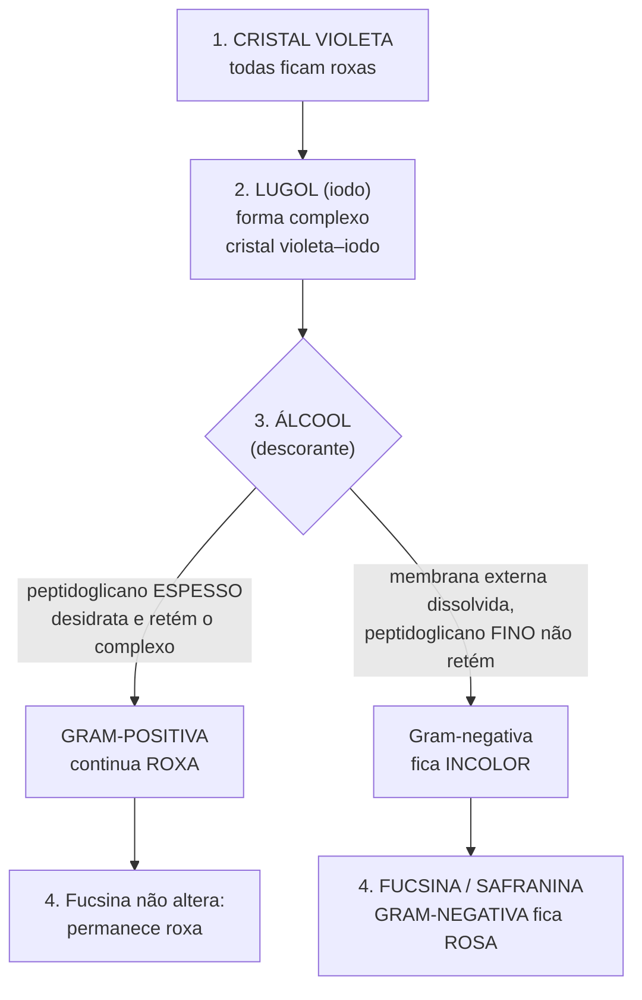

> **Roteiro do laboratório (Problema 3):** questões 1 (célula bacteriana × eucariótica; membrana, parede, glicocálice, ribossomos, mesossomo, nucleoide, fímbrias, flagelo, plasmídeo; proteínas de membrana — sideróforos, adesinas de manose, citotoxinas), 2 (respiração aeróbica, anaeróbica e fermentação; identificar BAAR no Ziehl-Neelsen), 3 (mecanismo do Gram e diferenças entre Gram-positivas e Gram-negativas), 7 (formas e arranjos) e 12 (um exemplo de infecção bacteriana por sistema). As imunoglobulinas, o MHC e os linfócitos B do mesmo roteiro (questões 4 a 6) estão em [imunidade humoral e anticorpos](#/imunologia/imunidade-humoral-anticorpos) e [imunidade celular](#/imunologia/imunidade-celular-mhc-linfocitos-t).

## Objetivos do tópico {#objetivos}

Ao final, você deve ser capaz de:

1. Descrever a **célula bacteriana** e suas diferenças em relação à célula eucariótica.
2. Identificar e explicar a função de cada estrutura: **membrana, parede, glicocálice (cápsula), ribossomos 70S, mesossomo, nucleoide, plasmídeos, fímbrias, flagelos** e proteínas de membrana como **sideróforos, adesinas e citotoxinas**.
3. Comparar as paredes **Gram-positiva** e **Gram-negativa** (peptidoglicano, ácidos teicoicos, membrana externa, LPS) e explicar **por que** elas se coram de modo diferente na coloração de Gram.
4. Explicar o princípio da coloração de **Ziehl-Neelsen** e identificar os **BAAR**.
5. Reconhecer **formas** (cocos, bacilos, vibriões, espirilos, espiroquetas) e **arranjos** (diplo, estrepto, estafilo, tétrade, sarcina, paliçada).
6. Diferenciar **respiração aeróbica, respiração anaeróbica e fermentação** e classificar as bactérias pela relação com o oxigênio.
7. Citar um exemplo de infecção bacteriana para cada **sistema do corpo** e seu mecanismo.

::: referencias
Murray, Rosenthal & Pfaller – Microbiologia Médica, 9ª ed., seção "Bacteriologia" · Tortora, Funke & Case – Microbiologia, 12ª ed., caps. "Anatomia funcional de células procarióticas e eucarióticas" e "Metabolismo microbiano" · Trabulsi & Alterthum – Microbiologia, 6ª ed.
:::

## Conceitos-base {#conceitos-base}

### Procariontes × eucariontes {#procarionte-eucarionte}

As **bactérias** são **procariontes** (do grego *pro* = antes, *karyon* = núcleo): células **sem núcleo** delimitado por membrana e **sem organelas membranosas** (não têm mitocôndrias, retículo endoplasmático nem complexo de Golgi). Medem em geral **0,5 a 5 micrômetros** (µm) — visíveis ao **microscópio óptico** com a objetiva de imersão (aumento de 1.000×), sobretudo depois de coradas.

| Característica | **Bactéria (procarionte)** | **Célula humana (eucarionte)** |
|---|---|---|
| Núcleo | **Ausente**: o DNA fica no citoplasma, numa região chamada **nucleoide** | Presente, com envelope nuclear |
| Cromossomo | Geralmente **um**, **circular**, sem histonas | Vários, lineares, com histonas |
| DNA extra | **Plasmídeos** frequentes | Raros (apenas DNA mitocondrial) |
| Organelas membranosas | **Ausentes** | Mitocôndrias, RE, Golgi, lisossomos |
| Ribossomos | **70S** (subunidades 30S + 50S) | 80S (40S + 60S) no citoplasma |
| Parede celular | Presente na maioria, com **peptidoglicano** | Ausente |
| Esteróis na membrana | Ausentes (exceto micoplasmas) | Colesterol |
| Produção de energia | Na **membrana plasmática** | Nas mitocôndrias |
| Divisão | **Fissão binária** (sem mitose) | Mitose |
| Tamanho típico | 0,5–5 µm | 10–100 µm |

**Por que isso importa?** Os **antibióticos** funcionam porque atacam estruturas **que só as bactérias têm** ou que são **diferentes** nelas: o **peptidoglicano** (penicilinas, cefalosporinas, vancomicina), o **ribossomo 70S** (aminoglicosídeos, tetraciclinas, macrolídeos), as **enzimas do DNA** bacteriano (quinolonas inibem a DNA girase) e vias metabólicas exclusivas (sulfonamidas bloqueiam a síntese de ácido fólico).

### Unidades e termos {#termos-bacterias}

- **"S"** (de **Svedberg**) mede a velocidade com que uma partícula sedimenta numa centrífuga — reflete tamanho e forma. Por isso 30S + 50S formam um ribossomo **70S** (e não 80S): os valores não se somam.
- **Patogenicidade** é a capacidade de causar doença; **virulência** é o grau dessa capacidade; **fatores de virulência** são as estruturas e moléculas que permitem à bactéria aderir, invadir, escapar da defesa e lesar (cápsula, fímbrias, toxinas, sideróforos…).
- **Microbiota** é o conjunto de micro-organismos que vivem normalmente no corpo (pele, boca, intestino, vagina), em geral sem causar doença, e que protegem contra patógenos ao competir por espaço e nutrientes.

::: referencias
Tortora, Microbiologia, 12ª ed., cap. "Anatomia funcional de células procarióticas e eucarióticas".
:::

## Explicação detalhada {#explicacao}

### Estruturas da célula bacteriana {#estruturas}

Vamos percorrer a bactéria de fora para dentro.

::: figura img/morfo/bacterias/celula-procarionte.png
**Esquema de uma célula bacteriana (procarionte).** De fora para dentro: **cápsula** (*capsule*), **parede celular** (*cell wall*) e **membrana plasmática** (*plasma membrane*). No citoplasma (*cytoplasm*), os **ribossomos** (*ribosomes*) e o **DNA no nucleoide** (*DNA, nucleoid*), sem membrana nuclear. O **mesossomo** (*mesosome*) é uma invaginação da membrana, hoje considerada em grande parte um artefato da preparação para microscopia eletrônica. Projetando-se para fora, o **flagelo bacteriano** (*bacterial flagellum*), responsável pela locomoção.
:::

#### Glicocálice e cápsula {#capsula}

**Glicocálice** é todo material **viscoso**, geralmente de **polissacarídeos** (às vezes polipeptídeos), secretado por fora da parede. Quando é **organizado e firmemente aderido** à parede, chama-se **cápsula**; quando é **frouxo** e desorganizado, **camada limosa**. Funções:

- **Evitar a fagocitose** — a cápsula é lisa, carregada negativamente e hidrofílica; os fagócitos "escorregam" nela e o complemento (C3b) se deposita mal. É um dos fatores de virulência mais importantes de *Streptococcus pneumoniae* (pneumococo), *Haemophilus influenzae* tipo b, *Neisseria meningitidis* e *Klebsiella*. Cepas **sem cápsula** desses agentes são **pouco virulentas**.
- **Adesão** a superfícies e formação de **biofilmes** — comunidades de bactérias envoltas por uma matriz que elas produzem, aderidas a dentes (placa bacteriana), cateteres, próteses e valvas. No biofilme, as bactérias ficam protegidas dos antibióticos e do sistema imune.
- **Proteção contra o ressecamento**.

As **vacinas** contra pneumococo, *H. influenzae* tipo b e meningococo são feitas com os **polissacarídeos da cápsula** (geralmente conjugados a uma proteína para gerar boa resposta imune e memória). Pessoas **sem baço** (asplenia) têm risco muito maior de infecções graves por bactérias encapsuladas, porque o baço é essencial para remover bactérias opsonizadas do sangue.

#### Parede celular {#parede}

A **parede celular** é uma estrutura **rígida** por fora da membrana, que:

- Dá **forma** à bactéria (coco, bacilo…);
- **Impede a ruptura osmótica** — o citoplasma bacteriano é muito concentrado, e a água tende a entrar; sem a parede, a bactéria incharia e estouraria (como ocorre quando a penicilina impede a síntese da parede de uma bactéria em crescimento);
- Ancora estruturas (flagelos, fímbrias) e contém fatores de virulência.

Seu componente essencial é o **peptidoglicano** (também chamado mureína): uma rede formada por cadeias de dois açúcares alternados — **N-acetilglicosamina (NAG)** e **ácido N-acetilmurâmico (NAM)** —, ligadas entre si por **pontes de pequenos peptídeos**, como uma malha ou uma cota de malha que envolve toda a célula. As **transpeptidases** (também chamadas **proteínas ligadoras de penicilina**, PBPs) fazem as ligações cruzadas entre os peptídeos; os **β-lactâmicos** (penicilinas, cefalosporinas) as inibem. A enzima **lisozima** (presente nas lágrimas, saliva e grânulos dos neutrófilos) quebra a ligação entre NAG e NAM.

A estrutura da parede divide as bactérias em dois grandes grupos — **Gram-positivas** e **Gram-negativas** —, detalhados na seção sobre a [coloração de Gram](#/microbiologia-parasitologia/morfo-bacterias#gram-positiva-negativa).

Algumas bactérias têm parede **atípica**: as **micobactérias** (bacilo da tuberculose e da hanseníase) têm uma parede rica em **ácidos micólicos** (lipídios de cadeia muito longa), base da coloração de Ziehl-Neelsen; os **micoplasmas** **não têm parede** (por isso não se coram pelo Gram e são resistentes aos β-lactâmicos).

#### Membrana plasmática (citoplasmática) {#membrana-bacteriana}

Bicamada de **fosfolipídios** com proteínas, **sem esteróis**. Como a bactéria não tem mitocôndrias, a membrana faz o que, nas nossas células, é dividido entre várias organelas:

- **Barreira seletiva** e **transporte** de nutrientes e íons;
- **Produção de energia**: contém a **cadeia transportadora de elétrons** e a **ATP sintase** (a membrana bacteriana equivale à membrana interna da mitocôndria — não por acaso, as mitocôndrias descendem de bactérias);
- Síntese de componentes da parede e de lipídios;
- **Secreção** de proteínas (inclusive toxinas) por sistemas de secreção;
- Local de fixação do cromossomo durante a divisão.

#### Mesossomo {#mesossomo}

Por muito tempo, descreveram-se **mesossomos** — **invaginações** (dobras para dentro) da membrana plasmática, vistas ao microscópio eletrônico, às quais se atribuíam funções de respiração e de divisão celular. Hoje se sabe que, em grande parte, são **artefatos** produzidos pelos métodos químicos de fixação usados na preparação das amostras (não aparecem em técnicas de congelamento rápido). Vale saber o conceito, porque ainda aparece em livros e no roteiro.

#### Citoplasma, ribossomos e inclusões {#citoplasma-bacteriano}

O citoplasma é cerca de 80% água, com proteínas, enzimas, metabólitos, os **ribossomos 70S** (que fazem a síntese de proteínas — e são alvo de muitos antibióticos) e **inclusões** de reserva: grânulos de **polifosfato** (volutina ou grânulos metacromáticos — vistos no *Corynebacterium diphtheriae*), de **glicogênio** e de **poli-β-hidroxibutirato** (lipídio de reserva).

#### Nucleoide e cromossomo {#nucleoide}

O **nucleoide** é a região do citoplasma onde fica o **cromossomo** bacteriano: geralmente **uma única molécula de DNA circular**, de fita dupla, muito enovelada (superenrolada pela enzima **DNA girase**, alvo das quinolonas), **sem membrana** em volta. Como não há núcleo, a **transcrição e a tradução acontecem ao mesmo tempo** no citoplasma.

#### Plasmídeos {#plasmideos}

**Plasmídeos** são **pequenas moléculas de DNA circular extracromossômico**, que se replicam de forma **independente** do cromossomo. Não são essenciais para a sobrevivência em condições normais, mas carregam genes que dão vantagens: **resistência a antibióticos** (genes de β-lactamases, por exemplo), **toxinas** e outros fatores de virulência. Podem ser transferidos de uma bactéria para outra — inclusive entre espécies diferentes — pela **conjugação**, através de uma fímbria especial (o pilus sexual). É assim que a **resistência a antibióticos** se espalha rapidamente nos hospitais.

#### Fímbrias e pili {#fimbrias}

**Fímbrias** são apêndices **curtos, finos e numerosos**, de proteína (pilina), que se projetam da superfície — muito mais numerosos que os flagelos e **não servem para locomoção**. Funções:

- **Adesão** às células do hospedeiro — o primeiro passo de muitas infecções. As **adesinas** na ponta das fímbrias reconhecem receptores específicos: por exemplo, a *E. coli* uropatogênica tem **fímbrias tipo 1**, cuja adesina (FimH) se liga a resíduos de **manose** das células da bexiga, e **fímbrias P**, que se ligam a glicolipídios do rim (pielonefrite). Bactérias sem fímbrias são levadas pelo fluxo da urina ou do muco.
- **Pilus sexual (F)**: mais longo e em pequeno número, usado na **conjugação** (transferência de plasmídeos).
- Na *Neisseria gonorrhoeae*, os pili mudam de antígeno constantemente (**variação antigênica**), escapando dos anticorpos — por isso a gonorreia pode se repetir.

#### Flagelos {#flagelos}

**Flagelos** são apêndices **longos**, de proteína (**flagelina**), que giram como uma **hélice** movida por um motor na membrana, alimentado pelo gradiente de prótons. Permitem a **motilidade** e a **quimiotaxia** (movimento em direção a nutrientes ou para longe de substâncias nocivas). Arranjos: **monotríquio** (um flagelo num polo, como no *Vibrio cholerae*), **lofotríquio** (tufo num polo), **anfitríquio** (nos dois polos) e **peritríquio** (por toda a superfície, como na *E. coli*, na *Salmonella* e no *Proteus*). A flagelina é um **PAMP** reconhecido pelo receptor Toll **TLR5**. O antígeno flagelar é chamado de **antígeno H** (usado para classificar sorotipos de *Salmonella* e *E. coli*). Nas **espiroquetas** (*Treponema*, *Leptospira*, *Borrelia*), os flagelos ficam **por dentro** da membrana externa (**filamentos axiais** ou endoflagelos), fazendo a bactéria se mover como um saca-rolhas.

#### Endósporos {#endosporos}

Algumas bactérias Gram-positivas (*Bacillus* e *Clostridium*) formam **endósporos** quando faltam nutrientes: estruturas dormentes, com camadas espessas e pouca água, **extremamente resistentes** a calor, ressecamento, radiação e desinfetantes, que podem sobreviver por anos. Por isso a esterilização de materiais exige **autoclave** (vapor sob pressão a 121 °C). Exemplos: tétano (*C. tetani*), botulismo (*C. botulinum*), antraz (*B. anthracis*), colite por *C. difficile*.

#### Proteínas de membrana citadas no roteiro {#proteinas-membrana}

- **Sideróforos** — o **ferro** é essencial para as bactérias (enzimas da cadeia respiratória), mas no corpo humano ele fica quase todo preso a proteínas (**transferrina**, **lactoferrina**, ferritina, hemoglobina) — uma defesa chamada **imunidade nutricional**. Para "roubar" ferro, muitas bactérias secretam **sideróforos** (como a enterobactina da *E. coli*): moléculas pequenas com **afinidade altíssima pelo ferro**, que o tiram das proteínas do hospedeiro; depois, **receptores específicos na membrana** bacteriana (na membrana externa das Gram-negativas) capturam o complexo ferro-sideróforo e o transportam para dentro. Pacientes com **sobrecarga de ferro** (hemocromatose, transfusões repetidas) ficam mais suscetíveis a certas infecções (*Vibrio vulnificus*, *Yersinia*).
- **Adesinas que reconhecem manose** — proteínas (geralmente na ponta das fímbrias) que se ligam a **açúcares** como a **manose** das glicoproteínas da superfície das células do hospedeiro. O exemplo clássico é a **FimH** da *E. coli* nas fímbrias tipo 1, que se liga às manoses das células do urotélio da bexiga — primeiro passo da **cistite**. (Não confundir com o **receptor de manose** dos macrófagos, que é do hospedeiro e serve para reconhecer micróbios.)
- **Citotoxinas** — toxinas que **lesam ou matam as células** do hospedeiro. Algumas formam **poros** na membrana da célula-alvo (como a α-toxina do *S. aureus* e a hemolisina da *E. coli*), outras entram na célula e inibem a síntese de proteínas (toxina diftérica, toxina Shiga) ou alteram vias de sinalização (toxina colérica, que ativa a adenilato ciclase e causa diarreia secretora). As toxinas proteicas **secretadas** são chamadas **exotoxinas**, para distingui-las da **endotoxina** (o LPS, que faz parte da parede das Gram-negativas).

::: referencias
Murray, Microbiologia Médica, 9ª ed., caps. "Classificação, estrutura e replicação bacteriana" e "Mecanismos de patogênese bacteriana" · Tortora, Microbiologia, 12ª ed.
:::

### Gram-positivas × Gram-negativas {#gram-positiva-negativa}

As paredes dos dois grupos são **muito diferentes**, e é essa diferença que a coloração de Gram revela.

::: figura img/morfo/bacterias/parede-gram.png
**Parede celular: Gram-positiva (acima) × Gram-negativa (abaixo).** Na **Gram-positiva** (*Gram Positive*), por fora da **membrana plasmática** (*plasma membrane*) há uma camada **espessa de peptidoglicano** (*peptidoglycan*, em marrom). Na **Gram-negativa** (*Gram Negative*), o **peptidoglicano é fino** e fica num espaço entre duas membranas — o **espaço periplasmático** (*periplasmic space*) — e, por fora, há uma **membrana externa** (*outer membrane*) com **lipopolissacarídeo** (*lipopolysaccharide*, LPS) e proteínas.
:::

| Característica | **Gram-positiva** | **Gram-negativa** |
|---|---|---|
| Peptidoglicano | **Espesso** (muitas camadas; 20–80 nm) | **Fino** (1–2 camadas; ~5 nm) |
| **Ácidos teicoicos** e lipoteicoicos | **Presentes** (polímeros que atravessam o peptidoglicano; os lipoteicoicos ancoram-se na membrana) — dão carga negativa, participam da adesão e são PAMPs (TLR2) | Ausentes |
| **Membrana externa** | Ausente | **Presente**: bicamada assimétrica com **LPS** na face externa e **porinas** (canais que deixam passar moléculas pequenas) |
| **LPS (endotoxina)** | Ausente | **Presente** — lipídio A (tóxico) + núcleo polissacarídico + **antígeno O** |
| Espaço periplasmático | Pequeno ou ausente | Bem definido (contém enzimas, inclusive **β-lactamases**) |
| Resistência a lisozima e penicilina | **Mais sensíveis** (peptidoglicano exposto) | **Mais resistentes** (a membrana externa é uma barreira) |
| Cor no Gram | **Roxo / azul-violeta** | **Rosa / vermelho** |
| Exemplos | *Staphylococcus*, *Streptococcus*, *Enterococcus*, *Clostridium*, *Bacillus*, *Listeria*, *Corynebacterium* | *E. coli*, *Klebsiella*, *Salmonella*, *Shigella*, *Pseudomonas*, *Neisseria*, *Haemophilus*, *Vibrio* |

**LPS e choque**: o **lipídio A** do LPS é a parte tóxica (a **endotoxina**). Quando as Gram-negativas se multiplicam no sangue ou morrem, o LPS liberado é reconhecido pelo **TLR4** dos macrófagos, que produzem grandes quantidades de **TNF, IL-1 e IL-6** — causando febre, vasodilatação, aumento da permeabilidade, coagulação intravascular disseminada e **choque séptico** (veja [inflamação aguda](#/patologia/inflamacao-aguda#fase-aguda)). O **antígeno O** é a parte mais externa e variável, usada para classificar sorotipos (como *E. coli* **O157**:H7).

#### A coloração de Gram, passo a passo {#coloracao-gram}

Desenvolvida por **Hans Christian Gram** em 1884, é a coloração mais usada na microbiologia — é rápida (minutos) e orienta o tratamento antes do resultado da cultura. Depois de **fixar** o esfregaço na lâmina (pelo calor), seguem-se quatro etapas:

1. **Cristal violeta** (corante primário, roxo) — cora **todas** as bactérias de roxo.
2. **Lugol** (iodo, o **mordente**) — o iodo se combina com o cristal violeta formando **complexos grandes** (cristal violeta–iodo) dentro da célula. Todas continuam roxas.
3. **Álcool ou álcool-acetona** (o **descorante**) — **etapa decisiva**:
   - Nas **Gram-positivas**, o álcool **desidrata** a camada espessa de peptidoglicano, que se **contrai** e fecha seus poros; os complexos cristal violeta–iodo, grandes demais, **ficam presos** → a célula **permanece roxa**.
   - Nas **Gram-negativas**, o álcool **dissolve os lipídios da membrana externa**, abrindo a parede; a camada fina de peptidoglicano **não consegue reter** os complexos, que são lavados → a célula fica **incolor**.
4. **Fucsina ou safranina** (contracorante, vermelho/rosa) — cora as células que ficaram incolores: as **Gram-negativas** ficam **rosa-avermelhadas**; as Gram-positivas, já roxas, não mudam visivelmente.

**Pegadinhas técnicas**: se o álcool ficar tempo demais, até Gram-positivas podem perder o corante (aparecem falsamente rosa); culturas **velhas**, com paredes danificadas, também podem parecer Gram-negativas ("Gram-variáveis"). Bactérias **sem parede** (*Mycoplasma*) ou com parede rica em lipídios (*Mycobacterium*) **não se coram bem** pelo Gram; espiroquetas são finas demais para serem vistas.

::: figura img/morfo/bacterias/gram-misto.jpg
**Coloração de Gram de uma mistura de bactérias.** Os **cocos roxos**, agrupados em **cachos**, são **Gram-positivos** (*Staphylococcus aureus*); os **bacilos rosa-avermelhados** (bastonetes) são **Gram-negativos** (*Escherichia coli*). A barra indica 10 µm. Repare na diferença de cor (retenção ou não do cristal violeta) e de forma (cocos × bacilos) — as duas informações que o Gram fornece.
:::

::: referencias
Murray, Microbiologia Médica, 9ª ed., caps. "Classificação, estrutura e replicação bacteriana" e "Diagnóstico laboratorial" · Tortora, Microbiologia, 12ª ed.
:::

### Coloração de Ziehl-Neelsen e os BAAR {#ziehl-neelsen}

As **micobactérias** (*Mycobacterium tuberculosis*, causador da tuberculose, e *M. leprae*, da hanseníase) têm uma parede com grande quantidade de **ácidos micólicos** — lipídios de cadeia muito longa que tornam a parede **cerosa** e **impermeável**. Isso tem várias consequências: as micobactérias **coram-se mal pelo Gram**, resistem ao ressecamento, a muitos desinfetantes e a vários antibióticos, crescem **lentamente** e sobrevivem dentro dos macrófagos.

A coloração de **Ziehl-Neelsen** aproveita essa parede cerosa:

1. **Fucsina fenicada** (vermelha), **aquecida** até emitir vapores — o calor e o fenol fazem o corante **penetrar** na parede cerosa.
2. **Descoloração com álcool-ácido** (álcool com ácido clorídrico) — remove a fucsina de **todas as outras células**, mas **não** das micobactérias: os ácidos micólicos **retêm** o corante. Daí o nome **bacilos álcool-ácido resistentes (BAAR)**.
3. **Azul de metileno** (contracorante) — cora de azul o fundo, as células do paciente e as outras bactérias.

**Resultado**: os **BAAR** aparecem como **bastonetes finos, retos ou levemente curvos, vermelhos (rosa-avermelhados)**, isolados ou em pequenos grupos, sobre um **fundo azul**. Às vezes têm aspecto granuloso (em "contas") ou formam agrupamentos em feixes (o **fator corda**, característico do *M. tuberculosis* virulento).

::: figura img/morfo/bacterias/baar-ziehl-cdc.jpg
**Ziehl-Neelsen: *Mycobacterium tuberculosis* (BAAR).** Bacilos **finos, vermelhos**, levemente curvos, sobre **fundo azul** (azul de metileno). Eles retiveram a fucsina mesmo após a descoloração com álcool-ácido, graças aos **ácidos micólicos** da parede — por isso são chamados de bacilos **álcool-ácido resistentes**.
:::

::: figura img/morfo/bacterias/baar-ziehl-lba.jpg
**BAAR em lavado broncoalveolar corado pelo Ziehl-Neelsen.** Observe os **bastonetes vermelhos** dispersos entre as **células azuis** do paciente (núcleos corados pelo azul de metileno). É assim que se procura o bacilo na **baciloscopia de escarro** — o exame mais usado no Brasil para diagnosticar e acompanhar a tuberculose pulmonar.
:::

**Na prática**: a **baciloscopia** (pesquisa de BAAR no escarro) é rápida e barata, mas precisa de muitos bacilos (cerca de 5.000 a 10.000 por mL) para ser positiva; por isso hoje é complementada pelo **teste rápido molecular** (TRM-TB, que também detecta resistência à rifampicina) e pela **cultura**. Um resultado positivo indica, em geral, doença **bacilífera** (transmissível). A baciloscopia também é usada na hanseníase (raspado de lesões e lóbulos da orelha).

::: referencias
Murray, Microbiologia Médica, 9ª ed., cap. "Mycobacterium" · Ministério da Saúde – Manual de Recomendações para o Controle da Tuberculose no Brasil.
:::

### Formas e arranjos {#formas-arranjos}

A **forma** (morfologia) e o **arranjo** (como as células ficam agrupadas após a divisão) são vistos no esfregaço corado e, junto com a cor no Gram, são o primeiro passo da identificação.

#### Formas {#formas}

- **Cocos** — esféricos ou ovais.
- **Bacilos (bastonetes)** — cilíndricos, alongados. Os muito curtos, quase ovais, são **cocobacilos** (*Haemophilus*, *Bordetella*, *Brucella*).
- **Vibriões** — bastonetes **curvos**, em forma de **vírgula** (*Vibrio cholerae*).
- **Espirilos** — **espiralados e rígidos**, com flagelos externos (*Spirillum*; *Campylobacter* e *Helicobacter* têm forma curva/espiralada semelhante, em "asa de gaivota" ou "S").
- **Espiroquetas** — **espiraladas e flexíveis**, finas, com filamentos axiais internos (*Treponema pallidum* — sífilis; *Leptospira* — leptospirose; *Borrelia* — doença de Lyme).
- **Pleomórficas** — sem forma fixa (micoplasmas, que não têm parede).

#### Arranjos {#arranjos}

Os arranjos dependem do **plano de divisão** e de as células **permanecerem unidas** depois de se dividirem:

| Arranjo | Como se forma | Exemplo |
|---|---|---|
| **Diplococos** | Cocos aos **pares** (divisão num plano) | *Neisseria* (em "grão de café", Gram-negativos), *Streptococcus pneumoniae* (em "chama de vela", lanceolados, Gram-positivos) |
| **Estreptococos** | Cocos em **cadeias** (divisão sempre no **mesmo plano**, as células continuam unidas) | *Streptococcus pyogenes* (faringite, impetigo, erisipela) |
| **Estafilococos** | Cocos em **cachos** ("cacho de uva"; divisão em **vários planos ao acaso**) | *Staphylococcus aureus*, *S. epidermidis* |
| **Tétrades** | Grupos de **4** (divisão em 2 planos perpendiculares) | *Micrococcus* |
| **Sarcinas** | **Cubos de 8** (divisão em 3 planos) | *Sarcina* |
| **Diplobacilos / estreptobacilos** | Bacilos aos pares / em cadeias | *Bacillus anthracis* (cadeias, "vagão de trem") |
| **Paliçada e "letras chinesas"** | Bacilos lado a lado ou em ângulos (V, L) | *Corynebacterium diphtheriae* |

::: figura img/morfo/bacterias/morfologia-bacteriana.png
**Formas e arranjos bacterianos.** **Cocos** (*cocos*): isolados, **diplococos**, diplococos encapsulados (pneumococo), **estreptococos** (cadeias), **sarcina** (cubos), **estafilococos** (cachos) e **tétrade**. **Bacilos**: cocobacilos, bacilos, diplobacilos, **estreptobacilos**, paliçadas. **Outros**: bastonete estendido (*Fusobacterium*), **vibrião**, bastão (*Corynebacterium*), forma helicoidal (*Helicobacter*), **espirilo**, **espiroquetas** (*Borrelia*, *Leptospira*), filamentosa e formas com hifa ou pseudópode.
:::

::: figura img/morfo/bacterias/staphylococcus-gram.jpg
**_Staphylococcus aureus_ — Gram.** **Cocos Gram-positivos** (roxos), agrupados em **cachos irregulares** — o arranjo **estafilo**, resultado da divisão em vários planos. O *S. aureus* é o principal agente de infecções de pele (furúnculos, celulite, abscessos), osteomielite, endocardite em usuários de drogas injetáveis e infecções de cateter.
:::

::: figura img/morfo/bacterias/ecoli-gram.jpg
**_Escherichia coli_ — Gram.** **Bacilos Gram-negativos** (rosa-avermelhados), curtos, isolados ou aos pares, sem arranjo característico. A *E. coli* faz parte da microbiota intestinal e é a principal causa de **infecção urinária** e de sepse de origem abdominal e urinária.
:::

::: figura img/morfo/bacterias/corynebacterium-gram.jpg
**_Corynebacterium diphtheriae_ — Gram.** **Bacilos Gram-positivos**, finos, às vezes com uma extremidade mais dilatada (em "clava"), dispostos em **paliçada** e em ângulos que lembram **letras chinesas** (V, L, Y) — arranjo produzido pelo modo como as células se dobram após a divisão. Causa a **difteria**, em que uma exotoxina inibe a síntese de proteínas e forma uma pseudomembrana na garganta; é prevenida pela vacina (DTP).
:::

::: referencias
Murray, Microbiologia Médica, 9ª ed. · Tortora, Microbiologia, 12ª ed., cap. "Anatomia funcional de células procarióticas e eucarióticas".
:::

### Obtenção de energia: respiração e fermentação {#metabolismo}

As bactérias de importância médica são **quimio-heterotróficas**: obtêm energia e carbono a partir de **moléculas orgânicas** (como a glicose). O processo começa sempre pela **glicólise** (glicose → 2 piruvatos, com saldo de 2 ATP e produção de NADH). Para continuar extraindo energia — e para **regenerar o NAD⁺** que a glicólise consome —, há três caminhos:

1. **Respiração aeróbica** — o piruvato é oxidado completamente no **ciclo de Krebs** (no citoplasma, já que não há mitocôndrias), e os elétrons do NADH e FADH₂ passam pela **cadeia transportadora de elétrons** na **membrana plasmática**, que bombeia prótons e gera o gradiente usado pela ATP sintase. O **aceptor final** de elétrons é o **oxigênio (O₂)**, que vira água. É o caminho que rende **mais ATP** (até ~38 por glicose nas bactérias, que não gastam energia transportando moléculas para mitocôndrias). Ex.: *Pseudomonas*, *M. tuberculosis*.
2. **Respiração anaeróbica** — semelhante à aeróbica (ciclo de Krebs e cadeia transportadora), mas o **aceptor final não é o oxigênio**, e sim outra molécula inorgânica: **nitrato** (NO₃⁻, reduzido a nitrito — base do **teste do nitrito** na fita de urina, positivo em infecções por *E. coli* e outras enterobactérias), **sulfato** (SO₄²⁻, reduzido a sulfeto de hidrogênio) ou carbonato. Rende **menos ATP** que a aeróbica, porque esses aceptores têm menor afinidade por elétrons.
3. **Fermentação** — sem ciclo de Krebs nem cadeia transportadora: a bactéria faz só a **glicólise** (2 ATP por glicose) e, para regenerar o NAD⁺, usa um **composto orgânico** derivado do próprio açúcar como aceptor de elétrons, gerando produtos como **ácido lático** (*Streptococcus*, lactobacilos), **ácidos mistos e gás** (*E. coli*), etanol, ácido butírico (*Clostridium*). Rendimento **baixo** — por isso as bactérias fermentadoras consomem muito açúcar. A acidez produzida tem consequências: o ácido lático das bactérias da placa dentária (*S. mutans*) **desmineraliza o esmalte** e causa **cárie**; os lactobacilos vaginais mantêm o pH ácido que protege contra patógenos. Os padrões de fermentação de açúcares (glicose, lactose) são usados no laboratório para **identificar** bactérias (por exemplo, *E. coli* fermenta **lactose**; *Salmonella* e *Shigella* não).

| | **Respiração aeróbica** | **Respiração anaeróbica** | **Fermentação** |
|---|---|---|---|
| Glicólise | Sim | Sim | Sim |
| Ciclo de Krebs e cadeia transportadora | Sim | Sim | **Não** |
| Aceptor final de elétrons | **O₂** | **Inorgânico** (NO₃⁻, SO₄²⁻, CO₃²⁻) | **Orgânico** (piruvato ou derivado) |
| ATP por glicose | **Máximo** (até ~38) | Intermediário | **2** |
| Produtos | CO₂ + H₂O | CO₂ + NO₂⁻, H₂S… | Ácido lático, etanol, ácidos, gás |

#### Relação com o oxigênio {#relacao-oxigenio}

| Grupo | Comportamento | Exemplos |
|---|---|---|
| **Aeróbios estritos** | Precisam de O₂ (respiração aeróbica) | *Pseudomonas aeruginosa*, *M. tuberculosis* (por isso prefere os ápices pulmonares, mais oxigenados) |
| **Anaeróbios estritos** | **Morrem** na presença de O₂ (não têm enzimas como catalase e superóxido dismutase para neutralizar as espécies reativas de oxigênio); fermentam ou fazem respiração anaeróbica | *Clostridium* (tétano, botulismo, gangrena gasosa), *Bacteroides* (abscessos abdominais) — causam infecções em tecidos mal irrigados e necróticos |
| **Anaeróbios facultativos** | Respiram com O₂ e **fermentam** (ou respiram anaerobicamente) sem ele | *E. coli*, *Staphylococcus*, enterobactérias — a maioria das bactérias de importância médica |
| **Aerotolerantes** | Fermentam sempre, mas toleram o O₂ | *Streptococcus*, lactobacilos |
| **Microaerófilos** | Precisam de **pouco** O₂ (2–10%) | *Campylobacter*, *Helicobacter pylori* |

::: referencias
Tortora, Microbiologia, 12ª ed., cap. "Metabolismo microbiano" · Murray, Microbiologia Médica, 9ª ed., cap. "Metabolismo e genética bacterianos".
:::

## Correlação clínica {#correlacao-clinica}

### Um exemplo de infecção bacteriana por sistema {#infeccoes-por-sistema}

O roteiro pede um exemplo por sistema, com o mecanismo. Uma seleção:

| Sistema | Bactéria (Gram/forma) | Doença | Mecanismo principal |
|---|---|---|---|
| **Respiratório** | *Streptococcus pneumoniae* (diplococo Gram-positivo, encapsulado) | Pneumonia lobar, otite, sinusite, meningite | **Cápsula** antifagocitária; pneumolisina (toxina formadora de poros); intensa resposta inflamatória com exsudato alveolar |
| **Respiratório** | *Mycobacterium tuberculosis* (BAAR) | Tuberculose | Sobrevive **dentro dos macrófagos** (impede a fusão do fagossomo com o lisossomo); a resposta Th1 forma **granulomas** com necrose caseosa |
| **Cardiovascular** | *Streptococcus viridans* e *S. aureus* (cocos Gram-positivos) | Endocardite infecciosa | **Adesão** às valvas (lesadas ou com próteses) e formação de **vegetações** (biofilme com fibrina e plaquetas) |
| **Digestório** | *Vibrio cholerae* (vibrião Gram-negativo) | Cólera | **Toxina colérica** ativa a adenilato ciclase → AMPc ↑ → secreção maciça de cloreto e água → diarreia aquosa ("água de arroz") e desidratação |
| **Digestório** | *Helicobacter pylori* (espiralado Gram-negativo, microaerófilo) | Gastrite, úlcera péptica, câncer gástrico | **Urease** produz amônia que neutraliza o ácido; flagelos atravessam o muco; toxinas (CagA, VacA) e inflamação crônica |
| **Urinário** | *Escherichia coli* uropatogênica (bacilo Gram-negativo) | Cistite, pielonefrite | **Fímbrias** (tipo 1 → **manose** da bexiga; P → rim) permitem aderir apesar do fluxo urinário |
| **Nervoso** | *Neisseria meningitidis* (diplococo Gram-negativo) | Meningite, meningococcemia | **Cápsula**; **LPS/endotoxina** abundante (choque, púrpura, coagulação intravascular disseminada) |
| **Nervoso** | *Clostridium tetani* (bacilo Gram-positivo, anaeróbio, esporulado) | Tétano | Esporos em ferimento com tecido necrótico; **toxina tetânica** bloqueia a liberação dos neurotransmissores inibitórios (GABA, glicina) → espasmos |
| **Pele e partes moles** | *Staphylococcus aureus* (cocos Gram-positivos em cachos) | Furúnculo, abscesso, celulite, impetigo | **Coagulase**, proteína A (liga-se à porção Fc da IgG e atrapalha a opsonização), toxinas formadoras de poros e enzimas que destroem tecido; inflamação purulenta |
| **Musculoesquelético** | *Staphylococcus aureus* | Osteomielite, artrite séptica | Adesinas que se ligam ao colágeno e à matriz óssea; biofilme em implantes |
| **Reprodutor** | *Neisseria gonorrhoeae* (diplococo Gram-negativo) e *Treponema pallidum* (espiroqueta) | Gonorreia; sífilis | Gonococo: **pili** com variação antigênica, adesão ao epitélio; *Treponema*: dissemina-se pelo sangue, causa vasculite (endarterite) |
| **Sangue (sepse)** | Bacilos Gram-negativos (como *E. coli*, *Klebsiella*) | Sepse e choque séptico | **LPS** → TLR4 → TNF, IL-1, IL-6 → vasodilatação, permeabilidade, coagulação intravascular |
| **Olho** | *Chlamydia trachomatis* (Gram-negativa atípica, intracelular obrigatória) | Tracoma, conjuntivite de inclusão | Infecção intracelular do epitélio da conjuntiva; inflamação crônica e cicatrizes |

### Do laboratório à prescrição {#gram-tratamento}

O Gram de um material clínico orienta o antibiótico **antes** da cultura: por exemplo, **diplococos Gram-negativos** no líquor de um adolescente com febre, rigidez de nuca e petéquias sugerem **meningococo**; **cocos Gram-positivos em cachos** numa hemocultura sugerem **estafilococo** (pensar em cobertura para *S. aureus* resistente à meticilina, conforme o contexto); a **vancomicina** é ativa contra Gram-positivos mas **não atravessa a membrana externa** das Gram-negativas, que são intrinsecamente resistentes a ela.

::: referencias
Murray, Microbiologia Médica, 9ª ed. · Harrison – Medicina Interna, 21ª ed., seção "Doenças causadas por bactérias".
:::

## Pontos de alta cobrança em prova {#alta-cobranca}

::: prova
- **Bactéria = procarionte**: sem núcleo (DNA circular no **nucleoide**), sem organelas membranosas, **ribossomos 70S** (30S + 50S), parede com **peptidoglicano**, membrana **sem esteróis** que faz a produção de energia, fissão binária; **plasmídeos** (resistência, toxinas; transferidos por conjugação).
- **Cápsula/glicocálice**: antifagocitária (pneumococo, *Haemophilus* b, meningococo, *Klebsiella*), biofilme; base das **vacinas** conjugadas; asplênicos são vulneráveis. **Fímbrias**: adesão (FimH da *E. coli* → **manose** da bexiga); pilus sexual → conjugação. **Flagelos**: motilidade (flagelina → TLR5; antígeno H); espiroquetas com filamentos axiais. **Mesossomo**: invaginação da membrana, em grande parte artefato. **Endósporos**: *Bacillus* e *Clostridium*, resistentes (autoclave).
- **Sideróforos**: captam **ferro** das proteínas do hospedeiro (transferrina, lactoferrina). **Citotoxinas/exotoxinas**: proteínas secretadas que lesam células × **endotoxina** = LPS da parede das Gram-negativas.
- **Gram-positiva**: peptidoglicano **espesso** + **ácidos teicoicos**; sem membrana externa → **roxa**. **Gram-negativa**: peptidoglicano **fino** + espaço periplasmático + **membrana externa com LPS** e porinas → **rosa**.
- **Gram**: **cristal violeta** → **lugol** (mordente; complexo CV-iodo) → **álcool** (etapa decisiva: desidrata peptidoglicano espesso e retém o complexo; dissolve a membrana externa das Gram-negativas) → **fucsina/safranina** (cora as Gram-negativas de rosa).
- **LPS**: lipídio A (endotoxina) → **TLR4** → TNF/IL-1/IL-6 → choque séptico; antígeno O = sorotipo.
- **Ziehl-Neelsen**: **fucsina a quente** → **álcool-ácido** → **azul de metileno**; **BAAR** = bastonetes finos **vermelhos** em fundo **azul** (ácidos micólicos retêm a fucsina) — *M. tuberculosis*, *M. leprae*; baciloscopia de escarro.
- **Formas**: cocos, bacilos, cocobacilos, vibriões (vírgula), espirilos (rígidos), espiroquetas (flexíveis). **Arranjos**: diplo (*Neisseria*, pneumococo), **estrepto** = cadeias (um plano), **estafilo** = cachos (vários planos), tétrade, sarcina, paliçada/letras chinesas (*Corynebacterium*).
- **Energia**: respiração **aeróbica** (aceptor **O₂**; mais ATP), **anaeróbica** (aceptor **inorgânico** — nitrato → teste do nitrito na urina), **fermentação** (aceptor **orgânico**; 2 ATP; ácido lático → cárie). Aeróbios estritos (*Pseudomonas*, *M. tuberculosis*), anaeróbios estritos (*Clostridium*, *Bacteroides*), facultativos (*E. coli*, *S. aureus*), microaerófilos (*H. pylori*, *Campylobacter*).
:::

## Armadilhas comuns {#armadilhas}

::: armadilha
- **Achar que as Gram-negativas não têm peptidoglicano.** Têm, mas **fino**; o que elas têm a mais é a **membrana externa** com LPS.
- **Achar que a etapa decisiva do Gram é o cristal violeta ou a fucsina.** É o **álcool (descoloração)**: é nele que as Gram-negativas perdem o complexo cristal violeta–iodo.
- **Confundir endotoxina com exotoxina.** **Endotoxina** = **LPS** (lipídio A), parte da parede das **Gram-negativas**, liberado quando se multiplicam ou morrem. **Exotoxinas** = **proteínas secretadas** por Gram-positivas e Gram-negativas (toxina tetânica, colérica, diftérica).
- **Confundir estrepto com estafilo.** **Estrepto** = **cadeias** (como um colar); **estafilo** = **cachos** (como uvas).
- **Achar que o "70S" é a soma de 30S + 50S.** O S mede a sedimentação, que não é aditiva.
- **Achar que BAAR é "Gram-positivo comum".** As micobactérias coram-se **mal** pelo Gram; identifica-se pelo **Ziehl-Neelsen** (vermelhas em fundo azul).
- **Confundir respiração anaeróbica com fermentação.** Na **respiração anaeróbica** há cadeia transportadora, com aceptor **inorgânico** (nitrato, sulfato); na **fermentação** não há cadeia, e o aceptor é **orgânico**.
- **Achar que o mesossomo é uma organela funcional confirmada.** É considerado, em grande parte, **artefato** da preparação para microscopia eletrônica.
:::

## Resumo para revisão rápida {#resumo}

- **Célula bacteriana**: procarionte; nucleoide (DNA circular), plasmídeos, ribossomos 70S, membrana sem esteróis (energia), parede de peptidoglicano, ± cápsula, fímbrias, flagelos, endósporos; mesossomo = artefato. Proteínas de superfície: **sideróforos** (ferro), **adesinas** (manose — FimH), **citotoxinas**.
- **Gram+**: peptidoglicano espesso, ácidos teicoicos → roxa. **Gram−**: peptidoglicano fino, periplasma, membrana externa com **LPS** (endotoxina, TLR4) → rosa.
- **Gram**: cristal violeta → lugol → **álcool** → fucsina/safranina.
- **Ziehl-Neelsen**: fucsina a quente → álcool-ácido → azul de metileno; **BAAR vermelhos em fundo azul** (ácidos micólicos) — tuberculose e hanseníase.
- **Formas**: cocos, bacilos, vibriões, espirilos, espiroquetas. **Arranjos**: diplo, estrepto (cadeias), estafilo (cachos), tétrade, sarcina, paliçada.
- **Energia**: respiração aeróbica (O₂), anaeróbica (nitrato, sulfato), fermentação (orgânico, 2 ATP). Aeróbios, anaeróbios estritos, facultativos, aerotolerantes, microaerófilos.
- **Por sistema**: pneumococo e *M. tuberculosis* (respiratório), estreptococos/*S. aureus* (endocardite), *V. cholerae* e *H. pylori* (digestório), *E. coli* (urinário), meningococo e *C. tetani* (nervoso), *S. aureus* (pele, osso), gonococo e *T. pallidum* (reprodutor), Gram-negativos (sepse).

::: referencias
Murray, Microbiologia Médica, 9ª ed. · Tortora, Microbiologia, 12ª ed. · Trabulsi & Alterthum, Microbiologia, 6ª ed. · Ministério da Saúde – Manual de Recomendações para o Controle da Tuberculose no Brasil.
:::
