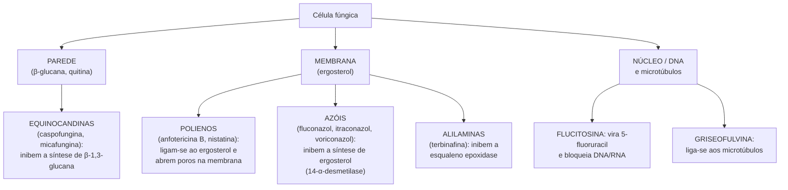

> **Roteiro do laboratório (Problema 2):** questão 5 — tipos de doenças causadas por fungos: micotoxicose, alergias e micoses (a); classificação clínica das micoses: superficiais, cutâneas, subcutâneas, sistêmicas e oportunistas (b); leveduras e hifas (c); estrutura da célula fúngica: parede, membrana, organelas e núcleo (d); obtenção e armazenamento de energia (e).

## Objetivos do tópico {#objetivos}

Ao final, você deve ser capaz de:

1. Explicar o que são **fungos** e como eles diferem de bactérias e de células humanas.
2. Diferenciar os três tipos de doença causados por fungos: **micotoxicoses**, **alergias** e **micoses**.
3. Classificar as micoses em **superficiais, cutâneas, subcutâneas, sistêmicas (endêmicas) e oportunistas**, com exemplos.
4. Reconhecer ao microscópio **leveduras, pseudo-hifas e hifas** (septadas e cenocíticas), entender o **dimorfismo** e identificar preparações típicas (KOH, Gram, lactofenol, tinta nanquim, histologia).
5. Descrever a **célula fúngica** — parede (quitina, glucanas, mananas), membrana (**ergosterol**), núcleo e organelas — e relacioná-la com os **antifúngicos**.
6. Explicar como os fungos **obtêm e armazenam energia**.

::: referencias
Murray, Rosenthal & Pfaller – Microbiologia Médica, 9ª ed., seção "Micologia" · Tortora, Funke & Case – Microbiologia, 12ª ed., cap. "Os eucariotos: fungos, algas, protozoários e helmintos" · Trabulsi & Alterthum – Microbiologia, 6ª ed.
:::

## Conceitos-base {#conceitos-base}

### O que são fungos {#o-que-sao-fungos}

**Fungos** são seres **eucariontes** — suas células têm **núcleo** envolto por membrana e **organelas** (mitocôndrias, retículo endoplasmático, Golgi), como as nossas. Isso os diferencia das **bactérias** (procariontes, sem núcleo). Formam um reino próprio (*Fungi*), que inclui bolores, leveduras e cogumelos. Características gerais:

- São **heterotróficos**: não fazem fotossíntese; obtêm carbono de matéria orgânica, **absorvendo** nutrientes após digeri-los fora da célula com enzimas que secretam. Na natureza, são grandes **decompositores**.
- Têm **parede celular** rígida (diferente da das bactérias e das plantas), rica em **quitina** e **glucanas**.
- Na membrana, o esterol principal é o **ergosterol** (nas células humanas é o **colesterol**) — diferença crucial para os medicamentos.
- Reproduzem-se por **esporos** (assexuados ou sexuados) e, nas leveduras, por **brotamento**.
- A maioria vive no **ambiente** (solo, plantas em decomposição, fezes de aves e morcegos); alguns fazem parte da **microbiota** humana (como a *Candida*, na boca, intestino e vagina).

**Por que fungos são difíceis de tratar?** Como são eucariontes, compartilham muitas estruturas com nossas células (ribossomos, núcleo, organelas). Os antifúngicos precisam mirar no que é **exclusivamente fúngico**: a **parede celular** e o **ergosterol**. Por isso há poucos antifúngicos e alguns são tóxicos.

### Quem adoece {#quem-adoece}

O ser humano é muito resistente aos fungos: a pele íntegra, a temperatura corporal (37 °C, alta demais para muitos fungos ambientais) e a **imunidade inata** (neutrófilos e macrófagos) e **celular** (linfócitos **Th1** e **Th17**) bloqueiam a maioria. As infecções graves ocorrem sobretudo em pessoas com **defesas alteradas**: **neutropenia** (quimioterapia, leucemia), **HIV/aids** com CD4⁺ baixo, uso de **corticoides** e imunossupressores, transplantes, **diabetes descompensado**, uso de **antibióticos de amplo espectro** (que eliminam bactérias que competem com a *Candida*) e cateteres venosos.

::: referencias
Murray, Microbiologia Médica, 9ª ed., cap. "Classificação, estrutura e replicação dos fungos".
:::

## Explicação detalhada {#explicacao}

### Três maneiras de um fungo causar doença {#tipos-doenca}

1. **Micotoxicose** — doença causada pela **ingestão de toxinas** produzidas por fungos (as **micotoxinas**), **sem infecção**: o fungo nem precisa estar presente, apenas sua toxina no alimento. Exemplos:
   - **Aflatoxinas**, produzidas por *Aspergillus flavus* em grãos e amendoim mal armazenados — lesam o fígado e são **cancerígenas** (associadas ao carcinoma hepatocelular);
   - **Ergotismo**, pelos alcaloides do *Claviceps purpurea* que contamina o centeio — vasoconstrição intensa (gangrena de extremidades) e alterações neurológicas;
   - **Micetismo** — intoxicação pela ingestão de **cogumelos venenosos** (como os do gênero *Amanita*, que causam insuficiência hepática).
2. **Alergias (hipersensibilidade)** — reação imune exagerada a **esporos** e componentes fúngicos inalados, também sem invasão de tecido: rinite e asma alérgicas por esporos de bolores, **pneumonite de hipersensibilidade** (como o "pulmão de fazendeiro") e a **aspergilose broncopulmonar alérgica**, em asmáticos e pessoas com fibrose cística, em que o *Aspergillus* coloniza os brônquios e provoca reação alérgica intensa.
3. **Micoses** — **infecção** propriamente dita: o fungo **invade e cresce** nos tecidos. São classificadas pela **profundidade** e pelo tipo de hospedeiro.

### Classificação clínica das micoses {#classificacao-micoses}

#### Micoses superficiais {#micoses-superficiais}

Atingem só a camada **mais externa** da pele (camada córnea) ou a cutícula do pelo, **sem inflamação** importante — são problemas basicamente estéticos.

- **Pitiríase versicolor** (*Malassezia*): manchas claras ou escuras, finamente descamativas, no tronco; o fungo interfere na produção de melanina. No exame direto, leveduras e hifas curtas ("espaguete com almôndegas").
- **Tinea nigra**: manchas escuras na palma da mão.
- **Piedras**: nódulos nos pelos.

#### Micoses cutâneas {#micoses-cutaneas}

Atingem a **pele (epiderme queratinizada), os pelos e as unhas**, provocando **inflamação** (reação do hospedeiro). As principais são as **dermatofitoses** (*tineas*), causadas pelos **dermatófitos** (gêneros *Trichophyton*, *Microsporum* e *Epidermophyton*), fungos que **digerem queratina** (têm queratinases):

- **Tinea corporis** (corpo), **tinea pedis** ("pé de atleta"), **tinea cruris** (virilha), **tinea capitis** (couro cabeludo, mais em crianças) e **onicomicose** (unhas).
- **Candidíase cutânea e de mucosas** (assaduras, intertrigo, sapinho, candidíase vaginal) costuma ser incluída aqui por atingir superfícies, embora a *Candida* seja também um agente oportunista.

::: figura img/morfo/fungos/tinea-corporis.jpg
**Tinea corporis (dermatofitose do corpo).** Lesões arredondadas, **avermelhadas**, com **borda elevada e descamativa** e centro mais claro — o aspecto "em anel" que deu origem ao nome popular em inglês *ringworm*. O fungo cresce para fora, em direção à pele ainda não atingida, por isso a borda é a área mais ativa — e é dela que se raspa o material para o exame direto com KOH.
:::

::: figura img/morfo/fungos/hifas-koh-pele.jpg
**Exame direto com KOH de raspado de pele.** O **hidróxido de potássio** (KOH) dissolve a queratina e as células da pele, mas não a parede do fungo, que fica visível sem coloração. Observe as **hifas** — filamentos finos, longos, **ramificados** e com **septos** (divisões transversais) —, típicas de um **dermatófito** numa micose cutânea.
:::

#### Micoses subcutâneas {#micoses-subcutaneas}

O fungo, que vive no solo e em plantas, é **implantado na derme e no subcutâneo** por um **trauma** (espinho, farpa, lasca de madeira). A lesão cresce lentamente no local e pode se espalhar pelos linfáticos.

- **Esporotricose** (*Sporothrix*): nódulos que se ulceram e se dispõem em fila ao longo do trajeto de um vaso linfático (forma linfocutânea). No Brasil, tornou-se frequente a transmissão por **arranhadura e mordedura de gatos** doentes (*Sporothrix brasiliensis*).
- **Cromoblastomicose**: lesões verrucosas em membros inferiores de trabalhadores rurais; ao microscópio, os **corpos escleróticos** (células castanhas, de parede grossa, "moedas de cobre").
- **Micetoma (eumicetoma)**: tumefação com fístulas que drenam **grãos** (colônias do fungo).

#### Micoses sistêmicas (endêmicas) {#micoses-sistemicas}

Causadas por fungos **dimórficos** que vivem no solo de **regiões geográficas específicas**. A infecção começa pela **inalação** dos esporos, atinge os **pulmões** e pode se disseminar para outros órgãos — e acomete também pessoas **sem imunodeficiência** (embora seja mais grave nos imunodeprimidos).

- **Paracoccidioidomicose** (*Paracoccidioides brasiliensis*) — a micose sistêmica **mais importante do Brasil**, típica de **trabalhadores rurais** do sexo masculino: pulmão, lesões de mucosa oral (estomatite "moriforme", como uma amora), linfonodos. No tecido, a levedura com **múltiplos brotamentos** em volta, como uma **"roda de leme"** ou "orelhas de Mickey".
- **Histoplasmose** (*Histoplasma capsulatum*) — associada a **cavernas, galinheiros e fezes de morcegos e aves**; leveduras pequenas **dentro dos macrófagos**; disseminada em pacientes com aids.
- **Coccidioidomicose** (*Coccidioides*) — regiões semiáridas (inclusive o Nordeste brasileiro); no tecido, **esférulas** cheias de endósporos.

#### Micoses oportunistas {#micoses-oportunistas}

Causadas por fungos que normalmente **não causam doença** em pessoas saudáveis (fazem parte da microbiota ou estão no ambiente), mas **invadem** quando as defesas falham.

- **Candidíase** (*Candida albicans* e outras) — da microbiota. Vai do **sapinho** (placas brancas na boca) e da esofagite (aids) à **candidemia** (infecção do sangue) em pacientes com cateter venoso, nutrição parenteral, antibióticos de amplo espectro e internação em UTI.
- **Aspergilose invasiva** (*Aspergillus fumigatus*) — esporos inalados do ambiente; em pacientes com **neutropenia grave** (quimioterapia, transplante de medula), as hifas **invadem os vasos** (angioinvasão), causando infartos e hemorragia pulmonar. Outras formas: o **aspergiloma** ("bola fúngica" crescendo numa cavidade antiga de tuberculose) e a forma alérgica.
- **Criptococose** (*Cryptococcus neoformans*) — encontrado em **fezes de pombos**; inalado, dissemina-se para o **sistema nervoso central** e causa **meningite**, principalmente em pacientes com **aids** e CD4⁺ baixo. Tem uma **cápsula** de polissacarídeo espessa, que é seu principal fator de virulência.
- **Mucormicose** (fungos da ordem *Mucorales*, como *Rhizopus*) — em pacientes com **diabetes em cetoacidose** e neutropenia; invade os vasos e destrói os tecidos rapidamente, sobretudo a forma **rinocerebral** (seios da face, órbita, cérebro). É uma emergência.
- **Pneumocistose** (*Pneumocystis jirovecii*) — pneumonia em pacientes com aids e CD4⁺ < 200/mm³; curiosamente, não tem ergosterol na membrana e não responde aos antifúngicos comuns (trata-se com sulfametoxazol-trimetoprima).

| Micose | Onde atinge | Como se adquire | Exemplos |
|---|---|---|---|
| **Superficial** | Camada córnea, cutícula do pelo; sem inflamação | Contato; microbiota | Pitiríase versicolor, tinea nigra, piedras |
| **Cutânea** | Pele, pelos, unhas (queratina); com inflamação | Contato com pessoas, animais, solo | Dermatofitoses (tineas), candidíase cutânea |
| **Subcutânea** | Derme e subcutâneo, linfáticos | **Implantação traumática** | Esporotricose, cromoblastomicose, micetoma |
| **Sistêmica (endêmica)** | Pulmão → disseminação | **Inalação** de esporos do solo, em regiões específicas; também em imunocompetentes | Paracoccidioidomicose, histoplasmose, coccidioidomicose |
| **Oportunista** | Qualquer órgão | Microbiota ou ambiente; só em **imunodeprimidos** | Candidíase invasiva, aspergilose, criptococose, mucormicose, pneumocistose |

::: referencias
Murray, Microbiologia Médica, 9ª ed., seção "Micologia" · Trabulsi & Alterthum, Microbiologia, 6ª ed. · Ministério da Saúde – Guia de Vigilância em Saúde (micoses sistêmicas).
:::

### Morfologia: leveduras e hifas {#leveduras-hifas}

Os fungos se apresentam em duas formas básicas:

#### Leveduras {#leveduras}

**Leveduras** são fungos **unicelulares**, de forma **arredondada ou oval**, com cerca de 3 a 15 micrômetros (µm; um micrômetro é um milésimo de milímetro — uma hemácia mede ~7 µm). Reproduzem-se principalmente por **brotamento** (gemulação): uma pequena protuberância (o **broto** ou blastoconídio) cresce na superfície da célula-mãe, recebe uma cópia do núcleo e se destaca. Em cultura, formam **colônias lisas e cremosas**, parecidas com as de bactérias. Exemplos: *Candida*, *Cryptococcus*, a levedura de cerveja e do pão (*Saccharomyces*).

Quando os brotos **não se separam** e continuam se alongando, formam cadeias de células alongadas com **estrangulamentos** nos pontos de união — as **pseudo-hifas** (parecem "salsichas" ligadas). São típicas da *Candida*.

#### Hifas e micélio {#hifas}

**Hifas** são **filamentos tubulares** formados por células alongadas, que crescem pela **ponta** e se ramificam. O emaranhado de hifas forma o **micélio** — visível a olho nu como o "bolor" algodonoso no pão velho. Fungos que crescem assim são chamados de **filamentosos** ou **bolores**; em cultura, formam **colônias algodonosas, aveludadas ou pulverulentas**.

- **Hifas septadas** — divididas por paredes transversais (**septos**), que têm poros por onde passam citoplasma e organelas. Ex.: *Aspergillus* e dermatófitos. O *Aspergillus* tem hifas **finas, septadas, de largura uniforme**, que se ramificam em **ângulo agudo** (~45°, em "Y").
- **Hifas cenocíticas (asseptadas)** — praticamente **sem septos**: um tubo contínuo com muitos núcleos. São **largas**, de largura irregular, em forma de **fita**, e se ramificam em **ângulo reto** (~90°). Ex.: *Mucorales* (mucormicose).

As hifas também formam estruturas especializadas para a **reprodução**. No *Aspergillus*, uma hifa ereta (o **conidióforo**) termina numa dilatação (a **vesícula**), coberta por células (as **fiálides** ou esterigmas) que produzem cadeias de esporos assexuados (os **conídios**) — o aspecto lembra um **aspersor de jardim** (*aspergillum*, que deu nome ao gênero). Esses conídios, de 2–3 µm, ficam suspensos no ar e chegam aos alvéolos quando inalados.

::: figura img/morfo/fungos/aspergillus-lpcb.jpg
***Aspergillus* em preparação com azul de algodão e lactofenol** (lactofenol azul-algodão, corante usado para examinar fungos filamentosos cultivados). Observe as **hifas septadas** que sobem como hastes (**conidióforos**) e terminam numa dilatação arredondada (**vesícula**), coberta de **fiálides** que produzem **cadeias de conídios** (esporos) — o aspecto de "aspersor" que identifica o gênero.
:::

::: figura img/morfo/fungos/mucormicose-histologia.jpg
**Mucormicose pulmonar em biópsia (H&E).** Hifas **largas, em fita**, de paredes finas, **sem septos (cenocíticas)** e com ramificação em **ângulo reto** (seta), em meio a tecido necrótico e hemorragia. Compare mentalmente com o *Aspergillus*, de hifas finas, septadas e ramificadas em ângulo agudo — a distinção muda o tratamento (o voriconazol, usado na aspergilose, não age nos *Mucorales*).
:::

#### Dimorfismo {#dimorfismo}

Alguns fungos mudam de forma conforme a **temperatura**: são os **fungos dimórficos**. No **ambiente (25 °C)** crescem como **bolor (hifas)** e produzem esporos; ao serem inalados e chegarem ao **corpo (37 °C)**, transformam-se em **leveduras** (ou esférulas), mais adaptadas para sobreviver nos tecidos e resistir aos fagócitos. Mnemônico em inglês: *"mold in the cold, yeast in the heat"* (bolor no frio, levedura no calor). São os agentes das **micoses sistêmicas** (*Paracoccidioides*, *Histoplasma*, *Coccidioides*, *Blastomyces*) e da **esporotricose** (*Sporothrix*).

A **Candida albicans** é um caso especial: é uma levedura que, no tecido, forma **pseudo-hifas e hifas verdadeiras** — e a capacidade de formar hifas é essencial para **invadir** as mucosas.

::: figura img/morfo/fungos/candida-pseudo-hifas-gram.jpg
***Candida* em esfregaço vaginal corado pelo Gram.** A *Candida* cora-se como **Gram-positiva** (roxo-azulada). Observe as **leveduras ovais** (blastoconídios, os pontos arroxeados menores) e os **filamentos alongados** — **pseudo-hifas** —, sobre o fundo rosado das células epiteliais descamadas. Encontrar pseudo-hifas indica que o fungo está na forma invasiva, compatível com **candidíase vulvovaginal**.
:::

::: figura img/morfo/fungos/candida-levedura-hifa.jpg
***Candida albicans* em cultura em placa (ágar YPD).** As **colônias arredondadas, lisas e cremosas** (brancas) correspondem ao crescimento como **levedura**; a área de aspecto **rendado e enrugado**, com filamentos irradiando, corresponde ao crescimento **filamentoso** (hifas). A mesma espécie pode crescer nas duas formas, dependendo das condições.
:::

#### Exames de laboratório que mostram a morfologia {#exames-micologicos}

| Exame | O que mostra | Uso típico |
|---|---|---|
| **Exame direto com KOH** (10–20%) | Dissolve queratina e células; hifas e leveduras ficam visíveis | Pele, unha, pelo (dermatófitos, *Malassezia*, *Candida*) |
| **Gram** | Leveduras e pseudo-hifas coram-se como Gram-positivas | Secreções, urina, hemoculturas |
| **Tinta nanquim (tinta da China)** | O fundo fica preto e a **cápsula** aparece como um **halo claro** em volta da levedura | Líquor na suspeita de **criptococose** |
| **Lactofenol azul-algodão** | Cora as estruturas de reprodução dos fungos filamentosos cultivados | Identificação do gênero (*Aspergillus*, *Penicillium*…) |
| **Histologia: PAS e prata de Grocott (GMS)** | A parede fúngica cora-se em magenta (PAS) ou preto (prata) | Biópsias (aspergilose, mucormicose, micoses sistêmicas) |
| **Cultura** (ágar Sabouraud) | Colônias leveduriformes (cremosas) ou filamentosas (algodonosas) | Identificação da espécie e teste de sensibilidade |

::: figura img/morfo/fungos/criptococo-liquor-nanquim.jpg
**Líquor com *Cryptococcus* em preparação com tinta nanquim.** O nanquim forma um **fundo escuro**; as leveduras aparecem como **círculos claros e brilhantes**, porque a **cápsula** de polissacarídeo espessa ao redor de cada célula **não deixa as partículas de tinta entrarem**. É o exame clássico, rápido, na suspeita de **meningite criptocócica** em pacientes com aids (hoje complementado pela pesquisa do antígeno capsular).
:::

::: referencias
Murray, Microbiologia Médica, 9ª ed., caps. "Classificação, estrutura e replicação dos fungos" e "Diagnóstico laboratorial das doenças fúngicas" · Robbins Patologia Básica, 10ª ed.
:::

### A célula fúngica {#celula-fungica}

#### Parede celular {#parede-fungica}

A parede é **rígida**, protege contra a ruptura osmótica e dá forma à célula. Não tem peptidoglicano (por isso **penicilinas não agem** em fungos). Seus componentes, de dentro para fora:

- **Quitina** — polímero de N-acetilglicosamina (o mesmo material da carapaça dos insetos), que forma uma camada interna resistente;
- **β-glucanas** — polímeros de glicose (β-1,3 e β-1,6-glucanas), o principal componente estrutural, ligadas à quitina;
- **Mananas e manoproteínas** — na camada mais externa, ligam-se às células do hospedeiro e são reconhecidas pelo sistema imune;
- Em alguns fungos, **melanina** (protege contra radicais livres e fagócitos) e, no *Cryptococcus*, a **cápsula** de polissacarídeo por fora da parede.

**Importância imunológica**: β-glucanas e mananas são **PAMPs**, reconhecidos por receptores da imunidade inata como a **dectina-1** (que reconhece β-glucana) e o receptor de manose dos macrófagos, desencadeando a resposta **Th17**, que recruta neutrófilos (veja [imunidade inata](#/imunologia/imunidade-inata#receptores-padroes)). Na prática, a dosagem de **β-D-glucana** e de **galactomanana** (componente da parede do *Aspergillus*) no sangue ajuda a diagnosticar infecções invasivas.

#### Membrana plasmática {#membrana-fungica}

Bicamada de fosfolipídios com proteínas, como a nossa, mas com **ergosterol** no lugar do colesterol. O ergosterol regula a fluidez e a função da membrana — e é o **principal alvo** dos antifúngicos.

#### Núcleo e organelas {#organelas-fungicas}

Os fungos têm **núcleo verdadeiro** (com envelope nuclear e vários cromossomos lineares; fazem mitose), **mitocôndrias**, **retículo endoplasmático**, **complexo de Golgi**, **vacúolos** (armazenamento, degradação, equilíbrio osmótico), ribossomos **80S** (iguais aos nossos — por isso antibióticos que agem nos ribossomos bacterianos 70S não funcionam), citoesqueleto (microtúbulos, alvo da griseofulvina) e, nas hifas, os septos com poros. Não têm cloroplastos.

#### Os antifúngicos atacam o que é exclusivo do fungo {#antifungicos}

- A **anfotericina B** se liga ao ergosterol, mas também um pouco ao colesterol das nossas células — daí sua toxicidade, sobretudo **renal**.
- As **equinocandinas** são pouco tóxicas porque as células humanas **não têm parede** nem β-glucana.
- A **terbinafina** concentra-se na queratina e é muito usada nas **onicomicoses** e dermatofitoses.

::: referencias
Murray, Microbiologia Médica, 9ª ed. · Goodman & Gilman, 13ª ed., cap. "Agentes antifúngicos".
:::

### Obtenção e armazenamento de energia {#energia-fungos}

Os fungos são **quimio-heterotróficos**: obtêm energia e carbono a partir de **compostos orgânicos** (açúcares, lipídios, proteínas). Como têm parede rígida, não conseguem englobar partículas; por isso **secretam enzimas digestivas** (amilases, proteases, lipases, queratinases nos dermatófitos, fosfolipases na *Candida*) que quebram os nutrientes **fora da célula**, e depois **absorvem** as moléculas pequenas (nutrição por **absorção**). Essas mesmas enzimas ajudam a invadir os tecidos.

Para produzir ATP, usam:

- **Respiração aeróbica** — a maioria dos fungos de importância médica é **aeróbica**: a glicose passa pela **glicólise** (no citoplasma), pelo **ciclo de Krebs** e pela **cadeia respiratória** nas **mitocôndrias**, com o oxigênio como aceptor final de elétrons. É a forma mais eficiente (cerca de 30–32 ATP por glicose). O *Aspergillus* e os *Mucorales* são aeróbios estritos — e crescem bem no pulmão, rico em oxigênio.
- **Fermentação** — muitas **leveduras** são **anaeróbias facultativas**: na falta de oxigênio, fazem só a glicólise e regeneram o NAD⁺ convertendo o piruvato em **etanol e CO₂** (fermentação alcoólica). Rende apenas **2 ATP por glicose**. É o processo usado pelo *Saccharomyces* na produção de pão (o CO₂ faz a massa crescer), cerveja e vinho. A *Candida* também fermenta açúcares — propriedade usada em testes de identificação.

**Armazenamento**: os fungos guardam energia na forma de **glicogênio** (como os animais — e não amido, como as plantas), de **trealose** (um dissacarídeo que também protege contra o estresse) e de **gotículas de lipídios**.

::: referencias
Tortora, Microbiologia, 12ª ed., caps. "Metabolismo microbiano" e "Os eucariotos" · Murray, Microbiologia Médica, 9ª ed.
:::

## Correlação clínica {#correlacao-clinica}

### Doença fúngica × estado imune {#fungos-imunidade}

O tipo de defeito imune prediz o fungo:

| Defeito | Fungos típicos | Por quê |
|---|---|---|
| **Neutropenia** (quimioterapia) | *Aspergillus*, *Candida* invasiva, *Mucorales* | Neutrófilos são a principal defesa contra hifas |
| **Linfócitos T CD4⁺ baixos** (aids) | *Cryptococcus*, *Pneumocystis*, *Histoplasma*, candidíase oral e esofágica | A imunidade celular (Th1 ativa macrófagos; Th17 protege mucosas) controla leveduras intracelulares e de mucosa |
| **Cetoacidose diabética** | *Mucorales* (mucormicose) | Acidose libera ferro da transferrina (o fungo usa ferro), e neutrófilos funcionam mal |
| **Antibióticos de amplo espectro, cateter, UTI** | *Candida* (candidemia) | Perda da competição bacteriana; porta de entrada no sangue |
| **Corticoides** | Vários (aspergilose, pneumocistose, candidíase) | Reduzem a função de neutrófilos, macrófagos e linfócitos T |

### Exemplos clínicos {#exemplos-clinicos}

- **Candidíase oral (sapinho)** em lactente, idoso com prótese ou paciente usando **corticoide inalatório** — placas brancas removíveis; em adulto jovem sem motivo aparente, deve levantar suspeita de **HIV**.
- **Meningite criptocócica** em paciente com aids: cefaleia progressiva, febre, hipertensão intracraniana; líquor com **tinta nanquim** positiva e antígeno criptocócico; tratamento com **anfotericina B + flucitosina** e depois fluconazol.
- **Mucormicose rinocerebral** em diabético em cetoacidose: dor facial, secreção nasal escura, **escara negra** no palato ou na narina (necrose por invasão vascular) — emergência que exige cirurgia e anfotericina B.
- **Paracoccidioidomicose** em lavrador fumante: lesões ulceradas na boca, tosse e linfonodos aumentados.

::: referencias
Murray, Microbiologia Médica, 9ª ed. · Harrison – Medicina Interna, 21ª ed., seção "Infecções fúngicas".
:::

## Pontos de alta cobrança em prova {#alta-cobranca}

::: prova
- **Fungos**: eucariontes, heterotróficos por **absorção**; parede de **quitina + β-glucanas + mananas** (sem peptidoglicano); membrana com **ergosterol**; ribossomos 80S.
- **Doenças**: **micotoxicose** (ingestão de toxina, sem infecção: aflatoxina → câncer de fígado; ergotismo), **alergia** (esporos inalados: asma, pneumonite de hipersensibilidade, aspergilose broncopulmonar alérgica), **micose** (infecção).
- **Micoses**: **superficiais** (camada córnea, sem inflamação: pitiríase versicolor) · **cutâneas** (queratina, com inflamação: **dermatófitos** — *Trichophyton*, *Microsporum*, *Epidermophyton*) · **subcutâneas** (implantação traumática: **esporotricose** — gatos no Brasil; cromoblastomicose) · **sistêmicas** (inalação, fungos **dimórficos**, regiões endêmicas, também em imunocompetentes: **paracoccidioidomicose** — "roda de leme", histoplasmose) · **oportunistas** (imunodeprimidos: *Candida*, *Aspergillus*, *Cryptococcus*, *Mucorales*, *Pneumocystis*).
- **Levedura**: unicelular, **brotamento**, colônia cremosa. **Pseudo-hifa**: brotos alongados que não se soltam (estrangulamentos) — *Candida*. **Hifa**: filamento; **micélio** = conjunto (bolor).
- **Septada** (*Aspergillus*: fina, ramificação em **ângulo agudo**, conidióforo com vesícula e conídios) × **cenocítica** (*Mucorales*: larga, em fita, **ângulo reto**).
- **Dimorfismo**: **hifa a 25 °C (ambiente) → levedura a 37 °C (corpo)** — fungos das micoses sistêmicas e *Sporothrix*.
- **Exames**: KOH (pele, unha), **tinta nanquim** (cápsula do *Cryptococcus*, halo claro no líquor), lactofenol azul-algodão (cultura), PAS e prata (histologia), Sabouraud.
- **Antifúngicos**: **polienos** (anfotericina B — liga ergosterol, poros; nefrotóxica), **azóis** (inibem síntese de ergosterol), **equinocandinas** (inibem β-1,3-glucana da parede; pouco tóxicas), terbinafina (esqualeno epoxidase), flucitosina, griseofulvina.
- **Energia**: maioria **aeróbia** (respiração nas mitocôndrias); leveduras **anaeróbias facultativas** fazem **fermentação alcoólica** (etanol + CO₂); reserva em **glicogênio**, trealose e lipídios.
:::

## Armadilhas comuns {#armadilhas}

::: armadilha
- **Achar que fungos são procariontes ou que antibióticos antibacterianos os tratam.** Fungos são **eucariontes**; não têm peptidoglicano nem ribossomos 70S.
- **Confundir micotoxicose com micose.** Na micotoxicose **não há infecção** — apenas ingestão da toxina.
- **Achar que "sistêmica" é o mesmo que "oportunista".** Micoses **sistêmicas (endêmicas)** atingem também pessoas **saudáveis** em regiões específicas; as **oportunistas** dependem de imunodepressão.
- **Inverter o dimorfismo.** É **bolor (hifas) no ambiente/frio** e **levedura no corpo/calor**.
- **Confundir pseudo-hifa com hifa verdadeira.** A pseudo-hifa tem **estrangulamentos** entre as células (brotos alongados); a hifa verdadeira tem paredes paralelas e septos sem estrangulamento.
- **Trocar *Aspergillus* e *Mucorales* na lâmina.** *Aspergillus*: hifas **finas, septadas, ângulo agudo**. *Mucorales*: **largas, sem septos, ângulo reto**.
- **Achar que o halo claro da tinta nanquim é a parede celular.** É a **cápsula** de polissacarídeo, que exclui as partículas de tinta.
- **Achar que fungos armazenam amido.** Armazenam **glicogênio** (como os animais) e trealose.
:::

## Resumo para revisão rápida {#resumo}

- **Fungos**: eucariontes heterotróficos; parede (quitina, β-glucanas, mananas), membrana com **ergosterol**, núcleo e organelas, ribossomos 80S.
- **Doenças**: micotoxicoses (toxinas ingeridas), alergias (esporos inalados), micoses (infecção).
- **Micoses**: superficiais (pitiríase versicolor), cutâneas (dermatófitos; candidíase de pele e mucosa), subcutâneas (esporotricose, cromoblastomicose), sistêmicas/endêmicas (paracoccidioidomicose, histoplasmose — dimórficos, inalação), oportunistas (*Candida*, *Aspergillus*, *Cryptococcus*, *Mucorales*, *Pneumocystis*).
- **Morfologia**: leveduras (brotamento), pseudo-hifas (*Candida*), hifas septadas (*Aspergillus*, dermatófitos) e cenocíticas (*Mucorales*); dimorfismo térmico.
- **Exames**: KOH, Gram, tinta nanquim (*Cryptococcus*), lactofenol azul-algodão, PAS/prata, cultura.
- **Antifúngicos**: polienos e azóis (ergosterol), equinocandinas (parede), terbinafina, flucitosina, griseofulvina.
- **Energia**: respiração aeróbica (maioria) ou fermentação alcoólica (leveduras); reservas de glicogênio, trealose e lipídios.
- **Imunidade**: neutropenia → *Aspergillus*/*Candida*/*Mucorales*; CD4⁺ baixo → *Cryptococcus*/*Pneumocystis*/*Histoplasma*; cetoacidose → *Mucorales*.

::: referencias
Murray, Microbiologia Médica, 9ª ed. · Tortora, Microbiologia, 12ª ed. · Goodman & Gilman, 13ª ed.
:::
