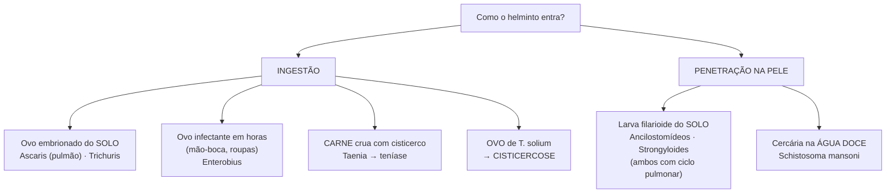

> **Roteiro do laboratório (Problema 3):** questões 8 (estudo morfológico das fases de ovos, larvas e vermes adultos dos helmintos) e 9 (ciclo biológico de *Schistosoma mansoni*, *Taenia* sp., *Cysticercus* sp., *Ascaris lumbricoides*, *Ancylostoma duodenale*, *Strongyloides stercoralis*, *Enterobius vermicularis* e *Trichuris trichiura*, identificando os órgãos e sistemas envolvidos). A resposta imune contra helmintos (Th2, IgE, eosinófilos, mastócitos) está introduzida em [imunidade humoral e anticorpos](#/imunologia/imunidade-humoral-anticorpos).

## Objetivos do tópico {#objetivos}

Ao final, você deve ser capaz de:

1. Definir **helminto**, **hospedeiro definitivo**, **hospedeiro intermediário**, **geo-helminto** e **forma infectante**, e classificar os helmintos em **nematódeos** e **platelmintos** (trematódeos e cestódeos).
2. Reconhecer ao microscópio os **ovos** e as **larvas** dos principais helmintos e descrever os **vermes adultos**.
3. Descrever o **ciclo biológico** de cada helminto do roteiro, com a **via de infecção**, o **trajeto no corpo** e os **órgãos e sistemas** atingidos.
4. Relacionar o ciclo com as **manifestações clínicas**, o **diagnóstico** (exame parasitológico de fezes, fita adesiva, sorologia, imagem) e a **prevenção**.
5. Explicar por que algumas helmintíases causam **eosinofilia** e **síndrome de Löffler**.

::: referencias
Neves – Parasitologia Humana, 14ª ed. · Rey – Parasitologia, 4ª ed. · Murray, Rosenthal & Pfaller – Microbiologia Médica, 9ª ed., seção "Parasitologia" · CDC – DPDx (Laboratory Identification of Parasites of Public Health Concern).
:::

## Conceitos-base {#conceitos-base}

### O que são helmintos {#o-que-sao-helmintos}

**Helmintos** (do grego *helmins* = verme) são **animais multicelulares** de corpo alongado, que vivem como parasitas — os "vermes". Diferem dos protozoários (unicelulares) por serem **organismos complexos**, com tecidos, órgãos digestivos e reprodutores; muitos são **visíveis a olho nu** na fase adulta (de milímetros a vários metros). Uma característica importante: a maioria dos helmintos **não se multiplica dentro do corpo humano** — cada verme adulto veio de uma forma infectante que entrou. Por isso a **carga parasitária** (quantos vermes a pessoa tem) depende do número de exposições, e a doença costuma ser mais grave quanto maior a carga. A exceção clássica é o *Strongyloides*, que pode se multiplicar no hospedeiro (autoinfecção).

### Vocabulário do ciclo biológico {#vocabulario-ciclo}

- **Ciclo biológico (evolutivo)**: a sequência de fases do parasita (ovo → larva → adulto) e os hospedeiros e ambientes por onde ele passa.
- **Hospedeiro definitivo**: onde o parasita atinge a **fase adulta** e se reproduz **sexuadamente**. Ex.: o ser humano para a *Taenia* e o *Schistosoma*.
- **Hospedeiro intermediário**: onde ocorrem fases **larvárias** (ou reprodução assexuada). Ex.: o caramujo *Biomphalaria* para o *Schistosoma*; o porco e o boi para a *Taenia*.
- **Ciclo monoxênico**: um só hospedeiro (Ascaris, ancilostomídeos, Enterobius, Trichuris). **Heteroxênico**: mais de um hospedeiro (Schistosoma, Taenia).
- **Forma infectante**: a fase capaz de infectar o ser humano (ovo embrionado, larva filarioide, cercária, cisticerco).
- **Geo-helmintos**: helmintos cujos ovos ou larvas precisam passar um período **no solo** para se tornarem infectantes (Ascaris, Trichuris, ancilostomídeos, Strongyloides). Sua transmissão depende de **falta de saneamento** (fezes no solo) — por isso são marcadores de desigualdade social.
- **Ciclo pulmonar (de Loss)**: trajeto em que a larva entra no sangue, chega aos **pulmões**, atravessa os alvéolos, sobe pela traqueia, é **deglutida** e só então vira adulta no intestino. Ocorre em **Ascaris, ancilostomídeos e Strongyloides** (mnemônico: "**A**nimais **A**ndam **S**ubindo pelo pulmão"). A passagem das larvas pelo pulmão pode causar a **síndrome de Löffler**: tosse, chiado, infiltrados pulmonares transitórios e **eosinofilia**.
- **Eosinofilia**: aumento dos **eosinófilos** no sangue — leucócitos especializados contra parasitas grandes demais para serem fagocitados. É típica das helmintíases com **fase tecidual** (larvas migrando), sendo menor quando o verme fica só na luz do intestino.
- **Exame parasitológico de fezes (EPF)**: pesquisa de ovos, larvas e cistos nas fezes. Métodos: **Hoffman (Lutz)** — sedimentação espontânea, bom para ovos pesados (Schistosoma, Ascaris); **Kato-Katz** — quantitativo (ovos por grama de fezes), padrão para esquistossomose e geo-helmintos; **Baermann-Moraes** — usa o **termotropismo e o hidrotropismo** das larvas (elas migram para a água morna), para **Strongyloides**; **Faust** — centrífugo-flutuação, para cistos de protozoários e ovos leves; **fita adesiva (Graham)** — para **Enterobius**.

### Classificação {#classificacao-helmintos}

| Grupo | Corpo | Sexos | Tubo digestivo | Helmintos do roteiro |
|---|---|---|---|---|
| **Nematódeos** (vermes redondos) | **Cilíndrico**, não segmentado, com cutícula | **Separados** (macho e fêmea; macho geralmente menor, com extremidade curvada) | **Completo** (boca e ânus) | *Ascaris*, ancilostomídeos (*Ancylostoma duodenale*, *Necator americanus*), *Strongyloides*, *Enterobius*, *Trichuris* |
| **Platelmintos – trematódeos** (vermes achatados não segmentados) | **Achatado, em folha** (Schistosoma é cilíndrico, exceção) | A maioria hermafrodita; **Schistosoma tem sexos separados** | Incompleto (sem ânus) | *Schistosoma mansoni* |
| **Platelmintos – cestódeos** (vermes em fita) | **Achatado e segmentado** (proglotes), com **escólex** de fixação | **Hermafroditas** (cada proglote tem órgãos masculinos e femininos) | **Ausente** (absorvem nutrientes pela superfície) | *Taenia solium*, *Taenia saginata* |

::: referencias
Neves – Parasitologia Humana, 14ª ed. · Rey – Parasitologia, 4ª ed.
:::

## Explicação detalhada {#explicacao}

### *Schistosoma mansoni* — esquistossomose {#schistosoma}

#### Morfologia {#schistosoma-morfologia}

- **Adultos**: trematódeos de **sexos separados** que vivem **acasalados** nas **veias do sistema porta** (sobretudo nas **veias mesentéricas**, ramos da mesentérica inferior). O **macho** (~1 cm) é mais curto e grosso, e dobra o corpo formando um sulco longitudinal — o **canal ginecóforo** —, onde a **fêmea**, mais longa e fina, fica alojada. Têm duas ventosas (oral e ventral) de fixação.
- **Ovo**: **grande** (~150 × 60 µm), oval, **com uma espícula lateral** (um "esporão" saindo do lado) — a marca do *S. mansoni*. Dentro, já há um **miracídio** (larva ciliada). (O *S. haematobium*, da África, tem espícula **terminal** e vive nas veias da bexiga.)
- **Miracídio**: larva **ciliada** que sai do ovo na água doce e nada até o caramujo.
- **Cercária**: larva com **cauda bifurcada**, liberada pelo caramujo na água; é a **forma infectante** para o ser humano.
- **Esquistossômulo**: a cercária depois de perder a cauda e penetrar na pele.

::: figura img/morfo/helmintos/schistosoma-ovo.jpg
**Ovo de *Schistosoma mansoni*** (exame de fezes). Ovo **grande e oval**, com a **espícula lateral** — o "esporão" projetado de um dos lados —, que identifica a espécie. A espícula ajuda o ovo a atravessar a parede do intestino; quando os ovos ficam presos nos tecidos (fígado, intestino), provocam os granulomas responsáveis pela doença.
:::

::: figura img/morfo/helmintos/schistosoma-adultos.jpg
**Adultos de *Schistosoma mansoni* acasalados** (CDC). O **macho**, mais largo, enrola-se formando o **canal ginecóforo**, onde fica a **fêmea**, mais fina e escura. O casal vive nas veias mesentéricas, e a fêmea põe centenas de ovos por dia.
:::

#### Ciclo biológico {#schistosoma-ciclo}

1. Os **ovos** saem com as **fezes** do ser humano infectado.
2. Na **água doce**, o ovo eclode e libera o **miracídio**, que nada e penetra no **caramujo** do gênero ***Biomphalaria*** (hospedeiro intermediário).
3. No caramujo, há **multiplicação assexuada** (esporocistos): um único miracídio gera **milhares de cercárias**, liberadas na água nas horas mais quentes e iluminadas do dia.
4. A **cercária** penetra ativamente na **pele** de quem entra na água (banho de rio, lagoa, trabalho em valas de irrigação), perdendo a cauda e virando **esquistossômulo**. Pode causar uma coceira no local (**dermatite cercariana**).
5. O esquistossômulo entra na circulação venosa → **coração direito** → **pulmões** → circulação sistêmica → chega ao **sistema porta intra-hepático**, onde amadurece em adulto e se acasala.
6. Os casais migram, **contra o fluxo sanguíneo**, para as **veias mesentéricas inferiores**, e a fêmea põe os ovos nas vênulas da parede intestinal. Parte dos ovos atravessa a parede e cai na **luz intestinal** (saindo nas fezes); **parte é arrastada pelo sangue portal até o fígado**, onde fica presa.

**Órgãos e sistemas**: pele (penetração), circulação e pulmões (migração), **sistema porta, fígado e baço** (doença), **intestino** (postura de ovos).

**Fisiopatologia**: a doença crônica é causada **pelos ovos, não pelos vermes**. Os ovos presos nos tecidos liberam antígenos que provocam **granulomas** (resposta Th2, com eosinófilos e macrófagos) ao redor deles. No fígado, os granulomas nos espaços porta levam a uma **fibrose periportal** característica (**fibrose de Symmers**, "em haste de cachimbo"), que obstrui o fluxo portal → **hipertensão portal pré-sinusoidal** → **esplenomegalia**, circulação colateral e **varizes de esôfago** (que podem sangrar), com a **função hepática relativamente preservada** — é a forma **hepatoesplênica**. No Brasil, a doença é endêmica em áreas do Nordeste e de Minas Gerais.

::: figura img/morfo/helmintos/schistosoma-ciclo.png
**Ciclo biológico do *Schistosoma*** (CDC). Os **ovos** saem nas fezes (ou na urina, no *S. haematobium*) e eclodem na água, liberando o **miracídio**, que penetra no **caramujo**; no caramujo formam-se os **esporocistos** e as **cercárias**, que saem para a água e **penetram na pele** humana. Perdendo a cauda, viram **esquistossômulos**, que circulam até o **sistema porta**, amadurecem e migram como **casais adultos** para as veias mesentéricas (*S. mansoni*), onde põem os ovos. O símbolo de infecção (círculo) indica a penetração das cercárias; o de diagnóstico (triângulo), os ovos nas fezes.
:::

::: referencias
Neves – Parasitologia Humana, 14ª ed., cap. "Schistosoma mansoni" · Ministério da Saúde – Vigilância da Esquistossomose Mansoni: Diretrizes Técnicas.
:::

### *Taenia solium* e *Taenia saginata* — teníase e cisticercose {#taenia}

#### Morfologia {#taenia-morfologia}

- **Adulto (a "solitária")**: cestódeo em **fita**, de **3 a 4 m** (*T. solium*) até **4 a 10 m** (*T. saginata*), que vive no **intestino delgado** humano. Partes:
  - **Escólex** (a "cabeça"): órgão de **fixação** na parede intestinal, com **4 ventosas**. A *T. solium* tem, além delas, um **rostro com dupla coroa de ganchos** (é "armada"); a *T. saginata* **não tem ganchos** ("inerme").
  - **Colo**: região de crescimento, que forma novas proglotes.
  - **Estróbilo**: o corpo, formado por centenas a milhares de **proglotes** (segmentos), cada uma com órgãos reprodutores masculinos e femininos. As proglotes do fim (as **grávidas**) são basicamente um **útero cheio de ovos** e se destacam.
- **Ovo**: **esférico**, ~30–40 µm, com uma casca **grossa, radiada** (com estrias, o **embrióforo**) e, dentro, o **embrião hexacanto** (oncosfera) com **6 ganchos**. Os ovos das duas espécies são **indistinguíveis** ao microscópio.
- **Cisticerco**: a **larva**, uma **vesícula** translúcida, cheia de líquido, de cerca de 1 cm, com um **escólex invaginado** dentro. Vive nos **músculos** do hospedeiro intermediário (porco, para a *T. solium* — *Cysticercus cellulosae*; boi, para a *T. saginata* — *Cysticercus bovis*).

**Como diferenciar as duas espécies**:

| | ***T. solium*** | ***T. saginata*** |
|---|---|---|
| Hospedeiro intermediário | **Porco** | **Boi** |
| Escólex | 4 ventosas + **rostro com ganchos** | 4 ventosas, **sem ganchos** |
| Proglote grávida — ramificações uterinas de cada lado | **Poucas** (7 a 12), dendríticas | **Muitas** (15 a 30), dicotômicas |
| Eliminação das proglotes | **Passiva**, em grupos, com as fezes | **Ativa** (saem sozinhas pelo ânus, fora da evacuação) |
| **Cisticercose humana** | **Sim** (o ser humano pode ser hospedeiro intermediário) | Praticamente não |

::: figura img/morfo/helmintos/taenia-solium-escolex.jpg
**Escólex de *Taenia solium*** (CDC). Observe as **quatro ventosas** (estruturas circulares) e, no topo, o **rostro com a dupla coroa de ganchos** — por isso a *T. solium* é chamada de "tênia armada". A *T. saginata* tem só as ventosas.
:::

::: figura img/morfo/helmintos/taenia-proglote-gravida.jpg
**Proglote grávida de *Taenia*** (preparação corada). O segmento está tomado pelo **útero ramificado** e cheio de ovos. A **contagem das ramificações laterais do útero** diferencia as espécies: **poucas** (até ~12 de cada lado) na *T. solium* e **muitas** (mais de 15) na *T. saginata*.
:::

#### Ciclo da teníase (verme adulto no intestino) {#teniase}

1. O ser humano (**hospedeiro definitivo**) come **carne de porco ou de boi crua ou malpassada** contendo **cisticercos** vivos.
2. No intestino delgado, o escólex do cisticerco se **evagina** (sai para fora), fixa-se na mucosa e, em cerca de 2 a 3 meses, forma o **verme adulto**.
3. As **proglotes grávidas** e os **ovos** saem com as fezes.
4. O **porco ou o boi** (hospedeiros intermediários) **ingere os ovos** no ambiente contaminado por fezes humanas.
5. No intestino do animal, a **oncosfera** é liberada, atravessa a parede, cai no sangue e se aloja nos **músculos** (e outros tecidos), transformando-se em **cisticerco**. O ciclo se fecha quando o ser humano come essa carne.

A **teníase** costuma ter poucos sintomas (desconforto abdominal, náuseas, eliminação de proglotes).

#### Cisticercose (larva nos tecidos humanos) {#cisticercose}

Na **cisticercose**, o ser humano faz o papel do **porco**: **ingere ovos de *T. solium*** — por **água e alimentos contaminados** com fezes humanas (verduras cruas mal lavadas), por mãos sujas ou por **autoinfecção** (quem tem a tênia adulta leva os próprios ovos à boca). Os ovos liberam oncosferas que se espalham pelo sangue e formam **cisticercos** em **músculos, tecido subcutâneo, olhos e, sobretudo, no sistema nervoso central** — a **neurocisticercose**.

**Atenção**: comer carne de porco malpassada causa **teníase**; a **cisticercose** vem da **ingestão de ovos**.

A **neurocisticercose** é a principal causa de **epilepsia adquirida** em países em desenvolvimento. Os cisticercos vivos causam pouca reação; quando a larva **morre**, há **inflamação** intensa ao redor, que provoca crises convulsivas, cefaleia e, se os cistos obstruem a circulação do líquor, **hidrocefalia** e hipertensão intracraniana. Cisticercos antigos **calcificam**. O diagnóstico é por **tomografia** ou **ressonância** (cistos com o escólex visível como um ponto — "sinal do escólex" —, lesões em anel ou calcificações) e sorologia.

::: figura img/morfo/helmintos/neurocisticercose-tc.jpg
**Neurocisticercose na tomografia de crânio.** Múltiplas lesões no parênquima cerebral — cistos e/ou calcificações, que aparecem como pontos de densidade diferente do tecido normal — correspondem aos **cisticercos** de *T. solium* em diferentes fases (vivos, em degeneração com inflamação, ou calcificados). O paciente adquiriu a doença por **ingestão de ovos**.
:::

::: figura img/morfo/helmintos/taenia-ciclo.png
**Ciclo biológico da *Taenia*** (CDC). O ser humano elimina **ovos e proglotes** nas fezes; o **boi** (*T. saginata*) ou o **porco** (*T. solium*) ingere os ovos, e as **oncosferas** atravessam a parede intestinal e formam **cisticercos** na musculatura. O ser humano se infecta ao **comer a carne crua ou malpassada**; o escólex se fixa no intestino e o verme cresce até a fase adulta. (A cisticercose humana, por ingestão de ovos de *T. solium*, é um desvio desse ciclo.)
:::

::: referencias
Neves – Parasitologia Humana, 14ª ed., caps. "Taenia solium e Taenia saginata" e "Cisticercose" · Rey – Parasitologia, 4ª ed.
:::

### *Ascaris lumbricoides* — ascaridíase {#ascaris}

#### Morfologia {#ascaris-morfologia}

- **Adultos**: os **maiores nematódeos intestinais humanos** — a fêmea mede **20 a 35 cm** e o macho 15 a 30 cm (com a cauda **enrolada** ventralmente). Cor branca ou rosada, corpo cilíndrico e afilado nas pontas; a boca tem **três lábios**. Vivem na **luz do intestino delgado**, alimentando-se do conteúdo intestinal. Uma fêmea põe cerca de **200 mil ovos por dia**.
- **Ovo fértil**: oval, ~60 × 45 µm, **castanho-dourado** (corado pela bile), com uma casca **espessa** coberta por uma **camada externa mamilonada** (com protuberâncias irregulares, como uma superfície "rugosa"). Ovos inférteis são mais alongados, com casca mais fina e conteúdo granuloso; às vezes a camada mamilonada se perde (ovo "decorticado").
- **Forma infectante**: o **ovo embrionado** (com a larva L3 dentro), que se forma **no solo** em cerca de 2 a 3 semanas, em condições de umidade, sombra e calor. O ovo recém-eliminado **não é infectante**.

::: figura img/morfo/helmintos/ascaris-ovo.jpg
**Ovo fértil de *Ascaris lumbricoides*** (CDC). Ovo oval, de cor **castanho-dourada**, com casca **espessa** e a **camada externa mamilonada** (as irregularidades na superfície). Os ovos são muito resistentes e sobrevivem por anos no solo úmido.
:::

::: figura img/morfo/helmintos/ascaris-adultos.jpg
**Vermes adultos de *Ascaris lumbricoides*** eliminados por um paciente. Note o tamanho (**dezenas de centímetros**), a forma **cilíndrica** e a cor esbranquiçada a rosada. Grandes quantidades de vermes podem formar um "novelo" que obstrui o intestino, sobretudo em crianças.
:::

#### Ciclo biológico {#ascaris-ciclo}

1. Ovos não embrionados saem nas **fezes**; no **solo**, embrionam e tornam-se infectantes.
2. O ser humano **ingere os ovos embrionados** com água, verduras cruas mal lavadas ou mãos sujas de terra (crianças brincando no chão).
3. No **intestino delgado**, as **larvas eclodem**, atravessam a parede intestinal e caem na circulação (veia porta) → **fígado** → coração direito → **pulmões** (**ciclo pulmonar**).
4. Nos pulmões, as larvas crescem, rompem os capilares e entram nos **alvéolos**, sobem pelos brônquios e pela traqueia até a faringe e são **deglutidas**.
5. De volta ao **intestino delgado**, tornam-se **adultas** em cerca de 2 a 3 meses, acasalam, e as fêmeas começam a pôr ovos.

**Órgãos e sistemas**: digestório (infecção e fase adulta), fígado, **pulmões** (migração larvária — síndrome de Löffler).

**Clínica**: a maioria é assintomática. Com muitos vermes: dor abdominal, **desnutrição** e déficit de crescimento em crianças, **obstrução intestinal** por "bolo de áscaris", e migração do verme adulto para lugares errados (**ducto biliar** — colangite, pancreatite; apêndice). A fase pulmonar causa a **síndrome de Löffler**.

::: referencias
Neves – Parasitologia Humana, 14ª ed., cap. "Ascaris lumbricoides".
:::

### Ancilostomídeos (*Ancylostoma duodenale* e *Necator americanus*) — ancilostomíase ("amarelão") {#ancilostomideos}

#### Morfologia {#ancilostomideos-morfologia}

- **Adultos**: nematódeos pequenos (**~1 cm**), que vivem **presos à mucosa do intestino delgado** (duodeno e jejuno) por uma **cápsula bucal** com **dentes** (*Ancylostoma duodenale*, 2 pares de dentes) ou **lâminas cortantes** (*Necator americanus*, o mais comum no Brasil). O macho tem na cauda uma **bolsa copuladora**. Eles "mordem" a mucosa e **sugam sangue**, secretando **anticoagulantes** que mantêm o local sangrando.
- **Ovo**: oval, ~60 × 40 µm, de **casca fina e transparente**, com o conteúdo (blastômeros, as células do embrião em divisão) **separado da casca** por um espaço claro. Os ovos de *Ancylostoma* e *Necator* são indistinguíveis.
- **Larvas**: a **rabditoide** (L1), que eclode no solo (esôfago com dilatação em bulbo, **cavidade bucal longa**), e a **filarioide** (L3), a **forma infectante**, que vive no solo e **penetra na pele**.

::: figura img/morfo/helmintos/ancilostomideo-ovo.jpg
**Ovos de ancilostomídeo** (exame de fezes). Ovos ovais, de **casca muito fina e transparente**, com o embrião em fase de **blastômeros** (células em divisão), separado da casca por um **espaço claro**. Compare com o ovo de *Ascaris*, de casca grossa e mamilonada.
:::

#### Ciclo biológico {#ancilostomideos-ciclo}

1. Ovos saem nas **fezes**; no **solo** quente, úmido e sombreado, eclodem em 1 a 2 dias, liberando a **larva rabditoide**, que se alimenta e muda até a **larva filarioide** (infectante) em cerca de uma semana.
2. A larva filarioide **penetra ativamente na pele** de quem anda **descalço** ou tem contato com o solo (pés, mãos). Pode causar coceira e erupção no local.
3. Cai na circulação → coração direito → **pulmões** (**ciclo pulmonar**) → alvéolos → traqueia → **deglutida**.
4. No **intestino delgado**, torna-se **adulta**, fixa-se na mucosa e suga sangue. (O *A. duodenale* também pode infectar por **via oral**, ingerido com alimentos.)

**Órgãos e sistemas**: **pele** (penetração), pulmões (migração), **intestino delgado** e **sangue** (perda sanguínea crônica).

**Clínica e fisiopatologia**: cada verme causa uma pequena perda diária de sangue (estimada em ~0,03 mL por *Necator* e ~0,2 mL por *Ancylostoma*). Com centenas de vermes, a **perda crônica de sangue** pelo intestino esgota os estoques de ferro e causa **anemia ferropriva** (microcítica e hipocrômica) e perda de proteínas (**hipoalbuminemia**, edema). A palidez amarelada dos doentes deu o nome popular "**amarelão**" (o "Jeca Tatu" de Monteiro Lobato). Em crianças, prejudica o crescimento e o desenvolvimento cognitivo. Prevenção: **calçados**, saneamento.

::: figura img/morfo/helmintos/ancilostomideo-ciclo.png
**Ciclo biológico dos ancilostomídeos** (CDC). **Ovos** nas fezes → **larva rabditoide** no solo → **larva filarioide** (infectante) → **penetração na pele** → circulação → **pulmões** → deglutição → **adultos** no intestino delgado, fixados à mucosa.
:::

::: referencias
Neves – Parasitologia Humana, 14ª ed., cap. "Ancilostomídeos".
:::

### *Strongyloides stercoralis* — estrongiloidíase {#strongyloides}

#### Morfologia {#strongyloides-morfologia}

- **Fêmea parasita**: muito pequena (~2 mm), fina, vive **dentro da mucosa** do duodeno e jejuno e se reproduz **por partenogênese** (sem macho). Não existe macho parasita.
- **Ovos**: postos dentro da mucosa, **eclodem ali mesmo** — por isso, nas fezes, normalmente **não se encontram ovos, e sim larvas rabditoides**. Essa é a diferença diagnóstica clássica em relação aos ancilostomídeos.
- **Larva rabditoide** (L1): eliminada nas fezes; tem **cavidade bucal curta** e um **primórdio genital** bem visível (diferente da larva rabditoide do ancilostomídeo, de cavidade bucal longa — que só aparece em fezes envelhecidas, depois que os ovos eclodem).
- **Larva filarioide** (L3): infectante, com **cauda entalhada** (bifurcada na ponta).
- **Vida livre**: no solo, as larvas rabditoides podem formar **machos e fêmeas de vida livre**, que se reproduzem sexuadamente — o parasita consegue se multiplicar no ambiente.

::: figura img/morfo/helmintos/larvas-ancilostomideo-strongyloides.jpg
**Larvas rabditoides: ancilostomídeo (à esquerda) × *Strongyloides* (à direita)** (CDC). A diferença está na extremidade anterior: a **cavidade bucal** é **longa** no ancilostomídeo e **curta** no *Strongyloides*; este também tem um **primórdio genital** evidente no meio do corpo.
:::

#### Ciclo biológico e autoinfecção {#strongyloides-ciclo}

1. **Ciclo direto**: larvas rabditoides saem nas fezes → no solo, viram **filarioides** → **penetram na pele** → circulação → **pulmões** → deglutidas → **fêmeas parasitas** na mucosa intestinal → ovos → larvas rabditoides.
2. **Ciclo indireto (de vida livre)**: no solo, as rabditoides formam adultos de vida livre, que se reproduzem e geram novas larvas filarioides infectantes.
3. **Autoinfecção** — a característica mais importante: parte das larvas rabditoides **se transforma em filarioides ainda dentro do intestino** (autoinfecção interna, favorecida por constipação) ou na **pele da região perianal** (externa), e **reinfecta o mesmo hospedeiro**, penetrando na mucosa ou na pele. Por isso a infecção pode **persistir por décadas** sem novas exposições.

**Órgãos e sistemas**: pele, pulmões, **intestino delgado**; na hiperinfecção, praticamente **todos os órgãos**.

**Hiperinfecção e forma disseminada**: em pacientes **imunodeprimidos** — sobretudo em uso de **corticoides** (que, além de reduzir a imunidade, parecem acelerar a transformação das larvas) e na infecção pelo **HTLV-1** —, a autoinfecção se descontrola: milhões de larvas atravessam a parede intestinal, **carregando bactérias intestinais** para o sangue (**sepse por Gram-negativos**, meningite), e invadem pulmões e outros órgãos. A mortalidade é alta. Por isso, pessoas de áreas endêmicas devem ser **investigadas ou tratadas** (ivermectina) antes de iniciar corticoterapia prolongada ou imunossupressão.

::: figura img/morfo/helmintos/strongyloides-ciclo.jpg
**Ciclo biológico do *Strongyloides stercoralis*** (CDC). À esquerda, o **ciclo de vida livre** no solo (adultos machos e fêmeas que geram larvas); à direita, o **ciclo parasitário**: a **larva filarioide penetra na pele**, migra pelos **pulmões**, é deglutida e se torna a **fêmea parasita** no intestino, cujos ovos eclodem na mucosa liberando **larvas rabditoides** (que saem nas fezes). Repare na seta da **autoinfecção**, em que a larva rabditoide vira filarioide dentro do próprio hospedeiro.
:::

::: referencias
Neves – Parasitologia Humana, 14ª ed., cap. "Strongyloides stercoralis" · Harrison, 21ª ed., cap. "Infecções por nematódeos intestinais".
:::

### *Enterobius vermicularis* — enterobíase (oxiuríase) {#enterobius}

#### Morfologia {#enterobius-morfologia}

- **Adultos**: pequenos (fêmea ~1 cm, macho ~0,5 cm), brancos, **finos como fios de linha**, com uma dilatação cuticular na extremidade anterior (**asas cefálicas**). A fêmea tem a cauda longa e pontiaguda (daí o nome popular "**oxiúro**" — *oxys* = agudo, *oura* = cauda). Vivem no **ceco**, apêndice e cólon.
- **Ovo**: oval, ~55 × 25 µm, **assimétrico** — com um lado **achatado** e o outro convexo (forma de **"D"**) —, casca fina e transparente, com uma **larva** dentro. Torna-se infectante em **poucas horas** após a postura.

::: figura img/morfo/helmintos/enterobius-ovo.jpg
**Ovo de *Enterobius vermicularis*** (fita adesiva). Ovo oval, **achatado de um lado** (forma de "D"), de casca fina e transparente, com a **larva** dentro. Esses ovos raramente aparecem no exame de fezes, porque são postos **na pele ao redor do ânus** — por isso o diagnóstico é feito pelo **método da fita adesiva** (Graham), pela manhã, antes do banho.
:::

::: figura img/morfo/helmintos/enterobius-cabeca.jpg
**Extremidade anterior de *Enterobius vermicularis* adulto** (CDC). Observe as **asas cefálicas** — expansões laterais da cutícula ao redor da boca, que aparecem como "abas" transparentes de cada lado da cabeça — e, logo atrás, o **esôfago com bulbo**. Os vermes inteiros são pequenos (fêmea ~1 cm), finos e brancos, com a cauda da fêmea longa e pontiaguda; podem ser vistos à noite na região perianal, "como fiapos de linha que se mexem".

#### Ciclo biológico {#enterobius-ciclo}

1. As fêmeas grávidas migram **à noite** do intestino grosso para a **região perianal**, onde depositam milhares de **ovos** na pele e morrem.
2. Os ovos e a movimentação das fêmeas causam **prurido anal intenso**, principalmente **noturno** (com irritabilidade, sono agitado).
3. Ao coçar, a criança leva ovos para as **unhas e as mãos** e os ingere (**autoinfecção externa** — mão-boca) ou os espalha pela roupa de cama, roupas, poeira (os ovos são leves e podem ser **inalados e deglutidos**), infectando outras pessoas da casa.
4. Os ovos ingeridos eclodem no **intestino delgado**, as larvas migram até o **ceco** e viram adultos em cerca de 1 mês. **Não há ciclo pulmonar** nem passagem pelo solo.
5. Pode ocorrer também **retroinfecção**: larvas que eclodem na pele perianal voltam pelo ânus até o intestino.

**Órgãos e sistemas**: digestório (intestino grosso), **pele perianal**; nas meninas, os vermes podem migrar para a **vulva e a vagina** (vulvovaginite).

É a helmintíase mais comum em **crianças em idade escolar**, independe de saneamento e é **familiar** (toda a família costuma ser tratada).

::: figura img/morfo/helmintos/enterobius-ciclo.png
**Ciclo biológico do *Enterobius vermicularis*** (CDC). Os **ovos** são depositados na **pele perianal**; são **ingeridos** (mão-boca, roupas de cama, poeira); as larvas eclodem no intestino delgado e os **adultos** vivem no **ceco**; as **fêmeas migram à noite** para a região perianal para pôr os ovos. O diagnóstico é pela **fita adesiva**.
:::

::: referencias
Neves – Parasitologia Humana, 14ª ed., cap. "Enterobius vermicularis".
:::

### *Trichuris trichiura* — tricuríase {#trichuris}

#### Morfologia {#trichuris-morfologia}

- **Adultos**: 3 a 5 cm, em forma de **chicote** (*whipworm*): a parte **anterior é longa e fina como um fio** (cerca de 3/5 do corpo) e a **posterior é grossa**. O macho tem a cauda enrolada. Vivem no **ceco e no cólon**, com a porção fina **enterrada na mucosa** (como uma costura) e a porção grossa livre na luz.
- **Ovo**: forma de **barril** (ou de "**limão**", "bola de futebol americano"), ~50 × 22 µm, castanho, de casca espessa, com **dois tampões polares** (rolhas mucoides) transparentes nas extremidades — inconfundível.

::: figura img/morfo/helmintos/trichuris-ovos.jpg
**Ovos de *Trichuris trichiura*** (exame de fezes). Ovos em forma de **barril** ou **limão**, castanhos, de casca espessa, com os **dois tampões polares** transparentes nas extremidades — o aspecto mais característico entre os ovos de helmintos.
:::

#### Ciclo biológico {#trichuris-ciclo}

1. Ovos não embrionados saem nas **fezes**; no **solo**, embrionam em 2 a 4 semanas.
2. O ser humano **ingere os ovos embrionados** (água, alimentos, mãos sujas de terra) — como no *Ascaris*.
3. As larvas eclodem no **intestino delgado**, migram para o **ceco e o cólon**, penetram na mucosa e se tornam **adultas** em cerca de 2 a 3 meses. **Não há ciclo pulmonar**.

**Órgãos e sistemas**: digestório (**intestino grosso**).

**Clínica**: em infecções intensas (crianças), **colite** com diarreia com muco e sangue, **tenesmo** (vontade persistente de evacuar) e, por esforço evacuatório e enfraquecimento da musculatura, **prolapso retal** (o reto se exterioriza, com vermes visíveis aderidos à mucosa); anemia e déficit de crescimento.

::: figura img/morfo/helmintos/trichuris-ciclo.jpg
**Ciclo biológico do *Trichuris trichiura*** (CDC). **Ovos** não embrionados nas fezes → **embrionamento no solo** → **ingestão** dos ovos embrionados → larvas eclodem no intestino delgado → **adultos** no ceco e cólon, com a extremidade fina inserida na mucosa.
:::

::: referencias
Neves – Parasitologia Humana, 14ª ed., cap. "Trichuris trichiura".
:::

### Quadro-resumo: infecção, ciclo e órgãos {#quadro-helmintos}

| Helminto | Forma infectante e via | Ciclo pulmonar | Habitat do adulto | O que se vê no diagnóstico | Órgãos/sistemas e doença |
|---|---|---|---|---|---|
| ***Schistosoma mansoni*** | **Cercária** — **penetra na pele** (água doce com caramujo *Biomphalaria*) | Passa pelos pulmões | **Veias mesentéricas** (sistema porta) | **Ovo com espícula lateral** (Kato-Katz) | Fígado (fibrose periportal), baço, hipertensão portal, intestino |
| ***Taenia solium/saginata*** (teníase) | **Cisticerco** na **carne crua** de porco/boi | Não | Intestino delgado | Ovos (radiados, iguais) e **proglotes** | Digestório |
| ***T. solium*** (cisticercose) | **Ovos** — água/alimentos contaminados, autoinfecção | — | (larva) músculos, subcutâneo, olho, **SNC** | Imagem (TC/RM), sorologia | Neurocisticercose: epilepsia, hidrocefalia |
| ***Ascaris lumbricoides*** | **Ovo embrionado** — ingestão (solo) | **Sim** | Intestino delgado (luz) | **Ovo mamilonado** castanho | Digestório (obstrução), vias biliares, pulmão (Löffler) |
| **Ancilostomídeos** | **Larva filarioide** — **penetra na pele** (solo, pés descalços) | **Sim** | Intestino delgado (preso à mucosa, hematófago) | **Ovo de casca fina** com blastômeros | Anemia ferropriva ("amarelão"), pele, pulmão |
| ***Strongyloides stercoralis*** | **Larva filarioide** — **penetra na pele**; **autoinfecção** | **Sim** | Mucosa do intestino delgado (fêmea partenogenética) | **Larva rabditoide** nas fezes (Baermann-Moraes) | Intestino, pulmão, pele; **hiperinfecção** em imunodeprimidos |
| ***Enterobius vermicularis*** | **Ovo** — mão-boca, roupas, poeira (infectante em horas) | Não | **Ceco**, cólon | **Ovo em "D"** na **fita adesiva** | Prurido anal noturno, vulvovaginite |
| ***Trichuris trichiura*** | **Ovo embrionado** — ingestão (solo) | Não | **Ceco e cólon** (extremidade fina na mucosa) | **Ovo em barril** com tampões polares | Colite, **prolapso retal**, anemia |

::: referencias
Neves – Parasitologia Humana, 14ª ed. · CDC – DPDx.
:::

## Correlação clínica {#correlacao-clinica}

### Eosinofilia e resposta Th2 {#eosinofilia}

Helmintos são grandes demais para serem fagocitados. Contra eles, o sistema imune monta uma resposta do tipo **Th2**: os linfócitos Th2 produzem **IL-4** (estimula os linfócitos B a produzirem **IgE**), **IL-5** (produção e ativação de **eosinófilos**) e **IL-13** (aumenta a secreção de muco e a contração do intestino, ajudando a expulsar os vermes). A IgE recobre o verme e liga-se aos **eosinófilos** e **mastócitos**, que liberam o conteúdo de seus grânulos (como a proteína básica principal) sobre o parasita. Por isso:

- **Eosinofilia** importante sugere helmintos com **fase tecidual** (larvas migrando: Löffler na ascaridíase, ancilostomíase e estrongiloidíase; esquistossomose aguda; cisticercose) — e é menor quando o verme está só na luz intestinal (como na teníase).
- Na **hiperinfecção por Strongyloides** em pacientes com corticoide, a eosinofilia pode **desaparecer** (o corticoide suprime os eosinófilos) — a ausência de eosinofilia **não exclui** a doença.

### Tratamento e prevenção (visão geral) {#tratamento-helmintos}

- **Albendazol** ou **mebendazol** (inibem a formação de microtúbulos do verme): ascaridíase, ancilostomíase, tricuríase, enterobíase (na enterobíase, repete-se após 2 semanas e trata-se toda a família).
- **Ivermectina**: escolha para **estrongiloidíase**.
- **Praziquantel**: **esquistossomose** e **teníase** (também neurocisticercose, junto com albendazol, conforme o caso, com corticoide para controlar a inflamação causada pela morte das larvas).
- Prevenção: **saneamento básico** e água tratada (geo-helmintos, esquistossomose, cisticercose), **calçados** (ancilostomídeos, Strongyloides), lavagem de verduras e mãos, **cozimento adequado das carnes** e inspeção sanitária (teníase), evitar contato com águas com caramujos (esquistossomose), higiene das unhas e lavagem de roupas de cama (enterobíase). Em áreas de alta prevalência, o Ministério da Saúde recomenda **tratamento coletivo** de escolares com albendazol.

::: referencias
Ministério da Saúde – Guia de Vigilância em Saúde · Goodman & Gilman, 13ª ed., cap. "Quimioterapia das infecções por helmintos" · Abbas, 10ª ed., cap. "Imunidade aos micróbios".
:::

## Pontos de alta cobrança em prova {#alta-cobranca}

::: prova
- **Nematódeos** (cilíndricos, sexos separados, tubo digestivo completo): Ascaris, ancilostomídeos, Strongyloides, Enterobius, Trichuris. **Trematódeos**: Schistosoma (sexos separados — exceção). **Cestódeos** (fita, proglotes, escólex, hermafroditas, sem tubo digestivo): Taenia.
- **Ciclo pulmonar (Löffler + eosinofilia)**: **A**scaris, **A**ncilostomídeos, **S**trongyloides (e o Schistosoma passa pelo pulmão).
- **Penetram na pele**: ancilostomídeos e Strongyloides (**larva filarioide**, solo) e Schistosoma (**cercária**, água doce). **Ingestão**: Ascaris, Trichuris (ovo do solo), Enterobius (ovo — mão-boca), Taenia (cisticerco na carne → teníase; **ovo → cisticercose**).
- **Ovos**: Schistosoma — **espícula lateral**; Ascaris — **mamilonado**, castanho; ancilostomídeo — **casca fina**, blastômeros; Enterobius — **em "D"** (fita adesiva); Trichuris — **barril com tampões polares**; Taenia — **radiado**, oncosfera com 6 ganchos (espécies iguais). Strongyloides — **larva rabditoide** nas fezes (Baermann-Moraes), não ovo.
- **Schistosoma**: caramujo ***Biomphalaria***; adultos nas **veias mesentéricas**; **ovos** causam granulomas → **fibrose periportal (Symmers)** → hipertensão portal pré-sinusoidal, esplenomegalia, varizes.
- **Taenia solium** (porco, escólex **armado** com ganchos, poucas ramificações uterinas, **causa cisticercose**) × **T. saginata** (boi, inerme, muitas ramificações, proglotes saem ativamente). **Neurocisticercose** = principal causa de epilepsia adquirida em países em desenvolvimento.
- **Ancilostomídeos**: hematófagos → **anemia ferropriva** ("amarelão").
- **Strongyloides**: fêmea **partenogenética** na mucosa, **autoinfecção**, **hiperinfecção** com corticoide/HTLV-1 (sepse por Gram-negativos); tratar com **ivermectina**.
- **Enterobius**: **prurido anal noturno**, crianças, familiar, **fita adesiva**. **Trichuris**: colite, **prolapso retal**.
- **Th2**: IL-4 (IgE), IL-5 (eosinófilos), IL-13 (muco); mastócitos e eosinófilos.
:::

## Armadilhas comuns {#armadilhas}

::: armadilha
- **Achar que comer carne de porco malpassada causa cisticercose.** Causa **teníase** (verme adulto). A **cisticercose** vem da **ingestão de ovos** de *T. solium* (água, verduras, mãos, autoinfecção).
- **Procurar ovos de Strongyloides nas fezes.** Os ovos eclodem na mucosa; nas fezes frescas aparecem **larvas rabditoides**.
- **Confundir larva rabditoide de Strongyloides com a de ancilostomídeo.** Strongyloides: **cavidade bucal curta** e primórdio genital evidente; ancilostomídeo: **cavidade bucal longa** (e só aparece em fezes envelhecidas).
- **Achar que o verme adulto do Schistosoma causa a doença hepática.** Quem causa são os **ovos** presos no fígado (granulomas e fibrose).
- **Pedir exame de fezes para diagnosticar Enterobius.** O método é a **fita adesiva perianal**.
- **Incluir Enterobius ou Trichuris no ciclo pulmonar.** Eles **não** têm ciclo pulmonar.
- **Achar que todos os helmintos se multiplicam no hospedeiro.** A regra é **não se multiplicarem**; a exceção é o **Strongyloides** (autoinfecção).
- **Achar que ausência de eosinofilia exclui hiperinfecção por Strongyloides.** O corticoide pode suprimi-la.
:::

## Resumo para revisão rápida {#resumo}

- **Helmintos**: vermes multicelulares; nematódeos (Ascaris, ancilostomídeos, Strongyloides, Enterobius, Trichuris), trematódeos (Schistosoma), cestódeos (Taenia). Em geral não se multiplicam no hospedeiro (exceto Strongyloides).
- **Schistosoma mansoni**: cercária penetra na pele (água com *Biomphalaria*) → pulmão → sistema porta → veias mesentéricas; ovo com espícula lateral; granulomas nos ovos → fibrose periportal, hipertensão portal.
- **Taenia**: carne crua com cisticerco → teníase (adulto no intestino; escólex, proglotes); ovos de *T. solium* → **cisticercose** (neurocisticercose, epilepsia).
- **Ascaris**: ovo mamilonado do solo ingerido → ciclo pulmonar → adultos grandes no intestino delgado (obstrução, Löffler).
- **Ancilostomídeos**: larva filarioide penetra na pele → ciclo pulmonar → adultos hematófagos no delgado → anemia ferropriva; ovo de casca fina.
- **Strongyloides**: larva filarioide na pele → ciclo pulmonar → fêmea na mucosa; larvas rabditoides nas fezes; autoinfecção e hiperinfecção em imunodeprimidos.
- **Enterobius**: ovo em "D" ingerido (mão-boca); fêmeas põem ovos na pele perianal à noite; fita adesiva.
- **Trichuris**: ovo em barril com tampões polares, do solo; adultos em chicote no ceco/cólon; colite e prolapso retal.
- **Imunidade**: resposta Th2 — IgE, eosinófilos, mastócitos; eosinofilia nas fases teciduais.

::: referencias
Neves – Parasitologia Humana, 14ª ed. · Rey – Parasitologia, 4ª ed. · CDC – DPDx · Ministério da Saúde – Guia de Vigilância em Saúde.
:::
