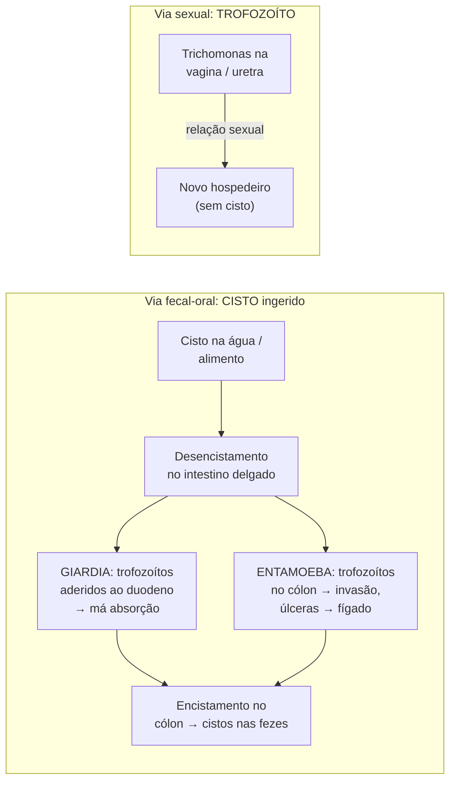

> **Roteiro do laboratório (Problema 3):** questões 10 (estudo morfológico de cisto e trofozoíto de protozoários), 11 (ciclo biológico de *Trichomonas vaginalis*, *Giardia lamblia* e *Entamoeba histolytica*) e 13 (um exemplo de infecção por protozoário para cada sistema do corpo humano e seu mecanismo infeccioso).

## Objetivos do tópico {#objetivos}

Ao final, você deve ser capaz de:

1. Definir **protozoário** e diferenciá-lo de bactérias, fungos e helmintos.
2. Explicar as formas **cisto** e **trofozoíto** — estrutura, função, onde são encontradas e qual é a forma infectante.
3. Reconhecer ao microscópio os cistos e trofozoítos de ***Giardia lamblia*** e ***Entamoeba histolytica*** e o trofozoíto de ***Trichomonas vaginalis***.
4. Descrever o **ciclo biológico** desses três protozoários, os **órgãos envolvidos**, a **fisiopatologia** e o **diagnóstico**.
5. Citar um **protozoário de importância médica para cada sistema** do corpo e seu mecanismo de infecção.

::: referencias
Neves – Parasitologia Humana, 14ª ed. · Rey – Parasitologia, 4ª ed. · Murray, Rosenthal & Pfaller – Microbiologia Médica, 9ª ed., seção "Parasitologia" · CDC – DPDx.
:::

## Conceitos-base {#conceitos-base}

### O que são protozoários {#o-que-sao-protozoarios}

**Protozoários** são seres **eucariontes unicelulares** — uma única célula, com **núcleo** e organelas, que realiza sozinha todas as funções vitais (alimentação, locomoção, reprodução). Medem em geral de **2 a 100 µm**: são vistos ao **microscópio óptico**, mas não a olho nu. Diferente dos helmintos, **multiplicam-se dentro do hospedeiro** (geralmente por divisão binária), de modo que **um pequeno número de parasitas ingeridos pode gerar uma infecção intensa**.

| | **Bactérias** | **Fungos** | **Protozoários** | **Helmintos** |
|---|---|---|---|---|
| Tipo de célula | Procarionte | Eucarionte com **parede** (quitina) | Eucarionte **sem parede** | Animais multicelulares |
| Nº de células | 1 | 1 (levedura) ou muitas (hifas) | **1** | Muitas (tecidos e órgãos) |
| Multiplica-se no hospedeiro? | Sim | Sim | **Sim** | Em geral **não** |
| Visível a olho nu? | Não | Colônias, bolor | Não | Adultos, sim |

São classificados, de forma simplificada, pelo **modo de locomoção**:

- **Amebas** (sarcodíneos): movem-se por **pseudópodes** — projeções do citoplasma que "puxam" a célula (*Entamoeba*).
- **Flagelados**: movem-se por **flagelos** (*Giardia*, *Trichomonas*, *Trypanosoma*, *Leishmania*).
- **Ciliados**: cobertos por **cílios** (*Balantidium coli*, raro).
- **Esporozoários (apicomplexos)**: sem estruturas de locomoção visíveis; têm um **complexo apical** que usam para invadir células; são **intracelulares** (*Plasmodium*, *Toxoplasma*, *Cryptosporidium*).

### Cisto × trofozoíto {#cisto-trofozoito}

Muitos protozoários intestinais alternam entre duas formas:

- **Trofozoíto** (do grego *trophé* = alimento): a forma **ativa** — **móvel**, que se **alimenta**, se **multiplica** e **causa a doença**. É **frágil**: morre rapidamente fora do corpo e é destruído pelo ácido do estômago. Por isso **não costuma ser a forma infectante** (exceção: *Trichomonas*, que só existe como trofozoíto e é transmitido diretamente, de mucosa para mucosa).
- **Cisto**: a forma de **resistência** e de **transmissão**. O trofozoíto, ao descer pelo intestino grosso (onde as fezes perdem água), **encista**: arredonda-se, para de se mover e de se alimentar, e secreta uma **parede espessa e resistente** (de quitina em algumas espécies). O cisto sobrevive **semanas a meses** na água e no solo úmido, **resiste ao cloro** usado no tratamento comum da água e ao ácido gástrico. É a **forma infectante** dos protozoários intestinais, transmitida pela via **fecal-oral** (água e alimentos contaminados, mãos sujas, contato sexual oral-anal).

| | **Trofozoíto** | **Cisto** |
|---|---|---|
| Função | Alimentação, multiplicação, **doença** | **Resistência** e **transmissão** |
| Mobilidade | **Móvel** (pseudópodes, flagelos) | Imóvel |
| Parede | Só membrana (frágil) | **Parede espessa** |
| Resistência fora do corpo | Mínima (morre em minutos a horas) | **Alta** (semanas a meses; resiste ao cloro) |
| Onde se encontra | Tecidos e luz do intestino; **fezes diarreicas** (trânsito rápido) | **Fezes formadas**; ambiente (água, alimentos) |
| Infectante? | Em geral não (exceto *Trichomonas*) | **Sim** |

**Encistamento** é a transformação do trofozoíto em cisto (no intestino grosso); **desencistamento** é a saída do trofozoíto do cisto (no intestino delgado, estimulada pelo ácido do estômago e pelas enzimas pancreáticas). Uma consequência prática: em **diarreia**, o trânsito é rápido e não há tempo de encistar — aparecem **trofozoítos** nas fezes; em **fezes formadas**, aparecem **cistos**. Como a eliminação de cistos é **intermitente**, recomenda-se examinar **três amostras** de fezes em dias diferentes.

**Como examinar**: o **exame a fresco** com solução salina mostra os trofozoítos se movendo (em fezes recém-emitidas); o **lugol** (iodo) cora os núcleos e o glicogênio dos cistos, facilitando a identificação; métodos de concentração como **Faust** (centrífugo-flutuação em sulfato de zinco) e **Hoffman** recuperam cistos; colorações permanentes (**hematoxilina férrica**, tricrômico) mostram detalhes nucleares.

::: referencias
Neves – Parasitologia Humana, 14ª ed., caps. "Protozoários: introdução" e "Diagnóstico laboratorial" · Rey – Parasitologia, 4ª ed.
:::

## Explicação detalhada {#explicacao}

### *Giardia lamblia* (*G. intestinalis*, *G. duodenalis*) — giardíase {#giardia}

#### Morfologia {#giardia-morfologia}

- **Trofozoíto**: flagelado com forma de **pera** (ou de **raquete**, gota), cortado ao meio no sentido do comprimento, com ~12–15 µm × 6–8 µm. É **bilateralmente simétrico** e tem:
  - **Dois núcleos** na parte anterior, que, com os corpos medianos, dão a impressão de um "**rosto sorridente**" ou de "**óculos**";
  - **Quatro pares de flagelos** (8 flagelos), que dão o movimento característico de "**folha caindo**" no exame a fresco;
  - **Disco ventral (adesivo)**: uma estrutura côncava na face ventral, que funciona como uma **ventosa**, fixando o parasita às **microvilosidades** das células do intestino delgado;
  - **Corpos medianos** e **axonemas** (as "bases" dos flagelos, que percorrem o corpo como uma linha central).
- **Cisto**: **oval**, ~8–12 µm, com parede espessa e lisa, contendo **4 núcleos** (quando maduro), axonemas e restos do disco ventral (fibrilas curvas). É a **forma infectante**: **bastam cerca de 10 cistos** para causar infecção.

::: figura img/morfo/protozoarios/giardia-trofozoito.jpg
**Trofozoíto de *Giardia lamblia*** (coloração). Observe a forma de **pera**, os **dois núcleos** na parte anterior (os "olhos" do "rosto"), as estruturas centrais (axonemas e corpos medianos) e os **flagelos**. É a forma que vive aderida à mucosa do duodeno e do jejuno e causa a doença.
:::

::: figura img/morfo/protozoarios/giardia-mev.jpg
**Trofozoíto de *Giardia* ao microscópio eletrônico de varredura** (CDC). Vista da **face ventral**: o **disco adesivo** côncavo (a "ventosa" circular), com o qual o parasita se prende às microvilosidades do intestino delgado, e os **flagelos** saindo das bordas e da extremidade posterior. Ao fim da infecção, as marcas do disco ficam impressas na superfície das células intestinais.
:::

::: figura img/morfo/protozoarios/giardia-cistos-lugol.jpg
**Cistos de *Giardia* em exame com lugol** (fezes formadas). **Ovais**, de parede espessa e lisa, com o conteúdo corado de amarelo-acastanhado pelo iodo; em alguns é possível ver os **núcleos** (até 4) e as fibrilas internas. É a forma eliminada nas fezes e transmitida pela água e pelos alimentos.
:::

#### Ciclo biológico {#giardia-ciclo}

1. O ser humano **ingere cistos** com **água** (inclusive água tratada só com cloro, de poços e de rios), alimentos crus contaminados, mãos sujas ou contato pessoa a pessoa (creches, contato sexual oral-anal). Animais (cães, castores) também podem ser reservatórios.
2. No **duodeno**, estimulado pelo ácido gástrico e pelas enzimas pancreáticas, ocorre o **desencistamento**: cada cisto libera um parasita que se divide, gerando **dois trofozoítos**.
3. Os trofozoítos **fixam-se pelo disco ventral à mucosa do duodeno e do jejuno** e se multiplicam por **divisão binária longitudinal**. **Não invadem a mucosa** — ficam na superfície.
4. Ao descerem para o **intestino grosso**, **encistam** e são eliminados como cistos nas fezes (trofozoítos nas fezes diarreicas).

**Órgãos e sistemas**: **digestório** (duodeno e jejuno).

**Fisiopatologia**: os trofozoítos aderidos formam um "tapete" sobre a mucosa, lesam as **microvilosidades** (borda em escova), causam **atrofia das vilosidades** e inflamação leve, e reduzem as **enzimas da borda em escova** (como a lactase). Resultado: **má absorção** de gorduras, vitaminas lipossolúveis, vitamina B12 e lactose. A clínica vai de assintomática a **diarreia aquosa, gordurosa (esteatorreia — fezes claras, volumosas, fétidas, que boiam)**, distensão abdominal, flatulência, perda de peso e, em crianças, **déficit de crescimento**. **Não há sangue nas fezes** (não há invasão). Pessoas com **deficiência de IgA** ou hipogamaglobulinemia têm giardíase grave e recorrente (a IgA secretora é a principal defesa).

**Diagnóstico**: cistos (ou trofozoítos) no exame de fezes (Faust), pesquisa de **antígenos** nas fezes; tratamento com **metronidazol**, tinidazol ou secnidazol.

::: figura img/morfo/protozoarios/giardia-ciclo.png
**Ciclo biológico da *Giardia*** (CDC). Os **cistos** (resistentes) e os **trofozoítos** saem nas fezes; a infecção ocorre pela **ingestão de cistos** em água ou alimentos contaminados (ou pela via fecal-oral direta). No **intestino delgado**, o desencistamento libera **trofozoítos**, que se multiplicam por divisão binária, ficam aderidos à mucosa e **encistam** ao descer para o cólon.
:::

::: referencias
Neves – Parasitologia Humana, 14ª ed., cap. "Giardia" · Murray, Microbiologia Médica, 9ª ed., cap. "Protozoários intestinais e urogenitais".
:::

### *Entamoeba histolytica* — amebíase {#entamoeba}

#### Morfologia {#entamoeba-morfologia}

- **Trofozoíto**: ameba de 10–60 µm, que se move de modo **direcional e rápido** por pseudópodes digitiformes (em forma de dedo), com citoplasma dividido em **ectoplasma** (claro, externo) e **endoplasma** (granuloso). Tem **um núcleo** com a cromatina distribuída de forma **fina e regular** sob a membrana nuclear e um **cariossomo central pequeno** (um "ponto" no centro). O sinal mais importante: os trofozoítos invasivos **fagocitam hemácias** — encontrar **hemácias dentro do citoplasma** (**hematofagia**) é praticamente **diagnóstico de *E. histolytica* patogênica**.
- **Cisto**: **esférico**, 10–20 µm, com **1 a 4 núcleos** (o cisto maduro, **infectante**, tem **4 núcleos**), com as mesmas características nucleares; os cistos jovens podem ter **corpos cromatoides** (bastões de ribossomos, de pontas arredondadas, "em charuto") e vacúolos de glicogênio.

**Atenção diagnóstica**: a ***Entamoeba dispar*** (não patogênica, muito mais frequente) é **idêntica** à *E. histolytica* ao microscópio (cistos e trofozoítos sem hemácias). Elas só se diferenciam por testes de **antígeno**, **PCR** ou pela presença de hemácias fagocitadas. Por isso o laudo do exame de fezes costuma dizer "**complexo *E. histolytica/E. dispar***". Outras amebas comensais (*Entamoeba coli*, cisto com até **8 núcleos** e cariossomo excêntrico; *Endolimax nana*; *Iodamoeba*) **não causam doença**, mas indicam ingestão de material contaminado por fezes.

::: figura img/morfo/protozoarios/entamoeba-trofozoitos-hemacias.jpg
**Trofozoítos de *Entamoeba histolytica* com hemácias fagocitadas** (coloração). Dentro do citoplasma das amebas, observe as **hemácias ingeridas** (círculos escuros). A **hematofagia** indica a forma **invasiva** da *E. histolytica* — e a diferencia da *E. dispar*, comensal, que não fagocita hemácias. Esses trofozoítos são encontrados nas fezes com sangue da disenteria amebiana e nas bordas das úlceras intestinais.
:::

#### Ciclo biológico {#entamoeba-ciclo}

1. O ser humano **ingere cistos maduros (tetranucleados)** com água ou alimentos contaminados, mãos sujas ou contato sexual oral-anal.
2. No **intestino delgado (íleo terminal)**, ocorre o **desencistamento**: cada cisto origina **8 trofozoítos** (o núcleo se divide mais uma vez).
3. Os trofozoítos migram para o **intestino grosso** (ceco e cólon), onde vivem na luz se alimentando de bactérias e restos, e se multiplicam por **divisão binária**.
4. Encistam ao descer pelo cólon e saem nas fezes como **cistos** (que podem ter 1 a 4 núcleos).
5. Em parte dos casos (fatores do parasita e do hospedeiro), os trofozoítos **invadem a parede intestinal** e podem chegar, pelo **sangue portal**, ao **fígado** e a outros órgãos.

**Órgãos e sistemas**: **digestório** (intestino grosso — colite, disenteria); **fígado** (abscesso amebiano); raramente pulmão (por contiguidade com o fígado), cérebro e pele perianal.

**Como a ameba lesa os tecidos** (o nome *histolytica* significa "que dissolve tecidos"):

1. **Adesão**: uma lectina da superfície do trofozoíto, que reconhece galactose e N-acetilgalactosamina, liga-se às células do cólon.
2. **Morte das células**: os **amebaporos** (peptídeos que formam poros na membrana) e o contato com a ameba induzem **apoptose e necrose** das células do epitélio, de neutrófilos e de outras células do hospedeiro; a ameba também "morde" e engole pedaços de células vivas (**trogocitose**).
3. **Destruição da matriz**: **cisteíno-proteases** digerem o muco, a matriz extracelular e os anticorpos, permitindo que o parasita avance em profundidade.
4. A invasão forma, na mucosa do cólon, as típicas **úlceras em "botão de camisa"** (ou "em frasco"): uma abertura **pequena** na mucosa que se **alarga na submucosa**, porque a ameba encontra menos resistência ali. Entre as úlceras, a mucosa costuma ser normal.
5. **Clínica intestinal**: da forma assintomática (a maioria) até a **disenteria amebiana** — várias evacuações com **muco e sangue**, cólica e **tenesmo** —, e complicações (perfuração, megacólon, ameboma).
6. **Abscesso hepático amebiano**: trofozoítos que entram nos ramos da **veia porta** chegam ao fígado (mais ao **lobo direito**, que recebe mais sangue da mesentérica superior), destroem o parênquima e formam uma cavidade cheia de material **necrótico, espesso, achocolatado** ("**pasta de anchova**") — que, na verdade, **não é pus** (tem poucos neutrófilos, porque a ameba os mata). Clínica: febre, dor no hipocôndrio direito, hepatomegalia dolorosa; mais comum em **homens adultos**; pode ocorrer **sem diarreia** e meses após a viagem a área endêmica.

**Diagnóstico**: trofozoítos hematófagos ou cistos nas fezes, antígeno fecal específico, PCR; sorologia e ultrassonografia no abscesso hepático. **Tratamento**: **metronidazol** (age nos trofozoítos teciduais), seguido de um **amebicida de luz** (como teclozana ou paromomicina) para eliminar os cistos do intestino.

::: figura img/morfo/protozoarios/entamoeba-ciclo.png
**Ciclo biológico da *Entamoeba histolytica*.** **Cistos** ingeridos com água ou alimentos contaminados liberam **trofozoítos** no intestino, que colonizam o **intestino grosso** e se multiplicam. Os trofozoítos **encistam** e saem nas fezes (fezes formadas: cistos; diarreia: trofozoítos). Nas infecções **invasivas**, os trofozoítos atravessam a mucosa (colite, disenteria) e podem chegar pelo **sangue ao fígado** (abscesso hepático) e, raramente, a outros órgãos.
:::

::: referencias
Neves – Parasitologia Humana, 14ª ed., cap. "Amebíase" · Robbins Patologia Básica, 10ª ed., cap. "Trato gastrointestinal" · Murray, Microbiologia Médica, 9ª ed.
:::

### *Trichomonas vaginalis* — tricomoníase {#trichomonas}

#### Morfologia {#trichomonas-morfologia}

- **Só existe como trofozoíto** — **não forma cisto**. Por isso é **frágil** fora do corpo e é transmitido **diretamente**, de pessoa a pessoa, pelo **contato sexual**.
- **Trofozoíto**: flagelado em forma de **pera** ou oval, ~10–20 µm (um pouco maior que um leucócito), com:
  - **Quatro flagelos anteriores** livres;
  - Um quinto flagelo voltado para trás, preso ao corpo por uma **membrana ondulante** (que vai até a metade do corpo);
  - Um **axóstilo** — um bastão rígido que atravessa o corpo e se projeta pela extremidade posterior como uma "cauda" pontiaguda;
  - **Um núcleo** anterior, grande e oval.
- No **exame a fresco** da secreção vaginal (ou da urina), vê-se o movimento característico: o parasita **se agita e gira**, com a membrana ondulante batendo — um movimento "**em espasmos**" ou "trêmulo".

::: figura img/morfo/protozoarios/trichomonas-giemsa.jpg
**Trofozoítos de *Trichomonas vaginalis*** (coloração de Giemsa, CDC). Formas **ovais ou em pera**, com o **núcleo** escuro na parte anterior; em alguns é possível ver os **flagelos** anteriores e o **axóstilo** saindo pela extremidade posterior. Não existe a forma de cisto: o trofozoíto é a forma que infecta, multiplica-se e é transmitida.
:::

#### Ciclo biológico {#trichomonas-ciclo}

1. A **transmissão é sexual** (o trofozoíto passa de uma mucosa para outra durante a relação). Raramente, transmissão do recém-nascido no parto.
2. Os trofozoítos colonizam o **epitélio escamoso** da **vagina**, da uretra e das glândulas de Skene nas mulheres, e a **uretra e a próstata** nos homens.
3. Multiplicam-se por **divisão binária longitudinal** e são transmitidos ao parceiro na próxima relação. **Ciclo monoxênico e direto**, sem fase no ambiente.

**Órgãos e sistemas**: **reprodutor e urinário** (vagina, colo do útero, uretra, próstata).

**Fisiopatologia e clínica**: o parasita **adere** às células epiteliais por adesinas, provoca sua morte por contato e por proteases, e atrai neutrófilos. O ambiente vaginal fica menos ácido (os lactobacilos diminuem; pH **> 4,5**). Na mulher: **corrimento abundante, amarelo-esverdeado, bolhoso (espumoso), com odor fétido**, prurido, ardor, dor na relação e, ao exame, o **colo "em framboesa"** ou "morango" (pequenas hemorragias puntiformes — colpite macular). No homem: geralmente **assintomático** (reservatório) ou com uretrite leve. Aumenta o risco de **transmissão do HIV**, de parto prematuro e de doença inflamatória pélvica.

**Diagnóstico**: exame a fresco da secreção (trofozoítos móveis), teste de **aminas** (odor de peixe com KOH) e pH, cultura, testes moleculares. **Tratamento**: **metronidazol** (ou tinidazol/secnidazol), sempre **tratando também o(s) parceiro(s)**.

::: referencias
Neves – Parasitologia Humana, 14ª ed., cap. "Trichomonas vaginalis" · Ministério da Saúde – Protocolo Clínico e Diretrizes Terapêuticas para Atenção Integral às Pessoas com IST.
:::

### Comparação dos três protozoários do roteiro {#comparacao-protozoarios}

| | ***Giardia lamblia*** | ***Entamoeba histolytica*** | ***Trichomonas vaginalis*** |
|---|---|---|---|
| Grupo | Flagelado | Ameba | Flagelado |
| Trofozoíto | Pera, **2 núcleos**, **8 flagelos**, **disco adesivo** | Pseudópodes, 1 núcleo com cariossomo central, **hemácias fagocitadas** | Pera, 1 núcleo, **4 flagelos anteriores**, **membrana ondulante**, **axóstilo** |
| Cisto | Oval, **4 núcleos** | Esférico, **até 4 núcleos** | **Não forma cisto** |
| Forma infectante | Cisto | Cisto tetranucleado | **Trofozoíto** |
| Transmissão | Fecal-oral (**água**) | Fecal-oral (água, alimentos) | **Sexual** |
| Local | **Duodeno e jejuno** (superfície, sem invasão) | **Cólon** (pode invadir) → **fígado** | **Vagina**, uretra, próstata |
| Doença | **Má absorção**, diarreia gordurosa, sem sangue | **Disenteria** (muco e sangue), úlceras em botão de camisa, **abscesso hepático** | **Vaginite** com corrimento espumoso esverdeado, uretrite |
| Diagnóstico | Cistos/trofozoítos nas fezes, antígeno | Trofozoítos hematófagos/cistos, antígeno, PCR, sorologia | **Exame a fresco** da secreção, testes moleculares |
| Tratamento | Metronidazol, tinidazol, secnidazol | Metronidazol + amebicida de luz | Metronidazol (tratar parceiros) |

### Um protozoário para cada sistema {#protozoarios-por-sistema}

O roteiro pede um exemplo de infecção por protozoário em cada sistema, com o mecanismo:

| Sistema | Protozoário | Doença | Transmissão e mecanismo |
|---|---|---|---|
| **Digestório** (intestino delgado) | *Giardia lamblia* | Giardíase | Cistos ingeridos; trofozoítos aderidos pelo disco ventral lesam as microvilosidades → má absorção |
| **Digestório** (intestino grosso) e **fígado** | *Entamoeba histolytica* | Amebíase, abscesso hepático | Cistos ingeridos; trofozoítos invadem a mucosa (lectina, amebaporos, proteases) e chegam ao fígado pela veia porta |
| **Digestório** (imunodeprimidos) | *Cryptosporidium* | Criptosporidiose | Oocistos na água (resistem ao cloro); infecta as microvilosidades; diarreia grave e crônica na aids |
| **Reprodutor e urinário** | *Trichomonas vaginalis* | Tricomoníase | Sexual; trofozoíto adere ao epitélio escamoso e o lesa |
| **Sangue** (hemácias) | *Plasmodium* (*P. falciparum*, *P. vivax*) | **Malária** | Picada do mosquito ***Anopheles*** (fêmea); esporozoítos → **fígado** (multiplicação; o *P. vivax* forma hipnozoítos latentes, causa de recaídas) → merozoítos invadem e rompem as **hemácias** em ciclos → febre periódica, anemia; o *P. falciparum* faz as hemácias aderirem aos vasos (malária cerebral). Endêmica na **Amazônia**, inclusive no **Pará** |
| **Cardiovascular** e digestório | *Trypanosoma cruzi* | **Doença de Chagas** | Fezes do **barbeiro** (triatomíneo) contaminando a picada ou mucosas, **via oral** (alimentos como **açaí** e caldo de cana contaminados — principal forma de transmissão atual na Amazônia), transfusão, transplacentária. As formas amastigotas se multiplicam dentro das células, sobretudo **miocárdio** e neurônios do sistema nervoso autônomo entérico → **cardiomiopatia chagásica** crônica, megaesôfago e megacólon |
| **Pele e mucosas** | *Leishmania* (*L. braziliensis*, *L. amazonensis*) | **Leishmaniose tegumentar** | Picada do **flebotomíneo** (mosquito-palha); amastigotas dentro dos **macrófagos** da pele → úlcera de bordas elevadas ("em moldura"), indolor; lesões mucosas destrutivas (nariz, palato) |
| **Fígado, baço e medula óssea** (sistema mononuclear fagocitário) | *Leishmania infantum* (*L. chagasi*) | **Leishmaniose visceral** (calazar) | Flebotomíneo; o **cão** é o principal reservatório urbano; amastigotas nos macrófagos → hepatoesplenomegalia, febre, pancitopenia |
| **Sistema nervoso**, olhos e placenta | *Toxoplasma gondii* | **Toxoplasmose** | Ingestão de **oocistos** das **fezes de gato** (hospedeiro definitivo) ou de cistos em **carne malcozida**; transplacentária. Taquizoítos invadem qualquer célula nucleada; formam cistos no cérebro e na retina. Na **gestação**: toxoplasmose congênita (coriorretinite, hidrocefalia, calcificações). Na **aids**: encefalite com lesões cerebrais em anel |
| **Sistema nervoso** | *Naegleria fowleri* (ameba de vida livre) | Meningoencefalite amebiana primária (rara, fatal) | Água doce morna entra pelo nariz (mergulho); a ameba sobe pelo nervo olfatório até o cérebro |
| **Respiratório** | *Toxoplasma* e *Cryptosporidium* em imunodeprimidos; a malária grave pode causar edema pulmonar | — | Protozoários raramente têm o pulmão como alvo principal; a pneumonia por *Pneumocystis*, antes classificada como protozoário, é hoje considerada um **fungo** (veja [fungos](#/microbiologia-parasitologia/morfo-fungos#micoses-oportunistas)) |

::: referencias
Neves – Parasitologia Humana, 14ª ed. · Ministério da Saúde – Guia de Vigilância em Saúde (malária, doença de Chagas, leishmanioses, toxoplasmose).
:::

## Correlação clínica {#correlacao-clinica}

### Diarreia com ou sem sangue: o raciocínio {#diarreia-raciocinio}

- **Diarreia aquosa, gordurosa, sem sangue, distensão e perda de peso**, às vezes após viagem ou acampamento (água de rio): pensar em ***Giardia*** (intestino delgado, sem invasão).
- **Disenteria — fezes com muco e sangue, tenesmo**: pensar em agentes **invasivos do cólon**: ***Entamoeba histolytica***, *Shigella*, *Campylobacter*, *E. coli* enteroinvasiva.
- **Febre e dor no hipocôndrio direito com lesão hepática cística**, meses após diarreia ou viagem: **abscesso hepático amebiano**.

### Metronidazol {#metronidazol}

O **metronidazol** é o fármaco comum aos três protozoários do roteiro. Ele entra na célula e é **reduzido** (ativado) por enzimas próprias de organismos **anaeróbios** — como os protozoários *Giardia*, *Entamoeba* e *Trichomonas*, que não têm mitocôndrias típicas e vivem em ambientes com pouco oxigênio —, formando radicais que **danificam o DNA** do parasita. Por isso também age em **bactérias anaeróbias**. Efeitos adversos: gosto metálico, náuseas e **reação tipo dissulfiram** com álcool (deve-se evitar bebida alcoólica durante o tratamento e até alguns dias depois).

### Prevenção {#prevencao-protozoarios}

- **Fecal-oral (Giardia, Entamoeba)**: água filtrada ou **fervida** (os cistos resistem ao cloro nas concentrações habituais), saneamento, lavagem de mãos e de alimentos crus.
- **Sexual (Trichomonas)**: preservativo; tratar os parceiros.

::: referencias
Goodman & Gilman, 13ª ed., cap. "Quimioterapia das infecções por protozoários" · Neves – Parasitologia Humana, 14ª ed.
:::

## Pontos de alta cobrança em prova {#alta-cobranca}

::: prova
- **Protozoários**: eucariontes **unicelulares**, sem parede, **multiplicam-se no hospedeiro**. Grupos: amebas (pseudópodes), flagelados, ciliados, esporozoários (intracelulares).
- **Trofozoíto**: forma **ativa** (móvel, se alimenta, multiplica, causa doença), **frágil**, nas fezes diarreicas. **Cisto**: forma de **resistência e transmissão**, parede espessa, resiste ao cloro, nas fezes formadas, **infectante** (fecal-oral). Encistamento no cólon; desencistamento no delgado. Examinar 3 amostras.
- **Giardia**: trofozoíto em **pera** com **2 núcleos**, **8 flagelos** e **disco adesivo** ("rosto sorridente", movimento de "folha caindo"); cisto oval com **4 núcleos**; vive **aderida ao duodeno/jejuno sem invadir**; **má absorção**, esteatorreia, **sem sangue**; grave na deficiência de IgA.
- **Entamoeba histolytica**: trofozoíto com pseudópodes, núcleo com **cariossomo central**, **hemácias fagocitadas** (= patogênica); cisto com **até 4 núcleos** (8 = *E. coli*); idêntica à **E. dispar** ao microscópio; cólon → **úlceras em botão de camisa**, **disenteria**; veia porta → **abscesso hepático** ("pasta de anchova", lobo direito). Lectina, **amebaporos**, cisteíno-proteases.
- **Trichomonas**: **só trofozoíto (sem cisto)**, **transmissão sexual**; 4 flagelos anteriores, **membrana ondulante**, **axóstilo**; corrimento **amarelo-esverdeado bolhoso** fétido, pH > 4,5, colo em framboesa; exame a fresco; tratar parceiros.
- **Metronidazol** para os três (ativado em anaeróbios; reação tipo dissulfiram com álcool).
- **Por sistema**: digestório (*Giardia*, *Entamoeba*, *Cryptosporidium*), reprodutor (*Trichomonas*), sangue (*Plasmodium* — *Anopheles*; Amazônia), coração (*T. cruzi* — barbeiro, **via oral/açaí**), pele (*Leishmania* tegumentar — flebotomíneo), fígado/baço/medula (*L. infantum* — calazar), SNC/olho/placenta (*Toxoplasma* — gato, carne malcozida).
:::

## Armadilhas comuns {#armadilhas}

::: armadilha
- **Achar que o trofozoíto é a forma infectante dos protozoários intestinais.** É o **cisto**; o trofozoíto é destruído no estômago. A exceção é o **Trichomonas**, que **não tem cisto**.
- **Achar que cloração comum elimina cistos.** Cistos de *Giardia* e *Entamoeba* (e oocistos de *Cryptosporidium*) **resistem ao cloro**; filtrar ou ferver.
- **Considerar "complexo *E. histolytica/E. dispar*" no exame de fezes como amebíase invasiva.** Ao microscópio elas são iguais; só **hemácias fagocitadas**, antígeno específico ou PCR confirmam a *E. histolytica*.
- **Contar os núcleos errado.** Cisto de *Giardia*: **4**; cisto maduro de *E. histolytica*: **4**; cisto de *E. coli*: **até 8**; trofozoíto de *Giardia*: **2**.
- **Achar que a giardíase causa sangue nas fezes.** A *Giardia* **não invade** a mucosa; a diarreia é de má absorção, sem sangue.
- **Chamar o conteúdo do abscesso amebiano de pus.** É material **necrótico** ("pasta de anchova"), com poucos neutrófilos.
- **Tratar só a paciente com tricomoníase.** O parceiro (muitas vezes assintomático) precisa ser tratado.
:::

## Resumo para revisão rápida {#resumo}

- **Protozoários**: eucariontes unicelulares que se multiplicam no hospedeiro; amebas, flagelados, ciliados, esporozoários.
- **Trofozoíto** (ativo, frágil, causa doença) × **cisto** (resistente, infectante, fecal-oral; resiste ao cloro).
- **Giardia**: pera, 2 núcleos, 8 flagelos, disco adesivo; cisto com 4 núcleos; duodeno sem invasão; má absorção sem sangue.
- **Entamoeba histolytica**: trofozoíto hematófago (patogênico), cisto com até 4 núcleos; cólon (úlceras em botão de camisa, disenteria) e fígado (abscesso); confundível com *E. dispar*.
- **Trichomonas vaginalis**: só trofozoíto, sexual; membrana ondulante, axóstilo; vaginite com corrimento espumoso esverdeado; tratar parceiros.
- **Metronidazol** para os três.
- **Por sistema**: *Plasmodium* (sangue), *T. cruzi* (coração, via oral na Amazônia), *Leishmania* (pele; vísceras), *Toxoplasma* (SNC, olho, placenta), *Cryptosporidium* (intestino na aids).

::: referencias
Neves – Parasitologia Humana, 14ª ed. · Rey – Parasitologia, 4ª ed. · CDC – DPDx · Ministério da Saúde – Guia de Vigilância em Saúde.
:::
