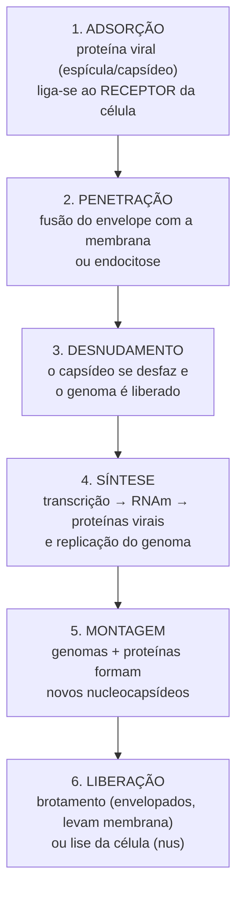

> **Roteiro do laboratório (Problema 2):** questão 1 — classificação de Baltimore (a); morfologias virais (b); componentes estruturais (c); etapas da replicação (d); estrutura do HIV (e) e do coronavírus (f); tropismo viral com três exemplos (k). A resposta do sistema imune contra vírus (interferons, células NK, linfócitos T CD8⁺) está em [imunidade inata](#/imunologia/imunidade-inata) e [imunidade celular](#/imunologia/imunidade-celular-mhc-linfocitos-t).

## Objetivos do tópico {#objetivos}

Ao final, você deve ser capaz de:

1. Explicar o que é um **vírus** e por que ele é um **parasita intracelular obrigatório**.
2. Identificar os **componentes estruturais** (ácido nucleico, capsídeo, envelope, proteínas do envelope, enzimas) e reconhecer as **morfologias** (icosaédrica/poliédrica, helicoidal, esférica, filamentosa e complexa).
3. Classificar os vírus pelos **sete grupos de Baltimore**, explicando a lógica (como cada genoma chega ao RNA mensageiro) e dando exemplos de importância médica.
4. Descrever as **etapas da replicação viral** — adsorção, penetração, desnudamento, síntese, montagem e liberação — e o que acontece em cada uma.
5. Identificar os componentes do **HIV** e do **coronavírus (SARS-CoV-2)** num esquema e relacioná-los com o ciclo e com os alvos dos antivirais e das vacinas.
6. Explicar os **mecanismos de tropismo viral** e citar exemplos.

::: referencias
Murray, Rosenthal & Pfaller – Microbiologia Médica, 9ª ed., seção "Virologia" · Tortora, Funke & Case – Microbiologia, 12ª ed., cap. "Vírus, viroides e príons" · Trabulsi & Alterthum – Microbiologia, 6ª ed.
:::

## Conceitos-base {#conceitos-base}

### O que é um vírus {#o-que-e-virus}

Um **vírus** é uma partícula infecciosa formada, no mínimo, por um **genoma** (DNA **ou** RNA — nunca os dois) envolto por uma capa de proteínas. Ele **não é uma célula**: não tem ribossomos, não produz energia (ATP) e não tem metabolismo próprio. Por isso, fora de uma célula, o vírus é inerte — apenas uma "embalagem com instruções". Só se multiplica **dentro** de uma célula viva, usando os ribossomos, as enzimas e a energia dela: é um **parasita intracelular obrigatório**.

Alguns termos essenciais:

- **Vírion** — a partícula viral completa e infecciosa, como existe fora da célula.
- **Genoma viral** — o ácido nucleico; pode ser DNA ou RNA, de **fita simples** ou **dupla**, linear ou circular, inteiro ou segmentado (dividido em pedaços, como no influenza).
- **Sentido (polaridade) do RNA** — um RNA de fita simples é de **sentido positivo (+)** quando tem a mesma sequência de um RNA mensageiro (RNAm) e pode ser **lido diretamente pelos ribossomos**; é de **sentido negativo (−)** quando é a fita complementar, que precisa primeiro ser copiada em RNA (+) para virar mensageiro.
- **Tamanho** — vírus medem cerca de **20 a 300 nanômetros** (nm). Um nanômetro é um milionésimo de milímetro; a maioria dos vírus só é visível ao **microscópio eletrônico**. Para comparar: uma bactéria como *E. coli* mede cerca de 2.000 nm.

### Por que os vírus importam para o médico {#importancia}

- Antibióticos **não agem** em vírus (não há parede celular, ribossomos bacterianos ou metabolismo próprio para atacar). Os antivirais precisam atingir **etapas específicas** do ciclo viral — por isso conhecer o ciclo é essencial.
- A célula infectada pode **morrer** (efeito citopático, necrose ou apoptose — veja [necrose e apoptose](#/patologia/necrose-apoptose#situacoes-apoptose)), **transformar-se** (vírus oncogênicos, como o HPV) ou **conviver** com o vírus em **latência** (herpes).

::: referencias
Murray, Microbiologia Médica, 9ª ed., cap. "Classificação, estrutura e replicação viral".
:::

## Explicação detalhada {#explicacao}

### Componentes estruturais {#componentes}

Imagine o vírus como uma **carta** (o genoma) dentro de um **envelope de papel rígido** (o capsídeo), que às vezes ainda vai dentro de uma **sacola plástica com etiquetas** (o envelope lipídico com glicoproteínas).

#### Ácido nucleico (genoma) {#acido-nucleico}

Contém os genes que comandam a produção de novas partículas. Os **vírus de DNA** (exceto os poxvírus) costumam se replicar no **núcleo** da célula, usando as enzimas de DNA do hospedeiro; os **vírus de RNA** (exceto influenza e retrovírus) costumam se replicar no **citoplasma**, e precisam trazer ou codificar uma enzima que a célula humana não tem: a **RNA polimerase dependente de RNA** (que copia RNA a partir de RNA). Essa enzima **erra muito** e não corrige os erros — por isso os vírus de RNA **mutam rapidamente** (influenza, HIV, SARS-CoV-2).

#### Capsídeo {#capsideo}

**Capsídeo** é a capa de proteína que envolve e protege o genoma. Ele é formado pela repetição de pequenas unidades proteicas, os **capsômeros** — um modo econômico de construir uma estrutura grande com poucos genes. **Genoma + capsídeo = nucleocapsídeo.** O capsídeo também participa da entrada na célula nos vírus que não têm envelope.

#### Envelope {#envelope}

Alguns vírus têm, por fora do nucleocapsídeo, um **envelope**: uma bicamada de **lipídios** que o vírus "rouba" de uma membrana da célula hospedeira (membrana plasmática, retículo endoplasmático, Golgi ou envelope nuclear) ao sair dela. Consequências práticas:

| | **Vírus envelopados** | **Vírus não envelopados (nus)** |
|---|---|---|
| Resistência | **Frágeis**: o envelope é destruído por **detergentes, sabão, álcool**, ressecamento, ácido gástrico | **Resistentes** ao ressecamento, detergentes e ácido |
| Transmissão típica | Gotículas, sangue, sexo, contato íntimo (precisam ficar úmidos) | **Fecal-oral**, superfícies, água (sobrevivem no ambiente) |
| Saída da célula | Geralmente por **brotamento** (a célula pode sobreviver um tempo) | Geralmente por **lise** da célula |
| Exemplos | HIV, influenza, coronavírus, herpes, sarampo, hepatite B | Norovírus, rotavírus, poliovírus, adenovírus, HPV, hepatite A |

Por isso **lavar as mãos com água e sabão** ou usar **álcool 70%** inativa bem os vírus envelopados (como o SARS-CoV-2), enquanto vírus nus como o **norovírus** resistem mais ao álcool e causam surtos em navios e creches.

#### Proteínas do envelope (espículas) {#proteinas-envelope}

Inseridas no envelope ficam as **glicoproteínas** (proteínas com açúcares), que formam projeções chamadas **espículas** (*spikes*). Elas fazem a **ligação ao receptor** da célula e a **fusão** do envelope com a membrana da célula. Exemplos: **gp120 e gp41** do HIV, **proteína S (spike)** do coronavírus, **hemaglutinina e neuraminidase** do influenza. Como ficam expostas, são o principal alvo dos **anticorpos neutralizantes** e das **vacinas**. Por dentro do envelope, muitos vírus têm uma **proteína de matriz**, que liga o envelope ao nucleocapsídeo.

#### Enzimas {#enzimas}

Alguns vírus carregam dentro do vírion as enzimas de que vão precisar logo ao entrar na célula:

- **Transcriptase reversa** (retrovírus como o HIV; também a hepatite B): copia **RNA em DNA**.
- **Integrase** (HIV): insere o DNA viral no DNA da célula.
- **Protease** (HIV, coronavírus): corta as poliproteínas virais em proteínas funcionais.
- **RNA polimerase dependente de RNA** (vírus de RNA negativo, como influenza e sarampo): precisam trazê-la pronta, porque seu genoma não pode ser lido pelos ribossomos.
- **Neuraminidase** (influenza): solta os vírions novos da célula.

Cada uma dessas enzimas é um **alvo de antiviral** (veja a correlação clínica).

### Morfologias virais {#morfologias}

A forma do vírus depende do arranjo dos capsômeros e da presença de envelope:

- **Icosaédrica (poliédrica, "cúbica")** — o capsídeo forma um **icosaedro**: um sólido com **20 faces triangulares** e 12 vértices, quase esférico. É a forma mais eficiente de fechar um espaço com unidades repetidas. Exemplos: **adenovírus** (nu, com fibras nos vértices), poliovírus, HPV, herpesvírus (icosaédrico **com** envelope).
- **Helicoidal** — os capsômeros se enrolam **em espiral** em volta do ácido nucleico, formando um **tubo** (como uma escada em caracol). Nos vírus humanos, o nucleocapsídeo helicoidal costuma ficar **dentro de um envelope**: influenza, sarampo, raiva, coronavírus. O exemplo clássico de helicoidal nu é o vírus do mosaico do tabaco (de plantas).
- **Esférica** — aspecto arredondado, geralmente por causa do **envelope** que envolve o nucleocapsídeo (icosaédrico ou helicoidal). Ex.: HIV, influenza, coronavírus, herpes.
- **Filamentosa** — partículas **longas como fios**, envelopadas, com nucleocapsídeo helicoidal: o **ebola** e o **Marburg** (filovírus) são o exemplo típico; o influenza também pode formar filamentos.
- **Complexa** — não se encaixa nas outras: os **bacteriófagos** (vírus de bactérias) têm "cabeça" icosaédrica, "cauda" helicoidal e fibras de fixação, como um módulo lunar; os **poxvírus** (varíola) têm forma de **tijolo**, com várias camadas; o vírus da **raiva** tem forma de **projétil** (bala de revólver).

::: figura img/morfo/virus/ciclo-litico-lisogenico.png
**Ciclo de um bacteriófago (vírus de bactéria, de morfologia complexa).** No **ciclo lítico** (números 1 a 6, metade superior): o fago se fixa na bactéria (1), injeta seu DNA (2), o DNA viral comanda a síntese de novas partes (3), que são montadas em novos fagos (4–5), e a bactéria se rompe (lise) liberando-os (6). No **ciclo lisogênico** (metade inferior, 7 a 9), o DNA do fago se integra ao cromossomo bacteriano e é copiado junto com ele a cada divisão, sem matar a célula, até que um estímulo o reative. É um bom modelo das etapas que também ocorrem em células humanas — e da **latência** de vírus como o herpes e da integração do HIV.
:::

### Classificação de Baltimore {#baltimore}

A classificação proposta por **David Baltimore** (1971) agrupa os vírus pela resposta a uma única pergunta: **como o genoma deste vírus chega ao RNA mensageiro (RNAm)?** Isso importa porque **toda proteína viral precisa ser traduzida a partir de um RNAm (+)** pelos ribossomos da célula. O caminho depende do tipo de genoma, e define de quais enzimas o vírus precisa.

| Grupo | Genoma | Como chega ao RNAm | Exemplos de importância médica |
|---|---|---|---|
| **I** | DNA de fita dupla (**dsDNA**) | Transcrição comum (como os genes da célula) | **Herpesvírus** (herpes simples, varicela-zóster, Epstein-Barr, citomegalovírus), **adenovírus**, **HPV**, poxvírus |
| **II** | DNA de fita simples (**ssDNA**) | Primeiro é convertido em DNA de fita dupla, depois transcrito | **Parvovírus B19** (eritema infeccioso, crise aplástica) |
| **III** | RNA de fita dupla (**dsRNA**) | A fita (−) é copiada em RNAm por RNA polimerase viral | **Rotavírus** (diarreia em crianças) |
| **IV** | RNA de fita simples **positiva** (**+ssRNA**) | O próprio genoma **já é** RNAm: é traduzido direto | **Coronavírus** (SARS-CoV-2), **poliovírus**, **hepatite A**, **hepatite C**, **dengue, zika, febre amarela**, rinovírus |
| **V** | RNA de fita simples **negativa** (**−ssRNA**) | O genoma é copiado em RNAm (+) pela RNA polimerase que o vírus **traz no vírion** | **Influenza**, **sarampo**, caxumba, **raiva**, vírus sincicial respiratório, ebola |
| **VI** | +ssRNA **com transcriptase reversa** (retrovírus) | RNA → **DNA** (transcriptase reversa) → integra no genoma → transcrito em RNAm | **HIV**, HTLV-1 |
| **VII** | dsDNA **com transcriptase reversa** (DNA parcialmente fita dupla) | DNA → RNA intermediário → DNA (usa transcriptase reversa na replicação) | **Hepatite B** |

::: figura img/morfo/virus/classificacao-baltimore.png
**Classificação de Baltimore.** Todos os caminhos convergem para o **RNAm** (centro). *dsDNA* = DNA de fita dupla (grupo **I**); *ssDNA* = DNA de fita simples (**II**); *dsRNA* = RNA de fita dupla (**III**); *(+)ssRNA* = RNA de fita simples positiva (**IV**); *(−)ssRNA* = RNA de fita simples negativa (**V**); no grupo **VI** (retrovírus), o (+)ssRNA passa por um **híbrido DNA/RNA** até o dsDNA (transcrição reversa); no grupo **VII** (hepatite B), o dsDNA passa por um ssRNA intermediário.
:::

::: dica Como memorizar a lógica
- **+ssRNA** = "já é mensageiro": por isso o **RNA purificado** desses vírus, sozinho, já é infeccioso se colocado numa célula.
- **−ssRNA** = "negativo precisa de ajuda": o vírion **tem que trazer** sua RNA polimerase, porque a célula não sabe copiar RNA.
- **Retrovírus** (VI) = "volta para trás" (RNA → DNA) e **integra** — por isso a infecção pelo HIV é **para sempre**.
:::

::: referencias
Murray, Microbiologia Médica, 9ª ed., cap. "Classificação, estrutura e replicação viral" · Tortora, Microbiologia, 12ª ed.
:::

### Replicação viral, etapa por etapa {#replicacao}

Vamos seguir um vírus desde que encosta numa célula até a saída das novas partículas. Uma infecção típica produz centenas a milhares de vírions por célula.

1. **Adsorção (fixação)** — a etapa que decide **quais células** o vírus pode infectar. Uma proteína da superfície viral (espícula, nos envelopados; proteína do capsídeo, nos nus) se liga de forma **específica** a uma molécula da membrana da célula, o **receptor** (às vezes também a um **correceptor**). Exemplos: gp120 do HIV → **CD4** (+ CCR5 ou CXCR4); proteína S do SARS-CoV-2 → **ECA2**; hemaglutinina do influenza → **ácido siálico**; vírus Epstein-Barr → **CD21** (receptor de complemento dos linfócitos B). Os **anticorpos neutralizantes** agem principalmente **bloqueando** essa etapa.
2. **Penetração** — o vírus entra:
   - **Fusão direta** do envelope com a membrana plasmática (HIV), liberando o nucleocapsídeo no citoplasma;
   - **Endocitose** mediada pelo receptor: a célula engole o vírus numa vesícula (endossomo); a **acidificação** do endossomo muda a forma das proteínas virais e provoca a fusão do envelope com a membrana do endossomo (influenza, também o coronavírus em algumas células);
   - Nos bacteriófagos, **injeção** do genoma (o capsídeo fica de fora).
3. **Desnudamento (descapsidação)** — o capsídeo se **desmonta** e libera o genoma, que precisa chegar ao lugar certo: o citoplasma (maioria dos vírus de RNA) ou o **núcleo** (maioria dos vírus de DNA, transportados pelos microtúbulos até os poros nucleares). Nesse período, chamado **eclipse**, não há vírus infecciosos detectáveis dentro da célula — ele "desapareceu" como partícula e existe apenas como genoma.
4. **Síntese (biossíntese)** — o genoma assume o comando da célula:
   - **Transcrição** dos genes virais em RNAm (de acordo com o grupo de Baltimore);
   - **Tradução** pelos ribossomos da célula. Primeiro são feitas as **proteínas precoces** (enzimas para replicar o genoma e proteínas que desligam as defesas e a síntese da própria célula); depois, as **proteínas tardias** (estruturais: capsídeo, glicoproteínas do envelope). Muitos vírus produzem longas **poliproteínas** que precisam ser cortadas pela **protease** viral;
   - **Replicação do genoma**, fazendo muitas cópias.
5. **Montagem (maturação)** — os genomas recém-replicados são empacotados pelas proteínas do capsídeo, formando novos nucleocapsídeos. Em alguns vírus (HIV), a **maturação** final, com o corte das proteínas pela protease, ocorre **depois** da saída — sem ela, a partícula não é infecciosa.
6. **Liberação** — a saída da célula:
   - **Brotamento**: nos vírus envelopados, as glicoproteínas virais se inserem numa região da membrana; o nucleocapsídeo empurra essa região e sai **envolvido por ela**, ganhando o envelope. A célula pode sobreviver por algum tempo;
   - **Lise**: nos vírus nus, a célula se enche de vírions e se **rompe**, morrendo.

Ao longo do ciclo, a célula infectada mostra peptídeos virais no **MHC de classe I**, o que permite que os **linfócitos T CD8⁺** a reconheçam e a matem por apoptose; as células também produzem **interferons tipo I**, que avisam as vizinhas para se protegerem.

::: referencias
Murray, Microbiologia Médica, 9ª ed. · Tortora, Microbiologia, 12ª ed.
:::

### Estrutura do HIV {#hiv}

O **HIV** (vírus da imunodeficiência humana) é um **retrovírus** (grupo **VI** de Baltimore), do gênero *Lentivirus*. Mede cerca de 100–120 nm, é **esférico e envelopado**, com um **capsídeo cônico** característico.

::: figura img/morfo/virus/hiv-virion.png
**Estrutura do vírion do HIV.** De fora para dentro: as espículas do **complexo de glicoproteínas do envelope** (*env glycoprotein complex*), formado por **gp120** (a parte externa, que se liga ao CD4) e **gp41** (a parte transmembrana, que faz a fusão), com açúcares (*glycosylation*); a **membrana lipídica** (*lipid membrane*), que contém também **proteínas da célula hospedeira** (*proteins of host cell*, como moléculas de MHC), herdadas no brotamento; a **proteína de matriz** (*matrix protein*, p17) forrando o envelope por dentro; o **capsídeo cônico** (*capsid*, proteína p24); dentro dele, o **nucleocapsídeo** (*nucleocapsid*, p7) envolvendo **duas cópias do genoma de RNA** (*viral RNA genome*); e as enzimas **transcriptase reversa** (*reverse transcriptase*), **integrase** (*integrase*) e **protease** (*protease*). *Tat* é uma proteína reguladora que aumenta a transcrição do vírus.
:::

**Componentes e suas funções:**

| Componente | Proteína | Função |
|---|---|---|
| Glicoproteína de superfície | **gp120** | Liga-se ao **CD4** e ao correceptor (**CCR5** ou **CXCR4**) |
| Glicoproteína transmembrana | **gp41** | Faz a **fusão** do envelope com a membrana da célula |
| Envelope lipídico | — | Vem da membrana da célula hospedeira |
| Matriz | **p17** | Sustenta o envelope por dentro |
| Capsídeo | **p24** | Capa cônica; o **antígeno p24** é detectado nos testes de 4ª geração |
| Genoma | 2 fitas de **+ssRNA** | Genes *gag* (proteínas estruturais), *pol* (enzimas), *env* (envelope) e reguladores |
| Enzimas | **Transcriptase reversa**, **integrase**, **protease** | Copiar RNA em DNA; integrar no genoma; cortar as poliproteínas (maturação) |

**Ciclo resumido do HIV**: (1) gp120 se liga ao **CD4** e ao **CCR5/CXCR4** → (2) gp41 promove a **fusão** → (3) desnudamento → (4) **transcriptase reversa** copia o RNA em DNA (com muitos erros — alta variabilidade) → (5) **integrase** insere o DNA viral (**provírus**) no cromossomo da célula → (6) a célula transcreve e traduz os genes virais → (7) montagem junto à membrana e **brotamento** → (8) a **protease** corta as poliproteínas e o vírion **amadurece**. As células-alvo são as que têm CD4: **linfócitos T CD4⁺** (principal), macrófagos e células dendríticas. O provírus pode ficar **latente** em linfócitos T de memória — o **reservatório** que impede a cura com os medicamentos atuais.

### Estrutura do coronavírus (SARS-CoV-2) {#coronavirus}

Os **coronavírus** são vírus de **RNA de fita simples positiva** (grupo **IV**), com o **maior genoma** entre os vírus de RNA (~30 mil bases), **esféricos e envelopados** (~80–120 nm), com **nucleocapsídeo helicoidal**. O nome vem das espículas, que ao microscópio eletrônico lembram uma **coroa** solar.

::: figura img/morfo/virus/coronavirus-estrutura.png
**Esquema do coronavírus.** Na superfície, a **glicoproteína S** (*spike glycoprotein S*), que forma a "coroa" e se liga ao receptor; inseridas no envelope (*envelope*), a **proteína M** (*membrane protein*, de membrana — a mais abundante, que dá forma ao vírion) e a **proteína E** (*E protein*, de envelope — pequena, participa da montagem e da liberação). Dentro, o **genoma de RNA** (*RNA genome*) enrolado com a **proteína N** (nucleocapsídeo), formando um nucleocapsídeo **helicoidal**.
:::

::: figura img/morfo/virus/sars-cov-2-me.jpg
**SARS-CoV-2 ao microscópio eletrônico de transmissão** (imagem colorizada artificialmente, NIAID). As partículas virais (em laranja/vermelho) aparecem como **esferas** com pequenas projeções na superfície — as espículas (proteína S) —, aderidas ou brotando da superfície de uma célula (em azul). Repare no tamanho: elas só são vistas ao **microscópio eletrônico**.
:::

| Componente | Função |
|---|---|
| **Proteína S (spike)** | Subunidade **S1** liga-se à **ECA2** (enzima conversora de angiotensina 2) da célula; subunidade **S2** faz a fusão. Precisa ser "ativada" por proteases da célula (**TMPRSS2** na membrana ou catepsinas no endossomo). **Principal alvo das vacinas** e dos anticorpos neutralizantes; suas mutações definem as variantes |
| **Proteína M** | Estrutura do envelope; organiza a montagem |
| **Proteína E** | Montagem e liberação; forma canais iônicos |
| **Proteína N** | Envolve o RNA (nucleocapsídeo); alvo de muitos **testes rápidos de antígeno** |
| **Genoma +ssRNA** | Traduzido direto em poliproteínas, cortadas por proteases virais; replicado pela RNA polimerase viral (com uma enzima de "revisão" que reduz erros) |

**Ciclo resumido**: proteína S se liga à **ECA2** → clivagem pela TMPRSS2 → **fusão** (ou endocitose) → o RNA (+) é traduzido direto em poliproteínas → **proteases virais** (Mpro/3CL e PLpro) as cortam → formação de um complexo de replicação em membranas do retículo endoplasmático → montagem no compartimento entre o retículo e o Golgi → saída por vesículas (exocitose). A **ECA2** existe nas células do epitélio respiratório (inclusive pneumócitos tipo II), intestino, endotélio, rim e coração — o que explica a doença respiratória e as manifestações em outros órgãos.

::: referencias
Murray, Microbiologia Médica, 9ª ed., caps. "Retrovírus" e "Coronavírus" · Abbas, 10ª ed., cap. "Imunodeficiências congênitas e adquiridas".
:::

### Tropismo viral {#tropismo}

**Tropismo** é a **preferência** de um vírus por determinados **hospedeiros, tecidos ou células**. Ele explica por que o vírus da hepatite atinge o fígado, o da raiva o sistema nervoso e o HIV os linfócitos CD4⁺. Os mecanismos são:

1. **Presença do receptor (e do correceptor)** — o determinante mais importante. O vírus só se fixa a células que expressam a molécula à qual sua proteína de superfície se liga.
2. **Proteases necessárias para ativar as proteínas virais** — o vírus pode se fixar, mas só entra onde houver a protease que "ativa" sua proteína de fusão (TMPRSS2 para o SARS-CoV-2; proteases tipo tripsina do trato respiratório para o influenza humano).
3. **Fatores dentro da célula** — a célula precisa ter os **fatores de transcrição** e as enzimas que o vírus usa, e não ter defesas que o bloqueiem. O HPV, por exemplo, só completa seu ciclo em queratinócitos em diferenciação.
4. **Via de entrada e condições do local** — temperatura (rinovírus crescem melhor a 33 °C, temperatura do nariz), pH (vírus nus resistentes ao ácido sobrevivem ao estômago e infectam o intestino), presença de barreiras.
5. **Disseminação** — vírus que atingem o sangue (viremia) ou viajam pelos **nervos** (raiva, herpes) alcançam órgãos distantes.

**Exemplos** (o roteiro pede três):

| Vírus | Receptor / fator | Tropismo e consequência |
|---|---|---|
| **HIV** | **CD4** + **CCR5** (cepas R5, predominantes no início) ou **CXCR4** (cepas X4, mais tardias) | **Linfócitos T CD4⁺**, macrófagos → imunodeficiência. Pessoas homozigotas para a deleção **CCR5-Δ32** são muito resistentes às cepas R5 |
| **SARS-CoV-2** | **ECA2** + protease **TMPRSS2** | Epitélio respiratório e pneumócitos → pneumonia; endotélio, intestino, rim |
| **Influenza** | **Ácido siálico** ligado de formas diferentes (ligação α-2,6 nas vias aéreas superiores humanas; α-2,3 nas aves e no trato respiratório inferior humano) + proteases do trato respiratório | Epitélio respiratório; a diferença de receptores explica por que vírus aviários transmitem mal entre humanos, mas podem causar pneumonia grave |
| **Vírus Epstein-Barr** | **CD21** (receptor de complemento CR2) | **Linfócitos B** e epitélio da orofaringe → mononucleose; associado a linfomas |
| **Raiva** | Receptor de acetilcolina (nicotínico) na junção neuromuscular, entre outros | **Neurônios**: sobe pelos nervos até o SNC → encefalite |
| **Hepatites A, B, C** | Receptores dos hepatócitos (para o HBV, o NTCP) | **Fígado** → hepatite |
| **Poliovírus** | **CD155** | Intestino e **neurônios motores** do corno anterior da medula → paralisia flácida |
| **Rinovírus** | **ICAM-1** (a maioria) | Mucosa nasal (cresce melhor a 33 °C) → resfriado |

::: figura img/morfo/virus/openstax-21-3.jpg
**Panorama das infecções virais por sistema** (OpenStax). Exemplos de tropismo: **encefalite/meningite** (*encephalitis/meningitis*) — vírus JC, sarampo, raiva, arbovírus; **resfriado comum** (*common cold*) — rinovírus, parainfluenza, vírus sincicial respiratório; **faringite** (*pharyngitis*) — adenovírus, Epstein-Barr, citomegalovírus; **parotidite** (*parotitis*) — caxumba; **pneumonia** — influenza, parainfluenza, adenovírus, SARS coronavírus; **infecções oculares** (*eye infections*) — herpes simples, adenovírus, citomegalovírus; **cardiovasculares** — Coxsackie B; **hepatite** — vírus das hepatites A a E; **infecções de pele** (*skin infections*) — varicela-zóster, herpesvírus humano 6, varíola, molusco contagioso, papilomavírus, parvovírus B19, rubéola, sarampo, Coxsackie A; **mielite** (*myelitis*) — poliovírus, HTLV-1; **gastroenterite** — adenovírus, rotavírus, norovírus, astrovírus, coronavírus; **pancreatite** — Coxsackie B; **infecções sexualmente transmissíveis** (*sexually transmitted diseases*) — herpes simples tipo 2, papilomavírus, HIV.
:::

::: referencias
Murray, Microbiologia Médica, 9ª ed., cap. "Mecanismos de patogênese viral".
:::

## Correlação clínica {#correlacao-clinica}

### Antivirais: um alvo para cada etapa {#antivirais}

| Etapa | Fármaco (exemplos) | Vírus |
|---|---|---|
| Adsorção (correceptor) | **Maraviroque** (bloqueia o CCR5) | HIV (só cepas R5) |
| Fusão | **Enfuvirtida** (liga-se à gp41) | HIV |
| Desnudamento | Amantadina (histórica; resistência difundida) | Influenza A |
| Síntese do genoma | **Aciclovir** (análogo de nucleosídeo, ativado pela timidina quinase viral); **tenofovir, zidovudina** (inibidores da transcriptase reversa); **efavirenz** (não nucleosídeo); sofosbuvir (polimerase do HCV) | Herpes; HIV e hepatite B; hepatite C |
| Integração | **Dolutegravir**, raltegravir (inibidores da integrase) | HIV |
| Maturação (protease) | **Atazanavir, darunavir** (HIV); **nirmatrelvir** (protease principal do SARS-CoV-2) | HIV; COVID-19 |
| Liberação | **Oseltamivir** (inibe a neuraminidase) | Influenza |

O tratamento do HIV combina fármacos de **classes diferentes** (terapia antirretroviral combinada), porque a alta taxa de mutação da transcriptase reversa seleciona rapidamente vírus resistentes a um fármaco isolado.

### Diagnóstico ligado à estrutura {#diagnostico}

- **HIV**: testes de 4ª geração detectam **anticorpos** contra o HIV **e o antígeno p24** (do capsídeo), encurtando a "janela" diagnóstica; a **carga viral** (RNA por PCR) acompanha o tratamento; a contagem de **linfócitos T CD4⁺** mede o dano imune.
- **COVID-19**: **RT-PCR** (detecta o RNA viral — o "RT" é a transcrição reversa feita no laboratório para transformar o RNA em DNA e amplificá-lo) e **testes rápidos de antígeno** (detectam a proteína N).
- **Vacinas**: as vacinas contra a COVID-19 ensinam o sistema imune a produzir anticorpos contra a **proteína S**.

### Envelopado ou nu: prevenção {#prevencao}

Álcool 70% e sabão destroem o envelope: ótimos contra coronavírus, influenza, HIV, herpes. Para vírus nus (norovírus, rotavírus, hepatite A), a **lavagem com água e sabão** (remoção mecânica) e o hipoclorito são mais confiáveis que o álcool.

::: referencias
Goodman & Gilman, 13ª ed., seção "Quimioterapia das infecções virais" · Ministério da Saúde – Protocolo Clínico e Diretrizes Terapêuticas para Manejo da Infecção pelo HIV em Adultos.
:::

## Pontos de alta cobrança em prova {#alta-cobranca}

::: prova
- **Vírus**: parasita intracelular **obrigatório**; **DNA ou RNA** (nunca os dois); sem ribossomos nem metabolismo; 20–300 nm (microscópio eletrônico).
- **Nucleocapsídeo** = genoma + **capsídeo** (capsômeros). **Envelope** = lipídios **da célula hospedeira** + **glicoproteínas virais** (espículas: ligação e fusão; alvo de anticorpos e vacinas).
- **Envelopados**: frágeis (álcool, sabão, ácido), brotamento, transmissão por gotículas/sangue/sexo. **Nus**: resistentes, lise, **fecal-oral**.
- **Morfologias**: **icosaédrica** (20 faces; adenovírus, polio, HPV, herpes), **helicoidal** (influenza, sarampo, raiva, coronavírus — envelopados), **esférica** (envelopados), **filamentosa** (ebola), **complexa** (bacteriófagos, poxvírus em tijolo, raiva em projétil).
- **Baltimore** (como chega ao RNAm): I dsDNA (herpes, adeno, HPV) · II ssDNA (parvovírus B19) · III dsRNA (rotavírus) · IV **+ssRNA** (corona, polio, hepatites A e C, dengue, zika) · V **−ssRNA** (influenza, sarampo, raiva, VSR, ebola — trazem RNA polimerase) · VI **retrovírus** (HIV — transcriptase reversa + integração) · VII dsDNA com transcriptase reversa (**hepatite B**).
- **Replicação**: **adsorção** (receptor — define o tropismo) → **penetração** (fusão ou endocitose) → **desnudamento** (eclipse) → **síntese** (precoces e tardias) → **montagem** → **liberação** (brotamento ou lise).
- **HIV**: **gp120** (CD4 + CCR5/CXCR4), **gp41** (fusão), p17 (matriz), **p24** (capsídeo cônico; teste de 4ª geração), 2 fitas de +ssRNA, **transcriptase reversa, integrase, protease**; provírus latente = reservatório.
- **Coronavírus**: +ssRNA, envelopado, nucleocapsídeo helicoidal; **S** (liga à **ECA2**, ativada pela **TMPRSS2**; alvo das vacinas), **M**, **E**, **N** (testes de antígeno).
- **Tropismo**: receptor/correceptor, proteases, fatores intracelulares, condições locais. HIV → CD4/CCR5; SARS-CoV-2 → ECA2; influenza → ácido siálico; EBV → CD21; poliovírus → CD155; rinovírus → ICAM-1.
- **Antivirais por etapa**: maraviroque (CCR5), enfuvirtida (gp41), análogos de nucleosídeos/inibidores da TR, inibidores da integrase, inibidores de protease, oseltamivir (neuraminidase).
:::

## Armadilhas comuns {#armadilhas}

::: armadilha
- **Achar que o envelope é produzido pelo vírus.** Os **lipídios** vêm da **célula hospedeira**; apenas as **glicoproteínas** inseridas nele são virais.
- **Confundir capsídeo com envelope.** Capsídeo = **proteína** (todos os vírus têm); envelope = **lipídio** (só alguns têm).
- **Achar que "esférico" é um tipo de capsídeo.** A forma esférica geralmente se deve ao **envelope**; por dentro, o nucleocapsídeo é icosaédrico ou helicoidal.
- **Trocar RNA positivo e negativo.** **Positivo** = já é RNAm (traduzido direto; RNA isolado é infeccioso). **Negativo** = precisa ser copiado por uma RNA polimerase que o vírus **traz consigo**.
- **Achar que a hepatite B é um retrovírus de RNA.** O HBV tem genoma de **DNA** (grupo VII), mas usa **transcriptase reversa** na replicação.
- **Achar que o CD4 sozinho basta para o HIV entrar.** É preciso o **correceptor** (CCR5 ou CXCR4) — por isso a deleção CCR5-Δ32 protege e o maraviroque funciona.
- **Achar que antibióticos tratam viroses.** Não agem nos vírus; servem apenas para infecções bacterianas secundárias.
:::

## Resumo para revisão rápida {#resumo}

- **Vírus** = genoma (DNA ou RNA) + **capsídeo** proteico (capsômeros) ± **envelope** lipídico da célula com **glicoproteínas virais**; algumas enzimas (transcriptase reversa, integrase, protease, RNA polimerase, neuraminidase). Parasita intracelular obrigatório.
- **Envelopados** (frágeis, brotamento) × **nus** (resistentes, lise, fecal-oral).
- **Morfologias**: icosaédrica, helicoidal, esférica, filamentosa, complexa.
- **Baltimore**: I dsDNA, II ssDNA, III dsRNA, IV +ssRNA, V −ssRNA, VI retrovírus (HIV), VII dsDNA-TR (HBV) — classificação pelo caminho até o RNAm.
- **Replicação**: adsorção → penetração → desnudamento → síntese → montagem → liberação. Cada etapa é alvo de antivirais.
- **HIV**: gp120/gp41, p17, p24, RNA ×2, TR, integrase, protease; CD4 + CCR5/CXCR4; provírus integrado e latente.
- **SARS-CoV-2**: +ssRNA; S (ECA2 + TMPRSS2; vacinas), M, E, N.
- **Tropismo**: receptor, proteases, fatores intracelulares, condições locais e disseminação — exemplos: HIV (CD4/CCR5), SARS-CoV-2 (ECA2), influenza (ácido siálico), EBV (CD21), raiva (neurônios), poliovírus (CD155).

::: referencias
Murray, Microbiologia Médica, 9ª ed. · Tortora, Microbiologia, 12ª ed. · Trabulsi & Alterthum, Microbiologia, 6ª ed.
:::
