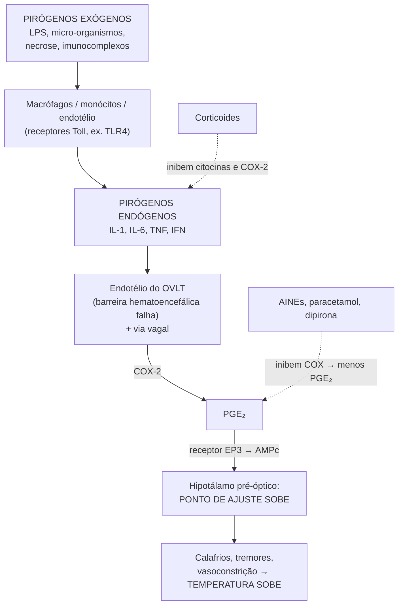
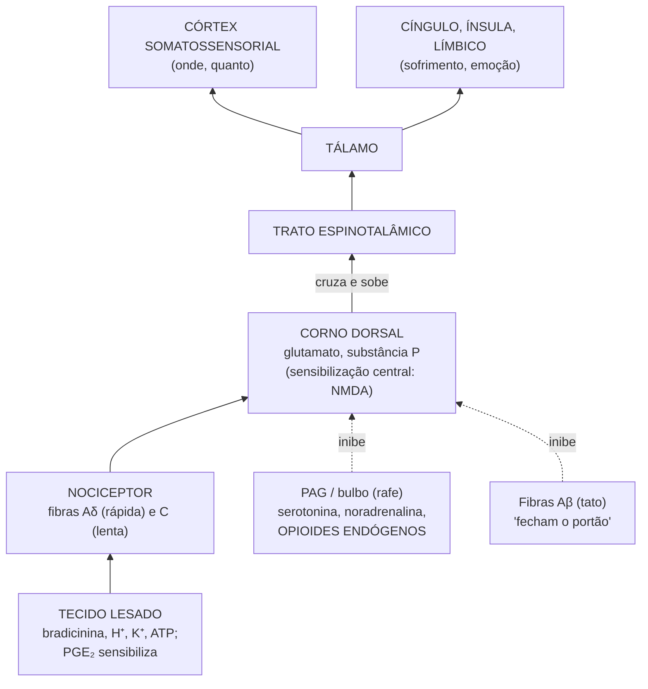
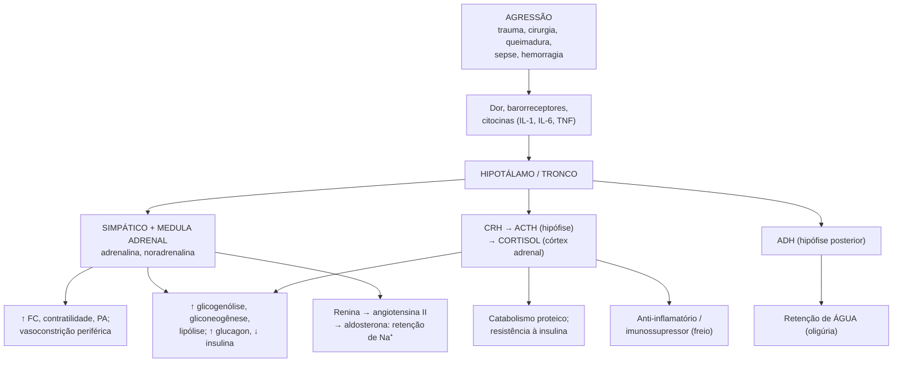

> **Pré-requisito:** os mediadores inflamatórios (citocinas, prostaglandinas, bradicinina) estão em [inflamação aguda](#/patologia/inflamacao-aguda#mediadores). Este tópico cobre o item da ementa do ASE6 sobre as **respostas sistêmicas à agressão**: febre, dor e a resposta neuroendócrina e metabólica ao estresse.

## Objetivos do tópico {#objetivos}

Ao final, você deve ser capaz de:

1. Explicar a **termorregulação** normal e como o **hipotálamo** ajusta o "termostato".
2. Narrar a **gênese da febre** (pirógenos exógenos → citocinas → **PGE₂** → ponto de ajuste) e suas fases clínicas; diferenciar **febre** de **hipertermia**; explicar como agem os **antitérmicos**.
3. Descrever o caminho da **dor**: nociceptores, fibras **Aδ** e **C**, medula, vias ascendentes e córtex; explicar a **dor inflamatória** (sensibilização periférica e central, hiperalgesia, alodinia), a **dor neuropática**, a **dor referida** e a **modulação descendente** (opioides endógenos, teoria do portão).
4. Descrever a **resposta neuroendócrina ao estresse**: **eixo hipotálamo-hipófise-adrenal** (CRH, ACTH, cortisol), **sistema simpático-adrenal** (catecolaminas), ADH, aldosterona, glucagon, GH — e as consequências **metabólicas** (hiperglicemia, catabolismo proteico, retenção de água e sódio).
5. Relacionar essas respostas com situações clínicas (sepse, pós-operatório, trauma, insuficiência adrenal, uso de corticoides).

::: referencias
Guyton & Hall – Tratado de Fisiologia Médica, 14ª ed., caps. "Temperatura corporal, regulação da temperatura e febre", "Sensações somáticas: II. Dor, cefaleia e sensações térmicas" e "Hormônios adrenocorticais" · Robbins Patologia Básica, 10ª ed., cap. "Inflamação e reparo" · Harrison – Medicina Interna, 21ª ed., caps. "Febre e hipertermia" e "Dor".
:::

## Conceitos-base {#conceitos-base}

### Temperatura corporal e termorregulação {#termorregulacao}

O ser humano é **homeotérmico**: mantém a temperatura **central** (dos órgãos internos) relativamente constante, em torno de **37 °C** (com variação diária de ~0,5 °C — mais baixa de madrugada, mais alta no fim da tarde, o **ritmo circadiano**), apesar das variações do ambiente. A temperatura da pele, ao contrário, varia bastante.

O **centro termorregulador** fica no **hipotálamo**, sobretudo na **área pré-óptica do hipotálamo anterior**. Ele funciona como um **termostato** com um **ponto de ajuste** (*set point*):

1. **Sensores**: neurônios sensíveis à temperatura do sangue no próprio hipotálamo e receptores térmicos da pele informam a temperatura atual.
2. **Comparação**: o hipotálamo compara a temperatura medida com o ponto de ajuste.
3. **Respostas efetoras**:
   - Se a temperatura está **acima** do ponto de ajuste → **perder calor**: **vasodilatação cutânea** (mais sangue quente na pele, que irradia calor), **sudorese** (a evaporação do suor retira calor), redução da produção de calor, comportamento (tirar roupas, procurar sombra).
   - Se está **abaixo** → **conservar e produzir calor**: **vasoconstrição cutânea** (pele fria e pálida, menos perda), **tremores** (contrações musculares involuntárias que geram calor), aumento do metabolismo (via simpático e hormônios tireoidianos), comportamento (agasalhar-se, encolher-se). Recém-nascidos usam também a **gordura marrom** (termogênese sem tremor).

A produção de calor vem do **metabolismo** (fígado, músculos, coração, cérebro); a perda ocorre por **radiação** (a principal em repouso), **condução**, **convecção** e **evaporação** (a única que funciona quando o ambiente está mais quente que o corpo).

### Febre × hipertermia {#febre-hipertermia}

- **Febre**: elevação da temperatura **porque o ponto de ajuste do hipotálamo subiu** — o termostato foi "regulado para cima" por mediadores inflamatórios. O corpo **ativamente** produz e conserva calor até atingir o novo ponto. É uma resposta **regulada** e geralmente **autolimitada** (raramente passa de 41 °C).
- **Hipertermia**: elevação da temperatura **com o ponto de ajuste normal**, porque a **produção de calor supera a capacidade de perder calor** (ou a perda está bloqueada): **insolação/intermação** (exercício intenso no calor), hipertermia maligna (reação genética a anestésicos), síndrome neuroléptica maligna, hipertireoidismo grave (tempestade tireoidiana), intoxicação por anfetaminas/cocaína. O termostato está "certo", mas o sistema não dá conta. **Os antitérmicos não funcionam** na hipertermia (não há ponto de ajuste para baixar), e ela pode subir a níveis fatais; o tratamento é **resfriamento físico** e tratamento da causa (veja [agressões físicas](#/patologia/agressoes-fisicas-quimicas#calor)).

### Vocabulário da dor {#vocabulario-dor}

A **dor** é, segundo a Associação Internacional para o Estudo da Dor, uma **experiência sensitiva e emocional desagradável associada, ou semelhante àquela associada, a uma lesão tecidual real ou potencial**. Isso significa que a dor tem um componente **sensorial** (onde, quanto, como) e um **afetivo-emocional** (sofrimento, medo), e que é sempre **subjetiva**.

- **Nocicepção**: o processo neural de **detectar e transmitir** estímulos lesivos (o "sinal"). A dor é a **percepção** consciente desse sinal no cérebro — pode haver nocicepção sem dor (anestesia geral) e dor sem nocicepção periférica (dor do membro fantasma).
- **Nociceptor**: terminação nervosa livre especializada em detectar estímulos **lesivos** (mecânicos intensos, térmicos extremos, químicos).
- **Hiperalgesia**: dor **maior** que o normal a um estímulo doloroso. **Alodinia**: dor provocada por um estímulo que **normalmente não dói** (como o toque leve na pele queimada pelo sol).
- **Dor aguda** (alerta e proteção, ligada a uma lesão) × **dor crônica** (> 3 meses, persistindo além do tempo normal de cura, frequentemente com mudanças no próprio sistema nervoso).

::: referencias
Guyton & Hall, 14ª ed. · Harrison, 21ª ed.
:::

## Explicação detalhada {#explicacao}

### Gênese da febre, passo a passo {#genese-febre}

1. **Pirógenos exógenos** — substâncias de fora que induzem febre: produtos de micro-organismos, sobretudo o **LPS** (endotoxina das bactérias Gram-negativas), mas também componentes de bactérias Gram-positivas, vírus e fungos; e também imunocomplexos, tecido necrótico, alguns fármacos e tumores.
2. **Reconhecimento**: macrófagos, monócitos, células dendríticas e células endoteliais reconhecem esses produtos por **receptores Toll** (o LPS pelo **TLR4** — veja [receptores de padrões](#/imunologia/imunidade-inata#receptores-padroes)).
3. **Pirógenos endógenos** — as células ativadas liberam **citocinas pirogênicas**: **IL-1**, **IL-6**, **TNF** e interferons.
4. **Chegada ao hipotálamo**: as citocinas circulantes agem nas células endoteliais dos vasos de uma região próxima ao hipotálamo onde a **barreira hematoencefálica é incompleta** — o **órgão vascular da lâmina terminal (OVLT)**. (Há também uma via nervosa: citocinas no abdome estimulam fibras do **nervo vago**, que informam o cérebro.)
5. **Produção de PGE₂**: essas células induzem a enzima **COX-2** e produzem **prostaglandina E₂ (PGE₂)**, o mediador final da febre.
6. **Elevação do ponto de ajuste**: a PGE₂ age em receptores (**EP3**) de neurônios da área pré-óptica, que, pela via do **AMPc**, **elevam o ponto de ajuste** — por exemplo, de 37 °C para 39 °C.
7. **O corpo "acha" que está frio**: agora a temperatura real (37 °C) está **abaixo** do novo ponto de ajuste. O hipotálamo aciona as respostas de **produção e conservação de calor**: vasoconstrição cutânea (mãos e pés frios, palidez), **calafrios e tremores**, sensação de frio, busca por cobertas, aumento do metabolismo.
8. **Platô**: quando a temperatura alcança o novo ponto de ajuste, os mecanismos se equilibram (pele quente e seca).
9. **Defervescência**: quando os pirógenos diminuem (infecção controlada) ou se usa antitérmico, o ponto de ajuste **volta ao normal**; agora a temperatura está **acima** do ponto de ajuste, e o hipotálamo aciona a **perda de calor**: **vasodilatação** (pele vermelha e quente) e **sudorese** intensa.

#### Para que serve a febre? {#utilidade-febre}

A febre é uma resposta **conservada na evolução** (ocorre até em répteis, que buscam lugares quentes quando infectados), o que sugere benefício: temperaturas mais altas **reduzem a multiplicação** de alguns micro-organismos, **aceleram** a fagocitose, a proliferação de linfócitos e a produção de anticorpos e interferons. O custo é **metabólico**: cada grau a mais aumenta o metabolismo em cerca de **10–13%**, eleva a frequência cardíaca (cerca de 10 batimentos por grau, em adultos) e o consumo de oxigênio — pesado para cardiopatas, idosos e pacientes graves. Em crianças pequenas predispostas, a subida rápida da temperatura pode desencadear **crises convulsivas febris**.

#### Antitérmicos {#antitermicos}

- **AINEs** (ibuprofeno, AAS), **paracetamol** e **dipirona** inibem a **COX** no sistema nervoso central, **reduzindo a PGE₂** e trazendo o ponto de ajuste de volta ao normal. Por isso **baixam a febre**, mas **não reduzem a temperatura normal** nem funcionam na **hipertermia**.
- **Corticoides** reduzem a produção das citocinas e da COX-2 — também baixam a febre (e podem mascarar infecções).
- **Medidas físicas** (compressas, banho morno) ajudam pouco na febre se o ponto de ajuste continua alto (o corpo reage produzindo mais calor) — são essenciais na **hipertermia**.

#### Padrões de febre {#padroes-febre}

- **Contínua**: elevada o tempo todo, com variação < 1 °C (febre tifoide, pneumonia lobar).
- **Remitente**: variação diária > 1 °C, sem voltar ao normal (muitas infecções bacterianas).
- **Intermitente**: sobe e **volta ao normal** a cada dia (abscessos, sepse).
- **Periódica (terçã)**: picos a cada **48 horas**, com dias sem febre — **malária** por *P. vivax*; ciclo ligado à ruptura sincronizada das hemácias.
- **Febre de origem indeterminada**: febre > 38,3 °C por mais de 3 semanas sem diagnóstico após investigação inicial (infecções como tuberculose e endocardite, doenças autoimunes, linfomas).

::: referencias
Guyton & Hall, 14ª ed., cap. "Temperatura corporal, regulação da temperatura e febre" · Harrison, 21ª ed., cap. "Febre e hipertermia".
:::

### Dor: do tecido ao cérebro {#dor}

O caminho da dor tem quatro etapas: **transdução** (o estímulo vira sinal elétrico no nociceptor), **transmissão** (o sinal viaja pelo nervo e pela medula), **modulação** (o sinal é amplificado ou atenuado na medula e no tronco) e **percepção** (o cérebro interpreta).

#### 1. Transdução: nociceptores {#nociceptores}

Os **nociceptores** são terminações nervosas livres presentes na pele, músculos, articulações, vísceras e vasos (mas **não** no parênquima cerebral). Detectam:

- Estímulos **mecânicos intensos** (corte, pressão forte);
- **Térmicos** extremos (acima de ~43 °C ou frio intenso) — por canais como o **TRPV1** (o mesmo ativado pela **capsaicina** da pimenta, por isso ela "arde");
- **Químicos**: substâncias liberadas pelos tecidos lesados e pela inflamação — **bradicinina**, **íons H⁺** (acidez), **K⁺**, **ATP**, serotonina, histamina.

Quando ativados, os canais iônicos despolarizam a terminação e, se o limiar é atingido, disparam **potenciais de ação**.

#### 2. Transmissão: as fibras e as vias {#fibras-vias}

Duas classes de fibras levam o sinal até a medula:

| | **Fibras Aδ** | **Fibras C** |
|---|---|---|
| Mielina | **Finamente mielinizadas** | **Amielínicas** |
| Velocidade | **Rápidas** (~5–30 m/s) | **Lentas** (~0,5–2 m/s) |
| Tipo de dor | **"Primeira dor"**: aguda, em pontada, **bem localizada** | **"Segunda dor"**: em queimação, difusa, **mal localizada**, persistente |
| Exemplo | A picada nítida ao bater o dedo | A dor latejante que vem segundos depois |

As fibras chegam ao **corno dorsal da medula espinal** (o primeiro neurônio tem o corpo celular no **gânglio da raiz dorsal**), onde fazem **sinapse** com neurônios de segunda ordem, liberando **glutamato** (rápido) e **substância P** e CGRP (neuropeptídios, mais lentos e prolongados). Os neurônios de segunda ordem **cruzam para o lado oposto** da medula e sobem pelo **trato espinotalâmico** (anterolateral):

- **Trato neoespinotalâmico** → tálamo (núcleos laterais) → **córtex somatossensorial**: aspecto **discriminativo** (onde dói, quanto, que tipo) — principalmente fibras Aδ.
- **Trato paleoespinotalâmico** e espinorreticular → formação reticular do tronco, tálamo medial → **córtex do cíngulo anterior, ínsula, sistema límbico**: aspecto **afetivo-emocional** (o sofrimento, a atenção, o alerta, as respostas autonômicas) — principalmente fibras C.

Na face, o equivalente é o **nervo trigêmeo**.

#### 3. Dor inflamatória: sensibilização {#sensibilizacao}

Na inflamação, a dor é **maior** e surge com estímulos menores. Dois mecanismos:

- **Sensibilização periférica**: mediadores da inflamação — sobretudo a **PGE₂** (que **não causa dor sozinha**, mas **reduz o limiar** dos nociceptores) e a **bradicinina** (que ativa e sensibiliza diretamente), além de histamina, serotonina, citocinas e o **fator de crescimento neural** (NGF) — alteram os canais iônicos dos nociceptores, que passam a disparar com estímulos fracos. Resultado: **hiperalgesia primária** no local inflamado. Nociceptores antes "silenciosos" (que não respondem normalmente) passam a responder. É aqui que os **AINEs** agem como analgésicos: ao reduzir as prostaglandinas, reduzem a sensibilização.
- **Inflamação neurogênica**: os próprios nociceptores ativados liberam, na periferia, **substância P** e **CGRP**, que causam vasodilatação e edema — amplificando a inflamação (o rubor ao redor de uma lesão).
- **Sensibilização central**: estímulos dolorosos intensos ou repetidos fazem os neurônios do **corno dorsal** ficarem **hiperexcitáveis** — a ativação de receptores **NMDA** pelo glutamato, o "*wind-up*" (aumento progressivo da resposta a estímulos repetidos das fibras C), redução da inibição. Resultado: **hiperalgesia secundária** (em área maior que a lesão) e **alodinia** (o toque leve, levado por fibras Aβ, passa a ativar neurônios de dor). A sensibilização central é importante na transição para a **dor crônica**.

#### 4. Modulação: o controle da dor pelo próprio sistema nervoso {#modulacao}

- **Teoria do portão (Melzack e Wall)**: no corno dorsal, interneurônios inibitórios funcionam como um "portão". Fibras grossas de **tato (Aβ)**, quando ativadas, estimulam esses interneurônios e **fecham o portão** à passagem do sinal doloroso. É por isso que **esfregar o local** que bateu alivia a dor (e a base da estimulação elétrica transcutânea, TENS).
- **Analgesia descendente**: regiões do tronco encefálico — **substância cinzenta periaquedutal (PAG)** no mesencéfalo e o **bulbo rostral ventromedial** (núcleo magno da rafe) — enviam fibras descendentes ao corno dorsal que liberam **serotonina** e **noradrenalina** e ativam interneurônios que liberam **opioides endógenos** (**encefalinas, endorfinas, dinorfinas**). Esses opioides agem em receptores (μ, δ, κ) **pré e pós-sinápticos**, reduzindo a liberação de glutamato e substância P e hiperpolarizando o neurônio de segunda ordem: o sinal é **atenuado**. O sistema é ativado por estresse, emoção intensa e atenção (o soldado ferido que não sente dor durante o combate — **analgesia induzida pelo estresse**).
- **Fármacos**: a **morfina** e outros opioides imitam os opioides endógenos; antidepressivos que aumentam serotonina e noradrenalina (como a duloxetina e a amitriptilina) reforçam a via descendente — úteis na dor neuropática.

#### Tipos de dor {#tipos-dor}

- **Nociceptiva somática**: de pele, músculos, ossos, articulações — **bem localizada** (fratura, corte).
- **Nociceptiva visceral**: de órgãos internos (distensão, isquemia, inflamação, espasmo) — **mal localizada**, difusa, em cólica ou peso, frequentemente com **náuseas, sudorese e palidez** (reações autonômicas). As vísceras são pouco sensíveis a corte ou queimadura, mas muito sensíveis a **distensão** e **isquemia**.
- **Dor referida**: dor visceral **sentida numa área da pele distante** do órgão, porque as fibras viscerais e as fibras da pele **convergem nos mesmos neurônios** do corno dorsal (no mesmo segmento medular) — o cérebro "atribui" a dor à pele, mais habituada a sentir dor. Exemplos: **infarto do miocárdio** → dor no **braço esquerdo, mandíbula, pescoço**; **vesícula biliar** → **ombro direito/escápula**; diafragma → **ombro**; **apendicite** → começa na região **periumbilical** (dor visceral) e depois migra para a **fossa ilíaca direita** (quando o peritônio parietal se inflama — dor somática); cálculo ureteral → irradiação para a virilha e genitais.
- **Neuropática**: causada por **lesão ou doença do próprio sistema nervoso** somatossensorial (neuropatia diabética, neuralgia pós-herpética, compressão de raiz, dor do membro fantasma). Características: **queimação, choques, formigamento**, alodinia, áreas de sensibilidade alterada. Responde mal aos AINEs; trata-se com antidepressivos, anticonvulsivantes (gabapentina, pregabalina, carbamazepina).
- **Nociplástica**: dor com sensibilização do sistema nervoso sem lesão evidente (fibromialgia).

::: referencias
Guyton & Hall, 14ª ed., cap. "Sensações somáticas: II. Dor" · Harrison, 21ª ed., cap. "Dor: fisiopatologia e tratamento".
:::

### Resposta neuroendócrina e metabólica ao estresse {#resposta-estresse}

Diante de uma agressão importante — **trauma, cirurgia, queimadura, infecção grave, hemorragia**, e também estresse emocional intenso —, o organismo dispara uma resposta coordenada pelo **sistema nervoso e pelo sistema endócrino**, com dois objetivos: **(1) manter a circulação e a perfusão dos órgãos vitais** e **(2) disponibilizar energia (glicose, aminoácidos, ácidos graxos)** para os tecidos que precisam se defender e se reparar. É a resposta de "**luta ou fuga**" ampliada e prolongada.

#### Como a agressão é detectada {#deteccao-estresse}

- **Impulsos nervosos aferentes** da área lesada (dor, nociceptores);
- **Barorreceptores** que detectam queda de pressão e volume (hemorragia);
- **Citocinas** (IL-1, IL-6, TNF) da área inflamada, que agem no hipotálamo;
- Estímulos emocionais (medo, ansiedade) vindos do sistema límbico.

Esses sinais convergem no **hipotálamo** e no **tronco encefálico**, que ativam dois grandes braços efetores.

#### Braço 1 — Sistema simpático-adrenal (resposta rápida, segundos) {#simpatico-adrenal}

O **sistema nervoso simpático** é ativado, e a **medula da adrenal** libera **adrenalina** (e noradrenalina) no sangue:

- **Coração e vasos**: aumento da **frequência e da força de contração** cardíaca (receptores β1), **vasoconstrição** na pele, rins e vísceras (α1), redirecionando sangue para coração, cérebro e músculos; aumento da pressão.
- **Metabolismo**: **glicogenólise** e **gliconeogênese** no fígado, **lipólise** no tecido adiposo, **inibição da insulina** e estímulo do **glucagon** → aumento de glicose e ácidos graxos no sangue.
- **Outros**: broncodilatação, pupilas dilatadas, sudorese, alerta.

#### Braço 2 — Eixo hipotálamo-hipófise-adrenal (HHA) (minutos a horas) {#eixo-hha}

1. O **hipotálamo** (núcleo paraventricular) libera **CRH** (hormônio liberador de corticotrofina) na circulação porta-hipofisária.
2. A **hipófise anterior** responde liberando **ACTH** (hormônio adrenocorticotrófico, ou corticotrofina) — junto com a **β-endorfina** (do mesmo precursor, a POMC), que contribui para a analgesia.
3. O ACTH estimula o **córtex da adrenal** (zona fasciculada) a produzir **cortisol**.
4. Normalmente, o cortisol **inibe** o hipotálamo e a hipófise (**retroalimentação negativa**); no estresse intenso, essa inibição é **superada** e o cortisol fica alto, perdendo-se o ritmo circadiano (normalmente mais alto pela manhã).

**Ações do cortisol no estresse**:

- **Metabolismo**: **hiperglicemia** (estimula a **gliconeogênese** hepática, reduz a captação de glicose pelos músculos e tecido adiposo — **resistência à insulina**), **catabolismo de proteínas musculares** (libera aminoácidos para a gliconeogênese e para a síntese de proteínas de fase aguda e de reparo), lipólise.
- **Circulação**: **potencializa** a ação das catecolaminas nos vasos (efeito "permissivo") — sem cortisol, os vasos respondem mal à adrenalina e a pressão cai.
- **Imunidade e inflamação**: **anti-inflamatório e imunossupressor** — reduz a produção de citocinas, prostaglandinas e leucotrienos, a migração de leucócitos e a função dos linfócitos. É um **freio** essencial: sem ele, a resposta inflamatória poderia se tornar descontrolada e lesiva. No hemograma: **leucocitose com neutrofilia** (desmarginação), **linfopenia** e **eosinopenia**.

#### Outros hormônios {#outros-hormonios-estresse}

- **ADH (vasopressina)**: liberado pela hipófise posterior (por dor, queda de volume, angiotensina, náuseas) → **retenção de água** nos rins (urina concentrada, **oligúria** no pós-operatório) e vasoconstrição. Pode causar **hiponatremia** se o paciente receber muitos líquidos sem sódio.
- **Sistema renina-angiotensina-aldosterona**: a queda de perfusão renal e o simpático estimulam a **renina** → angiotensina II (vasoconstrição) → **aldosterona** → **retenção de sódio e água**, perda de potássio.
- **Glucagon**: aumentado → mais glicogenólise e gliconeogênese.
- **Hormônio do crescimento (GH)**: aumentado → lipólise e hiperglicemia.
- **Insulina**: secreção **reduzida** no início (pelas catecolaminas) e, depois, **resistência** à sua ação.
- **Hormônios tireoidianos**: o T3 ativo cai (síndrome do eutireoidiano doente); **gonadotrofinas** e hormônios sexuais caem.

#### As fases metabólicas após a agressão {#fases-metabolicas}

Após um trauma grave ou cirurgia de grande porte, descrevem-se classicamente:

1. **Fase de choque (*ebb*, "vazante")** — primeiras **24–48 horas**: o organismo "economiza": **metabolismo e temperatura reduzidos**, débito cardíaco baixo se houver hipovolemia, prioridade para manter a perfusão (simpático intenso). Hiperglicemia.
2. **Fase de fluxo (*flow*)** — dias a semanas: **hipermetabolismo** — aumento do gasto energético e do consumo de O₂, febre, taquicardia, **catabolismo** intenso (perda de massa muscular, **balanço nitrogenado negativo**: elimina-se mais nitrogênio na urina do que se ingere), hiperglicemia com resistência à insulina, síntese de proteínas de fase aguda. Pode durar semanas em queimados e politraumatizados.
3. **Fase anabólica (convalescença)** — à medida que a agressão se resolve: recuperação da massa muscular, balanço nitrogenado positivo, ganho de peso.

**Resposta de fase aguda** associada: o fígado, estimulado pela **IL-6**, produz **proteína C-reativa**, fibrinogênio, amiloide A sérica, ferritina, hepcidina (que retém ferro) e reduz a albumina e a transferrina (veja [fase aguda](#/patologia/inflamacao-aguda#fase-aguda)).

::: referencias
Guyton & Hall, 14ª ed., caps. "Hormônios adrenocorticais" e "O sistema nervoso autônomo e a medula adrenal" · Harrison, 21ª ed. · Sabiston – Tratado de Cirurgia, 20ª ed., cap. "Resposta inflamatória sistêmica".
:::

## Correlação clínica {#correlacao-clinica}

### Hiperglicemia de estresse {#hiperglicemia-estresse}

Pacientes **sem diabetes** podem ter glicemias elevadas na sepse, no infarto, no AVC, no trauma e no pós-operatório, pela ação combinada de **cortisol, catecolaminas, glucagon, GH e citocinas** (gliconeogênese + resistência à insulina). A hiperglicemia acentuada piora o prognóstico (prejudica a função dos neutrófilos e a cicatrização), e por isso a glicemia é monitorada e controlada nas unidades de terapia intensiva, evitando também a hipoglicemia.

### Insuficiência adrenal e crise adrenal {#crise-adrenal}

Quem tem **insuficiência adrenal** (doença de Addison, destruição autoimune das adrenais) ou usa **corticoides cronicamente** — o que **suprime o eixo HHA**, deixando as adrenais atrofiadas — **não consegue aumentar o cortisol** diante de uma agressão. Numa infecção, cirurgia ou trauma, pode desenvolver **crise adrenal**: **hipotensão e choque refratários** a volume e vasopressores (falta o efeito permissivo do cortisol sobre os vasos), hipoglicemia, hiponatremia, febre, dor abdominal. Por isso, pacientes em uso crônico de corticoide recebem **doses de estresse** de hidrocortisona antes de cirurgias e em doenças graves, e o corticoide **não deve ser suspenso abruptamente**.

### Corticoides como fármacos {#corticoides-farmaco}

O uso terapêutico de corticoides reproduz o cortisol em excesso: **anti-inflamatório e imunossupressor** (úteis em alergias, asma, doenças autoimunes), mas com **hiperglicemia**, perda muscular, osteoporose, má cicatrização, maior risco de infecções, ganho de peso e, em uso prolongado, supressão do eixo HHA (síndrome de Cushing iatrogênica).

### Dor no pós-operatório e analgesia multimodal {#analgesia}

A dor não tratada **amplifica** a resposta ao estresse (taquicardia, hipertensão, hiperglicemia, catabolismo), dificulta a respiração profunda e a tosse (atelectasias, pneumonia) e a mobilização (trombose venosa profunda), e favorece a **dor crônica** pós-cirúrgica (sensibilização central). A **analgesia multimodal** combina fármacos que agem em pontos diferentes da via: **AINEs/dipirona/paracetamol** (sensibilização periférica e central), **opioides** (receptores μ na medula e no cérebro), **anestésicos locais** e bloqueios (impedem a transmissão no nervo), e adjuvantes. A **escada analgésica da OMS** orienta a progressão (não opioide → opioide fraco → opioide forte, com adjuvantes).

### Febre: quando se preocupar {#febre-alarme}

- Febre em **neutropênico** (quimioterapia) é **emergência** (veja [neutropenia febril](#/imunologia/orgaos-linfoides-hematopoese#neutropenia-febril)).
- Febre com **rigidez de nuca, petéquias, alteração de consciência, hipotensão** → meningite, sepse.
- **Hipertermia** (temperatura muito alta, pele quente e seca, confusão, após exposição ao calor ou uso de drogas) não responde a antitérmicos: resfriamento rápido.

::: referencias
Harrison, 21ª ed. · Goodman & Gilman, 13ª ed., caps. "ACTH, esteroides adrenais e farmacologia do córtex adrenal" e "Opioides, analgesia e manejo da dor".
:::

## Pontos de alta cobrança em prova {#alta-cobranca}

::: prova
- **Termorregulação**: hipotálamo **pré-óptico anterior** = termostato com ponto de ajuste; perder calor (vasodilatação, sudorese) × produzir/conservar (vasoconstrição, tremores).
- **Febre** = **ponto de ajuste elevado** (regulada); **hipertermia** = ponto de ajuste normal com produção > perda (insolação, hipertermia maligna, drogas) — **antitérmicos não funcionam** na hipertermia.
- **Gênese da febre**: pirógenos exógenos (LPS → TLR4) → **IL-1, IL-6, TNF** → endotélio do **OVLT** (e vago) → **COX-2** → **PGE₂** → receptor EP3/AMPc → **↑ ponto de ajuste** → calafrios, tremores, vasoconstrição; defervescência = sudorese e vasodilatação.
- **Antitérmicos**: AINEs, paracetamol, dipirona → inibem **COX** no SNC → ↓ PGE₂. Corticoides ↓ citocinas.
- Febre: +10–13% de metabolismo por °C; convulsão febril em crianças; febre terçã = malária vivax.
- **Dor**: transdução (nociceptores; TRPV1; bradicinina, H⁺, K⁺, ATP), transmissão (**Aδ**: rápida, mielinizada, localizada; **C**: lenta, amielínica, queimação), corno dorsal (**glutamato, substância P**) → cruza → **espinotalâmico** → tálamo → córtex somatossensorial (discriminativo) e cíngulo/ínsula/límbico (afetivo).
- **Sensibilização periférica**: **PGE₂ reduz o limiar** (não causa dor sozinha), bradicinina ativa → hiperalgesia primária (AINEs agem aqui). **Central**: NMDA, *wind-up* → hiperalgesia secundária, **alodinia**.
- **Modulação**: **teoria do portão** (fibras Aβ fecham o portão — esfregar alivia); via descendente **PAG → bulbo** (serotonina, noradrenalina) → **opioides endógenos** (encefalinas, endorfinas) inibem o corno dorsal.
- **Tipos**: somática (localizada), visceral (difusa, autonômica; sensível a distensão e isquemia), **referida** (convergência no mesmo segmento: IAM → braço esquerdo/mandíbula; vesícula → ombro direito; apendicite periumbilical → FID), **neuropática** (queimação, choques; antidepressivos, gabapentinoides).
- **Estresse**: simpático-adrenal (adrenalina: ↑ FC, PA, glicogenólise, lipólise) + **eixo HHA** (CRH → ACTH → **cortisol**: gliconeogênese, resistência à insulina, catabolismo proteico, efeito permissivo vascular, **anti-inflamatório**) + **ADH** (retenção de água, oligúria) + **aldosterona** (Na⁺) + glucagon, GH; insulina ↓.
- **Fases**: *ebb* (choque, hipometabolismo, 24–48 h) → *flow* (**hipermetabolismo, catabolismo, balanço nitrogenado negativo**) → anabólica.
- **Clínica**: hiperglicemia de estresse; **crise adrenal** em quem usa corticoide crônico (choque refratário) → dose de estresse; analgesia multimodal.
:::

## Armadilhas comuns {#armadilhas}

::: armadilha
- **Confundir febre com hipertermia.** Na febre o **termostato subiu**; na hipertermia o termostato está normal e o corpo **não consegue perder calor** — antitérmico não resolve.
- **Achar que os calafrios significam que a febre está caindo.** Calafrios e tremores acontecem na **subida** (o corpo "acha" que está frio); a **sudorese** acontece na **queda**.
- **Achar que a PGE₂ causa dor diretamente.** Ela **sensibiliza** os nociceptores (reduz o limiar); quem ativa diretamente é a bradicinina, H⁺, K⁺, ATP.
- **Trocar as fibras.** **Aδ** = mielinizadas, rápidas, dor aguda localizada; **C** = amielínicas, lentas, dor em queimação difusa.
- **Achar que a dor referida vem de um "erro" do órgão.** Ela vem da **convergência** das fibras viscerais e cutâneas nos **mesmos neurônios** medulares.
- **Achar que o cortisol do estresse é só prejudicial.** Ele é essencial para manter a pressão (efeito permissivo) e **frear** a inflamação; sua falta leva a choque.
- **Esquecer a oligúria fisiológica do pós-operatório.** Decorre do **ADH** e da **aldosterona** elevados; hidratação excessiva com soluções sem sódio pode causar **hiponatremia**.
:::

## Resumo para revisão rápida {#resumo}

- **Termorregulação**: hipotálamo pré-óptico (termostato); febre = ponto de ajuste alto; hipertermia = falha em perder calor.
- **Febre**: pirógenos exógenos → IL-1/IL-6/TNF → OVLT → COX-2 → PGE₂ → ponto de ajuste ↑ → calafrios; defervescência com sudorese; antitérmicos inibem COX; benefícios e custo metabólico; padrões (contínua, remitente, intermitente, terçã).
- **Dor**: nociceptores → fibras Aδ e C → corno dorsal (glutamato, substância P) → espinotalâmico → tálamo → córtex e sistema límbico. Sensibilização periférica (PGE₂, bradicinina) e central (NMDA). Modulação: portão (Aβ) e via descendente (PAG, serotonina, noradrenalina, opioides endógenos). Tipos: somática, visceral, referida, neuropática.
- **Estresse**: simpático-adrenal (catecolaminas) + eixo HHA (cortisol) + ADH + aldosterona + glucagon/GH; hiperglicemia, catabolismo, retenção de água e sódio, anti-inflamação; fases ebb, flow e anabólica.
- **Clínica**: hiperglicemia de estresse, crise adrenal (dose de estresse em usuários de corticoide), analgesia multimodal, febre de alarme.

::: referencias
Guyton & Hall, 14ª ed. · Robbins Patologia Básica, 10ª ed. · Harrison, 21ª ed.
:::
