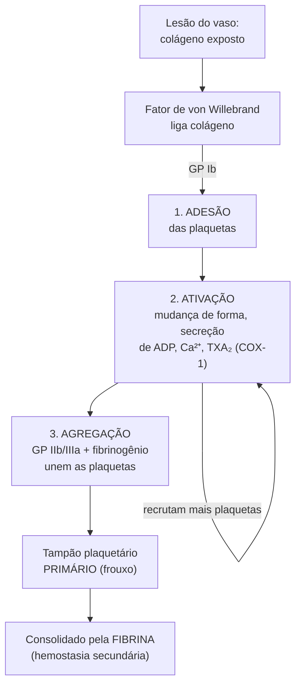
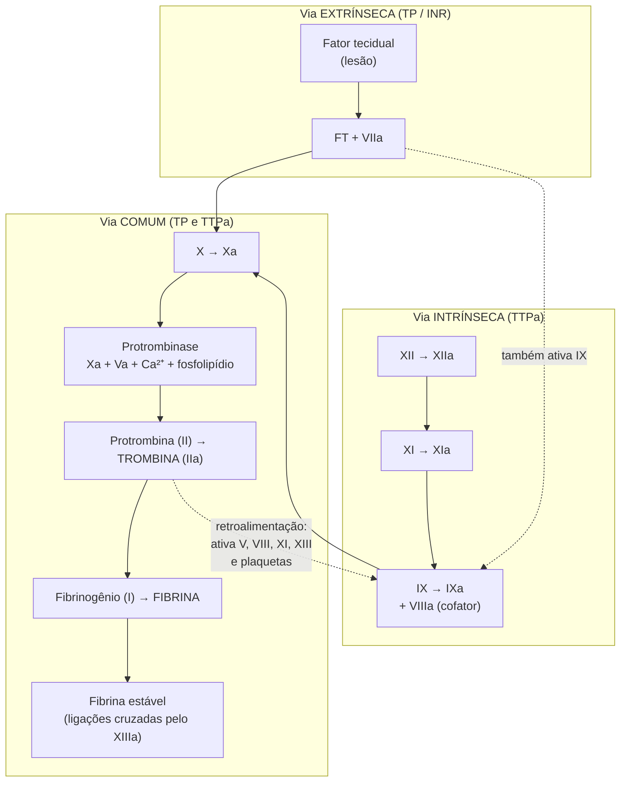
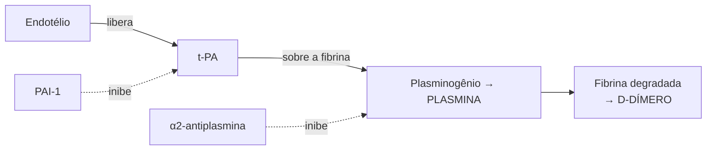

> **Ligação com o morfofuncional:** a trombose venosa profunda, a anatomia das veias e o trombo ao microscópio (linhas de Zahn) estão em [trombose e cicatrização](#/patologia/morfo-trombose-cicatrizacao). Este tópico explica o mecanismo normal da hemostasia e os principais distúrbios (sangramento e trombose), item da ementa do ASE6.

## Objetivos do tópico {#objetivos}

Ao final, você deve ser capaz de:

1. Descrever as etapas da **hemostasia normal**: resposta vascular, **hemostasia primária** (plaquetas) e **secundária** (coagulação), e **fibrinólise**.
2. Explicar a **adesão, a ativação e a agregação** das plaquetas, com as moléculas envolvidas (fator de von Willebrand, GP Ib, GP IIb/IIIa, ADP, tromboxano A₂).
3. Narrar a **cascata da coagulação** — o modelo clássico (vias extrínseca, intrínseca e comum) e o **modelo celular** (iniciação, amplificação, propagação) —, incluindo o papel da **vitamina K** e do **cálcio**.
4. Explicar os **anticoagulantes naturais** (antitrombina, proteína C e S, TFPI) e o **papel antitrombótico do endotélio**.
5. Interpretar os **exames** (contagem de plaquetas, TP/INR, TTPa, fibrinogênio, D-dímero).
6. Reconhecer os principais **distúrbios hemorrágicos** (hemofilias, doença de von Willebrand, plaquetopenias, deficiência de vitamina K, CIVD) e **trombóticos** (trombofilias), e o mecanismo dos **antiagregantes, anticoagulantes e trombolíticos**.

::: referencias
Kumar, Abbas & Aster – Robbins Patologia Básica, 10ª ed., caps. "Distúrbios hemodinâmicos, tromboembolia e choque" e "Doenças hematológicas" · Guyton & Hall – Tratado de Fisiologia Médica, 14ª ed., cap. "Hemostasia e coagulação sanguínea" · Goodman & Gilman, 13ª ed., cap. "Coagulação sanguínea e fármacos anticoagulantes, fibrinolíticos e antiplaquetários".
:::

## Conceitos-base {#conceitos-base}

### O equilíbrio da hemostasia {#equilibrio}

**Hemostasia** é o conjunto de mecanismos que (1) **mantém o sangue líquido** dentro dos vasos normais e (2) **forma rapidamente um tampão** no local de uma lesão vascular, impedindo a perda de sangue — e depois (3) **dissolve** esse tampão quando o vaso se repara. É um **equilíbrio fino** entre forças **pró-coagulantes** e **anticoagulantes/fibrinolíticas**:

- Pender demais para o lado pró-coagulante → **trombose** (formação de trombos dentro de vasos íntegros — veja [trombose](#/patologia/morfo-trombose-cicatrizacao#triade-virchow)).
- Pender demais para o lado anticoagulante → **hemorragia** (sangramento).

Os protagonistas são três: **(1) a parede do vaso** (sobretudo o **endotélio**), **(2) as plaquetas** e **(3) as proteínas da coagulação** (os "fatores", a maioria produzida pelo **fígado**).

### Vocabulário {#vocabulario-hemostasia}

- **Plaquetas (trombócitos)**: fragmentos de citoplasma, **sem núcleo**, de 2–3 µm, liberados pelos **megacariócitos** da medula óssea. Vivem **7 a 10 dias**. Valor normal: **150.000 a 450.000/mm³**. Contêm **grânulos α** (fator de von Willebrand, fibrinogênio, fator V, PDGF) e **grânulos densos** (ADP, cálcio, serotonina).
- **Fatores da coagulação**: proteínas plasmáticas numeradas em algarismos romanos (I a XIII), a maioria **zimogênios** — formas **inativas** de enzimas (serino-proteases), que se ativam em sequência, cada uma cortando e ativando a seguinte. O "a" indica a forma ativa (ex.: X → Xa).
- **Fibrinogênio (fator I)** → **fibrina**: proteína solúvel que, cortada pela **trombina (fator IIa)**, polimeriza formando uma **rede insolúvel** que prende plaquetas e hemácias.
- **Coágulo** × **trombo**: coágulo é sangue coagulado (inclusive fora do corpo); trombo é a massa formada dentro do vaso em vida.

::: referencias
Guyton & Hall, 14ª ed., cap. "Hemostasia e coagulação sanguínea" · Robbins Patologia Básica, 10ª ed.
:::

## Explicação detalhada {#explicacao}

### O endotélio: antitrombótico em repouso, pró-trombótico quando lesado {#endotelio}

Em condições normais, o endotélio **impede** a coagulação:

- **Contra as plaquetas**: produz **prostaciclina (PGI₂)** e **óxido nítrico (NO)**, que inibem a ativação plaquetária e dilatam o vaso; tem a enzima **ADPase** (CD39), que degrada o ADP (um ativador de plaquetas); e cobre o colágeno subendotelial, que é muito trombogênico.
- **Contra a coagulação**: tem na superfície **heparan sulfato** (molécula parecida com a heparina, que potencializa a **antitrombina**), **trombomodulina** (que transforma a trombina de pró em **anticoagulante**, ativando a proteína C) e produz o **inibidor da via do fator tecidual (TFPI)**.
- **Fibrinolítico**: libera o **ativador do plasminogênio tecidual (t-PA)**.

Quando é **lesado ou ativado** (trauma, citocinas inflamatórias como TNF e IL-1, toxinas bacterianas, hipóxia), o endotélio **expõe o colágeno subendotelial** e o **fator de von Willebrand**, passa a expressar **fator tecidual** e reduz suas defesas: torna-se **pró-trombótico**.

### Etapa 1 — Resposta vascular {#resposta-vascular}

Logo após a lesão, ocorre **vasoconstrição arteriolar** reflexa (por reflexo neurogênico e pela **endotelina**, liberada pelo endotélio lesado), reduzindo o fluxo para a área. É transitória: sozinha, não para um sangramento.

### Etapa 2 — Hemostasia primária: o tampão plaquetário {#hemostasia-primaria}

1. **Adesão**: o colágeno subendotelial exposto se liga ao **fator de von Willebrand (FvW)**, uma proteína grande (produzida pelo endotélio e pelos megacariócitos) que funciona como uma "**ponte**" entre o colágeno e as plaquetas. As plaquetas aderem ao FvW por meio do receptor **glicoproteína Ib (GP Ib)**. A adesão é especialmente importante em **fluxo rápido** (artérias), onde as plaquetas precisam ser "agarradas".
2. **Ativação e mudança de forma**: aderidas, as plaquetas se **ativam**: mudam de discos lisos para formas **espiculadas** (com projeções, aumentando a superfície) e **liberam o conteúdo dos grânulos** (**secreção**): **ADP** e **cálcio** dos grânulos densos; FvW, fibrinogênio e fator V dos grânulos α. Também sintetizam **tromboxano A₂ (TXA₂)** a partir do ácido araquidônico (pela **cicloxigenase-1**). ADP e TXA₂ **recrutam e ativam mais plaquetas** — amplificação. A membrana ativada expõe **fosfolipídios negativos (fosfatidilserina)**, que servem de superfície para as reações da coagulação.
3. **Agregação**: a ativação muda a forma do receptor **glicoproteína IIb/IIIa (GP IIb/IIIa)**, que passa a ligar **fibrinogênio**. Cada molécula de fibrinogênio se liga a duas plaquetas, **unindo-as** umas às outras: forma-se o **tampão plaquetário primário**, ainda frouxo. A trombina gerada na coagulação reforça a ativação (pelos receptores PAR).

O tampão primário é **instável**: precisa ser consolidado pela rede de fibrina da hemostasia secundária.

### Etapa 3 — Hemostasia secundária: a cascata da coagulação {#cascata}

O objetivo da cascata é gerar **trombina**, a enzima central, que converte **fibrinogênio em fibrina**. As reações são **amplificadas** (cada enzima ativa muitas moléculas da próxima) e ocorrem sobre **superfícies de fosfolipídios** (plaquetas ativadas, células lesadas) com **cálcio** (Ca²⁺), que liga os fatores a essas superfícies — por isso o sangue colhido para exames vai em tubo com **citrato**, que captura o cálcio e impede a coagulação.

#### Vitamina K {#vitamina-k}

Os fatores **II (protrombina), VII, IX e X** — e os anticoagulantes **proteína C e S** — são **dependentes de vitamina K**. O fígado os produz, mas para que funcionem precisa adicionar grupos carboxila (**γ-carboxilação**) a resíduos de ácido glutâmico; esses grupos ligam o **cálcio** e permitem que o fator se fixe aos fosfolipídios. A vitamina K é o cofator dessa reação. **Sem vitamina K** (desnutrição, antibióticos que eliminam a flora intestinal, má absorção de gordura, recém-nascidos, uso de **varfarina**), os fatores são produzidos, mas **não funcionam**.

#### Modelo clássico (útil para entender os exames) {#modelo-classico}

- **Via extrínseca** — iniciada pelo **fator tecidual** (FT, também chamado tromboplastina; uma proteína de membrana das células **fora** dos vasos — fibroblastos, células musculares lisas — e de monócitos e endotélio ativados). O FT, exposto pela lesão, liga-se ao **fator VII**, formando o complexo **FT–VIIa**, que ativa o **fator X**. É avaliada pelo **tempo de protrombina (TP)**.
- **Via intrínseca** — iniciada pelo contato do **fator XII** com superfícies de carga negativa (no laboratório, vidro, caolim): XII → XI → **IX**; o **IXa**, junto com o **VIIIa** (seu cofator), ativa o **fator X**. É avaliada pelo **tempo de tromboplastina parcial ativada (TTPa)**.
- **Via comum** — o **Xa**, com seu cofator **Va**, forma o complexo **protrombinase**, que converte a **protrombina (II)** em **trombina (IIa)**. A trombina corta o **fibrinogênio (I)** em **fibrina**; os monômeros de fibrina se polimerizam, e o **fator XIIIa** (ativado pela trombina) faz **ligações cruzadas** que estabilizam a rede. Alterações aqui prolongam **TP e TTPa**.

#### Modelo celular (como acontece no corpo) {#modelo-celular}

No organismo, as vias não funcionam separadas. O **modelo baseado em células** descreve três fases sobrepostas:

1. **Iniciação** — na célula que expressa **fator tecidual** (no local da lesão), o complexo **FT–VIIa** ativa pequenas quantidades de **X** (e de IX). O Xa gera uma **pequena quantidade de trombina** — insuficiente para formar fibrina em larga escala, mas suficiente para dar a partida. O **TFPI** logo bloqueia o complexo FT–VIIa–Xa, por isso a iniciação é breve.
2. **Amplificação** — essa pequena quantidade de trombina **ativa as plaquetas** que aderiram ao local e ativa os cofatores **V e VIII** e o **fator XI** na superfície plaquetária.
3. **Propagação** — sobre as **plaquetas ativadas**, o **IXa + VIIIa** (complexo "tenase") gera grandes quantidades de **Xa**, e o **Xa + Va** (protrombinase) gera uma **explosão de trombina**, que forma a rede de fibrina e consolida o tampão.

**Por que isso importa?** O modelo explica por que a falta de **fator VIII ou IX** (hemofilias) causa sangramento grave, apesar de a via extrínseca estar normal: sem o complexo tenase, não há amplificação suficiente. E por que a falta de **fator XII** **não causa sangramento** (ele prolonga o TTPa no laboratório, mas não é necessário no corpo).

#### As funções da trombina {#trombina}

A **trombina** é a "maestra" da hemostasia:

- Converte **fibrinogênio em fibrina** e ativa o **XIII**;
- **Ativa plaquetas** (receptores PAR) — o ativador plaquetário mais potente;
- Ativa os fatores **V, VIII e XI** (retroalimentação positiva);
- Ao se ligar à **trombomodulina** do endotélio **normal**, muda de função e ativa a **proteína C** — tornando-se **anticoagulante** (isso limita o coágulo ao local da lesão);
- Tem efeitos **inflamatórios** (ativa endotélio e leucócitos) — ponte entre coagulação e inflamação.

::: referencias
Robbins Patologia Básica, 10ª ed., cap. "Distúrbios hemodinâmicos" · Guyton & Hall, 14ª ed.
:::

### Etapa 4 — Freios: os anticoagulantes naturais {#anticoagulantes-naturais}

Para que o coágulo **não se espalhe** além do local da lesão:

- **Antitrombina (AT)**: inibe a **trombina** e o **Xa** (também IXa, XIa, XIIa). Sua ação é **muito acelerada pela heparina** (e pelo heparan sulfato endotelial) — é assim que o fármaco **heparina** funciona.
- **Sistema da proteína C**: a trombina ligada à **trombomodulina** ativa a **proteína C**, que, com seu cofator **proteína S**, **inativa os fatores Va e VIIIa** (os cofatores dos complexos que amplificam a cascata). Ambas dependem de vitamina K.
- **TFPI (inibidor da via do fator tecidual)**: bloqueia o complexo **FT–VIIa–Xa**, encerrando a iniciação.
- **Fluxo sanguíneo**: dilui e "lava" os fatores ativados, levando-os ao fígado para serem removidos (por isso a **estase** favorece a trombose).

### Etapa 5 — Fibrinólise: dissolvendo o coágulo {#fibrinolise}

Quando o vaso se repara, o coágulo precisa ser removido:

1. O endotélio libera o **ativador do plasminogênio tecidual (t-PA)** (há também a uroquinase), que se liga à fibrina.
2. Sobre a fibrina, o t-PA converte o **plasminogênio** (incorporado ao coágulo) em **plasmina**.
3. A **plasmina** degrada a fibrina em fragmentos, os **produtos de degradação da fibrina** — entre eles o **D-dímero**, que só existe se houve fibrina **estabilizada** (com ligações cruzadas) que foi degradada. Por isso o **D-dímero elevado** indica que há formação e dissolução de coágulos no corpo.
4. **Freios da fibrinólise**: o **PAI-1** (inibidor do ativador do plasminogênio, produzido pelo endotélio e aumentado na inflamação e na obesidade) e a **α2-antiplasmina** (que inativa a plasmina livre circulante).

### Os exames da coagulação {#exames}

| Exame | O que avalia | Valor de referência aproximado | Prolongado/alterado em |
|---|---|---|---|
| **Contagem de plaquetas** | Número de plaquetas | 150–450 mil/mm³ | Plaquetopenias (sangramento de pele e mucosas, geralmente < 50 mil; espontâneo < 10–20 mil) |
| **Tempo de protrombina (TP)** e **INR** | Via **extrínseca** e **comum** (VII, X, V, II, fibrinogênio) | TP ~11–13,5 s; INR ~1,0 | **Deficiência de vitamina K**, **varfarina**, **doença hepática** (o VII tem meia-vida curta — altera primeiro), CIVD |
| **TTPa** | Via **intrínseca** e **comum** (XII, XI, IX, VIII, X, V, II, fibrinogênio) | ~25–35 s | **Hemofilias A e B**, **heparina não fracionada**, doença de von Willebrand (pelo VIII baixo), anticoagulante lúpico (paradoxalmente trombótico), CIVD |
| **Fibrinogênio** | Quantidade de fibrinogênio | ~200–400 mg/dL | Baixo no **consumo** (CIVD) e na doença hepática grave; alto na inflamação (proteína de fase aguda) |
| **D-dímero** | Formação e degradação de fibrina | Baixo | **TVP/embolia pulmonar**, **CIVD**, pós-operatório, gestação, câncer, infecção (pouco específico; útil para **excluir** TEV quando normal) |

O **INR** (razão normalizada internacional) padroniza o TP entre laboratórios; é usado para **controlar a varfarina** (alvo geralmente entre 2 e 3).

::: referencias
Robbins Patologia Básica, 10ª ed., cap. "Doenças hematológicas" · Goodman & Gilman, 13ª ed.
:::

## Correlação clínica {#correlacao-clinica}

### Distúrbios hemorrágicos {#disturbios-hemorragicos}

**Padrão do sangramento** — ajuda a localizar o defeito:

| | **Defeito plaquetário / vascular (hemostasia primária)** | **Defeito de coagulação (hemostasia secundária)** |
|---|---|---|
| Local | **Pele e mucosas**: petéquias, equimoses pequenas, gengivorragia, epistaxe, menorragia | **Profundo**: **hemartroses** (sangue nas articulações), hematomas musculares |
| Início após trauma/cirurgia | **Imediato** | **Tardio** (horas depois — o tampão primário se forma, mas não se consolida) |
| Exemplos | Plaquetopenias, doença de von Willebrand, uso de AAS | Hemofilias, deficiência de vitamina K |

- **Plaquetopenias (trombocitopenias)**: por **menor produção** (aplasia de medula, leucemias, quimioterapia, deficiência de B12/folato), **maior destruição** (**púrpura trombocitopênica imune** — anticorpos contra as plaquetas; dengue; heparina) ou **sequestro** no baço aumentado. Petéquias quando muito baixas.
- **Doença de von Willebrand**: o distúrbio hemorrágico **hereditário mais comum** (geralmente autossômico dominante). Falta ou disfunção do FvW → **adesão plaquetária deficiente** (sangramento mucocutâneo: epistaxe, menorragia, sangramento após extração dentária) e, como o FvW também **protege o fator VIII** da degradação, o VIII pode estar baixo (TTPa prolongado). Plaquetas em número normal.
- **Hemofilia A** (deficiência de **fator VIII**) e **hemofilia B** (deficiência de **fator IX**): herança **recessiva ligada ao X** — afetam quase só **homens**, e as mulheres são portadoras. Sangramentos profundos (**hemartroses** de joelhos, cotovelos, tornozelos, que destroem as articulações), hematomas, sangramento prolongado após cirurgia. **TTPa prolongado**, TP e plaquetas normais. Tratamento: reposição do fator.
- **Deficiência de vitamina K**: recém-nascidos (pouca vitamina K e flora intestinal estéril — por isso todo recém-nascido recebe **vitamina K intramuscular** ao nascer, prevenindo a doença hemorrágica do recém-nascido), desnutrição, antibióticos prolongados, má absorção, colestase, **intoxicação por varfarina** ou raticidas cumarínicos. **TP/INR prolongado** primeiro (o VII tem meia-vida mais curta).
- **Doença hepática**: o fígado produz quase todos os fatores — TP prolongado, plaquetopenia (por hiperesplenismo), mas também redução dos anticoagulantes naturais (equilíbrio frágil).

### Coagulação intravascular disseminada (CIVD) {#civd}

A **CIVD** é uma ativação **sistêmica e descontrolada** da coagulação, desencadeada por doenças graves que expõem **fator tecidual** em grande quantidade ou lesam o endotélio de forma difusa: **sepse** (sobretudo por Gram-negativos e meningococo), **trauma grave e queimaduras**, **complicações obstétricas** (descolamento de placenta, embolia de líquido amniótico, feto morto retido), **câncer** (leucemia promielocítica aguda, adenocarcinomas), picadas de cobras (algumas peçonhas), choque.

O paradoxo da CIVD é que ela causa, **ao mesmo tempo**:

1. **Trombose**: microtrombos de fibrina em pequenos vasos de vários órgãos → **isquemia** e falência de órgãos (rins, pulmões, cérebro, pele) e **anemia hemolítica microangiopática** (as hemácias são fragmentadas ao passar pelos filamentos de fibrina — **esquizócitos** no sangue periférico);
2. **Hemorragia**: o **consumo** de plaquetas e de fatores (sobretudo fibrinogênio) e a **fibrinólise** ativada deixam o sangue incapaz de coagular → sangramento difuso (punções, mucosas, feridas).

**Laboratório**: **plaquetas baixas**, **TP e TTPa prolongados**, **fibrinogênio baixo**, **D-dímero muito elevado**, esquizócitos. Tratamento: tratar a **causa** e dar suporte (plaquetas, plasma, crioprecipitado conforme sangramento).

### Trombofilias {#trombofilias}

Tendência aumentada a **trombose** (veja também a [tríade de Virchow](#/patologia/morfo-trombose-cicatrizacao#triade-virchow)):

- **Hereditárias**: **fator V de Leiden** (o Va resiste à inativação pela proteína C ativada — a mais comum em populações de origem europeia), mutação da **protrombina G20210A** (mais protrombina), deficiências de **antitrombina**, **proteína C** e **proteína S**.
- **Adquiridas**: **síndrome antifosfolípide** (autoanticorpos contra proteínas ligadas a fosfolipídios; trombose venosa e arterial, abortos de repetição; o "anticoagulante lúpico" prolonga o TTPa no laboratório, mas causa **trombose** no paciente), câncer, gestação, estrogênios, imobilização, **trombocitopenia induzida por heparina** (anticorpos contra o complexo heparina–fator plaquetário 4 que **ativam** plaquetas: queda das plaquetas **com trombose**).

### Fármacos: onde cada um age {#farmacos}

| Classe | Exemplo | Mecanismo | Monitoramento / antídoto |
|---|---|---|---|
| **Antiagregantes** | **Ácido acetilsalicílico (AAS)** | Inibe **irreversivelmente a COX-1** → sem **TXA₂** pelos ~7–10 dias de vida da plaqueta | — |
| | **Clopidogrel** | Bloqueia o receptor de **ADP** (P2Y12) | — |
| | Abciximabe, tirofibana | Bloqueiam a **GP IIb/IIIa** (agregação final) | — |
| **Heparina não fracionada** | — | Potencializa a **antitrombina** → inibe **trombina e Xa** | **TTPa**; antídoto **protamina** |
| **Heparina de baixo peso molecular** | Enoxaparina | Antitrombina → inibe sobretudo o **Xa** | Anti-Xa (se necessário) |
| **Antagonista da vitamina K** | **Varfarina** | Impede a reciclagem da vitamina K → fatores **II, VII, IX, X** (e proteínas C e S) não funcionais | **TP/INR**; antídoto **vitamina K** (e plasma/complexo protrombínico) |
| **Anticoagulantes orais diretos** | Rivaroxabana, apixabana (anti-**Xa**); dabigatrana (anti-**trombina**) | Inibem diretamente o fator | Antídotos específicos (andexanete, idarucizumabe) |
| **Trombolíticos** | Alteplase (t-PA recombinante) | Convertem **plasminogênio em plasmina** → dissolvem o trombo | Usados no AVC isquêmico e no IAM/embolia pulmonar selecionados; risco de hemorragia |
| **Antifibrinolíticos** | Ácido tranexâmico | Inibe a ativação do plasminogênio | Hemorragias (trauma, pós-parto) |

**Detalhe da varfarina**: no início do tratamento, a **proteína C** (de meia-vida curta) cai antes dos fatores pró-coagulantes, criando um breve estado **pró-trombótico** — por isso se associa heparina nos primeiros dias, e pacientes com deficiência de proteína C podem ter **necrose cutânea** induzida por varfarina.

::: referencias
Robbins Patologia Básica, 10ª ed., caps. "Doenças hematológicas" e "Distúrbios hemodinâmicos" · Goodman & Gilman, 13ª ed. · Ministério da Saúde – Manual de Hemofilia.
:::

## Pontos de alta cobrança em prova {#alta-cobranca}

::: prova
- **Endotélio normal = antitrombótico**: PGI₂, NO, ADPase (anti-plaqueta); heparan sulfato (antitrombina), **trombomodulina** (proteína C), TFPI; **t-PA**. Lesado: expõe **colágeno**, **FvW**, **fator tecidual**.
- **Hemostasia primária**: **adesão** (colágeno–**FvW**–**GP Ib**) → **ativação** (forma, grânulos: ADP, Ca²⁺; **TXA₂** pela COX-1) → **agregação** (**GP IIb/IIIa + fibrinogênio**).
- **Coagulação**: extrínseca (**FT + VII**) → **TP/INR**; intrínseca (XII, XI, **IX + VIII**) → **TTPa**; comum (**X + V** → protrombina → **trombina** → **fibrina**; XIII estabiliza). Cálcio e fosfolipídios necessários (citrato no tubo).
- **Modelo celular**: iniciação (FT–VIIa, pouca trombina) → amplificação (plaquetas, V, VIII, XI) → propagação (tenase IXa–VIIIa, protrombinase Xa–Va → explosão de trombina). Falta de XII não sangra.
- **Vitamina K**: fatores **II, VII, IX, X** + **proteínas C e S** (γ-carboxilação). Varfarina e deficiência → **TP/INR** prolongado primeiro.
- **Anticoagulantes naturais**: **antitrombina** (trombina, Xa; potencializada pela heparina), **proteína C + S** (inativam **Va e VIIIa**), **TFPI**.
- **Fibrinólise**: t-PA → **plasmina** → **D-dímero**; freios: PAI-1, α2-antiplasmina.
- **Sangramento**: plaquetário (mucocutâneo, imediato: petéquias, epistaxe) × coagulação (**hemartroses**, tardio).
- **von Willebrand**: o mais comum hereditário; adesão deficiente; VIII pode cair (TTPa ↑); plaquetas normais. **Hemofilia A (VIII)/B (IX)**: ligada ao X, **hemartroses**, **TTPa ↑**, TP normal.
- **CIVD**: sepse, trauma, obstetrícia, câncer; **microtrombos + hemorragia por consumo**; plaquetas ↓, TP/TTPa ↑, **fibrinogênio ↓**, **D-dímero ↑↑**, esquizócitos.
- **Trombofilias**: fator V de Leiden, protrombina G20210A, deficiência de AT/proteína C/S, **SAF** (TTPa ↑ mas trombose), TIH.
- **Fármacos**: AAS (COX-1, TXA₂), clopidogrel (ADP/P2Y12), heparina (antitrombina; **TTPa**; protamina), varfarina (vit. K; **INR**; vitamina K), DOACs (anti-Xa, antitrombina), alteplase (plasminogênio → plasmina).
:::

## Armadilhas comuns {#armadilhas}

::: armadilha
- **Achar que o TP avalia a via intrínseca.** **TP** = extrínseca (VII) + comum; **TTPa** = intrínseca (VIII, IX, XI, XII) + comum.
- **Achar que hemofilia causa petéquias.** Causa sangramentos **profundos** (hemartroses); petéquias sugerem problema de **plaquetas**.
- **Achar que a deficiência de fator XII sangra.** Prolonga o TTPa, mas **não causa sangramento**.
- **Confundir o mecanismo da heparina com o da varfarina.** **Heparina** potencializa a **antitrombina** (efeito imediato, TTPa); **varfarina** antagoniza a **vitamina K** (efeito em dias, INR).
- **Achar que D-dímero alto confirma trombose.** É **sensível** mas **pouco específico**; seu valor é **excluir** quando normal em baixa probabilidade.
- **Achar que a CIVD é só um problema de sangramento.** Ela causa **trombose e hemorragia** ao mesmo tempo.
- **Achar que o anticoagulante lúpico causa sangramento.** Prolonga o TTPa no tubo, mas causa **trombose** no paciente.
- **Esquecer que a trombina também é anticoagulante.** Ligada à **trombomodulina**, ativa a **proteína C**.
:::

## Resumo para revisão rápida {#resumo}

- **Hemostasia** = equilíbrio entre coagulação e anticoagulação/fibrinólise; atores: endotélio, plaquetas, fatores.
- **Endotélio**: antitrombótico em repouso (PGI₂, NO, trombomodulina, heparan sulfato, TFPI, t-PA), pró-trombótico lesado (colágeno, FvW, FT).
- **Primária**: adesão (FvW–GP Ib), ativação (ADP, TXA₂), agregação (GP IIb/IIIa–fibrinogênio).
- **Secundária**: extrínseca (FT–VII; TP), intrínseca (IX–VIII; TTPa), comum (X–V → trombina → fibrina); modelo celular (iniciação, amplificação, propagação). Vitamina K: II, VII, IX, X, C, S.
- **Freios**: antitrombina, proteína C/S, TFPI. **Fibrinólise**: t-PA → plasmina → D-dímero.
- **Distúrbios**: plaquetopenias e von Willebrand (mucocutâneo), hemofilias A/B (hemartroses, TTPa), deficiência de vitamina K (TP), CIVD (trombose + consumo), trombofilias (fator V de Leiden, SAF...).
- **Fármacos**: AAS, clopidogrel, heparinas, varfarina, DOACs, trombolíticos, ácido tranexâmico.

::: referencias
Robbins Patologia Básica, 10ª ed. · Guyton & Hall, 14ª ed. · Goodman & Gilman, 13ª ed.
:::
