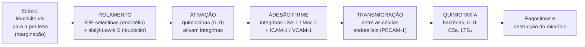
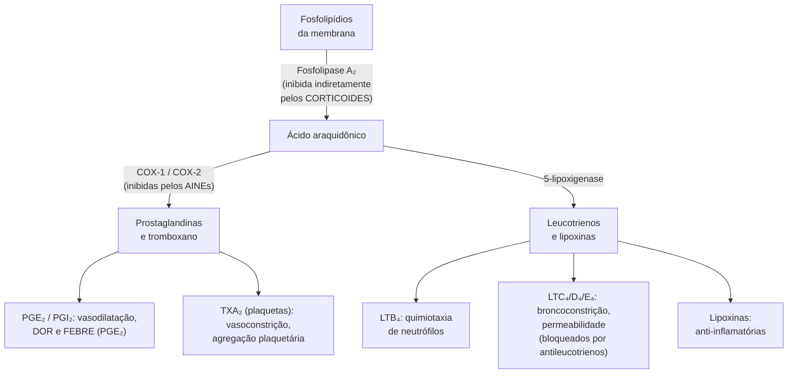
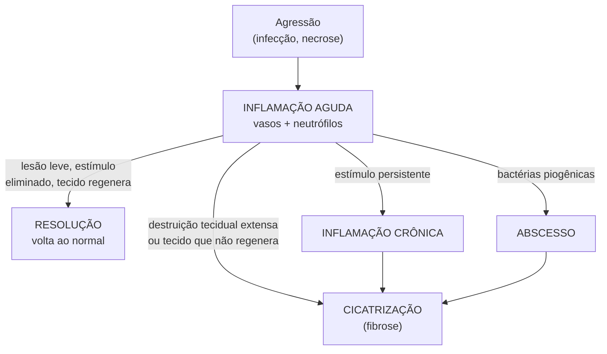

> **Pré-requisitos:** os receptores que detectam micróbios e células lesadas (PAMPs, DAMPs, receptores Toll, inflamassoma) e as células da imunidade inata estão em [imunidade inata](#/imunologia/imunidade-inata); a cascata do complemento, em [sistema complemento](#/imunologia/sistema-complemento). Este tópico cobre o item da ementa do ASE6 "inflamação aguda: sinais cardinais e mediadores químicos".

## Objetivos do tópico {#objetivos}

Ao final, você deve ser capaz de:

1. Definir **inflamação** e diferenciar **aguda** de **crônica**.
2. Explicar a origem fisiológica de cada **sinal cardinal** (rubor, calor, tumor, dor e perda de função).
3. Narrar as **alterações vasculares**: vasodilatação, aumento da permeabilidade, formação de **exsudato** × **transudato** e edema.
4. Descrever passo a passo o **recrutamento dos leucócitos** (marginação, rolamento, adesão firme, transmigração, quimiotaxia) e a sua **ativação** (fagocitose, morte do micróbio, NETs).
5. Conhecer as origens e as ações dos principais **mediadores**: aminas vasoativas, metabólitos do ácido araquidônico, citocinas, complemento, sistema das cininas e outros — e como os **anti-inflamatórios** agem sobre eles.
6. Reconhecer os **padrões morfológicos** (seroso, fibrinoso, purulento, úlcera) e os **desfechos** (resolução, cicatrização, abscesso, cronificação).
7. Relacionar o conteúdo com as **manifestações sistêmicas** (febre, leucocitose, proteínas de fase aguda) e com doenças por defeito dos leucócitos.

::: referencias
Kumar, Abbas & Aster – Robbins Patologia Básica, 10ª ed., cap. "Inflamação e reparo" · Bogliolo – Patologia Geral, 6ª ed., cap. "Inflamações".
:::

## Conceitos-base {#conceitos-base}

### O que é inflamação {#definicao}

**Inflamação** é a resposta dos **tecidos vascularizados** a uma agressão (infecção ou lesão de tecido), que consiste em **levar células de defesa e moléculas do sangue até o local** onde são necessárias, para **eliminar a causa** da agressão e **remover o tecido morto**, preparando o terreno para o **reparo**.

Pense no sangue como um exército que circula pelas estradas (os vasos). Em condições normais, leucócitos e proteínas de defesa (anticorpos, complemento) ficam **dentro** dos vasos. Quando há uma invasão num tecido, é preciso: (1) **aumentar o fluxo** de sangue para a região, (2) **abrir as "portas"** dos vasos para que proteínas e células saiam, e (3) **guiar** os leucócitos até o inimigo. A inflamação é exatamente esse conjunto de ações.

A inflamação é **protetora** — sem ela, infecções seriam fatais e feridas nunca cicatrizariam —, mas também pode **lesar** os tecidos, quando é exagerada, prolongada ou dirigida contra o próprio organismo (alergias, doenças autoimunes, aterosclerose).

### Aguda × crônica {#aguda-cronica}

| | **Inflamação aguda** | **Inflamação crônica** |
|---|---|---|
| Início | Rápido (minutos a horas) | Insidioso |
| Duração | Horas a poucos dias | Semanas a anos |
| Células predominantes | **Neutrófilos** | **Macrófagos, linfócitos e plasmócitos** |
| Lesão tecidual e fibrose | Geralmente leve e autolimitada | Frequentemente acentuada e progressiva, com fibrose |
| Sinais locais e sistêmicos | Proeminentes | Menos evidentes |

A inflamação crônica é estudada em [inflamação crônica e reparo](#/patologia/inflamacao-cronica-reparo).

### Quem dispara a inflamação {#estimulos}

Os estímulos são:

- **Infecções** (bactérias, vírus, fungos, parasitas) e suas toxinas;
- **Necrose de tecido** por qualquer causa — isquemia, trauma, queimaduras, agentes químicos (veja [necrose](#/patologia/necrose-apoptose#duas-mortes)). Por isso um infarto, mesmo estéril, inflama;
- **Corpos estranhos** (farpas, suturas, cristais como os de urato na gota);
- **Reações imunes** (alergias e autoimunidade).

Esses estímulos são reconhecidos por **receptores de reconhecimento de padrões** — como os receptores **Toll** (TLRs) — nos macrófagos, células dendríticas, mastócitos e células do endotélio. Esses receptores detectam **PAMPs** (padrões moleculares associados a patógenos, como o LPS das bactérias Gram-negativas) e **DAMPs** (padrões associados a dano, como ATP, DNA e ácido úrico liberados por células mortas). O **inflamassoma** é um complexo dentro da célula que, ao detectar esses sinais, ativa a **caspase-1**, que converte a pró-IL-1β em **IL-1β** ativa (veja [imunidade inata](#/imunologia/imunidade-inata#receptores-padroes)).

Uma vez ativadas, essas células liberam os **mediadores** — moléculas que comandam as etapas seguintes.

### Termos que serão usados {#termos}

- **Mediador inflamatório**: qualquer molécula que induz ou regula a inflamação (histamina, prostaglandinas, citocinas…).
- **Citocina**: proteína secretada por uma célula que transmite sinais a outras células (por exemplo, TNF e IL-1).
- **Quimiocina**: citocina especializada em **atrair leucócitos** (por exemplo, IL-8, também chamada CXCL8).
- **Endotélio**: camada única de células que reveste o interior dos vasos.
- **Vênula pós-capilar**: o pequeno vaso que recebe o sangue dos capilares — é o **principal local** de saída de líquido e células na inflamação.
- **Opsonina**: molécula que "reveste" o micróbio e facilita sua fagocitose (anticorpos IgG e o fragmento C3b do complemento).
- **Edema**: acúmulo de líquido no espaço entre as células (interstício).

::: referencias
Robbins Patologia Básica, 10ª ed., cap. "Inflamação e reparo" · Abbas, 10ª ed., cap. "Imunidade inata".
:::

## Explicação detalhada {#explicacao}

### Sinais cardinais {#sinais-cardinais}

Os sinais clássicos da inflamação foram descritos há quase dois mil anos — os quatro primeiros por **Celso** e o quinto atribuído a **Virchow**. Cada um tem uma explicação fisiológica:

| Sinal (latim) | O que se percebe | Por que acontece |
|---|---|---|
| **Rubor** | Vermelhidão | **Vasodilatação** das arteríolas → mais sangue na região (hiperemia) |
| **Calor** | Pele quente | Mesmo mecanismo: chega mais sangue quente do centro do corpo |
| **Tumor** | Inchaço | **Edema**: líquido rico em proteínas sai dos vasos mais permeáveis |
| **Dor** | Dor e sensibilidade | **Prostaglandinas** e **bradicinina** estimulam e sensibilizam as terminações nervosas; o edema também comprime e distende os tecidos |
| **Functio laesa** | Perda de função | Consequência da dor e do inchaço (e da lesão tecidual) — por exemplo, a dificuldade de mexer uma articulação inflamada |

Pense num dedo com uma farpa infectada: em algumas horas ele fica vermelho, quente, inchado, dolorido e difícil de dobrar. Os cinco sinais estão ali — e todos derivam de dois fenômenos que vamos ver a seguir: as **alterações dos vasos** e a **chegada das células**.

### Alterações vasculares {#alteracoes-vasculares}

#### 1. Vasodilatação {#vasodilatacao}

Às vezes depois de uma **vasoconstrição** muito breve (segundos), a primeira resposta é a **dilatação das arteríolas**, induzida principalmente pela **histamina** (liberada pelos mastócitos) e pelo **óxido nítrico** (NO, produzido pelo endotélio), agindo sobre o músculo liso vascular. Mais leitos capilares se abrem, e o fluxo para a região **aumenta** — o que produz o **rubor** e o **calor**.

#### 2. Aumento da permeabilidade vascular {#permeabilidade}

Em seguida, a parede das **vênulas pós-capilares** passa a deixar sair **líquido rico em proteínas**. Os mecanismos são:

1. **Contração das células endoteliais** — o mais comum. A histamina, a bradicinina e os leucotrienos fazem as células do endotélio se **contraírem**, abrindo **fendas** entre elas. É rápido (começa em minutos) e de curta duração (15–30 minutos) — é a chamada **resposta imediata transitória**. Citocinas como TNF e IL-1 causam uma retração endotelial mais lenta e duradoura.
2. **Lesão direta do endotélio** — queimaduras, toxinas bacterianas e radiação podem **matar ou descolar** as células endoteliais. O vazamento começa logo e dura até o vaso ser reparado (ou trombosar). Uma variação é o vazamento **tardio e prolongado**, que começa horas depois, típico de queimaduras solares leves.
3. **Lesão causada pelos próprios leucócitos** — neutrófilos aderidos ao endotélio liberam enzimas e espécies reativas de oxigênio que lesam a parede.
4. **Transcitose aumentada** — transporte de líquido através do citoplasma da célula endotelial, por canais formados por vesículas.
5. **Vasos novos** — durante o reparo, os capilares recém-formados (angiogênese) são "frouxos" e vazam até amadurecerem.

#### 3. Exsudato × transudato {#exsudato-transudato}

A saída de líquido para o interstício (**edema**) pode ser de dois tipos — distinção muito cobrada:

- **Transudato** — líquido **pobre em proteínas e células**, que sai de um vaso **íntegro** apenas por **desequilíbrio de pressões** (aumento da pressão hidrostática, como na insuficiência cardíaca, ou queda da pressão oncótica, como na hipoalbuminemia). **Não** é inflamatório.
- **Exsudato** — líquido **rico em proteínas** (e geralmente em células e restos celulares), que sai porque a **permeabilidade** do vaso **aumentou**. É a marca da **inflamação**. Quando o exsudato é rico em neutrófilos e restos de células mortas, é chamado de **pus** (exsudato **purulento**).

| | **Transudato** | **Exsudato** |
|---|---|---|
| Causa | Desequilíbrio de pressões (vaso íntegro) | **Permeabilidade aumentada** (inflamação) |
| Proteínas | Baixas | **Altas** |
| Densidade | Baixa (< 1,012) | Alta (> 1,020) |
| Células | Poucas | Muitas (leucócitos) |
| Exemplos | Insuficiência cardíaca, cirrose, síndrome nefrótica | Pneumonia, infecções, neoplasias, inflamações |

Na prática clínica, ao puncionar um derrame pleural, comparam-se a proteína e a desidrogenase láctica (LDH) do líquido com as do sangue (**critérios de Light**) para saber se é exsudato ou transudato.

#### 4. Estase e o que ela permite {#estase}

Com a saída de líquido, o sangue que fica nos pequenos vasos se torna **mais concentrado e viscoso**, e o fluxo fica **mais lento** (**estase**) — a vermelhidão fica mais intensa. A lentidão é fundamental: permite que os **leucócitos**, antes arrastados no centro da corrente, se aproximem da parede do vaso e possam sair. Além do sangue, também aumenta o fluxo de **linfa**, que drena o líquido do edema — por isso, numa infecção de pele, podem surgir **linfangite** (as "estrias vermelhas") e **linfadenite** (gânglios inchados e doloridos).

::: referencias
Robbins Patologia Básica, 10ª ed., cap. "Inflamação e reparo".
:::

### Eventos celulares: recrutamento dos leucócitos {#recrutamento}

O leucócito que predomina nas primeiras **6 a 24 horas** é o **neutrófilo** (é o mais numeroso no sangue, responde rápido às quimiocinas e se fixa com facilidade ao endotélio, mas vive pouco). Entre **24 e 48 horas**, ele é substituído pelos **monócitos/macrófagos**, que vivem mais e proliferam no tecido. Exceções: nas infecções por *Pseudomonas*, os neutrófilos predominam por vários dias; nas infecções virais, os **linfócitos** podem ser os primeiros; nas alergias e parasitoses, os **eosinófilos**.

Para sair do vaso, o leucócito passa por uma sequência de etapas, cada uma controlada por moléculas específicas.

#### 1. Marginação e rolamento {#rolamento}

Com a estase, os leucócitos se deslocam para a periferia da corrente (**marginação**). Ali, encontram o endotélio ativado: o TNF, a IL-1 (liberados pelos macrófagos) e a histamina fazem as células endoteliais exporem na superfície as **selectinas** — a **E-selectina** e a **P-selectina** (esta última guardada em grânulos chamados corpos de Weibel-Palade e liberada em minutos). As selectinas se ligam fracamente a **açúcares** da superfície dos leucócitos (como o **sialyl-Lewis X**). A ligação é fraca e transitória — se forma e se desfaz —, e o leucócito vai **rolando** sobre o endotélio, desacelerando como uma bola que rola sobre velcro.

#### 2. Adesão firme {#adesao}

Enquanto rola, o leucócito encontra **quimiocinas** (como a **IL-8/CXCL8**) presas à superfície do endotélio. Elas ativam o leucócito, e suas **integrinas** (como **LFA-1** e **Mac-1**) mudam de forma, passando ao estado de **alta afinidade**. Ao mesmo tempo, TNF e IL-1 fazem o endotélio expressar os ligantes das integrinas: **ICAM-1** e **VCAM-1**. A ligação integrina–ICAM é forte: o leucócito **para** e se **achata** sobre o endotélio.

#### 3. Transmigração (diapedese) {#diapedese}

O leucócito se espreme **entre** as células endoteliais, nas junções, num processo mediado pela molécula **PECAM-1 (CD31)** presente nos dois lados. Depois, digere a membrana basal com enzimas (colagenases) e chega ao interstício. Ocorre principalmente nas **vênulas pós-capilares**.

#### 4. Quimiotaxia {#quimiotaxia}

No tecido, o leucócito segue um **gradiente químico** — move-se na direção em que a concentração do atraente aumenta, como quem segue um cheiro até a cozinha. Os principais **quimiotáticos** são:

- **Produtos bacterianos** (como peptídeos que começam com N-formil-metionina);
- **Quimiocinas** (IL-8);
- **C5a** (fragmento do complemento);
- **Leucotrieno B₄ (LTB₄)**.

O leucócito "estende pseudópodes" na direção do sinal, reorganizando seu citoesqueleto de actina.

#### 5. Ativação e fagocitose {#fagocitose}

Ao chegar ao foco, o leucócito é **ativado** (por PAMPs, citocinas e opsoninas) e passa a **fagocitar**, em três etapas:

1. **Reconhecimento e ligação**: o fagócito reconhece o micróbio diretamente (receptores de manose, receptores "scavenger") ou — com muito mais eficiência — por meio das **opsoninas**: **IgG** (ligada aos receptores Fc) e **C3b** (ligada ao receptor de complemento CR1).
2. **Engolfamento**: a membrana envolve a partícula, formando um **fagossomo**, que se funde com um lisossomo (**fagolisossomo**).
3. **Morte e degradação** do micróbio:
   - **Explosão respiratória (burst oxidativo)**: a enzima **NADPH oxidase** (fagócito-oxidase), montada na membrana do fagolisossomo, converte O₂ em **ânion superóxido** (O₂•⁻), que vira **peróxido de hidrogênio** (H₂O₂). A **mieloperoxidase (MPO)** dos grânulos dos neutrófilos combina o H₂O₂ com o cloreto (Cl⁻) formando **ácido hipocloroso (HOCl)** — da mesma família do princípio ativo da água sanitária (hipoclorito) —, que destrói o micróbio. É o sistema H₂O₂–MPO–haleto, o mais eficiente dos neutrófilos. (Os radicais livres são detalhados em [lesão celular e estresse oxidativo](#/patologia/lesao-celular-estresse-oxidativo).)
   - **Óxido nítrico** (NO), produzido pela iNOS dos macrófagos, que reage com o superóxido formando peroxinitrito (ONOO⁻).
   - **Enzimas e proteínas dos grânulos**: elastase, lisozima, defensinas, proteína básica principal (nos eosinófilos).

Os neutrófilos também podem formar **NETs** (*neutrophil extracellular traps*, "armadilhas extracelulares"): lançam para fora uma rede de **cromatina** com proteínas antimicrobianas que prende e mata os micróbios — o neutrófilo morre no processo.

#### 6. Lesão do próprio tecido {#lesao-tecidual-leucocitos}

As armas dos leucócitos não distinguem micróbio de tecido: enzimas e radicais que escapam do fagolisossomo (quando o fagócito "regurgita" ao tentar engolir algo grande, ou quando morre) **lesam os tecidos vizinhos**. Esse dano é responsável por boa parte da lesão em doenças como a gota, a artrite reumatoide, a síndrome do desconforto respiratório agudo (SDRA) e a lesão de reperfusão.

#### 7. O fim da inflamação {#terminacao}

A inflamação aguda precisa **terminar**, e há vários freios:

- Os mediadores têm **meia-vida curta** e são produzidos apenas enquanto o estímulo persiste;
- Os neutrófilos vivem pouco no tecido (horas a 1–2 dias) e morrem por **apoptose**;
- Ocorre uma **troca** de mediadores: dos leucotrienos pró-inflamatórios para mediadores lipídicos **anti-inflamatórios** (**lipoxinas**, resolvinas, protectinas);
- Macrófagos que fagocitam neutrófilos apoptóticos liberam **TGF-β** e **IL-10**, que são anti-inflamatórias;
- Impulsos nervosos colinérgicos (o "reflexo anti-inflamatório" do nervo vago) inibem a produção de TNF.

::: referencias
Robbins Patologia Básica, 10ª ed., cap. "Inflamação e reparo" · Abbas, 10ª ed., cap. "Imunidade inata".
:::

### Mediadores químicos {#mediadores}

Os mediadores podem estar **pré-formados** em grânulos (liberação imediata, como a histamina) ou ser **sintetizados** na hora (prostaglandinas, citocinas). Vêm de **células** (mastócitos, macrófagos, plaquetas, endotélio) ou de **proteínas do plasma** produzidas pelo fígado, que circulam inativas e são ativadas no local (complemento, cininas, coagulação).

#### Aminas vasoativas: histamina e serotonina {#aminas}

- **Histamina** — pré-formada nos grânulos dos **mastócitos** (e basófilos e plaquetas). É liberada por trauma, calor, frio, IgE ligada a alérgenos (alergias), C3a e C5a (as **anafilatoxinas**), citocinas. Age nos receptores **H1**: **dilata arteríolas** e **aumenta a permeabilidade** das vênulas (contração endotelial). É o **primeiro** mediador a agir, responsável pela fase imediata. Os anti-histamínicos (anti-H1) bloqueiam essa ação.
- **Serotonina** — nas **plaquetas**, liberada na agregação plaquetária; ação vasoativa parecida.

#### Metabólitos do ácido araquidônico (eicosanoides) {#eicosanoides}

O **ácido araquidônico** é um ácido graxo das membranas celulares. Quando a célula é ativada, a enzima **fosfolipase A₂** o libera da membrana, e ele segue por duas vias principais:

- **Via da cicloxigenase (COX-1 e COX-2)** → **prostaglandinas** e **tromboxano**:
  - **PGE₂** e **PGI₂ (prostaciclina)**: **vasodilatação**; a **PGE₂** também causa **dor** (sensibiliza as terminações nervosas à bradicinina) e **febre** (age no hipotálamo).
  - **PGD₂** (mastócitos): vasodilatação e permeabilidade.
  - **Tromboxano A₂ (TXA₂)** (plaquetas): **vasoconstrição** e **agregação plaquetária**.
  - **PGI₂** (endotélio): o oposto do TXA₂ — vasodilatação e **inibição** da agregação.
- **Via da lipoxigenase (5-LOX)** → **leucotrienos**:
  - **LTB₄**: potente **quimiotático** e ativador de neutrófilos.
  - **LTC₄, LTD₄, LTE₄** (os "cisteinil-leucotrienos"): **broncoconstrição** intensa e aumento da **permeabilidade** — importantes na **asma**.
  - **Lipoxinas**: **anti-inflamatórias** (inibem o recrutamento de neutrófilos).

**Os anti-inflamatórios agem aqui**:

- **AINEs** (anti-inflamatórios não esteroides, como ácido acetilsalicílico e ibuprofeno) inibem a **COX** — reduzem prostaglandinas (e, portanto, dor, febre e vasodilatação). O **ácido acetilsalicílico** inibe a COX de forma **irreversível**; nas plaquetas (que não têm núcleo e não sintetizam nova enzima), isso bloqueia o TXA₂ pelo resto da vida da plaqueta — base do seu uso como **antiagregante**. Os **inibidores seletivos da COX-2** (coxibes) poupam a COX-1 do estômago, mas aumentam o risco cardiovascular (reduzem a PGI₂ protetora sem reduzir o TXA₂ das plaquetas).
- **Antileucotrienos** (como o montelucaste, que bloqueia o receptor dos cisteinil-leucotrienos) — usados na asma.
- **Corticoides** (glicocorticoides) agem **mais acima**: reduzem a transcrição da COX-2, da fosfolipase A₂ e de citocinas (TNF, IL-1) — por isso têm um efeito anti-inflamatório amplo.

#### Citocinas {#citocinas}

As principais citocinas da inflamação aguda são produzidas sobretudo por **macrófagos**, mastócitos e células endoteliais ativados:

- **TNF (fator de necrose tumoral)** e **IL-1** — ações **locais**: ativam o endotélio (expressão de selectinas, ICAM-1, VCAM-1, quimiocinas), aumentam a coagulação, estimulam fibroblastos. Ações **sistêmicas**: **febre**, produção de **proteínas de fase aguda**, liberação de neutrófilos da medula, perda de apetite e sonolência. O **TNF** em excesso causa **choque séptico** (vasodilatação, queda da contratilidade cardíaca, trombose) e, cronicamente, **caquexia** (emagrecimento).
- **IL-6** — principal estímulo para o fígado produzir as **proteínas de fase aguda** (como a **PCR**).
- **Quimiocinas** (como a **IL-8/CXCL8**) — **recrutam e ativam neutrófilos**.
- **IL-17** (produzida por linfócitos Th17) — estimula a produção de quimiocinas que recrutam neutrófilos.

#### Sistema complemento {#complemento-inflamacao}

O complemento (veja [o tópico próprio](#/imunologia/sistema-complemento)) contribui com três ações inflamatórias:

- **C3a e C5a** (anafilatoxinas): induzem os **mastócitos** a liberarem **histamina** → vasodilatação e permeabilidade;
- **C5a**: potente **quimiotático** de neutrófilos e monócitos;
- **C3b**: **opsonina** — facilita a fagocitose;
- O **MAC** (C5b-9) lisa micróbios.

#### Sistema das cininas e coagulação {#cininas}

O **fator XII** da coagulação (fator de Hageman) é ativado ao contato com superfícies alteradas e dispara, ao mesmo tempo, a coagulação e o **sistema das cininas**: a calicreína cliva o cininogênio, liberando a **bradicinina**, que **aumenta a permeabilidade**, dilata vasos e causa **dor**. A bradicinina é degradada rapidamente pela **enzima conversora de angiotensina (ECA)** — por isso os **inibidores da ECA** (como o enalapril) podem causar **tosse seca** e, raramente, **angioedema** (inchaço de lábios, língua e glote), por acúmulo de bradicinina. A trombina, gerada na coagulação, também ativa o endotélio. A **plasmina** (sistema fibrinolítico) pode ativar o complemento.

#### Outros mediadores {#outros-mediadores}

- **Fator de ativação plaquetária (PAF)** — derivado de fosfolipídios; agrega plaquetas, causa broncoconstrição, aumenta a permeabilidade.
- **Óxido nítrico (NO)** — vasodilatação; mata micróbios nos macrófagos.
- **Espécies reativas de oxigênio** — matam micróbios, mas também lesam o tecido.
- **Neuropeptídios** (substância P) — transmitem dor e aumentam a permeabilidade.

#### Mediador × efeito: a tabela-resumo {#tabela-mediadores}

| Efeito | Principais mediadores |
|---|---|
| **Vasodilatação** | Histamina, **prostaglandinas** (PGE₂, PGI₂), NO |
| **Aumento da permeabilidade** | **Histamina**, serotonina, **bradicinina**, C3a e C5a (via histamina), **leucotrienos C₄/D₄/E₄**, PAF |
| **Quimiotaxia e ativação de leucócitos** | **C5a**, **LTB₄**, **quimiocinas (IL-8)**, TNF, IL-1, produtos bacterianos |
| **Febre** | **IL-1, TNF, IL-6** (agem via **PGE₂** no hipotálamo) |
| **Dor** | **Prostaglandinas (PGE₂)**, **bradicinina**, substância P |
| **Lesão tecidual** | Enzimas lisossômicas dos leucócitos, espécies reativas de oxigênio, NO |

::: referencias
Robbins Patologia Básica, 10ª ed., cap. "Inflamação e reparo" · Goodman & Gilman, 13ª ed., cap. "Farmacoterapia da inflamação, febre, dor e gota".
:::

### Padrões morfológicos {#padroes-morfologicos}

A aparência da inflamação aguda depende do **tipo de exsudato**, que reflete a intensidade da agressão e o local:

- **Inflamação serosa** — exsudato **pobre em células**, aquoso, que se acumula em cavidades (pleura, peritônio, pericárdio — os **derrames**) ou sob a pele, como na **bolha** de uma queimadura.
- **Inflamação fibrinosa** — com permeabilidade maior, saem moléculas grandes como o **fibrinogênio**, que vira **fibrina**. Típica do revestimento das cavidades: na **pericardite fibrinosa**, a fibrina dá um aspecto de "pão com manteiga" (separe duas fatias com manteiga) e pode produzir um **atrito** à ausculta. Se a fibrina não for removida, é organizada em tecido fibroso (aderências).
- **Inflamação purulenta (supurativa)** — exsudato com muitos **neutrófilos**, células necróticas e líquido: o **pus**. Causada por bactérias **piogênicas** (formadoras de pus), como estafilococos. Um **abscesso** é uma coleção localizada de pus dentro de um tecido, envolta por uma cápsula de tecido de granulação e fibrose — em geral, é preciso **drená-lo**, porque antibióticos penetram mal em seu interior. (Corresponde à [necrose liquefativa](#/patologia/necrose-apoptose#necrose-liquefativa).)
- **Úlcera** — perda localizada do revestimento (pele ou mucosa) por necrose e descamação do tecido inflamado — por exemplo, a úlcera péptica do estômago e as úlceras de pele em pacientes com doença vascular.

::: referencias
Robbins Patologia Básica, 10ª ed., cap. "Inflamação e reparo".
:::

### Desfechos da inflamação aguda {#desfechos}

1. **Resolução completa** — quando a agressão é breve e a lesão pequena (e o tecido consegue se regenerar): os mediadores são neutralizados, a permeabilidade volta ao normal, os neutrófilos morrem por apoptose, os macrófagos limpam os restos e a linfa drena o edema. Exemplo: pneumonia lobar tratada a tempo — o pulmão volta ao normal.
2. **Cicatrização por tecido conjuntivo (fibrose)** — quando a destruição foi grande, quando o tecido não regenera (como o miocárdio) ou quando há muita fibrina. O tecido é substituído por **tecido de granulação** e, depois, por uma **cicatriz** de colágeno.
3. **Abscesso** — nas infecções por bactérias piogênicas.
4. **Progressão para inflamação crônica** — quando o agente persiste ou a resposta não se resolve (veja [inflamação crônica e reparo](#/patologia/inflamacao-cronica-reparo)).

::: referencias
Robbins Patologia Básica, 10ª ed., cap. "Inflamação e reparo".
:::

## Correlação clínica {#correlacao-clinica}

### Manifestações sistêmicas: resposta de fase aguda {#fase-aguda}

As citocinas (**IL-1, TNF e IL-6**) caem na circulação e provocam a **resposta de fase aguda**:

- **Febre** — as citocinas (chamadas **pirógenos endógenos**) induzem a produção de **PGE₂** no hipotálamo, que "reajusta o termostato" para uma temperatura mais alta. Os AINEs baixam a febre por inibirem essa PGE₂. (Detalhes em [febre, dor e resposta neuroendócrina](#/patologia/febre-dor-resposta-neuroendocrina).)
- **Proteínas de fase aguda** produzidas pelo fígado sob estímulo da **IL-6**: **proteína C-reativa (PCR)**, **fibrinogênio** e **amiloide A sérico**. A PCR é usada na clínica como marcador de inflamação. O fibrinogênio faz as hemácias se agruparem e sedimentarem mais rápido — por isso a **velocidade de hemossedimentação (VHS)** aumenta.
- **Leucocitose** — aumento dos leucócitos no sangue, por liberação acelerada da medula (estimulada por IL-1 e TNF). Nas infecções bacterianas, há **neutrofilia** com **desvio à esquerda** (aparecem formas jovens, como os **bastonetes**). Infecções virais tendem a causar **linfocitose**; alergias e parasitoses, **eosinofilia**. Algumas infecções (febre tifoide, certos vírus) causam **leucopenia**.
- Outras: aumento da frequência cardíaca e da pressão, calafrios, perda de apetite, sonolência e mal-estar.
- Na **sepse**, a produção maciça de citocinas causa vasodilatação generalizada, aumento da permeabilidade em todo o corpo, coagulação intravascular disseminada e **choque séptico**.

### Defeitos dos leucócitos {#defeitos-leucocitos}

As doenças em que uma etapa do recrutamento ou da morte do micróbio falha mostram a importância de cada passo — e causam **infecções bacterianas e fúngicas recorrentes**:

| Doença | Defeito | Consequência típica |
|---|---|---|
| **Deficiência de adesão leucocitária tipo 1** | Integrinas (cadeia **CD18**) | Neutrófilos não aderem nem saem dos vasos: infecções sem pus, **neutrofilia** muito alta, **queda tardia do coto umbilical** |
| **Deficiência de adesão leucocitária tipo 2** | Sialyl-Lewis X (ligante das selectinas) | Falha no rolamento |
| **Doença granulomatosa crônica** | **NADPH oxidase** (sem explosão respiratória) | Infecções por bactérias e fungos **catalase-positivos** (*S. aureus*, *Aspergillus*); granulomas. Teste: **di-hidrorrodamina** (DHR) ou nitroazul de tetrazólio |
| **Síndrome de Chédiak-Higashi** | Fusão de fagossomos com lisossomos (gene LYST) | Grânulos gigantes nos leucócitos, albinismo parcial, neuropatia |
| **Deficiência de mieloperoxidase** | MPO | Geralmente assintomática; risco aumentado de candidíase |

Causas **adquiridas** são muito mais comuns: **neutropenia** por quimioterapia ou leucemia, **diabetes mal controlado** (função de neutrófilos prejudicada), corticoterapia.

### Tratando a inflamação {#tratamento}

- **AINEs**: dor, febre e inflamação (inibem a COX). Efeitos adversos: lesão gástrica (perda da PGE₂ protetora), lesão renal (as prostaglandinas mantêm o fluxo renal em situações de estresse), sangramento.
- **Corticoides**: efeito anti-inflamatório amplo (inibem a transcrição de citocinas, COX-2, moléculas de adesão), mas com muitos efeitos adversos no uso prolongado. Curiosidade: por reduzirem a aderência dos neutrófilos ao endotélio, causam **leucocitose** (neutrófilos que estavam "marginados" voltam à circulação).
- **Imunobiológicos**: anticorpos contra **TNF** (infliximabe, adalimumabe) ou contra o receptor de **IL-6** (tocilizumabe), usados em doenças inflamatórias crônicas como a artrite reumatoide. Aumentam o risco de infecções, especialmente a **reativação da tuberculose** (o TNF é essencial para manter os granulomas).
- **Gelo e repouso** em traumas: reduzem a vasodilatação e o edema.

::: referencias
Robbins Patologia Básica, 10ª ed., cap. "Inflamação e reparo" · Goodman & Gilman, 13ª ed. · Abbas, 10ª ed., cap. "Imunodeficiências congênitas e adquiridas".
:::

## Pontos de alta cobrança em prova {#alta-cobranca}

::: prova
- **Inflamação aguda**: rápida, curta, **neutrófilos** (6–24 h; substituídos por monócitos/macrófagos em 24–48 h). **Crônica**: macrófagos, linfócitos, plasmócitos, fibrose.
- **Sinais cardinais**: **rubor e calor** (vasodilatação, histamina e NO), **tumor** (edema por permeabilidade aumentada), **dor** (PGE₂, bradicinina), **perda de função**.
- **Permeabilidade**: principal mecanismo = **contração endotelial** nas **vênulas pós-capilares** (histamina, bradicinina, leucotrienos; rápida e transitória); também lesão endotelial direta (queimaduras, toxinas), lesão por leucócitos, transcitose, vasos novos.
- **Exsudato** (proteínas e células altas, permeabilidade ↑; inflamação; pus = exsudato purulento) × **transudato** (pobre em proteínas, desequilíbrio de pressões; IC, cirrose, nefrótica).
- **Recrutamento**: rolamento (**selectinas** E e P + **sialyl-Lewis X**) → ativação (quimiocinas, IL-8) → adesão firme (**integrinas** LFA-1/Mac-1 + **ICAM-1/VCAM-1**, induzidas por TNF e IL-1) → transmigração (**PECAM-1/CD31**) → quimiotaxia (**bactérias, IL-8, C5a, LTB₄**).
- **Fagocitose**: opsoninas **IgG e C3b**; **NADPH oxidase** → superóxido → H₂O₂ → **MPO** → **HOCl** (sistema mais eficiente); NO; enzimas; NETs.
- **Histamina** (mastócitos, H1): primeiro mediador; vasodilatação e permeabilidade.
- **Ácido araquidônico**: fosfolipase A₂ (corticoides inibem) → **COX** (AINEs inibem) → PGE₂ (dor, febre, vasodilatação), PGI₂ (vasodilatação, antiagregante), **TXA₂** (agregação, vasoconstrição) | **5-LOX** → **LTB₄** (quimiotaxia), **LTC₄/D₄/E₄** (broncoconstrição, permeabilidade), **lipoxinas** (anti-inflamatórias).
- AAS inibe COX **irreversivelmente** → antiagregante; coxibes poupam COX-1 mas aumentam risco cardiovascular.
- **TNF e IL-1**: ativam endotélio, febre, fase aguda; **IL-6**: proteínas de fase aguda (**PCR**, fibrinogênio → VHS ↑); **IL-8**: quimiotaxia de neutrófilos.
- **C3a/C5a**: anafilatoxinas (histamina); **C5a**: quimiotaxia; **C3b**: opsonina.
- **Bradicinina**: permeabilidade, dor; degradada pela ECA → **iECA causam tosse e angioedema**.
- **Padrões**: seroso (bolha, derrames), fibrinoso (pericardite "pão com manteiga"), purulento (**abscesso** — drenar), úlcera.
- **Desfechos**: resolução, cicatrização (fibrose), abscesso, cronificação.
- **Defeitos**: LAD-1 (**CD18**, sem pus, queda tardia do coto umbilical); **DGC** (**NADPH oxidase**, catalase-positivos, teste DHR); **Chédiak-Higashi** (fusão fagolisossomal, grânulos gigantes, albinismo).
:::

## Armadilhas comuns {#armadilhas}

::: armadilha
- **Achar que a saída de leucócitos e líquido ocorre nos capilares ou arteríolas.** O principal local é a **vênula pós-capilar**.
- **Confundir edema inflamatório (exsudato) com o edema da insuficiência cardíaca (transudato).** O exsudato é rico em proteínas porque o vaso ficou **permeável**; o transudato sai de vaso íntegro por **pressão**.
- **Trocar selectinas e integrinas.** **Selectinas** → **rolamento** (ligação fraca a açúcares). **Integrinas** → **adesão firme** (ligação a ICAM-1/VCAM-1).
- **Achar que os AINEs inibem a produção de leucotrienos.** Eles inibem a **COX**; ao bloqueá-la, mais ácido araquidônico pode ser desviado para a via da lipoxigenase — o que explica a **asma induzida por aspirina** em pessoas suscetíveis.
- **Achar que o tromboxano e a prostaciclina têm o mesmo efeito.** **TXA₂** (plaquetas) → **agrega e contrai**; **PGI₂** (endotélio) → **antiagrega e dilata**.
- **Esquecer que a febre depende da PGE₂.** As citocinas (IL-1, TNF, IL-6) agem no hipotálamo **por meio da PGE₂** — por isso os AINEs são antitérmicos.
- **Achar que a inflamação só ocorre com infecção.** Necrose estéril (infarto), corpos estranhos, cristais e reações imunes também inflamam.
- **Achar que corticoide causa leucopenia por "imunossupressão".** O corticoide causa **leucocitose** (neutrófilos se desprendem do endotélio), embora reduza a função dos leucócitos e cause linfopenia e eosinopenia.
:::

## Resumo para revisão rápida {#resumo}

- **Inflamação** = resposta dos tecidos vascularizados que leva células e proteínas do sangue até o local da agressão para eliminar a causa e remover o tecido morto. **Aguda**: rápida, neutrófilos, exsudato. Gatilhos: infecção, necrose, corpos estranhos, reações imunes (via TLRs, PAMPs, DAMPs, inflamassoma).
- **Sinais cardinais**: rubor e calor (vasodilatação), tumor (edema/exsudato), dor (PGE₂, bradicinina), perda de função.
- **Vasos**: vasodilatação (histamina, NO) → permeabilidade aumentada nas **vênulas pós-capilares** (contração endotelial; lesão direta; leucócitos; transcitose; vasos novos) → **exsudato** (rico em proteínas) → estase → leucócitos na periferia.
- **Leucócitos**: rolamento (selectinas) → ativação (quimiocinas) → adesão (integrinas + ICAM/VCAM) → transmigração (PECAM-1) → quimiotaxia (bactérias, IL-8, C5a, LTB₄) → fagocitose (opsoninas IgG/C3b; NADPH oxidase, MPO, HOCl; NO; enzimas; NETs). Os leucócitos também lesam o tecido. Fim: apoptose dos neutrófilos, lipoxinas, TGF-β, IL-10.
- **Mediadores**: histamina (primeira; H1), eicosanoides (COX → PGs/TXA₂; LOX → leucotrienos/lipoxinas; AINEs inibem COX, corticoides inibem mais acima), citocinas (TNF, IL-1, IL-6, IL-8), complemento (C3a, C5a, C3b), bradicinina (degradada pela ECA), PAF, NO.
- **Padrões**: seroso, fibrinoso, purulento (abscesso), úlcera. **Desfechos**: resolução, fibrose, abscesso, cronificação.
- **Sistêmico**: febre (PGE₂ no hipotálamo), PCR e fibrinogênio (VHS), leucocitose com desvio à esquerda; sepse.
- **Defeitos**: LAD-1 (CD18), DGC (NADPH oxidase), Chédiak-Higashi. Causas adquiridas mais comuns: neutropenia, diabetes, corticoides.

::: referencias
Robbins Patologia Básica, 10ª ed. · Goodman & Gilman, 13ª ed. · Abbas, 10ª ed.
:::
