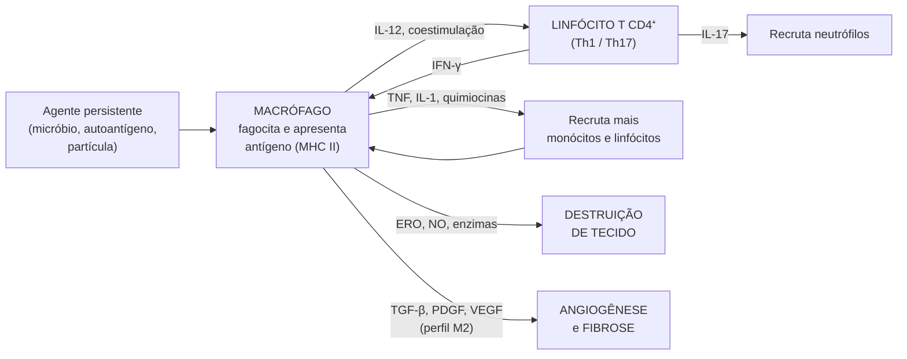

> **Pré-requisito:** [inflamação aguda](#/patologia/inflamacao-aguda) (alterações vasculares, neutrófilos, mediadores). As fases da cicatrização de uma ferida e o tecido de granulação ao microscópio estão em [trombose e cicatrização](#/patologia/morfo-trombose-cicatrizacao#cicatrizacao). Este tópico cobre o item da ementa do ASE6 "inflamação crônica e reparo tecidual".

## Objetivos do tópico {#objetivos}

Ao final, você deve ser capaz de:

1. Definir **inflamação crônica**, citar suas causas e explicar por que ela combina, ao mesmo tempo, **inflamação ativa, destruição de tecido e tentativa de reparo**.
2. Descrever o papel de cada célula: **macrófagos** (ativação clássica M1 e alternativa M2), **linfócitos**, **plasmócitos**, **eosinófilos** e **mastócitos**.
3. Explicar o **granuloma**: o que é, como se forma (passo a passo), seus tipos (imunológico e de corpo estranho; caseoso e não caseoso) e doenças em que aparece.
4. Diferenciar **regeneração** de **cicatrização** e classificar os tecidos pela capacidade proliferativa (**lábeis, estáveis e permanentes**).
5. Explicar o papel da **matriz extracelular**, dos **fatores de crescimento** e da **angiogênese** no reparo.
6. Entender a **fibrose** como desfecho patológico da inflamação crônica (cirrose, fibrose pulmonar, nefropatia crônica) e as consequências sistêmicas (anemia da inflamação, amiloidose).

::: referencias
Kumar, Abbas & Aster – Robbins Patologia Básica, 10ª ed., cap. "Inflamação e reparo" · Bogliolo – Patologia Geral, 6ª ed., caps. "Inflamações" e "Reparo".
:::

## Conceitos-base {#conceitos-base}

### O que é inflamação crônica {#definicao-cronica}

**Inflamação crônica** é a inflamação de **duração prolongada** (semanas, meses ou anos), em que acontecem **simultaneamente** três coisas:

1. **Inflamação ativa**, com predomínio de **células mononucleares** — **macrófagos, linfócitos e plasmócitos** (células com núcleo único e arredondado, diferentes dos neutrófilos, de núcleo segmentado);
2. **Destruição de tecido**, causada pelo próprio agente agressor persistente e, principalmente, pelas células inflamatórias;
3. **Tentativa de reparo**, com **formação de novos vasos (angiogênese)** e **fibrose** (deposição de tecido conjuntivo).

Uma imagem útil: a inflamação aguda é um **incêndio rápido** que os bombeiros (neutrófilos) apagam em poucos dias; a crônica é um **incêndio que não se apaga** — os bombeiros continuam trabalhando, as estruturas continuam caindo e, ao mesmo tempo, pedreiros (fibroblastos) tentam reconstruir, muitas vezes com "concreto" (cicatriz) no lugar do tecido original.

| | **Aguda** | **Crônica** |
|---|---|---|
| Duração | Horas a dias | Semanas a anos |
| Células | **Neutrófilos** | **Macrófagos, linfócitos, plasmócitos** |
| Vasos | Vasodilatação, permeabilidade, exsudato | **Angiogênese** (vasos novos) |
| Tecido | Lesão geralmente limitada | **Destruição progressiva** + **fibrose** |
| Exemplo | Faringite bacteriana, apendicite aguda | Tuberculose, artrite reumatoide, hepatite crônica, aterosclerose |

### Quando a inflamação se torna crônica {#causas-cronica}

1. **Infecções persistentes** por micro-organismos difíceis de eliminar: *Mycobacterium tuberculosis*, *Treponema pallidum* (sífilis), fungos, alguns vírus (hepatites B e C) e parasitas (esquistossomose). Muitas vezes provocam uma resposta do tipo **hipersensibilidade tardia** (mediada por linfócitos T), que pode formar granulomas.
2. **Exposição prolongada a agentes tóxicos**, exógenos ou endógenos: **sílica** inalada (silicose), **tabaco**, **álcool**, cristais de colesterol na parede arterial (aterosclerose).
3. **Doenças imunomediadas**: **autoimunidade** (artrite reumatoide, lúpus, doença de Crohn — o sistema imune ataca o próprio organismo, e o "agressor" nunca é eliminado) e **alergias** (asma crônica).
4. **Episódios agudos repetidos** que não se resolvem completamente (pielonefrite de repetição).

Algumas inflamações crônicas **começam já crônicas**, sem fase aguda evidente (tuberculose, artrite reumatoide); outras são continuação de uma aguda não resolvida.

### Pré-requisitos sobre as células {#celulas-base}

- **Macrófago**: célula fagocítica grande, derivada do **monócito** do sangue (que, ao sair do vaso e entrar no tecido, amadurece em macrófago) ou de macrófagos residentes que vivem nos tecidos desde a vida embrionária (células de Kupffer no fígado, micróglia no cérebro, macrófagos alveolares). Vive meses no tecido — muito mais que o neutrófilo.
- **Linfócitos T e B**: células da imunidade adaptativa (veja o [panorama do sistema imune](#/imunologia/visao-geral-sistema-imune#linfocitos)). Os **T CD4⁺** "comandam" a resposta por meio de citocinas; os **B** se transformam em **plasmócitos**, que produzem anticorpos.
- **Citocina**: proteína de sinalização entre células (IFN-γ, IL-4, TGF-β…).

::: referencias
Robbins Patologia Básica, 10ª ed., cap. "Inflamação e reparo".
:::

## Explicação detalhada {#explicacao}

### As células da inflamação crônica {#celulas-cronica}

#### Macrófagos: a célula central {#macrofagos}

Os macrófagos são as células dominantes na maioria das inflamações crônicas. Eles chegam como **monócitos**, recrutados pelos mesmos mecanismos que os neutrófilos (selectinas, integrinas, quimiocinas — veja [recrutamento](#/patologia/inflamacao-aguda#recrutamento)), mas continuam chegando por muito tempo, **sobrevivem** semanas a meses e podem **proliferar** no local.

Dependendo dos sinais que recebem, os macrófagos se ativam de duas formas principais (na realidade, há um espectro entre elas):

| | **Ativação clássica (M1)** | **Ativação alternativa (M2)** |
|---|---|---|
| Sinais que induzem | Produtos microbianos (LPS via receptores Toll) e **IFN-γ** (dos linfócitos Th1 e células NK) | **IL-4 e IL-13** (dos linfócitos Th2, mastócitos, eosinófilos) |
| O que produzem | **Espécies reativas de oxigênio e nitrogênio** (NO), enzimas lisossômicas, **citocinas inflamatórias** (IL-1, IL-12, TNF) | **Fatores de crescimento** (**TGF-β**, PDGF, VEGF), IL-10 (anti-inflamatória) |
| Função | **Matar micróbios** e amplificar a inflamação — mas também **lesar o tecido** | **Reparo**: angiogênese, ativação de fibroblastos, **fibrose**; reduz a inflamação |
| Fase típica | Início, eliminação do agente | Resolução, cicatrização |

Os macrófagos também **apresentam antígenos** aos linfócitos T (pelo MHC de classe II), que respondem produzindo citocinas que **ativam ainda mais os macrófagos**. Essa **conversa recíproca macrófago ↔ linfócito T** é o "motor" que mantém a inflamação crônica funcionando — e é por isso que ela custa a parar.

#### Linfócitos e plasmócitos {#linfocitos-plasmocitos}

- **Linfócitos T CD4⁺** — conforme o tipo, dirigem a inflamação: **Th1** (produzem **IFN-γ**, ativam macrófagos M1 — típico da tuberculose e da formação de granulomas), **Th2** (IL-4, IL-5, IL-13 — eosinófilos e macrófagos M2, típico das alergias e parasitoses), **Th17** (IL-17 — recruta neutrófilos, importante em algumas doenças autoimunes e infecções por fungos e bactérias extracelulares).
- **Linfócitos T CD8⁺** — matam células infectadas por vírus (hepatites crônicas).
- **Linfócitos B e plasmócitos** — produzem **anticorpos** contra o antígeno persistente ou contra o próprio organismo. Em inflamações muito prolongadas, os linfócitos podem se organizar em **folículos linfoides com centros germinativos** dentro do tecido inflamado (órgãos linfoides **terciários**), como na sinóvia da artrite reumatoide e na tireoide da tireoidite de Hashimoto. O **plasmócito**, ao microscópio, tem núcleo excêntrico com cromatina em "**roda de carroça**" e citoplasma basófilo com halo claro perto do núcleo (o complexo de Golgi).

#### Eosinófilos e mastócitos {#eosinofilos-mastocitos}

- **Eosinófilos** — predominam nas inflamações mediadas por **IgE** e **Th2**: **alergias** (asma) e **parasitoses** (helmintos). São recrutados pela **eotaxina** e ativados pela **IL-5**; seus grânulos contêm a **proteína básica principal**, tóxica para os parasitas — e também para o epitélio (lesão das vias aéreas na asma).
- **Mastócitos** — presentes em todos os tecidos conjuntivos, liberam histamina e outros mediadores (fundamentais nas alergias, veja [hipersensibilidades](#/imunologia/hipersensibilidades)) e citocinas que participam da inflamação crônica.
- **Neutrófilos** — embora característicos da aguda, podem persistir em algumas inflamações crônicas (osteomielite crônica, lesão pulmonar do tabagismo), mantidos por micro-organismos persistentes ou pela IL-17.

::: referencias
Robbins Patologia Básica, 10ª ed., cap. "Inflamação e reparo" · Abbas, 10ª ed., cap. "Mecanismos efetores da imunidade mediada por células T".
:::

### Inflamação granulomatosa {#granuloma}

#### O que é {#granuloma-definicao}

**Granuloma** é um padrão especial de inflamação crônica: um **agregado organizado de macrófagos ativados**, que se transformam em **células epitelioides**, frequentemente com **células gigantes multinucleadas**, rodeado por um colar de **linfócitos** (e às vezes plasmócitos) e, mais externamente, por **fibroblastos** e fibrose. É uma tentativa do organismo de **cercar e isolar** um agente que ele **não consegue eliminar**.

- **Célula epitelioide**: macrófago ativado, maior, com citoplasma abundante, rosa-pálido e de limites imprecisos, e núcleo **alongado, em forma de sola de sapato ou de chinelo**. O nome vem da semelhança com células epiteliais (ficam juntas como um epitélio). São macrófagos especializados em **secretar**, mais que em fagocitar.
- **Célula gigante multinucleada**: formada pela **fusão** de vários macrófagos (estimulada por citocinas como IFN-γ e IL-4), com dezenas de núcleos. Tipos: **de Langhans** — núcleos dispostos em **ferradura ou coroa na periferia** (típica da tuberculose, mas não exclusiva); **de corpo estranho** — núcleos **espalhados** pelo citoplasma, muitas vezes com o material estranho dentro.

#### Como se forma, passo a passo (o exemplo da tuberculose) {#granuloma-formacao}

1. O bacilo *M. tuberculosis* é fagocitado pelos **macrófagos alveolares**, mas **sobrevive dentro deles**, impedindo a fusão do fagossomo com o lisossomo.
2. Células dendríticas levam antígenos do bacilo ao linfonodo e ativam **linfócitos T CD4⁺**, que se diferenciam em **Th1** (estimulados pela **IL-12** dos macrófagos).
3. Os Th1 voltam ao pulmão e produzem **IFN-γ**, que **ativa os macrófagos** (perfil M1): eles passam a matar melhor os bacilos e se transformam em **células epitelioides**; alguns se fundem em **células gigantes**.
4. Os macrófagos produzem **TNF**, essencial para **recrutar mais células e manter o granuloma organizado** (por isso pacientes tratados com **anti-TNF** podem ter **reativação da tuberculose**).
5. No centro, a destruição de macrófagos e de tecido por produtos tóxicos e pela hipóxia forma **necrose caseosa** (veja [necrose caseosa](#/patologia/necrose-apoptose#necrose-caseosa)).
6. Na periferia, linfócitos formam um colar, e os fibroblastos depositam colágeno, **encapsulando** o granuloma. Com o tempo, ele pode **calcificar** (calcificação distrófica). O bacilo pode permanecer vivo, latente, dentro do granuloma por décadas — e reativar se a imunidade cair (aids, corticoides, idade, desnutrição).

#### Tipos de granuloma {#tipos-granuloma}

| Tipo | Mecanismo | Aspecto | Exemplos |
|---|---|---|---|
| **Imunológico** | Resposta de **linfócitos T** (Th1, IFN-γ) a antígenos persistentes | Células epitelioides, gigantes tipo Langhans, colar de linfócitos | **Tuberculose** (caseoso), **hanseníase**, **sífilis** terciária (goma), **micoses** (paracoccidioidomicose, histoplasmose), **esquistossomose** (em torno dos ovos), **sarcoidose** (não caseoso, causa desconhecida), **doença de Crohn** (não caseoso), arranhadura do gato |
| **De corpo estranho** | Material **inerte** grande demais para ser fagocitado, **sem** resposta imune específica | Células gigantes de **corpo estranho** (núcleos dispersos) englobando o material (visível com luz polarizada) | Fios de **sutura**, talco (usuários de drogas injetáveis), queratina de cistos rompidos, silicone, farpas |

- **Granuloma caseoso** (com necrose central "de queijo") → pense primeiro em **tuberculose** (também micoses).
- **Granuloma não caseoso** ("duro", sem necrose) → **sarcoidose**, doença de Crohn, hanseníase tuberculoide, reação a corpo estranho, beriliose.

::: dica Granuloma × tecido de granulação
São coisas diferentes, apesar do nome parecido. **Granuloma** = agregado de **macrófagos epitelioides** (inflamação crônica). **Tecido de granulação** = **capilares novos + fibroblastos** (reparo de feridas). Veja o [tecido de granulação](#/patologia/morfo-trombose-cicatrizacao#fase-proliferacao).
:::

::: referencias
Robbins Patologia Básica, 10ª ed., caps. "Inflamação e reparo" e "Doenças infecciosas" · Abbas, 10ª ed.
:::

### Reparo tecidual {#reparo}

Logo que a inflamação começa, começa também o **reparo**. Ele pode acontecer de duas formas (frequentemente combinadas):

- **Regeneração**: substituição das células perdidas por **células do mesmo tipo**, com restauração completa da estrutura e da função.
- **Cicatrização (reparo por tecido conjuntivo)**: substituição por **tecido fibroso** (colágeno) — a **cicatriz**, que restaura a integridade, mas **não a função** especializada.

O que decide qual das duas ocorre são dois fatores: **(1)** a **capacidade proliferativa** das células do tecido e **(2)** a **integridade da matriz extracelular** (o "andaime").

#### Capacidade proliferativa: tecidos lábeis, estáveis e permanentes {#capacidade-proliferativa}

| Tipo | Comportamento das células | Exemplos | Reparo típico |
|---|---|---|---|
| **Lábeis** (em divisão contínua) | Perdidas e substituídas o tempo todo, a partir de **células-tronco** | Epitélios de superfície (**pele**, mucosa da boca, do **intestino**, do colo do útero, ductos), **medula óssea** | **Regeneração** fácil (se a membrana basal/matriz estiver preservada) |
| **Estáveis** (quiescentes) | Normalmente **não se dividem** (fase G₀ do ciclo celular), mas **voltam a se dividir** quando há perda de tecido | **Fígado** (hepatócitos), **rim** (túbulos), pâncreas, endotélio, fibroblastos, músculo liso | Regeneração **se a matriz estiver preservada**; se não, fibrose |
| **Permanentes** | **Não se dividem** após o nascimento (diferenciação terminal) | **Neurônios**, **músculo cardíaco**, (músculo esquelético tem regeneração limitada por células satélites) | **Cicatriz** (fibrose no coração; gliose no SNC) |

O **ciclo celular** é a sequência que leva uma célula a se dividir: **G₁** (crescimento) → **S** (síntese/duplicação do DNA) → **G₂** → **M** (mitose). Células quiescentes ficam em **G₀** e podem ser estimuladas a voltar ao ciclo por **fatores de crescimento**.

**O fígado como exemplo**: após a retirada de até 60–70% do fígado (doação para transplante), os hepatócitos remanescentes saem de G₀ e se dividem, restaurando a massa do órgão em semanas — **regeneração**. Mas na **hepatite crônica**, a destruição repetida, com lesão da matriz e ativação de células produtoras de colágeno, leva a **cirrose**: nódulos de regeneração cercados por **fibrose**, com perda da arquitetura e da função.

#### Matriz extracelular: o andaime {#matriz-extracelular}

A **matriz extracelular (MEC)** é a rede de moléculas fora das células que dá sustentação, organização e sinais aos tecidos:

- **Proteínas fibrosas estruturais**: **colágenos** (resistência à tração — o tipo I é o mais abundante, em tendões, ossos e cicatrizes maduras; o tipo III predomina em tecidos jovens e cicatrizes iniciais; o tipo IV forma as membranas basais) e **elastina** (elasticidade de vasos, pulmão, pele).
- **Glicoproteínas de adesão**: **fibronectina** e **laminina**, que ligam as células à matriz (por meio de receptores chamados **integrinas**).
- **Proteoglicanos e ácido hialurônico**: formam um gel hidratado, armazenam fatores de crescimento.
- **Membrana basal**: lâmina especializada que fica sob os epitélios e em volta de vasos e músculos.

A matriz é mais que um suporte: ela **guia a migração** das células durante o reparo, **mantém a polaridade** e a organização do tecido e **armazena fatores de crescimento**. Se a membrana basal está **intacta**, as células que se regeneram seguem o "molde" e reconstroem o tecido original; se está **destruída**, o tecido se reconstrói de forma desorganizada, com fibrose. Por isso uma necrose tubular aguda (que poupa a membrana basal) regenera, enquanto um abscesso renal deixa cicatriz.

#### Fatores de crescimento {#fatores-crescimento}

São proteínas que estimulam a **proliferação, a migração, a diferenciação e a sobrevivência** das células. Os principais no reparo:

| Fator | Principais fontes | Principais ações |
|---|---|---|
| **EGF / TGF-α** (fator de crescimento epidérmico) | Macrófagos, plaquetas, queratinócitos | Proliferação de **epitélios** (reepitelização) e fibroblastos |
| **HGF** (fator de crescimento de hepatócitos) | Fibroblastos, células do estroma do fígado | Proliferação de **hepatócitos** e outras células epiteliais |
| **VEGF** (fator de crescimento do endotélio vascular) | Macrófagos, células em **hipóxia** (via HIF-1), tumores | **Angiogênese**, aumento da permeabilidade |
| **PDGF** (derivado de plaquetas) | **Plaquetas**, macrófagos, endotélio | **Migração e proliferação de fibroblastos** e músculo liso; atrai monócitos |
| **FGF** (fator de crescimento de fibroblastos) | Macrófagos, mastócitos | Angiogênese, migração de fibroblastos, reepitelização |
| **TGF-β** (fator transformador de crescimento beta) | Plaquetas, **macrófagos M2**, linfócitos T reguladores | **Síntese de colágeno e de matriz**, inibição da degradação da matriz, transformação de fibroblastos em **miofibroblastos** — o principal fator **fibrogênico**; também é **anti-inflamatório** |

#### Angiogênese {#angiogenese}

**Angiogênese** é a formação de **novos vasos a partir de vasos preexistentes**. É essencial no reparo (o tecido de granulação), na inflamação crônica e — de forma patológica — no crescimento de **tumores** e na retinopatia diabética. Passo a passo:

1. Estímulos (hipóxia → **HIF-1** → **VEGF**; fatores de crescimento dos macrófagos) chegam a uma vênula ou capilar.
2. O **óxido nítrico** dilata o vaso e o VEGF aumenta sua permeabilidade.
3. Enzimas (**metaloproteinases**) degradam a membrana basal, e os **pericitos** (células que envolvem os capilares) se afastam.
4. Uma célula endotelial na ponta (a **célula-guia**, *tip cell*) migra em direção ao estímulo, seguida por células endoteliais que **proliferam** atrás dela (*stalk cells*), formando um **broto**.
5. O broto forma uma **luz** e se conecta a outros brotos, permitindo o fluxo de sangue.
6. Pericitos e células musculares lisas são recrutados (por PDGF e outros) e uma nova membrana basal é depositada: o vaso **amadurece** e se estabiliza.

Vasos jovens são **permeáveis** (edema do tecido de granulação). Fármacos **anti-VEGF** (como o bevacizumabe) são usados em tumores e em doenças da retina.

#### Fibrose e cicatrização {#fibrose}

Na cicatrização (descrita fase a fase em [trombose e cicatrização](#/patologia/morfo-trombose-cicatrizacao#cicatrizacao)), forma-se primeiro o **tecido de granulação** (capilares novos + fibroblastos + edema + células inflamatórias), que depois **amadurece** em **cicatriz**: os fibroblastos depositam **colágeno** (primeiro tipo III, depois tipo I), os vasos regridem, e os **miofibroblastos** contraem o tecido. O equilíbrio entre **síntese** de colágeno (estimulada pelo TGF-β) e **degradação** pelas **metaloproteinases** determina o resultado.

Quando o estímulo inflamatório **persiste**, a deposição de colágeno se torna **excessiva e contínua**, substituindo progressivamente o tecido funcional: é a **fibrose**, que causa grande parte da morbidade das doenças crônicas:

| Órgão | Doença fibrosante | Células produtoras de colágeno / estímulo | Consequência |
|---|---|---|---|
| **Fígado** | **Cirrose** (álcool, hepatites B e C, esteatohepatite) | **Células estreladas** (de Ito), ativadas em miofibroblastos pelo TGF-β | Hipertensão portal, insuficiência hepática, câncer |
| **Pulmão** | Fibrose pulmonar idiopática, **silicose**, asbestose | Fibroblastos ativados por macrófagos que fagocitaram as partículas | Insuficiência respiratória restritiva |
| **Rim** | Doença renal crônica (diabetes, hipertensão, glomerulonefrites) | Fibroblastos intersticiais, miofibroblastos | Perda progressiva de néfrons |
| **Coração** | Cicatriz após infarto; miocardiopatia chagásica | Fibroblastos cardíacos | Insuficiência cardíaca, arritmias |
| **Pele e órgãos** | Esclerodermia (esclerose sistêmica) | Fibroblastos ativados por mecanismo autoimune | Endurecimento da pele, fibrose de órgãos |

::: referencias
Robbins Patologia Básica, 10ª ed., cap. "Inflamação e reparo" · Junqueira & Carneiro – Histologia Básica, 13ª ed., cap. "Tecido conjuntivo".
:::

## Correlação clínica {#correlacao-clinica}

### Efeitos sistêmicos da inflamação crônica {#efeitos-sistemicos}

- **Anemia da inflamação (de doença crônica)**: a **IL-6** estimula o fígado a produzir **hepcidina**, hormônio que **bloqueia a liberação de ferro** pelos macrófagos e a absorção intestinal. O ferro fica "preso" nos depósitos (ferritina alta), e a medula fica sem ferro para produzir hemácias — anemia normo ou microcítica, com **ferritina normal ou alta** (diferente da anemia ferropriva, de ferritina baixa).
- **Caquexia**: emagrecimento e perda muscular por ação do **TNF** e outras citocinas (tuberculose, câncer, aids).
- **Amiloidose secundária (AA)**: na inflamação crônica prolongada (artrite reumatoide, tuberculose, osteomielite crônica, doença de Crohn), o fígado produz continuamente a proteína **amiloide A sérica**; fragmentos dela se dobram de forma anormal (em **folha β-pregueada**) e se depositam nos tecidos como **amiloide** — sobretudo nos **rins** (síndrome nefrótica, insuficiência renal), fígado, baço e adrenais. Na lâmina, material rosa amorfo extracelular que, corado pelo **vermelho Congo**, mostra **birrefringência verde-maçã** à luz polarizada.
- **Aterosclerose acelerada** e aumento de risco cardiovascular nas doenças inflamatórias crônicas (lúpus, artrite reumatoide).
- **Câncer**: a inflamação crônica favorece mutações (radicais livres) e proliferação celular — hepatite crônica → carcinoma hepatocelular; gastrite por *H. pylori* → câncer gástrico; colite ulcerativa → câncer colorretal.

### Exemplos clínicos {#exemplos-cronica}

- **Tuberculose** e **reativação com anti-TNF**: antes de iniciar imunobiológicos anti-TNF, rastreia-se tuberculose latente (prova tuberculínica ou IGRA).
- **Sarcoidose**: granulomas **não caseosos** em linfonodos hilares, pulmão, pele e olhos, de causa desconhecida, em adultos jovens; os macrófagos dos granulomas produzem **calcitriol** (vitamina D ativa), podendo causar **hipercalcemia**.
- **Silicose**: trabalhadores de mineração, pedreiras e jateamento de areia; os macrófagos alveolares fagocitam a sílica, são lesados e liberam mediadores que ativam fibroblastos → **nódulos fibróticos**.
- **Cirrose**: fibrose hepática difusa, irreversível nas fases avançadas.

::: referencias
Robbins Patologia Básica, 10ª ed., caps. "Inflamação e reparo", "Doenças do sistema imune" (amiloidose) e "Doenças hematológicas".
:::

## Pontos de alta cobrança em prova {#alta-cobranca}

::: prova
- **Inflamação crônica** = inflamação ativa (**macrófagos, linfócitos, plasmócitos**) + **destruição de tecido** + **reparo** (angiogênese e fibrose). Causas: infecções persistentes (TB, sífilis, fungos), agentes tóxicos (sílica, tabaco), autoimunidade, alergias.
- **Macrófagos M1** (LPS + **IFN-γ**): matam micróbios, ERO/NO, IL-1/TNF/IL-12, lesam tecido. **M2** (**IL-4/IL-13**): reparo, **TGF-β**, PDGF, VEGF, fibrose, IL-10.
- **Ciclo macrófago ↔ linfócito T** (IL-12 → Th1 → IFN-γ → macrófago) mantém a cronicidade.
- **Granuloma**: macrófagos **epitelioides** + **células gigantes** (Langhans: núcleos em ferradura; corpo estranho: núcleos dispersos) + **colar de linfócitos**. Formação: Th1 → IFN-γ; **TNF mantém o granuloma** (anti-TNF → reativação de TB). **Caseoso** → tuberculose; **não caseoso** → sarcoidose, Crohn, corpo estranho.
- **Granuloma ≠ tecido de granulação** (capilares + fibroblastos).
- **Tecidos**: **lábeis** (pele, intestino, medula — regeneram), **estáveis** (fígado, rim — regeneram se a matriz estiver preservada), **permanentes** (neurônios, miocárdio — cicatriz).
- **Matriz extracelular** íntegra (membrana basal) → regeneração; destruída → fibrose. Colágeno **III** (jovem) → **I** (maduro); **IV** nas membranas basais.
- **Fatores**: **VEGF** (angiogênese; HIF-1 na hipóxia), **PDGF** (fibroblastos), **TGF-β** (colágeno, miofibroblastos, principal fibrogênico, anti-inflamatório), EGF (epitélio), HGF (hepatócitos), FGF.
- **Fibrose** patológica: cirrose (células estreladas), fibrose pulmonar/silicose, DRC, esclerodermia.
- **Sistêmico**: anemia da inflamação (**IL-6 → hepcidina**, ferritina alta), caquexia (TNF), **amiloidose AA** (vermelho Congo, **verde-maçã** na luz polarizada; rim), câncer.
:::

## Armadilhas comuns {#armadilhas}

::: armadilha
- **Achar que inflamação crônica é só "aguda que durou muito".** Muitas começam crônicas (TB, artrite reumatoide) e têm células, mecanismos e consequências diferentes.
- **Confundir granuloma com tecido de granulação.** Granuloma = macrófagos epitelioides; tecido de granulação = capilares e fibroblastos.
- **Achar que todo granuloma é tuberculose.** Granulomas **não caseosos** sugerem sarcoidose, Crohn, corpo estranho; e micoses também fazem granulomas caseosos.
- **Achar que célula gigante de Langhans é exclusiva da tuberculose.** É típica, mas aparece em outras doenças granulomatosas.
- **Achar que o fígado sempre regenera.** Regenera se a **matriz** estiver preservada; com lesão crônica e destruição da arquitetura, evolui para **cirrose**.
- **Achar que o TGF-β é pró-inflamatório.** Ele é **fibrogênico** e **anti-inflamatório**.
- **Confundir anemia da inflamação com ferropriva.** Na da inflamação, a **ferritina é normal ou alta** (ferro preso pela hepcidina).
:::

## Resumo para revisão rápida {#resumo}

- **Inflamação crônica**: duração longa; macrófagos, linfócitos, plasmócitos; destruição + reparo (angiogênese, fibrose); causas: infecções persistentes, tóxicos, autoimunidade, alergias.
- **Macrófagos** M1 (IFN-γ: matam, lesam) e M2 (IL-4/13: reparam, fibrose); conversa com linfócitos T mantém a cronicidade. Eosinófilos em alergias e helmintos.
- **Granuloma**: epitelioides + gigantes + linfócitos; imunológico (TB caseoso; sarcoidose, Crohn não caseosos) × corpo estranho; IFN-γ e TNF.
- **Reparo**: regeneração (lábeis e estáveis, matriz íntegra) × cicatrização (permanentes ou matriz destruída). Fatores: VEGF, PDGF, TGF-β, EGF, HGF, FGF. Angiogênese por brotamento. Fibrose: cirrose, fibrose pulmonar, DRC.
- **Sistêmico**: anemia da inflamação (hepcidina), caquexia, amiloidose AA, risco cardiovascular e de câncer.

::: referencias
Robbins Patologia Básica, 10ª ed. · Bogliolo – Patologia Geral, 6ª ed.
:::
