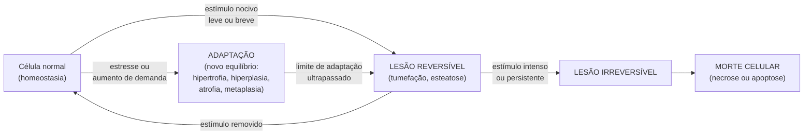
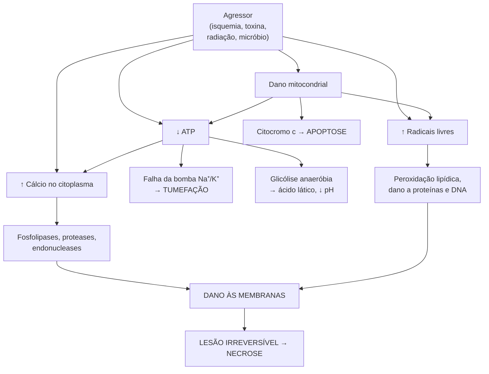
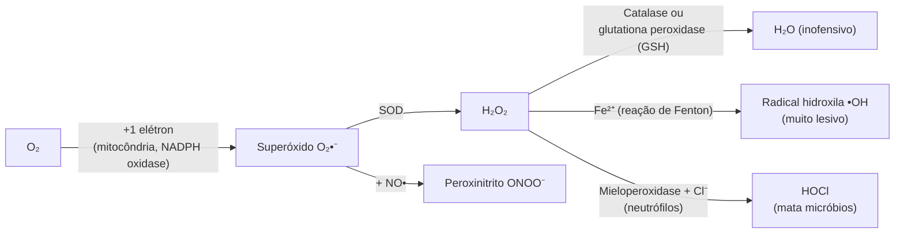
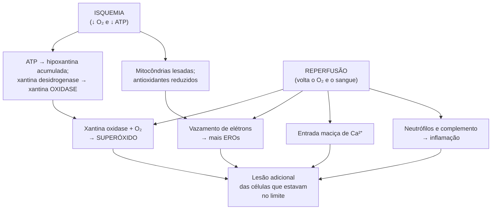

> **Este tópico abre a parte de patologia do ASE6.** Ele cobre a ementa ("mecanismo geral de agressão celular; alterações celulares aos agentes agressores físicos, químicos e biológicos; isquemia; estresse oxidativo") e as questões 1, 2 e 11 do **roteiro 4 do morfofuncional** (trombose venosa profunda, isquemia-reperfusão e radicais livres). O que acontece quando a célula morre está no tópico seguinte, [necrose e apoptose](#/patologia/necrose-apoptose).

## Objetivos do tópico {#objetivos}

Ao final, você deve ser capaz de:

1. Explicar o espectro **normalidade → adaptação → lesão reversível → lesão irreversível → morte celular** e citar as principais **causas** de lesão celular.
2. Reconhecer as **adaptações celulares** ao estresse (hipertrofia, hiperplasia, atrofia, metaplasia) e quando cada uma ocorre.
3. Descrever os **mecanismos bioquímicos** da lesão: depleção de **ATP**, dano **mitocondrial**, entrada de **cálcio**, **estresse oxidativo**, dano às **membranas** e ao **DNA/proteínas**.
4. Diferenciar **hipóxia** de **isquemia** e explicar por que a isquemia lesa mais.
5. Descrever a **morfologia** da lesão reversível (tumefação celular, esteatose) e os sinais de **irreversibilidade**.
6. Caracterizar os **radicais livres** (espécies reativas de oxigênio e de nitrogênio): como se formam, que estragos fazem e como o corpo se defende — e o seu papel no **sistema imune**.
7. Explicar a **lesão de isquemia-reperfusão** e a **trombose venosa profunda** como exemplos clínicos.

::: referencias
Kumar, Abbas & Aster – Robbins Patologia Básica, 10ª ed., cap. "Lesão e morte celulares" · Bogliolo – Patologia Geral, 6ª ed., caps. "Degenerações" e "Lesões celulares reversíveis".
:::

## Conceitos-base {#conceitos-base}

### O espectro da resposta celular {#espectro}

Uma célula normal vive em **homeostasia**: mantém seu funcionamento dentro de limites estreitos apesar das variações do ambiente. Quando é submetida a um **estímulo nocivo** ou a uma demanda maior que a habitual, ela pode seguir caminhos diferentes, dependendo da **intensidade** e da **duração** do estímulo e do **tipo** de célula:

- **Adaptação**: a célula muda (tamanho, número, tipo) e encontra um novo equilíbrio, sobrevivendo.
- **Lesão reversível**: há alterações funcionais e estruturais, mas, se o estímulo for retirado, a célula **volta ao normal**.
- **Lesão irreversível**: passa-se um "ponto de não retorno"; a célula **morrerá** mesmo se o estímulo cessar.

**Um exemplo que acompanha todo o tópico:** quando uma artéria coronária se fecha, as células do miocárdio irrigadas por ela param de contrair em cerca de **1 minuto** (lesão reversível, ainda funcional), mas só morrem de forma irreversível depois de **20 a 40 minutos** de isquemia. Abrir a artéria nesse intervalo salva o músculo — essa é a base do tratamento do infarto.

### Causas de lesão celular {#causas}

| Causa | Exemplos |
|---|---|
| **Privação de oxigênio** (a mais comum) | **Hipóxia** (anemia, intoxicação por monóxido de carbono, doença pulmonar) e **isquemia** (obstrução do fluxo de sangue) |
| **Agentes físicos** | Trauma mecânico, calor e frio extremos, radiação, choque elétrico, mudanças bruscas de pressão |
| **Agentes químicos e fármacos** | Venenos, álcool, poluentes, excesso de fármacos (paracetamol), até glicose ou sal em excesso |
| **Agentes infecciosos** | Vírus, bactérias (e suas toxinas), fungos, protozoários, helmintos |
| **Reações imunológicas** | Autoimunidade, alergias, dano causado pela própria resposta inflamatória |
| **Alterações genéticas** | Proteínas mal dobradas, defeitos enzimáticos (erros inatos do metabolismo) |
| **Desequilíbrios nutricionais** | Desnutrição, deficiência de vitaminas; obesidade e excesso de lipídios |
| **Envelhecimento** | Acúmulo de danos e perda da capacidade de reparo |

### Adaptações celulares ao estresse {#adaptacoes}

As adaptações são aprofundadas no ASE2, mas fazem parte do roteiro 4 e da compreensão do espectro:

| Adaptação | O que é | Exemplo fisiológico | Exemplo patológico |
|---|---|---|---|
| **Hipertrofia** | Aumento do **tamanho** das células (mais proteínas e organelas), sem aumentar o número | Músculo esquelético do atleta; útero na gravidez | **Miocárdio** na hipertensão arterial (o coração "trabalha contra" uma pressão maior) |
| **Hiperplasia** | Aumento do **número** de células (só em tecidos capazes de se dividir) | Mama na puberdade e na lactação; regeneração do fígado após retirada de parte dele | Hiperplasia do endométrio por excesso de estrogênio; hiperplasia prostática benigna |
| **Atrofia** | **Redução** do tamanho (e da função) das células, por perda de componentes | Involução do timo; útero após a gravidez | Músculo imobilizado ou desnervado; cérebro com isquemia crônica; desnutrição |
| **Metaplasia** | **Troca de um tipo de célula diferenciada por outro**, mais resistente ao estresse | — | Epitélio respiratório (cilíndrico ciliado) virando **escamoso** no fumante; epitélio do esôfago virando glandular no refluxo crônico (**esôfago de Barrett**) |

A metaplasia é "um preço": o novo epitélio aguenta melhor a agressão, mas perde funções (o epitélio escamoso não tem cílios nem muco) e pode, com o tempo, evoluir para displasia e câncer.

::: referencias
Robbins Patologia Básica, 10ª ed., cap. "Lesão e morte celulares".
:::

## Explicação detalhada {#explicacao}

### Hipóxia e isquemia {#hipoxia-isquemia}

- **Hipóxia** é a **falta de oxigênio** nos tecidos, com o fluxo de sangue mantido. Causas: menos O₂ no ar ou nos pulmões (doença pulmonar, altitude), sangue incapaz de transportar O₂ (**anemia**, **monóxido de carbono**, que ocupa a hemoglobina), ou células incapazes de usar o O₂ (**cianeto**, que bloqueia a cadeia respiratória).
- **Isquemia** é a **redução do fluxo de sangue** para um tecido (por obstrução arterial ou queda da pressão de perfusão). Ela causa hipóxia **e** mais duas coisas: falta **substratos** para a glicólise (glicose) e os **metabólitos** se acumulam (ácido lático, CO₂), porque não são levados embora.

**Por isso a isquemia lesa mais e mais rápido que a hipóxia isolada**: na hipóxia, a célula ainda consegue fazer glicólise anaeróbia com a glicose que continua chegando; na isquemia, até essa via falha e o ácido se acumula.

**A sensibilidade varia muito entre os tecidos:**

| Célula | Tempo aproximado de isquemia até lesão irreversível |
|---|---|
| **Neurônio** | **3 a 5 minutos** |
| **Miócito cardíaco** | **20 a 40 minutos** |
| Hepatócito, túbulo renal | 1 a 2 horas |
| Fibroblasto, músculo esquelético | Várias horas |

### Mecanismos bioquímicos da lesão celular {#mecanismos-lesao}

Os agentes agressores são muito diferentes, mas atingem poucos **alvos comuns**: a produção de energia (mitocôndrias), as membranas, a síntese de proteínas, o DNA e o equilíbrio de íons. Os seis mecanismos principais se reforçam uns aos outros:

#### 1. Depleção de ATP {#deplecao-atp}

É o mecanismo central da lesão por hipóxia e isquemia. Sem O₂, a fosforilação oxidativa na mitocôndria para, e o ATP cai. As consequências aparecem em cascata:

1. **A bomba de sódio e potássio (Na⁺/K⁺-ATPase) falha** → sódio e água entram na célula, potássio sai → a célula e suas organelas **incham** (**tumefação celular** — a primeira alteração visível).
2. **A célula passa a depender da glicólise anaeróbia** → consome o glicogênio de reserva e acumula **ácido lático** → o **pH intracelular cai** → a cromatina do núcleo se condensa.
3. **As bombas de cálcio falham** → o cálcio entra e se acumula no citoplasma (veja o mecanismo 3).
4. **Os ribossomos se soltam do retículo endoplasmático rugoso** → a síntese de proteínas diminui.
5. Se a falta de energia persiste, há dano irreversível às membranas das mitocôndrias e dos lisossomos.

#### 2. Dano mitocondrial {#dano-mitocondrial}

As mitocôndrias são alvo de quase todos os agressores (hipóxia, toxinas, radiação, cálcio). Quando lesadas:

- Formam-se **poros na membrana interna** (o *poro de transição de permeabilidade mitocondrial*) → a mitocôndria perde o potencial de membrana e **para de produzir ATP** — sinal de irreversibilidade.
- Proteínas que ficavam no espaço entre as membranas, como o **citocromo c**, vazam para o citoplasma e ativam a **apoptose** (veja [necrose e apoptose](#/patologia/necrose-apoptose)).
- A cadeia respiratória danificada "vaza" elétrons e produz mais **radicais livres**.

#### 3. Entrada e acúmulo de cálcio {#calcio}

Normalmente, a concentração de cálcio no citoplasma é cerca de 10.000 vezes menor que fora da célula, graças a bombas que gastam ATP. Na lesão, o cálcio entra (pela membrana lesada e pela falha das bombas) e é liberado das reservas internas (mitocôndrias e retículo endoplasmático). O cálcio em excesso **ativa enzimas destrutivas**:

- **Fosfolipases** → degradam as membranas;
- **Proteases** → quebram proteínas do citoesqueleto e da membrana;
- **Endonucleases** → fragmentam o DNA;
- **ATPases** → consomem ainda mais ATP.

Além disso, o cálcio favorece a abertura dos poros mitocondriais e a apoptose. Nas mitocôndrias muito lesadas, ele se deposita formando as **densidades floculentas** vistas ao microscópio eletrônico — um sinal clássico de lesão irreversível.

#### 4. Estresse oxidativo (radicais livres) {#estresse-oxidativo}

É tão importante que tem uma seção própria, abaixo.

#### 5. Defeitos de permeabilidade das membranas {#membranas}

A perda da integridade das membranas é a marca da lesão irreversível. Elas são atacadas por radicais livres (peroxidação lipídica), fosfolipases ativadas pelo cálcio, toxinas bacterianas, proteínas do complemento e agentes físicos. As consequências dependem da membrana atingida:

- **Membrana mitocondrial** → para a produção de ATP e libera ativadores da apoptose;
- **Membrana plasmática** → perda do equilíbrio de íons e vazamento do conteúdo celular (por isso enzimas como a **troponina** do coração e as **transaminases** do fígado aparecem no sangue quando essas células morrem);
- **Membrana dos lisossomos** → as enzimas lisossomais escapam e **digerem a própria célula**.

#### 6. Dano ao DNA e acúmulo de proteínas mal dobradas {#dna-proteinas}

Radiação, quimioterápicos e radicais livres lesam o DNA; se o dano é grande demais para ser reparado, a proteína **p53** induz a **apoptose**. Proteínas mal dobradas que se acumulam no retículo endoplasmático (por mutações, falta de energia ou radicais livres) desencadeiam a "resposta a proteínas mal dobradas" e, se ela falhar, também a apoptose.

::: referencias
Robbins Patologia Básica, 10ª ed., cap. "Lesão e morte celulares".
:::

### Radicais livres e estresse oxidativo {#radicais-livres}

#### O que é um radical livre {#definicao-radical}

Um **radical livre** é uma molécula (ou átomo) com **um elétron desemparelhado** na camada mais externa. Essa configuração é instável: o radical "rouba" elétrons das moléculas vizinhas, que por sua vez se tornam radicais — uma **reação em cadeia**. Quando a produção dessas espécies supera a capacidade de defesa da célula, temos o **estresse oxidativo**.

O termo **espécies reativas de oxigênio (EROs)** inclui os radicais derivados do oxigênio e algumas moléculas reativas que não são radicais (como o peróxido de hidrogênio). Há também as **espécies reativas de nitrogênio**.

#### Tipos principais {#tipos-radicais}

| Espécie | Como se forma | Características |
|---|---|---|
| **Ânion superóxido (O₂•⁻)** | Oxigênio que recebe **um** elétron a mais — vazamento da **cadeia respiratória** mitocondrial, ação da **NADPH oxidase** dos fagócitos, da **xantina oxidase** | É o "radical de partida"; convertido em H₂O₂ pela superóxido dismutase |
| **Peróxido de hidrogênio (H₂O₂)** | Dismutação do superóxido; enzimas oxidases (nos peroxissomos) | **Não é radical**, mas atravessa membranas e gera o radical hidroxila na presença de ferro |
| **Radical hidroxila (•OH)** | **Reação de Fenton**: H₂O₂ + **Fe²⁺** → •OH; **radiólise da água** pela radiação ionizante | O **mais reativo e destrutivo**; ataca qualquer molécula próxima |
| **Óxido nítrico (NO•)** | Produzido pelas **óxido nítrico sintases** (endotélio, neurônios, macrófagos com iNOS) | Em pequenas quantidades sinaliza (vasodilatação); em grandes, é tóxico |
| **Peroxinitrito (ONOO⁻)** | **NO• + superóxido** | Espécie reativa de nitrogênio muito lesiva para proteínas e lipídios |
| **Ácido hipocloroso (HOCl)** | **Mieloperoxidase** dos neutrófilos: H₂O₂ + Cl⁻ | Arma dos neutrófilos contra micróbios |

#### De onde vêm {#fontes-radicais}

- **Metabolismo normal**: 1–2% do oxigênio usado pela mitocôndria "escapa" da cadeia respiratória como superóxido — por isso a produção é contínua, e as defesas também.
- **Radiação** ionizante (raios X, raios gama) e ultravioleta: quebram a molécula de água em radicais hidroxila.
- **Metabolismo de substâncias químicas e fármacos**: as enzimas do citocromo P450 transformam algumas substâncias em radicais (o tetracloreto de carbono vira o radical CCl₃•) ou em metabólitos reativos (o paracetamol vira **NAPQI**).
- **Metais de transição**: **ferro** e **cobre** livres catalisam a formação do radical hidroxila (reação de Fenton) — por isso o excesso de ferro (hemocromatose) lesa o fígado, o pâncreas e o coração.
- **Inflamação**: neutrófilos e macrófagos produzem grandes quantidades de EROs e NO na **explosão respiratória**.
- **Reperfusão** de tecidos isquêmicos (veja adiante).

#### Que estragos fazem {#efeitos-radicais}

1. **Peroxidação lipídica das membranas** — o radical ataca as ligações duplas dos ácidos graxos insaturados dos fosfolipídios, gerando peróxidos que propagam a reação em cadeia → a membrana perde integridade.
2. **Oxidação de proteínas** — formação de ligações cruzadas e fragmentação; enzimas perdem a função, e proteínas danificadas são degradadas ou se agregam.
3. **Lesões no DNA** — quebras de fita e bases modificadas → mutações (contribuem para o envelhecimento e para o câncer) ou apoptose.

#### Como a célula se defende {#antioxidantes}

| Defesa | Como age |
|---|---|
| **Superóxido dismutase (SOD)** | Converte superóxido (O₂•⁻) em H₂O₂ |
| **Catalase** (nos peroxissomos) | Decompõe H₂O₂ em água e oxigênio |
| **Glutationa peroxidase** | Converte H₂O₂ (e peróxidos lipídicos) em água, usando a **glutationa reduzida (GSH)** como doadora de elétrons |
| **Glutationa reduzida (GSH)** | Principal antioxidante solúvel da célula; também "neutraliza" metabólitos reativos como o NAPQI do paracetamol |
| **Vitamina E** (α-tocoferol) | Lipossolúvel: protege as **membranas**, interrompendo a cadeia da peroxidação lipídica |
| **Vitamina C**, β-caroteno | Antioxidantes hidrossolúveis (vitamina C) e lipossolúveis (carotenoides) |
| **Proteínas que sequestram metais** | **Transferrina**, **ferritina** (ferro) e **ceruloplasmina** (cobre) mantêm esses metais ligados, impedindo a reação de Fenton |

#### O papel dos radicais livres no sistema imune {#radicais-imunidade}

Os radicais livres são, ao mesmo tempo, **armas** e **efeitos colaterais** da defesa:

- **Como arma**: neutrófilos e macrófagos usam a **NADPH oxidase** para produzir superóxido dentro do fagolisossomo; ele vira H₂O₂, e a **mieloperoxidase** forma o **ácido hipocloroso** — o "alvejante" que mata as bactérias fagocitadas. Macrófagos ativados por IFN-γ produzem também **óxido nítrico** (iNOS). Quem não tem NADPH oxidase funcional (**doença granulomatosa crônica**) sofre infecções graves (veja [imunidade inata](#/imunologia/imunidade-inata#fagocitose)).
- **Como sinalização**: em pequenas doses, as EROs participam da ativação de células imunes e da formação das armadilhas extracelulares dos neutrófilos (NETs).
- **Como dano**: quando os fagócitos liberam esses produtos fora da célula, eles lesam o **próprio tecido** do hospedeiro — parte importante do dano na inflamação, na sepse, na lesão de reperfusão e em doenças inflamatórias crônicas.

::: referencias
Robbins Patologia Básica, 10ª ed., cap. "Lesão e morte celulares" · Abbas, 10ª ed., cap. "Imunidade inata".
:::

### Morfologia da lesão reversível {#morfologia-reversivel}

#### Tumefação celular (degeneração hidrópica) {#tumefacao}

É a **primeira manifestação** de quase toda lesão celular, consequência da falha da bomba de sódio e potássio:

- **A olho nu**: o órgão fica **pálido**, **aumentado** de volume e de peso, com maior turgor.
- **Ao microscópio óptico**: células **aumentadas**, com citoplasma pálido; quando a água se acumula em pequenos vacúolos (retículo endoplasmático dilatado), fala-se em **degeneração hidrópica** ou **vacuolar**.
- **Ao microscópio eletrônico**: bolhas na membrana plasmática, perda de microvilosidades, **mitocôndrias inchadas** (às vezes com pequenas densidades amorfas), **retículo endoplasmático dilatado** com ribossomos soltos, **figuras de mielina** (restos de membranas enrolados) e condensação da cromatina.

#### Esteatose (alteração gordurosa) {#esteatose}

É o acúmulo de **vacúolos de gordura** (triglicerídeos) no citoplasma, típico de órgãos que metabolizam lipídios — sobretudo o **fígado**, mas também o coração e o rim. Ocorre quando a lesão (álcool, toxinas, hipóxia, desnutrição proteica, obesidade, diabetes) prejudica a capacidade da célula de exportar ou oxidar a gordura. Na lâmina corada por H&E, a gordura é dissolvida no preparo e aparece como **vacúolos claros**, grandes (que empurram o núcleo para a periferia) ou pequenos e múltiplos.

### Sinais de lesão irreversível {#irreversibilidade}

Dois fenômenos marcam o "ponto de não retorno":

1. **Incapacidade de recuperar a função mitocondrial** (sem produção de ATP mesmo se o oxigênio voltar).
2. **Distúrbios profundos das membranas** (plasmática e dos lisossomos).

Ao microscópio, aparecem:

- **Mitocôndrias com grandes densidades floculentas** (depósitos de cálcio e proteínas desnaturadas);
- **Ruptura da membrana plasmática** e das membranas dos lisossomos;
- **Alterações nucleares** da necrose: **picnose** (núcleo encolhido e escuro), **cariorrexe** (núcleo fragmentado) e **cariólise** (núcleo desbotado até desaparecer) — detalhadas em [necrose e apoptose](#/patologia/necrose-apoptose#alteracoes-nucleares).

::: referencias
Robbins Patologia Básica, 10ª ed., cap. "Lesão e morte celulares" · Bogliolo – Patologia Geral, 6ª ed.
:::

### Lesão de isquemia-reperfusão {#isquemia-reperfusao}

**Restaurar o fluxo** de sangue para um tecido isquêmico é indispensável para salvá-lo — mas, paradoxalmente, a **reperfusão pode piorar a lesão** das células que já estavam no limite. Isso acontece por vários mecanismos:

1. **Explosão de radicais livres** quando o oxigênio volta:
   - as mitocôndrias lesadas "vazam" elétrons e produzem superóxido em excesso;
   - durante a isquemia, o ATP é degradado até **hipoxantina**, e a enzima xantina desidrogenase é convertida em **xantina oxidase**; com a volta do O₂, a xantina oxidase transforma a hipoxantina acumulada produzindo grandes quantidades de **superóxido**;
   - as defesas antioxidantes estão reduzidas pela isquemia.
2. **Sobrecarga de cálcio**: com a reperfusão, o cálcio entra em grande quantidade nas células lesadas.
3. **Inflamação**: as células lesadas liberam sinais de perigo (DAMPs); **neutrófilos** chegam com o sangue e produzem ainda mais radicais livres e enzimas.
4. **Ativação do complemento**: anticorpos naturais (IgM) se ligam a estruturas expostas no tecido isquêmico e ativam o complemento.

**Morfologia típica**: no miocárdio reperfundido aparecem **bandas de contração** (miofibrilas hipercontraídas pela entrada de cálcio) e **hemorragia** no tecido infartado (vasos lesados voltam a receber sangue).

**Importância clínica**: é um fenômeno central no tratamento do **infarto do miocárdio** (angioplastia ou trombólise), do **AVC isquêmico**, de **transplantes** (o órgão fica isquêmico durante o transporte) e de cirurgias com clampeamento de vasos. Mesmo assim, a reperfusão precoce traz muito mais benefício que dano — o objetivo é reperfundir **o mais cedo possível**.

### Trombose venosa profunda: lesão por obstrução do fluxo {#trombose-venosa-profunda}

O roteiro 4 pede as alterações da **trombose venosa profunda (TVP)** e os vasos mais afetados. A trombose e a coagulação serão aprofundadas no tópico de hemostasia (Lote 3); aqui fica o essencial:

- **O que é**: formação de um **trombo** (massa sólida de plaquetas, fibrina e células do sangue) dentro de uma **veia profunda**, geralmente dos **membros inferiores**.
- **Por que acontece — tríade de Virchow**:
  1. **Estase** (lentidão do fluxo): imobilidade (cirurgia, internação, viagens longas), insuficiência cardíaca, compressão venosa;
  2. **Lesão endotelial**: trauma, cirurgia, cateteres, inflamação;
  3. **Hipercoagulabilidade**: câncer, gravidez e puerpério, anticoncepcionais com estrogênio e reposição hormonal, trombofilias hereditárias (como fator V de Leiden), obesidade, tabagismo.
- **Vasos mais afetados**: as **veias profundas da panturrilha** (tibiais, fibulares e veias dos músculos da panturrilha) são o ponto de início mais comum; o trombo pode estender-se às veias **poplítea**, **femoral** e **ilíacas** (TVP proximal, de maior risco de embolia). Também pode ocorrer nos membros superiores (cateteres) e em veias abdominais.
- **Alterações nos tecidos**: a obstrução do retorno venoso aumenta a pressão nos capilares a montante → **edema** do membro, dor, calor e vermelhidão (pela inflamação ao redor da veia); o sangue represado congestiona os tecidos. Com o tempo, o trombo é **organizado** (invadido por fibroblastos e novos vasos) e pode recanalizar, mas as válvulas venosas ficam lesadas (síndrome pós-trombótica: edema crônico, varizes, úlceras).
- **Complicação mais temida**: fragmentos do trombo se soltam (**êmbolos**), sobem pela veia cava, passam pelo coração direito e se alojam nas artérias pulmonares → **tromboembolismo pulmonar**, que pode ser fatal.

::: referencias
Robbins Patologia Básica, 10ª ed., caps. "Lesão e morte celulares" e "Distúrbios hemodinâmicos, tromboembolismo e choque".
:::

## Correlação clínica {#correlacao-clinica}

### Infarto do miocárdio: a janela de tempo {#iam}

Na oclusão de uma coronária, o miocárdio perde a contração em segundos, mas as células só morrem de forma irreversível após **20 a 40 minutos**, e a necrose se completa em algumas horas, avançando do subendocárdio para o epicárdio. Por isso **"tempo é músculo"**: quanto antes a artéria é aberta (angioplastia ou trombólise), mais músculo se salva. A **troponina** sobe no sangue porque a membrana das células lesadas se rompe e libera seu conteúdo — um marcador de **lesão irreversível**.

### Intoxicação por paracetamol {#paracetamol}

Em doses normais, o paracetamol é eliminado pelo fígado por vias seguras, e uma pequena parte é transformada pelo citocromo P450 em **NAPQI**, um metabólito reativo que é logo neutralizado pela **glutationa (GSH)**. Na **superdosagem**, a glutationa se esgota, o NAPQI se liga às proteínas e gera estresse oxidativo, causando **necrose dos hepatócitos** (sobretudo ao redor da veia centrolobular, onde há mais citocromo P450). O tratamento é a **N-acetilcisteína**, que repõe a glutationa — melhor quanto mais cedo.

### Monóxido de carbono: hipóxia sem cianose {#monoxido-carbono}

O **monóxido de carbono** (incêndios, aquecedores e geradores em locais fechados) se liga à hemoglobina com afinidade cerca de 200 vezes maior que o oxigênio e impede seu transporte. Os tecidos mais sensíveis à hipóxia — **cérebro** e **coração** — são os mais afetados (cefaleia, confusão, coma, arritmias). O tratamento é oxigênio a 100% (ou hiperbárico).

### Hemocromatose: ferro e radicais livres {#hemocromatose}

No excesso de ferro (hemocromatose hereditária, transfusões repetidas), o ferro livre catalisa a **reação de Fenton** e a produção de radical hidroxila, lesando fígado (cirrose), pâncreas (diabetes), coração (insuficiência cardíaca) e pele (escurecimento) — um exemplo de doença por estresse oxidativo.

::: referencias
Robbins Patologia Básica, 10ª ed., cap. "Lesão e morte celulares" · Harrison – Medicina Interna, 21ª ed., caps. "Infarto agudo do miocárdio", "Intoxicação por paracetamol" e "Hemocromatose".
:::

## Pontos de alta cobrança em prova {#alta-cobranca}

::: prova
- **Espectro**: normal → **adaptação** → **lesão reversível** → **lesão irreversível** → **morte** (necrose ou apoptose). Depende de intensidade, duração e tipo celular.
- **Adaptações**: hipertrofia (tamanho), hiperplasia (número), atrofia (redução), **metaplasia** (troca de tipo celular; ex.: brônquio do fumante, esôfago de Barrett).
- **Isquemia** (↓ fluxo: falta O₂ **e** substratos, acumula metabólitos) lesa **mais** que a **hipóxia** (só ↓ O₂). Neurônio 3–5 min; miocárdio 20–40 min.
- **↓ ATP** → falha da **Na⁺/K⁺-ATPase** (tumefação), glicólise anaeróbia (**lactato**, ↓ pH), entrada de Ca²⁺, ribossomos soltos (↓ síntese proteica).
- **Ca²⁺** ativa **fosfolipases, proteases, endonucleases, ATPases**.
- **Irreversibilidade**: falha mitocondrial persistente + dano grave de membranas; **densidades floculentas** nas mitocôndrias; picnose, cariorrexe, cariólise.
- **Lesão reversível**: **tumefação celular** (primeira alteração; órgão pálido e aumentado) e **esteatose** (vacúolos de gordura, sobretudo fígado).
- **Radicais livres**: elétron desemparelhado; **superóxido**, **H₂O₂** (não radical), **hidroxila** (o mais lesivo; **Fenton** com Fe²⁺), **NO**, **peroxinitrito**, **HOCl**.
- **Efeitos**: peroxidação lipídica, oxidação de proteínas, dano ao DNA. **Defesas**: **SOD**, **catalase**, **glutationa peroxidase/GSH**, vitaminas **E** (membranas) e **C**, transferrina/ferritina/ceruloplasmina.
- **Imunidade**: NADPH oxidase → superóxido → H₂O₂ → **MPO → HOCl** (matar micróbios); excesso lesa o tecido.
- **Isquemia-reperfusão**: **xantina oxidase** + mitocôndrias lesadas → EROs; sobrecarga de Ca²⁺; neutrófilos; complemento; **bandas de contração**.
- **TVP**: **tríade de Virchow** (estase, lesão endotelial, hipercoagulabilidade); começa nas **veias da panturrilha** → poplítea, femoral, ilíacas; complicação: **embolia pulmonar**.
- **Paracetamol**: NAPQI esgota **glutationa** → necrose centrolobular → **N-acetilcisteína**.
:::

## Armadilhas comuns {#armadilhas}

::: armadilha
- **Achar que hipóxia e isquemia são sinônimos.** Isquemia é **falta de fluxo** (e, portanto, de O₂, glicose e remoção de metabólitos); hipóxia é só **falta de O₂**.
- **Considerar a tumefação celular uma lesão irreversível.** Ela é a **primeira** e **reversível** manifestação da lesão.
- **Achar que o H₂O₂ é um radical livre.** Ele **não tem elétron desemparelhado**; é uma espécie reativa de oxigênio que gera o radical hidroxila na presença de ferro.
- **Achar que radicais livres são sempre ruins.** Eles são **armas** dos fagócitos e participam da sinalização celular; o problema é o **excesso** (estresse oxidativo).
- **Achar que a reperfusão deve ser evitada por causar lesão.** A reperfusão **precoce** salva muito mais tecido do que lesa; o dano de reperfusão afeta células que já estavam no limite.
- **Confundir hipertrofia com hiperplasia.** Hipertrofia = células **maiores**; hiperplasia = **mais** células. O miocárdio adulto praticamente só faz hipertrofia.
- **Achar que a TVP começa na coxa.** O início mais comum é nas **veias profundas da panturrilha**; a extensão para veias proximais aumenta o risco de embolia.
:::

## Resumo para revisão rápida {#resumo}

- **Espectro**: adaptação (hipertrofia, hiperplasia, atrofia, metaplasia) → lesão reversível → irreversível → morte.
- **Causas**: hipóxia/isquemia (a mais comum), físicas, químicas, infecciosas, imunológicas, genéticas, nutricionais, envelhecimento.
- **Isquemia > hipóxia** em gravidade; neurônios 3–5 min, miocárdio 20–40 min.
- **Mecanismos**: ↓ ATP (Na⁺/K⁺ → tumefação; lactato; Ca²⁺; ↓ proteínas), dano mitocondrial (sem ATP, citocromo c → apoptose, mais EROs), ↑ Ca²⁺ (fosfolipases, proteases, endonucleases), radicais livres, dano às membranas, dano ao DNA/proteínas.
- **Reversível**: tumefação (degeneração hidrópica), esteatose. **Irreversível**: mitocôndrias com densidades floculentas, ruptura de membranas, picnose/cariorrexe/cariólise.
- **Radicais livres**: superóxido, H₂O₂, hidroxila (Fenton), NO, peroxinitrito, HOCl; fontes: mitocôndria, radiação, fármacos (P450), ferro/cobre, fagócitos, reperfusão; efeitos: peroxidação lipídica, proteínas, DNA; defesas: SOD, catalase, glutationa peroxidase/GSH, vitaminas E e C, proteínas que sequestram metais.
- **Imunidade**: explosão respiratória mata micróbios; excesso lesa o tecido.
- **Isquemia-reperfusão**: xantina oxidase, mitocôndrias, Ca²⁺, neutrófilos, complemento; bandas de contração.
- **TVP**: tríade de Virchow; veias da panturrilha → poplítea/femoral/ilíacas; edema; embolia pulmonar.

::: referencias
Robbins Patologia Básica, 10ª ed. · Bogliolo – Patologia Geral, 6ª ed.
:::
