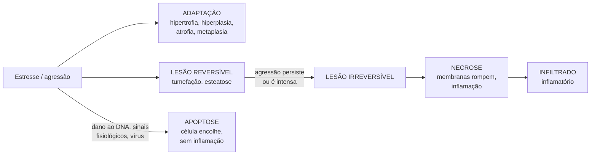

> **Roteiro do laboratório (Problema 4):** questões 2 (isquemia-reperfusão), 3 a 9 (apoptose × necrose: características morfológicas, citopatológicas e ultraestruturais; poros nucleares; neurônios no AVC isquêmico), 5 e 12 (identificar na lâmina a necrose de coagulação e os outros tipos de necrose), 11 (radicais livres) e 13 (alterações anatômicas e fisiológicas: adaptação, necrose, apoptose e infiltrado). Os mecanismos estão explicados em profundidade nos tópicos da tutoria [lesão celular e estresse oxidativo](#/patologia/lesao-celular-estresse-oxidativo) e [necrose e apoptose](#/patologia/necrose-apoptose); aqui o foco é **reconhecer as alterações nas lâminas e nas fotos**. A trombose venosa profunda e a cicatrização (questões 1 e 10) estão em [trombose e cicatrização](#/patologia/morfo-trombose-cicatrizacao).

## Objetivos do tópico {#objetivos}

Ao final, você deve ser capaz de:

1. Seguir um **roteiro de leitura de lâmina** de lesão celular (aumento, coloração, o que procurar).
2. **Identificar na lâmina a necrose de coagulação** e reconhecer os demais tipos de necrose (liquefativa, caseosa, gordurosa, fibrinoide) e a gangrena, justificando pelos achados.
3. Diferenciar **apoptose × necrose** ao microscópio óptico e nas **eletromicrografias** (transmissão e varredura), incluindo a membrana e os **poros nucleares**.
4. Interpretar as alterações de **neurônios isquêmicos**, em que apoptose e necrose coexistem.
5. Reconhecer a **lesão de isquemia-reperfusão** no miocárdio.
6. Relacionar os **radicais livres** com a lesão tecidual e com a defesa imune.
7. Descrever quatro alterações anatômicas e fisiológicas provocadas por processos patológicos: **adaptação, necrose, apoptose e infiltrado**.

::: referencias
Kumar, Abbas & Aster – Robbins Patologia Básica, 10ª ed., caps. "Lesão e morte celulares" e "Inflamação e reparo" · Bogliolo – Patologia Geral, 6ª ed. · Junqueira & Carneiro – Histologia Básica, 13ª ed.
:::

## Conceitos-base {#conceitos-base}

### Como ler uma lâmina de patologia {#como-ler-lamina}

A coloração mais usada é a **hematoxilina-eosina (H&E)**:

- A **hematoxilina** é um corante **básico** que cora em **azul-arroxeado** as estruturas **ácidas** (basófilas): **núcleos** (DNA), ribossomos e RNA do citoplasma, cálcio.
- A **eosina** é um corante **ácido** que cora em **rosa** as estruturas **básicas** (eosinófilas): **proteínas do citoplasma**, colágeno, hemácias (vermelho vivo), fibrina.

Por isso, na lesão celular, duas mudanças de cor contam a história:

1. **Citoplasma mais rosado (hipereosinofilia)**: a célula morta perde RNA (azul) e suas proteínas desnaturam e ligam mais eosina.
2. **Núcleo alterado**: muito escuro e pequeno (**picnose**), fragmentado (**cariorrexe**) ou pálido até desaparecer (**cariólise**) — veja [alterações nucleares](#/patologia/necrose-apoptose#alteracoes-nucleares).

**Roteiro prático** (use sempre):

1. **Pequeno aumento (4× e 10×)**: qual é o **órgão**? Há uma **área diferente** do restante (mais rosa, mais pálida, um "buraco", um nódulo)? A arquitetura está **preservada** ou **perdida**? Há uma **borda** entre o tecido vivo e o alterado?
2. **Médio e grande aumento (40×)**: como estão os **núcleos** (presentes, ausentes, picnóticos, fragmentados)? O **citoplasma** está mais eosinófilo, vacuolado? Que **células inflamatórias** há e onde (neutrófilos na borda, macrófagos, linfócitos, células gigantes)? Há material amorfo, cálcio (roxo granuloso), hemorragia, fibrina?
3. **Conclusão**: nome do processo + justificativa pelos achados (como o roteiro pede na questão 12).

### Reversível, irreversível, necrose e apoptose: o mapa {#mapa-lesao}

::: referencias
Robbins Patologia Básica, 10ª ed., cap. "Lesão e morte celulares" · Junqueira & Carneiro – Histologia Básica, 13ª ed., cap. "Métodos de estudo em histologia".
:::

## Explicação detalhada {#explicacao}

### Lâminas de necrose {#laminas-necrose}

#### Necrose de coagulação — a lâmina principal {#lamina-coagulacao}

É a necrose dos **infartos** de órgãos sólidos (coração, rim, baço, fígado) — a lesão por **isquemia** (falta de fluxo sanguíneo). O roteiro pede que você **a identifique na lâmina**. O que procurar:

1. **Pequeno aumento**: uma **área bem delimitada**, mais **rosada e homogênea** que o tecido ao redor (às vezes em forma de **cunha** no rim e no baço), em que o **desenho do tecido continua reconhecível** — você ainda vê os contornos de túbulos, glomérulos ou fibras musculares.
2. **Grande aumento**: as células parecem **"fantasmas"**: mantêm o **contorno**, mas o citoplasma está **hipereosinofílico** e os **núcleos sumiram** ou estão em picnose, cariorrexe e cariólise.
3. **Borda**: entre a área morta e o tecido vivo, uma faixa de **infiltrado inflamatório** — **neutrófilos** nos primeiros dias, depois **macrófagos** e **tecido de granulação** — e às vezes congestão e hemorragia.

**Por que a arquitetura se mantém?** A isquemia causa acidose, que **desnatura** não só as proteínas estruturais como as **enzimas** da célula. Sem enzimas ativas, a autodigestão é lenta, e o tecido morto fica "fixado" por alguns dias, até que os leucócitos o removam.

::: figura img/morfo/lesao/necrose-coagulacao-rim.jpg
**Infarto do córtex renal — necrose de coagulação** (H&E, pequeno aumento). Na área infartada (região inferior e à direita), o tecido está **pálido e rosado**, mas ainda se reconhecem os **contornos de túbulos e de glomérulos** — a **arquitetura está preservada** —, enquanto os **núcleos desapareceram**. No canto superior esquerdo, o córtex viável, com túbulos e glomérulos de núcleos azuis, e uma faixa de **congestão/hemorragia** na transição.
:::

::: figura img/morfo/lesao/necrose-coagulacao-miocardio.jpg
**Necrose de coagulação de cardiomiócitos (infarto agudo do miocárdio, H&E).** As fibras musculares cardíacas mantêm o **contorno alongado**, mas estão **hipereosinofílicas** (rosa intenso e homogêneo) e **sem núcleos** ou com núcleos picnóticos — "fibras fantasmas". Repare como ainda é possível dizer que se trata de músculo, o que não aconteceria numa necrose liquefativa.
:::

::: figura img/morfo/lesao/infarto-miocardio-fases.jpg
**Evolução histológica do infarto do miocárdio** (H&E). Painéis em sequência: miocárdio com as primeiras alterações (fibras **onduladas** e hipereosinofílicas); **necrose de coagulação** estabelecida com **infiltrado de neutrófilos** entre as fibras mortas (1–3 dias); **macrófagos** removendo o tecido necrótico (3–7 dias); **tecido de granulação** com novos vasos (1–2 semanas); e **cicatriz de colágeno** (semanas a meses). A sequência permite estimar a "idade" de um infarto numa necropsia.
:::

#### Necrose liquefativa {#lamina-liquefativa}

- **Onde**: **abscessos** por bactérias piogênicas (estafilococos) e **infartos do sistema nervoso central**.
- **Na lâmina**: **perda completa da arquitetura** — no lugar do tecido, uma cavidade ou área preenchida por **restos celulares** e **muitos neutrófilos** (vivos e mortos: o **pus**), cercada, nos abscessos antigos, por uma **cápsula** de tecido de granulação e fibrose. No cérebro, a área infartada é limpa por **macrófagos espumosos** (cheios de lipídios da mielina) e vira uma cavidade com gliose ao redor.
- **Por quê**: predomina a **digestão enzimática** (enzimas dos neutrófilos) sobre a desnaturação.

::: figura img/morfo/lesao/abscesso-histologia.jpg
**Abscesso — necrose liquefativa** (H&E). No centro, a arquitetura do tecido **desapareceu**: há um material com **inúmeros neutrófilos** (núcleos pequenos, escuros e segmentados, em densidade muito alta) e restos celulares — o **pus**. Na periferia, o tecido ainda reconhecível, com inflamação. Compare com a necrose de coagulação, em que o desenho do tecido persiste.
:::

::: figura img/morfo/lesao/abscesso-pulmonar.jpg
**Abscesso pulmonar (macroscopia).** Uma **cavidade** no parênquima pulmonar, com paredes irregulares e conteúdo necrótico amolecido — o resultado macroscópico da necrose liquefativa, em que o tecido é digerido e eliminado (às vezes por um brônquio, deixando a cavidade com nível de ar e líquido na radiografia).
:::

#### Necrose caseosa {#lamina-caseosa}

- **Onde**: **tuberculose** (também histoplasmose e outras micoses).
- **Na lâmina**: no centro, um material **eosinófilo, amorfo e granuloso**, **sem nenhum contorno celular** (diferente da coagulação); ao redor, o **granuloma**: **macrófagos epitelioides** (grandes, de citoplasma rosa-pálido e núcleo alongado, lembrando células epiteliais), **células gigantes multinucleadas** do tipo **Langhans** (núcleos dispostos em ferradura na periferia) e um halo de **linfócitos**; mais externamente, fibroblastos.
- **Macroscopia**: material branco-amarelado, friável, **"de queijo"**.

::: figura img/morfo/lesao/necrose-caseosa-linfonodo.jpg
**Linfonodo com tuberculose — necrose caseosa e granulomas** (H&E, pequeno aumento). Áreas centrais de material **rosa, amorfo e granuloso**, sem estrutura celular (a **necrose caseosa**), cercadas por uma faixa de células (macrófagos epitelioides, células gigantes e linfócitos) que forma os **granulomas**. O tecido linfoide residual aparece mais azulado na periferia.
:::

#### Necrose gordurosa {#lamina-gordurosa}

- **Onde**: tecido adiposo ao redor do pâncreas na **pancreatite aguda** (necrose gordurosa **enzimática**) e na **mama** após trauma (necrose gordurosa traumática).
- **Na lâmina**: adipócitos com **contornos borrados** ("fantasmas" de células de gordura), material **basófilo** granuloso (**sabões de cálcio** — a saponificação dos ácidos graxos liberados pelas lipases) e reação inflamatória ao redor, com macrófagos espumosos.
- **Macroscopia**: manchas **brancas como giz**.

::: figura img/morfo/lesao/necrose-gordurosa.jpg
**Necrose gordurosa** (H&E). Observe os **adipócitos** de contornos alterados e, entre eles e dentro deles, material amorfo e infiltrado de **macrófagos** que fagocitam a gordura liberada (ficando com o citoplasma espumoso). Na necrose enzimática da pancreatite, há também depósitos **basófilos** (azulados) de sabões de cálcio.
:::

#### Necrose fibrinoide {#lamina-fibrinoide}

- **Onde**: **parede de vasos** em vasculites, doenças por **imunocomplexos** (como o lúpus) e na **hipertensão maligna**.
- **Na lâmina**: a parede do vaso fica tomada por um material **rosa-vivo, brilhante e amorfo**, que lembra fibrina ("fibrinoide") — formado por **imunocomplexos e proteínas plasmáticas** (fibrina) que extravasaram —, com inflamação ao redor. Só é visível ao microscópio.

::: figura img/morfo/lesao/necrose-fibrinoide.jpg
**Necrose fibrinoide em glomérulo** (à esquerda, H&E; à direita, coloração tricrômica). A **seta amarela** aponta o depósito de material **eosinófilo brilhante e amorfo** na parede dos capilares glomerulares (em vermelho no tricrômico) — fibrina e imunocomplexos depositados na parede vascular lesada.
:::

#### Gangrena {#lamina-gangrena}

Termo **clínico** para a necrose de um **membro** (ou segmento de intestino) por isquemia. A **gangrena seca** corresponde à **necrose de coagulação**: o membro fica **preto, seco e mumificado**, com **limite nítido** entre o tecido morto e o vivo (comum em doença arterial e diabetes). Na **gangrena úmida**, a infecção bacteriana superposta causa **necrose liquefativa** (inchaço, secreção, odor fétido).

::: figura img/morfo/lesao/gangrena-seca.jpg
**Gangrena seca do pé** (ilustração médica histórica). O antepé está **enegrecido, ressecado e retraído** (mumificado), com uma **linha de demarcação** nítida separando-o da pele viável do tornozelo. Corresponde à **necrose de coagulação** por isquemia arterial, sem infecção importante.
:::

#### Quadro para a questão 12 do roteiro ("identifique o tipo de necrose e justifique") {#quadro-tipos-necrose}

| Achado principal na lâmina ou na peça | Tipo de necrose | Justificativa |
|---|---|---|
| Área rosa com **contornos celulares preservados**, **sem núcleos**, neutrófilos na borda | **Coagulação** | Proteínas e enzimas desnaturadas pela isquemia; arquitetura mantida |
| **Cavidade/pus**, neutrófilos abundantes, arquitetura perdida; cérebro amolecido | **Liquefativa** | Digestão enzimática predomina (abscesso, infarto do SNC) |
| Material **amorfo granuloso** central + **granuloma** com células gigantes; macroscopia "de queijo" | **Caseosa** | Tuberculose/micoses; destruição celular completa sem liquefação |
| **Manchas brancas de giz** no tecido adiposo; adipócitos fantasmas, **cálcio basófilo** | **Gordurosa** | Lipases liberam ácidos graxos que se unem ao cálcio (saponificação) |
| Parede de vaso **rosa-brilhante amorfa** | **Fibrinoide** | Imunocomplexos e fibrina na parede vascular |
| Membro **preto, seco, mumificado** | **Gangrena seca** (coagulação) | Isquemia sem infecção |

::: referencias
Robbins Patologia Básica, 10ª ed., cap. "Lesão e morte celulares" · Bogliolo – Patologia Geral, 6ª ed.
:::

### Apoptose × necrose nas imagens {#apoptose-necrose-imagens}

#### Ao microscópio óptico {#apoptose-mo-lamina}

A **célula apoptótica** aparece **isolada**, **menor** que as vizinhas, com citoplasma **denso e muito eosinófilo**, **cromatina condensada** em massas escuras (às vezes em **meia-lua** junto à membrana nuclear) ou núcleo **fragmentado em esferas** — os **corpos apoptóticos** —, muitas vezes **dentro de um macrófago**, e **sem inflamação** ao redor. A **necrose** atinge **grupos** de células, que estão **inchadas** (no início) ou eosinofílicas sem núcleo, com **inflamação**.

::: figura img/morfo/lesao/neutrofilo-apoptotico.jpg
**Neutrófilo em apoptose** (grande aumento). A célula está **arredondada e retraída**, com o núcleo **fragmentado em várias esferas densas e escuras** (cromatina condensada) dentro de um citoplasma íntegro, delimitado por membrana. É o destino normal dos neutrófilos ao fim da inflamação aguda: morrem por apoptose e são fagocitados por macrófagos sem provocar nova inflamação.
:::

#### Nas eletromicrografias (questões 7 e 8 do roteiro) {#eletromicrografias}

A **microscopia eletrônica de transmissão (MET)** mostra o **interior** da célula em cortes ultrafinos; a **de varredura (MEV)** mostra a **superfície** em três dimensões. Use esta tabela para justificar cada imagem:

| O que observar | **Apoptose** | **Necrose** |
|---|---|---|
| Tamanho da célula | **Diminuído** (retração, citoplasma denso) | **Aumentado** (tumefação, citoplasma claro) |
| Membrana plasmática (MET) | **Íntegra**, com **projeções em bolhas** (*blebs*) | **Rompida**, descontínua; conteúdo extravasando |
| Superfície (MEV) | Célula **arredondada**, coberta de **bolhas** que se destacam como esferas (corpos apoptóticos) | Célula **inchada**, superfície **irregular e esburacada**, perda de microvilosidades |
| **Mitocôndrias** | **Preservadas** (compactas) até fases tardias | **Inchadas**, cristas desorganizadas, **densidades floculentas** (proteínas desnaturadas, sinal de irreversibilidade) e às vezes depósitos de cálcio |
| Outras organelas | Íntegras, compactadas | Retículo dilatado, **figuras de mielina** (espirais de membranas lesadas), lisossomos rompidos |
| Núcleo | Cromatina **condensada em massas densas junto ao envelope nuclear** (crescentes), depois **fragmentação** em pedaços envoltos por membrana | Picnose, cariorrexe ou **cariólise** (núcleo pálido) |
| Destino | Corpos apoptóticos **fagocitados**; sem inflamação | Restos digeridos; **inflamação** |

**Exemplo da questão 7** (célula A com estresse oxidativo × célula B lesada por radiação, setas nas mitocôndrias): a célula com **mitocôndrias inchadas e densidades floculentas**, membrana descontínua e citoplasma claro está em **necrose** — o estresse oxidativo intenso lesa diretamente membranas e mitocôndrias; a célula **retraída, de citoplasma denso, com mitocôndrias preservadas e cromatina condensada** está em **apoptose** — o dano ao **DNA** pela radiação ativa o **p53** e a via mitocondrial da apoptose. (Doses baixas de radiação ou de oxidantes tendem a causar apoptose; doses altas, necrose — os dois agentes podem causar ambos, e é a **morfologia** que define o diagnóstico.)

#### Poros nucleares na apoptose (questão 8, figuras 5 e 6) {#poros-nucleares}

O **envelope nuclear** é uma membrana dupla atravessada por **complexos de poro nuclear** — canais de proteína (nucleoporinas) por onde passam RNA e proteínas entre núcleo e citoplasma. Na célula **normal**, os poros estão **distribuídos de modo regular e uniforme** por todo o envelope. Na **apoptose**, as **caspases** clivam as **láminas** (a rede de proteínas que sustenta o envelope por dentro) e algumas **nucleoporinas**. Com isso:

- Os poros **se agrupam (aglomeram)** em algumas regiões do envelope, ficando **ausentes** nas áreas onde a cromatina condensada se encostou na membrana;
- A barreira entre núcleo e citoplasma se torna mais **permeável**;
- O envelope depois se dobra e se fragmenta junto com o núcleo, e os pedaços vão para os corpos apoptóticos.

Na imagem de criofratura ou MEV do envelope, portanto: **célula normal** = poros **numerosos e uniformemente espalhados**; **célula apoptótica** = poros **agrupados** em ilhas, com áreas lisas sem poros.

#### Neurônios no AVC isquêmico: apoptose e necrose juntas (questão 9) {#neuronios-isquemia}

As eletromicrografias de neurônios do córtex isquêmico (estudo experimental em ratos) mostram, ao longo do tempo:

- **Neurônio normal**: núcleo claro com cromatina dispersa, citoplasma com organelas organizadas.
- **8 horas**: neurônios **muito encolhidos**, com **núcleos escuros** e cromatina **condensada e fragmentada** (alteração **apoptótica** do núcleo), mas já com **rupturas de membranas e do citoplasma** (alteração **necrótica**).
- **16 horas**: corpos celulares menores, condensação e fragmentação da cromatina, formação de **corpos apoptóticos** (apoptose) — e, no citoplasma, **grandes vacúolos**, **desaparecimento das organelas** e **membranas colapsadas** (necrose).
- **24 horas**: continuam as alterações nucleares apoptóticas, incluindo o clássico **núcleo em "meia-lua"**, enquanto a deterioração necrótica do citoplasma e da membrana avança.

**Interpretação**: na isquemia, apoptose e necrose formam um **contínuo**. A falta de oxigênio derruba o ATP; a apoptose **consome energia**, e quando o ATP cai demais o programa apoptótico iniciado não consegue terminar "limpo" e a célula evolui com características de necrose (inclusive formas reguladas, como a **necroptose**). Por isso o mesmo neurônio pode exibir **núcleo apoptótico e citoplasma necrótico** (veja [o contínuo](#/patologia/necrose-apoptose#continuum)).

::: referencias
Robbins Patologia Básica, 10ª ed., cap. "Lesão e morte celulares" · Bogliolo – Patologia Geral, 6ª ed. · Alberts – Biologia Molecular da Célula, 6ª ed., caps. "O núcleo" e "Morte celular".
:::

### Isquemia-reperfusão: o que se vê no tecido (questão 2) {#lamina-reperfusao}

Quando o fluxo sanguíneo volta a um tecido isquêmico (por exemplo, após angioplastia ou trombólise num infarto), parte das células que ainda estavam vivas é salva, mas outras **morrem justamente na reperfusão**. Os mecanismos (explicados em [isquemia-reperfusão](#/patologia/lesao-celular-estresse-oxidativo#isquemia-reperfusao)):

1. **Explosão de radicais livres**: o oxigênio que volta é usado por mitocôndrias lesadas e por enzimas (xantina oxidase, NADPH oxidase dos neutrófilos) para gerar **espécies reativas de oxigênio**, que lesam membranas, proteínas e DNA;
2. **Sobrecarga de cálcio** nas células (as bombas danificadas não conseguem expulsá-lo), que ativa enzimas destrutivas e provoca **hipercontração** das miofibrilas e abertura do poro de transição mitocondrial;
3. **Inflamação**: chegada de **neutrófilos**, que liberam mais radicais e enzimas; ativação do complemento;
4. **Lesão do endotélio**, com obstrução da microcirculação (fenômeno de "não refluxo").

**Morfologia típica no miocárdio reperfundido**:

- **Bandas de necrose de contração**: faixas **transversais, densas e intensamente eosinofílicas** nas fibras cardíacas, formadas pela **hipercontração** de sarcômeros quando o cálcio entra em excesso nas células com membranas lesadas;
- **Hemorragia** intersticial (os vasos lesados pela isquemia sangram quando o fluxo volta) — o infarto reperfundido costuma ser **hemorrágico**;
- **Infiltrado de neutrófilos** mais precoce e intenso.

::: figura img/morfo/lesao/infarto-reperfusao.jpg
**Infarto do miocárdio com reperfusão** (H&E e macroscopia). Nos painéis histológicos, fibras com **bandas de contração** — faixas transversais densas e rosadas — e área de necrose com **hemorragia** intersticial; no painel macroscópico (corte transversal do coração), a área infartada aparece **vermelho-escura e hemorrágica**, típica do infarto reperfundido; no último painel, inflamação na área lesada.
:::

### Radicais livres (questão 11) {#radicais-livres-morfo}

**Radical livre** é uma molécula com um **elétron desemparelhado** na camada externa — instável, ela "rouba" elétrons de outras moléculas, iniciando reações em cadeia. Os principais (detalhes em [radicais livres](#/patologia/lesao-celular-estresse-oxidativo#radicais-livres)):

| Derivados do **oxigênio** (EROs) | Derivados do **nitrogênio** (ERNs) |
|---|---|
| **Ânion superóxido** (O₂•⁻) — gerado na cadeia respiratória e pela NADPH oxidase | **Óxido nítrico** (NO•) — produzido pelas sintases de NO (a iNOS dos macrófagos produz grandes quantidades) |
| **Peróxido de hidrogênio** (H₂O₂) — não é radical, mas gera radicais | **Peroxinitrito** (ONOO⁻) — da reação do NO com o superóxido; muito lesivo |
| **Radical hidroxila** (•OH) — o mais reativo, formado a partir do H₂O₂ na presença de **ferro** (reação de Fenton) | |
| **Ácido hipocloroso** (HOCl) — produzido pela mieloperoxidase dos neutrófilos | |

**Efeitos teciduais deletérios**: **peroxidação dos lipídios** das membranas (a célula e as organelas "vazam"), **oxidação de proteínas** (enzimas perdem a função, proteínas se agregam), **lesão do DNA** (mutações, quebra de fitas → apoptose ou câncer). Contribuem para a lesão de **isquemia-reperfusão**, intoxicações (paracetamol, tetracloreto de carbono), radiação, inflamação crônica, aterosclerose e envelhecimento. Morfologicamente, vê-se lesão de membranas (tumefação, figuras de mielina), mitocôndrias lesadas e morte celular.

**Papel no sistema imunológico**: os radicais são **armas** dos fagócitos. Na **explosão respiratória**, a NADPH oxidase dos neutrófilos e macrófagos gera superóxido → H₂O₂ → (mieloperoxidase) **HOCl**, e a iNOS gera **NO** e peroxinitrito, que **matam micróbios** fagocitados. A importância disso aparece na **doença granulomatosa crônica** (defeito da NADPH oxidase), com infecções graves por bactérias e fungos. O preço: quando esses radicais escapam, **lesam o tecido do próprio hospedeiro** (veja [inflamação aguda](#/patologia/inflamacao-aguda#fagocitose)).

**Defesas antioxidantes**: enzimas (**superóxido dismutase**, **catalase**, **glutationa peroxidase**), glutationa, vitaminas **E** e **C**, e as proteínas que **sequestram ferro e cobre** (transferrina, ferritina, ceruloplasmina).

::: referencias
Robbins Patologia Básica, 10ª ed., caps. "Lesão e morte celulares" e "Coração".
:::

### Quatro alterações provocadas por processos patológicos (questão 13) {#quatro-alteracoes}

#### 1. Adaptação {#adaptacao}

Mudanças **reversíveis** no número, tamanho ou tipo das células diante de um estresse, que permitem ao tecido sobreviver e funcionar em novas condições (veja [adaptações](#/patologia/lesao-celular-estresse-oxidativo#adaptacoes)):

- **Hipertrofia** — aumento do **tamanho** das células (com mais proteínas e miofilamentos), em tecidos que não se dividem bem. **Anatomia**: órgão maior e mais pesado; **fisiologia**: maior capacidade de trabalho, até um limite. Ex.: **ventrículo esquerdo** na hipertensão arterial (parede espessa, que depois fica rígida e insuficiente).
- **Hiperplasia** — aumento do **número** de células, em tecidos que se dividem (endométrio sob estrogênio, próstata no idoso).
- **Atrofia** — redução do tamanho e do número de células (desuso, desnervação, isquemia lenta, envelhecimento): órgão menor, função reduzida.
- **Metaplasia** — troca de um tipo de célula diferenciada por outro, mais resistente ao estresse. Ex.: epitélio cilíndrico ciliado dos brônquios trocado por **epitélio escamoso** no **fumante** (mais resistente, mas perde os cílios e a limpeza do muco); epitélio do colo do útero na zona de transformação; esôfago de Barrett (escamoso → glandular intestinal pelo refluxo). A metaplasia persistente pode evoluir para displasia e câncer.

::: figura img/morfo/lesao/hipertrofia-ventricular.jpg
**Hipertrofia do ventrículo esquerdo** (corte transversal do coração). A parede do **ventrículo esquerdo** está **muito espessada**, com a cavidade relativamente pequena — adaptação a uma **sobrecarga de pressão** crônica (hipertensão arterial, estenose aórtica). Cada cardiomiócito aumentou de tamanho (hipertrofia), sem aumentar em número. Com o tempo, o músculo hipertrófico fica rígido e mal irrigado, levando à insuficiência cardíaca.
:::

#### 2. Necrose {#necrose-alteracao}

**Anatomia**: área de cor e consistência alteradas (pálida e firme no infarto, amolecida no abscesso, "de queijo" na tuberculose, branca de giz na pancreatite), que depois é substituída por cicatriz. **Fisiologia**: **perda de função** do tecido (insuficiência cardíaca após infarto extenso; déficit neurológico após AVC), **liberação de conteúdo celular no sangue** (troponina, enzimas hepáticas, amilase/lipase — usados no diagnóstico), **inflamação** local e sistêmica (febre, leucocitose).

#### 3. Apoptose {#apoptose-alteracao}

**Anatomia**: geralmente **sem lesão visível** a olho nu, porque atinge células isoladas; quando é extensa e prolongada, leva à **redução do tamanho do órgão** (atrofia — por exemplo, involução do timo, atrofia de glândulas com ducto obstruído). **Fisiologia**: **renovação** dos tecidos e moldagem na embriogênese, **eliminação de linfócitos autorreativos** e de células infectadas por vírus, **término das respostas imunes**; em excesso, contribui para doenças neurodegenerativas e para a perda de células na isquemia; em falta, para o **câncer** e a **autoimunidade**.

#### 4. Infiltrado {#infiltrado}

O termo tem dois sentidos na patologia — vale conhecer os dois:

- **Infiltrado inflamatório**: presença de **células inflamatórias** no tecido, saídas dos vasos. O **tipo** de célula conta a história: **neutrófilos** = inflamação **aguda** (infecção bacteriana, borda de infarto recente); **linfócitos, plasmócitos e macrófagos** = inflamação **crônica**; **eosinófilos** = alergia e parasitoses; **macrófagos epitelioides e células gigantes** = granuloma. **Anatomia**: tecido inchado, avermelhado; **fisiologia**: os sinais da inflamação (dor, calor, rubor, tumor, perda de função) e, quando persistente, **fibrose**.
- **Infiltração (acúmulo intracelular)**: depósito anormal de substâncias **dentro das células**, como a **esteatose** (acúmulo de **triglicerídeos** nos hepatócitos — "infiltração gordurosa"), comum no **alcoolismo**, na obesidade e no diabetes, por desequilíbrio entre a chegada e a saída de gordura do fígado. **Anatomia**: fígado **aumentado, amarelado e untuoso**; **na lâmina**: hepatócitos com **vacúolos claros** (a gordura é dissolvida no processamento), que empurram o núcleo para a periferia. É uma **lesão reversível** se a causa for removida, mas pode evoluir para inflamação e cirrose.

::: figura img/morfo/lesao/esteatose-hepatica.jpg
**Esteatose hepática** (H&E). Os hepatócitos contêm **vacúolos redondos e claros** de tamanhos variados — os espaços onde estava a gordura (triglicerídeos), dissolvida durante o processamento da lâmina. Nos vacúolos grandes (macrovesicular), o **núcleo é empurrado para a periferia** da célula. É um exemplo de acúmulo intracelular (infiltração gordurosa), uma lesão reversível.
:::

::: referencias
Robbins Patologia Básica, 10ª ed., caps. "Lesão e morte celulares", "Inflamação e reparo" e "Fígado".
:::

## Correlação clínica {#correlacao-clinica}

### Da lâmina à clínica {#lamina-clinica}

- **Infarto agudo do miocárdio**: necrose de coagulação → liberação de **troponina**; a fase de **macrófagos (3–7 dias)** é a de maior risco de **ruptura** da parede; a reperfusão precoce (angioplastia) salva miocárdio, mas causa lesão de reperfusão (bandas de contração, hemorragia).
- **AVC isquêmico**: necrose **liquefativa** e apoptose na penumbra — a janela terapêutica (trombólise, trombectomia) visa salvar os neurônios ainda viáveis.
- **Tuberculose**: necrose **caseosa** em granulomas; ao liquefazer-se e drenar por um brônquio, forma **cavernas** (bacilíferas).
- **Pancreatite aguda grave**: necrose **gordurosa** com consumo de cálcio (hipocalcemia).
- **Vasculites e lúpus**: necrose **fibrinoide** em vasos (glomerulonefrite, lesões de pele).
- **Diabetes e doença arterial periférica**: **gangrena** seca de dedos e pés; se infecta, úmida (risco de sepse e amputação).
- **Esteatose hepática** no alcoolismo e na síndrome metabólica: reversível com a retirada da causa.

::: referencias
Robbins Patologia Básica, 10ª ed. · Bogliolo – Patologia Geral, 6ª ed.
:::

## Pontos de alta cobrança em prova {#alta-cobranca}

::: prova
- **H&E**: hematoxilina (azul) cora núcleos; eosina (rosa) cora citoplasma e proteínas. Célula necrótica = citoplasma **hipereosinofílico** + núcleo com **picnose/cariorrexe/cariólise**.
- **Coagulação (infarto)**: área rosa com **contornos preservados** ("células fantasmas") e **sem núcleos**; neutrófilos na **borda**. **Liquefativa**: arquitetura perdida, **pus/neutrófilos** (abscesso) ou cérebro amolecido. **Caseosa**: material **amorfo granuloso** + **granuloma** (epitelioides, Langhans, linfócitos). **Gordurosa**: adipócitos fantasmas + **sabões de cálcio** (giz). **Fibrinoide**: parede de vaso **rosa-brilhante**. **Gangrena seca** = coagulação; úmida = liquefativa.
- **Apoptose (MO)**: célula **isolada, encolhida**, citoplasma denso eosinófilo, cromatina em **meia-lua**, **corpos apoptóticos**, **sem inflamação**.
- **ME — apoptose**: retração, **bolhas** (blebs), **membrana íntegra**, **mitocôndrias preservadas**, cromatina condensada junto ao envelope, fragmentação; **poros nucleares agrupados**. **ME — necrose**: tumefação, **membrana rompida**, **mitocôndrias inchadas com densidades floculentas**, figuras de mielina, cariólise.
- **AVC isquêmico (ME)**: núcleo **apoptótico** + citoplasma **necrótico** (vacúolos, perda de organelas, membranas colapsadas) — **contínuo** dependente do ATP.
- **Reperfusão (miocárdio)**: **bandas de necrose de contração** (Ca²⁺), **hemorragia**, neutrófilos; mecanismos: **EROs**, sobrecarga de cálcio, inflamação, lesão endotelial.
- **Radicais**: EROs (O₂•⁻, H₂O₂, •OH, HOCl) e ERNs (NO, ONOO⁻); peroxidação lipídica, oxidação de proteínas, dano ao DNA; **arma dos fagócitos** (NADPH oxidase, MPO, iNOS); antioxidantes (SOD, catalase, glutationa peroxidase, vitaminas E e C).
- **Questão 13**: **adaptação** (hipertrofia do VE na hipertensão, metaplasia escamosa no fumante), **necrose** (perda de função, marcadores no sangue, inflamação), **apoptose** (células isoladas, sem inflamação; atrofia quando extensa), **infiltrado** (inflamatório — tipo de célula indica o processo; ou acúmulo intracelular como a **esteatose**).
:::

## Armadilhas comuns {#armadilhas}

::: armadilha
- **Confundir necrose de coagulação com caseosa na lâmina.** Na **coagulação**, o **desenho do tecido persiste** (contornos celulares); na **caseosa**, o material é **amorfo** e há **granuloma** em volta.
- **Esquecer que o infarto cerebral é liquefativo.** Infarto **não é sinônimo** de coagulação.
- **Achar que núcleo escuro e condensado é sempre necrose.** A apoptose também condensa a cromatina; olhe o **contexto**: célula **isolada e encolhida, membrana íntegra, sem inflamação** = apoptose.
- **Usar as mitocôndrias ao contrário na ME.** Na **apoptose**, as mitocôndrias ficam **preservadas** (até tarde); **densidades floculentas** nas mitocôndrias são marca de **necrose/lesão irreversível**.
- **Achar que a reperfusão só faz bem.** Ela salva tecido, mas também causa **lesão própria** (radicais, cálcio, neutrófilos).
- **Achar que radicais livres são apenas nocivos.** São **essenciais** para os fagócitos matarem micróbios.
- **Confundir infiltrado inflamatório com infiltração gordurosa.** O primeiro são **células inflamatórias** no tecido; o segundo, **gordura dentro das células** (esteatose).
:::

## Resumo para revisão rápida {#resumo}

- **Ler a lâmina**: órgão → área alterada → arquitetura preservada ou perdida → núcleos → citoplasma → tipo e local do infiltrado → conclusão justificada.
- **Necroses**: coagulação (contornos preservados, sem núcleos — infartos), liquefativa (pus, cérebro), caseosa (amorfo + granuloma — tuberculose), gordurosa (saponificação — pancreatite), fibrinoide (vasos — imunocomplexos), gangrena seca/úmida.
- **Apoptose × necrose**: MO (célula isolada encolhida, corpos apoptóticos, sem inflamação × grupos de células, inflamação); ME (bolhas, membrana íntegra, mitocôndrias preservadas, cromatina em crescente, poros nucleares agrupados × tumefação, membrana rota, densidades floculentas, figuras de mielina). Neurônios isquêmicos mostram os dois.
- **Reperfusão**: bandas de contração, hemorragia, neutrófilos; EROs, cálcio, inflamação.
- **Radicais livres**: EROs/ERNs; lesam lipídios, proteínas e DNA; armas dos fagócitos; antioxidantes.
- **Questão 13**: adaptação (hipertrofia, hiperplasia, atrofia, metaplasia), necrose, apoptose, infiltrado (inflamatório; esteatose).

::: referencias
Robbins Patologia Básica, 10ª ed. · Bogliolo – Patologia Geral, 6ª ed.
:::
