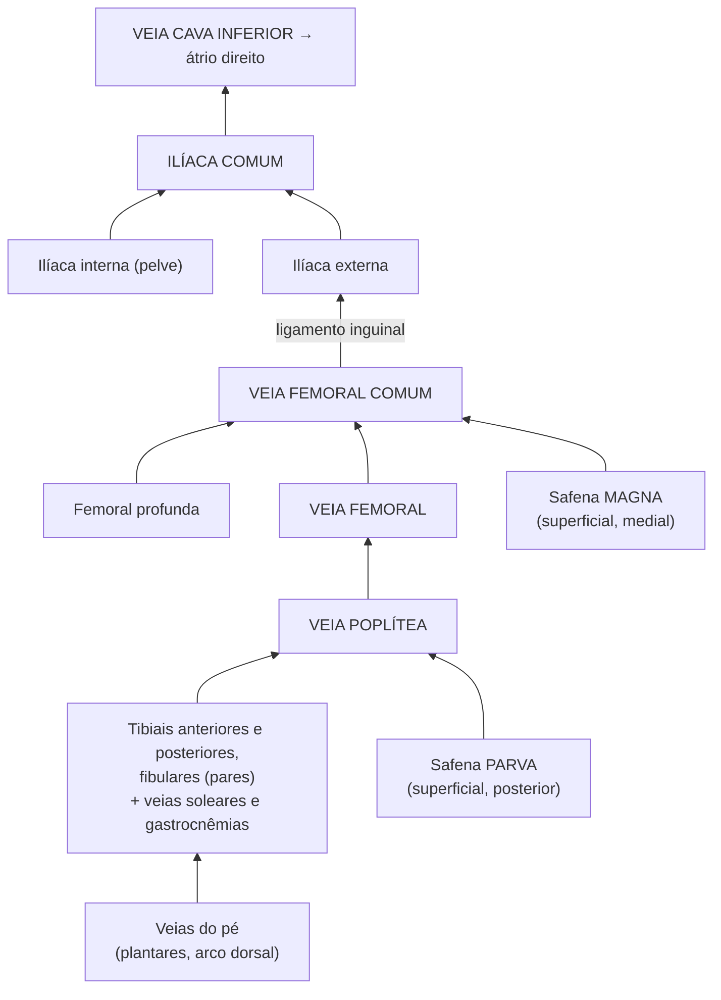
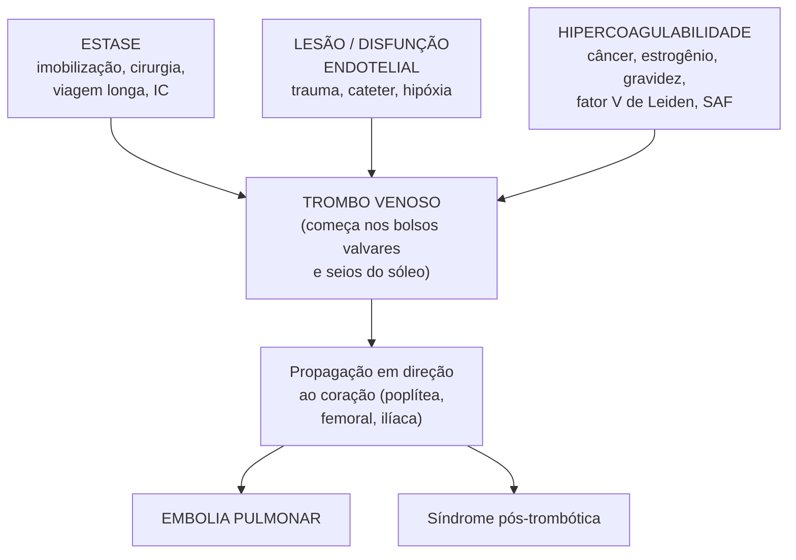

> **Roteiro do laboratório (Problema 4):** questões 1 (alterações fisiopatológicas e celulares da trombose venosa profunda e principais vasos afetados) e 10 (mecanismos celulares e alterações morfológicas da cicatrização). A coagulação está detalhada no tópico planejado [hemostasia e coagulação](#/patologia/hemostasia-coagulacao); a TVP também é discutida em [lesão celular](#/patologia/lesao-celular-estresse-oxidativo#trombose-venosa-profunda); a inflamação que inicia o reparo, em [inflamação aguda](#/patologia/inflamacao-aguda). As lâminas de necrose e apoptose estão em [lesão celular nas lâminas](#/patologia/morfo-lesao-celular).

## Objetivos do tópico {#objetivos}

Ao final, você deve ser capaz de:

1. Descrever a **anatomia das veias do membro inferior** (sistemas profundo, superficial e perfurante), a **bomba muscular da panturrilha** e as **válvulas venosas**, e apontar os **vasos mais afetados pela TVP**.
2. Explicar a **tríade de Virchow** e as alterações **celulares e moleculares** que formam o trombo venoso.
3. Reconhecer o **trombo** ao microscópio (**linhas de Zahn**) e diferenciá-lo do **coágulo pós-morte**.
4. Descrever os **destinos do trombo** e as consequências clínicas (**embolia pulmonar**, síndrome pós-trombótica).
5. Narrar as **fases da cicatrização** (hemostasia, inflamação, proliferação, remodelamento) com os mecanismos celulares.
6. Identificar o **tecido de granulação** na lâmina e diferenciar cicatrização por **primeira** e **segunda intenção**, **cicatriz hipertrófica** e **queloide**.

::: referencias
Kumar, Abbas & Aster – Robbins Patologia Básica, 10ª ed., caps. "Distúrbios hemodinâmicos, tromboembolia e choque" e "Inflamação e reparo" · Moore – Anatomia Orientada para a Clínica, 8ª ed., cap. "Membro inferior" · Netter – Atlas de Anatomia Humana.
:::

## Conceitos-base {#conceitos-base}

### Termos essenciais {#termos-trombose}

- **Hemostasia**: o processo **normal** que interrompe um sangramento após lesão de um vaso — vasoconstrição, formação do **tampão plaquetário** (hemostasia primária) e da **rede de fibrina** pela cascata de coagulação (hemostasia secundária), seguidos da dissolução do coágulo (**fibrinólise**) quando o vaso se repara.
- **Trombose**: formação **patológica** de um **trombo** — massa sólida de **plaquetas, fibrina e células do sangue** — **dentro de um vaso íntegro ou do coração**, num indivíduo **vivo**. É a hemostasia ativada no lugar ou no momento errado.
- **Coágulo**: sangue coagulado **fora da circulação ativa** (no tubo de ensaio, numa ferida, ou dentro dos vasos **depois da morte**).
- **Êmbolo**: massa sólida, líquida ou gasosa **solta** dentro dos vasos, levada pelo sangue para um local distante do de origem; mais de 95% dos êmbolos são **pedaços de trombo** (**tromboembolia**).
- **Trombose venosa profunda (TVP)**: trombose nas **veias profundas**, quase sempre dos **membros inferiores** (também da pelve, e menos dos membros superiores).
- **Tromboembolismo venoso (TEV)**: o conjunto **TVP + embolia pulmonar**.

### Anatomia das veias do membro inferior {#anatomia-veias}

O sangue do membro inferior volta ao coração por três sistemas:

1. **Sistema venoso profundo** — veias que acompanham as artérias, **entre e dentro dos músculos**, abaixo da fáscia muscular. Leva cerca de **90%** do retorno venoso do membro.
2. **Sistema venoso superficial** — veias no tecido subcutâneo, **acima da fáscia**: as **safenas**.
3. **Veias perfurantes (comunicantes)** — atravessam a fáscia ligando o sistema superficial ao profundo; suas válvulas fazem o sangue fluir **do superficial para o profundo**.

**Sistema profundo — de baixo para cima** (sentido do fluxo):

- No pé, as **veias plantares** e do dorso drenam para as veias da perna.
- Na perna, as veias profundas são **pares** (duas "veias satélites" ou **veias comitantes** acompanhando cada artéria): **veias tibiais anteriores**, **tibiais posteriores** e **fibulares**. Há também as **veias musculares da panturrilha** — as **veias soleares** (que formam grandes **seios venosos** dentro do músculo sóleo) e as **gastrocnêmias**.
- Atrás do joelho, na fossa poplítea, as veias da perna se unem formando a **veia poplítea**.
- A veia poplítea atravessa o hiato dos adutores e passa a se chamar **veia femoral** (que acompanha a artéria femoral pela coxa — **atenção**: o nome antigo "femoral superficial" é enganoso, porque ela é uma **veia profunda**).
- Na parte alta da coxa, a femoral recebe a **veia femoral profunda** e forma a **veia femoral comum**, que recebe também a **veia safena magna** (junção safenofemoral, na região inguinal).
- Ao passar sob o **ligamento inguinal**, vira **veia ilíaca externa**; une-se à **ilíaca interna** (que drena a pelve) formando a **veia ilíaca comum**.
- As duas ilíacas comuns se unem (ao nível da 5ª vértebra lombar) formando a **veia cava inferior**, que leva o sangue ao **átrio direito**.

**Sistema superficial**:

- **Veia safena magna**: começa na face medial do dorso do pé, passa **à frente do maléolo medial**, sobe pela face **medial** da perna e da coxa e desemboca na **veia femoral comum** (junção safenofemoral). É a maior veia do corpo em comprimento (usada em pontes de safena).
- **Veia safena parva**: começa na face lateral do pé, passa **atrás do maléolo lateral**, sobe pela face **posterior** da perna e desemboca na **veia poplítea** (junção safenopoplítea).

::: figura img/morfo/trombose/veias-membro-inferior.jpg
**Veias do membro inferior — vistas anterior e posterior** (OpenStax). Acompanhe o trajeto do sangue de baixo para cima: no pé, o **arco venoso dorsal** (*dorsal venous arch*) e as **veias plantares** (*plantar veins*); na perna, as veias **tibiais anteriores** (*anterior tibial*), **tibiais posteriores** (*posterior tibial*) e **fibulares** (*fibular*); atrás do joelho, a **veia poplítea** (*popliteal*); na coxa, a **femoral** (*femoral*) e a **femoral profunda** (*deep femoral*), com as **circunflexas femorais** (*femoral circumflex*); na pelve, as **ilíacas externa, interna e comum** (*external/internal/common iliac*). O sistema superficial aparece com a **safena magna** (*great saphenous*), subindo pela face medial até a femoral, e a **safena parva** (*small saphenous*), na face posterior, até a poplítea.
:::

### Como o sangue sobe: bomba muscular e válvulas {#bomba-muscular}

Em pé, o sangue das pernas precisa subir mais de um metro contra a gravidade, com pressão venosa baixa. Dois mecanismos resolvem isso:

- **Válvulas venosas**: pregas da túnica íntima, em forma de **bolso (válvulas semilunares)**, que se abrem para o coração e se fecham quando o sangue tenta voltar. São numerosas nas veias da perna.
- **Bomba muscular da panturrilha** (o "**coração periférico**"): ao **contrair**, os músculos da panturrilha (sóleo e gastrocnêmio) **comprimem** as veias profundas e os seios venosos do sóleo, empurrando o sangue para cima (as válvulas impedem o refluxo); ao **relaxar**, as veias se enchem de novo, inclusive com sangue vindo das superficiais pelas perfurantes.

**Por que isso importa para a TVP?** Quando a pessoa fica **imóvel** (acamada, pós-operatório, viagem longa sentada, membro engessado), a bomba muscular para, o sangue fica **parado** nos seios venosos do sóleo e nos **bolsos atrás das válvulas** — exatamente onde a maioria das TVPs **começa**.

::: referencias
Moore – Anatomia Orientada para a Clínica, 8ª ed., cap. "Membro inferior" · Guyton & Hall – Tratado de Fisiologia Médica, 14ª ed., cap. "Distensibilidade vascular e funções dos sistemas arterial e venoso".
:::

## Explicação detalhada {#explicacao}

### A tríade de Virchow {#triade-virchow}

O patologista **Rudolf Virchow** descreveu, no século XIX, os três fatores que favorecem a trombose. Na TVP, geralmente há **mais de um** ao mesmo tempo:

1. **Estase (alteração do fluxo sanguíneo)** — o fator **mais importante nas veias**. O sangue parado (ou com fluxo turbulento) permite que plaquetas e leucócitos encostem no endotélio, impede que os fatores de coagulação ativados sejam "lavados" e diluídos e dificulta a chegada dos inibidores naturais. **Causas**: **imobilização** (cirurgias, sobretudo ortopédicas de quadril e joelho; internação; gesso; viagens longas), insuficiência cardíaca, varizes, compressão de veias (gravidez, tumores pélvicos).
2. **Lesão endotelial** — o endotélio normal é **antitrombótico** (produz prostaciclina e óxido nítrico, que inibem as plaquetas; tem trombomodulina e heparan sulfato, que inativam a trombina; e libera o ativador do plasminogênio tecidual, que dissolve a fibrina). Quando lesado ou **ativado** (trauma, cirurgia, cateteres, inflamação, hipóxia causada pela própria estase), passa a expor **colágeno** e **fator tecidual**, que ativam plaquetas e a coagulação. Nas veias, a lesão é muitas vezes sutil: é a **disfunção** do endotélio hipóxico nos bolsos valvares.
3. **Hipercoagulabilidade (trombofilia)** — tendência aumentada do sangue a coagular:
   - **Hereditária**: **fator V de Leiden** (o fator V passa a resistir à inativação pela proteína C ativada — a trombofilia hereditária mais comum em pessoas de ascendência europeia), mutação do gene da **protrombina** (G20210A), deficiências de **antitrombina**, **proteína C** ou **proteína S**.
   - **Adquirida**: **câncer** (as células tumorais liberam fator tecidual e mucinas pró-coagulantes), **gravidez e puerpério**, **anticoncepcionais com estrogênio** e terapia hormonal (o estrogênio aumenta a produção hepática de fatores de coagulação e reduz a antitrombina), **síndrome antifosfolípide**, obesidade, idade avançada, tabagismo, desidratação, trombose prévia, **COVID-19**.

### Como o trombo venoso se forma, passo a passo {#formacao-trombo}

1. Com a **estase**, o sangue nos **bolsos atrás das válvulas** e nos **seios do sóleo** fica parado. O endotélio dessas regiões sofre **hipóxia** (o oxigênio do sangue estagnado é consumido).
2. O endotélio hipóxico se **ativa**: expressa moléculas de adesão (como a **P-selectina**), que prendem **leucócitos** (neutrófilos e monócitos) e plaquetas; os monócitos e o endotélio passam a expor **fator tecidual**.
3. O **fator tecidual** dispara a **cascata da coagulação** (via extrínseca), gerando **trombina**, que converte o **fibrinogênio** em **fibrina** e ativa mais plaquetas. Os neutrófilos podem liberar **NETs** (redes de DNA), que servem de arcabouço para plaquetas e fibrina.
4. Como o fluxo é lento, o trombo venoso é rico em **fibrina e hemácias presas** e relativamente pobre em plaquetas — por isso é **vermelho** (o "**trombo vermelho**" ou de estase). (Já o trombo **arterial**, formado em fluxo rápido sobre uma placa de aterosclerose rompida, é rico em plaquetas — o "trombo branco".)
5. O trombo **cresce** por deposição de novas camadas, em geral **no sentido do fluxo** (em direção ao coração — **propagação**), podendo ocupar a veia poplítea, a femoral e as ilíacas. A ponta que flutua livre na corrente é a mais propensa a **se soltar**.

**Vasos mais afetados**: a TVP costuma começar nas **veias da panturrilha** (veias soleares e gastrocnêmias, tibiais posteriores e fibulares — **TVP distal**) e se propagar para as veias **poplítea, femoral, femoral comum e ilíacas** (**TVP proximal**). As **TVPs proximais** (da poplítea para cima) são as que mais causam **embolia pulmonar** grave. A TVP é mais comum no membro inferior **esquerdo**, em parte porque a **veia ilíaca comum esquerda** é **comprimida** entre a **artéria ilíaca comum direita** (que passa por cima dela) e a coluna vertebral (síndrome de May-Thurner, em sua forma acentuada). Nos membros superiores, a TVP atinge as veias **subclávia e axilar**, geralmente associada a **cateteres venosos centrais** e marcapassos.

### O trombo ao microscópio: linhas de Zahn {#linhas-zahn}

Um trombo formado **em vida**, dentro da circulação, cresce em camadas sucessivas. Ao microscópio, apresenta as **linhas de Zahn**: **laminações alternadas** de faixas **claras/rosa-pálidas** (plaquetas aglutinadas e fibrina) e faixas **escuras/vermelhas** (hemácias presas na rede de fibrina), com leucócitos de permeio. Elas mostram que o trombo se formou com **sangue em movimento**. Nas veias, como o fluxo é lento, as linhas são menos evidentes que nos trombos arteriais e cardíacos, mas ainda podem ser vistas.

Além disso, o trombo verdadeiro fica **aderido à parede do vaso** no ponto de origem, é **firme, seco, friável** e de superfície **opaca**.

::: figura img/morfo/trombose/trombo-laminado.jpg
**Trombo com laminações (linhas de Zahn)** (H&E, pequeno aumento). Observe as **faixas alternadas**: áreas **rosa-pálidas** (plaquetas e fibrina) intercaladas com áreas **vermelhas** (hemácias aprisionadas). Essa estratificação indica que o trombo foi depositado em camadas, **em vida**, com o sangue circulando.
:::

#### Trombo × coágulo pós-morte {#trombo-coagulo}

Na necropsia, é preciso distinguir um trombo verdadeiro (que pode ter causado a morte) do sangue que coagula nos vasos **depois** da morte:

| | **Trombo (formado em vida)** | **Coágulo pós-morte** |
|---|---|---|
| Linhas de Zahn | **Presentes** (laminações) | **Ausentes** |
| Aderência à parede | **Aderido** no ponto de origem | **Solto**, não aderido |
| Consistência | Firme, **seco, friável** | **Gelatinoso, elástico, úmido** |
| Superfície | Opaca, irregular | **Lisa e brilhante** |
| Cor | Mista, laminada | Parte inferior **vermelho-escura** ("geleia de groselha", hemácias que sedimentaram) e parte superior **amarelada** ("gordura de galinha", plasma) |
| Forma | Pode não ter a forma do vaso | **Molde** do vaso |

### Destinos do trombo {#destinos-trombo}

Depois de formado, o trombo pode:

1. **Propagar-se** — crescer e ocupar mais segmentos venosos.
2. **Embolizar** — soltar-se, total ou parcialmente, e viajar pelo sangue: das veias do membro inferior → **veia cava inferior** → **átrio e ventrículo direitos** → **artérias pulmonares**: **embolia pulmonar (EP)**.
3. **Dissolver-se** — pela **fibrinólise** (a plasmina degrada a fibrina), sobretudo nos trombos recentes (é o que os trombolíticos aceleram).
4. **Organizar-se e recanalizar** — se persistir, o trombo é invadido por **células inflamatórias, fibroblastos e capilares** a partir da parede (como num **tecido de granulação** — veja a seção sobre cicatrização); com o tempo, transforma-se em tecido fibroso incorporado à parede, e novos canais se abrem através dele, restabelecendo parcialmente o fluxo (**recanalização**). Esse processo, porém, **destrói as válvulas** da veia.

### Embolia pulmonar {#embolia-pulmonar}

A **embolia pulmonar** é a complicação mais temida da TVP (e a TVP é a origem da imensa maioria das EPs):

- **Êmbolos grandes** podem parar na bifurcação do tronco pulmonar (**êmbolo "a cavaleiro"**, ou em sela) ou nas artérias pulmonares principais → obstrução súbita do fluxo para os pulmões → **sobrecarga aguda do ventrículo direito**, queda do débito do ventrículo esquerdo, hipotensão, choque e **morte súbita**.
- **Êmbolos médios** obstruem ramos menores → dispneia súbita, taquicardia, dor pleurítica, hipoxemia (por alteração da relação ventilação/perfusão); se a circulação brônquica estiver prejudicada (insuficiência cardíaca), pode haver **infarto pulmonar hemorrágico** (em cunha, na periferia).
- **Êmbolos pequenos e repetidos** podem levar à **hipertensão pulmonar tromboembólica crônica**.

::: figura img/morfo/trombose/tromboembolo-pulmonar.jpg
**Tromboêmbolo recente em artéria pulmonar** (H&E). A luz da artéria está ocupada por material de trombo — áreas **vermelhas** (hemácias) e **rosa-pálidas** (fibrina e plaquetas) — que se formou nas veias do membro inferior, soltou-se e foi levado até o pulmão. Por ser recente, ainda não há organização (invasão por fibroblastos e capilares).
:::

### Síndrome pós-trombótica {#sindrome-pos-trombotica}

Quando o trombo se organiza, as **válvulas** das veias profundas ficam destruídas ou aderidas e a veia pode continuar parcialmente obstruída. O resultado, meses a anos depois, é a **hipertensão venosa crônica** no membro: dor e peso na perna, **edema**, **varizes** secundárias, escurecimento da pele (por depósito de **hemossiderina** das hemácias que extravasam), endurecimento (lipodermatoesclerose) e, nos casos graves, **úlceras venosas** perto do maléolo medial.

::: referencias
Robbins Patologia Básica, 10ª ed., cap. "Distúrbios hemodinâmicos, tromboembolia e choque".
:::

### Cicatrização: como o tecido se repara {#cicatrizacao}

**Reparo** é a restauração da arquitetura e da função de um tecido após uma lesão. Pode ocorrer por:

- **Regeneração** — as células perdidas são **substituídas por células iguais**, e o tecido volta ao normal. Só é possível em tecidos com células capazes de se dividir (epitélios da pele e do intestino, fígado) e quando a **matriz de sustentação** (o "esqueleto" de tecido conjuntivo) está preservada.
- **Cicatrização** — o tecido perdido é **substituído por tecido conjuntivo fibroso** (colágeno): a **cicatriz**. Acontece quando a lesão é extensa, destrói a matriz ou atinge tecidos que não regeneram (miocárdio, neurônios). A cicatriz preserva a integridade, mas **não tem a função** do tecido original.

A maioria das feridas cicatriza por uma **combinação** dos dois (a epiderme regenera; a derme cicatriza). O processo tem **quatro fases que se sobrepõem**:

#### 1. Hemostasia (minutos) {#fase-hemostasia}

Logo após a lesão, os vasos se contraem, as **plaquetas** aderem ao colágeno exposto e formam o tampão, e a coagulação forma uma rede de **fibrina**. O **coágulo** de fibrina e plaquetas fecha a ferida e serve de **arcabouço provisório** pelo qual as células vão migrar. As plaquetas liberam fatores de crescimento — **PDGF** (fator de crescimento derivado das plaquetas) e **TGF-β** (fator transformador de crescimento beta) — que atraem as células das próximas fases. Na pele, o coágulo que seca na superfície forma a **crosta**.

#### 2. Inflamação (primeiros 1 a 3 dias, até ~1 semana) {#fase-inflamacao}

- **Neutrófilos** chegam primeiro (24–48 h), atraídos por quimiocinas, e **limpam** a ferida, matando bactérias e digerindo restos.
- **Macrófagos** (a partir de 48–72 h) são as **células-chave do reparo**: fagocitam restos, bactérias e neutrófilos mortos, e produzem os **fatores de crescimento** que comandam a fase seguinte (**TGF-β**, **PDGF**, **VEGF**, **FGF**). Sem macrófagos, a cicatrização praticamente não ocorre. Ao longo do processo, eles passam de um perfil inflamatório para um perfil "reparador" (macrófagos **M2**), que favorece a fibrose e a angiogênese.

#### 3. Proliferação: tecido de granulação (3 a 5 dias até cerca de 3 semanas) {#fase-proliferacao}

É a fase em que se forma o **tecido de granulação** — a marca do reparo e a principal lâmina do tema:

- **Angiogênese**: estimuladas sobretudo pelo **VEGF** (fator de crescimento do endotélio vascular), células endoteliais de vasos vizinhos brotam e formam **novos capilares**. Esses capilares jovens são **permeáveis** (as junções entre as células ainda são imaturas) — daí o **edema** do tecido de granulação, que também **sangra facilmente**.
- **Migração e proliferação de fibroblastos**: atraídos e estimulados pelo PDGF e pelo **TGF-β**, os fibroblastos migram para a ferida, se multiplicam e começam a produzir **matriz extracelular**, primeiro com **colágeno do tipo III** (mais fino) e proteoglicanos.
- **Reepitelização**: na superfície, as células da camada basal da epiderme das bordas (e dos folículos pilosos) migram por baixo da crosta e cobrem a ferida — em feridas cirúrgicas, isso ocorre em 24 a 48 horas.

**Aspecto macroscópico**: tecido **vermelho-vivo, granuloso** (cada "grânulo" é um tufo de capilares), úmido e que sangra ao toque — daí o nome "granulação".

**Na lâmina**: **numerosos capilares novos**, pequenos e de paredes finas, muitas vezes dispostos **perpendicularmente à superfície**; **fibroblastos** jovens (fusiformes, com núcleo ovalado e citoplasma basófilo), **edema** (espaços claros entre as células) e **células inflamatórias** (macrófagos, neutrófilos, linfócitos), numa matriz frouxa.

::: figura img/morfo/trombose/tecido-granulacao.jpg
**Tecido de granulação** (H&E, grande aumento). Observe os **capilares novos** — pequenos vasos de parede fina, com hemácias na luz — em meio a um **estroma frouxo e edemaciado** (áreas claras), com **fibroblastos** fusiformes e muitas **células inflamatórias** dispersas (núcleos pequenos e escuros de linfócitos, neutrófilos e macrófagos). Ainda não há colágeno denso: é o tecido de reparo jovem, que depois amadurece em cicatriz.
:::

#### 4. Remodelamento (maturação) (semanas a 1–2 anos) {#fase-remodelamento}

- O tecido de granulação vai sendo substituído por **tecido fibroso**: os capilares regridem (por apoptose), as células inflamatórias saem, e os fibroblastos depositam **colágeno do tipo I** (mais grosso e resistente) no lugar do tipo III, organizando as fibras ao longo das linhas de tensão.
- As **metaloproteinases** (enzimas que degradam colágeno, produzidas por fibroblastos e macrófagos) e seus inibidores equilibram **síntese e degradação** — o desequilíbrio leva a cicatrização deficiente ou excessiva.
- Alguns fibroblastos se transformam em **miofibroblastos** (com filamentos de actina como as células musculares lisas, sob ação do TGF-β), que **contraem a ferida**, aproximando as bordas — importante nas feridas abertas.
- A cicatriz fica mais **pálida** (menos vasos) e mais **firme**. A **força tênsil** (resistência à tração) aumenta progressivamente: cerca de **10%** da pele normal ao fim da primeira semana (por isso os pontos são retirados nessa época e a ferida precisa de cuidado), chegando a **70–80%** em torno de 3 meses — **nunca recupera 100%**.

### Primeira × segunda intenção {#primeira-segunda-intencao}

| | **Primeira intenção** | **Segunda intenção** |
|---|---|---|
| Ferida | **Limpa, bordas aproximadas** (incisão cirúrgica suturada) | **Bordas afastadas**, grande perda de tecido, infecção, úlcera, queimadura, infarto |
| Coágulo e inflamação | Pequenos | **Grandes**, inflamação intensa |
| Tecido de granulação | **Pouco** | **Abundante**, preenche a cavidade de baixo para cima |
| Contração da ferida (miofibroblastos) | Mínima | **Importante** (pode reduzir a ferida a 5–10% do tamanho original) |
| Cicatriz | **Fina**, discreta | **Larga**, pode retrair e deformar |
| Tempo | Rápido | Lento |

### Fatores que prejudicam a cicatrização {#fatores-cicatrizacao}

- **Locais**: **infecção** (a causa mais importante de atraso), **corpos estranhos** (fragmentos, suturas, tecido necrótico), má irrigação (**isquemia** — doença arterial, insuficiência venosa), mobilidade e tensão excessiva da ferida, pressão (úlceras de pressão).
- **Sistêmicos**: **diabetes** (microangiopatia, função de neutrófilos reduzida, glicação do colágeno), **desnutrição** (proteínas; **vitamina C** — necessária para a hidroxilação do colágeno, cuja falta causa o **escorbuto**; zinco), **corticoides** (reduzem a inflamação, a produção de TGF-β e a síntese de colágeno), idade avançada, quimioterapia, tabagismo.

### Cicatrização excessiva: cicatriz hipertrófica e queloide {#queloide}

Quando há produção **excessiva de colágeno**, a cicatriz fica elevada:

- **Cicatriz hipertrófica**: elevada, **restrita aos limites da ferida original**, costuma **regredir** parcialmente com o tempo; comum após queimaduras e em áreas de tensão.
- **Queloide**: **ultrapassa os limites** da ferida original, invadindo a pele vizinha, **não regride** e tende a **recidivar** após a retirada cirúrgica; tem predisposição **genética**, é mais comum em pessoas de **pele negra** e em locais como lóbulo da orelha, tórax anterior, ombros. Ao microscópio, feixes grossos e desorganizados de colágeno hialinizado.

Outros desvios: **deiscência** (abertura da ferida, por infecção, tensão ou desnutrição), **granulação exuberante** (excesso de tecido de granulação que impede a epitelização) e **contratura** (retração excessiva que limita o movimento, como após queimaduras em articulações).

::: figura img/morfo/trombose/queloide.jpg
**Queloide após cirurgia abdominal.** Cicatriz **elevada, espessa, brilhante e endurecida**, que **ultrapassa os limites** da incisão original. Resulta da produção excessiva e desorganizada de **colágeno** na fase de remodelamento; ao contrário da cicatriz hipertrófica, não regride espontaneamente e costuma recidivar após a retirada.
:::

::: referencias
Robbins Patologia Básica, 10ª ed., cap. "Inflamação e reparo" · Junqueira & Carneiro – Histologia Básica, 13ª ed., cap. "Tecido conjuntivo".
:::

## Correlação clínica {#correlacao-clinica}

### Diagnóstico e prevenção da TVP {#tvp-clinica}

- **Quadro**: **edema assimétrico** de uma perna (diferença de circunferência da panturrilha), **dor** e sensibilidade no trajeto venoso, calor, empastamento da panturrilha, às vezes veias superficiais dilatadas. Muitas TVPs são **assintomáticas** e só aparecem com a embolia pulmonar.
- **Probabilidade clínica**: escores como o de **Wells** (câncer ativo, imobilização, cirurgia recente, edema de toda a perna, assimetria, TVP prévia…).
- **D-dímero**: produto da degradação da fibrina pela plasmina. É **sensível** mas **pouco específico** (aumenta em cirurgia, gestação, infecção, câncer): um D-dímero **normal**, em paciente de baixa probabilidade, praticamente **exclui** TVP.
- **Ultrassonografia com compressão e Doppler**: exame de escolha. A veia normal **colapsa** quando o transdutor a comprime; a veia com trombo **não colapsa** (e não há fluxo ao Doppler).
- **Tratamento**: **anticoagulação** (heparinas, anticoagulantes orais diretos como rivaroxabana e apixabana, ou varfarina). O anticoagulante **não dissolve** o trombo diretamente: impede que ele cresça e que novos se formem, enquanto o organismo o dissolve ou organiza.
- **Prevenção (profilaxia)** em pacientes internados e cirúrgicos: **deambulação precoce**, **heparina** em dose profilática, meias de compressão e **compressão pneumática intermitente** (que imita a bomba muscular). Em viagens longas: movimentar as pernas, caminhar, hidratar-se.

::: figura img/morfo/trombose/tvp-perna.jpg
**TVP da perna direita.** Note o **edema** e o aumento de volume da **perna direita** em comparação com a esquerda, com a pele levemente avermelhada — a **assimetria** dos membros é o achado clínico mais útil. O retorno venoso obstruído aumenta a pressão nos capilares e o líquido extravasa para o interstício.
:::

::: figura img/morfo/trombose/tvp-ultrassom.jpg
**Ultrassonografia com Doppler colorido na TVP de veia femoral.** Em vermelho, o fluxo na **artéria femoral** (*femoral artery*); em azul, o fluxo na **veia femoral comum** (*common femoral vein*) e na **veia femoral profunda** (*deep femoral vein*); a **veia femoral** (na imagem chamada de *subsartorial vein*, por passar sob o músculo sartório) aparece **sem fluxo colorido**, preenchida pelo trombo — e, na compressão, não colapsaria.
:::

### Cicatrização na prática {#cicatrizacao-pratica}

- Retirada de pontos da pele em **7 a 14 dias**, conforme o local (mais cedo na face, mais tarde no dorso e nas articulações), quando a força tênsil já permite.
- Feridas de **pacientes diabéticos** (pé diabético) e de **úlceras venosas** (síndrome pós-trombótica) cicatrizam mal: controle da glicemia, desbridamento do tecido necrótico, tratamento da infecção e compressão (nas venosas).
- **Infarto do miocárdio**: o miocárdio necrótico é substituído por **cicatriz** (o músculo não regenera) — a função perdida não volta.

::: referencias
Robbins Patologia Básica, 10ª ed. · Sociedade Brasileira de Angiologia e de Cirurgia Vascular – Diretrizes sobre Trombose Venosa Profunda.
:::

## Pontos de alta cobrança em prova {#alta-cobranca}

::: prova
- **Veias profundas** (do pé à cava): tibiais anteriores/posteriores e fibulares (**pares**) + **soleares e gastrocnêmias** → **poplítea** → **femoral** (é profunda, apesar do nome antigo "superficial") + femoral profunda → **femoral comum** → ilíaca externa → **ilíaca comum** → **cava inferior**. **Superficiais**: **safena magna** (anterior ao maléolo medial, face medial → femoral comum) e **safena parva** (posterior ao maléolo lateral → poplítea). **Perfurantes**: do superficial para o profundo.
- **Bomba muscular da panturrilha** + **válvulas**: imobilidade → estase nos **bolsos valvares** e **seios do sóleo**, onde a TVP começa.
- **Tríade de Virchow**: **estase** (principal nas veias), **lesão/disfunção endotelial**, **hipercoagulabilidade** (câncer, estrogênio, gravidez, fator V de Leiden, protrombina G20210A, deficiência de antitrombina/proteína C/S, SAF).
- Formação: endotélio hipóxico → P-selectina → leucócitos e plaquetas → **fator tecidual** → trombina → fibrina; trombo venoso **vermelho** (fibrina + hemácias).
- **Vasos**: começa nas **veias da panturrilha** (distal) e propaga para **poplítea, femoral, ilíacas** (proximal — maior risco de EP); mais à **esquerda** (ilíaca comum esquerda comprimida pela artéria ilíaca comum direita). Membro superior: subclávia/axilar (cateteres).
- **Linhas de Zahn** = trombo formado em vida (camadas de plaquetas/fibrina × hemácias), **aderido**, seco, friável. **Coágulo pós-morte**: sem linhas, solto, gelatinoso, "geleia de groselha" + "gordura de galinha", molde do vaso.
- **Destinos**: propagação, **embolização** (→ **embolia pulmonar**), dissolução, **organização e recanalização** (destrói válvulas → **síndrome pós-trombótica**: edema, hiperpigmentação, úlcera venosa).
- **Cicatrização**: **hemostasia** (coágulo, PDGF, TGF-β) → **inflamação** (neutrófilos, depois **macrófagos** — células-chave) → **proliferação** (**tecido de granulação**: **capilares novos** por VEGF + **fibroblastos** + edema + inflamação; colágeno **III**; reepitelização) → **remodelamento** (colágeno **I**, metaloproteinases, **miofibroblastos** contraem; força tênsil ~10% em 1 semana, **70–80% em 3 meses**).
- **1ª intenção** (bordas aproximadas, cicatriz fina) × **2ª intenção** (perda de tecido, muito granulação, contração, cicatriz larga).
- Atrapalham: **infecção**, corpo estranho, isquemia, **diabetes**, desnutrição (**vitamina C**, zinco, proteínas), **corticoides**.
- **Hipertrófica** (dentro dos limites, regride) × **queloide** (ultrapassa os limites, não regride, recidiva, pele negra).
:::

## Armadilhas comuns {#armadilhas}

::: armadilha
- **Achar que a veia femoral ("femoral superficial") é superficial.** Ela é uma **veia profunda**; trombose nela é **TVP** proximal, com risco de embolia.
- **Achar que a lesão endotelial é o fator principal da trombose venosa.** Nas veias, o fator predominante é a **estase**; a lesão endotelial predomina na trombose **arterial**.
- **Confundir trombo com coágulo pós-morte.** O trombo tem **linhas de Zahn** e está **aderido** à parede.
- **Achar que a embolia pulmonar se origina no coração esquerdo.** O trombo venoso vai **pela cava inferior ao coração direito** e às **artérias pulmonares**; êmbolos do coração esquerdo vão para a circulação **sistêmica** (cérebro, rins, membros).
- **Achar que o anticoagulante dissolve o trombo.** Ele impede o crescimento e novos trombos; quem dissolve são a **fibrinólise** natural ou os trombolíticos.
- **Confundir tecido de granulação com granuloma.** **Tecido de granulação** = capilares novos + fibroblastos (reparo). **Granuloma** = agregado de macrófagos epitelioides (inflamação crônica, como na tuberculose).
- **Achar que a cicatriz recupera 100% da resistência.** Chega a **70–80%** da pele normal.
- **Confundir queloide com cicatriz hipertrófica.** O **queloide ultrapassa** os limites da ferida.
:::

## Resumo para revisão rápida {#resumo}

- **Veias do membro inferior**: profundas (tibiais, fibulares, soleares/gastrocnêmias → poplítea → femoral → femoral comum → ilíacas → cava), superficiais (safenas magna e parva), perfurantes; bomba muscular da panturrilha e válvulas.
- **TVP**: tríade de Virchow (estase, lesão endotelial, hipercoagulabilidade); começa nos bolsos valvares e seios do sóleo, propaga-se para poplítea/femoral/ilíacas; mais à esquerda.
- **Trombo**: linhas de Zahn, aderido; coágulo pós-morte sem linhas, solto, gelatinoso.
- **Destinos**: propagação, embolia pulmonar, dissolução, organização/recanalização (síndrome pós-trombótica).
- **Diagnóstico**: assimetria, Wells, D-dímero (exclui se normal e baixa probabilidade), ultrassom com compressão; anticoagulação; profilaxia com deambulação, heparina, compressão.
- **Cicatrização**: hemostasia → inflamação (macrófagos) → tecido de granulação (capilares por VEGF, fibroblastos, colágeno III) → remodelamento (colágeno I, miofibroblastos, força tênsil 70–80%). 1ª × 2ª intenção. Fatores: infecção, isquemia, diabetes, desnutrição, corticoides. Hipertrófica × queloide.

::: referencias
Robbins Patologia Básica, 10ª ed. · Moore – Anatomia Orientada para a Clínica, 8ª ed. · Junqueira & Carneiro – Histologia Básica, 13ª ed.
:::
