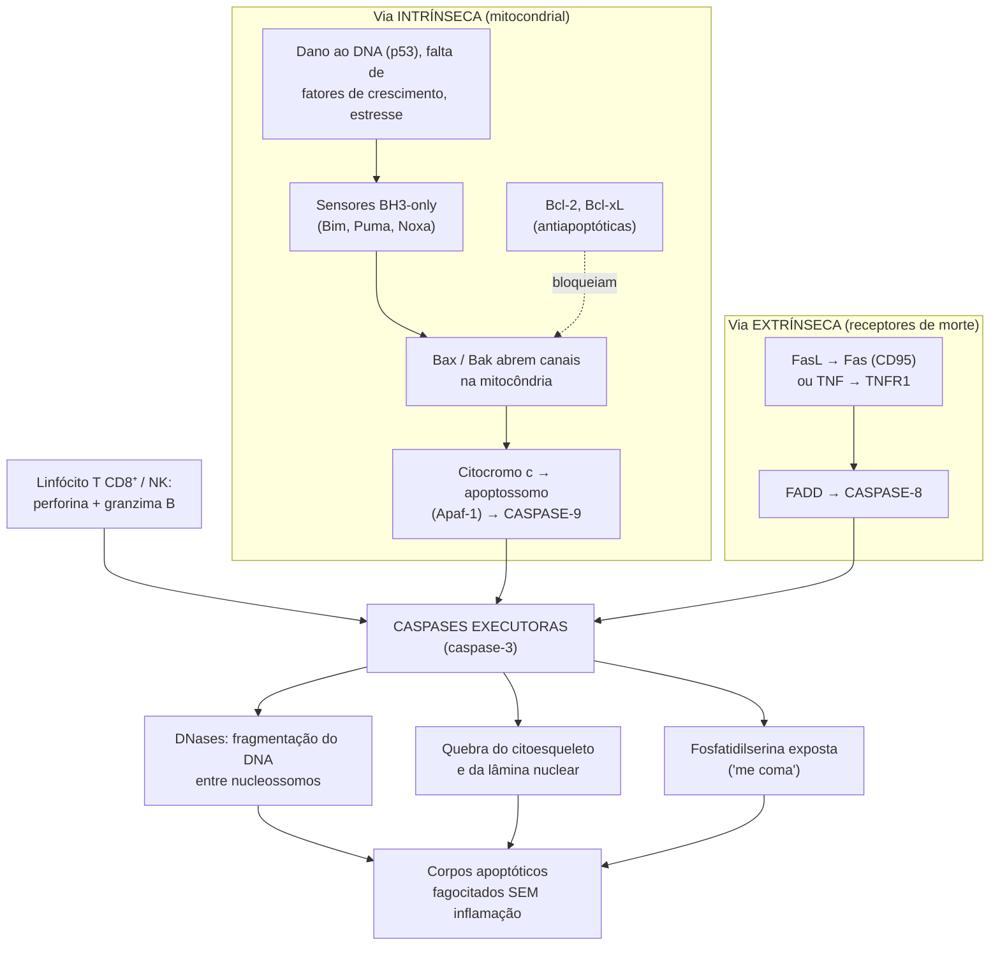

> **Pré-requisito:** os mecanismos que levam a célula da lesão reversível à irreversível estão em [lesão celular e estresse oxidativo](#/patologia/lesao-celular-estresse-oxidativo). Este tópico cobre a ementa ("isquemia, necrose, apoptose") e as questões 3 a 9, 12 e 13 do **roteiro 4 do morfofuncional** (diferenças morfológicas e ultraestruturais entre apoptose e necrose; tipos de necrose).

## Objetivos do tópico {#objetivos}

Ao final, você deve ser capaz de:

1. Definir **necrose** e **apoptose** e explicar por que uma causa **inflamação** e a outra não.
2. Reconhecer as **alterações citoplasmáticas e nucleares** da necrose (**picnose, cariorrexe, cariólise**).
3. Descrever os **tipos de necrose** — **coagulação, liquefativa, caseosa, gordurosa, fibrinoide** e a **gangrena** — com suas causas, aspecto macroscópico e microscópico.
4. Explicar as situações **fisiológicas e patológicas** de apoptose e suas **vias** (intrínseca/mitocondrial e extrínseca/receptores de morte), com o papel das **caspases**, da família **Bcl-2** e do **p53**.
5. Diferenciar apoptose e necrose ao **microscópio óptico** e ao **eletrônico**, incluindo a membrana e os poros nucleares.
6. Aplicar o conteúdo a situações clínicas: infarto do miocárdio, AVC, tuberculose, pancreatite, vasculites, gangrena e câncer.

::: referencias
Kumar, Abbas & Aster – Robbins Patologia Básica, 10ª ed., cap. "Lesão e morte celulares" · Bogliolo – Patologia Geral, 6ª ed., cap. "Morte celular".
:::

## Conceitos-base {#conceitos-base}

### Duas maneiras de morrer {#duas-mortes}

Quando uma célula ultrapassa o ponto de não retorno — ou quando o organismo decide que ela precisa ser eliminada — ela morre por um de dois caminhos principais:

- **Necrose** — morte **"acidental" e desorganizada**, causada por agressões graves (isquemia, toxinas, infecções, trauma). As membranas se rompem, o conteúdo celular **vaza** para o tecido, e as enzimas (da própria célula e dos leucócitos) **digerem** os restos. Como o material que vaza funciona como sinal de perigo (DAMPs), há **inflamação**. Costuma atingir **grupos de células** (uma área do tecido).
- **Apoptose** — morte **programada e regulada**, um "suicídio celular" executado por enzimas próprias (as **caspases**). A célula **encolhe**, se fragmenta em pedaços envoltos por membrana (os **corpos apoptóticos**) e é **fagocitada rapidamente** antes de vazar qualquer conteúdo — por isso **não há inflamação**. Costuma atingir **células isoladas**. Acontece todos os dias em condições normais e também em doenças.

Uma analogia: a necrose é como um prédio que **desaba** espalhando entulho pela rua (e chamando os bombeiros); a apoptose é uma **demolição controlada**, em que o prédio é desmontado e os pedaços são recolhidos sem sujar a vizinhança.

### Por que a célula necrótica fica rosada e o núcleo some {#porque-eosinofilia}

Na coloração H&E, a célula necrótica fica **mais eosinófila** (mais rosada) porque:

1. Perde o **RNA** do citoplasma (que é basófilo, azulado);
2. As **proteínas desnaturadas** do citoplasma se ligam mais à eosina.

O citoplasma pode ficar com aspecto **vítreo e homogêneo** (perda de glicogênio), ou **vacuolado** (organelas digeridas), e às vezes se **calcifica**.

::: referencias
Robbins Patologia Básica, 10ª ed., cap. "Lesão e morte celulares".
:::

## Explicação detalhada {#explicacao}

### Alterações nucleares da necrose {#alteracoes-nucleares}

O núcleo da célula necrótica passa por uma destas três alterações (que podem aparecer em sequência):

| Alteração | O que acontece | Aspecto na lâmina |
|---|---|---|
| **Picnose** | A cromatina se **condensa** e o núcleo **encolhe** | Núcleo **pequeno, redondo e muito escuro** (hiperbasófilo) |
| **Cariorrexe** | O núcleo picnótico se **fragmenta** | Vários **fragmentos** escuros de cromatina espalhados |
| **Cariólise** | A cromatina é **digerida** pelas DNases e vai **desbotando** | Núcleo **pálido**, "fantasma", até **desaparecer** |

Em 1 a 2 dias, o núcleo da célula necrótica desaparece completamente.

### Tipos de necrose {#tipos-necrose}

Os padrões de necrose dependem do **equilíbrio entre duas forças**: a **desnaturação das proteínas** (que "fixa" o tecido) e a **digestão enzimática** (que o liquefaz). Conhecer o padrão ajuda a descobrir a causa.

#### Necrose de coagulação {#necrose-coagulacao}

- **Causa típica**: **isquemia** em órgãos sólidos (exceto o cérebro) — é o padrão dos **infartos** do coração, do rim, do baço.
- **Por que acontece**: a acidose e a lesão desnaturam não só as proteínas estruturais, mas também as **enzimas** da célula. Assim, a autodigestão fica **retardada**, e o tecido morto **mantém a arquitetura** por alguns dias.
- **Macroscopia**: área **firme**, pálida ou amarelada (infarto **branco**), muitas vezes em forma de **cunha** (seguindo o território da artéria obstruída). Em órgãos com circulação dupla ou tecido frouxo (pulmão, intestino), o infarto é **vermelho** (hemorrágico).
- **Microscopia — como identificar na lâmina**:
  1. Uma área de **eosinofilia intensa** (rosa homogêneo), em que se reconhece o **contorno das células** e a arquitetura do tecido (túbulos, fibras) — as células parecem **"fantasmas"**;
  2. **Núcleos ausentes** ou em picnose, cariorrexe e cariólise;
  3. Na **borda** com o tecido vivo, um **infiltrado de neutrófilos** (nos primeiros dias) e, depois, macrófagos e tecido de granulação — a reação inflamatória que vai remover o tecido morto;
  4. Às vezes, hemorragia e congestão.

::: dica Como não confundir na prova prática
Se a área rosa **mantém o desenho do tecido** mas **não tem núcleos**, pense em **necrose de coagulação**. Se no lugar há um **buraco cheio de neutrófilos e restos**, pense em **necrose liquefativa** (abscesso). Se há um material **rosa amorfo, granuloso, sem desenho nenhum**, cercado por **granuloma**, pense em **necrose caseosa**.
:::

#### Necrose liquefativa {#necrose-liquefativa}

- **Causas típicas**: **infecções bacterianas** (e às vezes fúngicas) focais, que atraem muitos neutrófilos — formando **abscessos**; e a **isquemia do sistema nervoso central** (o cérebro tem pouca matriz de sustentação e muitas enzimas, e a área infartada vira líquido).
- **Por que acontece**: predomina a **digestão enzimática** (enzimas dos neutrófilos e da própria célula) sobre a desnaturação.
- **Macroscopia**: o tecido vira uma **massa líquida e viscosa**; nas infecções, cremosa e amarelada — o **pus**. No cérebro, forma-se depois uma **cavidade** (cisto) no lugar do infarto.
- **Microscopia**: perda total da arquitetura; restos celulares e **muitos neutrófilos** (nos abscessos); no cérebro, macrófagos cheios de lipídios.

#### Necrose caseosa {#necrose-caseosa}

- **Causa típica**: **tuberculose** (também histoplasmose e outras infecções fúngicas).
- **Macroscopia**: material **branco-amarelado, friável, com aspecto de queijo** ("caseoso", de *caseus* = queijo).
- **Microscopia**: área de material **eosinófilo amorfo e granuloso**, **sem nenhum contorno celular** (a arquitetura se perde completamente), cercada por um **granuloma**: macrófagos epitelioides, **células gigantes multinucleadas** (como as de Langhans) e um halo de linfócitos.
- É uma forma intermediária: as células são destruídas e fragmentadas, mas não liquefeitas.

#### Necrose gordurosa {#necrose-gordurosa}

- **Causa típica**: **pancreatite aguda** — as **lipases** pancreáticas ativadas escapam e digerem o tecido adiposo ao redor do pâncreas e no peritônio. Também ocorre por **trauma** em tecidos gordurosos (como a mama).
- **Como acontece**: as lipases quebram os triglicerídeos em ácidos graxos, que se **combinam com o cálcio** formando **sabões** (**saponificação**).
- **Macroscopia**: manchas **brancas como giz**, firmes, no tecido adiposo.
- **Microscopia**: adipócitos com contorno apagado, material **basófilo** (depósitos de cálcio) e reação inflamatória ao redor.
- **Correlação**: o consumo de cálcio na saponificação pode causar **hipocalcemia** nas pancreatites graves.

#### Necrose fibrinoide {#necrose-fibrinoide}

- **Causa típica**: **reações imunológicas na parede dos vasos** — vasculites, deposição de **imunocomplexos** (antígeno + anticorpo) nas artérias, hipertensão maligna.
- **Microscopia**: a parede do vaso fica com um material **rosa-brilhante, amorfo**, parecido com fibrina ("fibrinoide"), formado por **imunocomplexos e fibrina** que extravasou, com inflamação ao redor.
- Só é visível ao microscópio.

#### Gangrena {#gangrena}

**Gangrena** não é um padrão específico de célula, e sim um **termo clínico** usado para a necrose de um **membro** (geralmente o pé ou os dedos) ou de um segmento de intestino, em geral por **isquemia**:

- **Gangrena seca** — predomina a **necrose de coagulação**: o membro fica **escuro, seco e mumificado**, com limite nítido. Comum na doença arterial e no diabetes.
- **Gangrena úmida** — quando se soma uma **infecção bacteriana**, que causa **necrose liquefativa**: o tecido fica inchado, úmido, com cheiro fétido. É mais grave e pode causar sepse.
- **Gangrena gasosa** — infecção por *Clostridium* (como *C. perfringens*), com produção de gás no tecido (crepitação).

#### Calcificação distrófica {#calcificacao-distrofica}

Áreas de necrose antigas frequentemente acumulam **sais de cálcio** — a **calcificação distrófica**, que ocorre com **cálcio sanguíneo normal** (por exemplo, em lesões tuberculosas antigas, placas de aterosclerose e valvas cardíacas lesadas). É diferente da **calcificação metastática**, que acontece em **tecidos normais** quando o cálcio do sangue está alto (hipercalcemia). Na lâmina, o cálcio aparece como material **roxo-azulado** granuloso.

| Tipo | Causa típica | Aspecto característico |
|---|---|---|
| **Coagulação** | **Isquemia** (infartos, exceto SNC) | Arquitetura preservada, células "fantasmas" sem núcleo |
| **Liquefativa** | **Abscessos** bacterianos; **infarto cerebral** | Tecido liquefeito, pus, neutrófilos |
| **Caseosa** | **Tuberculose** | Material amorfo "de queijo" + granuloma |
| **Gordurosa** | **Pancreatite aguda**; trauma | Saponificação, manchas brancas de giz |
| **Fibrinoide** | **Vasculites**, imunocomplexos | Parede vascular rosa-brilhante (fibrina + imunocomplexos) |
| **Gangrena** (termo clínico) | Isquemia de membro (± infecção) | Seca (coagulação) ou úmida (liquefativa) |

::: referencias
Robbins Patologia Básica, 10ª ed., cap. "Lesão e morte celulares" · Bogliolo – Patologia Geral, 6ª ed.
:::

### Apoptose {#apoptose}

#### Quando acontece {#situacoes-apoptose}

**Situações fisiológicas** — a apoptose é essencial para o funcionamento normal do corpo:

- **Embriogênese**: eliminação das membranas entre os dedos, formação de cavidades, remodelação de órgãos.
- **Involução de tecidos dependentes de hormônios** quando o hormônio cai: endométrio na menstruação, mama após a lactação.
- **Renovação de tecidos**: células velhas do epitélio intestinal e da pele.
- **Sistema imune**: eliminação dos linfócitos autorreativos no timo e na medula (seleção negativa), dos linfócitos reprovados nos centros germinativos e dos linfócitos efetores depois que a infecção acaba (contração).
- Eliminação dos **neutrófilos** depois da inflamação aguda.

**Situações patológicas**:

- **Dano ao DNA** irreparável (radiação, quimioterápicos, hipóxia): é melhor eliminar a célula do que deixá-la acumular mutações.
- **Acúmulo de proteínas mal dobradas** (algumas doenças neurodegenerativas).
- **Infecções virais**: os linfócitos T CD8⁺ induzem a apoptose das células infectadas (por exemplo, na hepatite viral, aparecem hepatócitos apoptóticos — os "corpúsculos de Councilman").
- **Atrofia patológica** de órgãos com ducto obstruído (pâncreas, glândulas salivares, rim).
- Lesões leves por agentes que, em dose maior, causariam necrose.

#### Vias da apoptose {#vias-apoptose}

As executoras da apoptose são as **caspases** — proteases que existem na célula na forma inativa e, uma vez ativadas, se ativam em cascata. Há **caspases iniciadoras** (caspase-9 na via intrínseca, caspase-8 na extrínseca) e **caspases executoras** (como a caspase-3).

**Via intrínseca (mitocondrial)** — a mais comum, disparada por sinais **de dentro** da célula:

1. Estresse celular (dano ao DNA, falta de fatores de crescimento, proteínas mal dobradas, hipóxia) ativa "sensores" da família Bcl-2 (proteínas **BH3-only**, como Bim, Puma e Noxa). O **p53**, ativado pelo dano ao DNA, aumenta a produção desses sensores.
2. Os sensores ativam **Bax e Bak** (pró-apoptóticas), que formam **canais na membrana externa da mitocôndria**.
3. O **citocromo c** vaza da mitocôndria para o citoplasma.
4. O citocromo c se liga à proteína **Apaf-1**, formando o **apoptossomo**, que ativa a **caspase-9**.
5. A caspase-9 ativa as **caspases executoras** (caspase-3).
6. As proteínas **antiapoptóticas** **Bcl-2**, **Bcl-xL** e **Mcl-1** se opõem a Bax e Bak e protegem a mitocôndria — enquanto há fatores de sobrevivência, elas predominam.

**Via extrínseca (receptores de morte)** — disparada por sinais **de fora** da célula:

1. Um ligante se une a um **receptor de morte** na membrana: **Fas (CD95)** ligado ao **FasL** (expresso por linfócitos T ativados), ou o receptor de **TNF** tipo 1.
2. O receptor recruta a proteína adaptadora **FADD**, que ativa a **caspase-8**.
3. A caspase-8 ativa as **caspases executoras**.

Um terceiro caminho é usado pelos **linfócitos T CD8⁺** e **células NK**: a **perforina** abre poros na célula-alvo e a **granzima B** entra e ativa as caspases diretamente.

#### A execução e a remoção {#execucao}

As caspases executoras:

- Ativam **DNases** que cortam o DNA **entre os nucleossomos**, em fragmentos de tamanhos múltiplos de ~180 pares de bases (que, numa eletroforese, formam o padrão de **"escada"**, diferente do "borrão" da necrose);
- Quebram o **citoesqueleto** e a **lâmina nuclear** (a rede de proteínas que sustenta o envelope nuclear), levando à fragmentação do núcleo;
- Fazem a célula expor na face externa da membrana a **fosfatidilserina** (que normalmente fica voltada para dentro). Ela funciona como um sinal **"me coma"** para os **macrófagos**, que engolem os corpos apoptóticos rapidamente — e, ao fazer isso, liberam sinais **anti-inflamatórios**.

### Morfologia: apoptose × necrose {#morfologia-apoptose}

#### Ao microscópio óptico {#apoptose-mo}

A célula **apoptótica** aparece como:

- Uma célula **isolada**, **encolhida**, com citoplasma **denso e intensamente eosinófilo**;
- **Cromatina condensada** em massas escuras junto à membrana nuclear (às vezes em forma de **crescente** ou **meia-lua**), e depois **núcleo fragmentado**;
- **Corpos apoptóticos**: fragmentos arredondados de citoplasma, com ou sem pedaços de núcleo, frequentemente **dentro de macrófagos**;
- **Sem inflamação** ao redor.

#### Ao microscópio eletrônico {#apoptose-me}

O microscópio eletrônico mostra as diferenças com clareza (é o que o roteiro pede nas questões 7 a 9):

| Característica | **Apoptose** | **Necrose** |
|---|---|---|
| Volume da célula | **Encolhida** (retração) | **Inchada** (tumefação) |
| Membrana plasmática | **Íntegra**, com **bolhas** (*blebs*) que se destacam como corpos apoptóticos | **Rompida**, com perda do conteúdo |
| Organelas | **Preservadas** e compactadas dentro dos corpos apoptóticos até tarde | **Inchadas** e destruídas; mitocôndrias com **densidades floculentas**; figuras de mielina |
| Núcleo | Cromatina **condensada** em massas densas junto ao envelope (crescentes), depois **fragmentação** em pedaços envoltos por membrana | Picnose, **cariorrexe** e **cariólise** (cromatina "dissolvida") |
| Envelope e poros nucleares | Envelope nuclear inicialmente preservado; as caspases quebram a lâmina nuclear e as proteínas dos poros, e os **poros se agrupam** em algumas regiões, desaparecendo das áreas onde a cromatina se condensou | Envelope se rompe junto com as demais membranas |
| Conteúdo celular | **Não vaza** | **Vaza** para o tecido |
| Inflamação | **Ausente** | **Presente** |

Na **varredura** (microscopia eletrônica que mostra a superfície), a célula apoptótica aparece **arredondada, com várias bolhas** na superfície, fragmentando-se em corpos esféricos; a célula necrótica aparece **inchada, com a superfície rompida** e perda de microvilosidades.

#### Quando os dois se misturam {#continuum}

Nem sempre a separação é perfeita. Num **AVC isquêmico**, por exemplo, os neurônios da região afetada mostram, ao mesmo tempo, **alterações nucleares de apoptose** (cromatina condensada e fragmentada, corpos apoptóticos, núcleos em meia-lua) e **alterações citoplasmáticas de necrose** (grandes vacúolos, desaparecimento das organelas, membranas colapsadas). Isso acontece porque a mesma agressão pode disparar os dois programas, dependendo da quantidade de ATP disponível (a apoptose **gasta energia**; se o ATP acaba, a célula segue para a necrose) e porque existem formas **reguladas** de necrose.

#### Outras formas de morte celular {#outras-mortes}

- **Necroptose** — uma necrose **programada**, regulada por proteínas específicas (RIPK1, RIPK3 e MLKL), que ocorre quando a via das caspases está bloqueada (por exemplo, por vírus). Tem morfologia de necrose e causa inflamação.
- **Piroptose** — morte de células infectadas, mediada pelo **inflamassoma** e pela **caspase-1**, com liberação de IL-1β e formação de poros (gasdermina) — muito inflamatória (veja [imunidade inata](#/imunologia/imunidade-inata#receptores-padroes)).
- **Ferroptose** — morte dependente de **ferro** e de peroxidação lipídica, quando as defesas antioxidantes (glutationa) se esgotam.

| | **Necrose** | **Apoptose** |
|---|---|---|
| Natureza | Acidental, desregulada (exceto necroptose) | Programada, regulada |
| Extensão | Grupos de células | Células isoladas |
| Tamanho da célula | Aumentado (tumefação) | Reduzido (retração) |
| Núcleo | Picnose → cariorrexe → cariólise | Condensação e fragmentação em corpos apoptóticos |
| Membrana plasmática | Rompida | Íntegra (com bolhas) |
| Conteúdo celular | Vaza; digestão enzimática | Fica dentro dos corpos apoptóticos |
| Inflamação | **Sim** | **Não** |
| Energia (ATP) | Não precisa | **Precisa** |
| Significado | Sempre patológica | Fisiológica ou patológica |

::: referencias
Robbins Patologia Básica, 10ª ed., cap. "Lesão e morte celulares" · Abbas, 10ª ed., cap. "Diferenciação e funções dos linfócitos T CD8⁺ efetores".
:::

## Correlação clínica {#correlacao-clinica}

### Infarto do miocárdio: a necrose ao longo do tempo {#evolucao-infarto}

O infarto é o exemplo clássico de **necrose de coagulação**, e sua aparência muda com o tempo — o que permite estimar a "idade" de um infarto numa necropsia:

| Tempo após a oclusão | O que se vê ao microscópio |
|---|---|
| Primeiras horas | Pouca alteração ao MO; fibras onduladas na borda |
| **4–12 horas** | Início da necrose de coagulação: hipereosinofilia, núcleos em picnose |
| **12–72 horas** | Necrose estabelecida, perda dos núcleos; **infiltrado de neutrófilos** |
| **3–7 dias** | Neutrófilos morrendo; **macrófagos** removendo o tecido morto (fase de maior risco de ruptura da parede) |
| **7–14 dias** | **Tecido de granulação** (novos vasos e fibroblastos) na borda |
| **2 meses** | **Cicatriz** de colágeno |

Como as células necróticas perdem a integridade da membrana, liberam no sangue proteínas que servem de **marcadores**: **troponina** (coração), CK-MB, transaminases (fígado), amilase e lipase (pâncreas).

### AVC isquêmico: necrose liquefativa {#avc}

No cérebro, o infarto não mantém a arquitetura: a área necrótica **amolece e se liquefaz**, é limpa por macrófagos e, semanas depois, deixa uma **cavidade** cheia de líquido, cercada por células da glia (gliose). Na região ao redor do núcleo do infarto (a penumbra), muitos neurônios morrem por **apoptose** nas horas e dias seguintes — alvo do tratamento precoce.

### Tuberculose: necrose caseosa {#tuberculose-caseosa}

Na tuberculose, a resposta imune celular contra o *Mycobacterium tuberculosis* forma **granulomas** com centro de **necrose caseosa**. Quando o material caseoso se liquefaz e é eliminado por um brônquio, forma-se uma **caverna** — e o paciente passa a eliminar muitos bacilos no escarro (é quando a transmissão é maior). Lesões antigas costumam **calcificar** (calcificação distrófica).

### Câncer: escapando da apoptose {#cancer-apoptose}

Células tumorais frequentemente **escapam da apoptose**:

- **Mutações do gene p53** (o "guardião do genoma") — presentes em cerca de metade dos cânceres humanos — impedem que células com DNA danificado sejam eliminadas.
- **Excesso de Bcl-2**: no **linfoma folicular**, a translocação t(14;18) coloca o gene **BCL2** sob controle do gene da cadeia pesada das imunoglobulinas, e os linfócitos B passam a produzir Bcl-2 em excesso, sobrevivendo por tempo demais.
- Muitos **quimioterápicos** e a **radioterapia** funcionam induzindo apoptose; tumores com p53 mutado costumam ser mais resistentes. Existem fármacos que inibem a Bcl-2 (como o venetoclax), usados em algumas leucemias.

::: referencias
Robbins Patologia Básica, 10ª ed., caps. "Lesão e morte celulares", "Coração" e "Neoplasia".
:::

## Pontos de alta cobrança em prova {#alta-cobranca}

::: prova
- **Necrose**: morte desregulada, membranas rompidas, conteúdo vaza, **inflamação**, grupos de células, sempre patológica. **Apoptose**: programada (caspases), célula **encolhe**, membrana íntegra, **corpos apoptóticos** fagocitados, **sem inflamação**, células isoladas, gasta ATP, fisiológica ou patológica.
- Célula necrótica: citoplasma **mais eosinófilo** (perde RNA, proteínas desnaturadas); núcleo: **picnose** (encolhe e escurece) → **cariorrexe** (fragmenta) → **cariólise** (desbota e some).
- **Coagulação**: **isquemia** de órgãos sólidos (exceto SNC); arquitetura preservada, células "fantasmas" sem núcleo; neutrófilos na borda.
- **Liquefativa**: **abscessos** bacterianos (pus) e **infarto cerebral**.
- **Caseosa**: **tuberculose**; material amorfo "de queijo" + **granuloma** com células gigantes.
- **Gordurosa**: **pancreatite aguda** (lipases → **saponificação** com cálcio, manchas brancas; hipocalcemia).
- **Fibrinoide**: **vasculites** e imunocomplexos na parede vascular.
- **Gangrena**: termo clínico; **seca** (coagulação) × **úmida** (infecção, liquefativa).
- **Calcificação distrófica** (tecido necrótico, cálcio sérico normal) × **metastática** (tecido normal, hipercalcemia).
- **Via intrínseca**: estresse/dano ao DNA (**p53**) → BH3-only → **Bax/Bak** → **citocromo c** → apoptossomo (**Apaf-1**) → **caspase-9**; freada por **Bcl-2/Bcl-xL**. **Via extrínseca**: **Fas–FasL** / TNFR1 → **FADD** → **caspase-8**. CTL/NK: **perforina + granzima B**. Executora: **caspase-3**.
- Execução: DNA cortado entre nucleossomos (**"escada"**), **fosfatidilserina** exposta ("me coma").
- **ME**: apoptose = encolhimento, bolhas, organelas preservadas, cromatina em **crescente**, corpos apoptóticos; necrose = tumefação, organelas destruídas, **densidades floculentas**, membranas rompidas.
- **Infarto**: neutrófilos 12–72 h; macrófagos 3–7 dias; granulação 7–14 dias; cicatriz ~2 meses.
- **Câncer**: p53 mutado; **Bcl-2** em excesso no linfoma folicular, t(14;18).
:::

## Armadilhas comuns {#armadilhas}

::: armadilha
- **Achar que todo infarto é necrose de coagulação.** No **cérebro**, o infarto causa necrose **liquefativa**.
- **Confundir picnose da necrose com a condensação da apoptose.** Ambas condensam a cromatina; a diferença está no **contexto**: na apoptose a célula está **encolhida, isolada**, com membrana íntegra e **sem inflamação**; na necrose, há grupos de células inchadas, membranas rompidas e inflamação.
- **Achar que a apoptose é sempre patológica.** Ela acontece todos os dias em condições normais (renovação de tecidos, sistema imune, embriogênese).
- **Achar que a gangrena é um tipo histológico específico.** É um termo **clínico**: a seca corresponde a necrose de coagulação; a úmida, à liquefativa por infecção.
- **Trocar as caspases iniciadoras.** **Caspase-9** = via **intrínseca** (mitocondrial); **caspase-8** = via **extrínseca** (receptores de morte).
- **Achar que a Bcl-2 promove a morte.** A Bcl-2 é **antiapoptótica**; Bax e Bak são as **pró-apoptóticas**.
- **Confundir calcificação distrófica com metastática.** A **distrófica** ocorre em tecido **lesado** com cálcio sérico normal; a **metastática**, em tecido **normal** com hipercalcemia.
:::

## Resumo para revisão rápida {#resumo}

- **Necrose** = morte desregulada com ruptura de membranas, vazamento e **inflamação**; **apoptose** = morte programada por **caspases**, célula encolhida, corpos apoptóticos fagocitados **sem inflamação**.
- **Necrose — citoplasma** mais eosinófilo; **núcleo**: picnose, cariorrexe, cariólise.
- **Tipos**: coagulação (isquemia; arquitetura preservada), liquefativa (abscesso; cérebro), caseosa (tuberculose; granuloma), gordurosa (pancreatite; saponificação), fibrinoide (vasculites), gangrena seca/úmida (termo clínico). Calcificação distrófica em áreas necróticas.
- **Apoptose — situações**: embriogênese, involução hormonal, renovação, sistema imune; dano ao DNA, proteínas mal dobradas, vírus (CTL), atrofia por obstrução.
- **Vias**: intrínseca (p53, BH3-only, Bax/Bak, citocromo c, Apaf-1, caspase-9; Bcl-2 freia) e extrínseca (Fas/TNFR1, FADD, caspase-8); CTL/NK: perforina e granzima B; executora caspase-3; DNA em "escada"; fosfatidilserina "me coma".
- **ME**: apoptose (encolhimento, bolhas, organelas intactas, cromatina em crescente, poros nucleares agrupados) × necrose (tumefação, organelas destruídas, densidades floculentas, membranas rompidas). Os dois podem coexistir (AVC). Outras formas: necroptose, piroptose, ferroptose.
- **Clínica**: evolução do infarto (neutrófilos → macrófagos → granulação → cicatriz), marcadores no sangue, AVC liquefativo, tuberculose caseosa, câncer e escape da apoptose (p53, Bcl-2).

::: referencias
Robbins Patologia Básica, 10ª ed. · Bogliolo – Patologia Geral, 6ª ed.
:::
